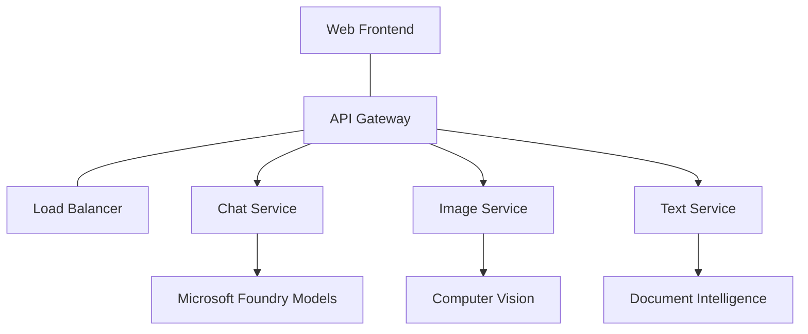

# Tuotannon tekoälyn kuormitusten parhaat käytännöt AZD:llä

**Luvun navigointi:**
- **📚 Kurssin etusivu**: [AZD Aloittelijoille](../../README.md)
- **📖 Nykyinen luku**: Luku 8 - Tuotanto & Yrityskäyttömallit
- **⬅️ Edellinen luku**: [Luku 7: Vianetsintä](../chapter-07-troubleshooting/debugging.md)
- **⬅️ Myös aiheeseen liittyvä**: [AI-työpajan laboratorio](../chapter-02-ai-development/ai-workshop-lab.md)
- **🎯 Kurssi valmis**: [AZD Aloittelijoille](../../README.md)

## Yleiskatsaus

Tämä opas selittää tuotannon tekoälymallit Azure Developer CLI:n (AZD) avulla. Se on suunnittelun viite, ei käyttöönotettava sovellus tai tuotantotodistus.

**Esimerkkien rajat:** Ellei erikseen mainita kokonaisuudeksi, Bicep-koodin osat olettavat parametrit ja viitteet sisällä olevasta mallista. Ne jättävät pois isäntäkuvat/suunnitelmat, identiteetit, roolimääritykset, DNS:n, tulosteet ja muut vaaditut integraatiot. YAML-palvelupolut ja koukku/testiskriptit ovat kuvitteellisia tiedostoja, jotka luodaan **omaan sovellukseesi**; niitä ei toimiteta tämän kurssin mukana. Käytä toimivaa AZD-esimerkkiä pohjana, käännä koko infrastruktuuri ja testaa se eristetyssä ympäristössä ennen tuotantoon siirtymistä.

## Keskeiset käsitellyt haasteet

Yleisiä tuotannon huolia ovat monipalveluisten käyttöönottojen hallinta, identiteetin ja salaisuuksien hallinta, skaalaus, kustannusvalvonta ja valvonta. Mitään mitattua esiintyvyyttä ei tässä väitetä.

## Tuotannon tekoälyn arkkitehtuurimallit

### Malli 1: Mikropalvelujen tekoälyarkkitehtuuri

**Milloin käyttää**: Monimutkaiset tekoälysovellukset, joissa on useita toimintoja



**AZD-toteutus**:

```yaml
# azure.yaml
name: enterprise-ai-platform
services:
  web:
    project: ./web
    host: staticwebapp
  api-gateway:
    project: ./api-gateway
    host: containerapp
  chat-service:
    project: ./services/chat
    host: containerapp
  vision-service:
    project: ./services/vision
    host: containerapp
  text-service:
    project: ./services/text
    host: containerapp
```

### Malli 2: Tapahtumapohjainen tekoälyn prosessointi

**Milloin käyttää**: Eräajot, asiakirjanalyysi, asynkroniset työnkulut

```bicep
// Event Hub for AI processing pipeline
resource eventHub 'Microsoft.EventHub/namespaces@2024-01-01' = {
  name: eventHubNamespaceName
  location: location
  sku: {
    name: 'Standard'
    tier: 'Standard'
    capacity: 1
  }
}

// Service Bus for reliable message processing
resource serviceBus 'Microsoft.ServiceBus/namespaces@2024-01-01' = {
  name: serviceBusNamespaceName
  location: location
  sku: {
    name: 'Premium'
    tier: 'Premium'
    capacity: 1
  }
}

// Function App for processing
resource functionApp 'Microsoft.Web/sites@2023-01-01' = {
  name: functionAppName
  location: location
  kind: 'functionapp,linux'
  properties: {
    siteConfig: {
      appSettings: [
        {
          name: 'FUNCTIONS_EXTENSION_VERSION'
          value: '~4'
        }
        {
          name: 'AZURE_OPENAI_ENDPOINT'
          value: '@Microsoft.KeyVault(VaultName=${keyVault.name};SecretName=openai-endpoint)'
        }
      ]
    }
  }
}
```

Tämä luo nimitilaosat, ei keskuksia, jonotuksia, tilauksia tai Funktioiden triggeröintejä. Ajaakseen Funktio tarvitsee myös hosting-suunnitelman, suoritusaika-/tallennusasetukset, liitetyn identiteetin, RBAC:n ja verkkoyhteyden. Key Vault -viitteellä on oltava lupa lukea salaisuus; päätepisteen URL ei itsessään ole todennus.

## Tekoälyagentin tilan arviointi

Kun perinteinen web-sovellus rikkoutuu, oireet ovat tuttuja: sivu ei lataudu, API palauttaa virheen tai käyttöönotto epäonnistuu. Tekoälypohjaiset sovellukset voivat rikkoutua samoilla tavoilla, mutta myös käyttäytyä hienovaraisemmin ilman selvää virheilmoitusta.

Tämä osio auttaa rakentamaan mielikuvan tekoälykuormitusten valvonnasta, jotta tiedät, mistä katsoa, kun asiat eivät vaikuta oikeilta.

### Miten agentin tila eroaa perinteisestä sovelluksen tilasta

Perinteisissä sovelluksissa voi olla myös hienovaraisia oikeellisuusvirheitä. Tekoälyagentti lisää epädeterministisen vasteen laadun tavallisten saatavuus- ja oikeellisuushuolien lisäksi. Ajattele agentin terveyttä kahdella tasolla:

| Taso | Mitä valvoa | Mistä katsoa |
|-------|--------------|---------------|
| **Infrastruktuurin terveys** | Toimiiko palvelu? Onko resursseja varattu? Ovatko päätepisteet saavutettavissa? | `azd monitor`, Azure-portaalin resurssien tila, kontti-/sovelluslokit |
| **Käyttäytymisen terveys** | Vastaaako agentti oikein? Ovatko vastaukset ajantasaisia? Kutsutaanko mallia oikein? | Application Insights -jäljet, mallin kutsun viiveen mittarit, vastauksen laadun lokit |

Infrastruktuurin tila on tuttu – se on sama missä tahansa azd-sovelluksessa. Käyttäytymisen tila on uusi taso, jonka tekoälykuormat tuovat.

### Minne katsoa, kun tekoälysovellukset eivät käyttäydy odotetusti

Jos tekoälysovelluksesi ei tuota odottamiasi tuloksia, tässä on käsitteellinen tarkistuslista:

1. **Aloita perusteista.** Toimiiko sovellus? Pääseekö se riippuvuuksiinsa? Tarkista `azd monitor` ja resurssien tila kuten missä tahansa sovelluksessa.
2. **Tarkista mallin yhteys.** Kutsutaanko sovelluksestasi onnistuneesti tekoälymallia? Epäonnistuneet tai aikakatkaistut mallikutsut ovat yleisin syy tekoälysovellusten ongelmiin ja näkyvät sovelluslokitiedoissa.
3. **Tutki syötteet ja taustat turvallisesti.** Väärät vastaukset voivat johtua hausta, ohjeista, mallin rajoituksista tai työkalujen suorituksesta. Käytä pääsynvalvottua, sensuroitua diagnostiikkadataa; älä ota käyttöön epävalikoivaa kehotteiden/vastausten lokitusta tuotannossa.
4. **Tarkista vasteviiveet.** Tekoälymallin kutsut ovat hitaampia kuin tavalliset API-kutsut. Jos sovellus tuntuu hitaalta, tarkista onko mallin vasteajat pidentyneet – tämä voi viitata rajoituksiin, kapasiteettirajoihin tai aluekohtaiseen ruuhkaan.
5. **Seuraa kustannussignaaleja.** Odottamattomat piikit token-käytössä tai API-kutsuissa voivat viitata silmukkaan, virheelliseen kehotteeseen tai liiallisiin uudelleenyrityksiin.

Sinun ei tarvitse heti hallita havainto- ja valvontatyökaluja. Tärkein opetus on, että tekoälysovelluksilla on ylimääräinen käyttäytymistaso valvottavana, ja azd:n sisäänrakennettu valvonta (`azd monitor`) antaa lähtökohdan molempien tasojen tutkimiseen.

---

## Turvallisuuden parhaat käytännöt

### 1. Zero-Trust -turvamalli

**Toteutusstrategia**:
- Ei palveluiden välistä kommunikointia ilman todennusta
- Kaikki API-kutsut käyttävät hallittuja identiteettejä
- Verkkoyhteyden eristäminen yksityisillä päätepisteillä
- Vähimmän oikeuden pääsynhallinta

```bicep
// Managed Identity for each service
resource chatServiceIdentity 'Microsoft.ManagedIdentity/userAssignedIdentities@2023-01-31' = {
  name: 'chat-service-identity'
  location: location
}

// Role assignments with minimal permissions
resource openAIUserRole 'Microsoft.Authorization/roleAssignments@2022-04-01' = {
  scope: openAIAccount
  name: guid(openAIAccount.id, chatServiceIdentity.id, '5e0bd9bd-7b93-4f28-af87-19fc36ad61bd')
  properties: {
    roleDefinitionId: subscriptionResourceId('Microsoft.Authorization/roleDefinitions', '5e0bd9bd-7b93-4f28-af87-19fc36ad61bd')
    principalId: chatServiceIdentity.properties.principalId
    principalType: 'ServicePrincipal'
  }
}
```

### 2. Turvallinen salaisuuksien hallinta

**Key Vault -integraatiomalli**:

```bicep
// Key Vault with proper access policies
resource keyVault 'Microsoft.KeyVault/vaults@2023-02-01' = {
  name: keyVaultName
  location: location
  properties: {
    tenantId: tenant().tenantId
    sku: {
      family: 'A'
      name: 'standard' // Premium is needed for HSM-backed keys, not ordinary secrets
    }
    enableRbacAuthorization: true  // Use RBAC instead of access policies
    enablePurgeProtection: true    // Prevent accidental deletion
    enableSoftDelete: true
    softDeleteRetentionInDays: 90
  }
}

// Optional legacy key-auth alternative; omit when using Entra ID.
resource openAIKeySecret 'Microsoft.KeyVault/vaults/secrets@2023-02-01' = {
  parent: keyVault
  name: 'openai-api-key'
  properties: {
    value: openAIAccount.listKeys().key1
    attributes: {
      enabled: true
    }
  }
}
```

Määritä suoritusaikaidentiteetti `Key Vault Secrets User` sopivalla laajuudella ja liitä isäntään; `enableRbacAuthorization` yksinään ei anna pääsyä. Suosi OpenAI:n hallitun identiteetin todennusta `disableLocalAuth: true` avulla. Valinnainen avainsalasana on järkevä vain erikseen avaimella aktivoidulle tilille, ja provisiointipäällisellä tulee myös olla lupa kirjoittaa salaisuuksia.

### 3. Verkon turvallisuus

**Yksityisen päätepisteen asetukset**:

```bicep
// Virtual Network for AI services
resource virtualNetwork 'Microsoft.Network/virtualNetworks@2023-04-01' = {
  name: vnetName
  location: location
  properties: {
    addressSpace: {
      addressPrefixes: ['10.0.0.0/16']
    }
    subnets: [
      {
        name: 'ai-services-subnet'
        properties: {
          addressPrefix: '10.0.1.0/24'
          privateEndpointNetworkPolicies: 'Disabled'
        }
      }
      {
        name: 'app-services-subnet'
        properties: {
          addressPrefix: '10.0.2.0/24'
          delegations: [
            {
              name: 'Microsoft.Web/serverFarms'
              properties: {
                serviceName: 'Microsoft.Web/serverFarms'
              }
            }
          ]
        }
      }
    ]
  }
}

// Private endpoints for all AI services
resource openAIPrivateEndpoint 'Microsoft.Network/privateEndpoints@2023-04-01' = {
  name: '${openAIAccountName}-pe'
  location: location
  properties: {
    subnet: {
      id: virtualNetwork.properties.subnets[0].id
    }
    privateLinkServiceConnections: [
      {
        name: 'openai-connection'
        properties: {
          privateLinkServiceId: openAIAccount.id
          groupIds: ['account']
        }
      }
    ]
  }
}
```

Yksityiset päätepisteet tarvitsevat myös yksityiset DNS-alueiden ryhmät/VNet-linkit ja sovelluksen VNet-integraation. Ne eivät automaattisesti estä julkista pääsyä: poista tekoälytilin julkinen verkkoyhteys nimenomaisesti käytöstä sen jälkeen, kun yksityinen yhteys ja käyttöönoton pääsy on vahvistettu.

## Suorituskyky ja skaalaus

### 1. Automaattisen skaalaamisen strategiat

**Container Apps automaattinen skaalaus**:

```bicep
resource containerApp 'Microsoft.App/containerApps@2023-05-01' = {
  name: containerAppName
  location: location
  properties: {
    configuration: {
      ingress: {
        external: true
        targetPort: 8000
        transport: 'http'
      }
    }
    template: {
      scale: {
        minReplicas: 2  // Always have 2 instances minimum
        maxReplicas: 50 // Scale up to 50 for high load
        rules: [
          {
            name: 'http-scaling'
            http: {
              metadata: {
                concurrentRequests: '20'  // Scale when >20 concurrent requests
              }
            }
          }
          {
            name: 'cpu-scaling'
            custom: {
              type: 'cpu'
              metadata: {
                type: 'Utilization'
                value: '70'  // Scale when CPU >70%
              }
            }
          }
        ]
      }
    }
  }
}
```

### 2. Välimuististrategiat

**Redis-välimuisti tekoälyn vastauksille**:

```bicep
// Legacy Azure Cache for Redis example (not recommended for new deployments)
resource redisCache 'Microsoft.Cache/redis@2023-04-01' = {
  name: redisCacheName
  location: location
  properties: {
    sku: {
      name: 'Premium'
      family: 'P'
      capacity: 1
    }
    enableNonSslPort: false
    minimumTlsVersion: '1.2'
    redisConfiguration: {
      'maxmemory-policy': 'allkeys-lru'
    }
    // Sharding distributes data; replication/failover provides availability.
    shardCount: 2
  }
}

// Cache configuration in application
var cacheConnectionString = '${redisCache.properties.hostName}:6380,password=${redisCache.listKeys().primaryKey},ssl=True,abortConnect=False'
```

Azure Cache for Redis Basic/Standard/Premium on [poistumassa käytöstä](https://learn.microsoft.com/azure/azure-cache-for-redis/retirement-faq). Käytä Azure Managed Redis -palvelua uusissa suunnitelmissa ja sen dokumentoitua SKU-, identiteetti- ja TLS-konfiguraatiota sen sijaan, että kopioisit tämän vanhentuneen resurssin uuteen tuotantojärjestelmään. Yhteysmerkkijono on toimimaton paikkamerkki, ei todennustieto. Jaa välimuistin avaimet valtuutuksen, mallin/ohjeiden ja haun version mukaan, käyttöaikarajoituksin; yhteinen kyselykäyttöinen välimuisti voi paljastaa toisen käyttäjän tietoja.

### 3. Kuormantasauksen ja liikenteen hallinta

**Application Gateway WAF:llä**:

```bicep
// Application Gateway with Web Application Firewall
resource applicationGateway 'Microsoft.Network/applicationGateways@2023-04-01' = {
  name: appGatewayName
  location: location
  properties: {
    sku: {
      name: 'WAF_v2'
      tier: 'WAF_v2'
      capacity: 2
    }
    webApplicationFirewallConfiguration: {
      enabled: true
      firewallMode: 'Prevention'
      ruleSetType: 'OWASP'
      ruleSetVersion: '3.2'
    }
    // Backend pools for AI services
    backendAddressPools: [
      {
        name: 'ai-services-pool'
        properties: {
          backendAddresses: [
            {
              fqdn: '${containerApp.properties.configuration.ingress.fqdn}'
            }
          ]
        }
      }
    ]
  }
}
```

Tämä on osittainen gateway-resurssi: todellinen käyttöönotto tarvitsee myös gateway-aliverkon/IP-konfiguraation, etu-IP:t ja portit, TLS-kuuntelijat/sertifikaatit, backendin HTTP-asetukset/tarkastusprosit, reitityssäännöt ja prioriteetit sekä tarkistetun WAF-politiikan. TLS-isäntänimi/SNI ja todennus täytyy vastata Container Appin backendia.

## 💰 Kustannusten optimointi

### 1. Resurssien oikea koko

**Ympäristökohtaiset asetukset**:

Nämä nimet ovat **kuvitteellisia mukautettuja mallin syötteitä**, eivät automaattisia AZD-asetuksia. Määritä kussakin `infra/main.parameters.json`/Bicep- ja isäntäkonfiguraatiossa ensin. Esimerkiksi RAG-esimerkki käyttää `AZURE_SEARCH_SERVICE_SKU` ja `AZURE_OPENAI_CHATGPT_DEPLOYMENT_CAPACITY`, ei alla olevia geneerisiä nimiä. Anna Container Appsin muistille tuettu yksikkö kuten `1Gi` varsinaisessa resurssissa. Käytä infrastruktuurimuutoksiin `azd up` tai `azd provision`; `azd deploy` ei yksinään käytä Bicep-muutoksia.

```bash
# Development environment
azd env new development
azd env set AZURE_OPENAI_SKU "S0"
azd env set AZURE_OPENAI_CAPACITY 10
azd env set AZURE_SEARCH_SKU "basic"
azd env set CONTAINER_CPU 0.5
azd env set CONTAINER_MEMORY 1.0

# Production environment  
azd env new production
azd env set AZURE_OPENAI_SKU "S0"
azd env set AZURE_OPENAI_CAPACITY 100
azd env set AZURE_SEARCH_SKU "standard"
azd env set CONTAINER_CPU 2.0
azd env set CONTAINER_MEMORY 4.0
```

### 2. Kustannusvalvonta ja budjetit

```bicep
// Supply the first day of the current UTC month, e.g. 2026-11-01T00:00:00Z.
param budgetStartDate string

// Cost management and budgets
resource budget 'Microsoft.Consumption/budgets@2024-08-01' = {
  name: 'ai-workload-budget'
  properties: {
    timePeriod: {
      startDate: budgetStartDate
    }
    timeGrain: 'Monthly'
    amount: 2000  // In the billing currency, not necessarily USD
    category: 'Cost'
    notifications: {
      warning: {
        enabled: true
        operator: 'GreaterThan'
        threshold: 80
        contactEmails: [
          'finance@company.com'
          'engineering@company.com'
        ]
        contactRoles: [
          'Owner'
          'Contributor'
        ]
      }
      critical: {
        enabled: true
        operator: 'GreaterThan'
        threshold: 95
        contactEmails: [
          'cto@company.com'
        ]
      }
    }
  }
}
```

Korvaa esimerkkivastaanottajat ja tarkista laajuus/oikeudet. Budjettihälytykset käyttävät viivästynyttä laskutustietoa eivätkä rajaa kulutusta.

### 3. Token-käytön optimointi

**OpenAI:n kustannustenhallinta**:

Tämä on vain merkkiin perustuva heuristiikka käyttöliittymän esikatselua varten, **ei** mallin token-rajojen validointi. Tuotantokoodi käyttää tokenisaattoria, joka sopii käyttöönotetulle mallille ja ottaa huomioon järjestelmän ohjeet, työkalumääritykset, historian ja tulostebudjetin. Hylkää liian suuri käyttäjäviesti äläkä hiljaisesti katkaise sitä.

```typescript
// Application-level token optimization
class TokenOptimizer {
  private readonly maxTokens = 4000;
  private readonly reserveTokens = 500;
  
  optimizePrompt(userInput: string, context: string): string {
    const availableTokens = this.maxTokens - this.reserveTokens;
    if (this.estimateTokens(userInput) + 8 >= availableTokens) {
      throw new Error("User input exceeds the illustrative prompt budget");
    }
    const estimatedTokens = this.estimateTokens(userInput + context) + 8;
    
    if (estimatedTokens > availableTokens) {
      // Truncate context, not user input
      context = this.truncateContext(context, Math.max(0, availableTokens - this.estimateTokens(userInput) - 8));
    }
    
    return `${context}\n\nUser: ${userInput}`;
  }
  
  private estimateTokens(text: string): number {
    // Rough estimation: 1 token ≈ 4 characters
    return Math.ceil(text.length / 4);
  }

  private truncateContext(text: string, estimatedBudget: number): string {
    return text.slice(0, Math.max(0, estimatedBudget) * 4);
  }
}
```

## Valvonta ja havaittavuus

### 1. Kattava Application Insights

```bicep
// Application Insights with advanced features
resource applicationInsights 'Microsoft.Insights/components@2020-02-02' = {
  name: applicationInsightsName
  location: location
  kind: 'web'
  properties: {
    Application_Type: 'web'
    WorkspaceResourceId: logAnalyticsWorkspace.id
    SamplingPercentage: 100  // Ingestion setting; review cost and SDK sampling separately
    DisableIpMasking: false  // Retain IP masking
  }
}

// Custom metrics for AI operations
resource aiMetricAlerts 'Microsoft.Insights/metricAlerts@2018-03-01' = {
  name: 'ai-high-error-rate'
  location: 'global'
  properties: {
    description: 'Alert when failed request count exceeds 10 in five minutes'
    severity: 2
    enabled: true
    scopes: [
      applicationInsights.id
    ]
    evaluationFrequency: 'PT1M'
    windowSize: 'PT5M'
    criteria: {
      'odata.type': 'Microsoft.Azure.Monitor.SingleResourceMultipleMetricCriteria'
      allOf: [
        {
          name: 'high-error-rate'
          metricName: 'requests/failed'
          operator: 'GreaterThan'
          threshold: 10
          timeAggregation: 'Count'
        }
      ]
    }
  }
}
```

### 2. Tekoälykohtainen valvonta

**Mukautetut dashboardit tekoälyn mittareille**:

```json
{
  "dashboard": {
    "name": "AI Application Monitoring",
    "tiles": [
      {
        "name": "OpenAI Request Volume",
        "query": "dependencies | where target contains 'openai' | summarize count() by bin(timestamp, 5m)"
      },
      {
        "name": "AI Response Latency",
        "query": "dependencies | where target contains 'openai' | summarize avg(duration) by bin(timestamp, 5m)"
      },
      {
        "name": "Token Usage",
        "query": "customMetrics | where name == 'openai_tokens_used' | summarize sum(value) by bin(timestamp, 1h)"
      },
      {
        "name": "Cost per Hour",
        "query": "customMetrics | where name == 'openai_cost' | summarize sum(value) by bin(timestamp, 1h)"
      }
    ]
  }
}
```

Tämä JSON on sovelluksen määrittelemä luonnos, ei Azure-portaalin tuontitiedosto. Token-/kustannuskyselyt vaativat, että sovelluksesi lähettää nuo tietyt mittarit; niitä ei luo AZD. Mukauta riippuvuussuotimet todellisen mallipäätepisteesi/ajan nimiin.

### 3. Terveystarkistukset ja käyttöajan valvonta

```bicep
// Application Insights availability tests
resource availabilityTest 'Microsoft.Insights/webtests@2022-06-15' = {
  name: 'ai-app-availability-test'
  location: location
  tags: {
    'hidden-link:${applicationInsights.id}': 'Resource'
  }
  properties: {
    SyntheticMonitorId: 'ai-app-availability-test'
    Name: 'AI Application Availability Test'
    Description: 'Tests AI application endpoints'
    Enabled: true
    Frequency: 300  // 5 minutes
    Timeout: 120    // 2 minutes
    Kind: 'standard'
    Locations: [
      {
        Id: 'us-east-2-azr'
      }
      {
        Id: 'us-west-2-azr'
      }
    ]
    Request: {
      RequestUrl: 'https://${webApp.properties.defaultHostName}/health'
      HttpVerb: 'GET'
      FollowRedirects: true
      ParseDependentRequests: false
    }
    ValidationRules: {
      ExpectedHttpStatusCode: 200
      SSLCheck: true
      SSLCertRemainingLifetimeCheck: 7
    }
  }
}
```

## Toipuminen ja korkea käytettävyys

Edellä oleva testi olettaa olemassa olevan App Service `webApp` ja Application Insights -resurssin. Tavalliset saatavuustestit ovat laskutettavia ja vaativat saavuttavan päätepisteen; yksityiset sovellukset tarvitsevat sopivan yksityisen valvontasuunnitelman. URL-pingitestit ovat vanhentuneita; käytä [tavallisia saatavuustestejä](https://learn.microsoft.com/azure/azure-monitor/app/availability).

### 1. Monialueinen käyttöönotto

```yaml
# azure.yaml - Multi-region configuration
name: ai-app-multiregion
services:
  api-primary:
    project: ./api
    host: containerapp
    env:
      AZURE_REGION: eastus
  api-secondary:
    project: ./api
    host: containerapp
    env:
      AZURE_REGION: westus2
```

```bicep
// Separate App Service topology, not the Container Apps declarations above
resource trafficManager 'Microsoft.Network/trafficManagerProfiles@2022-04-01' = {
  name: trafficManagerProfileName
  location: 'global'
  properties: {
    profileStatus: 'Enabled'
    trafficRoutingMethod: 'Priority'
    dnsConfig: {
      relativeName: trafficManagerProfileName
      ttl: 30
    }
    monitorConfig: {
      protocol: 'HTTPS'
      port: 443
      path: '/health'
      intervalInSeconds: 30
      toleratedNumberOfFailures: 3
      timeoutInSeconds: 10
    }
    endpoints: [
      {
        name: 'primary-endpoint'
        type: 'Microsoft.Network/trafficManagerProfiles/azureEndpoints'
        properties: {
          targetResourceId: primaryAppService.id
          endpointStatus: 'Enabled'
          priority: 1
        }
      }
      {
        name: 'secondary-endpoint'
        type: 'Microsoft.Network/trafficManagerProfiles/azureEndpoints'
        properties: {
          targetResourceId: secondaryAppService.id
          endpointStatus: 'Enabled'
          priority: 2
        }
      }
    ]
  }
}
```

Ympäristömuuttujat eivät valitse resurssien sijainteja. IaC:n täytyy ottaa käyttöön erilliset alueelliset isännät ja sitoa kukin palvelu `resourceName` tai `azd-service-name` -tunnisteilla. Traffic Manager -esimerkki on **erillinen App Service -topologia** (`primaryAppService`/`secondaryAppService`), ei reititys Container Apps -ilmoituksiin. Container Apps tarvitsee sopivasti konfiguroidun ulkoisen päätepisteen/etusivun, TLS:n/mukautetun domain-reitityksen ja terveystarkistukset.

### 2. Datan varmuuskopiointi ja palautus

```bicep
// Backup configuration for critical data
resource backupVault 'Microsoft.DataProtection/backupVaults@2023-05-01' = {
  name: backupVaultName
  location: location
  identity: {
    type: 'SystemAssigned'
  }
  properties: {
    storageSettings: [
      {
        datastoreType: 'VaultStore'
        type: 'LocallyRedundant'
      }
    ]
  }
}

```

Vault yksinään ei ota varmuuskopiota. Määritä **kuormitukselle sopiva tuettu politiikka ja varmistusinstanssi**, lähdeluvat, säilytys ja palautustestit käyttäen [Azure Backupin tukitaulukoita](https://learn.microsoft.com/azure/backup/backup-support-matrix). Ei ole olemassa yleistä Azure Backup -politiikkaa hostatuille Azure OpenAI -mallien käyttöönotolle. Säilytä infrastruktuuri/malli käyttöönoton määritelmät lähdekoodinhallinnassa; suojaa ladatut asiakirjat, sovellustiedot ja hienosäätöaineistot jokaisen tukipalvelun tarjoamien varmuuskopiointi/vienti-ominaisuuksien avulla. Määrittele ja testaa RPO/RTO nimenomaisesti.

## DevOps ja CI/CD-integraatio

### 1. GitHub Actions -työnkulku

```yaml
# .github/workflows/deploy-ai-app.yml
name: Deploy AI Application

on:
  push:
    branches: [main]
  pull_request:
    branches: [main]

jobs:
  test:
    runs-on: ubuntu-latest
    steps:
      - uses: actions/checkout@v4
      
      - name: Setup Python
        uses: actions/setup-python@v4
        with:
          python-version: '3.11'
          
      - name: Install dependencies
        run: |
          pip install -r requirements.txt
          pip install pytest
          
      - name: Run tests
        run: pytest tests/
        
      - name: AI Safety Tests
        run: |
          python scripts/test_ai_safety.py
          python scripts/validate_prompts.py

```

Tämä on **vain testiosuus** työnkulusta ja edellyttää, että olet luonut `requirements.txt`, `tests/` ja kaksi turvaskriptiä. Lisää todennetut OIDC:n provisiointi-/käyttöönottojaksot [CI/CD-putkiston konfiguraatiosta](#cicd-pipeline-configuration), sisältäen `needs: test`, luotetun push/käsin käynnistyksen ja suojatut GitHub-ympäristöt. Älä ota tuotantoon epäluotettavaa pull request -koodia, jossa on pilvitodennustiedot. Tuore runnerilla ei ole valittua paikallista AZD-ympäristöä; anna ympäristö-/tilaus-/sijaintitiedot ja käytä `azd auth login`, älä vain `azure/login`.

### 2. Infrastruktuurin validointi

```bash
# scripts/validate_infrastructure.sh
#!/bin/bash
set -euo pipefail

echo "Validating AI infrastructure deployment..."

# Requires Azure CLI login and the resource group selected explicitly.
: "${AZURE_RESOURCE_GROUP:?Set AZURE_RESOURCE_GROUP}"
: "${AZURE_OPENAI_NAME:?Set AZURE_OPENAI_NAME}"
: "${AZURE_OPENAI_CHAT_DEPLOYMENT:?Set the actual deployment name}"

# A successful empty list is not proof that resources exist.
types=("Microsoft.CognitiveServices/accounts" "Microsoft.Search/searchServices"
       "Microsoft.Storage/storageAccounts" "Microsoft.KeyVault/vaults")
for resource_type in "${types[@]}"; do
    count=$(az resource list --resource-group "$AZURE_RESOURCE_GROUP" \
        --resource-type "$resource_type" --query "length(@)" -o tsv)
    if [[ "$count" -lt 1 ]]; then
        echo "ERROR: No $resource_type found in $AZURE_RESOURCE_GROUP"
        exit 1
    fi
done

# Validate OpenAI model deployments
echo "Validating OpenAI model deployments..."
state=$(az cognitiveservices account deployment show \
  --name "$AZURE_OPENAI_NAME" --resource-group "$AZURE_RESOURCE_GROUP" \
  --deployment-name "$AZURE_OPENAI_CHAT_DEPLOYMENT" \
  --query "properties.provisioningState" -o tsv)
if [[ "$state" != "Succeeded" ]]; then
    echo "ERROR: Required model deployment is not provisioned successfully"
    exit 1
fi

echo "Infrastructure validation completed successfully!"
```

Odotettu: nollapääte ja valmisviesti vain, jos kaikki odotetut tyypit ovat olemassa ja nimetty mallikäyttöönotto määritetty. Tämä tarkistaa varastoinnin/provisioinnin tilan, **ei** resurssien tervettä tilaa, tarkkaa topologiaa, RBAC:ia, verkon tavoitettavuutta tai mallin käyttäytymistä. Muokkaa odotettuja tyyppejä arkkitehtuuriisi sopiviksi ja tee sitten erillinen todennettu sovelluksen valmiustesti.

## Tuotantovalmiuden tarkistuslista

### Turvallisuus ✅
- [ ] Kaikki palvelut käyttävät hallittuja identiteettejä
- [ ] Salaisuudet tallennettu Key Vaultiin
- [ ] Yksityiset päätepisteet konfiguroitu
- [ ] Verkon suojausryhmät toteutettu
- [ ] RBAC vähimmällä tarvittavalla oikeudella
- [ ] WAF käytössä julkisilla päätepisteillä

### Suorituskyky ✅
- [ ] Automaattinen skaalaus määritetty
- [ ] Välimuisti käytössä
- [ ] Kuormantasaus perustettu
- [ ] CDN staattiselle sisällölle
- [ ] Tietokantayhteyden poolaus
- [ ] Token-käytön optimointi

### Valvonta ✅
- [ ] Application Insights konfiguroitu
- [ ] Mukautetut mittarit määritelty
- [ ] Hälytyssäännöt perustettu
- [ ] Dashboard luotu
- [ ] Terveystarkistukset toteutettu
- [ ] Lokien säilytyspolitiikat

### Luotettavuus ✅
- [ ] Monialueinen käyttöönotto
- [ ] Varmuuskopiointi- ja palautussuunnitelma
- [ ] Katkaisijat toteutettu
- [ ] Uudelleenyrityspolitiikat määritetty
- [ ] Sujuva heikkeneminen
- [ ] Terveystarkistuspäätepisteet

### Kustannusten hallinta ✅
- [ ] Budjettihälytykset määritetty
- [ ] Resurssien oikea koko
- [ ] Kehitys/testausalennukset käytössä
- [ ] Varatut instanssit ostettu
- [ ] Kustannustenvalvonnan dashboard
- [ ] Säännölliset kustannusarviot

### Säännösten noudattaminen ✅
- [ ] Tietojen sijaintivaatimukset täytetty
- [ ] Auditointi kirjaus päällä
- [ ] Säädösten mukaiset politiikat käytössä
- [ ] Turvapohjat toteutettu
- [ ] Säännölliset turvallisuusarvioinnit
- [ ] Poikkeamiin reagointisuunnitelma

## Suorituskykymittarit

### Havainnollistavat tuotantotavoitteet

Nämä ovat esimerkkisopimuksia ja kuormitustestejä varten, eivät mitattuja vertailuarvoja tai takuita. Vasteviive riippuu mallin/vastauksen pituudesta; kuukausittaiset token-kulut riippuvat liikenteestä ja hinnoista, eivät pelkästään tokenimäärästä.

| Mittari | Tavoite | Valvonta |
|--------|--------|------------|
| **Vastetekniikka** | < 2 sekuntia | Application Insights |
| **Saatavuus** | 99,9 % | Käyttöajan valvonta |
| **Virheprosentti** | < 0,1 % | Sovelluslokit |
| **Mallin kulutus** | < 500 $/kuukausi (esimerkki) | Kustannusten hallinta |
| **Samanaikaiset käyttäjät** | 1000+ | Kuormitustestaus |
| **Palautumisaika** | < 1 tunti | Katastrofipalautustestit |

### Kuormitustestaus

Seuraava on rajapintaluonnos kuormitustestausskriptistä, jonka **täytyy sinun toteuttaa**; tämä repositorio ei toimita `scripts/load_test.py`. Määritä pyynnön kuormatiedot, autentikointi, edustavat kuormat, prosenttipisteiden latenssi/virheväittämät ja budjettiraja valitsemassasi kuormitustestityökalussa ennen suoritusta:

```bash
# Load testing script for AI applications
python scripts/load_test.py \
  --endpoint https://your-ai-app.azurewebsites.net \
  --concurrent-users 100 \
  --duration 300 \
  --ramp-up 60
```

## 🤝 Yhteisön parhaat käytännöt

Perustuu Microsoft Foundry Discord -yhteisön palautteeseen:

### Yhteisön keskeiset suositukset:

1. **Aloita pienestä, skaalauta asteittain**: Aloita perus-SKU:illa ja skaalaa käyttötilanteen mukaan
2. **Seuraa kaikkea**: Ota kattava seuranta käyttöön ensimmäisestä päivästä lähtien
3. **Automatisoi turvallisuus**: Käytä infrastruktuuria koodina johdonmukaisen turvallisuuden saavuttamiseksi
4. **Testaa perusteellisesti**: Sisällytä tekoälyyn liittyvät testaukset putkistoosi
5. **Suunnittele kustannukset**: Seuraa tokenien käyttöä ja aseta budjetti-ilmoitukset ajoissa

### Vältettävät yleiset sudenkuopat:

- ❌ API-avainten kovakoodaus koodiin
- ❌ Asianmukaisen seurannan puuttuminen
- ❌ Kustannusten optimoinnin sivuuttaminen
- ❌ Virhetilanteiden testaamatta jättäminen
- ❌ Julkaisu ilman terveystarkistuksia

## AZD AI CLI -komennot ja -laajennukset

AZD sisältää kasvavan joukon tekoälyyn liittyviä komentoja ja laajennuksia, jotka virtaviivaistavat tuotannon tekoälytyönkulkuja. Nämä työkalut yhdistävät paikallisen kehityksen ja tuotantoon käyttöönoton tekoälykuormille.

> **Julkaisuanalyysi (2026-11-04):** Alla oleva CLI-ohjeistus on tarkistettu julkaistujen versioiden `azd` **1.37.2**, `azure.ai.agents` **1.0.0-beta.23**, ja `azure.ai.evaluations` **1.0.0-beta.2** mukaisesti. Agents beta.23 vaatii `azd >= 1.37.0`; evaluations beta.2 vaatii `azd >= 1.33.0`. Käytä vähintään versiota 1.37.0 yhdistettyyn työnkulkuun. Tämä on dokumentaatio- ja lähdeaineistotarkastus, ei live Azure -käyttöönoton varmistus.

### AZD-laajennukset tekoälylle

AZD käyttää laajennusjärjestelmää lisätäkseen tekoälyyn liittyviä ominaisuuksia. Asenna ja hallitse laajennuksia komennolla:

```bash
# List all available extensions (including AI)
azd extension list

# Inspect installed extension details
azd version
azd extension show azure.ai.agents

# Install the Foundry agents extension
azd extension install azure.ai.agents

# Install the separate Foundry evaluations extension
azd extension install azure.ai.evaluations

# Install the fine-tuning extension
azd extension install azure.ai.finetune

# Install the custom models extension
azd extension install azure.ai.models

# Upgrade all installed extensions
azd extension upgrade --all
```

**Saatavilla olevat tekoälylaajennukset:**

| Laajennus | Tarkoitus | Tila |
|-----------|----------|-------|
| `azure.ai.agents` | Foundry Agent Service -hallinta | Esikatselu |
| `azure.ai.evaluations` | Arviointiaineistot, arvioijat, arviointiryhmät ja ajot | Esikatselu |
| `azure.ai.skills` | Uudelleenkäytettävät agenttitaidot | Esikatselu |
| `azure.ai.connections` | Foundry-yhteydet (aineistojen lähteet, työkalut) | Esikatselu |
| `azure.ai.finetune` | Foundry-mallien hienosäätö | Esikatselu |
| `azure.ai.models` | Foundry-mukautetut mallit | Esikatselu |
| `azure.coding-agent` | Koodausagentin konfigurointi | Saatavilla |

> Suorita `azd extension list --installed` ja `azd extension show azure.ai.evaluations` tarkistaaksesi asennetut versiot. Päivitä ensin AZD:n ydin käyttäen [asennus/päivitys-ohjeita](https://learn.microsoft.com/azure/developer/azure-developer-cli/install-azd) (Windows winget -asennuksen tapauksessa: `winget upgrade Microsoft.Azd`), ja sen jälkeen aja `azd extension upgrade --all`. Ydinkomentoa `azd upgrade` ei ole. Tarkista yhteensopimattomat muutokset ennen tuotantoautomaatin päivitystä; älä oleta laajennuksen päivityksen säilyttävän vanhoja komento- tai konfiguraatiomuotoja.

### Viimeaikaiset julkaisumuutokset ja korjaukset

| Julkaisu | Mitä muuttuu tässä kurssissa |
|---------|------------------------------|
| `azd 1.37.0` | Lisää vakaan käyttöönoton esikatselun API:t ja korjaa laajennusten muokkausta siten, että ei-liittyvät `azure.yaml`-asetukset eivät käänny päälle. |
| `azd 1.37.1` | Korjaa Ctrl+C:n propagoinnin laajennusten yli ja erottaa peruutukset/aikarajat yleisistä virheistä. |
| `azd 1.37.2` | Parantaa käyttöönoton validointia: kriittiset varoitukset ovat oletuksena **Ei**, epäonnistuvat ilman vahvistusta ohjaamattomissa ajoissa, ja peruutus ohittaa jälkikäynnistyssilmukat. Korjaa myös ratkaisemattomat ympäristöarvot Deployment Stacks -kielto-listoissa, kun alfa-ominaisuus on käytössä. |
| Agents `beta.22` | Siirtää arvioinnin käyttämään `azd ai eval`, muuttaa optimoinnin GA v1 API:ksi, vaatii monikolliset `toolboxes`, ja erottaa hallitun kehikon, äänet ja pitkäkestoisen esikatselun valinnat. Korjaa ympäristökohtaisen mallin valinnan ja työkalupakin autentikoinnin. |
| Agents `beta.23` | Paljastaa `init --harness`; korjaa A2A 0.3 -vastauksen tuotannon, virheelliset prompt-agentin polut/moduulit infrastruktuuritasoilla, aktivointiaikarajan diagnostiikan, ja säilytetyt kehittäjän RBAC-varoitukset. |
| Evaluations `beta.2` | Vaatii camelCase-arviointikonfiguraation, lisää staattisen/simulaatio-pohjaisen keskustelujen luonnin ja eksplisiittiset paikallisen tiedoston lähteet, sekä korjaa aineistojen identiteetti/versio-käsittelyn, laatuporttien määrät, ja epäonnistuneen ajon diagnostiikan. |

Agentin aktivointiaikaraja ei **näytä** käyttöönoton epäonnistumista; tarkista yritetty versio ja sen tila ennen uudelleenyritystä. Kehittäjän RBAC-varoitukset voivat jäädä voimaan, vaikka käyttöönotto onnistuu; ratkaise puuttuva käyttöoikeus ennen kutsumista kyseisen kehittäjänä.

Lähteet: [AZD-julkaisut](https://github.com/Azure/azure-dev/releases), [agents beta.23 -julkaisu](https://github.com/Azure/azure-dev/releases/tag/azd-ext-azure-ai-agents_1.0.0-beta.23), [agents beta.22 -siirtymä](https://github.com/Azure/azure-dev/releases/tag/azd-ext-azure-ai-agents_1.0.0-beta.22), ja [evaluations beta.2 -julkaisu](https://github.com/Azure/azure-dev/releases/tag/azd-ext-azure-ai-evaluations_1.0.0-beta.2).

**Mitä ovat uudemmat `skills` ja `connections` -laajennukset?**

Kaksi esikatselulaajennusta ilmestyi agenttityökalujen kanssa ja ne kannattaa tuntea myös aloittelijana:

- **`azure.ai.skills`** — **taito** on uudelleenkäytettävä ominaisuus (paketoitu työkalu tai käyttäytyminen), jonka voit liittää yhteen tai useampaan agenttiin sen sijaan, että toteutat sen uudelleen joka kerta. Ajattele sitä jaetuksi rakennuspalikaksi: määritä "etsi dokumenteista" tai "etsi tilaus" taito kerran ja käytä sitä useissa agenteissa. Tämä pitää monen agentin järjestelmät (Luku 5) yhdenmukaisina ja välttää kopioi-liitä -ratkaisut.
- **`azure.ai.connections`** — **yhteys** on hallittu linkki Foundry-projektistasi ulkoiseen resurssiin, jota agenttisi tarvitsevat — aineistolähde (kuten Azure AI Search), työkalun päätepiste tai muu palvelu. Yhteydet keskittävät *missä* ja *miten* agentit pääsevät tietoihin, joten valtuustiedot ja päätepisteet sijaitsevat yhdessä hallitussa paikassa koodin hajanaisuuden sijaan.

Et tarvitse näitä julkaistaksesi ensimmäiset agenttisi — pysy `azure.ai.agents`-työkalun parissa opiskellessasi. Käytä `skills`-työkalua kun huomaat toistavasi samaa työkalua agenttien kesken ja `connections`-työkalua kun useat agentit jakavat saman aineiston lähteen.

### Agenttiprojektien alustaminen `azd ai agent init`-työkalulla

`azd ai agent init`-komento alustaa Microsoft Foundry agenttiprojektin. Käytä nykyistä `azure.yaml` projektimallia, ei vanhaa implisiittistä agenttimanifestia:

```bash
# Initialize a new agent project from a local project template
azd ai agent init --template ./templates/support-agent/azure.yaml

# Initialize and target a specific Foundry project
azd ai agent init --template ./templates/support-agent/azure.yaml --project-id <foundry-project-id>

# Adopt the template into a different directory
azd ai agent init --template ./templates/support-agent/azure.yaml --src ./agents/my-agent
```

**Keskeiset liput:**

| Lipuke | Kuvaus |
|--------|--------|
| `-t, --template` | Polku tai tuettu GitHub-URI `azure.yaml` projektidokumenttiin |
| `-p, --project-id` | Olemassa oleva Microsoft Foundry -projektin tunnus azd-ympäristöllesi |
| `-s, --src` | Lähdehakemisto luoduille agenteille tai kohdehakemisto projektin omaksumisessa |
| `--kind` | Alusta `hosted`, `prompt` tai esikatselun `prompt-voice` agentti |
| `--harness` | Valinnainen suorituskehikko `--kind prompt`:lle; vaatii esikatselun valinnan |
| `-e, --environment` | Käytettävä azd-ympäristö |

`--manifest`/`-m` on vanhentunut alias `--template`/`-t`:lle; lipukkeen uudelleennimeäminen ei muunna vanhaa manifestia uudeksi projektidokumentiksi. `--host containerapp` ei ole nykyinen agent-init -lippu. Tavalliselle Container Apps -sovellukselle käytä `azd init --template` mallin kanssa, joka määrittelee `host: containerapp`.

Olemassa olevalle projektille, jossa on tarkalleen yksi `azure.ai.project`-palvelu, `azd ai agent add support-agent --file ./agents/support-agent.yaml` lisää tai päivittää suoran agenttimääritelmän ilman käyttöönottoa tai julkaisua. Ajo-komennot hylkäävät vanhat implisiittiset `agent.yaml`/AgentManifest ja sisäkkäiset palvelun `config:` -määritelmät; siirrä ne nykyisen `azure.ai.agent` palvelun alle. Kun init tulostaa `cd` seuraavan vaiheen, suorita se ennen `azd up`: init ei muuta komentokehotteen hakemistoa.

**Tuotantovinkki**: Käytä `--project-id` yhdistääksesi suoraan olemassa olevaan Foundry-projektiin, pitäen agenttikoodisi ja pilviresurssisi linkitettyinä alusta alkaen.

#### Valinnaiset esikatseluominaisuudet

Hallittu kehikko, ääni ja pitkäkestoinen kutsu ovat oletuksena erikseen pois päältä. Aseta vain tarvitsemasi ominaisuuden kytkin **shellin/CI-prosessin ympäristömuuttujassa**, ei `azd env set`:lla:

| Ominaisuus | Prosessin ympäristömuuttuja |
|-----------|-------------------------|
| Hallittu kehikko (`init --kind prompt --harness ...`) | `AZD_ALPHA_ENABLE_AGENTS_MANAGED_HARNESS=true` |
| Ääni (`init --kind prompt-voice`) | `AZD_ALPHA_ENABLE_AGENTS_VOICE=true` |
| Pitkäkestoinen kutsu | `AZD_ALPHA_ENABLE_AGENTS_LONG_RUNNING=true` |

Esimerkiksi käytä `export AZD_ALPHA_ENABLE_AGENTS_MANAGED_HARNESS=true` Bashissa tai `$env:AZD_ALPHA_ENABLE_AGENTS_MANAGED_HARNESS = "true"` PowerShellissä ennen kyseisen komennon suorittamista. Yksi kytkin ei aktivoi muita. Katso [julkaistujen agenttien README](https://github.com/Azure/azure-dev/blob/azd-ext-azure-ai-agents_1.0.0-beta.23/cli/azd/extensions/azure.ai.agents/README.md) kaikista esikatselukytkimistä ja rajoituksista.

### Agenttien elinkaaren hallinta

Käytä `azure.ai.agents` testaukseen, tarkasteluun, optimointiin ja vanhentamiseen, sekä erillistä `azure.ai.evaluations` laajennusta laadun mittaamiseen:

```bash
# Invoke a deployed agent and view server response timing
# (total latency and time to first byte)
azd ai agent invoke

# Show the live endpoint configuration before changing it
azd ai agent endpoint show

# Download the deployed source of a code-based hosted agent
# (with SHA-256 verification)
azd ai agent code download

# Delete a hosted agent and all of its versions
# (--force terminates active sessions)
azd ai agent delete --force
```

**Elinkaari yhdellä silmäyksellä:**

| Vaihe | Komento | Tuotantokäyttö |
|-------|---------|----------------|
| Testaa | `azd ai agent invoke` | Vahvista vastaukset ja mittaa latenssi ennen julkaisua |
| Tarkastu | `azd ai agent endpoint show` | Tarkista päätepisteen autentikointi/konfiguraatio; havaitse yhteensopimattomuudet ajoissa |
| Mittaa | `azd ai eval init`, `generate`, `run start` | Määritä, ota käyttöön ja suorita toistuvia arviointeja |
| Paranna | `azd ai agent optimize --eval <evaluation-name> --optimize-model <optimizer-deployment>` | Käytä uudelleen yhteensopivaa arviointia agentin optimointiin |
| Palauta | `azd ai agent code download` | Nouda tarkka julkaistu lähdekoodi auditointia/palautusta varten |
| Eläkkeelle | `azd ai agent delete --force` | Poista agentti ja sen versiot siististi |

> Nämä ovat esikatselukomentoja ja voivat muuttua laajennusversioiden välillä. Suorita `azd ai agent --help` nähdäksesi tarkan alikomennovalikoiman asennetussa versiossa.

`endpoint show` tukee isännöityjä, käsky- ja ääniagenteja, mutta päätepistepäivitykset ovat vain isännöidyille; työnkulkuagentit eivät ole tuettuja. Koodin lataus ja yllä olevan hosted-agentin eläkkeellejättöesimerkki eivät ole geneerisiä kaikkien agenttityyppien osalta.

#### Arvioinnin siirtymä ja laatuvarmistukset

Aloittaen agenteista **1.0.0-beta.22 (2026-10-23)**, vanhat `azd ai agent eval`-komennot tarjoavat siirtymäohjeita entisen arviointityönkulun sijaan. Älä kopioi vanhoja `eval generate --dataset ...` esimerkkejä: arviointi sijaitsee nyt **`azd ai eval`** alla.

Initoidussa agenttiprojektissa autentikoi `azd auth login`:lla, vahvista valittu ympäristö/Foundry-projekti ja asenna `azure.ai.evaluations`. Tuomari-mallin käyttöönotto on tarpeen mallipohjaiseen pisteytykseen; generointi ja keskustelusimulaatio voivat vaatia omat mallivalinnat ja aiheuttaa lisäkustannuksia.

```bash
# Scaffold evals/ and wire an azure.ai.eval service into azure.yaml
azd ai eval init

# Optionally synthesize a rubric and dataset from the agent
azd ai eval generate

# Review generated files, then register datasets, evaluators, and eval groups
azd up

# Start an evaluation and wait for its results
azd ai eval run start --wait

# Inspect runs and available test-case output
azd ai eval run list
azd ai eval run show <run-id>
azd ai eval run output list <run-id>
```

Seuraa vuorovaikutteisia valintoja ja tulostettuja seuraavia vaiheita äläkä oleta luotujen resurssien olevan jo rekisteröityjä. Arviointikonfiguraatio sijaitsee normaalisti `evals/azure.eval.yaml`, johon viittaa `azure.ai.eval` -palvelu `azure.yaml`:ssa. Avaimet ovat **camelCase** (`evaluationLevel`, `maxSamples`, `initializationParameters`, `dataMapping`); vanhat snake_case-määritykset hylätään. Polut viitatun konfiguraation sisällä ratkaistaan suhteessa kyseiseen tiedostoon, ei repositorion juureen.

Keskusteluarvioinneissa valitse **static** pisteyttääksesi valmiit transkriptiot ilman agentin kutsua, tai **simulation** luodaksesi keskusteluja skenaarioiden siemenistä. Simulaatio tarvitsee agenttikohteen, simulaattorimallin ja erillisen tuomari-mallin valinnan. Ohjaamattomiin komentoihin toimita syötteet, jotka `azd ai eval init --help` ja `azd ai eval generate --help` luettelevat; älä oleta generointimallin olevan sama kuin tuomari tai simulaattori.

CI:ssä määritä eksplisiittinen laatupolitiikka `azd ai eval run start --help` (`--fail-on`) avulla ja käsittele nollasta poikkeava isäntäprosessin poistumistila epäonnistumisena. Valmis ajo ei automaattisesti ole laatupäästö. Tarkista epäonnistuneet/virheelliset rivit ja diagnostiikka; puuttuvat tai epäjohdonmukaiset tulosmäärit eivät ole onnistumisen todisteita. Rekisteröidyt aineistot säilyttävät palvelun identiteetin/versionsa; `--max-samples` ei voi osajoukostaa rekisteröityä aineistoa. Julkaise smaller erikseen, tai käytä tuettua paikallisen tiedoston lähdettä.

```bash
# Example CI policy: at least 90% of all test cases must pass
azd ai eval run start --wait --fail-on "pass-rate=0.9"
```

Läpäisymittarissa käytetään hyväksyttyjä testitapauksia jaettuna kaikkien testitapausten määrällä; epäonnistuneet, virheelliset, ohitetut ja muut ei-hyväksytyt rivit vaikuttavat tulokseen negatiivisesti. Älä yhdistä mittaria `--no-wait` kanssa, joka palauttaa ennen kuin ratkaisu on saatavilla.

#### Optimointikonfiguraation siirtymä

Optimointi käyttää nyt GA v1 API:a. Käyttääksesi uudelleen yhteensopivaa **vuoron tasolla olevaa, aineistotukea olevaa** arviointia uudesta työnkulusta:

```bash
# Replace placeholders with the evaluation name and optimizer model deployment
azd ai agent optimize --eval-config ./evals/azure.eval.yaml --eval <evaluation-name> --optimize-model <optimizer-deployment>
```

`--eval` valitsee arvioinnin; `--eval-config` valitsee sen konfiguraatiotiedoston (mukaan lukien tiedostopohjaiset määritelmät). Sen sijaan `--config` ottaa **erillisen optimoinnin API-pyynnön** YAML- tai JSON-muodossa. Älä lähetä vanhaa agenttia `eval.yaml` tai uutta `azure.eval.yaml` osoitteeseen `--config`, äläkä yhdistä `--config` ja `--eval`/`--eval-config`. Keskustelu-, jäljityspohjaiset tai simulaatioarvioinnit eivät ole vaihdettavissa datasettiin perustuvan optimointipikakuvakkeen kanssa; käytä näissä tilanteissa tuettua optimointipyyntöformaattia. Tarkista ehdokkaat ennen niiden soveltamista tai käyttöönottoa.

Katso tarkat vaihtoehdot [arviointiviitteestä tarkastetulle julkaisulle](https://github.com/Azure/azure-dev/blob/azd-ext-azure-ai-evaluations_1.0.0-beta.2/cli/azd/extensions/azure.ai.evaluations/README.md) ja [optimointikomentoarkistosta tarkastetulle julkaisulle](https://github.com/Azure/azure-dev/blob/azd-ext-azure-ai-agents_1.0.0-beta.23/cli/azd/extensions/azure.ai.agents/internal/cmd/optimize.go).

#### Vain luku -isännöidyn agentin käyttöönoton esikatselu

Olemassa olevalle Foundryyn sidotulle ympäristölle, jonka `azure.ai.agent` palvelu on yhtenäinen `kind: hosted`, vertaile tuettuja asetuksia ennen käyttöönottoa:

```bash
azd deploy <service-name> --preview --no-prompt
```

Tämä esikatselu ei ota agenttia käyttöön. Se ei ole täydellinen infrastruktuuri- tai turvallisuusero: kehotteet/ääni/työnkulkuagentit, perinteiset konfiguraatiorakenteet ja jotkin isännöidyt asetukset eivät kuulu sen piiriin. `unknown` tulos ei ole lupa ottaa käyttöön. Ei ole olemassa erillistä `azd ai agent deploy`- tai agenttikomentoa `--dry-run`; käytä ydinkäyttöönoton työnkulkua.

### Model Context Protocol (MCP) ja `azd mcp`

AZD sisältää sisäänrakennetun MCP-palvelintuen (Alpha), joka mahdollistaa tekoälyagenttien ja työkalujen vuorovaikutuksen Azure-resurssiesi kanssa vakiomuotoisen protokollan kautta:

```bash
# Start the MCP server for your project
azd mcp start

# Review current Copilot consent rules for tool execution
azd copilot consent list
```

MCP-palvelin tarjoaa azd-projektisi kontekstin—ympäristöt, palvelut ja Azure-resurssit—tekoälyä hyödyntäville kehitystyökaluille. Tämä mahdollistaa:

- **Tekoälyavusteinen käyttöönotto**: Anna koodausagenttien kysyä projektisi tilaa ja käynnistää käyttöönottoja
- **Resurssien löytäminen**: Tekoälytyökalut voivat löytää, mitä Azure-resursseja projektisi käyttää
- **Ympäristön hallinta**: Agentit voivat vaihtaa kehitys-/testi-/tuotantoympäristöjen välillä

### Infrastruktuurin luonti `azd infra generate` avulla

Tuotannon tekoälytyökuormille voit luoda ja mukauttaa Infrastructure as Codea automaattisen provisioinnin sijaan:

```bash
# Generate supported infrastructure for this project type
azd infra generate
```

Tuki riippuu projektista/isäntäkoneesta ja asennetuista tarjoajista; tämä ei ole yleinen käänteismallinnuskomento mielivaltaisille Azure-resursseille eikä lupaus generoida sekä Bicep- että Terraform-konfiguraatioita. Suorita `azd infra generate --help` ja tarkista generoitu formaatti. Jos tuki on saatavilla, IaC:n kirjoittaminen levylle mahdollistaa:
- Infrastruktuurin tarkastelun ja auditoinnin ennen käyttöönottoa
- Mukautettujen suojauskäytäntöjen lisäämisen (verkkosäännöt, yksityiset päätepisteet)
- Integroinnin olemassa oleviin IaC-tarkastusprosesseihin
- Infrastruktuurimuutosten versioinnin erikseen sovelluskoodista

### Tuotannon elinkaarikoukut

AZD-koukut antavat sinun lisätä mukautettua logiikkaa käyttöönoton jokaisessa vaiheessa—välttämätöntä tuotannon AI-työnkuluissa:

```yaml
# azure.yaml - Production hooks example
name: ai-production-app
hooks:
  preprovision:
    shell: sh
    run: scripts/validate-quotas.sh    # Check AI model quota before provisioning
  postprovision:
    shell: sh
    run: scripts/verify-networking.sh  # Verify IaC-provisioned private connectivity
  predeploy:
    shell: sh
    run: scripts/run-ai-safety-tests.sh  # Run prompt safety checks
  postdeploy:
    shell: sh
    run: scripts/smoke-test.sh           # Verify agent responses post-deploy
services:
  agent-api:
    project: ./src/agent
    host: containerapp
    hooks:
      predeploy:
        shell: sh
        run: scripts/validate-model-access.sh  # Per-service hook
```

```bash
# Run a specific hook manually during development
azd hooks run predeploy
```

**Suositellut tuotannon koukut AI-työnkuluissa:**

| Koukun nimi | Käyttötapaus |
|------------|-------------|
| `preprovision` | Tarkista tilauskiintiöt AI-mallin kapasiteetille |
| `postprovision` | Varmista yksityinen yhteys ja vaaditut resurssitulosteet |
| `predeploy` | Suorita AI-turvatestit, validoi pyyntöpohjat |
| `postdeploy` | Tee savu- eli pikakoeagentin vastauksille, tarkista mallin yhteydet |

### CI/CD-putken määritys

Käytä `azd pipeline config` yhdistämään projektisi GitHub Actionsiin tai Azure Pipelinesiin turvallisella Azure-todennuksella:

```bash
# Configure CI/CD pipeline (interactive)
azd pipeline config

# Configure with a specific provider
azd pipeline config --provider github
```

Tämä komento:
- Luo tai määrittää putkiston identiteetin; tarkista sen luoma roolialue/käyttöoikeudet äläkä oleta vähimmän oikeuden periaatetta
- Määrittää liitännäiset todentamistiedot (ei tallennettuja salaisuuksia)
- Luo tai päivittää putkiston määrittelytiedoston
- Asettaa vaaditut ympäristömuuttujat CI/CD-järjestelmässäsi

#### Vaiheittainen ohje: ensimmäinen GitHub Actions -putkesi

Tässä on koko opas toimivasta azd-projektista automatisoituihin käyttöönottoihin jokaisen työntämisen yhteydessä.

**1. Varmista, että projektisi on GitHubissa**

```bash
git init
git add .
git commit -m "Initial azd project"
gh repo create my-ai-app --private --source=. --push
```

**2. Suorita putkiston määritys**

```bash
azd pipeline config --provider github
```

azd kysyy vuorovaikutteisesti:
- Minkä Azure-tilauksen ja ympäristön kohdistaa
- Luo Entra **sovellusrekisteröinti + palveluperiaate** putkistolle
- Määrittää **liitännäiset todentamistiedot (OIDC)**—joten GitHub todentaa Azureen lyhytaikaisilla tunnuksilla eikä **salaisuuksia tallenneta**
- Työntää vaaditut **muuttujat** GitHub-reposiittoriisi (`AZURE_CLIENT_ID`, `AZURE_TENANT_ID`, `AZURE_SUBSCRIPTION_ID`, `AZURE_ENV_NAME`, `AZURE_LOCATION`)

**3. Ymmärrä luotu työnkulku**

Tuetulle mallipohjalle, määritä/tarkista `.github/workflows/azure-dev.yml`. Tärkeimmät osat näyttävät tältä (mallin tulee tarjota sovelluksen työkaluputki ja ympäristöparametrit):

```yaml
# .github/workflows/azure-dev.yml
on:
  push:
    branches: [ main ]
  workflow_dispatch:        # lets you run it manually too

permissions:
  id-token: write           # required for OIDC federated login
  contents: read

jobs:
  build:
    runs-on: ubuntu-latest
    env:
      AZURE_CLIENT_ID: ${{ vars.AZURE_CLIENT_ID }}
      AZURE_TENANT_ID: ${{ vars.AZURE_TENANT_ID }}
      AZURE_SUBSCRIPTION_ID: ${{ vars.AZURE_SUBSCRIPTION_ID }}
      AZURE_ENV_NAME: ${{ vars.AZURE_ENV_NAME }}
      AZURE_LOCATION: ${{ vars.AZURE_LOCATION }}
    steps:
      - uses: actions/checkout@v4
      - name: Install azd
        uses: Azure/setup-azd@v2
      - name: Log in with OIDC
        run: azd auth login --client-id "$AZURE_CLIENT_ID" --federated-credential-provider "github" --tenant-id "$AZURE_TENANT_ID"
      - name: Provision infrastructure
        run: azd provision --no-prompt
      - name: Deploy application
        run: azd deploy --no-prompt
```

**4. Varmista, että se toimii**

```bash
# Push a change to trigger the pipeline
git commit -am "Trigger pipeline" --allow-empty
git push
```

Avaa GitHub-reposiittorisi **Actions**-välilehti ja seuraa työnkulun suoritusta, joka käynnistyy automaattisesti `azd provision` ja `azd deploy`.

> **Miksi liitännäiset todentamistiedot ovat tärkeitä:** vanhemmat putket tallensivat asiakassalaisuuden GitHubiin. OIDC-liitännäiset todentamistiedot poistavat tämän salaisuuden kokonaan—GitHub pyytää suoritusaikaan lyhytaikaisen tunnuksen, mikä on sekä turvallisempaa että ei vaadi kiertoa tai vuotoa. Tämä on oletus, jonka `azd pipeline config` määrittää.

> **Salaisuudet vs. muuttujat:** ei-salaiset tunnisteet (`AZURE_CLIENT_ID` jne.) menevät reposiittorin **muuttujiin**. Jos sovelluksesi todella tarvitsee salaisuuden käännösaikana, lisää se GitHubin **salaisena** ja viittaa siihen `${{ secrets.NAME }}`—mutta käytä mieluummin Key Vaultia + hallittua identiteettiä suoritusaikana (katso [Luku 3](../chapter-03-configuration/authsecurity.md)).

**Tuotantotyönkulku putkiston määrityksellä:**

```bash
# 1. Set up production environment
azd env new production
azd env set AZURE_OPENAI_CAPACITY 100

# 2. Configure the pipeline
azd pipeline config --provider github

# 3. Review the generated trigger, provisioning/deployment steps, and approvals
```

#### Vaiheittainen ohje: Azure DevOps Pipelines

Suositko Azure DevOpsia GitHub Actionsin sijaan? azd tukee sitä natiivisti `azdo` -tarjoajan kautta. Käyttöprosessi on lähes identtinen—azd luo putkistotiedoston, luo palveluyhteyden ja määrittää todennuksen.

**1. Varmista, että sinulla on Azure DevOps -projekti**

Tarvitset organisaation ja projektin `https://dev.azure.com/<your-org>`. Luo henkilökohtainen käyttöoikeustunniste (PAT) oikeuksilla **Build (Lue & suorita)**, **Code (Lue & kirjoita)** ja **Service Connections (Lue, kysy & hallinnoi)**—azd pyytää sitä sinulta.

**2. Määritä putkisto**

```bash
azd pipeline config --provider azdo
```

azd:
- Kysyy Azure DevOps -organisaatiosi ja projektisi
- Luo (tai käytä uudelleen) **palveluyhteyttä** Azureen palveluperiaatteen avulla
- Määritä **kuormitustunnisteiden liittoutuma (OIDC)** niin, että asiakassalaisuutta ei tallenneta
- Määritä putkiston määritelmä (yleisesti `.azdo/pipelines/azure-dev.yml`) projektin putkistopohjasta

**3. Tarkista luotu putkisto**

Käytä projektin luomaa putkistoa, mukaan lukien sen **Azure-palveluyhteys ja AZD-todennusvaiheet**. Virallinen [Azure Pipelines -asennusopas](https://learn.microsoft.com/azure/developer/azure-developer-cli/pipeline-azure-pipelines) näyttää alla olevan asennuskatkelman; tämä on **vain asennusta varten**, ei ajoon tarkoitettu todennettu käyttöönoton työnkulku:

```yaml
# .azdo/pipelines/azure-dev.yml (installer fragment only)
trigger:
  - main

pool:
  vmImage: ubuntu-latest

steps:
  - task: setup-azd@0
    displayName: Install azd
```

Asenna AZD Azure DevOps -laajennus, jos tehtävä ei ole saatavilla organisaatiossasi. Älä kopioi pelkkiä `azd provision`/`azd deploy` shell-vaiheita ilman todentamista: palveluyhteyden määrittäminen ei automaattisesti kirjaa jokaista prosessia AZD:hen. Noudata luodun mallin OIDC-kirjautumista ja valtuutettua tehtäväkontekstia, ja anna valittu ympäristö/tilaus/sijainti.

**4. Mistä muuttujat tulevat**

azd tallentaa ympäristöarvot (`AZURE_ENV_NAME`, `AZURE_LOCATION`, `AZURE_SUBSCRIPTION_ID`) Azure DevOpsin **muuttujaryhmäksi**, jotta putki voi lukea ne. Voit tarkastella ja muokata niitä kohdassa **Pipelines → Library**.

> **Sama OIDC-etuna kuin GitHubissa:** myös `azdo`-tarjoaja määrittää kuormantunnistustunnistuksen oletuksena, joten palveluyhteydessä ei ole tallennettuna asiakassalaisuutta—Azure DevOps vaihtaa lyhytikäisen tokenin ajon aikana. Käytä `--auth-type client-credentials` vain, jos organisaatiosi ei vielä voi käyttää OIDC:tä.

**5. Suorita se**

```bash
git commit -am "Add Azure DevOps pipeline" --allow-empty
git push
```

Avaa **Pipelines** Azure DevOpsissa nähdäksesi `azd provision` ja `azd deploy` ajettavana.

### Komponenttien lisääminen `azd add` avulla

Lisää Azure-palveluita asteittain olemassa olevaan projektiin:

```bash
# Add a new service component interactively
azd add
```

Tämä on erityisen hyödyllistä tuotantokäyttöön tarkoitettujen tekoälysovellusten laajentamisessa—for esimerkiksi vektorihakupalvelun, uuden agenttipään tai valvontakomponentin lisääminen olemassa olevaan käyttöönottoon.

## Lisäresurssit

- **Azure Well-Architected Framework**: [AI-kuormituksen ohjeet](https://learn.microsoft.com/azure/well-architected/ai/)
- **Microsoft Foundry -dokumentaatio**: [Viralliset ohjeet](https://learn.microsoft.com/azure/ai-studio/)
- **Yhteisön mallipohjat**: [Azure-näytteet](https://github.com/Azure-Samples)
- **Discord-yhteisö**: [#Azure-kanava](https://discord.gg/microsoft-azure)
- **Agentin taidot Azurelle**: [microsoft/github-copilot-for-azure on skills.sh](https://skills.sh/microsoft/github-copilot-for-azure) - Uudelleenkäytettävät agenttitaidot Azure AI:lle, Foundrylle, käyttöönotolle, kustannusten optimoinnille ja diagnostiikalle. Asenna editoriisi:
  ```bash
  npx skills add microsoft/github-copilot-for-azure
  ```

---

**Luvun navigointi:**
- **📚 Kurssin etusivu**: [AZD Aloittelijoille](../../README.md)
- **📖 Nykyinen luku**: Luku 8 - Tuotanto- ja yrityskuvioita
- **⬅️ Edellinen luku**: [Luku 7: Vianmääritys](../chapter-07-troubleshooting/debugging.md)
- **⬅️ Myös liittyy**: [AI-työpajan laboratorio](../chapter-02-ai-development/ai-workshop-lab.md)
- **🎯 Kurssi valmis**: [AZD Aloittelijoille](../../README.md)

**Muista**: Tuotannon AI-kuormitukset vaativat huolellista suunnittelua, valvontaa ja jatkuvaa optimointia. Aloita näistä kuvioista ja sovita ne omiin erityisvaatimuksiisi.

---

<!-- CO-OP TRANSLATOR DISCLAIMER START -->
**Vastuuvapauslauseke**:
Tämä asiakirja on käännetty käyttämällä tekoälypohjaista käännöspalvelua [Co-op Translator](https://github.com/Azure/co-op-translator). Vaikka pyrimme tarkkuuteen, otathan huomioon, että automaattiset käännökset saattavat sisältää virheitä tai epätarkkuuksia. Alkuperäinen asiakirja sen alkuperäiskielellä on virallinen lähde. Tärkeissä asioissa suositellaan ammattimaista ihmiskäännöstä. Emme ole vastuussa tämän käännöksen käytöstä aiheutuvista väärinymmärryksistä tai tulkinnoista.
<!-- CO-OP TRANSLATOR DISCLAIMER END -->