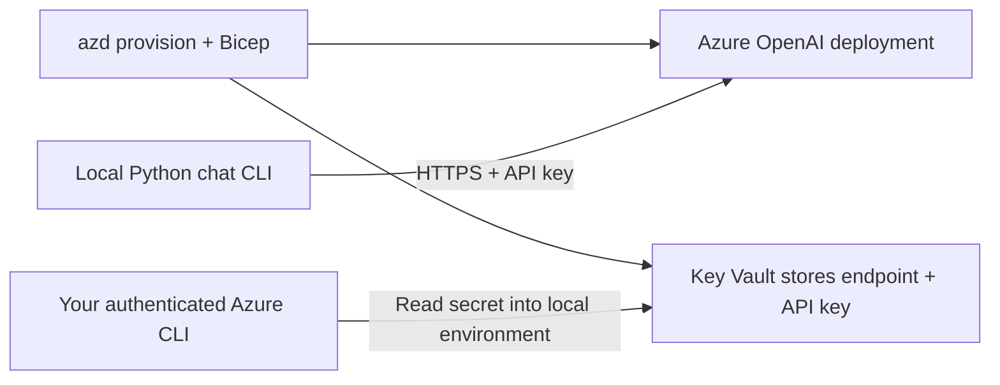

# Azure OpenAI Chat — Paikallinen CLI ja AZD-infrastruktuuri

**Taso:** Keskitaso · **Kesto:** 35–60 minuuttia asennuksen kanssa

Tämä esimerkkiratkaisu ottaa käyttöön **Azure OpenAI -resurssin ja Key Vaultin**, ja sen jälkeen suorittaa
vuorovaikutteisen Python-chat CLI:n **koneellasi**. Se ei isännöi verkkosovellusta
tai Container Appia. Oletusmalli on `gpt-4.1`, versio `2025-04-14`, kapasiteetilla
`GlobalStandard` käyttöönottokapasiteettina 20. Tarkista nykyinen saatavuus ja kiintiö
valitsemassasi alueessa ennen käyttöönottoa; mallin elinkaari voi muuttua.

## Oppimistavoitteet

- Mallin infrastruktuurin käyttöönotto Bicepillä ja azd:llä.
- Hae API-avain Key Vaultista ilman, että laitat sitä käyttöönoton tulostuksiin.
- Lähetä Chat Completions -pyyntöjä ja ylläpidä keskusteluhistoriaa.
- Tulkitse tokenimäärät ja kustannusarvioiden rajoitukset.



Tässä esimerkissä ei ole hallittua identiteetin ajoaikaista integraatiota, monialueista vikasietoa, mukautettua
nopeusrajoitinta, suoratoistotilaa tai isännöityä laskentaa. OpenAI SDK
yrittää uudelleen kahdesti uudelleentyritettävissä virheissä; CLI raportoi palautuvat virheet.

## Ennakkoedellytykset

- Ajantasainen vakaa [azd](https://learn.microsoft.com/azure/developer/azure-developer-cli/install-azd)
  (julkaisuversion tarkistushetkellä: 1.37.2).
- [Azure CLI](https://learn.microsoft.com/cli/azure/install-azure-cli).
- Python **3.10+** (suositeltu 3.11) ja virtuaaliympäristö.
- Azure-tilaus, jolla on oikeudet luoda Cognitive Services- ja Key Vault -resursseja,
  ottaa malleja käyttöön ja lukea vaultin salaisuuksia.
- Alueellinen saatavuus ja `GlobalStandard`-kiintiö `gpt-4.1`-palvelulle. Käyttövaatimukset
  riippuvat tilauksesta ja ominaisuudesta; hyväksyntäaikaa ei taata.

```bash
azd version
az version
python --version
azd auth login
az login
```

Nämä ovat erillisiä todennussessioita. Valitse sama tilaus molemmissa
työkaluissa ennen alla olevien komentojen suorittamista.

## Nopean aloituksen ohjeet (Bash)

Suorita repositorion juuresta:

```bash
cd examples/azure-openai-chat
azd env new myopenai
azd provision
```

Valitse tuettu alue. Käyttöönotto luo resurssiryhmän, OpenAI-tilin,
mallin käyttöönoton, Key Vaultin sekä `openai-endpoint`/`openai-api-key` salaisuudet.
Ei ole **palveluita otettavaksi käyttöön** kohteessa `azure.yaml`.

Lataa ei-salaiset ulostulot ja hae salaisuus nykyiseen komentokehoteesi:

```bash
export AZURE_OPENAI_ENDPOINT="$(azd env get-value AZURE_OPENAI_ENDPOINT)"
export AZURE_OPENAI_MODEL="$(azd env get-value AZURE_OPENAI_MODEL)"
KV_NAME="$(azd env get-value AZURE_KEY_VAULT_NAME)"
export AZURE_OPENAI_API_KEY="$(az keyvault secret show \
  --vault-name "$KV_NAME" --name openai-api-key --query value --output tsv)"

python -m venv .venv
source .venv/bin/activate
python -m pip install -r src/requirements.txt
python src/chat.py
```

PowerShellissä ota käyttöön `.\.venv\Scripts\Activate.ps1` ja määritä ympäristömuuttujat
käyttämällä `$env:AZURE_OPENAI_ENDPOINT = azd env get-value AZURE_OPENAI_ENDPOINT`
(ja vastaavasti mallille). Hae API-avain käyttämällä
`$env:AZURE_OPENAI_API_KEY = az keyvault secret show --vault-name $KV_NAME --name openai-api-key --query value -o tsv`.
Aseta ensin `$KV_NAME = azd env get-value AZURE_KEY_VAULT_NAME`.

Älä tulosta, tee commit tai liitä API-avainta issue-raportteihin. CLI lukee prosessin 
ympäristömuuttujat; se **ei** hae Key Vaultin salaisuuksia tai lataa `.env` tiedostoja.
`config.py` validoi päätepisteen, token-rajan ja lämpötilan käynnistyksessä.

Odotettu tulos (sisältö ja käyttö vaihtelevat):

```text
Azure OpenAI Chat Application
Model: gpt-4.1
...
You: Say hello in one sentence.
Assistant: Hello! How can I help you today?
[Tokens: ... | Cost: $...]
```

Komennot: `stats` näyttää kokonaismäärät, `clear` tyhjentää keskusteluhistorian, ja
`quit`/`exit` lopettaa istunnon. Ei ole olemassa `--stream`, `--show-tokens`, `tokens`,
tai `cost` komentoja.

## Vahvista käyttöönotto

Edellä mainittujen ympäristömuuttujien lataamisen jälkeen:

```bash
curl --fail-with-body \
  "${AZURE_OPENAI_ENDPOINT%/}/openai/deployments/${AZURE_OPENAI_MODEL}/chat/completions?api-version=2024-10-21" \
  -H "Content-Type: application/json" \
  -H "api-key: $AZURE_OPENAI_API_KEY" \
  -d '{"messages":[{"role":"user","content":"Say hello!"}],"max_tokens":50}'

az keyvault secret list --vault-name "$KV_NAME" --query "[].name" -o table
```

Onnistuminen: API palauttaa HTTP 200 koodin, jossa on `choices[0].message.content` ja `usage`;
holvi listaa `openai-api-key` ja `openai-endpoint`. Pelkkä onnistunut ARM-käyttöönotto
ei vahvista päätelmää.

## Tiedostot ja määritykset

```text
azure.yaml                         # Infrastructure-only AZD project
infra/main.bicep                   # Subscription deployment
infra/main.parameters.json         # Environment, location, principal ID
infra/resources/openai.bicep       # Account + model
infra/resources/keyvault.bicep     # Vault + deploying user's secret access policy
infra/resources/secrets.bicep      # Writes secrets, no key output
src/chat.py                        # Interactive CLI
src/config.py                      # Environment validation
src/requirements.txt               # Python packages
```

Muuttaaksesi varattua mallia/versiota/kapasiteettia, muokkaa oletusarvoja kohdassa
Aja `infra/main.bicep` ja `azd provision`. `AZURE_OPENAI_MODEL` määrittäminen kuorellasi
valitsee vain **olemassa olevan käyttöönoton nimen**; se ei ota käyttöön toista mallia.

| Suoritusaikamuuttuja | Oletus / lähde |
|---|---|
| `AZURE_OPENAI_ENDPOINT` | Pakollinen; azd ei-salainen tulos |
| `AZURE_OPENAI_API_KEY` | Pakollinen; haetaan Key Vaultista |
| `AZURE_OPENAI_MODEL` | `gpt-4.1`; Azure käyttöönoton nimi |
| `AZURE_OPENAI_MAX_TOKENS` | 800 (validointialue 1–4096) |
| `AZURE_OPENAI_TEMPERATURE` | 0.7 (alue 0–2) |
| `AZURE_OPENAI_INPUT_PRICE_PER_1K` | 0,002 USD; havainnollistava välimuistittoman syötteen hinta |
| `AZURE_OPENAI_OUTPUT_PRICE_PER_1K` | 0,008 USD; havainnollistava ulostulon hinta |

## Kustannukset ja tietoturvarajoitukset

Kustannusten näyttö on **arvio**, ei Azure-laskutusta. Se kertoo API-tokenin
käytön konfiguroiduilla hinnoilla eikä ota huomioon välimuistitettuja syötteitä,
alueellisia/SKU-eroja, veroja, hinnanmuutoksia tai epäonnistuneita/uudelleenyrityksiä.
Korvaa **molemmat hinnat**, kun käytät toista mallia tai SKU:ta ja varmista ajantasainen
[Azure OpenAI -hinnoittelu](https://azure.microsoft.com/pricing/details/cognitive-services/openai-service/).

Havainnollistukseksi, 100 pyyntöä käyttäen 500 välimuistittomatonta syötetokenia ja 200 ulostulotokenia,
oletushinnoilla maksavat `100 × (500/1000 × .002 + 200/1000 × .008) = $0.26`.
Key Vault -toiminnot/tallennus aiheuttavat erillisiä maksuja. Tälle paikalliselle CLI:lle ei ole kiinteää 50 $/kuukausi
maksua eikä mallissa ole isännöityä laskentaa.

Vault käyttää käyttöoikeuskäytäntöä käyttöönotosta vastaavalle osapuolelle; se ei ole RBAC tai
hallitun identiteetin sovellus-esimerkki. Julkiset päätelaitteet ja API-avaimen todennus
käytetään opetuksessa. Rajoita käyttöoikeuksia ja lisää sopivat identiteetti-/verkko-
hallinnat ennen tuotantoon soveltamista.

## Käytännön harjoituksia

### 1. Vahvista konteksti ja nollaa se

**Aloitus:** aja CLI. **Tavoite:** havainnoi historia.
Sano ”Muista sana cedar,” ja kysy sitten ”Mikä sanan pyysin sinua muistamaan?”
Aja `stats`; kaksi onnistunutta vuoroa lasketaan kahdeksi vaihdetuksi viestiksi.
Aja `clear` ja `stats`; vaihdetut viestit pitäisi olla nolla (tokenien kokonaismäärä säilyy).
Mallin tarkka sanamuoto ei ole deterministinen.

### 2. Vaihda vastausraja

**Aloitus:** poistu CLI:stä samalla shellillä.
Aja `export AZURE_OPENAI_MAX_TOKENS=100`, käynnistä `python src/chat.py` uudelleen, ja pyydä
lyhyt selitys azd:stä. Tarkista, että bannerissa näkyy 100.
Palauta `unset AZURE_OPENAI_MAX_TOKENS` avulla. Pienempi vastausraja ei
vähennä jo lähetettyjä historiatokenia.

### Yleisiä ongelmia

- **Puuttuvat ympäristömuuttujat:** provisiointi ei vie shell-arvoja ulos;
  toista vientivaiheet. Uusi terminaali tarvitsee ne uudestaan.
- **403 Key Vaultin luku:** varmista Azure CLI -tilaus/kirjautuminen ja edustaja
  vaultin käyttöoikeuspolitiikassa. Politiikkamuutosten leviämisessä voi kestää hetki.
- **404 päättely:** tarkista käyttöönoton nimi, päätepiste ja käyttöönoton tila.
- **429 päättely:** odota rajoitusten nollaantumista; tarkista alueellinen mallikiintiö.
  CLI poistaa epäonnistuneet vuorot historiasta, joten uudelleenyrittäminen ei tuplaa niitä.
- **Kontekstin pituus:** esimerkki ei lyhennä pitkiä keskusteluja; käytä `clear`.
- **Malli ei saatavilla/poistettu:** tarkista nykyinen mallin saatavuus ja päivitä
  malli/versio/SKU yhdessä; API-version ja malliversion asetukset ovat eriäviä.

## Siivous ja seuraavat askeleet

```bash
azd down
unset AZURE_OPENAI_API_KEY
```

Key Vaultin pehmeän poistamisen säilytysaika on seitsemän päivää; poisto vaatii erilliset oikeudet.
Sitoutunutta testisarjaa ei ole; älä aja olematonta `pytest tests/` komentoa.
Lisää mallinnetut API-testit ennen koodin laajentamista.

[Säilöesimerkit](../../../../examples/container-app) · [Vähittäiskaupan arkkitehtuurin suunnitelma](../retail-scenario.md) ·
[Kurssin kotisivu](../../README.md) · [Ilmoita ongelmasta](https://github.com/microsoft/AZD-for-beginners/issues)

---

<!-- CO-OP TRANSLATOR DISCLAIMER START -->
**Vastuuvapauslauseke**:
Tämä asiakirja on käännetty käyttämällä tekoälypohjaista käännöspalvelua [Co-op Translator](https://github.com/Azure/co-op-translator). Vaikka pyrimme tarkkuuteen, otathan huomioon, että automaattiset käännökset saattavat sisältää virheitä tai epätarkkuuksia. Alkuperäinen asiakirja sen alkuperäiskielellä on virallinen lähde. Tärkeissä asioissa suositellaan ammattimaista ihmiskäännöstä. Emme ole vastuussa tämän käännöksen käytöstä aiheutuvista väärinymmärryksistä tai tulkinnoista.
<!-- CO-OP TRANSLATOR DISCLAIMER END -->