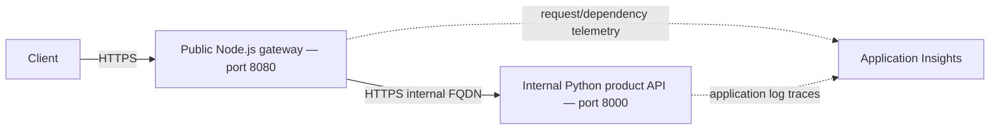

# Kaksi palvelua mikropalveluina — Azure Container Apps

**Taso:** Keskitaso · **Aika:** 45–60 minuuttia, sisältäen asetukset

Tämä oppimismalli toteuttaa **Node.js API -portin** ja **Pythonin vain luku -tuotepalvelun**.
Lähdekoodi, Docker-tiedostot, Bicep ja azd-konfiguraatio sisältyvät.
Se ei ole tuotantoon valmis järjestelmä.

## Mitä opit

- Julkaisemaan kaksi palvelua itsenäisesti.
- Käyttämään sisäistä backendin FQDN:ää HTTPS:n yli.
- Varmistamaan onnistuneet, ei löytynyt ja ei saatavilla -vastaukset.
- Ymmärtämään telemetriaa ja itsenäisiä skaalauksen rajoja.



Tuotekatalogi sisältää viisi kiinteää tuotetta muistissa. **POST-, PUT- tai DELETE-käsittelijöitä ei ole**,
tietokantaa, Service Busia, tilaus-/käyttäjä-/ilmoituspalvelua,
C#- tai Go-koodia ei ole. Nämä ovat tulevaisuuden kehitysideoita, eivät sisältyviä ominaisuuksia.
Portti ei tunnista käyttäjiä; sisäinen sisäänkäynti ei korvaa sovelluksen valtuutusta.


## Ennen aloittamista

Suorita ensin [single Flask API](../../../../../examples/container-app/simple-flask-api).
Asenna nykyinen vakaa azd (julkaisu tarkastushetkellä: 1.37.2), Azure CLI
ja Docker, jonka daemon on käynnissä. Tarvitset Azure-tilauksen, resurssien
luontioikeudet ja Container Apps -aluekiintiön.

```bash
azd version
az version
docker info
azd auth login
az login
```

Käytä samaa tilausta molemmissa CLI-työkaluissa. Alla olevat komennot käyttävät Bashia.

## Ota käyttöön ja varmista

Tietovaraston juuresta:

```bash
cd examples/container-app/microservices
azd env new microservices-demo
azd up
GATEWAY_URL=$(azd env get-value API_GATEWAY_URL)
RG_NAME=$(azd env get-value AZURE_RESOURCE_GROUP)
GATEWAY_NAME=$(azd env get-value API_GATEWAY_NAME)
PRODUCT_NAME=$(azd env get-value PRODUCT_SERVICE_NAME)

curl --fail-with-body "${GATEWAY_URL}/health"
curl --fail-with-body "${GATEWAY_URL}/api/products"
curl --fail-with-body "${GATEWAY_URL}/api/products/1"
curl -i "${GATEWAY_URL}/api/products/999"
```

**Onnistui:** health 200; list 200, jossa **viisi** tuotetta; tuote 1 on Kannettava tietokone
hinnalla 999,99 ja varastossa 50; tuntematon tuote palauttaa 404.
Kuvaukset sisältyvät vastauksiin; aikaleimat vaihtelevat.

Alkuperäinen käyttöönotto käyttää julkisia hello-world-kuvia portissa 80, joten se ei yritä
hakea olemattomia kuvia tyhjästä rekisteristä. Palvelukohtaiset Bicep-moduulit
ja parametritiedostot korvaavat ne rakennetuilla kuville ja sovelluksen porteilla/tarkastuskojeilla aikana
`azd deploy`. Pääparametrit säilyttävät julkaistut kuvanimet myöhempää käyttöönottoa varten.

## Palvelut ja verkotus

| Palvelu | Altistettavat päätepisteet | Oletusresurssit |
|---|---|---|
| Gateway | GET `/`, `/health`, `/api/products`, `/api/products/:id` | 1 vCPU, 2 GiB, 2–20 kopiota |
| Tuote | GET `/`, `/health`, `/products`, `/products/<id>` | 0,5 vCPU, 1 GiB, 1–10 kopiota |

Tuotteen ingressissä on `external: false` ja `allowInsecure: false`. Bicep injektoi
`PRODUCT_SERVICE_URL=https://<actual-internal-fqdn>` gatewayhin. HTTP toimisi
uudelleenohjaus; HTTPS vastaa määritettyä ingressiä. Lyhyen DNS-nimen on vastattava
**varsinaista Container Appin nimeä**, ei loogista palveluavainta `product-service`.
Älä yritä kutsua sisäistä URL-osoitetta suoraan läppäriltäsi.

Reitittimellä on viiden sekunnin aikakatkaisu tuotekutsuille. Puuttuvat tuote-ID:t
näkyvät virhekoodina 404; kuljetusvirheet/muut taustajärjestelmän virheet palauttavat 503. Reititin
`/health` tarkistaa vain reitittimen, ei taustajärjestelmän saatavuutta.

## Tiedostot ja asetukset

```text
azure.yaml
infra/main.bicep
infra/main.parameters.json
infra/abbreviations.json
infra/core/container-apps-environment.bicep
infra/core/monitor.bicep
infra/app/api-gateway.bicep
infra/app/api-gateway.parameters.json
infra/app/product-service.bicep
infra/app/product-service.parameters.json
src/api-gateway/{app.js,package.json,Dockerfile}
src/product-service/{main.py,requirements.txt,Dockerfile}
```

Skaalaus, CPU/muisti, portit ja sondit määritellään `infra/app/*.bicep`. Muokkaa näitä
tiedostoja ja suorita `azd up` ottaaksesi infrastruktuurin käyttöön ja uudelleenjulkaistaksesi sovelluksen. Tässä esimerkissä ei ole
`GATEWAY_MAX_REPLICAS` -ympäristömuuttujaparametria.

Koodimuutoksille:

```bash
azd deploy product-service
azd deploy api-gateway
```

Node-kuvassa käytetään Node 22:ta; Python-kuvassa käytetään Python 3.11:ta. Molemmat sitoutuvat
`0.0.0.0`. Ingress/probes käyttävät portteja 8080 (gateway) ja 8000 (tuote) vastaavasti.

## Paikallinen kehitys Dockerin avulla

Suorita tästä esimerkkihakemistosta. Käytä käyttäjän määrittelemää verkkoa, **älä `localhost`
yhdestä säilöstä toiseen saapumiseksi**:

```bash
docker network create azd-microservices-demo
docker build -t local-product ./src/product-service
docker build -t local-gateway ./src/api-gateway
docker run -d --name azd-product --network azd-microservices-demo local-product
docker run -d --name azd-gateway --network azd-microservices-demo \
  -p 8080:8080 -e PRODUCT_SERVICE_URL=http://azd-product:8000 local-gateway
curl --fail-with-body http://localhost:8080/api/products
```

Odotettu: viisi tuotetta. HTTP:tä käytetään vain tässä paikallisessa Docker-verkossa.

```bash
docker stop azd-product azd-gateway
docker rm azd-product azd-gateway
docker network rm azd-microservices-demo
```

## Valvonta

```bash
az containerapp logs show --name "$GATEWAY_NAME" --resource-group "$RG_NAME" --follow
# In a separate terminal:
az containerapp logs show --name "$PRODUCT_NAME" --resource-group "$RG_NAME" --tail 100
```

`azd monitor --logs` avaa portaalinäkymän; se ei suoratoista terminaalin lokeja.
Node SDK kerää gateway-pyynnöt/riippuvuudet. Pythonin `AzureLogHandler`
vie **lokijäljet**, ei automaattisia Flask-pyyntöjä, SQL-riippuvuuksia tai täydellisiä
hajautettuja jälkiä. OpenCensus on vanhentunut SDK; suosittelemme Azure Monitor OpenTelemetryä
tämän mallin laajentamiseen.

Application Insights Logsissa luo pyyntöjä ja tarkastele:

```kusto
requests
| where timestamp > ago(1h)
| where name contains "products"
| summarize RequestCount=count(), AvgDuration=avg(duration) by bin(timestamp, 5m)
```

Python-sovellusviesteille:

```kusto
traces
| where timestamp > ago(1h)
| where message contains "products"
| project timestamp, message, severityLevel
```

Salli viive tietojen keruussa ja otanta; älä odota tarkkaa pyyntömäärää tai
taattua viivettä. Ei ole määritetty räätälöityjä hälytyksiä tai kojelautoja.

## Käytännön harjoitukset

### Harjoitus 1: Muokkaa luetteloa

**Alkuperäispiste:** `src/product-service/main.py`.
**Tavoite:** varmista itsenäinen palvelun käyttöönotto.
Vaihda kannettavan varasto 50:stä 49:ään kiinteässä `products` listassa, suorita
`azd deploy product-service`, sitten pyyntö `${GATEWAY_URL}/api/products/1`.

**Onnistumiskriteerit / ratkaisu:** HTTP 200 ja `"stock":49`. Palauta 50 ja ota uudelleen käyttöön.
**Yleinen virhe:** muokataan gateway'ta sen sijaan, että muokattaisiin palvelua, joka omistaa hakemiston.
Tämä muuttaa lähdetietoja, ei pysyvää varastotietokantaa.

### Harjoitus 2: Vahvista replikan konfigurointi

**Lähtökohta:** `infra/app/product-service.bicep`.
**Tavoite:** havainnoi infrastruktuurin muutos arvaamatta autoskaalausta.
Vaihda `minReplicas: 1` arvoon `minReplicas: 2`, aja `azd up`, sitten:

```bash
az containerapp show --name "$PRODUCT_NAME" --resource-group "$RG_NAME" \
  --query properties.template.scale -o json
```

**Onnistumiskriteeri:** asetettu minimi on 2 ja maksimi pysyy 10.
Palauta minimiin 1 ja aja `azd up`.
**Yleinen ongelma:** `azd deploy` yksinään ei tee muutoksia muihin jaettuihin
infrastruktuureihin liittymättömiin osiin. Älä aseta `maxReplicas` nollaksi epäonnistumisen simuloimiseksi.
Tämä tarkistaa konfiguraation, ei kuormitustestiä tai taattua hetkellistä kopiokertaa.

### Harjoitus 3: Testaa palvelun puuttumisen käsittely paikallisesti

**Alku:** molemmat yllä olevat paikalliset Docker-kontit ovat käynnissä.
**Tavoite:** erottaa backend-vika puuttuvasta tuotteesta.
Pysäytä vain tuotekontti:

```bash
docker stop azd-product
curl -i http://localhost:8080/api/products
docker start azd-product
curl --fail-with-body http://localhost:8080/api/products
```

**Onnistumiskriteerit:** pysäytyksen aikana yhdyskäytävä palauttaa 503-koodin
`"error":"Product service unavailable"`; uudelleenkäynnistyksen jälkeen lista palauttaa 200.
Yritä uudelleen lyhyen käynnistysviiveen jälkeen tarvittaessa.
**Yleinen ongelma:** yhdyskäytävän pysäyttäminen testaa toisenlaista vikaa (ei HTTP-vastausta).

## Kustannukset ja tuotannon aukot

Oletusarvoiset minimikopiot pitävät laskennan käynnissä. Rekisteröinti ja valvonta myös aiheuttavat
kustannuksia. Ei ole varmistettua kiinteää 50 dollarin kuukausimaksua: arvioi alueelliset CPU/muisti,
kopioiden tunnit, pyynnöt, rekisteri ja lokien säilytys
[Azure-hinnoittelulaskin](https://azure.microsoft.com/pricing/calculator/).
Poista oppimateriaali viipymättä.

Tuotantotyö sisältää todennuksen/valtuutuksen, rajattuja hallittuja henkilöllisyyksiä,
pysyvää dataa, syötteen/vastauksen validoinnin, tuetun havaittavuuden instrumentoinnin,
kuormituksen/virheiden testauksen, CI/CD:n, hälytykset ja palautusmenettelyt. Tilauspalvelun,
jonon tai tietokannan lisääminen on erillinen toteutustehtävä, ei valmis
harjoitus tai täällä jo saatavilla oleva ominaisuus.

## Vianmääritys ja siivous

- **Kuvaa ei löydy ensimmäisessä provisiossa:** aloituksen tulee käyttää julkista kuvaa;
  tarkista pääkuvaparametrien oletukset ja käyttöönoton moduulimäärittelyt.
- **503 tuotetta:** tarkista tuotelokit, kuvan revisio ja injektoitu sisäinen HTTPS URL.
- **404 odottamaton polku:** tuotteen API on vain luku -tilassa; varmista reitti, ei olematonta CRUD-käsittelijää.
- **Ei telemetriaa:** tarkista ajoajan yhteysmerkkijonot paljastamatta niitä ja
  salli viive syötteessä. Pythonin pyyntötaulut eivät täyty sen lokikäsittelijällä.

Tästä esimerkkihakemistosta:

```bash
azd down
```

Tarkista poiston kehotteet ja varmista, että omistettu resurssiryhmä poistetaan.

[Edellinen: Flask API](../../../../../examples/container-app/simple-flask-api) · [Seuraava: Tietokantasovellus](../../../../../examples/database-app) ·
[AI-kehitys](../../../docs/chapter-02-ai-development/README.md) ·
[Kurssin etusivu](../../../README.md) · [Ilmoita ongelmasta](https://github.com/microsoft/AZD-for-beginners/issues)

---

<!-- CO-OP TRANSLATOR DISCLAIMER START -->
**Vastuuvapauslauseke**:
Tämä asiakirja on käännetty käyttämällä tekoälypohjaista käännöspalvelua [Co-op Translator](https://github.com/Azure/co-op-translator). Vaikka pyrimme tarkkuuteen, otathan huomioon, että automaattiset käännökset saattavat sisältää virheitä tai epätarkkuuksia. Alkuperäinen asiakirja sen alkuperäiskielellä on virallinen lähde. Tärkeissä asioissa suositellaan ammattimaista ihmiskäännöstä. Emme ole vastuussa tämän käännöksen käytöstä aiheutuvista väärinymmärryksistä tai tulkinnoista.
<!-- CO-OP TRANSLATOR DISCLAIMER END -->