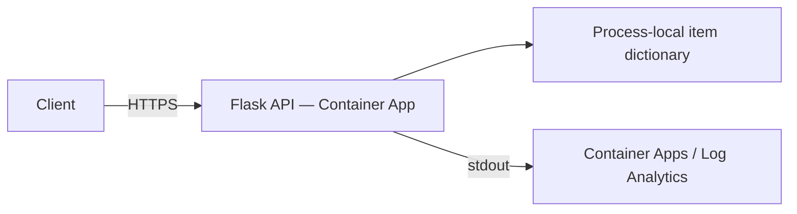

# Yksinkertainen Flask-API — Azure Container Apps

**Taso:** Aloittelija · **Aika:** 30–45 minuuttia asetusten kanssa

Ota käyttöön Python Flask CRUD -API Azure Developer CLI:llä (azd). Lähdekoodi, Dockerfile,
Bicep ja käyttöönoton parametrit sisältyvät. Tämä on **opetusnäyte**, ei
tuotantovalmiina oleva API.

## Mitä opit

- Luo ja julkaise säilö azd:n kautta.
- Määritä ingress ja liveness/readiness probe:t.
- Vahvista CRUD-vastaukset ja tarkastele sovelluksen lokitietoja.
- Ymmärrä, miksi muistissa oleva data ei sovellu kestävään käyttöön.



**Tärkeää:** kohteet pidetään yhdessä prosessissa. Oletuksena on **yksi Gunicorn-työntekijä,
0–1 replikaa**, joka tarkoituksellisesti välttää ristiriitaista dataa työntekijöiden/replikoiden välillä.
Kohteet katoavat uudelleenkäynnistyksen, version muutoksen tai skaalaamisen nollaan yhteydessä. Replikoiden
lisääminen vaatii jaetun pysyvän tallennustilan. API:lla ei ole autentikointia tai autorisointia.

## Edellytykset

- [Nykyinen vakaa azd](https://learn.microsoft.com/azure/developer/azure-developer-cli/install-azd)
  (julkaistu arviointiajankohtana: 1.37.2).
- [Azure CLI](https://learn.microsoft.com/cli/azure/install-azure-cli) varmennukseen.
- Docker ja sen daemon käynnissä; vaaditaan oletuksena paikalliseen kuvan rakentamiseen.
- Azure-tilaus, resurssien luontioikeudet ja Container Apps -alueen kiintiö.
- Bash alla oleville komennoille (tai vastaava PowerShell).
- Python 3.11 valinnaiseen paikalliseen kehitykseen.

```bash
azd version
az version
docker info
azd auth login
az login
```

CLI-työkaluilla on erilliset kirjautumissessiot. Käy sama tilaus molemmissa.

## Nopeasti käyntiin

Repositorion juuresta:

```bash
cd examples/container-app/simple-flask-api
azd env new flask-demo
azd up
API_URL=$(azd env get-value API_ENDPOINT)
RG_NAME=$(azd env get-value AZURE_RESOURCE_GROUP)
API_NAME=$(azd env get-value API_NAME)
curl --fail-with-body "${API_URL}/health"
```

Odotettu: HTTP 200 ja JSON jossa on `"status":"healthy"`,
`"service":"simple-flask-api"`, ja ajantasainen UTC-aikaleima.
Käyttöönotto ja kuvan rakentaminen kestävät tyypillisesti useita minuutteja; ajat vaihtelevat.

Alustuksessa käytetään julkista hello-world-kuvaa, joka kuuntelee portissa 80.
`azure.yaml` valitsee `infra/app/api.bicep` ja sen vastaavan parametritiedoston
palvelun käyttöönottoa varten, mikä vaihtaa kuvan, ingressin ja probe:t porttiin 8000.
Älä poista näitä käyttöönoton parametreja.

## Vahvista CRUD

Suorita seuraavat peräkkäin samalla aktiivisella replikalla:

```bash
# Create: HTTP 201; note the returned id (1 for a fresh process).
curl -i -X POST "${API_URL}/api/items" \
  -H "Content-Type: application/json" \
  -d '{"name":"Test Item","description":"My first item"}'

# Read list: HTTP 200, total 1 in a fresh process.
curl --fail-with-body "${API_URL}/api/items"

# Replace 1 if your create response returned another id.
curl --fail-with-body "${API_URL}/api/items/1"
curl -i -X PUT "${API_URL}/api/items/1" \
  -H "Content-Type: application/json" -d '{"name":"Updated Item"}'
curl -i -X DELETE "${API_URL}/api/items/1"
curl -i "${API_URL}/api/items/1"
```

Onnistuminen: POST 201, luku/PUT 200, DELETE 204 ilman sisältöä, sitten puuttuva kohde 404.
Virheellinen/ei-olio JSON tai tyhjä nimi palauttaa 400.
Jos kohde katoaa pyyntöjen välillä, tarkista uudelleenkäynnistys tai skaalaus nollaan;
tämä on tarkoituksellinen muistirajoitus, ei pysyvyyden puute.

| Päätepiste | Menetelmät |
|---|---|
| `/` | GET — palvelutiedot |
| `/health` | GET — liveness/readiness |
| `/api/items` | GET, POST |
| `/api/items/{id}` | GET, PUT, DELETE |

## Lokit ja asetukset

```bash
az containerapp logs show --name "$API_NAME" --resource-group "$RG_NAME" --follow
```

Odotettu: Gunicornin käynnistys, pyynnön käytön lokit ja sovellusviestit.
`azd monitor --logs` avaa portaalinäkymän; se ei suoratoista terminaaliin.
Application Insights on otettu käyttöön mutta **ei instrumentoitu tällä Flask-koodilla**;
käytä Container Apps/Log Analytics stdout-lokeihin.

Muokkaa `infra/app/api.bicep` CPU/muistin, replikan rajojen tai skaalaussääntöjen osalta, sen jälkeen
suorita `azd up`. Oletuksena 0.5 vCPU, 1 GiB, vähintään 0 / enintään 1 replikaa, ja
HTTP-kynnys 50 samanaikaista pyyntöä. Skaalaus nollaan voi lisätä kylmän käynnistyksen viivettä.

Mielivaltaiset `azd env set MAX_REPLICAS`, `API_KEY`, `LOG_LEVEL`, tai
`SCALE_TO_ZERO_TIMEOUT` arvot eivät ole **kytkettyjä tähän malliin tai sovellukseen**.
Arvon asettaminen ei automaattisesti tee siitä runtime-ympäristömuuttujaa.
Kuva sitoo portin 8000 eksplisiittisesti; päivitä Dockerfile, Bicep ingress ja probe:t
yhdessä jos porttia vaihdetaan.

## Tiedostot

```text
azure.yaml
infra/main.bicep
infra/main.parameters.json
infra/app/container-apps.bicep       # Environment, registry, monitoring
infra/app/api.bicep                  # App, ingress, probes, scale settings
infra/app/api.parameters.json        # Image and resource values for azd deploy
src/app.py
src/Dockerfile
src/requirements.txt
```

## Paikallinen kehitys

Tästä esimerkkihakemistosta:

```bash
python -m venv .venv
source .venv/bin/activate  # PowerShell: .\.venv\Scripts\Activate.ps1
python -m pip install -r src/requirements.txt
python src/app.py
```

Toisessa terminaalissa testaa `http://localhost:8000/health` ja CRUD-päätepisteet.
Tai rakenna ja suorita varsinainen kuva:

```bash
docker build -t flask-api:local ./src
docker run --rm -p 8000:8000 flask-api:local
```

Koodimuutosten jälkeen ensimmäisen käyttöönoton jälkeen suorita `azd deploy api`.
Bicep-muutoksille suorita `azd up` uudelleenkäyttöönottoa ja käyttöönottoa varten.

## Käytännön harjoitukset

### 1. Syötteen hylkäämisen validointi

**Alku:** otettu käyttöön API, `API_URL` yllä.
**Tavoite:** varmista, että API hylkää virheelliset JSON-rakenteet ja puuttuvat nimet.

```bash
curl -i -X POST "${API_URL}/api/items" \
  -H "Content-Type: application/json" -d '[]'
curl -i -X POST "${API_URL}/api/items" \
  -H "Content-Type: application/json" -d '{"name":""}'
```

**Onnistumiskriteerit / ratkaisu:** molemmat palauttavat 400 JSON-virheen kanssa, eivät 500.
**Yleinen ongelma:** JSON-content-type-otsikon puuttuminen.

### 2. Lisää lukuoikeuksinen versio-päätepiste

**Alku:** `src/app.py`. **Tavoite:** laajenna ja ota API uudelleen käyttöön.
Lisää tämä ennen `if __name__ == '__main__':`-lohkoa:

```python
@app.route('/version', methods=['GET'])
def version():
    return jsonify({'version': '1.0.0'})
```

Suorita `azd deploy api`, sitten `curl --fail-with-body "${API_URL}/version"`.
**Onnistumiskriteerit:** HTTP 200 ja `{"version":"1.0.0"}`.
**Yleinen ongelma:** reitin sijoittaminen `app.run()`-estävän kutsun jälkeen, kun
testataan `python src/app.py`:llä.

### Tiedon tarkistuskohta

Miksi yksi työntekijä ei riitä kestävään dataan? Koska edes yksi prosessi menettää
sanakirjansa uudelleenkäynnistyksessä. Tuotantoversio tarvitsee pysyvän jaetun tallennuksen,
autentikoinnin, valtuutuksen, migraatiot, testit ja operatiivisen valvonnan.

## Kustannukset ja vianmääritys

Tämä ei ole taattu $0-kustannuksin tapahtuva käyttöönotto: Basic-rekisteri ja lokien tallennus/ingestio
voi aiheuttaa maksuja vaikka sovelluslaskenta on nollassa. Käytä
[hinnoittelulaskuria](https://azure.microsoft.com/pricing/calculator/) alueellesi.

- **Dockerin rakennus epäonnistuu:** varmista `docker info`, verkkoyhteys ja riippuvuudet.
- **Sovellus ei terve:** tarkista konsoli-/järjestelmälokit ja varmista kuvan portti, ingressi,
  ja probet vastaavat toisiaan. Paikantimen porttia Flask-ankkurina ei saa probe-taa.
- **403/oikeudet:** varmista tilaus- ja resurssien luontioikeudet.
- **Kohteet katoavat:** muistissa oleva tila nollaantuu uudelleenkäynnistyksessä/skaalauksessa nollaan; lisää tietokanta
  kestävään toimintaan.

## Siivous ja seuraavat vaiheet

```bash
azd down
```

Tarkista poiston vahvistus ja varmista, että omistettu resurssiryhmä on poistettu.
Älä käytä tuhoavaa siivousta resurssiryhmälle, jossa on ei-asiaankuuluvaa dataa.

[Seuraava: Tietokantasovellus](../../../../../examples/database-app) · [Mikropalvelut](../../../../../examples/container-app/microservices) ·
[Säilöesittely](../README.md) · [Kurssin etusivu](../../../README.md) ·
[Ilmoita ongelmasta](https://github.com/microsoft/AZD-for-beginners/issues)

---

<!-- CO-OP TRANSLATOR DISCLAIMER START -->
**Vastuuvapauslauseke**:
Tämä asiakirja on käännetty käyttämällä tekoälypohjaista käännöspalvelua [Co-op Translator](https://github.com/Azure/co-op-translator). Vaikka pyrimme tarkkuuteen, otathan huomioon, että automaattiset käännökset saattavat sisältää virheitä tai epätarkkuuksia. Alkuperäinen asiakirja sen alkuperäiskielellä on virallinen lähde. Tärkeissä asioissa suositellaan ammattimaista ihmiskäännöstä. Emme ole vastuussa tämän käännöksen käytöstä aiheutuvista väärinymmärryksistä tai tulkinnoista.
<!-- CO-OP TRANSLATOR DISCLAIMER END -->