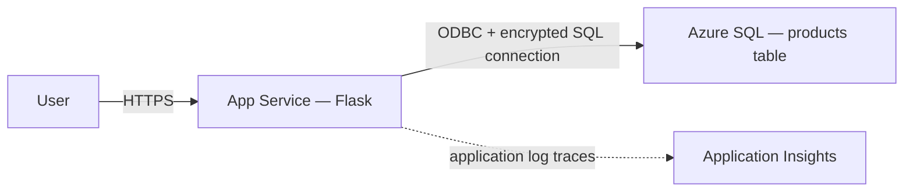

# Flask ja Azure SQL App Servicessä

**Taso:** Keskitaso · **Kesto:** 30–60 minuuttia, sisältäen edellytykset

Tämä esimerkki ottaa käyttöön Python Flask -lukurajapinnan **Linux App Service** -ympäristöön ja Basic
Azure SQL -tietokantaan. Lähdekoodi, Bicep ja azd-konfiguraatio sisältyvät. Kyseessä on
oppimissovellus, ei tuotantovalmiin tietokanta-arkkitehtuurin malli.

## Mitä opit

- Provisionoi App Service, SQL ja valvontaresurssit Bicepillä.
- Määritä salattu SQL-yhteys ilman tunnistetietojen sitomista.
- Alusta skeema ennen Gunicorn-työntekijöiden käynnistämistä.
- Varmista esisiirretty data, ei-löydy vastausten toiminta ja tietokannan kunto.



Resurssit: omistettu resurssiryhmä, B1 Linux App Service -suunnitelma, Python 3.11 Web
App, SQL-palvelin ja Basic 2 Gt tietokanta, Application Insights ja Log Analytics.
Web App käyttää **lähdekoodi/ZIP-jakelua ja Oryx-riippuvuuksien asennusta**;
`azd deploy` ei rakenna tai ota käyttöön valinnaista Dockerfileä.

## Edellytykset

- Nykyinen vakaa [azd](https://learn.microsoft.com/azure/developer/azure-developer-cli/install-azd)
  (julkaistu versio tarkasteluhetkellä: 1.37.2).
- [Azure CLI](https://learn.microsoft.com/cli/azure/install-azure-cli) tarkistusta varten.
- Azure-tilaus, oikeudet luoda listatut resurssit ja alueellinen kiintiö.
- Python **3.11** paikalliseen kehitykseen; sitoutettu `pyodbc==5.0.1` saattaa vaatia
  natiivirakennustyökaluja uudemmilla Python-versioilla.
- Microsoftin ODBC Driver 18 (tai 17) SQL Serverille paikallisissa koneissa. `pip install
  pyodbc` ei asenna järjestelmän ajuria. Katso
  [ODBC-asennus](https://learn.microsoft.com/sql/connect/odbc/download-odbc-driver-for-sql-server).
- Docker vain, jos testaat valinnaista säilöä paikallisesti.

```bash
azd version
az version
azd auth login
az login
```

Käytä molemmissa työkaluissa samaa tilausta. Alla olevat komennot käyttävät Bashia.

## Ota käyttöön

Reposton juuressa:

```bash
cd examples/database-app
azd env new sql-demo
azd provision
azd deploy
WEB_URL=$(azd env get-value WEB_APP_URI)
WEB_NAME=$(azd env get-value WEB_APP_NAME)
RG_NAME=$(azd env get-value AZURE_RESOURCE_GROUP)
```

Valitse tuettu alue. `sqlAdminLogin` on oletuksena `sqladmin`; vaadittu
`sqlAdminPassword` on suojattu parametri. Anna vahva salasana pyydettäessä.
Pidä käyttöönoton tunnistetiedot poissa Gitistä ja virheraporteista. Nykyinen
yhteysmerkkijonon interpolaatio odottaa salasanaa ilman yhteysmerkkijonon erottimia,
kuten `;`; mukauta pakoja ennen arvojen käyttöä.

Bicep asettaa käynnistyskomennon, joka suorittaa `init_database()` **ennen kuin** Gunicornin
työntekijät käynnistyvät. Tämä on tarpeen, koska `app:app`:n tuonti ei aja
Pythonin `if __name__ == '__main__'`-lohkoa. Uudessa tietokannassa alustaminen
luo `products` ja lisää viisi riviä. Se on yksinkertainen opetussiemen, ei
rinnakkainen migraatiokehys; käytä kunnollisia migraatioita ennen instanssien skaalausta.

Sovellus valitsee asennetun Microsoft ODBC Driver 18:n, sitten 17:n jos
yhteysmerkkijonossa ei nimenomaisesti mainita ajuria. Jos kumpaakaan ei ole,
käynnistys epäonnistuu toiminnalliseen asennusvirheeseen. Tarkista ajurin saatavuus
valitsemassasi App Service -ajoympäristössä äläkä oleta sitä.

## Tarkista

```bash
curl --fail-with-body "${WEB_URL}/"
curl --fail-with-body "${WEB_URL}/health"
curl --fail-with-body "${WEB_URL}/products"
curl --fail-with-body "${WEB_URL}/products/1"
curl -i "${WEB_URL}/products/999"
```

Odotetaan:

- `/` palauttaa päätepisteen tiedot.
- `/health` palauttaa 200 ja `{"status":"healthy","database":"connected"}`.
- `/products` palauttaa viisi esisiirrettyä tuotetta uudessa tietokannassa.
- `/products/1` palauttaa kannettavan hinnalla 1299.99.
- Olematon tuote palauttaa 404 ja `{"error":"Product not found"}`.

API on vain luku. POST/PUT/DELETE-reittejä tai selaimen käyttöliittymää ei ole.
Tietokantayhteyden epäonnistuessa `/health` palauttaa 503; se ei ole onnistuminen.

## Tiedostot ja konfiguraatio

```text
azure.yaml                         # Python App Service source deployment
infra/main.bicep
infra/main.parameters.json
infra/abbreviations.json
infra/resources/sql-server.bicep
infra/resources/sql-database.bicep
infra/resources/app-service-plan.bicep
infra/resources/web-app.bicep       # Settings + initialization/startup command
infra/resources/app-insights.bicep
src/web/app.py
src/web/requirements.txt
src/web/Dockerfile                 # Optional local container, not the azd target
.env.sample
```

`SQL_CONNECTION_STRING` annetaan suojattuna Bicep-parametrina Web App -moduulille
ja tallennetaan App Service -asetuksiin, ei käyttöönoton ulostuloksiin.
`APPLICATIONINSIGHTS_CONNECTION_STRING` määrittää lokin viennin.
`SCM_DO_BUILD_DURING_DEPLOYMENT=true` mahdollistaa palvelimen puolen riippuvuuksien asennuksen.
Määrittämällä mielivaltaisia `azd env` -arvoja ei automaattisesti muuteta sovellusasetuksia.

SQL:n palomuurin `0.0.0.0` -sääntö sallii yhteydet **Azure-palveluista,
mukaan lukien muiden asiakkaiden tilauksista**, SQL-todennusta käyttäen. Se ei ole
rajoitettu tähän sovellukseen tai tilaukseen. SQL:n julkinen verkko pääsy on käytössä.
Käytä kohdennettua verkottumista ja ei-ylläpitäjän sovellustunnusta ennen tuotantoa.

## Paikallinen kehitys

Käytä Python 3.11:tä ja asennettua Microsoft SQL ODBC -ajuria:

```bash
python -m venv .venv
source .venv/bin/activate  # PowerShell: .\.venv\Scripts\Activate.ps1
python -m pip install -r src/web/requirements.txt
export SQL_CONNECTION_STRING='Server=tcp:YOUR_SERVER.database.windows.net,1433;Database=YOUR_DATABASE;UID=YOUR_USER;PWD=YOUR_PASSWORD;Encrypt=yes;TrustServerCertificate=no;Connection Timeout=30;'
python src/web/app.py
```

Korvaa paikkamerkit turvallisesti. Kopioitu `.env`-tiedosto **ei lataudu automaattisesti**
tämän sovelluksen toimesta. Vienti muuttujista nykyisessä shellissä toimii sen sijaan.
Azure SQL:lle kannettavalta salli tilapäisesti vain oma julkinen IP-osoitteesi:

```bash
SQL_SERVER=$(azd env get-value SQL_SERVER_NAME)
MY_IP=YOUR_PUBLIC_IP
az sql server firewall-rule create -g "$RG_NAME" -s "$SQL_SERVER" \
  -n AllowMyLearningIP --start-ip-address "$MY_IP" --end-ip-address "$MY_IP"
```

Poista sääntö testauksen jälkeen:

```bash
az sql server firewall-rule delete -g "$RG_NAME" -s "$SQL_SERVER" -n AllowMyLearningIP
```

Valinnainen säilötesti tästä esimerkkihakemistosta:

```bash
docker build -t sql-flask:local src/web
docker run --rm -p 8000:8000 -e SQL_CONNECTION_STRING sql-flask:local
```

Tämä kuva asentaa Driver 18:n Debian 12 -pakettivarastosta, joka vastaa
Bookworm-pohjaa, alustaa tietokannan kerran ja käynnistää Gunicornin.

## Valvonta ja vianmääritys

Ota käyttöön/katso App Service -tiedostojärjestelmän sovelluslokeja käynnistyksen diagnosointiin:

```bash
az webapp log config --name "$WEB_NAME" --resource-group "$RG_NAME" \
  --application-logging filesystem --level information
az webapp log tail --name "$WEB_NAME" --resource-group "$RG_NAME"
```

Tämä koodi vie sovelluksen **lokijälkiä** perintönä OpenCensus-käsittelijän kautta.
Se ei määritä automaattista Flask-pyyntö-/riippuvuusjäljitystä, Live Metricsia,
SQL-tarkastusta, diagnostiikka-asetuksia tai hälytyksiä. Ne vaativat erillisen konfiguraation.
Uudenaikaista instrumentointia varten käytä Azure Monitor OpenTelemetria.

Application Insights Logseissa API-pyyntöjen jälkeen:

```kusto
traces
| where timestamp > ago(1h)
| where message contains "products" or message contains "Health check"
| project timestamp, message, severityLevel
```

Salli viive tietojen keräämisessä. Pyyntötaulukon tai Live Metrics -toiminnan
esiintyminen ei ole päälle asennetun instrumentoinnin valmistumisen mittari.

- **Ajuri puuttuu:** tarkista `pyodbc.drivers()` ajoympäristössä ja asenna
  tuettu Microsoft ODBC -ajuri. Pelkkä Python-paketti ei riitä.
- **Yhteyden epäonnistuminen:** tarkista SQL-asetukset, tunnistetiedot, palomuuri ja valittu
  tilaus. Älä poista salauksen käytöstä virheen ohittamiseksi.
- **Tuotetaulukko puuttuu:** varmista että Bicep-käynnistyskomento on otettu käyttöön;
  `gunicorn app:app`:n pelkkä käynnistys ohittaa alustuksen.
- **Paketin rakennus epäonnistuu:** käytä Python 3.11:tä tai toimita natiiviset rakennusedellytykset.
- **Nollahintaisten tietojen ongelma:** nolla on kelvollinen desimaalihinta; sen on sarjattava arvona 0.0,
  ei `null`.

## Käytännön harjoitukset

### Harjoitus 1: Vahvista puuttuvan tuotteen käyttäytyminen

**Lähtökohta:** otettu käyttöön API ja `WEB_URL` yllä.
**Tavoite:** erottaa puuttuva rivi rikkinäisestä tietokannasta.
Pyydä `/health` ja `/products/999` yllä olevilla komennoilla.
**Onnistumiskriteerit / vastaus:** terveystila 200, olematon tuote 404 (ei 500 tai 503).
**Yleinen virhe:** olettaa että ei-löydy vastaus todistaa SQL-yhteyden olevan rikki.

### Harjoitus 2: Muuta siirrettyä arvoa

**Lähtökohta:** Azure SQL Query Editor, yhdistetty esimerkkitietokantaan.
**Tavoite:** osoittaa että API:n data tallennetaan SQL:ään, ei prosessimuistiin.

```sql
UPDATE products SET price = 0 WHERE id = 1;
SELECT id, name, price FROM products WHERE id = 1;
```

Pyydä `${WEB_URL}/products/1`. **Onnistumiskriteeri:** hinta on `0.0`, ei `null`.
Palauta arvo:

```sql
UPDATE products SET price = 1299.99 WHERE id = 1;
```

**Yleinen virhe:** Python-siementaulukon muokkaus ei päivitä jo SQL:ään tallennettuja rivejä.
Älä suorita skeema/-dataharjoituksia tuotantotietokantaa vastaan.

### Harjoitus 3: Lisää vain luku -laskuri päätepiste

**Lähtökohta:** `src/web/app.py`.
**Tavoite:** laajenna API:tä parametrivapaalla aggregaattikyselyllä.
Lisää tämä ennen `if __name__ == '__main__':`-lohkoa:

```python
@app.route('/product-count')
def product_count():
    from contextlib import closing
    with closing(get_db_connection()) as conn, closing(conn.cursor()) as cursor:
        cursor.execute("SELECT COUNT(*) FROM products")
        return jsonify({'count': cursor.fetchone()[0]})
```

Suorita `azd deploy web`, sitten pyydä `${WEB_URL}/product-count`.
**Onnistumiskriteeri:** 200 ja `{"count":5}` koskemattomalla siirretyllä tietokannalla.
**Yleinen virhe:** reitin muuttaminen mutta unohdetaan käyttöönotto uudelleen.
Tuotannossa lisää virheenkäsittely/testit; tämä lyhyt harjoitus keskittyy kyselyyn.

## Kulut, tuotantoaukot ja siivous

B1 App Service ja Basic tietokanta veloitetaan niin kauan kuin ne ovat käytössä. Web Appin pysäyttäminen
ei **pysäytä** App Service -suunnitelman laskutusta. Lokit ja tallennus voivat lisätä kustannuksia.
Käytä [Azure-hinnoittelulaskuria](https://azure.microsoft.com/pricing/calculator/)
voimassa olevan alueellisen hinnoittelun tarkistamiseen. F1:een vaihtaminen edellyttää myös `alwaysOn` poistamista käytöstä;
se ei ole yhden rivin korvike. SQL serverless ei ole automaattisesti ilmaista.

Tuotantotyöt sisältävät vähiten oikeuksia vaativan sovellustunnuksen (ei SQL ylläpitäjä),
autentikoinnin/valtuutuksen, yksityisen verkotuksen, turvalliset migraatiot, yhteyksien
hallinnan/sykliarvion, telemetrian, tarkastukset, hälytykset, testit ja palautusprosessit.
Redis-välimuisti ja lisätaulukot ovat kehitysideoita, ei toteutettuja harjoituksia.

Tästä esimerkkihakemistosta:

```bash
azd down
```

Tarkista poiston varmistuskysely ja varmista, että omistettu resurssiryhmä poistetaan.
Älä poista ryhmiä, jotka sisältävät ei-liittyvää dataa.

[Säilöesimerkit](../../../../examples/container-app) ·
[AI-kehitys](../../docs/chapter-02-ai-development/README.md) ·
[Kurssin etusivu](../../README.md) · [Ilmoita ongelmasta](https://github.com/microsoft/AZD-for-beginners/issues)

---

<!-- CO-OP TRANSLATOR DISCLAIMER START -->
**Vastuuvapauslauseke**:
Tämä asiakirja on käännetty käyttämällä tekoälypohjaista käännöspalvelua [Co-op Translator](https://github.com/Azure/co-op-translator). Vaikka pyrimme tarkkuuteen, otathan huomioon, että automaattiset käännökset saattavat sisältää virheitä tai epätarkkuuksia. Alkuperäinen asiakirja sen alkuperäiskielellä on virallinen lähde. Tärkeissä asioissa suositellaan ammattimaista ihmiskäännöstä. Emme ole vastuussa tämän käännöksen käytöstä aiheutuvista väärinymmärryksistä tai tulkinnoista.
<!-- CO-OP TRANSLATOR DISCLAIMER END -->