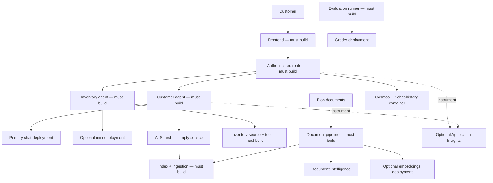

# Moni-agenttinen asiakastuki — Vähittäiskaupan arkkitehtuurisuunnitelma

**Luku 5: Moni-agenttiset tekoälyratkaisut**

- [Kurssin etusivu](../README.md)
- [Luku 5](../docs/chapter-05-multi-agent/README.md)
- [Edellytys: tekoälyn integrointi](../docs/chapter-02-ai-development/microsoft-foundry-integration.md)
- [Seuraava: kapasiteettisuunnittelu](../docs/chapter-06-pre-deployment/capacity-planning.md)
- [ARM-infrastruktuurin runko](retail-multiagent-arm-template/README.md)

> **Arkkitehtuuriohje, ei toimiva sovellus.** Ainoat vähittäiskaupan toteutustiedostot
> ovat `azuredeploy.json`, `azuredeploy.parameters.json` ja `deploy.sh` kansiossa
> `retail-multiagent-arm-template/`. Routerin/etupään kontit ovat hello-world-paikantimia.
> Paikallisesti ei ole vähittäiskaupan agenttia, käyttöliittymää, sisäänotto-putkea,
> arvioijaa, skanneria tai sovelluksen testipakettia.

## Yleiskatsaus

**Tavoite:** suunnitella asiakastukijärjestelmä asiakasagentilla ja varastoagentilla,
määrittää, mitä infrastruktuuri tarjoaa, ja suunnitella puuttuvat
sovellussopimukset ja -varmistukset.

**Kohderyhmä:** kehittäjät, jotka ovat suorittaneet paikallisen
[chat-esimerkin](../../../examples/azure-openai-chat) ja [kahden palvelun konttiesimerkin](../../../examples/container-app/microservices).
Arkkitehtuurin opiskeluun varataan 2–3 tuntia. Sovelluksen rakentaminen on erillinen
projekti: 80–120 kehitystuntia on havainnollistava suunnitteluarvio
kokeneille kehittäjille, **ei toimitustakuu**; tuotantovarmistus, testit,
tietoturvakatselmus ja ylläpito vaativat lisätyötä.

### Opittavat asiat

- Selittää reitityksen, perustumisen, työkaluluvat ja keskustelun omistajuuden.
- Erottaa mallin tunnisteet, käyttöönottonimet, API-versiot ja ARM-versiot.
- Suunnitella dokumenttien sisäänotto ja hakemisto vastaavilla vektoriulottuvuuksilla.
- Määritellä todennettavat toiminnalliset, arviointi- ja vikakestävyysvaatimukset.
- Erotella valinnaiset arkkitehtuuritavoitteet todellisuudessa tarjotuista resursseista.

## Ratkaisun arkkitehtuuri



Tämä on **kohdesovelluksen arkkitehtuuri**, ei käynnissä olevien agenttipalveluiden kaavio.
ARM-runko luo taustapalvelut ja vain kaksi paikantimena toimivaa konttia.
Front Door, rekisteri, hallitut identiteetit, rooliasetukset,
yksityiset päätepisteet, vikatilanteet, sovelluksen instrumentointi ja hälytykset eivät kuulu tähän.

### Vastuut ja sopimukset

| Komponentti | Vaadittu toiminta | Todisteet ennen valmistumista |
|---|---|---|
| Käyttöliittymä | Todentaa käyttäjät, renderöi chatin, lataa dokumentit turvallisesti | Käyttöliittymä- ja lataustestit, saavutettavat virheet |
| Reititin | Autorisoi pyynnöt, valitsee agentin, rajoittaa työkalukutsut/aikarajat | Reititystestit, valtuutustarkastukset, vikatestit |
| Asiakasagentti | Perustaa politiikka-/tuotevastaukset hyväksyttyihin lähteisiin | Oikeat viittaukset, pidättyvyys kun dataa ei löydy |
| Varastotyökalu | Lukee auktoritatiivisen varaston rajatuilla luvilla | Deterministiset varastotestit; ei keksittyä saatavuutta |
| Dokumenttiputki | Uutto, pilkkominen, upotus, indeksointi, päivitys/poisto | Indeksoidut testiobjektit, uudelleenyritys/virheilmoituskäytös |
| Keskustelutallennus | Erottelee käyttäjät, noudattaa säilytysaikaa | Käyttäjien välisten valtuutusten ja säilytysajan testit |
| Arviointiajuri | Vertaa tuloksia totuuteen ja arviointirubriikkiin | Kattavuus, virhelaskurit, toistettavat raportit |

Ajattele reititintä vastaanottotiskinä ja työkaluja rajatuina sisäisinä järjestelminä:
asiantuntijan valinta ei tarkoita valtuutusta päästä kaikkiin asiakkaan tietoihin.
Toteuta tunnistus- ja lupapolitiikka sovelluskoodissa ja datapalveluissa, ei kehotteissa.

## Infrastruktuuri vs. sovellus

Lue [rakenteen README](retail-multiagent-arm-template/README.md) ennen
käyttöönottoa. Siinä on yksityiskohtaiset tiedot resursseista, tavoista, kustannuksista ja rajoituksista.

| Looginen käyttötarkoitus | ARM-käyttöönoton nimi | Malli / versio | Oletusalue |
|---|---|---|---|
| Asiakaschat | `gpt-4.1-chat` | `gpt-4.1` / `2025-04-14` | `eastus2` |
| Varasto | `gpt-4.1-mini-inventory` | `gpt-4.1-mini` / `2025-04-14` | `westus2`, valinnainen |
| Upotukset | `text-embedding-ada-002` | `text-embedding-ada-002` / `2` | `francecentral`, valinnainen |
| Arviointi | `gpt-4.1-grader` | `gpt-4.1` / `2025-04-14` | Oletusalue oletuksena |

Tarkista malli/versio/SKU:n saatavuus ja kiintiö **kussakin alueessa**. Chat/mini/grader
käyttää `GlobalStandard`; upotukset käyttävät `Standard`. Kapasiteettiyksiköiden ja TPM:n vastaavuudet
ovat mallikohtaisia. Älä lisää erisuuruisia kapasiteettiyksiköitä universaaliksi kiintiöksi.

Azure OpenAI -pyynnön `model`-argumentti on **käyttöönoton nimi**, ei
välttämättä luettelon mallin tunniste. Data-tason API-versio `2024-10-21`
eroaa mallin versiosta `2025-04-14` ja ARM-resurssista `apiVersion`.
Mallia, joka ei ole käytettävissä, ei voi korjata muuttamalla pelkästään data-tason API-versiota.

`--no-multi-region` ohittaa toissijaiset ja upotus-tilit. Yksi ensisijainen chat- ja
itsenäinen arviointitili säilyy. Erilliset mallitilit eivät tarjoa automaattista
vikatilanteen siirtoa; siihen vaaditaan sovelluksen reititys, yhteensopivat käyttöönotot,
terveystarkistukset, uudelleenyritysrajat ja datan sijaintikatsaus.

## Toteutuspolku

### 1. Aloita yhdellä testatulla vuorovaikutuksella

Ennen suuren rakenteen määrittämistä, käytä paikallista chat-esimerkkiä hahmottaaksesi
pääsy inferenssipalveluun. Määrittele yksi edustava asiakaskysymys, hyväksytty
vastauslähde, odotettu lähdeviite ja toimintaohje epäonnistumisen varalle, kun lähde puuttuu.

### 2. Määritä reititys ja työkalujen rajat

Luo oma reititinlähde, riippuvuusmanifesti, Dockerfile ja testit. 
Havainnollistava sopimus voisi olla `POST /chat` käyttäen `{"message":"...","conversation_id":"..."}`.
**Tuo päätepiste on suunnitteluehdotus; ARM-mallipohja ei toteuta sitä.**

Varmista kehon tyyppien/rajojen oikeellisuus, johda käyttäjätunnus todennuksesta, pakota keskustelun omistajuus, 
käytä pyyntöaikarajoituksia ja palauta merkitykselliset virhekoodit.
Älä käsittele HTTP-virheitä tai tyhjiä vastauksia onnistuneina agentin tuloksina.

### 3. Toteuta maadoitus ja syöttö

ARM-mallipohja ei luo hakemistoa. Tämä on **viite JSON-palatettu omaan indeksi-määritelmääsi mukautettavaksi**, 
ei tiedosto, joka olisi jo repossa:

```json
{
  "name": "retail-product-index",
  "fields": [
    {"name": "id", "type": "Edm.String", "key": true},
    {"name": "title", "type": "Edm.String", "searchable": true},
    {"name": "content", "type": "Edm.String", "searchable": true},
    {"name": "category", "type": "Edm.String", "filterable": true},
    {
      "name": "content_vector",
      "type": "Collection(Edm.Single)",
      "searchable": true,
      "dimensions": 1536,
      "vectorSearchProfile": "retail-profile"
    }
  ],
  "vectorSearch": {
    "algorithms": [{"name": "retail-hnsw", "kind": "hnsw"}],
    "profiles": [{"name": "retail-profile", "algorithm": "retail-hnsw"}]
  }
}
```

Profiili linkittää vektorikentän algoritmiinsa. Ulottuvuuksien tulee täsmätä
todellinen upotuksen tuotos (1536 tälle `ada-002` käyttöönotolle). Python-hakua varten,
käytä `azure.search.documents.models.VectorizedQuery` sen sijaan, että käyttäisit puutteellista
sanakirjaa, josta puuttuu sen vektorikyselytyyppi:

```python
# Reference function only: supply an authenticated async SearchClient and an embedding.
from azure.search.documents.models import VectorizedQuery

async def retrieve(search_client, embedding):
    results = await search_client.search(
        search_text=None,
        vector_queries=[VectorizedQuery(
            vector=embedding,
            k_nearest_neighbors=5,
            fields="content_vector"
        )],
        select=["id", "title", "content"]
    )
    return [document async for document in results]
```

Luo erillinen tiedon syöttöön tarkoitettu toteutus, joka:

1. Myöntää latausoikeuden ja vahvistaa sisällön tyypin ja koon.
2. Lukee yksityisiä tietomassoja aitojen SDK-kutsujen avulla. Yksityinen tietomassojen URL-osoite itsessään
   ei ole luettava Document Intelligence -syöte; lähetä ladatut tavut käyttäen
   `AnalyzeDocumentRequest(bytes_source=...)` tai käytä asianmukaisesti rajattua,
   lyhytikäistä SAS:ia vaatimusten arvioinnin jälkeen.
3. Uuteaa tekstiä, pilkkoo sen upotuksiin sopiviin osiin ja luo upotukset.
4. Luo pysyvät kelvolliset asiakirja-avaimet ja lataa osat vastaavien vektorien kanssa.
5. Tarkastaa asiakirjakohtaiset indeksointitulokset, käsittelee uudelleenyritykset ja päivittää/poistaa vanhentuneet tiedot.

Älä interpoloi mielivaltaisia käyttäjäavaimia/arvoja OData-suodattimiin. Sallittujen kenttien luettelo,
varmista arvojen tyypit ja käytä lainausmerkkien pakoitusta. Boolean- ja numeeriset suodattimet tarvitsevat
tyypitettyjä literal-arvoja, eivät lainattuja merkkijonoja.

### 4. Verkkopohjaisuus

**Bing Search v7 poistettiin käytöstä 11. elokuuta 2025.** Vanha `Microsoft.Bing/accounts`
resurssi ja `api.bing.microsoft.com/v7.0/search` esimerkit eivät ole tuettu toteutuspolku.
Arvioi tällä hetkellä tuettu pohjaintegrointi Microsoft Foundryssa ja sen SDK:ssa,
käyttöoikeudet, laskutus ja viittausten vaatimukset; yhtäkään ei ole toteutettu täällä.
Se ei ole korvike poistuneelle päätepisteelle.

### 5. Lisää telemetria ja arviointi

Application Insightsin luominen ei instrumentoi koodia. Käytä tuettua Azure Monitorin
OpenTelemetry-instrumentointia uuden sovelluksen rakentamisessa, välitä jäljityskonteksti palveluiden välillä,
ja vältä asiakkaan kyselyjen, asiakirjojen tai salaisuuksien lokittamista.
Kyselyn lyhentäminen ei anonymisoi sitä.

Mittaa pyynnön kesto, reititys-/työkaluvikaantumiset, haun merkityksellisyys, viittauksen oikeellisuus,
tokenien käyttö ja pidättäytyminen. Tallenna totuuspohjaiset inventaario-/käytäntötiedot
arviointitapauksien yhteyteen: arvioija ei voi luotettavasti määrittää tosiasia-
tarkkuutta pelkästään kysymyksen ja vastauksen perusteella.

Arviointiasennus ei ole arviointisuorittaja. Toteuta versionhallittu arviointikriteeristö,
jäsennelty tulos/skema-validointi, pistemäärän rajatarkastukset, kuljetusvirheiden määrät
ja ihmisen tarkistamat tapaukset. Raportoi keskeneräiset/virheelliset tapaukset erikseen;
älä muunna niitä onnistuneiksi arvosanoiksi tai sisällytä hiljaisesti nollalaatuisina mallivastauksina.

Vastaavasti muutama avainsanatarkistus ei ole turvallisuussertifiointi. Epäonnistunut HTTP-
pyyntö, puuttuva testistrategia tai tyhjä vastaus on tehtävä **epäselväksi tai epäonnistuneeksi**
testitulokseksi, ei "100 % turvalliseksi" arvioksi. Suorita valtuutettu testaus asian-
mukaisilla työkaluilla ja ihmisen tarkistuksella ennen tuotantovalmiusväitettä.

### 6. Ota sovelluksesi käyttöön

Luo omat lähdekansiot, manifestit, testit, rekisteri ja kuvan vetoluvat. Korvaa varat
rakennetuilla kuvilla ja päivitä kuuntelusatamaan sopivat ingressit/tarkastukset.
Konfiguroi ajonaikaiset ympäristömuuttujat Bicepissä tai eksplisiittisellä tuetulla azd-ympäristökartoituksella.


Ei ole olemassa yleistä `config` sanakirjaa azd-palvelun alla, joka automaattisesti
luo ajonaikaisia ympäristömuuttujia. `azd env set` muuttaa vain resurssit, jotka
nimenomaisesti käyttävät näitä arvoja. Kanarialiputusta, alueiden luetteloa tai hienosäätökoukkua
ei ole toteutettu tässä kehyskkeessä.

## Käytännön suunnitteluharjoituksia

Nämä ovat **arkkitehtuuriharjoituksia**, eivät suoritettavaksi tarkoitettua peruskoodia.

### Harjoitus 1: Tarkista raja

**Lähtöpiste:** kolme tiedostoa kansiossa `retail-multiagent-arm-template/`.
**Tavoite:** erottaa käyttöönotto sovelluksen toiminnallisuudesta.
Avaa `azuredeploy.json`, etsi molemmat konttikuvat ja `targetPort` arvot,
ja luettele sitten arkistosta puuttuvat sovelluskomponentit.

**Onnistumiskriteerit / vastaus:** molemmat kuvat ovat hello-world-paikantimia, jotka kuuntelevat
portissa 80; agentit, chat-käyttöliittymä, reititin-käsittelijät, index/ingestio, arvioija ja skanneri
puuttuvat. Onnistunut paikantimen juuripyynnön ei pitäisi vahvistaa `/chat`.
**Yleinen ongelma:** resurssinimien, kuten `retail-router`, tulkitseminen toimivana koodina.

### Harjoitus 2: Seuraa vektorikonfiguraatiota

**Lähtökohta:** yllä oleva index JSON.
**Tavoite:** ymmärtää field → profile → algorithm -suhde.
Tunnista, mitkä arvot on vaihdettava, kun siirrytään upotemalliin, jossa on
eri lähtöulottuvuus, ja tarkastele sitten `retrieve`-funktiota.

**Onnistumiskriteerit / vastaus:** muuta kenttä `dimensions` todelliseksi vektorin pituudeksi;
pidä `vectorSearchProfile` linjassa määritellyn profiilin ja sen algoritmin kanssa;
kysely `fields` on nimettävä vektorin kenttä. Generoi olemassa olevat dokumenttivektorit uudelleen
, kun upotemalli vaihtuu.
**Yleinen ongelma:** pelkän mallin nimen muuttaminen ja yhteensopimattomien vektorien pitäminen.

### Harjoitus 3: Määrittele epäonnistumistesti

**Lähtökohta:** vastuut-taulukko.
**Tavoite:** estää väärät onnistumiset.
Kirjoita odotettu käyttäytyminen saatamattomalta inventaario-API:lta, hakemistosta, jossa ei ole vastaavia dokumentteja,
ja arviointipyynnöstä, joka palauttaa HTTP 503 -virheen.

**Onnistumiskriteerit / vastaus:** ei keksittyjä inventaariolukuja; eksplisiittinen pidättäytyminen tai
eskalaatio, kun konteksti puuttuu; arviointi raportoi kuljetuksen epäonnistumisena laadun tai turvallisuuden sijaan.
Lisää suoritettavat testit sovelluksen rakentamisen yhteydessä.
**Yleinen ongelma:** kaikkien poikkeusten kiinniottaminen ja jatkaminen tyhjällä vastauksella.

## Kustannukset, vianetsintä ja siivous

- Infrastruktuurilla on jatkuvia kuluja myös tyhjillä hakemistolla ja paikkamerkkisovelluksilla.
  Käytä ajantasaisia aluehintoja; ei ”vähimmäis” eikä monialue tarkoita ilmaista.
- Token-kustannukset riippuvat mallista, välimuistissa olevalta/poissa olevasta syötteestä, tulosteesta ja käyttöönoton SKUsta.
  Reititys voi säästää rahaa vain, jos mitattu työkuorma ja laatutulokset perustellusti oikeuttavat sen;
  kiinteää 60–80 % säästöä ei ole taattu.
- Tarkista mallin saatavuus ja kiintiö ennen käyttöönottoa; erottele käyttöoikeus-, käyttöönotonnimi-, alue-, malliversio- ja API-versio-virheet.

- Älä aja puuttuvia `setup-data.sh`, arvioija-CLI:itä tai `pytest tests/`-komentoja.
  Niiden toteutukset ovat osa kehityspinoa.
- Kehys on ARM-only: seuraa sen
  [varmistus- ja siivousohjeita](retail-multiagent-arm-template/README.md).
  `azd down` ei hallinnoi näitä resursseja.

## Liittyvät resurssit

- [Toimiva paikallinen chat-esimerkki](../../../examples/azure-openai-chat)
- [Toimiva kahden palvelun konttieresimerkki](../../../examples/container-app/microservices)
- [AI Search vektori-indeksit](https://learn.microsoft.com/azure/search/vector-search-how-to-create-index)
- [Container Apps -dokumentaatio](https://learn.microsoft.com/azure/container-apps/)
- [Vianetsintä](../docs/chapter-07-troubleshooting/common-issues.md)
- [Raportoi ongelma](https://github.com/microsoft/AZD-for-beginners/issues)

---

<!-- CO-OP TRANSLATOR DISCLAIMER START -->
**Vastuuvapauslauseke**:
Tämä asiakirja on käännetty käyttämällä tekoälypohjaista käännöspalvelua [Co-op Translator](https://github.com/Azure/co-op-translator). Vaikka pyrimme tarkkuuteen, otathan huomioon, että automaattiset käännökset saattavat sisältää virheitä tai epätarkkuuksia. Alkuperäinen asiakirja sen alkuperäiskielellä on virallinen lähde. Tärkeissä asioissa suositellaan ammattimaista ihmiskäännöstä. Emme ole vastuussa tämän käännöksen käytöstä aiheutuvista väärinymmärryksistä tai tulkinnoista.
<!-- CO-OP TRANSLATOR DISCLAIMER END -->