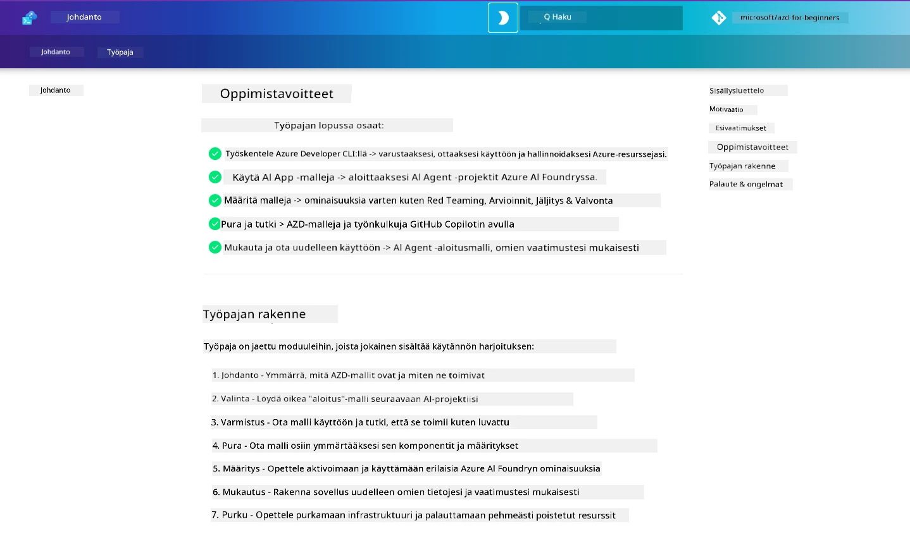

<div align="center">
  <div style="background: linear-gradient(135deg, #0078d4, #106ebe); border-radius: 10px; padding: 20px; margin: 20px 0; box-shadow: 0 4px 15px rgba(0, 120, 212, 0.3); border: 2px solid #005a9e;">
    <h2 style="color: white; margin: 0; font-size: 24px; text-shadow: 1px 1px 2px rgba(0,0,0,0.3);">
      🎯 AZD tekoälykehittäjille -työpaja
    </h2>
    <p style="color: white; margin: 10px 0 0 0; font-size: 16px; text-shadow: 1px 1px 2px rgba(0,0,0,0.3);">
      <strong>Käytännön työpaja tekoälysovellusten rakentamiseen Azure Developer CLI:llä.</strong><br>
      Suorita kaikki 7 moduulia hallitaksesi AZD-mallit ja tekoälyn käyttöönoton työnkulut.
    </p>
    <div style="margin-top: 15px;">
      <span style="background: rgba(255,255,255,0.2); padding: 5px 10px; border-radius: 15px; color: white; font-size: 14px;">
        📅 Lähdeohje tarkistettu: marraskuu 2026
      </span>
    </div>
  </div>
</div>

# AZD tekoälykehittäjille -työpaja

Tervetuloa käytännön työpajaan, jossa opit Azure Developer CLI:n (AZD) tekoälysovellusten käyttöönottoon keskittyen. Tämä työpaja auttaa sinua saamaan käytännön käsityksen AZD-malleista kolmessa vaiheessa:

1. **Löytö** - etsi sinulle sopiva malli.
1. **Käyttöönotto** - ota käyttöön ja vahvista, että se toimii
1. **Mukautus** - muokkaa ja toista, jotta siitä tulee sinun!

Työpajan aikana tutustut myös keskeisiin kehittäjätyökaluihin ja työnkulkuun, jotka auttavat virtaviivaistamaan koko kehityspolkusi.

<br/>

## Selainpohjainen opas

Työpajan oppitunnit ovat Markdown-muodossa. Voit selata niitä suoraan GitHubissa - tai käynnistää selainpohjaisen esikatselun alla olevan kuvakaappauksen mukaisesti.



Käyttääksesi tätä vaihtoehtoa tee fork repositoriosta omaan profiiliisi ja käynnistä GitHub Codespaces. Kun VS Code -pääte on aktiivinen, kirjoita tämä komento:

Tämä selain-esikatselu toimii GitHub Codespacesissa, kehityssäiliöissä tai paikallisessa kopiossa, johon Python ja MkDocs on asennettu.

```bash title="" linenums="0"
python -m pip install -r requirements-dev.txt
python -m mkdocs serve --config-file workshop/mkdocs.yml
```

Suorita nämä komennot **kurssin juurihakemistosta**, älä erikseen alustetusta tekoälyn esimerkkikansiosta. Pidä esikatselu etualalla, jotta virheet näkyvät; pysäytä se Ctrl+C:llä. Tarkistaaksesi sivusto ilman palvelinta, suorita `python -m mkdocs build --strict --config-file workshop/mkdocs.yml`.

Muutamassa sekunnissa näet ponnahdusikkunan. Valitse vaihtoehto `Open in browser`. Selainpohjainen opas avautuu nyt uuteen välilehteen. Tämän esikatselun etuja:

1. **Sisäänrakennettu haku** - löydä avainsanoja tai oppitunteja nopeasti.
1. **Kopioi-kuvake** - vie hiiri koodilohkojen päälle nähdäksesi tämän vaihtoehdon
1. **Teeman vaihto** - vaihda pimeän ja vaalean teeman välillä
1. **Hanki apua** - klikkaa Discord-kuvaketta alatunnisteessa liittyäksesi!

<br/>

## Työpajan yleiskatsaus

**Kesto:** 3-4 tuntia  
**Taso:** Aloittelijasta keskitason käyttäjälle  
**Edellytykset:** Azure-tuntemus, tekoälykonseptit, VS Code ja komentorivityökalut.

Tämä on käytännön työpaja, jossa opit tekemällä. Kun olet suorittanut harjoitukset, suosittelemme tutustumaan AZD Aloittelijoille -oppimateriaaliin jatkaaksesi oppimispolkua turvallisuus- ja tuottavuuskäytäntöihin.

| Aika| Moduuli  | Tavoite |
|:---|:---|:---|
| 15 min | [Johdanto](docs/instructions/0-Introduction.md) | Aloitus, tavoitteiden ymmärtäminen |
| 30 min | [Valitse tekoälymalli](docs/instructions/1-Select-AI-Template.md) | Tutki vaihtoehtoja ja valitse aloitusmalli | 
| 30 min | [Vahvista tekoälymalli](docs/instructions/2-Validate-AI-Template.md) | Ota oletusratkaisu käyttöön Azureen |
| 30 min | [Purkaa tekoälymalli](docs/instructions/3-Deconstruct-AI-Template.md) | Tutki rakennetta ja konfiguraatiota |
| 30 min | [Määritä tekoälymalli](docs/instructions/4-Configure-AI-Template.md) | Aktivoi ja kokeile käytettävissä olevia ominaisuuksia |
| 30 min | [Mukauta tekoälymalli](docs/instructions/5-Customize-AI-Template.md) | Sovita malli tarpeidesi mukaan |
| 30 min | [Pura infrastruktuuri](docs/instructions/6-Teardown-Infrastructure.md) | Siivous ja resurssien vapautus |
| 15 min | [Yhteenveto & seuraavat askeleet](docs/instructions/7-Wrap-up.md) | Oppimateriaalit, työpajahaaste |

<br/>

## Mitä opit

Ajattele AZD-mallia oppimisympäristönä, jossa tutustut Microsoft Foundryn end-to-end-kehitykseen liittyviin eri kyvykkyyksiin ja työkaluihin. Tämän työpajan päätteeksi sinulla pitäisi olla intuitiivinen käsitys erilaisista työkaluista ja käsitteistä tässä yhteydessä.

| Käsite  | Tavoite |
|:---|:---|
| **Azure Developer CLI** | Ymmärrä työkalun komennot ja työnkulut|
| **AZD-mallit**| Ymmärrä projektin rakenne ja konfiguraatio|
| **Azure AI Agentti**| Ota käyttöön ja ota Microsoft Foundry -projekti käyttöön  |
| **Azure AI Haku**| Mahdollista kontekstisuunnittelu agenteilla |
| **Havaittavuus**| Tutki jäljitystä, valvontaa ja arviointeja |
| **Punainen tiimi**| Tutki vastustestauksia ja torjuntakeinoja |

<br/>

## Työpajan rakenne

Työpaja on rakennettu viemään sinut mallin löytämisestä käyttöönottoon, purkamiseen ja mukauttamiseen - käyttämällä virallista [Getting Started with AI Agents](https://github.com/Azure-Samples/get-started-with-ai-agents) aloitusmallia pohjana.

### [Moduuli 1: Valitse tekoälymalli](docs/instructions/1-Select-AI-Template.md) (30 min)

- Mitä ovat tekoälymallit?
- Mistä löydän tekoälymalleja?
- Miten pääsen alkuun tekoälyagenttien rakentamisessa?
- **Harjoitus**: Pikakäynnistys Codespacesissa tai kehityssäiliössä

### [Moduuli 2: Vahvista tekoälymalli](docs/instructions/2-Validate-AI-Template.md) (30 min)

- Mikä on tekoälymallin arkkitehtuuri?
- Mikä on AZD:n kehitystyönkulku?
- Mistä saan apua AZD-kehitykseen?
- **Harjoitus**: Ota käyttöön ja vahvista AI Agents -malli

### [Moduuli 3: Pura tekoälymalli](docs/instructions/3-Deconstruct-AI-Template.md) (30 min)

- Tutki ympäristöäsi `.azure/` 
- Tutki resurssiasetustasi `infra/` 
- Tutki AZD-konfiguraatiotasi `azure.yaml`
- **Harjoitus**: Muokkaa ympäristömuuttujia ja ota uudelleen käyttöön

### [Moduuli 4: Määritä tekoälymalli](docs/instructions/4-Configure-AI-Template.md) (30 min)
- Tutki: Retrieval Augmented Generation
- Tutki: Agenttien arviointi ja punainen tiimi
- Tutki: Jäljitys ja valvonta
- **Harjoitus**: Tutki AI-agenttia + havaittavuutta 

### [Moduuli 5: Mukauta tekoälymalli](docs/instructions/5-Customize-AI-Template.md) (30 min)
- Määritä: PRD skenaariovaatimuksilla
- Konfiguroi: AZD-ympäristömuuttujat
- Toteuta: Elinkaarenaulat lisätehtäville
- **Harjoitus**: Mukauta malli omaan skenaarioosi

### [Moduuli 6: Pura infrastruktuuri](docs/instructions/6-Teardown-Infrastructure.md) (30 min)
- Kertaus: Mitä ovat AZD-mallit?
- Kertaus: Miksi käyttää Azure Developer CLI:tä?
- Seuraavat askeleet: Kokeile toista mallia!
- **Harjoitus**: Poista infrastruktuuri käytöstä ja siivoa

<br/>

## Työpajahaaste

Haluatko haastaa itsesi tekemään enemmän? Tässä muutamia projektiehdotuksia - tai jaa ideasi meille!

| Projekti | Kuvaus |
|:---|:---|
|1. **Purkaa monimutkainen tekoälymalli** | Käytä esitettyä työnkulkua ja työkaluja kokeillaksesi eri tekoälyratkaisun mallin käyttöönottoa, vahvistamista ja mukauttamista. _Mitä opit?_|
|2. **Mukauta omalla skenaariollasi**  | Kirjoita PRD (tuotevaatimusasiakirja) toiselle skenaariolle. Käytä sitten GitHub Copilotia mallivarastossasi Agent Model -tilassa ja pyydä sitä luomaan mukautustyönkulku sinulle. _Mitä opit? Miten voisit parantaa ehdotuksia?_|
| | |

## Palautetta?

1. Luo issue tähän repositorioon - tägää se `Workshop` helpottamaan.
1. Liity Microsoft Foundry Discordiin - verkostoidu vertaisiesi kanssa!


| | | 
|:---|:---|
| **📚 Kurssin kotisivu**| [AZD Aloittelijoille](../README.md)|
| **📖 Dokumentaatio** | [Aloita tekoälymallien kanssa](https://learn.microsoft.com/en-us/azure/ai-foundry/how-to/develop/ai-template-get-started)|
| **🛠️Tekoälymallit** | [Microsoft Foundry -mallit](https://ai.azure.com/templates) |
|**🚀 Seuraavat askeleet** | [Aloita työpaja](#workshop-overview) |
| | |

<br/>

---

**Navigointi:** [Pääkurssi](../README.md) | [Johdanto](docs/instructions/0-Introduction.md) | [Moduuli 1: Valitse malli](docs/instructions/1-Select-AI-Template.md)

**Valmiina aloittamaan tekoälysovellusten rakentamisen AZD:llä?**

[Aloita työpaja: Johdanto →](docs/instructions/0-Introduction.md)

---

<!-- CO-OP TRANSLATOR DISCLAIMER START -->
**Vastuuvapauslauseke**:
Tämä asiakirja on käännetty käyttämällä tekoälypohjaista käännöspalvelua [Co-op Translator](https://github.com/Azure/co-op-translator). Vaikka pyrimme tarkkuuteen, otathan huomioon, että automaattiset käännökset saattavat sisältää virheitä tai epätarkkuuksia. Alkuperäinen asiakirja sen alkuperäiskielellä on virallinen lähde. Tärkeissä asioissa suositellaan ammattimaista ihmiskäännöstä. Emme ole vastuussa tämän käännöksen käytöstä aiheutuvista väärinymmärryksistä tai tulkinnoista.
<!-- CO-OP TRANSLATOR DISCLAIMER END -->