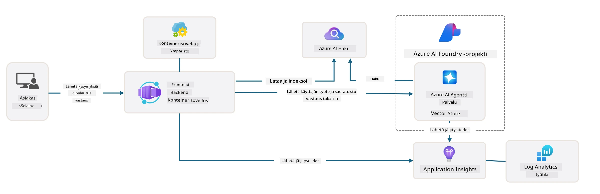

# 3. Tulkitse mallipohja

!!! tip "TÄMÄN MODUULIN PÄÄTTYESSÄ OSAA SEURAAVANLAISET ASIAT"

    - [ ] Use GitHub Copilot and optional MCP tools for Azure documentation and read-only exploration
    - [ ] Identify the template's application, infrastructure, configuration, and test entry points
    - [ ] Verify generated explanations against actual repository files
    - [ ] **Lab 3:** Trace one request and one configuration input through the project

---

## 1. Ota GitHub Copilot käyttöön

Avaa alustettu AI-esimerkki VS Codessa ja ota käyttöön [GitHub Copilot](https://code.visualstudio.com/docs/copilot/chat/chat-agent-mode). Kirjaudu sisään tilillä, jolla on kelvollinen suunnitelma; käyttörajoitukset vaihtelevat. Pyydä Copilotia selittämään repositorio ennen muutosten hyväksymistä.

### Valinnaiset MCP-palvelimet

Nämä palvelut voivat tarjota lisätyökaluja:

- [Azure MCP Server](https://learn.microsoft.com/azure/developer/azure-mcp-server/overview)
- [Microsoft Learn MCP Server](https://learn.microsoft.com/training/support/mcp)

VS Codessa käy läpi [MCP-konfigurointiopas](https://code.visualstudio.com/docs/copilot/chat/mcp-servers) ja luo `.vscode/mcp.json` tarvittaessa:

```json
{
  "servers": {
    "Azure MCP Server": {
      "type": "stdio",
      "command": "npx",
      "args": ["-y", "@azure/mcp@latest", "server", "start"]
    },
    "microsoft.docs.mcp": {
      "type": "http",
      "url": "https://learn.microsoft.com/api/mcp"
    }
  }
}
```

`npx`-komento vaatii tuetun Node.js/npm-asennuksen ja lataa suoritettavan koodin. Tarkista paketti ja lukitse hyväksytty versio toistettavaa tiimin asetusta varten. Käynnistä palvelimet VS Coden MCP-ohjaimilla ja tarkastele niiden käytettävissä olevia työkaluja; nimet voivat muuttua versioiden välillä.

**Todennus on erillinen.** Käytä AZD:n `azd auth login`-komentoa. Noudata Azure MCP:n dokumentoitua todennusprosessia sen työkaluissa; pelkkä AZD-kirjautuminen ei luo MCP-istuntoa. Käytä `az login` erikseen, kun harjoitus tai koukku kutsuu Azure CLI:tä.

Kokeile lukuoikeudella toimivia kehotteita:

1. "Käytä Microsoft Learn MCP:tä löytääksesi Azure Developer CLI:n konfigurointidokumentaation."
2. "Selitä tämän repositorion `azure.yaml`; mainitse tiedostot, jotka toteuttavat kukin koukun."
3. "Käytä saatavilla olevia Azure MCP -työkaluja ja listaa käyttöönotetut resurssini muuttamatta mitään."

Tarkista valittu vuokraaja/tilaus ja jokainen ehdotettu työkalukutsu. Älä hyväksy resurssien luontia, poistoa tai käyttöoikeusmuutoksia pelkästään arkkitehtuurin tutkimiseksi.

## 2. Ymmärrä arkkitehtuuri

Esimerkissä on Python FastAPI -backend ja React/TypeScript-frontend Azure Container Appsissa. Backend kommunikoi agentin kanssa Microsoft Foundry -projektissa. Tietojen hakeminen ja havaittavuus riippuvat mallipohjan ominaisuuksien käytöstä ja onnistuneesta asennuksesta; niitä ei taata vain siksi, että sovellus on otettu käyttöön.



Vertaa tätä kaaviota [nykyiseen upstream-käyttöönotto-oppaaseen](https://github.com/Azure-Samples/get-started-with-ai-agents/blob/main/docs/deployment.md) ja omiin resursseihisi. Tarkista konfiguroitu mallin käyttöönotto, agenttityökalut, hallittu identiteetti, roolijako, ja valinnaiset AI Search/Application Insights -resurssit.

**Harjoitus:** Pyydä Copilotia jäljittämään chat-pyyntö front-endistä API:n kautta Foundryyn, tiedosto- ja funktioviitteineen. Avaa viitteet ja varmista selitys. Älä päättele toteutettua todennusta, reititystä tai valtuutusta pelkästään kaaviosta.

## 3. Repositorion rakenne

Seuraavat valitut polut tarkastettiin esimerkin mukaisesti 4. marraskuuta 2026. Alustettu versiosi on totuuden lähde:

```text
get-started-with-ai-agents/
  azure.yaml
  docker-compose.yaml
  requirements-dev.txt
  .devcontainer/
  infra/
    main.bicep
    main.parameters.json
    api.bicep
    core/
  src/
    Dockerfile
    pyproject.toml
    requirements.txt
    api/
      main.py
      routes.py
      search_index_manager.py
    frontend/
      package.json
      src/
    files/
  scripts/
    validate_env_vars.sh
    validate_env_vars.ps1
    postdeploy.sh
    postdeploy.ps1
  tests/
    test_evaluation.py
    test_red_teaming.py
  docs/
    deployment.md
    deploy_customization.md
    ai_search.md
    observability.md
    local_development.md
    troubleshooting.md
```

### Infrastruktuuri ja konfiguraatio

`infra/main.bicep` orkestroi resursseja; `main.parameters.json` yhdistää mallipohjan syötteet AZD-ympäristöarvoihin. `azure.yaml` valitsee sovelluspalvelun ja elinkaarikoukut. Jäljitä syöte kuten `USE_AZURE_AI_SEARCH_SERVICE` näiden tiedostojen läpi löytääksesi, mikä todellisuudessa muuttuu.

### Sovellus ja identiteetti

Lue `src/api/` ja `src/frontend/` yhdessä. Tunnista, missä agentti luodaan tai haetaan, missä ohjeet/työkalut konfiguroidaan, ja mitä identiteettiä kukin Azure-kutsu käyttää. `src/files/`-kansion alle sijoitetut esimerkkitiedostot ovat demonstraatiodataa, eivät tuotantokatalogi tai valtuutusmalli.

### Testit ja havaittavuus

Nykyiset arviointi- ja red-teaming-päätepisteet ovat `tests/`-kansiossa; vanhat `evals/` ja `airedteaming/` polkuviitteet ovat vanhentuneita tässä esimerkissä. Lue `docs/observability.md` edellytykset ja kustannukset ennen pilvitestien suorittamista. Nämä Python-testit ovat erillään valinnaisesta `azure.ai.evaluations` AZD-laajennuksesta.

## 4. Varmista löydöksesi

- Tunnista API-reitti, agenttiliikenne ja hakukoodi yhdelle esimerkkikysymykselle.
- Selitä, mikä identiteetti pääsee Foundryyn ja mikä konfiguraatio valitsee sen päätepisteen.
- Löydä todelliset pre-up- ja post-deploy-skriptit ja niiden virheenkäsittely.
- Listaa kaikki riippuvuudet tai valinnaiset ominaisuudet, joita asennuksestasi puuttuu.

Jatka [Configure a Template](4-Configure-AI-Template.md).

---

<!-- CO-OP TRANSLATOR DISCLAIMER START -->
**Vastuuvapauslauseke**:
Tämä asiakirja on käännetty käyttämällä tekoälypohjaista käännöspalvelua [Co-op Translator](https://github.com/Azure/co-op-translator). Vaikka pyrimme tarkkuuteen, otathan huomioon, että automaattiset käännökset saattavat sisältää virheitä tai epätarkkuuksia. Alkuperäinen asiakirja sen alkuperäiskielellä on virallinen lähde. Tärkeissä asioissa suositellaan ammattimaista ihmiskäännöstä. Emme ole vastuussa tämän käännöksen käytöstä aiheutuvista väärinymmärryksistä tai tulkinnoista.
<!-- CO-OP TRANSLATOR DISCLAIMER END -->