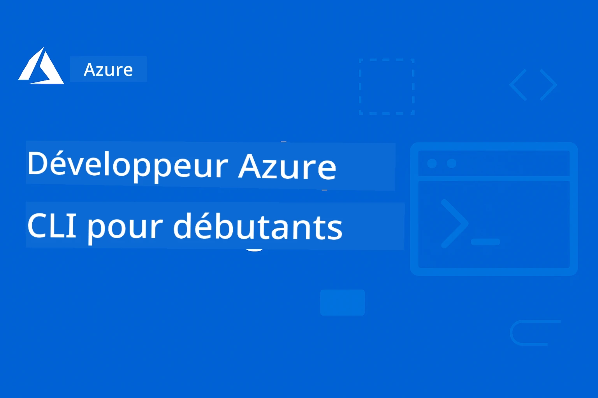

# AZD pour Débutants : Un Parcours d’Apprentissage Structuré

 

[](https://github.com/microsoft/AZD-for-beginners)
[](https://GitHub.com/microsoft/azd-for-beginners/network/)
[](https://github.com/microsoft/AZD-for-beginners)

[](https://discord.com/invite/nkVh3dp)
[](https://discord.gg/nTYy5BXMWG)

---

### Traductions Automatisées (Toujours à Jour)

<!-- CO-OP TRANSLATOR LANGUAGES TABLE START -->
[Arabe](../ar/README.md) | [Bengali](../bn/README.md) | [Bulgare](../bg/README.md) | [Birman (Myanmar)](../my/README.md) | [Chinois (Simplifié)](../zh-CN/README.md) | [Chinois (Traditionnel, Hong Kong)](../zh-HK/README.md) | [Chinois (Traditionnel, Macao)](../zh-MO/README.md) | [Chinois (Traditionnel, Taïwan)](../zh-TW/README.md) | [Croate](../hr/README.md) | [Tchèque](../cs/README.md) | [Danois](../da/README.md) | [Néerlandais](../nl/README.md) | [Estonien](../et/README.md) | [Finnois](../fi/README.md) | [Français](./README.md) | [Allemand](../de/README.md) | [Grec](../el/README.md) | [Hébreu](../he/README.md) | [Hindi](../hi/README.md) | [Hongrois](../hu/README.md) | [Indonésien](../id/README.md) | [Italien](../it/README.md) | [Japonais](../ja/README.md) | [Kannada](../kn/README.md) | [Khmer](../km/README.md) | [Coréen](../ko/README.md) | [Lituanien](../lt/README.md) | [Malais](../ms/README.md) | [Malayalam](../ml/README.md) | [Marathi](../mr/README.md) | [Népalais](../ne/README.md) | [Pidgin Nigérian](../pcm/README.md) | [Norvégien](../no/README.md) | [Persan (Farsi)](../fa/README.md) | [Polonais](../pl/README.md) | [Portugais (Brésil)](../pt-BR/README.md) | [Portugais (Portugal)](../pt-PT/README.md) | [Pendjabi (Gurmukhi)](../pa/README.md) | [Roumain](../ro/README.md) | [Russe](../ru/README.md) | [Serbe (Cyrillique)](../sr/README.md) | [Slovaque](../sk/README.md) | [Slovène](../sl/README.md) | [Espagnol](../es/README.md) | [Swahili](../sw/README.md) | [Suédois](../sv/README.md) | [Tagalog (Filipino)](../tl/README.md) | [Tamoul](../ta/README.md) | [Télougou](../te/README.md) | [Thaï](../th/README.md) | [Turc](../tr/README.md) | [Ukrainien](../uk/README.md) | [Ourdou](../ur/README.md) | [Vietnamien](../vi/README.md)

> **Préférez Cloner Localement ?**
>
> Ce dépôt inclut plus de 50 traductions de langues ce qui augmente considérablement la taille du téléchargement. Pour cloner sans traductions, utilisez le checkout éparse :
>
> **Bash / macOS / Linux :**
> ```bash
> git clone --filter=blob:none --sparse https://github.com/microsoft/AZD-for-beginners.git
> cd AZD-for-beginners
> git sparse-checkout set --no-cone '/*' '!translations' '!translated_images'
> ```
>
> **CMD (Windows) :**
> ```cmd
> git clone --filter=blob:none --sparse https://github.com/microsoft/AZD-for-beginners.git
> cd AZD-for-beginners
> git sparse-checkout set --no-cone "/*" "!translations" "!translated_images"
> ```
>
> Cela vous donne tout ce dont vous avez besoin pour compléter le cours avec un téléchargement beaucoup plus rapide.
<!-- CO-OP TRANSLATOR LANGUAGES TABLE END -->

## 🆕 Quoi de Neuf dans azd Aujourd’hui

> 📌 **Mise à jour Foundry GA (09-11-2026) :** Le **`microsoft.foundry` 1.0 bundle est généralement disponible**, annoncé le [5 novembre 2026](https://devblogs.microsoft.com/azure-sdk/microsoft-foundry-azure-developer-cli-ga/). Utilisez **`azd >= 1.37.0`** et installez-le avec `azd ext install microsoft.foundry`. Suivez le [guide de l’agent hébergé](docs/chapter-02-ai-development/microsoft-foundry-integration.md#hosted-agent-walkthrough-ga) pour la configuration, les tests locaux et le déploiement. Cette mise à jour est basée sur des directives publiées, pas sur un déploiement Azure en direct ; la GA du bundle ne rend pas toutes les fonctionnalités optionnelles, extensions ou SDK généralement disponibles.

Azure Developer CLI prend en charge de nombreux types d'applications, y compris les applications web, les API et les agents IA, via des hôtes, des modèles et des extensions pris en charge.

Voici ce que cela signifie pour vous :

- **Un bundle GA pour le développement Foundry.** `microsoft.foundry` installe sept extensions principales, y compris agents, projets, et Agent Inspector. Le code agent et les paramètres de déploiement restent ensemble dans `azure.yaml`.
- **Testez localement, puis déployez votre code.** Utilisez `azd ai agent init --deploy-mode code`, `azd provision`, et `azd ai agent run` pour inspecter les requêtes et réponses locales. Ensuite, utilisez `azd deploy` pour une construction distante dans Foundry, sans construction locale de conteneur.
- **Mesurez la qualité séparément.** Installez **`azure.ai.evaluations`** pour `azd ai eval generate`, `init`, et `run start`; il n’est pas inclus dans le bundle. Conservez les jeux de données révisés et les grilles d’évaluation avec votre code. Les projets plus anciens doivent suivre le [guide de migration évaluation et optimisation](docs/chapter-08-production/production-ai-practices.md#evaluation-migration-and-quality-checks).
- **Réutilisez la configuration en CI/CD.** Après un `azd up` réussi, configurez un pipeline avec `azd pipeline config`. Installez le bundle sur le runner et conservez les paramètres d’authentification et d’environnement générés.
- **Des bases plus fluides au quotidien.** Les versions récentes ont rendu `azd init` idempotent (sécurisé à relancer), ont fait en sorte que `azd auth login` efface automatiquement les jetons périmés, et ajouté une invite de configuration amicale `azd tool` au premier lancement.
- **Le flux de travail principal n’a pas changé.** Que vous déployiez une application todo, un microservice, ou une solution IA multi-agent, les commandes restent les mêmes.

> **Note pour les utilisateurs Aspire :** Microsoft fait désormais référence au produit simplement comme **Aspire** (anciennement ".NET Aspire"). Le support Aspire d’azd reste inchangé — seul le nom a été mis à jour.

Si vous avez déjà utilisé azd, le support IA est une extension naturelle — pas un outil séparé ni une voie avancée. Si vous commencez, vous apprendrez un seul flux qui fonctionne pour tout.

---

## 🚀 Qu’est-ce que Azure Developer CLI (azd) ?

**Azure Developer CLI (azd)** est un outil en ligne de commande convivial pour les développeurs qui facilite le déploiement d’applications sur Azure. Au lieu de créer et connecter manuellement des dizaines de ressources Azure, vous pouvez déployer des applications entières avec une seule commande.

### La magie de `azd up`

```bash
# This single command does everything:
# ✅ Creates all Azure resources  
# ✅ Configures networking and security
# ✅ Builds your application code
# ✅ Deploys to Azure
# ✅ Gives you a working URL
azd up
```

Le modèle fournit la configuration de l’application et de l’infrastructure. Le déploiement réussi nécessite toujours des services/modèles supportés, un quota et des permissions suffisants, des entrées correctes, et la vérification de l’application déployée. `azd up` ne rend pas automatiquement un modèle sécurisé, conforme, ou prêt pour la production.

---

## ❓ Azure Developer CLI vs Azure CLI : Quelle est la différence ?

C’est la question la plus courante que posent les débutants. Voici la réponse simple :

| Fonctionnalité | **Azure CLI (`az`)** | **Azure Developer CLI (`azd`)** |
|---------|---------------------|--------------------------------|
| **Objectif** | Gérer des ressources Azure individuelles | Déployer des applications complètes |
| **Mentalité** | Axée infrastructure | Axée application |
| **Exemple** | `az webapp create --name myapp...` | `azd up` |
| **Courbe d’apprentissage** | Connaître les services Azure | Connaître votre application |
| **Meilleur pour** | DevOps, Infrastructure | Développeurs, Prototypage |

### Analogie Simple

- **Azure CLI** est comme avoir tous les outils pour construire une maison - marteaux, scies, clous. Vous pouvez tout construire, mais vous devez connaître la construction.
- **Azure Developer CLI** est comme engager un entrepreneur - vous décrivez ce que vous voulez, et il s’occupe de la construction.

### Quand Utiliser Chacun

| Scénario | Utilisez Celui-ci |
|----------|----------|
| "Je veux déployer rapidement mon application web" | `azd up` |
| "J’ai besoin de créer seulement un compte de stockage" | `az storage account create` |
| "Je construis une application IA complète" | `azd init --template azure-search-openai-demo` |
| "Je dois déboguer une ressource Azure spécifique" | `az resource show` |
| "Je veux déployer dans mon environnement de production configuré" | Vérifiez la configuration, les accès, les coûts, et les contraintes opérationnelles avant `azd up --environment production` |

### Ils Fonctionnent Ensemble !

AZD et Azure CLI ont une authentification et une configuration séparées. Utilisez `azd auth login` pour AZD, et `az login` quand une commande hook ou diagnostic a explicitement besoin d'Azure CLI. Vous pouvez utiliser les deux :
```bash
# Deploy your app with AZD
azd up

# Then fine-tune specific resources with Azure CLI
az webapp config set --name myapp --always-on true
```

---

## 🌟 Trouvez des Modèles dans Awesome AZD

Ne commencez pas de zéro ! **Awesome AZD** est la collection communautaire de modèles prêts à déployer :

| Ressource | Description |
|----------|-------------|
| 🔗 [**Galerie Awesome AZD**](https://azure.github.io/awesome-azd/) | Parcourez plus de 200 modèles avec déploiement en un clic |
| 🔗 [**Soumettre un Modèle**](https://github.com/Azure/awesome-azd/issues) | Contribuez votre propre modèle à la communauté |
| 🔗 [**Dépôt GitHub**](https://github.com/Azure/awesome-azd) | Ajoutez aux favoris et explorez la source |

### Modèles IA Populaires d’Awesome AZD

Choisissez un modèle dans son propre répertoire vide ; les commandes ci-dessous sont des alternatives. Le `.` final initialise ce répertoire.

```bash
# RAG Chat with Microsoft Foundry Models + AI Search
azd init --template azure-search-openai-demo .

# Quick AI Chat Application
azd init --template openai-chat-app-quickstart .

# AI Agents with Foundry Agents
azd init --template get-started-with-ai-agents .
```

---

## 🎯 Démarrage en 3 Étapes

Avant de commencer, assurez-vous que votre machine est prête pour le modèle que vous souhaitez déployer :

**Windows :**
```powershell
.\validate-setup.ps1
```

**macOS / Linux :**
```bash
bash ./validate-setup.sh
```

Si une vérification requise échoue, corrigez-la d'abord puis continuez avec le démarrage rapide.

### Étape 1 : Installer AZD (2 minutes)

**Windows :**
```powershell
winget install microsoft.azd
```

**macOS :**
```bash
brew tap azure/azd && brew install azd
```

**Linux :**
```bash
curl -fsSL https://aka.ms/install-azd.sh | bash
```

### Étape 2 : Authentifiez-vous pour AZD

```bash
# Optional if you plan to use Azure CLI commands directly in this course
az login

# Required for AZD workflows
azd auth login
```

Si vous ne savez pas lequel vous faut, suivez le processus complet dans [Installation & Configuration](docs/chapter-01-foundation/installation.md#authentication-setup).

### Étape 3 : Déployez Votre Première Application

```bash
# Initialize from a template
azd init --template todo-nodejs-mongo .

# Deploy to Azure (creates everything!)
azd up
```

**🎉 C’est tout !** Votre application est maintenant en ligne sur Azure.

### Nettoyage (N’oubliez Pas !)

```bash
# Remove all resources when done experimenting
azd down --force --purge
```

---

## 📚 Comment Utiliser Ce Cours

Ce cours est conçu pour un **apprentissage progressif** - commencez où vous vous sentez à l’aise et montez en compétences :

| Votre Niveau | Commencez Ici |
|-----------------|------------|
| **Tout nouveau sur Azure** | [Chapitre 1 : Fondations](#-chapter-1-foundation--quick-start) |
| **Connaissance d’Azure, nouveau sur AZD** | [Chapitre 1 : Fondations](#-chapter-1-foundation--quick-start) |
| **Envie de déployer des apps IA** | [Chapitre 2 : Développement IA en Priorité](#-chapter-2-ai-first-development-recommended-for-ai-developers) |
| **Envie de pratique interactive** | [🎓 Atelier Interactif](workshop/README.md) - labo guidé de 3-4 heures |
| **Besoin de modèles production** | [Chapitre 8 : Production & Entreprise](#-chapter-8-production--enterprise-patterns) |

### Configuration Rapide

1. **Forkez Ce Dépôt** : [](https://GitHub.com/microsoft/azd-for-beginners/fork)
2. **Clonez-le** : `git clone https://github.com/YOUR-USERNAME/azd-for-beginners.git`
3. **Obtenez de l’Aide** : [Communauté Azure Discord](https://discord.com/invite/ByRwuEEgH4)

> **Préférez Cloner Localement ?**

> Ce dépôt inclut plus de 50 traductions linguistiques ce qui augmente considérablement la taille du téléchargement. Pour cloner sans les traductions, utilisez le sparse checkout :
> ```bash
> git clone --filter=blob:none --sparse https://github.com/microsoft/AZD-for-beginners.git
> cd AZD-for-beginners
> git sparse-checkout set --no-cone '/*' '!translations' '!translated_images'
> ```
> Cela vous fournit tout ce dont vous avez besoin pour compléter le cours avec un téléchargement beaucoup plus rapide.


## Vue d'ensemble du cours

Maîtrisez Azure Developer CLI (azd) à travers des chapitres structurés conçus pour un apprentissage progressif. **Accent particulier sur le déploiement d’applications IA avec l’intégration Microsoft Foundry.**

### Pourquoi ce cours est essentiel pour les développeurs modernes

Les développeurs déployant des charges de travail IA ont souvent besoin de conseils sur :
- Architectures IA complexes multi-services
- Bonnes pratiques de déploiement IA en production  
- Intégration et configuration des services IA Azure
- Optimisation des coûts pour les charges IA
- Dépannage des problèmes spécifiques au déploiement IA

### Objectifs d'apprentissage

En complétant ce cours structuré, vous allez :
- **Maîtriser les fondamentaux d’AZD** : Concepts clés, installation, et configuration
- **Déployer des applications IA** : Utiliser AZD avec les services Microsoft Foundry
- **Mettre en œuvre Infrastructure as Code** : Gérer les ressources Azure avec des templates Bicep
- **Dépanner les déploiements** : Résoudre les problèmes courants et déboguer
- **Optimiser pour la production** : Sécurité, montée en charge, monitoring, et gestion des coûts
- **Construire des solutions multi-agents** : Déployer des architectures IA complexes

## Avant de commencer : Comptes, accès, et hypothèses

Avant de débuter le chapitre 1, assurez-vous d’avoir les éléments suivants. Les étapes d’installation plus loin dans ce guide supposent que ces bases sont déjà en place.

- **Un abonnement Azure** : Vous pouvez utiliser un abonnement existant professionnel ou personnel, ou créer un [essai gratuit](https://aka.ms/azurefreetrial) pour commencer.
- **Permission de créer des ressources Azure** : Pour la plupart des exercices, vous devez avoir au moins un accès **Contributeur** sur l’abonnement ou le groupe de ressources cible. Certains chapitres supposent aussi que vous pouvez créer des groupes de ressources, identités gérées et affectations RBAC.
- [**Un compte GitHub**](https://github.com) : Utile pour forker le dépôt, suivre vos propres changements, et utiliser GitHub Codespaces pour l’atelier.
- **Prérequis d’exécution des templates** : Certains templates nécessitent des outils locaux comme Node.js, Python, Java, ou Docker. Exécutez le validateur de configuration avant de commencer pour détecter les outils manquants.
- **Connaissance basique du terminal** : Vous n’avez pas besoin d’être expert, mais vous devriez être à l’aise avec des commandes telles que `git clone`, `azd auth login`, et `azd up`.

> **Vous travaillez dans un abonnement d’entreprise ?**
> Si votre environnement Azure est géré par un administrateur, confirmez à l’avance que vous pouvez déployer des ressources dans l’abonnement ou groupe de ressources prévu. Sinon, demandez un abonnement sandbox ou un accès Contributeur avant de commencer.

> **Nouveau sur Azure ?**
> Commencez avec votre propre essai Azure ou abonnement à la consommation à https://aka.ms/azurefreetrial pour pouvoir réaliser les exercices de bout en bout sans attendre des autorisations au niveau du tenant.

## 🗺️ Plan du cours : Navigation rapide par chapitre

Chaque chapitre dispose d’un README dédié avec objectifs d’apprentissage, démarrages rapides, et exercices :

| Chapitre | Sujet | Leçons | Durée | Complexité |
|---------|-------|---------|----------|------------|
| **[Ch 1 : Fondations](docs/chapter-01-foundation/README.md)** | Premiers pas | [Bases AZD](docs/chapter-01-foundation/azd-basics.md) &#124; [Installation](docs/chapter-01-foundation/installation.md) &#124; [Premier Projet](docs/chapter-01-foundation/first-project.md) | 30-45 min | ⭐ |
| **[Ch 2 : Développement IA](docs/chapter-02-ai-development/README.md)** | Apps IA-first | [Intégration Foundry](docs/chapter-02-ai-development/microsoft-foundry-integration.md) &#124; [Agents IA](docs/chapter-02-ai-development/agents.md) &#124; [Déploiement Modèle](docs/chapter-02-ai-development/ai-model-deployment.md) &#124; [Atelier](docs/chapter-02-ai-development/ai-workshop-lab.md) | 1-2 hrs | ⭐⭐ |
| **[Ch 3 : Configuration](docs/chapter-03-configuration/README.md)** | Auth & Sécurité | [Configuration](docs/chapter-03-configuration/configuration.md) &#124; [Auth & Sécurité](docs/chapter-03-configuration/authsecurity.md) | 45-60 min | ⭐⭐ |
| **[Ch 4 : Infrastructure](docs/chapter-04-infrastructure/README.md)** | IaC & Déploiement | [Guide de déploiement](docs/chapter-04-infrastructure/deployment-guide.md) &#124; [Provisioning](docs/chapter-04-infrastructure/provisioning.md) | 1-1.5 hrs | ⭐⭐⭐ |
| **[Ch 5 : Multi-Agent](docs/chapter-05-multi-agent/README.md)** | Solutions Agents IA | [Scénario Retail](examples/retail-scenario.md) &#124; [Patterns de coordination](docs/chapter-06-pre-deployment/coordination-patterns.md) | 2-3 hrs | ⭐⭐⭐⭐ |
| **[Ch 6 : Pré-déploiement](docs/chapter-06-pre-deployment/README.md)** | Planification & Validation | [Prévol](docs/chapter-06-pre-deployment/preflight-checks.md) &#124; [Planification capacité](docs/chapter-06-pre-deployment/capacity-planning.md) &#124; [Sélection SKU](docs/chapter-06-pre-deployment/sku-selection.md) &#124; [App Insights](docs/chapter-06-pre-deployment/application-insights.md) | 1 hr | ⭐⭐ |
| **[Ch 7 : Dépannage](docs/chapter-07-troubleshooting/README.md)** | Debug & Correction | [Problèmes courants](docs/chapter-07-troubleshooting/common-issues.md) &#124; [Débogage](docs/chapter-07-troubleshooting/debugging.md) &#124; [Problèmes IA](docs/chapter-07-troubleshooting/ai-troubleshooting.md) | 1-1.5 hrs | ⭐⭐ |
| **[Ch 8 : Production](docs/chapter-08-production/README.md)** | Patterns entreprise | [Pratiques en production](docs/chapter-08-production/production-ai-practices.md) | 2-3 hrs | ⭐⭐⭐⭐ |
| **[🎓 Atelier](workshop/README.md)** | Lab pratique | [Introduction](workshop/docs/instructions/0-Introduction.md) &#124; [Sélection](workshop/docs/instructions/1-Select-AI-Template.md) &#124; [Validation](workshop/docs/instructions/2-Validate-AI-Template.md) &#124; [Déconstruction](workshop/docs/instructions/3-Deconstruct-AI-Template.md) &#124; [Configuration](workshop/docs/instructions/4-Configure-AI-Template.md) &#124; [Personnalisation](workshop/docs/instructions/5-Customize-AI-Template.md) &#124; [Démontage](workshop/docs/instructions/6-Teardown-Infrastructure.md) &#124; [Conclusion](workshop/docs/instructions/7-Wrap-up.md) | 3-4 hrs | ⭐⭐ |

**Durée totale du cours:** ~10-14 heures | **Progression de compétence:** Débutant → Production

---

## 📚 Chapitres d’apprentissage

*Sélectionnez votre parcours selon votre niveau et vos objectifs*

### 🚀 Chapitre 1 : Fondations & Démarrage rapide
**Prérequis** : abonnement Azure, connaissance basique de la ligne de commande  
**Durée** : 30-45 minutes  
**Complexité** : ⭐

#### Ce que vous apprendrez
- Compréhension des fondamentaux d’Azure Developer CLI
- Installation d’AZD sur votre plateforme
- Votre premier déploiement réussi

#### Ressources d’apprentissage
- **🎯 Commencez ici** : [Qu’est-ce qu’Azure Developer CLI ?](#-what-is-azure-developer-cli-azd)
- **📖 Théorie** : [Bases AZD](docs/chapter-01-foundation/azd-basics.md) - Concepts clés et terminologie
- **⚙️ Installation** : [Installation & Configuration](docs/chapter-01-foundation/installation.md) - Guides spécifiques à la plateforme
- **🛠️ Pratique** : [Votre premier projet](docs/chapter-01-foundation/first-project.md) - Tutoriel étape par étape
- **📋 Référence rapide** : [Cheat Sheet commandes](resources/cheat-sheet.md)

#### Exercices pratiques
```bash
# Quick installation check
azd version

# Deploy your first application
azd init --template todo-nodejs-mongo .
azd up
```

**💡 Résultat du chapitre** : Déployer avec succès une application web simple sur Azure à l’aide d’AZD

**✅ Validation de réussite :**
```bash
# After completing Chapter 1, you should be able to:
azd version              # Shows installed version
azd init --template todo-nodejs-mongo  # Initializes project
azd up                  # Deploys to Azure
azd show                # Displays running app URL
# Application opens in browser and works
azd down --force --purge  # Cleans up resources
```

**📊 Temps investi :** 30-45 minutes  
**📈 Niveau après :** Capable de déployer des applications de base en autonomie

---

### 🤖 Chapitre 2 : Développement IA-Première (Recommandé aux développeurs IA)
**Prérequis** : Chapitre 1 terminé  
**Durée** : 1-2 heures  
**Complexité** : ⭐⭐

#### Ce que vous apprendrez
- Intégration Microsoft Foundry avec AZD
- Déploiement d’applications alimentées par IA
- Compréhension de la configuration des services IA

#### Ressources d’apprentissage
- **🎯 Commencez ici** : [Intégration Microsoft Foundry](docs/chapter-02-ai-development/microsoft-foundry-integration.md)
- **🤖 Agents IA** : [Guide Agents IA](docs/chapter-02-ai-development/agents.md) - Déployer des agents intelligents avec AZD
- **📖 Modèles** : [Déploiement modèle IA](docs/chapter-02-ai-development/ai-model-deployment.md) - Déployer et gérer des modèles IA
- **🛠️ Atelier** : [Laboratoire IA](docs/chapter-02-ai-development/ai-workshop-lab.md) - Rendre vos solutions IA compatibles AZD
- **🎥 Guide interactif** : [Matériel atelier](workshop/README.md) - Apprentissage navigateur avec MkDocs * Environnement DevContainer
- **📋 Templates** : [Templates Microsoft Foundry](#featured-microsoft-foundry-templates)
- **📝 Exemples** : [Exemples déploiement AZD](examples/README.md)

#### Exercices pratiques
```bash
# Deploy your first AI application
azd init --template azure-search-openai-demo .
azd up

# Try additional AI templates
azd init --template openai-chat-app-quickstart .
azd init --template agent-openai-python-prompty .
```

**💡 Résultat du chapitre** : Déployer et configurer une application de chat alimentée par IA avec des capacités RAG

**✅ Validation de réussite :**
```bash
# After Chapter 2, you should be able to:
azd init --template azure-search-openai-demo .
azd up
# Test the AI chat interface
# Ask questions and get AI-powered responses with sources
# Verify search integration works
azd monitor  # Check Application Insights shows telemetry
azd down --force --purge
```

**📊 Temps investi :** 1-2 heures  
**📈 Niveau après :** Capable de déployer des applications d’apprentissage IA et d’identifier des besoins supplémentaires en préparation production
**💰 Sensibilisation aux coûts :** Comprendre $80-150/mois pour dev, $300-3500/mois pour production

#### 💰 Considérations de coûts pour les déploiements IA

**Environnement de développement (Estimé $80-150/mois) :**
- Modèles Microsoft Foundry (Paiement à l’usage) : $0-50/mois (basé sur l’utilisation de tokens)
- Recherche IA (niveau basique) : $75/mois
- Container Apps (Consommation) : $0-20/mois
- Stockage (Standard) : $1-5/mois

**Environnement production (Estimé $300-3,500+/mois) :**
- Modèles Microsoft Foundry (PTU pour performance constante) : $3,000+/mois OU paiement à l’usage avec volume élevé
- Recherche IA (niveau standard) : $250/mois
- Container Apps (Dédié) : $50-100/mois
- Application Insights : $5-50/mois
- Stockage (Premium) : $10-50/mois

**💡 Conseils d’optimisation des coûts :**
- Vérifiez les prix d’inférence des modèles et les crédits spécifiques au compte ; Azure OpenAI n’inclut pas d’allocation universelle gratuite de 50 000 tokens par mois
- Exécutez `azd down` pour supprimer les ressources quand elles ne sont plus nécessaires, après avoir revu l’environnement sélectionné
- Commencez par une facturation à la consommation, passez au PTU uniquement en production
- Utilisez `azd provision --preview` pour inspecter l’infrastructure planifiée, puis tarifez les ressources résultantes avec le Calculateur de prix Azure
- Activez l’auto-scaling : payez uniquement pour l’usage réel

**Suivi des coûts :**
```bash
# Inspect planned resources (this does not calculate prices)
azd provision --preview

# Monitor actual costs in Azure Portal
az consumption budget list --resource-group <your-rg>
```

---

### ⚙️ Chapitre 3 : Configuration & Authentification
**Prérequis** : Chapitre 1 terminé  
**Durée** : 45-60 minutes  
**Complexité** : ⭐⭐

#### Ce que vous apprendrez
- Configuration et gestion d’environnement
- Meilleures pratiques en authentification et sécurité
- Nommage et organisation des ressources

#### Ressources d’apprentissage
- **📖 Configuration** : [Guide de configuration](docs/chapter-03-configuration/configuration.md) - Mise en place de l’environnement
- **🔐 Sécurité** : [Patterns d’authentification et identité gérée](docs/chapter-03-configuration/authsecurity.md) - Patterns d’authentification
- **📝 Exemples** : [Exemple app base de données](examples/database-app/README.md) - Exemples AZD base de données

#### Exercices pratiques
- Configurer plusieurs environnements (dev, staging, prod)
- Mettre en place l’authentification identité gérée
- Implémenter des configurations spécifiques à chaque environnement

**💡 Résultat du chapitre** : Gérer plusieurs environnements avec authentification et sécurité appropriées

---

### 🏗️ Chapitre 4 : Infrastructure as Code & Déploiement
**Prérequis** : Chapitres 1-3 terminés  
**Durée** : 1-1.5 heures  
**Complexité** : ⭐⭐⭐

#### Ce que vous apprendrez
- Patterns avancés de déploiement
- Infrastructure as Code avec Bicep
- Stratégies de provisioning des ressources

#### Ressources d’apprentissage
- **📖 Déploiement** : [Guide de déploiement](docs/chapter-04-infrastructure/deployment-guide.md) - Flux complets
- **🏗️ Provisioning** : [Provision des ressources](docs/chapter-04-infrastructure/provisioning.md) - Gestion des ressources Azure
- **📝 Exemples** : [Exemple Container App](../../examples/container-app) - Déploiements containerisés

#### Exercices pratiques
- Créer des templates Bicep personnalisés
- Déployer des applications multi-services
- Implémenter des stratégies de déploiement blue-green

**💡 Résultat du chapitre** : Déployer des applications complexes multi-services avec des templates infrastructure personnalisés

---

### 🎯 Chapitre 5 : Solutions IA Multi-Agent (Avancé)
**Prérequis** : Chapitres 1-2 terminés  
**Durée** : 2-3 heures  
**Complexité** : ⭐⭐⭐⭐

#### Ce que vous apprendrez
- Patterns d’architecture multi-agent
- Orchestration et coordination des agents
- Déploiements IA prêts pour la production

#### Ressources d’apprentissage
- **🤖 Conception en vedette** : [Solution multi-agent pour le commerce de détail](examples/retail-scenario.md) - Plan d'architecture, pas une application complète
- **🛠️ Modèles ARM** : [Package de modèle ARM](../../examples/retail-multiagent-arm-template) - Structure d'infrastructure ; revoir les prérequis et les composants d'application manquants
- **📖 Architecture** : [Modèles de coordination multi-agent](docs/chapter-06-pre-deployment/coordination-patterns.md) - Modèles

#### Exercices pratiques
```bash
# Inspect the retail infrastructure scaffold before choosing to deploy it
cd examples/retail-multiagent-arm-template
cat README.md

# After an intentional deployment, inspect infrastructure state
az deployment group show --resource-group <rg-name> --name <deployment-name>
```

**💡 Résultat du chapitre** : Comprendre la conception multi-agent et identifier le travail d'implémentation, de validation et opérationnel nécessaire au-delà d'une structure d'infrastructure

---

### 🔍 Chapitre 6 : Validation & planification avant déploiement
**Prérequis** : Chapitre 4 complété  
**Durée** : 1 heure  
**Complexité** : ⭐⭐

#### Ce que vous apprendrez
- Planification de capacité et validation des ressources
- Stratégies de sélection de SKU
- Contrôles préalables et automatisation

#### Ressources d'apprentissage
- **📊 Planification** : [Planification de la capacité](docs/chapter-06-pre-deployment/capacity-planning.md) - Validation des ressources
- **💰 Sélection** : [Sélection de SKU](docs/chapter-06-pre-deployment/sku-selection.md) - Choix rentables
- **✅ Validation** : [Contrôles préalables](docs/chapter-06-pre-deployment/preflight-checks.md) - Scripts automatisés

#### Exercices pratiques
- Exécuter des scripts de validation de capacité
- Optimiser les sélections de SKU pour le coût
- Mettre en œuvre des contrôles automatisés avant déploiement

**💡 Résultat du chapitre** : Valider et optimiser les déploiements avant exécution

---

### 🚨 Chapitre 7 : Résolution de problèmes & débogage
**Prérequis** : N'importe quel chapitre de déploiement complété  
**Durée** : 1 à 1,5 heures  
**Complexité** : ⭐⭐

#### Ce que vous apprendrez
- Méthodes systématiques de débogage
- Problèmes courants et solutions
- Dépannage spécifique à l'IA

#### Ressources d'apprentissage
- **🔧 Problèmes courants** : [Problèmes courants](docs/chapter-07-troubleshooting/common-issues.md) - FAQ et solutions
- **🕵️ Débogage** : [Guide de débogage](docs/chapter-07-troubleshooting/debugging.md) - Stratégies étape par étape
- **🤖 Problèmes IA** : [Dépannage spécifique à l'IA](docs/chapter-07-troubleshooting/ai-troubleshooting.md) - Problèmes des services IA

#### Exercices pratiques
- Diagnostiquer des échecs de déploiement
- Résoudre des problèmes d'authentification
- Déboguer la connectivité des services IA

**💡 Résultat du chapitre** : Diagnostiquer et résoudre de manière autonome les problèmes courants de déploiement

---

### 🏢 Chapitre 8 : Modèles de production & entreprise
**Prérequis** : Chapitres 1 à 4 complétés  
**Durée** : 2 à 3 heures  
**Complexité** : ⭐⭐⭐⭐

#### Ce que vous apprendrez
- Stratégies de déploiement en production
- Modèles de sécurité en entreprise
- Supervision et optimisation des coûts

#### Ressources d'apprentissage
- **🏭 Production** : [Meilleures pratiques IA en production](docs/chapter-08-production/production-ai-practices.md) - Modèles d'entreprise
- **📝 Exemples** : [Exemple de microservices](../../examples/microservices) - Architectures complexes
- **📊 Supervision** : [Intégration Application Insights](docs/chapter-06-pre-deployment/application-insights.md) - Supervision

#### Exercices pratiques
- Mettre en œuvre des modèles de sécurité en entreprise
- Mettre en place une supervision complète
- Déployer en production avec une gouvernance appropriée

**💡 Résultat du chapitre** : Déployer des applications prêtes pour l'entreprise avec toutes les capacités de production

---

## 🎓 Aperçu de l'atelier : expérience d'apprentissage pratique

> **⚠️ STATUT DE L'ATELIER : Développement actif**  
> Les matériaux de l'atelier sont en cours de développement et de raffinement. Les modules de base fonctionnent, mais certaines sections avancées sont incomplètes. Nous travaillons activement à finaliser tout le contenu. [Suivre les progrès →](workshop/README.md)

### Matériel interactif de l'atelier
**Apprentissage pratique complet avec outils basés sur navigateur et exercices guidés**

Nos supports d'atelier offrent une expérience d'apprentissage interactive et structurée qui complète le programme basé sur les chapitres ci-dessus. L'atelier est conçu pour l'apprentissage autonome et les sessions dirigées par un instructeur.

#### 🛠️ Fonctionnalités de l'atelier
- **Interface basée navigateur** : atelier complet propulsé par MkDocs avec recherche, copie, et fonctionnalités de thème
- **Intégration GitHub Codespaces** : configuration d'environnement de développement en un clic
- **Parcours d'apprentissage structuré** : 8 modules d'exercices guidés (3-4 heures au total)
- **Méthodologie progressive** : Introduction → Sélection → Validation → Déconstruction → Configuration → Personnalisation → Démantèlement → Conclusion
- **Environnement DevContainer interactif** : Outils et dépendances préconfigurés

#### 📚 Structure des modules de l'atelier
L'atelier suit une **méthodologie progressive en 8 modules** qui vous mène de la découverte à la maîtrise du déploiement :

| Module | Sujet | Ce que vous ferez | Durée |
|--------|-------|----------------|----------|
| **0. Introduction** | Aperçu de l'atelier | Comprendre les objectifs d'apprentissage, les prérequis, et la structure de l'atelier | 15 min |
| **1. Sélection** | Découverte des modèles | Explorer les modèles AZD et choisir le modèle AI adapté à votre scénario | 20 min |
| **2. Validation** | Déployer & vérifier | Déployer le modèle avec `azd up` et valider l'infrastructure | 30 min |
| **3. Déconstruction** | Comprendre la structure | Utiliser GitHub Copilot pour explorer l'architecture du modèle, les fichiers Bicep, et l'organisation du code | 30 min |
| **4. Configuration** | Approfondissement azure.yaml | Maîtriser la configuration `azure.yaml`, les hooks de cycle de vie, et les variables d'environnement | 30 min |
| **5. Personnalisation** | Faites-le vôtre | Activer la recherche AI, le traçage, l'évaluation, et personnaliser selon votre scénario | 45 min |
| **6. Démantèlement** | Nettoyer | Déprovisionner en toute sécurité les ressources avec `azd down --purge` | 15 min |
| **7. Conclusion** | Étapes suivantes | Revoir les acquis, concepts clés, et poursuivre votre parcours d'apprentissage | 15 min |

**Déroulement de l'atelier :**
```
Introduction → Selection → Validation → Deconstruction → Configuration → Customization → Teardown → Wrap-up
     ↓            ↓           ↓              ↓               ↓              ↓            ↓           ↓
  Overview    Find the     Deploy &      Explore        Master         Customize     Clean up    Review &
             right        verify        code &        azure.yaml      for your      resources   next steps
             template                   structure                     scenario
```

#### 🚀 Commencer avec l'atelier
```bash
# Option 1: GitHub Codespaces (Recommended)
# Click "Code" → "Create codespace on main" in the repository

# Option 2: Local Development
git clone https://github.com/microsoft/azd-for-beginners.git
cd azd-for-beginners/workshop
# Follow the setup instructions in workshop/README.md
```

#### 🎯 Résultats d'apprentissage de l'atelier
En complétant l'atelier, les participants pourront :
- **Déployer des applications AI en production** : Utiliser AZD avec les services Microsoft Foundry
- **Maîtriser les architectures multi-agents** : Implémenter des solutions d'agents AI coordonnés
- **Mettre en œuvre les meilleures pratiques de sécurité** : Configurer l'authentification et le contrôle d'accès
- **Optimiser pour l'échelle** : Concevoir des déploiements performants et rentables
- **Résoudre des problèmes de déploiement** : Résoudre de manière autonome les problèmes courants

#### 📖 Ressources de l'atelier
- **🎥 Guide interactif** : [Matériel de l'atelier](workshop/README.md) - Environnement d'apprentissage basé sur navigateur
- **📋 Instructions module par module** :
  - [0. Introduction](workshop/docs/instructions/0-Introduction.md) - Aperçu et objectifs de l'atelier
  - [1. Sélection](workshop/docs/instructions/1-Select-AI-Template.md) - Trouver et choisir des modèles AI
  - [2. Validation](workshop/docs/instructions/2-Validate-AI-Template.md) - Déployer et valider les modèles
  - [3. Déconstruction](workshop/docs/instructions/3-Deconstruct-AI-Template.md) - Explorer l'architecture du modèle
  - [4. Configuration](workshop/docs/instructions/4-Configure-AI-Template.md) - Maîtriser azure.yaml
  - [5. Personnalisation](workshop/docs/instructions/5-Customize-AI-Template.md) - Personnaliser pour votre scénario
  - [6. Démantèlement](workshop/docs/instructions/6-Teardown-Infrastructure.md) - Nettoyer les ressources
  - [7. Conclusion](workshop/docs/instructions/7-Wrap-up.md) - Revue et étapes suivantes
- **🛠️ Laboratoire AI** : [Laboratoire AI](docs/chapter-02-ai-development/ai-workshop-lab.md) - Exercices axés sur l'IA
- **💡 Démarrage rapide** : [Guide d'installation de l'atelier](workshop/README.md#browser-based-guide) - Configuration de l'environnement

**Parfait pour** : Formation en entreprise, cours universitaires, apprentissage autonome et bootcamps développeurs.

---

## 📖 Approfondissement : Capacités AZD

Au-delà des bases, AZD offre des fonctionnalités puissantes pour les déploiements en production :

- **Déploiements basés sur des modèles** - Utiliser des modèles préconstruits pour les schémas d'application courants
- **Infrastructure as Code** - Gérer les ressources Azure avec Bicep ou Terraform  
- **Flux de travail intégrés** - Provisionner, déployer et surveiller les applications sans couture
- **Convivial pour les développeurs** - Optimisé pour la productivité et l'expérience développeur

### **AZD + Microsoft Foundry : Parfait pour les déploiements AI**

**Pourquoi AZD pour les solutions AI ?** AZD répond aux principaux défis rencontrés par les développeurs AI :

- **Modèles prêts pour l'AI** - Modèles préconfigurés pour les modèles Microsoft Foundry, services AI Azure, et charges ML
- **Déploiements AI sécurisés** - Modèles de sécurité intégrés pour les services AI, clés API, et points de terminaison modèles  
- **Modèles AI en production** - Meilleures pratiques pour des déploiements AI évolutifs et rentables
- **Flux AI bout-en-bout** - Du développement du modèle au déploiement en production avec supervision adéquate
- **Optimisation des coûts** - Allocation intelligente des ressources et stratégies de mise à l'échelle pour les charges AI
- **Intégration Microsoft Foundry** - Connexion transparente au catalogue et points de terminaison de modèles Microsoft Foundry

---

## 🎯 Bibliothèque de modèles & exemples

### En vedette : Modèles Microsoft Foundry
**Commencez ici si vous déployez des applications AI !**

> **Note :** Ces modèles démontrent divers schémas AI. Certains sont des exemples Azure externes, d'autres des implémentations locales.

| Modèle | Chapitre | Complexité | Services | Type |
|----------|---------|------------|----------|------|
| [**Commencer avec le chat AI**](https://github.com/Azure-Samples/get-started-with-ai-chat) | Chapitre 2 | ⭐⭐ | AzureOpenAI + Azure AI Model Inference API + Azure AI Search + Azure Container Apps + Application Insights | Externe |
| [**Commencer avec les agents AI**](https://github.com/Azure-Samples/get-started-with-ai-agents) | Chapitre 2 | ⭐⭐ | Agents Foundry + AzureOpenAI + Azure AI Search + Azure Container Apps + Application Insights| Externe |
| [**Démonstration Azure Search + OpenAI**](https://github.com/Azure-Samples/azure-search-openai-demo) | Chapitre 2 | ⭐⭐ | Azure OpenAI + Azure AI Search + Container Apps (par défaut) + Stockage | Externe |
| [**Démarrage rapide application chat OpenAI**](https://github.com/Azure-Samples/openai-chat-app-quickstart) | Chapitre 2 | ⭐ | AzureOpenAI + Container Apps + Application Insights | Externe |
| [**Agent OpenAI Python Prompty**](https://github.com/Azure-Samples/agent-openai-python-prompty) | Chapitre 5 | ⭐⭐⭐ | AzureOpenAI + Azure Functions + Prompty | Externe |
| [**Contoso Chat RAG**](https://github.com/Azure-Samples/contoso-chat) | Chapitre 8 | ⭐⭐⭐⭐ | AzureOpenAI + AI Search + Cosmos DB + Container Apps | Externe |
| [**Solution multi-agent Retail**](examples/retail-scenario.md) | Chapitre 5 | ⭐⭐⭐⭐ | Plan d'architecture proposé et structure d'infrastructure ; implémentation de l'application requise | **Plan local** |

### En vedette : Scénarios d'apprentissage complets
**Modèles d'applications prêts pour la production associés aux chapitres d'apprentissage**

| Modèle | Chapitre d'apprentissage | Complexité | Apprentissage clé |
|----------|------------------|------------|--------------|
| [**openai-chat-app-quickstart**](https://github.com/Azure-Samples/openai-chat-app-quickstart) | Chapitre 2 | ⭐ | Modèles de déploiement AI basiques |
| [**azure-search-openai-demo**](https://github.com/Azure-Samples/azure-search-openai-demo) | Chapitre 2 | ⭐⭐ | Implémentation RAG avec Azure AI Search |
| [**get-started-with-ai-agents**](https://github.com/Azure-Samples/get-started-with-ai-agents) | Chapitre 2 | ⭐⭐ | Chat avec agents et tests d'évaluation spécifiques à l'exemple |
| [**agent-openai-python-prompty**](https://github.com/Azure-Samples/agent-openai-python-prompty) | Chapitre 5 | ⭐⭐⭐ | Cadre agent et appels de fonctions |
| [**contoso-chat**](https://github.com/Azure-Samples/contoso-chat) | Chapitre 8 | ⭐⭐⭐ | Orchestration AI en entreprise |
| [**retail-multi-agent-solution**](examples/retail-scenario.md) | Chapitre 5 | ⭐⭐⭐⭐ | Architecture multi-agent avec agents Client et Inventaire |

### Apprentissage par type d'exemple

> **📌 Exemples locaux vs externes :**  
> **Exemples locaux** (dans ce dépôt) = Consultez le README de l'exemple pour le statut d'implémentation et les prérequis
> **Exemples externes** (échantillons Azure) = Clonez depuis les dépôts liés

#### Exemples locaux (prêts à l'emploi)
- [**Solution multi-agent Retail**](examples/retail-scenario.md) - Plan d'architecture avec structure d'infrastructure ARM
  - Rôles proposés d'agents Client et Inventaire
  - Supervision, évaluation, et code applicatif à implémenter et vérifier
  - Le simple provisionnement des ressources ne produit pas une application retail fonctionnelle

#### Exemples locaux - Applications Container (Chapitres 2-5)
**Exemples complets de déploiement de conteneurs dans ce dépôt :**
- [**Exemples d'applications Container**](examples/container-app/README.md) - Guide complet pour les déploiements conteneurisés
  - [API Flask simple](../../examples/container-app/simple-flask-api) - API REST basique avec scale-to-zero
  - [Architecture microservices](../../examples/container-app/microservices) - Exemple d'apprentissage à deux services ; durcissement en production est un travail supplémentaire
  - Modèles de démarrage rapide, production, et avancés de déploiement
  - Guide de supervision, sécurité, et optimisation des coûts

#### Exemples externes - Applications simples (Chapitres 1-2)
**Clonez ces dépôts d'échantillons Azure pour commencer :**
- [Application web simple - Node.js + MongoDB](https://github.com/Azure-Samples/todo-nodejs-mongo) - Modèles de déploiement basiques
- [Site web statique - React SPA](https://github.com/Azure-Samples/todo-csharp-sql-swa-func) - Déploiement de contenu statique
- [Container App - Python Flask](https://github.com/Azure-Samples/container-apps-store-api-microservice) - Déploiement d'API REST  

#### Exemples externes - Intégration de base de données (Chapitre 3-4)  
- [Database App - C# + SQL](https://github.com/Azure-Samples/todo-csharp-sql) - Modèles de connectivité base de données  
- [Functions + Cosmos DB](https://github.com/Azure-Samples/todo-python-mongo-swa-func) - Flux de données serverless  

#### Exemples externes - Modèles avancés (Chapitres 4-8)  
- [Java Microservices](https://github.com/Azure-Samples/java-microservices-aca-lab) - Architectures multi-services  
- [Container Apps Jobs](https://github.com/Azure-Samples/container-apps-jobs) - Traitement en arrière-plan  
- [Enterprise ML Pipeline](https://github.com/Azure/mlops-v2) - Modèles de référence MLOps ; pas un template AZD prêt à l'emploi  

### Collections de templates externes  
- [**Galerie officielle des templates AZD**](https://azure.github.io/awesome-azd/) - Collection sélectionnée de templates officiels et communautaires  
- [**Templates Azure Developer CLI**](https://learn.microsoft.com/en-us/azure/developer/azure-developer-cli/azd-templates) - Documentation des templates Microsoft Learn  
- [**Répertoire d'exemples**](examples/README.md) - Exemples d’apprentissage locaux avec explications détaillées  

---

## 📚 Ressources d'apprentissage & Références  

### Références rapides  
- [**Fiche de commandes**](resources/cheat-sheet.md) - Commandes azd essentielles organisées par chapitre  
- [**Glossaire**](resources/glossary.md) - Terminologie Azure et azd  
- [**FAQ**](resources/faq.md) - Questions courantes organisées par chapitre d'apprentissage  
- [**Guide d'étude**](resources/study-guide.md) - Exercices pratiques complets  

### Ateliers pratiques  
- [**Atelier AI**](docs/chapter-02-ai-development/ai-workshop-lab.md) - Rendez vos solutions IA déployables avec AZD (2-3 heures)  
- [**Atelier interactif**](workshop/README.md) - Exercices guidés en 8 modules avec MkDocs et GitHub Codespaces  
  - Suit : Introduction → Sélection → Validation → Déconstruction → Configuration → Personnalisation → Démontage → Conclusion  

### Ressources d'apprentissage externes  
- [Documentation Azure Developer CLI](https://learn.microsoft.com/en-us/azure/developer/azure-developer-cli/)  
- [Centre d’architecture Azure](https://learn.microsoft.com/en-us/azure/architecture/)  
- [Calculateur de prix Azure](https://azure.microsoft.com/pricing/calculator/)  
- [Statut Azure](https://status.azure.com/)  

### Compétences d'agents IA pour votre éditeur  
- [**Compétences Microsoft Azure sur skills.sh**](https://skills.sh/microsoft/github-copilot-for-azure) - 37 compétences d’agents ouvertes pour Azure AI, Foundry, déploiement, diagnostics, optimisation des coûts, etc. Installez-les dans GitHub Copilot, Cursor, Claude Code, ou tout autre agent supporté :  
  ```bash
  npx skills add microsoft/github-copilot-for-azure
  ```

---

## 🔧 Guide rapide de dépannage  

**Problèmes courants chez les débutants et solutions immédiates :**  

<details>
<summary><strong>❌ "azd : commande introuvable"</strong></summary>

```bash
# Install AZD first
# Windows (PowerShell):
winget install microsoft.azd

# macOS:
brew tap azure/azd && brew install azd

# Linux:
curl -fsSL https://aka.ms/install-azd.sh | bash

# Verify installation
azd version
```
</details>

<details>
<summary><strong>❌ "Aucun abonnement trouvé" ou "Abonnement non défini"</strong></summary>

```bash
# List available subscriptions
az account list --output table

# Set default subscription
az account set --subscription "<subscription-id-or-name>"

# Set for AZD environment
azd env set AZURE_SUBSCRIPTION_ID "<subscription-id>"

# Verify
az account show
```
</details>

<details>
<summary><strong>❌ "Quota insuffisant" ou "Quota dépassé"</strong></summary>

```bash
# Try different Azure region
azd env set AZURE_LOCATION "westus2"
azd up

# Or use smaller SKUs in development
# Edit infra/main.parameters.json:
{
  "sku": "B1"  // Instead of "P1V2"
}
```
</details>

<details>
<summary><strong>❌ "azd up" échoue en cours d’exécution</strong></summary>

```bash
# Option 1: Inspect the error and retry after correcting its cause
azd show
azd up --debug

# Option 2: Just fix infrastructure
azd provision

# Option 3: Check detailed status
azd show

# Option 4: Check logs in Azure Monitor
azd monitor --logs
```
</details>

<details>
<summary><strong>❌ "Échec d’authentification" ou "Token expiré"</strong></summary>

```bash
# Re-authenticate for AZD
azd auth logout
azd auth login

# Optional: refresh Azure CLI too if you are running az commands
az logout
az login

# Verify authentication
az account show
```
</details>

<details>
<summary><strong>❌ "Ressource déjà existante" ou conflit de nommage</strong></summary>

```bash
# Inspect the conflicting resource before changing or deleting anything.
# For an isolated new deployment, create a separate environment:
azd env new dev-v2
azd up
```
</details>

<details>
<summary><strong>❌ Déploiement du template trop long</strong></summary>

**Temps d’attente normal :**  
- Application web simple : 5-10 minutes  
- Application avec base de données : 10-15 minutes  
- Applications IA : 15-25 minutes (approvisionnement OpenAI lent)  

```bash
# Check progress
azd show

# If stuck >30 minutes, check Azure Portal:
azd monitor --overview
# Look for failed deployments
```
</details>

<details>
<summary><strong>❌ "Permission refusée" ou "Interdit"</strong></summary>

```bash
# Check your Azure role
az role assignment list --assignee $(az account show --query user.name -o tsv)

# You need at least "Contributor" role
# Ask your Azure admin to grant:
# - Contributor (for resources)
# - User Access Administrator (for role assignments)
```
</details>

<details>
<summary><strong>❌ Impossible de trouver l’URL de l’application déployée</strong></summary>

```bash
# Show all service endpoints
azd show

# Or open Azure Portal
azd monitor

# Check specific service
azd env get-values
# Look for *_URL variables
```
</details>

### 📚 Ressources complètes de dépannage  

- **Guide des problèmes courants :** [Solutions détaillées](docs/chapter-07-troubleshooting/common-issues.md)  
- **Problèmes spécifiques à l'IA :** [Dépannage IA](docs/chapter-07-troubleshooting/ai-troubleshooting.md)  
- **Guide de débogage :** [Débogage pas-à-pas](docs/chapter-07-troubleshooting/debugging.md)  
- **Obtenir de l’aide :** [Azure Discord](https://discord.gg/microsoft-azure) #azure-developer-cli  

---

## 🎓 Finalisation du cours & Certification  

### Suivi de progression  
Suivez votre progression à travers chaque chapitre :  

- [ ] **Chapitre 1** : Fondations & Démarrage rapide ✅  
- [ ] **Chapitre 2** : Développement AI-first ✅  
- [ ] **Chapitre 3** : Configuration & Authentification ✅  
- [ ] **Chapitre 4** : Infrastructure as Code & Déploiement ✅  
- [ ] **Chapitre 5** : Solutions AI multi-agents ✅  
- [ ] **Chapitre 6** : Validation pré-déploiement & planification ✅  
- [ ] **Chapitre 7** : Dépannage & Debugging ✅  
- [ ] **Chapitre 8** : Production & Modèles d’entreprise ✅  

### Vérification de l’apprentissage  
Après avoir terminé chaque chapitre, vérifiez vos connaissances en :  
1. **Exercice pratique** : Compléter le déploiement pratique du chapitre  
2. **Contrôle des connaissances** : Revoir la section FAQ du chapitre  
3. **Discussion communautaire** : Partager votre expérience sur Azure Discord  
4. **Chapitre suivant** : Passer au niveau de complexité suivant  

### Bénéfices à la fin du cours  
Une fois tous les chapitres terminés, vous aurez :  
- **Expérience en production** : Applications IA déployées sur Azure  
- **Compétences professionnelles** : Capacités de déploiement prêtes pour l’entreprise  
- **Reconnaissance communautaire** : Membre actif de la communauté développeur Azure  
- **Avancement de carrière** : Expertise AZD et déploiement IA recherchée  

---

## 🤝 Communauté & Support  

### Obtenir de l’aide & support  
- **Problèmes techniques** : [Signaler bugs et demander des fonctionnalités](https://github.com/microsoft/azd-for-beginners/issues)  
- **Questions d’apprentissage** : [Communauté Microsoft Azure Discord](https://discord.gg/microsoft-azure) et [](https://discord.gg/nTYy5BXMWG)  
- **Aide spécifique à l’IA** : Rejoignez le [](https://discord.gg/nTYy5BXMWG)  
- **Documentation** : [Documentation officielle Azure Developer CLI](https://learn.microsoft.com/en-us/azure/developer/azure-developer-cli/)  

### Perspectives communautaires depuis Microsoft Foundry Discord  

**Sujets discutés par la communauté :**  
- Déploiements multi-services, gestion des identifiants, préparation à la production  
- Templates spécifiques à l’IA, guides de dépannage, bonnes pratiques  

**Rejoignez notre communauté pour :**  
- Partager vos expériences AZD + IA et obtenir de l’aide  
- Accéder aux aperçus anticipés des nouveaux templates IA  
- Contribuer aux meilleures pratiques de déploiement IA  
- Influencer les futures fonctionnalités IA + AZD  

### Contribution au cours  
Vos contributions sont les bienvenues ! Veuillez lire notre [Guide de contribution](CONTRIBUTING.md) pour les détails sur :  
- **Améliorations de contenu** : Améliorer les chapitres et exemples existants  
- **Nouveaux exemples** : Ajouter des scénarios et templates concrets  
- **Traduction** : Aider à maintenir le support multilingue  
- **Rapports de bugs** : Améliorer la précision et la clarté  
- **Standards communautaires** : Respecter nos directives inclusives  

---

## 📄 Informations sur le cours  

### Licence  
Ce projet est sous licence MIT - voir le fichier [LICENSE](../../LICENSE) pour plus de détails.  

### Ressources d’apprentissage Microsoft associées  

Notre équipe produit d'autres cours d’apprentissage complets :  

<!-- CO-OP TRANSLATOR OTHER COURSES START -->
### LangChain  
[](https://aka.ms/langchain4j-for-beginners)  
[](https://aka.ms/langchainjs-for-beginners?WT.mc_id=m365-94501-dwahlin)  
[](https://github.com/microsoft/langchain-for-beginners?WT.mc_id=m365-94501-dwahlin)  
---

### Azure / Edge / MCP / Agents  
[](https://github.com/microsoft/AZD-for-beginners?WT.mc_id=academic-105485-koreyst)  
[](https://github.com/microsoft/edgeai-for-beginners?WT.mc_id=academic-105485-koreyst)  
[](https://github.com/microsoft/mcp-for-beginners?WT.mc_id=academic-105485-koreyst)  
[](https://github.com/microsoft/ai-agents-for-beginners?WT.mc_id=academic-105485-koreyst)  

---
 
### Série IA Générative  
[](https://github.com/microsoft/generative-ai-for-beginners?WT.mc_id=academic-105485-koreyst)  
[-9333EA?style=for-the-badge&labelColor=E5E7EB&color=9333EA)](https://github.com/microsoft/Generative-AI-for-beginners-dotnet?WT.mc_id=academic-105485-koreyst)  
[-C084FC?style=for-the-badge&labelColor=E5E7EB&color=C084FC)](https://github.com/microsoft/generative-ai-for-beginners-java?WT.mc_id=academic-105485-koreyst)  
[-E879F9?style=for-the-badge&labelColor=E5E7EB&color=E879F9)](https://github.com/microsoft/generative-ai-with-javascript?WT.mc_id=academic-105485-koreyst)  

---
 
### Apprentissage de base  
[](https://aka.ms/ml-beginners?WT.mc_id=academic-105485-koreyst)  
[](https://aka.ms/datascience-beginners?WT.mc_id=academic-105485-koreyst)  
[](https://aka.ms/ai-beginners?WT.mc_id=academic-105485-koreyst)  
[](https://github.com/microsoft/Security-101?WT.mc_id=academic-96948-sayoung)  
[](https://aka.ms/webdev-beginners?WT.mc_id=academic-105485-koreyst)  
[](https://aka.ms/iot-beginners?WT.mc_id=academic-105485-koreyst)  
[](https://github.com/microsoft/xr-development-for-beginners?WT.mc_id=academic-105485-koreyst)  

---
 
### Série Copilot  
[](https://aka.ms/GitHubCopilotAI?WT.mc_id=academic-105485-koreyst)  
[](https://github.com/microsoft/mastering-github-copilot-for-dotnet-csharp-developers?WT.mc_id=academic-105485-koreyst)  
[](https://github.com/microsoft/CopilotAdventures?WT.mc_id=academic-105485-koreyst)  
<!-- CO-OP TRANSLATOR OTHER COURSES END -->

---

## 🗺️ Navigation du cours  

**🚀 Prêt à commencer l’apprentissage ?**  

**Débutants** : Commencez par [Chapitre 1 : Fondations & Démarrage rapide](#-chapter-1-foundation--quick-start)  
**Développeurs IA** : Passez à [Chapitre 2 : Développement AI-first](#-chapter-2-ai-first-development-recommended-for-ai-developers)  
**Développeurs expérimentés** : Commencez par [Chapitre 3 : Configuration & Authentification](#️-chapter-3-configuration--authentication)  

**Étapes suivantes** : [Commencer Chapitre 1 - Notions de base AZD](docs/chapter-01-foundation/azd-basics.md) →  

---

<!-- CO-OP TRANSLATOR DISCLAIMER START -->
**Avertissement** :
Ce document a été traduit à l'aide du service de traduction automatique [Co-op Translator](https://github.com/Azure/co-op-translator). Bien que nous nous efforçions d'assurer l'exactitude, veuillez noter que les traductions automatisées peuvent contenir des erreurs ou des inexactitudes. Le document original dans sa langue native doit être considéré comme la source faisant autorité. Pour les informations critiques, il est recommandé de recourir à une traduction professionnelle réalisée par un humain. Nous ne saurions être tenus responsables des malentendus ou erreurs d'interprétation découlant de l'utilisation de cette traduction.
<!-- CO-OP TRANSLATOR DISCLAIMER END -->