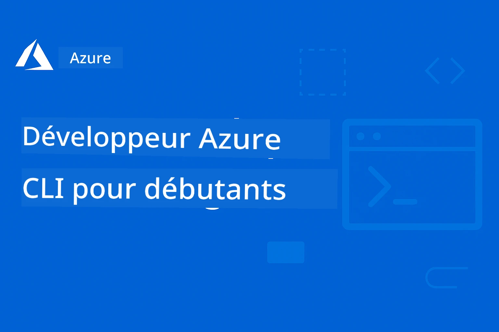

# AZD Pour Débutants : Un Parcours d'Apprentissage Structuré

 

[](https://GitHub.com/microsoft/azd-for-beginners/watchers/)
[](https://GitHub.com/microsoft/azd-for-beginners/network/)
[](https://GitHub.com/microsoft/azd-for-beginners/stargazers/)

[](https://discord.com/invite/nkVh3dp)
[](https://discord.gg/nTYy5BXMWG)

---

### Traductions Automatisées (Toujours à Jour)

<!-- CO-OP TRANSLATOR LANGUAGES TABLE START -->
[Arabe](../ar/README.md) | [Bengali](../bn/README.md) | [Bulgare](../bg/README.md) | [Birman (Myanmar)](../my/README.md) | [Chinois (Simplifié)](../zh-CN/README.md) | [Chinois (Traditionnel, Hong Kong)](../zh-HK/README.md) | [Chinois (Traditionnel, Macau)](../zh-MO/README.md) | [Chinois (Traditionnel, Taïwan)](../zh-TW/README.md) | [Croate](../hr/README.md) | [Tchèque](../cs/README.md) | [Danois](../da/README.md) | [Néerlandais](../nl/README.md) | [Estonien](../et/README.md) | [Finnois](../fi/README.md) | [Français](./README.md) | [Allemand](../de/README.md) | [Grec](../el/README.md) | [Hébreu](../he/README.md) | [Hindi](../hi/README.md) | [Hongrois](../hu/README.md) | [Indonésien](../id/README.md) | [Italien](../it/README.md) | [Japonais](../ja/README.md) | [Kannada](../kn/README.md) | [Khmer](../km/README.md) | [Coréen](../ko/README.md) | [Lituanien](../lt/README.md) | [Malais](../ms/README.md) | [Malayalam](../ml/README.md) | [Manipuri (Meitei Mayek)](../mni/README.md) | [Marathi](../mr/README.md) | [Népalais](../ne/README.md) | [Pidgin Nigérian](../pcm/README.md) | [Norvégien](../no/README.md) | [Persan (Farsi)](../fa/README.md) | [Polonais](../pl/README.md) | [Portugais (Brésil)](../pt-BR/README.md) | [Portugais (Portugal)](../pt-PT/README.md) | [Pendjabi (Gurmukhi)](../pa/README.md) | [Roumain](../ro/README.md) | [Russe](../ru/README.md) | [Serbe (Cyrillique)](../sr/README.md) | [Slovaque](../sk/README.md) | [Slovène](../sl/README.md) | [Espagnol](../es/README.md) | [Swahili](../sw/README.md) | [Suédois](../sv/README.md) | [Tagalog (Filipino)](../tl/README.md) | [Tamoul](../ta/README.md) | [Télougou](../te/README.md) | [Thaï](../th/README.md) | [Turc](../tr/README.md) | [Ukrainien](../uk/README.md) | [Ourdou](../ur/README.md) | [Vietnamien](../vi/README.md)

> **Préférez Cloner Localement ?**
>
> Ce dépôt inclut plus de 50 traductions, ce qui augmente considérablement la taille de téléchargement. Pour cloner sans traductions, utilisez le checkout partiel :
>
> **Bash / macOS / Linux :**
> ```bash
> git clone --filter=blob:none --sparse https://github.com/microsoft/AZD-for-beginners.git
> cd AZD-for-beginners
> git sparse-checkout set --no-cone '/*' '!translations' '!translated_images'
> ```
>
> **CMD (Windows) :**
> ```cmd
> git clone --filter=blob:none --sparse https://github.com/microsoft/AZD-for-beginners.git
> cd AZD-for-beginners
> git sparse-checkout set --no-cone "/*" "!translations" "!translated_images"
> ```
>
> Cela vous donne tout ce dont vous avez besoin pour suivre le cours avec un téléchargement beaucoup plus rapide.
<!-- CO-OP TRANSLATOR LANGUAGES TABLE END -->

## 🆕 Quoi de Neuf aujourd’hui avec azd

> 📌 Ce cours est validé pour **`azd 1.27.1`** (juillet 2026). Exécutez `azd version` pour vérifier votre build, et `azd upgrade` pour obtenir la dernière version.

Azure Developer CLI a évolué au-delà des applications web traditionnelles et des API. Aujourd’hui, azd est l’outil unique pour déployer **n’importe quelle** application sur Azure — y compris les applications alimentées par IA et les agents intelligents.

Voici ce que cela signifie pour vous :

- **Les agents IA sont désormais des charges de travail azd de premier ordre.** Vous pouvez initialiser, déployer et gérer des projets d'agents IA en utilisant le même workflow `azd init` → `azd up` que vous connaissez déjà.
- **Un cycle de vie complet d’agent depuis la CLI.** L’extension `azure.ai.agents` couvre maintenant tout le parcours — `azd ai agent init` pour générer la structure, `azd ai agent invoke` pour tester (avec affichage du temps de réponse), `azd ai agent eval generate` et `azd ai agent optimize` pour mesurer et améliorer la qualité, et `azd ai agent delete` pour nettoyer.
- **Plus de blocs de construction IA.** Les nouvelles extensions en aperçu — `azure.ai.skills` et `azure.ai.connections` — vous permettent de gérer directement avec azd les compétences d'agents réutilisables et les connexions Foundry.
- **L’intégration Microsoft Foundry** apporte le déploiement de modèles, l’hébergement d’agents et la configuration des services IA directement dans l’écosystème des templates azd.
- **Des bases plus fluides au quotidien.** Les versions récentes ont rendu `azd init` idempotent (sans risque de double exécution), fait que `azd auth login` supprime automatiquement les tokens périmés, et ajouté une invite conviviale `azd tool` pour la première exécution.
- **Le workflow principal n’a pas changé.** Que vous déployiez une application todo, un microservice ou une solution IA multi-agents, les commandes restent les mêmes.

> **Note pour les utilisateurs Aspire :** Microsoft appelle désormais le produit simplement **Aspire** (anciennement « .NET Aspire »). Le support Aspire d’azd reste inchangé — seul le nom a été mis à jour.

Si vous avez déjà utilisé azd, le support IA est une extension naturelle — pas un outil séparé ni une voie avancée. Si vous commencez, vous apprendrez un seul workflow fonctionnant pour tout.

---

## 🚀 Qu’est-ce que Azure Developer CLI (azd) ?

**Azure Developer CLI (azd)** est un outil en ligne de commande convivial pour développeurs facilitant le déploiement d’applications sur Azure. Au lieu de créer et de connecter manuellement des dizaines de ressources Azure, vous pouvez déployer des applications entières en une seule commande.

### La Magie de `azd up`

```bash
# This single command does everything:
# ✅ Creates all Azure resources  
# ✅ Configures networking and security
# ✅ Builds your application code
# ✅ Deploys to Azure
# ✅ Gives you a working URL
azd up
```

**C’est tout !** Pas besoin de cliquer dans le portail Azure, pas de modèles ARM complexes à apprendre, pas de configuration manuelle — juste des applications fonctionnelles sur Azure.

---

## ❓ Azure Developer CLI vs Azure CLI : Quelle Différence ?

C’est la question la plus courante chez les débutants. Voici la réponse simple :

| Fonctionnalité | **Azure CLI (`az`)** | **Azure Developer CLI (`azd`)** |
|---------|---------------------|--------------------------------|
| **But** | Gérer des ressources Azure individuelles | Déployer des applications complètes |
| **Approche** | Axée sur l’infrastructure | Axée sur l’application |
| **Exemple** | `az webapp create --name myapp...` | `azd up` |
| **Courbe d’apprentissage** | Connaître les services Azure | Juste connaître votre application |
| **Idéal pour** | DevOps, Infrastructure | Développeurs, Prototypage |

### Analogie Simple

- **Azure CLI** est comme avoir tous les outils pour construire une maison — marteaux, scies, clous. Vous pouvez tout construire, mais il faut savoir construire.
- **Azure Developer CLI** est comme engager un entrepreneur - vous décrivez ce que vous voulez, il s’occupe de la construction.

### Quand Utiliser Chacun

| Scénario | Utilisez Ceci |
|----------|----------|
| « Je veux déployer mon app web rapidement » | `azd up` |
| « Je dois créer juste un compte de stockage » | `az storage account create` |
| « Je construis une application IA complète » | `azd init --template azure-search-openai-demo` |
| « Je dois déboguer une ressource Azure spécifique » | `az resource show` |
| « Je veux un déploiement prêt pour production en quelques minutes » | `azd up --environment production` |

### Ils Fonctionnent Ensemble !

AZD utilise Azure CLI en coulisses. Vous pouvez utiliser les deux :
```bash
# Deploy your app with AZD
azd up

# Then fine-tune specific resources with Azure CLI
az webapp config set --name myapp --always-on true
```

---

## 🌟 Trouvez des Templates dans Awesome AZD

Ne partez pas de zéro ! **Awesome AZD** est la collection communautaire de templates prêts à déployer :

| Ressource | Description |
|----------|-------------|
| 🔗 [**Galerie Awesome AZD**](https://azure.github.io/awesome-azd/) | Parcourez plus de 200 templates avec déploiement en un clic |
| 🔗 [**Soumettre un Template**](https://github.com/Azure/awesome-azd/issues) | Contribuez votre propre template à la communauté |
| 🔗 [**Répertoire GitHub**](https://github.com/Azure/awesome-azd) | Étoilez et explorez la source |

### Templates IA Populaires d’Awesome AZD

```bash
# RAG Chat with Microsoft Foundry Models + AI Search
azd init --template azure-search-openai-demo

# Quick AI Chat Application
azd init --template openai-chat-app-quickstart

# AI Agents with Foundry Agents
azd init --template get-started-with-ai-agents
```

---

## 🎯 Commencer en 3 Étapes

Avant de commencer, assurez-vous que votre machine est prête pour le template que vous souhaitez déployer :

**Windows :**
```powershell
.\validate-setup.ps1
```

**macOS / Linux :**
```bash
bash ./validate-setup.sh
```

Si un contrôle requis échoue, corrigez-le d’abord puis continuez avec le démarrage rapide.

### Étape 1 : Installer AZD (2 minutes)

**Windows :**
```powershell
winget install microsoft.azd
```

**macOS :**
```bash
brew tap azure/azd && brew install azd
```

**Linux :**
```bash
curl -fsSL https://aka.ms/install-azd.sh | bash
```

### Étape 2 : Authentification pour AZD

```bash
# Optional if you plan to use Azure CLI commands directly in this course
az login

# Required for AZD workflows
azd auth login
```

Si vous ne savez pas laquelle choisir, suivez le flux complet d’installation dans [Installation & Setup](docs/chapter-01-foundation/installation.md#authentication-setup).

### Étape 3 : Déployez Votre Première Application

```bash
# Initialize from a template
azd init --template todo-nodejs-mongo

# Deploy to Azure (creates everything!)
azd up
```

**🎉 C’est tout !** Votre application est maintenant en ligne sur Azure.

### Nettoyage (N’oubliez Pas !)

```bash
# Remove all resources when done experimenting
azd down --force --purge
```

---

## 📚 Comment Utiliser Ce Cours

Ce cours est conçu pour un **apprentissage progressif** — commencez où vous êtes à l’aise et progressez étape par étape :

| Votre Expérience | Commencez Ici |
|-----------------|------------|
| **Nouveau sur Azure** | [Chapitre 1 : Fondations](#-chapter-1-foundation--quick-start) |
| **Connaît Azure, novice en AZD** | [Chapitre 1 : Fondations](#-chapter-1-foundation--quick-start) |
| **Veut déployer des apps IA** | [Chapitre 2 : Développement AI-First](#-chapter-2-ai-first-development-recommended-for-ai-developers) |
| **Veut pratiquer activement** | [🎓 Atelier Interactif](workshop/README.md) - laboratoire guidé de 3-4 heures |
| **Besoin de modèles pour la production** | [Chapitre 8 : Production & Entreprise](#-chapter-8-production--enterprise-patterns) |

### Installation Rapide

1. **Forkez Ce Dépôt** : [](https://GitHub.com/microsoft/azd-for-beginners/fork)
2. **Clonez-le** : `git clone https://github.com/YOUR-USERNAME/azd-for-beginners.git`
3. **Obtenez de l’Aide** : [Communauté Azure Discord](https://discord.com/invite/ByRwuEEgH4)

> **Préférez Cloner Localement ?**

> Ce dépôt inclut plus de 50 traductions, ce qui augmente considérablement la taille de téléchargement. Pour cloner sans traductions, utilisez le checkout partiel :
> ```bash
> git clone --filter=blob:none --sparse https://github.com/microsoft/AZD-for-beginners.git
> cd AZD-for-beginners
> git sparse-checkout set --no-cone '/*' '!translations' '!translated_images'
> ```
> Cela vous donne tout ce dont vous avez besoin pour suivre le cours avec un téléchargement beaucoup plus rapide.


## Aperçu du Cours

Maîtrisez Azure Developer CLI (azd) à travers des chapitres structurés conçus pour un apprentissage progressif. **Accent particulier sur le déploiement d’applications IA avec intégration Microsoft Foundry.**

### Pourquoi Ce Cours est Essentiel pour les Développeurs Modernes

Basé sur les retours de la communauté Microsoft Foundry Discord, **45 % des développeurs veulent utiliser AZD pour les charges IA** mais rencontrent des difficultés avec :
- Architectures IA multi-services complexes
- Meilleures pratiques de déploiement IA en production  
- Intégration et configuration des services IA Azure
- Optimisation des coûts pour les charges IA
- Résolution des problèmes spécifiques au déploiement IA

### Objectifs d’Apprentissage

En complétant ce cours structuré, vous allez :
- **Maîtriser les Fondamentaux d’AZD** : Concepts de base, installation et configuration
- **Déployer des Applications IA** : Utiliser AZD avec les services Microsoft Foundry
- **Mettre en œuvre l'infrastructure en tant que code** : Gérer les ressources Azure avec des modèles Bicep
- **Résoudre les problèmes de déploiement** : Résoudre les problèmes courants et effectuer le débogage
- **Optimiser pour la production** : Sécurité, mise à l’échelle, surveillance et gestion des coûts
- **Construire des solutions multi-agents** : Déployer des architectures complexes d’IA

## Avant de commencer : Comptes, accès et hypothèses

Avant de commencer le chapitre 1, assurez-vous d'avoir les éléments suivants en place. Les étapes d'installation plus loin dans ce guide supposent que ces bases sont déjà traitées.

- **Un abonnement Azure** : Vous pouvez utiliser un abonnement existant de votre travail ou de votre compte personnel, ou créer un [essai gratuit](https://aka.ms/azurefreetrial) pour commencer.
- **Permission de créer des ressources Azure** : Pour la plupart des exercices, vous devriez disposer d'au moins un accès **Contributeur** sur l'abonnement ou le groupe de ressources cible. Certains chapitres peuvent aussi supposer que vous pouvez créer des groupes de ressources, des identités gérées, et des affectations RBAC.
- [**Un compte GitHub**](https://github.com) : Utile pour forker le dépôt, suivre vos propres modifications, et utiliser GitHub Codespaces pour l'atelier.
- **Prérequis d'exécution des modèles** : Certains modèles nécessitent des outils locaux tels que Node.js, Python, Java ou Docker. Exécutez le validateur d'installation avant de commencer pour détecter précocement les outils manquants.
- **Une familiarité basique avec le terminal** : Vous n’avez pas besoin d’être un expert, mais vous devriez être à l'aise avec des commandes comme `git clone`, `azd auth login`, et `azd up`.

> **Travaillez-vous dans un abonnement d’entreprise ?**
> Si votre environnement Azure est géré par un administrateur, confirmez à l’avance que vous pouvez déployer des ressources dans l'abonnement ou le groupe de ressources que vous prévoyez d’utiliser. Sinon, demandez un abonnement sandbox ou un accès Contributeur avant de commencer.

> **Nouveau sur Azure ?**
> Commencez avec votre propre essai Azure ou un abonnement à la consommation à l'adresse https://aka.ms/azurefreetrial afin de pouvoir réaliser les exercices de bout en bout sans attendre des approbations au niveau du locataire.

## 🗺️ Carte du cours : Navigation rapide par chapitre

Chaque chapitre dispose d’un README dédié avec objectifs d’apprentissage, mises en route rapides et exercices :

| Chapitre | Sujet | Leçons | Durée | Complexité |
|---------|-------|---------|----------|------------|
| **[Ch 1 : Fondations](docs/chapter-01-foundation/README.md)** | Prise en main | [Bases AZD](docs/chapter-01-foundation/azd-basics.md) &#124; [Installation](docs/chapter-01-foundation/installation.md) &#124; [Premier projet](docs/chapter-01-foundation/first-project.md) | 30-45 min | ⭐ |
| **[Ch 2 : Développement IA](docs/chapter-02-ai-development/README.md)** | Applications IA-first | [Intégration Foundry](docs/chapter-02-ai-development/microsoft-foundry-integration.md) &#124; [Agents IA](docs/chapter-02-ai-development/agents.md) &#124; [Déploiement modèle](docs/chapter-02-ai-development/ai-model-deployment.md) &#124; [Atelier](docs/chapter-02-ai-development/ai-workshop-lab.md) | 1-2 h | ⭐⭐ |
| **[Ch 3 : Configuration](docs/chapter-03-configuration/README.md)** | Authentification & Sécurité | [Configuration](docs/chapter-03-configuration/configuration.md) &#124; [Authentification & Sécurité](docs/chapter-03-configuration/authsecurity.md) | 45-60 min | ⭐⭐ |
| **[Ch 4 : Infrastructure](docs/chapter-04-infrastructure/README.md)** | IaC & Déploiement | [Guide de déploiement](docs/chapter-04-infrastructure/deployment-guide.md) &#124; [Provisionnement](docs/chapter-04-infrastructure/provisioning.md) | 1-1,5 h | ⭐⭐⭐ |
| **[Ch 5 : Multi-Agent](docs/chapter-05-multi-agent/README.md)** | Solutions agents IA | [Scénario Retail](examples/retail-scenario.md) &#124; [Patrons de coordination](docs/chapter-06-pre-deployment/coordination-patterns.md) | 2-3 h | ⭐⭐⭐⭐ |
| **[Ch 6 : Pré-Déploiement](docs/chapter-06-pre-deployment/README.md)** | Planification & Validation | [Contrôles préliminaires](docs/chapter-06-pre-deployment/preflight-checks.md) &#124; [Planification capacité](docs/chapter-06-pre-deployment/capacity-planning.md) &#124; [Sélection SKU](docs/chapter-06-pre-deployment/sku-selection.md) &#124; [Insights applicatif](docs/chapter-06-pre-deployment/application-insights.md) | 1 h | ⭐⭐ |
| **[Ch 7 : Dépannage](docs/chapter-07-troubleshooting/README.md)** | Débogage & Correction | [Problèmes courants](docs/chapter-07-troubleshooting/common-issues.md) &#124; [Débogage](docs/chapter-07-troubleshooting/debugging.md) &#124; [Problèmes IA](docs/chapter-07-troubleshooting/ai-troubleshooting.md) | 1-1,5 h | ⭐⭐ |
| **[Ch 8 : Production](docs/chapter-08-production/README.md)** | Patrons entreprise | [Pratiques en production](docs/chapter-08-production/production-ai-practices.md) | 2-3 h | ⭐⭐⭐⭐ |
| **[🎓 Atelier](workshop/README.md)** | Laboratoire pratique | [Introduction](workshop/docs/instructions/0-Introduction.md) &#124; [Sélection](workshop/docs/instructions/1-Select-AI-Template.md) &#124; [Validation](workshop/docs/instructions/2-Validate-AI-Template.md) &#124; [Déconstruction](workshop/docs/instructions/3-Deconstruct-AI-Template.md) &#124; [Configuration](workshop/docs/instructions/4-Configure-AI-Template.md) &#124; [Personnalisation](workshop/docs/instructions/5-Customize-AI-Template.md) &#124; [Démantèlement](workshop/docs/instructions/6-Teardown-Infrastructure.md) &#124; [Conclusion](workshop/docs/instructions/7-Wrap-up.md) | 3-4 h | ⭐⭐ |

**Durée totale du cours :** ~10-14 heures | **Progression des compétences :** Débutant → Prêt pour la production

---

## 📚 Chapitres d’apprentissage

*Choisissez votre parcours d’apprentissage en fonction de votre niveau et de vos objectifs*

### 🚀 Chapitre 1 : Fondations et prise en main rapide
**Prérequis** : Abonnement Azure, connaissances de base en ligne de commande  
**Durée** : 30-45 minutes  
**Complexité** : ⭐

#### Ce que vous apprendrez
- Comprendre les fondamentaux de Azure Developer CLI
- Installer AZD sur votre plateforme
- Votre premier déploiement réussi

#### Ressources d’apprentissage
- **🎯 Commencer ici** : [Qu’est-ce que Azure Developer CLI ?](#what-is-azure-developer-cli)
- **📖 Théorie** : [Bases AZD](docs/chapter-01-foundation/azd-basics.md) - Concepts clés et terminologie
- **⚙️ Installation** : [Installation & Configuration](docs/chapter-01-foundation/installation.md) - Guides spécifiques aux plateformes
- **🛠️ Pratique** : [Votre premier projet](docs/chapter-01-foundation/first-project.md) - Tutoriel pas à pas
- **📋 Référence rapide** : [Fiche de commandes](resources/cheat-sheet.md)

#### Exercices pratiques
```bash
# Quick installation check
azd version

# Deploy your first application
azd init --template todo-nodejs-mongo
azd up
```

**💡 Résultat du chapitre** : Déployer avec succès une application web simple sur Azure avec AZD

**✅ Validation de réussite :**
```bash
# After completing Chapter 1, you should be able to:
azd version              # Shows installed version
azd init --template todo-nodejs-mongo  # Initializes project
azd up                  # Deploys to Azure
azd show                # Displays running app URL
# Application opens in browser and works
azd down --force --purge  # Cleans up resources
```

**📊 Temps investi :** 30-45 minutes  
**📈 Niveau de compétence après :** Peut déployer des applications basiques de manière autonome
**📈 Niveau de compétence après :** Peut déployer des applications basiques de manière autonome

---

### 🤖 Chapitre 2 : Développement IA-first (recommandé pour les développeurs IA)
**Prérequis** : Chapitre 1 terminé  
**Durée** : 1-2 heures  
**Complexité** : ⭐⭐

#### Ce que vous apprendrez
- Intégration Microsoft Foundry avec AZD
- Déployer des applications propulsées par IA
- Comprendre les configurations des services IA

#### Ressources d’apprentissage
- **🎯 Commencer ici** : [Intégration Microsoft Foundry](docs/chapter-02-ai-development/microsoft-foundry-integration.md)
- **🤖 Agents IA** : [Guide des agents IA](docs/chapter-02-ai-development/agents.md) - Déployer des agents intelligents avec AZD
- **📖 Patrons** : [Déploiement de modèles IA](docs/chapter-02-ai-development/ai-model-deployment.md) - Déployer et gérer des modèles IA
- **🛠️ Atelier** : [Atelier IA](docs/chapter-02-ai-development/ai-workshop-lab.md) - Rendre vos solutions IA prêtes pour AZD
- **🎥 Guide interactif** : [Matériel de l’atelier](workshop/README.md) - Apprentissage dans le navigateur avec MkDocs * Environnement DevContainer
- **📋 Modèles** : [Modèles Microsoft Foundry](#featured-microsoft-foundry-templates)
- **📝 Exemples** : [Exemples de déploiement AZD](examples/README.md)

#### Exercices pratiques
```bash
# Deploy your first AI application
azd init --template azure-search-openai-demo
azd up

# Try additional AI templates
azd init --template openai-chat-app-quickstart
azd init --template agent-openai-python-prompty
```

**💡 Résultat du chapitre** : Déployer et configurer une application de chat IA avec capacités RAG

**✅ Validation de réussite :**
```bash
# After Chapter 2, you should be able to:
azd init --template azure-search-openai-demo
azd up
# Test the AI chat interface
# Ask questions and get AI-powered responses with sources
# Verify search integration works
azd monitor  # Check Application Insights shows telemetry
azd down --force --purge
```

**📊 Temps investi :** 1-2 heures  
**📈 Niveau de compétence après :** Peut déployer et configurer des applications IA prêtes pour la production  
**💰 Sensibilisation au coût :** Comprendre 80-150 $/mois en développement, 300-3500 $/mois en production

#### 💰 Considérations de coût pour les déploiements IA

**Environnement de développement (estimé à 80-150 $/mois) :**
- Modèles Microsoft Foundry (facturation à l’usage) : 0-50 $/mois (selon usage des tokens)
- Recherche IA (niveau basique) : 75 $/mois
- Container Apps (consommation) : 0-20 $/mois
- Stockage (standard) : 1-5 $/mois

**Environnement de production (estimé à 300-3 500+ $/mois) :**
- Modèles Microsoft Foundry (PTU pour performance constante) : 3 000+ $/mois OU facturation à l’usage avec volume élevé
- Recherche IA (niveau standard) : 250 $/mois
- Container Apps (dédié) : 50-100 $/mois
- Application Insights : 5-50 $/mois
- Stockage (premium) : 10-50 $/mois

**💡 Astuces d’optimisation des coûts :**
- Utiliser les modèles Microsoft Foundry **niveau gratuit** pour l’apprentissage (Azure OpenAI 50 000 tokens/mois inclus)
- Exécuter `azd down` pour désallouer les ressources quand vous ne développez pas activement
- Commencer par une facturation à la consommation, passer au PTU uniquement pour la production
- Utiliser `azd provision --preview` pour estimer les coûts avant le déploiement
- Activer l’auto-scaling : ne payer que pour l’usage réel

**Surveillance des coûts :**
```bash
# Check estimated monthly costs
azd provision --preview

# Monitor actual costs in Azure Portal
az consumption budget list --resource-group <your-rg>
```

---

### ⚙️ Chapitre 3 : Configuration et authentification
**Prérequis** : Chapitre 1 terminé  
**Durée** : 45-60 minutes  
**Complexité** : ⭐⭐

#### Ce que vous apprendrez
- Configuration et gestion des environnements
- Bonnes pratiques d’authentification et de sécurité
- Nommage et organisation des ressources

#### Ressources d’apprentissage
- **📖 Configuration** : [Guide de configuration](docs/chapter-03-configuration/configuration.md) - Mise en place des environnements
- **🔐 Sécurité** : [Patrons d’authentification et identité gérée](docs/chapter-03-configuration/authsecurity.md) - Patrons d’authentification
- **📝 Exemples** : [Exemple d’application base de données](examples/database-app/README.md) - Exemples AZD bases de données

#### Exercices pratiques
- Configurer plusieurs environnements (dev, staging, prod)
- Installer une authentification par identité gérée
- Implémenter des configurations spécifiques par environnement

**💡 Résultat du chapitre** : Gérer plusieurs environnements avec authentification et sécurité adéquates

---

### 🏗️ Chapitre 4 : Infrastructure as Code & déploiement
**Prérequis** : Chapitres 1 à 3 terminés  
**Durée** : 1-1,5 heure  
**Complexité** : ⭐⭐⭐

#### Ce que vous apprendrez
- Patrons de déploiement avancés
- Infrastructure as Code avec Bicep
- Stratégies de provisionnement des ressources

#### Ressources d’apprentissage
- **📖 Déploiement** : [Guide de déploiement](docs/chapter-04-infrastructure/deployment-guide.md) - Flux complets
- **🏗️ Provisionnement** : [Provisionner des ressources](docs/chapter-04-infrastructure/provisioning.md) - Gestion des ressources Azure
- **📝 Exemples** : [Exemple d’application Container](../../examples/container-app) - Déploiements conteneurisés

#### Exercices pratiques
- Créer des modèles Bicep personnalisés
- Déployer des applications multi-services
- Implémenter des stratégies de déploiement blue-green

**💡 Résultat du chapitre** : Déployer des applications multi-services complexes en utilisant des modèles d’infrastructure personnalisés

---

### 🎯 Chapitre 5 : Solutions AI multi-agents (avancé)
**Prérequis** : Chapitres 1 et 2 terminés  
**Durée** : 2-3 heures  
**Complexité** : ⭐⭐⭐⭐

#### Ce que vous apprendrez
- Patrons d’architecture multi-agents
- Orchestration et coordination des agents
- Déploiements IA prêts pour la production

#### Ressources d’apprentissage
- **🤖 Projet vedette** : [Solution multi-agent Retail](examples/retail-scenario.md) - Implémentation complète
- **🛠️ Modèles ARM** : [Package de modèles ARM](../../examples/retail-multiagent-arm-template) - Déploiement en un clic
- **📖 Architecture** : [Patrons de coordination multi-agents](docs/chapter-06-pre-deployment/coordination-patterns.md) - Patrons

#### Exercices pratiques
```bash
# Deploy the complete retail multi-agent solution
cd examples/retail-multiagent-arm-template
./deploy.sh

# Explore agent configurations
az deployment group show --resource-group <rg-name> --name <deployment-name>
```

**💡 Résultat du chapitre** : Déployer et gérer une solution IA multi-agent prête pour la production avec agents Client et Inventaire

---

### 🔍 Chapitre 6 : Validation et planification pré-déploiement
**Prérequis** : Chapitre 4 terminé  
**Durée** : 1 heure  
**Complexité** : ⭐⭐

#### Ce que vous apprendrez
- Planification de capacité et validation des ressources
- Stratégies de sélection SKU
- Contrôles pré-vol et automatisation

#### Ressources d’apprentissage
- **📊 Planification** : [Planification de la Capacité](docs/chapter-06-pre-deployment/capacity-planning.md) - Validation des ressources
- **💰 Sélection** : [Sélection des SKU](docs/chapter-06-pre-deployment/sku-selection.md) - Choix économiques
- **✅ Validation** : [Vérifications Préalables](docs/chapter-06-pre-deployment/preflight-checks.md) - Scripts automatisés

#### Exercices Pratiques
- Exécuter des scripts de validation de capacité
- Optimiser la sélection des SKU pour les coûts
- Mettre en œuvre des contrôles automatisés avant le déploiement

**💡 Résultat du Chapitre** : Valider et optimiser les déploiements avant exécution

---

### 🚨 Chapitre 7 : Dépannage & Débogage
**Prérequis** : Tout chapitre de déploiement terminé  
**Durée** : 1-1,5 heures  
**Complexité** : ⭐⭐

#### Ce que vous apprendrez
- Approches systématiques de débogage
- Problèmes courants et solutions
- Dépannage spécifique à l'IA

#### Ressources d'apprentissage
- **🔧 Problèmes Courants** : [Problèmes Courants](docs/chapter-07-troubleshooting/common-issues.md) - FAQ et solutions
- **🕵️ Débogage** : [Guide de Débogage](docs/chapter-07-troubleshooting/debugging.md) - Stratégies étape par étape
- **🤖 Problèmes IA** : [Dépannage Spécifique à l'IA](docs/chapter-07-troubleshooting/ai-troubleshooting.md) - Problèmes des services IA

#### Exercices Pratiques
- Diagnostiquer les échecs de déploiement
- Résoudre les problèmes d'authentification
- Déboguer la connectivité aux services IA

**💡 Résultat du Chapitre** : Diagnostiquer et résoudre de manière autonome les problèmes courants de déploiement

---

### 🏢 Chapitre 8 : Modèles de Production & Entreprise
**Prérequis** : Chapitres 1 à 4 complétés  
**Durée** : 2-3 heures  
**Complexité** : ⭐⭐⭐⭐

#### Ce que vous apprendrez
- Stratégies de déploiement en production
- Modèles de sécurité en entreprise
- Surveillance et optimisation des coûts

#### Ressources d'apprentissage
- **🏭 Production** : [Meilleures Pratiques Azure AI en Production](docs/chapter-08-production/production-ai-practices.md) - Modèles entreprise
- **📝 Exemples** : [Exemple Microservices](../../examples/microservices) - Architectures complexes
- **📊 Surveillance** : [Intégration Application Insights](docs/chapter-06-pre-deployment/application-insights.md) - Surveillance

#### Exercices Pratiques
- Implémenter des modèles de sécurité en entreprise
- Mettre en place une surveillance complète
- Déployer en production avec gouvernance appropriée

**💡 Résultat du Chapitre** : Déployer des applications prêtes pour l'entreprise avec toutes les capacités de production

---

## 🎓 Aperçu de l'Atelier : Expérience d'Apprentissage Pratique

> **⚠️ ÉTAT DE L'ATELIER : Développement Actif**  
> Les matériels de l'atelier sont actuellement en cours de développement et d'amélioration. Les modules de base fonctionnent, mais certaines sections avancées sont incomplètes. Nous travaillons activement à la finalisation de tout le contenu. [Suivre la progression →](workshop/README.md)

### Matériels Interactifs de l'Atelier
**Apprentissage pratique complet avec outils basés sur navigateur et exercices guidés**

Nos matériels d'atelier offrent une expérience d'apprentissage structurée et interactive qui complète le programme basé sur les chapitres ci-dessus. L'atelier est conçu pour l'auto-apprentissage et les sessions dirigées par un instructeur.

#### 🛠️ Fonctionnalités de l'Atelier
- **Interface Navigateur** : Atelier complet propulsé par MkDocs avec recherche, copie et fonctionnalités de thème
- **Intégration GitHub Codespaces** : Configuration de l’environnement de développement en un clic
- **Parcours d'apprentissage structuré** : 8 modules d’exercices guidés (3-4 heures au total)
- **Méthodologie progressive** : Introduction → Sélection → Validation → Déconstruction → Configuration → Personnalisation → Nettoyage → Conclusion
- **Environnement DevContainer interactif** : Outils et dépendances pré-configurés

#### 📚 Structure des Modules de l'Atelier
L'atelier suit une **méthodologie progressive en 8 modules** vous menant de la découverte à la maîtrise du déploiement :

| Module | Sujet | Ce que vous ferez | Durée |
|--------|-------|-----------------|--------|
| **0. Introduction** | Aperçu de l'atelier | Comprendre les objectifs d'apprentissage, les prérequis et la structure de l'atelier | 15 min |
| **1. Sélection** | Découverte de modèles | Explorer les modèles AZD et sélectionner le modèle IA adéquat pour votre scénario | 20 min |
| **2. Validation** | Déploiement & Vérification | Déployer le modèle avec `azd up` et valider le fonctionnement de l'infrastructure | 30 min |
| **3. Déconstruction** | Comprendre la structure | Utiliser GitHub Copilot pour explorer l'architecture du modèle, les fichiers Bicep, et l'organisation du code | 30 min |
| **4. Configuration** | Exploration approfondie azure.yaml | Maîtriser la configuration `azure.yaml`, les hooks lifecycle et les variables d'environnement | 30 min |
| **5. Personnalisation** | Faites-le vôtre | Activer la Recherche IA, le tracing, l’évaluation et personnaliser pour votre scénario | 45 min |
| **6. Nettoyage** | Nettoyer | Déprovisionner en toute sécurité les ressources avec `azd down --purge` | 15 min |
| **7. Conclusion** | Étapes suivantes | Revoir les acquis, concepts clés et poursuivre votre parcours d'apprentissage | 15 min |

**Déroulement de l'Atelier :**
```
Introduction → Selection → Validation → Deconstruction → Configuration → Customization → Teardown → Wrap-up
     ↓            ↓           ↓              ↓               ↓              ↓            ↓           ↓
  Overview    Find the     Deploy &      Explore        Master         Customize     Clean up    Review &
             right        verify        code &        azure.yaml      for your      resources   next steps
             template                   structure                     scenario
```

#### 🚀 Démarrage de l'Atelier
```bash
# Option 1: GitHub Codespaces (Recommended)
# Click "Code" → "Create codespace on main" in the repository

# Option 2: Local Development
git clone https://github.com/microsoft/azd-for-beginners.git
cd azd-for-beginners/workshop
# Follow the setup instructions in workshop/README.md
```

#### 🎯 Objectifs d'Apprentissage de l'Atelier
En complétant cet atelier, les participants seront capables de :
- **Déployer des applications IA en production** : Utiliser AZD avec les services Microsoft Foundry
- **Maîtriser les architectures multi-agents** : Implémenter des solutions coordonnées d'agents IA
- **Mettre en œuvre les meilleures pratiques de sécurité** : Configurer l'authentification et le contrôle d’accès
- **Optimiser pour la montée en charge** : Concevoir des déploiements performants et économiques
- **Dépanner les déploiements** : Résoudre de manière autonome les problèmes courants

#### 📖 Ressources de l'Atelier
- **🎥 Guide interactif** : [Matériels de l'Atelier](workshop/README.md) - Environnement d'apprentissage basé navigateur
- **📋 Instructions module par module** :
  - [0. Introduction](workshop/docs/instructions/0-Introduction.md) - Aperçu et objectifs de l'atelier
  - [1. Sélection](workshop/docs/instructions/1-Select-AI-Template.md) - Trouver et sélectionner des modèles IA
  - [2. Validation](workshop/docs/instructions/2-Validate-AI-Template.md) - Déployer et vérifier les modèles
  - [3. Déconstruction](workshop/docs/instructions/3-Deconstruct-AI-Template.md) - Explorer l’architecture des modèles
  - [4. Configuration](workshop/docs/instructions/4-Configure-AI-Template.md) - Maîtriser azure.yaml
  - [5. Personnalisation](workshop/docs/instructions/5-Customize-AI-Template.md) - Personnaliser pour votre scénario
  - [6. Nettoyage](workshop/docs/instructions/6-Teardown-Infrastructure.md) - Nettoyer les ressources
  - [7. Conclusion](workshop/docs/instructions/7-Wrap-up.md) - Revue et étapes suivantes
- **🛠️ Laboratoire Atelier IA** : [Laboratoire Atelier IA](docs/chapter-02-ai-development/ai-workshop-lab.md) - Exercices centrés IA
- **💡 Démarrage rapide** : [Guide de Configuration de l'Atelier](workshop/README.md#quick-start) - Configuration de l’environnement

**Parfait pour** : Formation en entreprise, cours universitaires, apprentissage autonome, et bootcamps développeurs.

---

## 📖 Approfondissement : Capacités AZD

Au-delà des bases, AZD offre des fonctionnalités puissantes pour les déploiements en production :

- **Déploiements basés sur des modèles** - Utiliser des modèles préconçus pour les schémas applicatifs courants
- **Infrastructure as Code** - Gérer les ressources Azure via Bicep ou Terraform  
- **Flux de travail intégrés** - Provisionner, déployer et surveiller les applications sans rupture
- **Conçu pour les développeurs** - Optimisé pour la productivité et l’expérience développeur

### **AZD + Microsoft Foundry : Parfait pour les déploiements IA**

**Pourquoi AZD pour les solutions IA ?** AZD répond aux principaux défis des développeurs IA :

- **Modèles prêts pour l’IA** - Modèles préconfigurés pour Microsoft Foundry Models, services Azure AI, et charges ML
- **Déploiements IA sécurisés** - Modèles de sécurité intégrés pour services IA, clés API, et endpoints modèles  
- **Modèles IA en production** - Bonnes pratiques pour des déploiements IA scalables et économiques
- **Flux IA de bout en bout** - Du développement de modèles au déploiement en production avec surveillance appropriée
- **Optimisation des coûts** - Stratégies intelligentes de gestion et montée en charge des ressources IA
- **Intégration Microsoft Foundry** - Connexion transparente au catalogue et endpoints Microsoft Foundry

---

## 🎯 Bibliothèque de Modèles & Exemples

### En vedette : Modèles Microsoft Foundry
**Commencez ici si vous déployez des applications IA !**

> **Note :** Ces modèles illustrent divers schémas IA. Certains sont des Azure Samples externes, d'autres des implémentations locales.

| Modèle | Chapitre | Complexité | Services | Type |
|----------|---------|------------|----------|------|
| [**Démarrage avec chat IA**](https://github.com/Azure-Samples/get-started-with-ai-chat) | Chapitre 2 | ⭐⭐ | AzureOpenAI + Azure AI Model Inference API + Azure AI Search + Azure Container Apps + Application Insights | Externe |
| [**Démarrage avec agents IA**](https://github.com/Azure-Samples/get-started-with-ai-agents) | Chapitre 2 | ⭐⭐ | Foundry Agents + AzureOpenAI + Azure AI Search + Azure Container Apps + Application Insights| Externe |
| [**Démo Azure Search + OpenAI**](https://github.com/Azure-Samples/azure-search-openai-demo) | Chapitre 2 | ⭐⭐ | AzureOpenAI + Azure AI Search + App Service + Storage | Externe |
| [**Démarrage rapide OpenAI Chat App**](https://github.com/Azure-Samples/openai-chat-app-quickstart) | Chapitre 2 | ⭐ | AzureOpenAI + Container Apps + Application Insights | Externe |
| [**Agent OpenAI Python Prompty**](https://github.com/Azure-Samples/agent-openai-python-prompty) | Chapitre 5 | ⭐⭐⭐ | AzureOpenAI + Azure Functions + Prompty | Externe |
| [**Contoso Chat RAG**](https://github.com/Azure-Samples/contoso-chat) | Chapitre 8 | ⭐⭐⭐⭐ | AzureOpenAI + AI Search + Cosmos DB + Container Apps | Externe |
| [**Solution Multi-Agent Retail**](examples/retail-scenario.md) | Chapitre 5 | ⭐⭐⭐⭐ | AzureOpenAI + AI Search + Storage + Container Apps + Cosmos DB | **Locale** |

### En vedette : Scénarios d’Apprentissage Complets
**Modèles d’applications prêts pour la production associés aux chapitres d’apprentissage**

| Modèle | Chapitre d’Apprentissage | Complexité | Apprentissage Clé |
|----------|------------------|------------|--------------|
| [**openai-chat-app-quickstart**](https://github.com/Azure-Samples/openai-chat-app-quickstart) | Chapitre 2 | ⭐ | Schémas de déploiement IA de base |
| [**azure-search-openai-demo**](https://github.com/Azure-Samples/azure-search-openai-demo) | Chapitre 2 | ⭐⭐ | Mise en œuvre RAG avec Azure AI Search |
| [**ai-document-processing**](https://github.com/Azure-Samples/ai-document-processing) | Chapitre 4 | ⭐⭐ | Intégration Document Intelligence |
| [**agent-openai-python-prompty**](https://github.com/Azure-Samples/agent-openai-python-prompty) | Chapitre 5 | ⭐⭐⭐ | Cadre d'agents et appel de fonctions |
| [**contoso-chat**](https://github.com/Azure-Samples/contoso-chat) | Chapitre 8 | ⭐⭐⭐ | Orchestration IA en entreprise |
| [**retail-multi-agent-solution**](examples/retail-scenario.md) | Chapitre 5 | ⭐⭐⭐⭐ | Architecture multi-agent avec agents Client et Inventaire |

### Apprentissage par type d’exemple

> **📌 Exemples Locaux vs Externes :**  
> **Exemples Locaux** (dans ce repo) = Prêts à l’usage immédiat  
> **Exemples Externes** (Azure Samples) = Cloner depuis les dépôts liés

#### Exemples Locaux (Prêts à l'usage)
- [**Solution Multi-Agent Retail**](examples/retail-scenario.md) - Implémentation complète prête pour la production avec templates ARM
  - Architecture multi-agent (agents Client + Inventaire)
  - Surveillance et évaluation complètes
  - Déploiement en un clic via template ARM

#### Exemples Locaux - Applications Conteneurisées (Chapitres 2-5)
**Exemples complets de déploiement conteneurisé dans ce dépôt :**
- [**Exemples d'Applications Conteneurisées**](examples/container-app/README.md) - Guide complet des déploiements conteneurisés
  - [API Flask Simple](../../examples/container-app/simple-flask-api) - API REST de base avec scale-to-zero
  - [Architecture Microservices](../../examples/container-app/microservices) - Déploiement multi-service prêt pour la production
  - Schémas de déploiement Démarrage Rapide, Production, et Avancé
  - Instructions sur surveillance, sécurité, et optimisation des coûts

#### Exemples Externes - Applications Simples (Chapitres 1-2)
**Cloner ces dépôts Azure Samples pour débuter :**
- [Application Web Simple - Node.js + MongoDB](https://github.com/Azure-Samples/todo-nodejs-mongo) - Schémas de déploiement de base
- [Site Web Statique - React SPA](https://github.com/Azure-Samples/todo-csharp-sql-swa-func) - Déploiement de contenu statique
- [Container App - Python Flask](https://github.com/Azure-Samples/container-apps-store-api-microservice) - Déploiement API REST

#### Exemples Externes - Intégration Base de Données (Chapitres 3-4)  
- [Application Base de Données - C# + SQL](https://github.com/Azure-Samples/todo-csharp-sql) - Schémas de connectivité base de données
- [Functions + Cosmos DB](https://github.com/Azure-Samples/todo-python-mongo-swa-func) - Workflow serverless de données

#### Exemples Externes - Modèles Avancés (Chapitres 4-8)
- [Microservices Java](https://github.com/Azure-Samples/java-microservices-aca-lab) - Architectures multi-services
- [Jobs Container Apps](https://github.com/Azure-Samples/container-apps-jobs) - Traitement en arrière-plan  
- [Pipeline ML Entreprise](https://github.com/Azure-Samples/mlops-v2) - Modèles ML prêts pour la production

### Collections de Modèles Externes
- [**Galerie Officielle de Modèles AZD**](https://azure.github.io/awesome-azd/) - Collection triée de modèles officiels et communautaires
- [**Modèles Azure Developer CLI**](https://learn.microsoft.com/en-us/azure/developer/azure-developer-cli/azd-templates) - Documentation des modèles Microsoft Learn
- [**Répertoire d'Exemples**](examples/README.md) - Exemples locaux d’apprentissage avec explications détaillées

---

## 📚 Ressources & Références d'Apprentissage

### Références Rapides
- [**Fiche de Commandes**](resources/cheat-sheet.md) - Commandes azd essentielles organisées par chapitre
- [**Glossaire**](resources/glossary.md) - Terminologie Azure et azd  
- [**FAQ**](resources/faq.md) - Questions courantes organisées par chapitre d'apprentissage
- [**Guide d'Étude**](resources/study-guide.md) - Exercices pratiques complets

### Ateliers Pratiques
- [**Atelier AI Lab**](docs/chapter-02-ai-development/ai-workshop-lab.md) - Rendez vos solutions AI déployables avec AZD (2-3 heures)
- [**Atelier Interactif**](workshop/README.md) - Exercices guidés en 8 modules avec MkDocs et GitHub Codespaces
  - Sujets : Introduction → Sélection → Validation → Déconstruction → Configuration → Personnalisation → Démontage → Conclusion

### Ressources d’Apprentissage Externes
- [Documentation Azure Developer CLI](https://learn.microsoft.com/en-us/azure/developer/azure-developer-cli/)
- [Centre d'Architecture Azure](https://learn.microsoft.com/en-us/azure/architecture/)
- [Calculateur de Prix Azure](https://azure.microsoft.com/pricing/calculator/)
- [Statut Azure](https://status.azure.com/)

### Compétences d’Agent IA pour Votre Éditeur
- [**Compétences Microsoft Azure sur skills.sh**](https://skills.sh/microsoft/github-copilot-for-azure) - 37 compétences open agent pour Azure AI, Foundry, déploiement, diagnostics, optimisation des coûts, et plus. Installez-les dans GitHub Copilot, Cursor, Claude Code, ou tout agent supporté :
  ```bash
  npx skills add microsoft/github-copilot-for-azure
  ```

---

## 🔧 Guide Rapide de Dépannage

**Problèmes courants rencontrés par les débutants et solutions immédiates :**

<details>
<summary><strong>❌ "azd : commande introuvable"</strong></summary>

```bash
# Install AZD first
# Windows (PowerShell):
winget install microsoft.azd

# macOS:
brew tap azure/azd && brew install azd

# Linux:
curl -fsSL https://aka.ms/install-azd.sh | bash

# Verify installation
azd version
```
</details>

<details>
<summary><strong>❌ "Aucun abonnement trouvé" ou "Abonnement non défini"</strong></summary>

```bash
# List available subscriptions
az account list --output table

# Set default subscription
az account set --subscription "<subscription-id-or-name>"

# Set for AZD environment
azd env set AZURE_SUBSCRIPTION_ID "<subscription-id>"

# Verify
az account show
```
</details>

<details>
<summary><strong>❌ "Quota insuffisant" ou "Quota dépassé"</strong></summary>

```bash
# Try different Azure region
azd env set AZURE_LOCATION "westus2"
azd up

# Or use smaller SKUs in development
# Edit infra/main.parameters.json:
{
  "sku": "B1"  // Instead of "P1V2"
}
```
</details>

<details>
<summary><strong>❌ Échec de "azd up" à mi-parcours</strong></summary>

```bash
# Option 1: Clean and retry
azd down --force --purge
azd up

# Option 2: Just fix infrastructure
azd provision

# Option 3: Check detailed status
azd show

# Option 4: Check logs in Azure Monitor
azd monitor --logs
```
</details>

<details>
<summary><strong>❌ "Échec d’authentification" ou "Jeton expiré"</strong></summary>

```bash
# Re-authenticate for AZD
azd auth logout
azd auth login

# Optional: refresh Azure CLI too if you are running az commands
az logout
az login

# Verify authentication
az account show
```
</details>

<details>
<summary><strong>❌ "La ressource existe déjà" ou conflits de noms</strong></summary>

```bash
# AZD generates unique names, but if conflict:
azd down --force --purge

# Then retry with fresh environment
azd env new dev-v2
azd up
```
</details>

<details>
<summary><strong>❌ Déploiement du modèle trop long</strong></summary>

**Temps d’attente normaux :**
- Application web simple : 5-10 minutes
- Application avec base de données : 10-15 minutes
- Applications IA : 15-25 minutes (La provision OpenAI est lente)

```bash
# Check progress
azd show

# If stuck >30 minutes, check Azure Portal:
azd monitor --overview
# Look for failed deployments
```
</details>

<details>
<summary><strong>❌ "Permission refusée" ou "Interdit"</strong></summary>

```bash
# Check your Azure role
az role assignment list --assignee $(az account show --query user.name -o tsv)

# You need at least "Contributor" role
# Ask your Azure admin to grant:
# - Contributor (for resources)
# - User Access Administrator (for role assignments)
```
</details>

<details>
<summary><strong>❌ Impossible de trouver l’URL de l’application déployée</strong></summary>

```bash
# Show all service endpoints
azd show

# Or open Azure Portal
azd monitor

# Check specific service
azd env get-values
# Look for *_URL variables
```
</details>

### 📚 Ressources Complètes de Dépannage

- **Guide des problèmes courants:** [Solutions détaillées](docs/chapter-07-troubleshooting/common-issues.md)
- **Problèmes spécifiques à l’IA:** [Dépannage IA](docs/chapter-07-troubleshooting/ai-troubleshooting.md)
- **Guide de débogage:** [Débogage étape par étape](docs/chapter-07-troubleshooting/debugging.md)
- **Obtenir de l’aide:** [Azure Discord](https://discord.gg/microsoft-azure) #azure-developer-cli

---

## 🎓 Achèvement du Cours et Certification

### Suivi de Progression
Suivez votre progression d’apprentissage à travers chaque chapitre :

- [ ] **Chapitre 1** : Fondation & Démarrage Rapide ✅
- [ ] **Chapitre 2** : Développement AI-First ✅  
- [ ] **Chapitre 3** : Configuration & Authentification ✅
- [ ] **Chapitre 4** : Infrastructure as Code & Déploiement ✅
- [ ] **Chapitre 5** : Solutions Multi-Agent AI ✅
- [ ] **Chapitre 6** : Validation & Planification Pré-déploiement ✅
- [ ] **Chapitre 7** : Dépannage & Débogage ✅
- [ ] **Chapitre 8** : Modèles Production & Entreprise ✅

### Vérification de l’Apprentissage
Après avoir complété chaque chapitre, validez vos connaissances en :
1. **Exercice Pratique** : Effectuer le déploiement pratique du chapitre
2. **Vérification des Connaissances** : Consulter la section FAQ de votre chapitre
3. **Discussion Communautaire** : Partager votre expérience sur Azure Discord
4. **Chapitre Suivant** : Passer au niveau de complexité suivant

### Avantages de l’Achèvement du Cours
Une fois tous les chapitres terminés, vous aurez :
- **Expérience en Production** : Applications AI réelles déployées sur Azure
- **Compétences Professionnelles** : Capacités de déploiement prêtes pour l’entreprise  
- **Reconnaissance Communautaire** : Membre actif de la communauté de développeurs Azure
- **Avancement Professionnel** : Expertise AZD et IA très demandée pour le déploiement

---

## 🤝 Communauté & Support

### Obtenir de l’Aide & Support
- **Problèmes Techniques** : [Signaler bugs et demander des fonctionnalités](https://github.com/microsoft/azd-for-beginners/issues)
- **Questions d’Apprentissage** : [Communauté Microsoft Azure Discord](https://discord.gg/microsoft-azure) et [](https://discord.gg/nTYy5BXMWG)
- **Aide Spécifique IA** : Rejoignez le [](https://discord.gg/nTYy5BXMWG)
- **Documentation** : [Documentation officielle Azure Developer CLI](https://learn.microsoft.com/en-us/azure/developer/azure-developer-cli/)

### Perspectives Communautaires depuis Microsoft Foundry Discord

**Résultats récents du sondage sur le canal #Azure :**
- **45 %** des développeurs souhaitent utiliser AZD pour les charges IA
- **Principaux défis** : Déploiements multiservices, gestion des identifiants, préparation production  
- **Plus demandés** : Modèles spécifiques à l’IA, guides de dépannage, meilleures pratiques

**Rejoignez notre communauté pour :**
- Partager vos expériences AZD + IA et obtenir de l’aide
- Accéder aux avant-premières des nouveaux modèles IA
- Contribuer aux meilleures pratiques de déploiement IA
- Influencer le développement futur des fonctionnalités IA + AZD

### Contribution au Cours
Nous accueillons les contributions ! Veuillez lire notre [Guide de Contribution](CONTRIBUTING.md) pour les détails sur :
- **Améliorations de contenu** : Améliorer les chapitres et exemples existants
- **Nouveaux Exemples** : Ajouter des scénarios et modèles réels  
- **Traduction** : Aidez à maintenir le support multilingue
- **Rapports de bugs** : Améliorer précision et clarté
- **Normes communautaires** : Respecter nos règles inclusives de communauté

---

## 📄 Informations sur le Cours

### Licence
Ce projet est sous licence MIT - voir le fichier [LICENSE](../../LICENSE) pour les détails.

### Ressources d’Apprentissage Microsoft Associées

Notre équipe produit d'autres cours d’apprentissage complets :

<!-- CO-OP TRANSLATOR OTHER COURSES START -->
### LangChain
[](https://aka.ms/langchain4j-for-beginners)
[](https://aka.ms/langchainjs-for-beginners?WT.mc_id=m365-94501-dwahlin)
[](https://github.com/microsoft/langchain-for-beginners?WT.mc_id=m365-94501-dwahlin)
---

### Azure / Edge / MCP / Agents
[](https://github.com/microsoft/AZD-for-beginners?WT.mc_id=academic-105485-koreyst)
[](https://github.com/microsoft/edgeai-for-beginners?WT.mc_id=academic-105485-koreyst)
[](https://github.com/microsoft/mcp-for-beginners?WT.mc_id=academic-105485-koreyst)
[](https://github.com/microsoft/ai-agents-for-beginners?WT.mc_id=academic-105485-koreyst)

---
 
### Série IA Générative
[](https://github.com/microsoft/generative-ai-for-beginners?WT.mc_id=academic-105485-koreyst)
[-9333EA?style=for-the-badge&labelColor=E5E7EB&color=9333EA)](https://github.com/microsoft/Generative-AI-for-beginners-dotnet?WT.mc_id=academic-105485-koreyst)
[-C084FC?style=for-the-badge&labelColor=E5E7EB&color=C084FC)](https://github.com/microsoft/generative-ai-for-beginners-java?WT.mc_id=academic-105485-koreyst)
[-E879F9?style=for-the-badge&labelColor=E5E7EB&color=E879F9)](https://github.com/microsoft/generative-ai-with-javascript?WT.mc_id=academic-105485-koreyst)

---
 
### Apprentissage de Base
[](https://aka.ms/ml-beginners?WT.mc_id=academic-105485-koreyst)
[](https://aka.ms/datascience-beginners?WT.mc_id=academic-105485-koreyst)
[](https://aka.ms/ai-beginners?WT.mc_id=academic-105485-koreyst)
[](https://github.com/microsoft/Security-101?WT.mc_id=academic-96948-sayoung)
[](https://aka.ms/webdev-beginners?WT.mc_id=academic-105485-koreyst)
[](https://aka.ms/iot-beginners?WT.mc_id=academic-105485-koreyst)
[](https://github.com/microsoft/xr-development-for-beginners?WT.mc_id=academic-105485-koreyst)

---
 
### Série Copilot
[](https://aka.ms/GitHubCopilotAI?WT.mc_id=academic-105485-koreyst)
[](https://github.com/microsoft/mastering-github-copilot-for-dotnet-csharp-developers?WT.mc_id=academic-105485-koreyst)
[](https://github.com/microsoft/CopilotAdventures?WT.mc_id=academic-105485-koreyst)
<!-- CO-OP TRANSLATOR OTHER COURSES END -->

---

## 🗺️ Navigation du Cours

**🚀 Prêt à Commencer à Apprendre ?**

**Débutants** : Commencez par [Chapitre 1 : Fondation & Démarrage Rapide](#-chapter-1-foundation--quick-start)  
**Développeurs IA** : Passez au [Chapitre 2 : Développement AI-First](#-chapter-2-ai-first-development-recommended-for-ai-developers)  
**Développeurs expérimentés** : Commencez par [Chapitre 3 : Configuration & Authentification](#️-chapter-3-configuration--authentication)

**Étapes Suivantes** : [Commencer Chapitre 1 - Bases AZD](docs/chapter-01-foundation/azd-basics.md) →

---

<!-- CO-OP TRANSLATOR DISCLAIMER START -->
**Avertissement** :
Ce document a été traduit à l'aide du service de traduction automatique [Co-op Translator](https://github.com/Azure/co-op-translator). Bien que nous nous efforçions d'assurer l'exactitude, veuillez noter que les traductions automatisées peuvent contenir des erreurs ou des inexactitudes. Le document original dans sa langue native doit être considéré comme la source faisant autorité. Pour les informations critiques, il est recommandé de recourir à une traduction professionnelle réalisée par un humain. Nous ne saurions être tenus responsables des malentendus ou erreurs d'interprétation découlant de l'utilisation de cette traduction.
<!-- CO-OP TRANSLATOR DISCLAIMER END -->