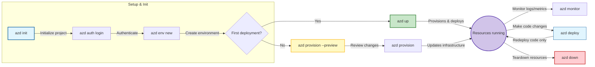
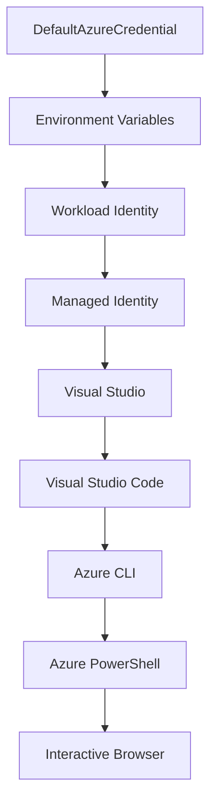

# Fondamentaux AZD - Concepts et Principes de Base

**Navigation dans le chapitre :**
- **📚 Accueil du cours** : [AZD Pour Débutants](../../README.md)
- **📖 Chapitre actuel** : Chapitre 1 - Fondations & Démarrage Rapide
- **⬅️ Précédent** : [Présentation du cours](../../README.md#-chapter-1-foundation--quick-start)
- **➡️ Suivant** : [Installation & Configuration](installation.md)
- **🚀 Chapitre suivant** : [Chapitre 2 : Développement AI-First](../chapter-02-ai-development/microsoft-foundry-integration.md)

## Introduction

> Revu selon `azd 1.37.2` (novembre 2026). Les commandes Bash utilisent des espaces réservés entre guillemets que vous devez remplacer. Les workflows de modèles utilisent `.` pour initialiser le répertoire courant ; sans argument de répertoire, l'initialisation du modèle crée un sous-répertoire et ne change pas le répertoire de travail de votre shell. Les extraits avancés sont illustratifs, pas des projets complets.

Cette leçon vous présente Azure Developer CLI (azd), un puissant outil en ligne de commande qui accélère votre parcours du développement local au déploiement sur Azure. Vous apprendrez les concepts fondamentaux, les fonctionnalités principales et comprendrez comment azd simplifie le déploiement d'applications natives dans le cloud.

## Objectifs d'apprentissage

À la fin de cette leçon, vous serez capable de :
- Comprendre ce qu'est Azure Developer CLI et son objectif principal
- Apprendre les concepts de base des modèles, environnements et services
- Explorer des fonctionnalités clés dont le développement basé sur modèle et Infrastructure as Code
- Comprendre la structure et le workflow d'un projet azd
- Être prêt à installer et configurer azd pour votre environnement de développement

## Résultats d'apprentissage

Après avoir terminé cette leçon, vous pourrez :
- Expliquer le rôle d'azd dans les workflows modernes de développement cloud
- Identifier les composants de la structure d'un projet azd
- Décrire comment les modèles, environnements et services fonctionnent ensemble
- Comprendre les avantages de l'Infrastructure as Code avec azd
- Reconnaître différentes commandes azd et leurs usages

## Qu'est-ce que Azure Developer CLI (azd) ?

Azure Developer CLI (azd) est un outil en ligne de commande conçu pour accélérer votre parcours du développement local au déploiement sur Azure. Il simplifie le processus de création, déploiement et gestion d'applications natives dans le cloud sur Azure.

### Que pouvez-vous déployer avec azd ?

azd prend en charge une large gamme de charges de travail — et la liste continue de s'allonger. Aujourd'hui, vous pouvez utiliser azd pour déployer :

| Type de charge | Exemples | Même workflow ? |
|---------------|----------|----------------|
| **Applications traditionnelles** | Applications web, API REST, sites statiques | ✅ `azd up` |
| **Services et microservices** | Applications en conteneurs, applications fonctionnelles, backends multi-services | ✅ `azd up` |
| **Applications alimentées par IA** | Applications de chat avec modèles Microsoft Foundry, solutions RAG avec Recherche IA | ✅ `azd up` |
| **Agents intelligents** | Agents hébergés Foundry, orchestrations multi-agents | ✅ `azd up` |

L'idée clé est que **le cycle de vie azd reste identique, quel que soit ce que vous déployez**. Vous initialisez un projet, provisionnez l'infrastructure, déployez votre code, surveillez votre application et nettoyez — que ce soit un simple site web ou un agent IA sophistiqué.

Cette continuité est voulue. azd considère les capacités IA comme un autre type de service que votre application peut utiliser, pas comme quelque chose de fondamentalement différent. Un point d'accès de chat propulsé par les modèles Microsoft Foundry est, du point de vue d'azd, un service supplémentaire à configurer et déployer.

### 🎯 Pourquoi utiliser AZD ? Une comparaison concrète

Comparons le déploiement d'une simple application web avec base de données :

#### ❌ SANS AZD : Déploiement manuel Azure (30+ minutes)

**Comparaison Bash illustrative, pas un démarreur d'application exécutable.** Cela suppose un code applicatif existant, des noms de ressources uniques, l'authentification Azure CLI, et les extensions CLI nécessaires. Utilisez l'exercice modèle ci-dessous pour le chemin complet supporté.

```bash
# Step 1: Create resource group
az group create --name myapp-rg --location eastus

# Step 2: Create App Service Plan
az appservice plan create --name myapp-plan \
  --resource-group myapp-rg \
  --sku B1 --is-linux

# Step 3: Create Web App
az webapp create --name myapp-web-unique123 \
  --resource-group myapp-rg \
  --plan myapp-plan \
  --runtime "NODE:22-lts"

# Step 4: Create Cosmos DB account (10-15 minutes)
az cosmosdb create --name myapp-cosmos-unique123 \
  --resource-group myapp-rg \
  --kind MongoDB

# Step 5: Create database
az cosmosdb mongodb database create \
  --account-name myapp-cosmos-unique123 \
  --resource-group myapp-rg \
  --name tododb

# Step 6: Create collection
az cosmosdb mongodb collection create \
  --account-name myapp-cosmos-unique123 \
  --resource-group myapp-rg \
  --database-name tododb \
  --name todos

# Step 7: Get connection string
CONN_STR=$(az cosmosdb keys list \
  --name myapp-cosmos-unique123 \
  --resource-group myapp-rg \
  --type connection-strings \
  --query "connectionStrings[0].connectionString" -o tsv)

# Step 8: Configure app settings
az webapp config appsettings set \
  --name myapp-web-unique123 \
  --resource-group myapp-rg \
  --settings MONGODB_URI="$CONN_STR"

# Step 9: Enable logging
az webapp log config --name myapp-web-unique123 \
  --resource-group myapp-rg \
  --application-logging filesystem \
  --detailed-error-messages true

# Step 10: Set up Application Insights
az monitor app-insights component create \
  --app myapp-insights \
  --location eastus \
  --resource-group myapp-rg

# Step 11: Link App Insights to Web App
INSTRUMENTATION_KEY=$(az monitor app-insights component show \
  --app myapp-insights \
  --resource-group myapp-rg \
  --query "instrumentationKey" -o tsv)

az webapp config appsettings set \
  --name myapp-web-unique123 \
  --resource-group myapp-rg \
  --settings APPINSIGHTS_INSTRUMENTATIONKEY="$INSTRUMENTATION_KEY"

# Step 12: Build application locally
npm install
npm run build

# Step 13: Create deployment package
zip -r app.zip . -x "*.git*" "node_modules/*"

# Step 14: Deploy application
az webapp deployment source config-zip \
  --resource-group myapp-rg \
  --name myapp-web-unique123 \
  --src app.zip

# Step 15: Wait and pray it works 🙏
# (No automated validation, manual testing required)
```

**Problèmes :**
- ❌ Plus de 15 commandes à retenir et exécuter dans l'ordre
- ❌ 30 à 45 minutes de travail manuel
- ❌ Facile de faire des erreurs (fautes de frappe, paramètres incorrects)
- ❌ Les identifiants doivent être gérés explicitement ; les logs de débogage et traces shell peuvent les exposer
- ❌ Pas de rollback automatique en cas d'échec
- ❌ Difficile à reproduire pour les membres de l'équipe
- ❌ Différent à chaque fois (non reproductible)

#### ✅ AVEC AZD : Déploiement automatisé (5 commandes, 10-15 minutes)

```bash
# Step 1: Initialize from template
azd init --template todo-nodejs-mongo .

# Step 2: Authenticate
azd auth login

# Step 3: Select the environment created during init
azd env select dev

# Step 4: Preview changes (optional but recommended)
azd provision --preview

# Step 5: Deploy everything
azd up

# ✨ Done! Everything is deployed, configured, and monitored
```

**Avantages :**
- ✅ **5 commandes** vs. plus de 15 étapes manuelles
- ✅ **10-15 minutes** de temps total (principalement attente Azure)
- ✅ **Moins d'erreurs manuelles** - workflow cohérent piloté par template
- ✅ **Gestion sécurisée des secrets** - de nombreux templates utilisent un stockage de secrets géré par Azure
- ✅ **Déploiements reproductibles** - même workflow à chaque fois
- ✅ **Définitions d'infrastructure reproductibles** - sujettes à quotas, disponibilité régionale, et versions de templates
- ✅ **Prêt pour équipe** - tout le monde peut déployer avec les mêmes commandes
- ✅ **Infrastructure as Code** - templates Bicep versionnés
- ✅ **Surveillance définie par template** - Application Insights incluse dans le template

### Temps et Fiabilité

Les temps indiqués sont des estimations, pas des benchmarks. azd réduit les commandes à orchestrer, mais ne garantit pas la durée du déploiement, n'élimine pas les erreurs ni ne fournit de rollback automatique applicatif/base de données. Gardez des versions fonctionnelles sous contrôle de source et testez les procédures de récupération.

## Concepts Clés

### Templates
Les templates sont la base d'azd. Ils contiennent :
- **Code applicatif** - Votre code source et ses dépendances
- **Définitions d'infrastructure** - ressources Azure définies en Bicep ou Terraform
- **Fichiers de configuration** - Paramètres et variables d'environnement
- **Scripts de déploiement** - Workflows automatisés de déploiement

### Environnements
Les environnements représentent différents cibles de déploiement :
- **Développement** - Pour tests et développement
- **Préproduction** - Environnement de préproduction
- **Production** - Environnement de production en direct

Chaque environnement conserve ses propres :
- Nom et valeurs d'environnement ; l'isolation des ressources dépend du template d'infrastructure
- Paramètres de configuration
- État du déploiement

### Services
Les services dans `azure.yaml` décrivent les composants applicatifs déployables :
- **Frontend** - Applications web, SPA
- **Backend** - API, microservices

Les bases de données et stockages sont normalement provisionnés comme ressources d'infrastructure, pas comme hôtes de service inventés tels que `host: postgres`.

## Fonctionnalités Clés

### 1. Développement piloté par Template
```bash
# Browse available templates
azd template list

# Initialize from a template
azd init --template "<template-name>" .
```

### 2. Infrastructure as Code
- **Bicep** - langage spécifique Azure
- **Terraform** - outil multi-cloud d'infrastructure
- Bicep compile en ARM templates ; le JSON ARM brut n’est pas un `infra.provider` intégré distinct.

### 3. Workflows intégrés
```bash
# Complete deployment workflow
azd up            # Provision + Deploy this is hands off for first time setup

# 🧪 NEW: Preview infrastructure changes before deployment (SAFE)
azd provision --preview    # Simulate infrastructure deployment without making changes

azd provision     # Create Azure resources if you update the infrastructure use this
azd deploy        # Deploy application code or redeploy application code once update
azd down          # Clean up resources
```

#### 🛡️ Planification d'infrastructure sécurisée avec aperçu
La commande `azd provision --preview` change la donne pour des déploiements sûrs :
- **Analyse en simulation** - Montre ce qui sera créé, modifié ou supprimé
- **Pas d'application d'infrastructure** - Examine les changements du fournisseur ; inspectez d'abord les hooks projet, car ils peuvent exécuter des commandes avec effets secondaires
- **Collaboration d'équipe** - Partagez le résultat de l'aperçu avant déploiement
- **Entrée pour planification des coûts** - Inspectez les SKU proposés, puis estimez-les avec le calculateur de prix Azure ; l’aperçu ne calcule pas les coûts

```bash
# Example preview workflow
azd provision --preview           # See what will change
# Review the output, discuss with team
azd provision                     # Apply changes with confidence
```

### 📊 Visuel : Workflow de développement AZD



**Explication du workflow :**
1. **Init** - Démarrer avec template ou nouveau projet
2. **Auth** - Authentifiez-vous auprès d’Azure
3. **Environment** - Créez un environnement de déploiement isolé
4. **Preview** - 🆕 Toujours prévisualiser les changements d'infrastructure d'abord (bonne pratique)
5. **Provision** - Créez/actualisez les ressources Azure
6. **Deploy** - Déployez votre code applicatif
7. **Monitor** - Surveillez la performance de l’application
8. **Iterate** - Faites des modifications et redéployez le code
9. **Cleanup** - Supprimez les ressources quand c’est fini

### 4. Gestion des environnements
```bash
# Create and manage environments
azd env new "<environment-name>"
azd env select "<environment-name>"
azd env list
```

### 5. Extensions et commandes IA

azd utilise un système d’extensions pour ajouter des capacités au-delà du CLI de base. Ceci est particulièrement utile pour les charges de travail IA :

```bash
# List available extensions
azd extension list

# Install the GA Foundry bundle (requires azd >= 1.37.0)
azd ext install microsoft.foundry

# Initialize an AI agent project interactively
azd ai agent init

# Test a deployed agent (shows latency and time-to-first-byte)
azd ai agent invoke

# Start the MCP server for AI-assisted development (Alpha)
azd mcp start
```

**Cycle de vie de l’agent, de bout en bout.** Le bundle GA `microsoft.foundry` inclut `azure.ai.agents` et six autres extensions centrales. Installez `azure.ai.evaluations` séparément pour évaluation. Utilisez `azd >= 1.37.0` pour ce workflow. Vous n’avez pas besoin de tout cela dès le premier jour :

| Étape | Commande | Fonction |
|-------|---------|---------|
| **Scaffold** | `azd ai agent init --template <path-to-azure.yaml>` | Adoptez un template de projet d’agent actuel |
| **Exécuter localement** | `azd ai agent run` puis `azd ai agent invoke --local "Test prompt"` dans un autre terminal | Inspectez l’activité locale avec Agent Inspector ; les appels modèles utilisent toujours Azure |
| **Déployer** | `azd deploy` | Pour agents hébergés en mode code, téléchargez la source pour une build Foundry distante |
| **Tester** | `azd ai agent invoke` | Appelez l’agent et voyez le temps de réponse |
| **Mesurer** | `azd ai eval init`, `generate`, `run start` | Configurez, déployez et réalisez des évaluations avec l'extension séparée |
| **Améliorer** | `azd ai agent optimize --eval <evaluation-name> --optimize-model <optimizer-deployment>` | Réutilisez une évaluation compatible pour optimiser l’agent |
| **Inspecter** | `azd ai agent endpoint show` | Visualisez la configuration en direct de l’endpoint |
| **Nettoyer** | `azd ai agent delete` | Supprimez un agent hébergé et toutes ses versions |

> Commencez par le [tutoriel agent hébergé GA](../chapter-02-ai-development/microsoft-foundry-integration.md#hosted-agent-walkthrough-ga), qui couvre prérequis, provisioning et nettoyage sécurisé. Les extensions sont abordées plus en détail dans la référence [Commandes IA CLI AZD](../chapter-08-production/production-ai-practices.md#azd-ai-cli-commands-and-extensions).

## 📁 Structure du projet

Une structure typique de projet azd :
```
my-app/
├── .azure/                  # Local environments and selected-environment config
│   ├── config.json
│   └── dev/.env
├── .devcontainer/          # Development container config
├── .github/workflows/      # GitHub Actions
├── .vscode/               # VS Code settings
├── infra/                 # Infrastructure code
│   ├── main.bicep        # Main infrastructure template
│   ├── main.parameters.json
│   └── modules/          # Reusable modules
├── src/                  # Application source code
│   ├── api/             # Backend services
│   └── web/             # Frontend application
├── azure.yaml           # azd project configuration
└── README.md
```

## 🔧 Fichiers de configuration

### azure.yaml
Le fichier principal de configuration de projet :
```yaml
name: my-awesome-app
metadata:
  template: my-template@1.0.0

services:
  web:
    project: ./src/web
    language: js
    host: appservice
  api:
    project: ./src/api
    language: js
    host: appservice

hooks:
  preprovision:
    shell: pwsh
    run: echo "Preparing to provision..."
```

### .azure/config.json
Sélection locale du projet pour l’environnement par défaut (illustratif ; géré par azd) :
```json
{
  "defaultEnvironment": "dev"
}
```

## 🎪 Workflows courants avec exercices pratiques

> **💡 Astuce d’apprentissage :** Suivez ces exercices dans l’ordre pour progresser dans vos compétences AZD.

### 🎯 Exercice 1 : Initialiser votre premier projet

**Objectif :** Créer un projet AZD et explorer sa structure

**Étapes :**
```bash
# Use a proven template
mkdir azd-basics-practice
cd azd-basics-practice
# Choose "dev" for the environment name when prompted
azd init --template todo-nodejs-mongo .

# Explore the generated files
ls -la  # View all files including hidden ones

# Key files created:
# - azure.yaml (main config)
# - infra/ (infrastructure code)
# - src/ (application code)
```

**✅ Succès :** Vous avez les répertoires azure.yaml, infra/ et src/

---

### 🎯 Exercice 2 : Déployer sur Azure

**Objectif :** Compléter un déploiement de bout en bout

**Étapes :**
```bash
# 1. Authenticate
azd auth login

# 2. Select the dev environment created in Exercise 1
azd env select dev
azd env set AZURE_LOCATION eastus

# 3. Preview changes (RECOMMENDED)
azd provision --preview

# 4. Deploy everything
azd up

# 5. Verify deployment
azd show    # View your app URL
```

**Temps estimé :** 10-15 minutes  
**✅ Succès :** L’URL de l’application s’ouvre dans le navigateur

---

### 🎯 Exercice 3 : Multiples environnements

**Objectif :** Déployer en dev et staging

**Étapes :**
```bash
# Already have dev, create staging
azd env new staging
azd env set AZURE_LOCATION westus2
azd up

# Switch between them
azd env list
azd env select dev
```

**✅ Succès :** Deux groupes de ressources distincts dans le portail Azure

**Nettoyage :** L’exercice 3 crée un second déploiement facturable. Supprimez les deux lorsque terminé :

```bash
azd down --environment dev
azd down --environment staging
```

---

### 🛡️ Nettoyage destructif : `azd down --force --purge`

Lorsque vous souhaitez intentionnellement supprimer les ressources Azure de l’environnement sélectionné :

```bash
azd down --force --purge
```

**Ce que ça fait :**
- `--force` : Pas de demandes de confirmation
- `--purge` : Supprime également définitivement les ressources soft-deleted supportées (par exemple Key Vaults), si la protection purge le permet. Ne supprime pas le répertoire local `.azure/`.

**À utiliser quand :** vous avez terminé avec un environnement jetable. Ne traitez pas le nettoyage destructif comme première réponse à une erreur d'authentification, de quota ou de configuration.

---

## 🎪 Référence du workflow original

### Démarrer un nouveau projet
```bash
# Method 1: Use existing template
azd init --template todo-nodejs-mongo .

# Method 2: Start from scratch
azd init

# Method 3: Use current directory
azd init .
```

### Cycle de développement
```bash
# Set up development environment
azd auth login
azd env new dev
azd env select dev

# Deploy everything
azd up

# Make changes and redeploy
azd deploy

# Clean up when done
azd down --force --purge # Deletes this environment's discovered Azure resources; review before forcing deletion.
```

## Comprendre `azd down --force --purge`
La commande `azd down --force --purge` est un moyen puissant pour démanteler complètement votre environnement azd et toutes les ressources associées. Voici une explication de chaque flag :
```
--force
```
- Saute les demandes de confirmation.
- Utile pour l’automatisation ou les scripts où l’entrée manuelle n’est pas possible.
- Ne contourne pas les permissions, la protection purge ou les échecs de suppression.

```
--purge
```
Supprime définitivement les ressources Azure soft-deleted supportées sans confirmation supplémentaire. La protection purge et les permissions restent en vigueur. Ne supprime **pas** les environnements locaux ni le dossier `.azure/`.


### Pourquoi utiliser les deux ?
Utilisez les deux uniquement lorsque vous souhaitez supprimer les ressources Azure de l’environnement sélectionné et purger les ressources récupérables. C’est un nettoyage destructif, pas une réparation générale ou une réinitialisation locale.

Cela est particulièrement utile après des suppressions manuelles dans le portail Azure ou lors du changement de templates, environnements ou conventions de nommage des groupes de ressources.


### Gestion de plusieurs environnements
```bash
# Create staging environment
azd env new staging
azd env select staging
azd up

# Switch back to dev
azd env select dev

# Compare environments
azd env list
```

## 🔐 Authentification et Identifiants

Distinquez l’authentification de déploiement (`azd auth login`) de l’authentification SDK de l’application (`DefaultAzureCredential`). Elles sont séparées. azd n’utilise pas par défaut les identifiants Azure CLI.

### Authentification Azure CLI (`az login`)

Exécutez `azd auth login` pour azd. Les commandes Azure CLI suivantes sont optionnelles et authentifient les commandes `az` séparément :

```bash
# Interactive login (opens browser)
az login

# Login with specific tenant
az login --tenant "<tenant-id>"

# Login with service principal
az login --service-principal -u "<app-id>" -p "<password>" --tenant "<tenant-id>"

# Check current login status
az account show

# List available subscriptions
az account list --output table

# Set default subscription
az account set --subscription "<subscription-id>"
```

### Flux d'authentification
1. **Connexion interactive** : Ouvre votre navigateur par défaut pour l’authentification
2. **Flux de code d’appareil** : Pour les environnements sans accès au navigateur
3. **Principal de service** : Pour les scénarios d'automatisation et CI/CD
4. **Identité gérée** : Pour les applications hébergées sur Azure

### Chaîne DefaultAzureCredential

`DefaultAzureCredential` est un type d’accréditation qui offre une expérience d’authentification simplifiée en essayant automatiquement plusieurs sources d’accréditations dans un ordre spécifique :

#### Chaîne d’accréditation du SDK d’application

La chaîne exacte dépend de la langue Azure Identity SDK, de la version, des plugins installés et des options. Ce diagramme est conceptuel, pas une séquence d’authentification azd fixe ; les SDK récents peuvent aussi inclure les accréditations Azure Developer CLI.


#### 1. Variables d’environnement
```bash
# Set environment variables for service principal
export AZURE_CLIENT_ID="<app-id>"
export AZURE_CLIENT_SECRET="<password>"
export AZURE_TENANT_ID="<tenant-id>"
```

#### 2. Identité de charge de travail (Kubernetes/GitHub Actions)
Utilisé automatiquement dans :
- Azure Kubernetes Service (AKS) avec identité de charge de travail
- GitHub Actions avec fédération OIDC
- Autres scénarios d’identité fédérée

#### 3. Identité gérée
Pour les ressources Azure telles que :
- Machines virtuelles
- App Service
- Azure Functions
- Instances de conteneurs

```bash
# Inspect a deployed Container App's configured identity (requires az login)
az containerapp show --name "<app-name>" --resource-group "<rg-name>" --query identity
```

#### 4. Intégration des outils de développement
- **Visual Studio** : utilise automatiquement le compte connecté
- **VS Code** : le support dépend du SDK et de la configuration du courtier/plugin pris en charge
- **Azure CLI** : utilise les accréditations `az login` (le plus courant pour le développement local)

### Configuration de l’authentification AZD

```bash
# Method 1: Direct azd authentication (recommended)
azd auth login

# Method 2: Direct azd authentication
azd auth login --use-device-code  # For headless environments

# Method 3: Check authentication status
azd auth login --check-status

# Method 4: Logout and re-authenticate
azd auth logout
azd auth login
```

### Bonnes pratiques d’authentification

#### Pour le développement local
```bash
# 1. Log in to azd
azd auth login

# 2. Select the subscription for this initialized environment
azd env set AZURE_SUBSCRIPTION_ID "<subscription-id>"

# 3. Check azd sign-in details (read the status message)
azd auth login --check-status
```

#### Pour les pipelines CI/CD
```yaml
# Partial GitHub Actions steps: assumes checkout, azd installation,
# required AZURE_* environment values, and pipeline secret configuration.
- name: Deploy with azd
  run: |
    azd auth login --client-id ${{ secrets.AZURE_CLIENT_ID }} \
                    --client-secret ${{ secrets.AZURE_CLIENT_SECRET }} \
                    --tenant-id ${{ secrets.AZURE_TENANT_ID }}
    azd up --no-prompt
```

#### Pour les environnements de production
- Utilisez **Identité gérée** lors de l’exécution sur des ressources Azure
- Utilisez **Principal de service** pour les scénarios d’automatisation
- Évitez de stocker les accréditations dans le code ou les fichiers de configuration
- Utilisez **Azure Key Vault** pour la configuration sensible

### Problèmes d’authentification courants et solutions

#### Problème : "Aucune souscription trouvée"
```bash
# Solution: Set default subscription
az account list --output table
az account set --subscription "<subscription-id>"
azd env set AZURE_SUBSCRIPTION_ID "<subscription-id>"
```

#### Problème : "Autorisations insuffisantes"
```bash
# Solution: Check and assign required roles
az role assignment list --assignee $(az account show --query user.name --output tsv)

# Common required roles:
# - Contributor (for resource management)
# - User Access Administrator (for role assignments)
```

#### Problème : "Jeton expiré"
```bash
# Solution: Re-authenticate
az logout
az login
azd auth logout
azd auth login
```

### Authentification dans différents scénarios

#### Développement local
```bash
# Personal development account
az login
azd auth login
```

#### Développement en équipe
```bash
# Use specific tenant for organization
az login --tenant contoso.onmicrosoft.com
azd auth login --tenant-id "<tenant-id>"
```

#### Scénarios multi-locataires
```bash
# Switch between tenants
az login --tenant tenant1.onmicrosoft.com
azd auth login --tenant-id "<tenant-1-id>"
# Select an environment configured with tenant 1's subscription
azd env select tenant1-dev
# Deploy to tenant 1
azd up

az login --tenant tenant2.onmicrosoft.com  
azd auth login --tenant-id "<tenant-2-id>"
azd env select tenant2-dev
# Deploy to tenant 2
azd up
```

### Considérations de sécurité

1. **Stockage des accréditations** : Ne jamais stocker les accréditations dans le code source
2. **Limitation de la portée** : Utiliser le principe du moindre privilège pour les principaux de service
3. **Rotation des jetons** : Faire tourner régulièrement les secrets de principal de service
4. **Piste d’audit** : Surveiller les activités d’authentification et de déploiement
5. **Sécurité réseau** : Utiliser des points de terminaison privés quand c’est possible

### Résolution des problèmes d’authentification

```bash
# Debug authentication issues
azd auth login --check-status
az account show
az account get-access-token

# Common diagnostic commands
whoami                          # Current user context
az ad signed-in-user show      # Microsoft Entra ID user details
az group list                  # Test resource access
```

## Découverte de commandes

### Découverte
```bash
azd template list              # Browse templates
azd template list --help       # Template discovery options
azd init --help               # Initialization options
```

### Gestion de projet
```bash
azd show                     # Project overview
azd env list                # Available environments and selected default
azd config show            # Configuration settings
```

### Surveillance
```bash
azd monitor                  # Open Azure portal monitoring
azd monitor --logs           # View application logs
azd monitor --live           # View live metrics
azd pipeline config          # Set up CI/CD
```

## Bonnes pratiques

### 1. Utilisez des noms significatifs
```bash
# Good
azd env new production-east
azd init --template todo-nodejs-mongo .

# Avoid
azd env new env1
azd init --template template1 .
```

### 2. Exploitez les modèles
- Commencez avec des modèles existants
- Personnalisez selon vos besoins
- Créez des modèles réutilisables pour votre organisation

### 3. Isolation des environnements
- Utilisez des environnements séparés pour dev/staging/prod
- Ne déployez jamais directement en production depuis votre machine locale
- Utilisez des pipelines CI/CD pour les déploiements en production

### 4. Gestion de la configuration
- Utilisez l’identité gérée et Key Vault pour les secrets ; les valeurs `azd env set` ordinaires sont en clair localement
- Gardez la configuration sous contrôle de version
- Documentez les paramètres spécifiques à chaque environnement

## Progression d’apprentissage

### Débutant (Semaine 1-2)
1. Installez azd et authentifiez-vous
2. Déployez un modèle simple
3. Comprenez la structure du projet
4. Apprenez les commandes de base (up, down, deploy)

### Intermédiaire (Semaine 3-4)
1. Personnalisez les modèles
2. Gérez plusieurs environnements
3. Comprenez l’infrastructure en code
4. Configurez des pipelines CI/CD

### Avancé (Semaine 5+)
1. Créez des modèles personnalisés
2. Modèles d’infrastructure avancés
3. Déploiements multi-régions
4. Configurations de niveau entreprise

## Étapes suivantes

**📖 Continuez l’apprentissage du Chapitre 1 :**
- [Installation & configuration](installation.md) - Installez azd et configurez-le
- [Votre premier projet](first-project.md) - Terminez le tutoriel pratique
- [Guide de configuration](../chapter-03-configuration/configuration.md) - Options de configuration avancées

**🎯 Prêt pour le chapitre suivant ?**
- [Chapitre 2 : Développement AI-first](../chapter-02-ai-development/microsoft-foundry-integration.md) - Commencez à construire des applications IA

## Ressources supplémentaires

- [Présentation Azure Developer CLI](https://learn.microsoft.com/en-us/azure/developer/azure-developer-cli/)
- [Galerie des modèles](https://azure.github.io/awesome-azd/)
- [Exemples communautaires](https://github.com/Azure-Samples)

---

## 🙋 Questions fréquemment posées

### Questions générales

**Q : Quelle est la différence entre AZD et Azure CLI ?**

R : Azure CLI (`az`) sert à gérer des ressources Azure individuelles. AZD (`azd`) sert à gérer des applications entières :

```bash
# Azure CLI - Low-level resource management
az webapp create --name myapp --resource-group rg
az sql server create --name myserver --resource-group rg
# ...many more commands needed

# AZD - Application-level management
azd up  # Deploys entire app with all resources
```

**Considérez-le ainsi :**
- `az` = Manipuler des briques Lego individuelles
- `azd` = Travailler avec des ensembles Lego complets

---

**Q : Ai-je besoin de connaître Bicep ou Terraform pour utiliser AZD ?**

R : Non ! Commencez avec les modèles :
```bash
# Use existing template - no IaC knowledge needed
azd init --template todo-nodejs-mongo .
azd up
```

Vous pouvez apprendre Bicep plus tard pour personnaliser l’infrastructure. Les modèles fournissent des exemples fonctionnels auxquels s’inspirer.

---

**Q : Combien coûte l’exécution des modèles AZD ?**

R : Les coûts varient selon la région, le SKU, le temps de fonctionnement, le mode de base de données et l’utilisation des modèles. Un environnement de développement peut entraîner des frais mensuels substantiels même au repos ; ne supposez pas une plage universelle de 50 à 150 $ :

```bash
# Preview resource changes (not prices)
azd provision --preview

# Always cleanup when not using
azd down --force --purge  # Removes all resources
```

**Astuce de pro :** Utilisez les niveaux gratuits quand c’est possible :
- App Service : niveau F1 (Gratuit)
- Azure OpenAI : pas d’allocation mensuelle gratuite garantie de jetons ; vérifiez le modèle et l’offre tarifaire actuels
- Cosmos DB : les comptes équipé de débit provisionné éligibles peuvent opter pour un niveau gratuit ; les modèles serverless ne sont pas automatiquement admissibles

---

**Q : Puis-je utiliser AZD avec des ressources Azure existantes ?**

R : Oui, mais il est plus facile de partir de zéro. AZD fonctionne mieux quand il gère le cycle de vie complet. Pour les ressources existantes :

```bash
# Option 1: Import existing resources (advanced)
azd init
# Then modify infra/ to reference existing resources

# Option 2: Start fresh (recommended)
azd init --template "<verified-template-name>" .
azd up  # Creates new environment
```

---

**Q : Comment partager mon projet avec mes coéquipiers ?**

R : Validez le projet AZD dans Git (mais PAS le dossier .azure) :

```bash
# Already in .gitignore by default
.azure/        # Contains secrets and environment data
*.env          # Environment variables

# Team members then:
git clone "<your-repo>"
# Change into the cloned repository before running the remaining commands.
azd auth login
azd env new "<their-name>-dev"
azd up
```

Tout le monde obtient une infrastructure identique à partir des mêmes modèles.

---

### Questions de dépannage

**Q : "azd up" a échoué à mi-chemin. Que faire ?**

R : Vérifiez l’erreur, corrigez-la, puis réessayez :

```bash
# Capture detailed diagnostics (redact sensitive values before sharing)
azd up --debug

# Common fixes:

# 1. If quota exceeded:
azd env set AZURE_LOCATION "westus2"  # Try different region

# 2. If resource name conflict:
azd down --force --purge  # Clean slate
azd up  # Retry

# 3. If auth expired:
az login
azd auth login
azd up
```

**Problème le plus courant :** Mauvaise souscription Azure sélectionnée
```bash
az account list --output table
az account set --subscription "<correct-subscription>"
azd env set AZURE_SUBSCRIPTION_ID "<correct-subscription-id>"
```

---

**Q : Comment déployer uniquement les changements de code sans reprovisionner ?**

R : Utilisez `azd deploy` au lieu de `azd up` :

```bash
azd up          # First time: provision + deploy (slow)

# Make code changes...

azd deploy      # Subsequent times: deploy only (fast)
```

Comparaison des vitesses :
- `azd up` : 10-15 minutes (provisionne l’infrastructure)
- `azd deploy` : 2-5 minutes (code seulement)

---

**Q : Puis-je personnaliser les modèles d’infrastructure ?**

R : Oui ! Modifiez les fichiers Bicep dans `infra/` :

```bash
# After azd init
cd infra/
code main.bicep  # Edit in VS Code

# Preview changes
azd provision --preview

# Apply changes
azd provision
```

**Astuce :** Commencez petit - changez d’abord les SKUs :
```bicep
// infra/main.bicep
sku: {
  name: 'B1'  // Change to 'P1V2' for production
}
```

---

**Q : Comment supprimer tout ce qu’AZD a créé ?**

R : Une commande supprime toutes les ressources :

```bash
azd down --force --purge

# This deletes:
# - Azure resources/resource groups discovered for the selected environment
# - Supported soft-deleted resources, if purge protection allows
# Local .azure files remain; shared/external resources may remain too.
```

**À exécuter toujours quand :**
- Fin des tests d’un modèle
- Passage à un projet différent
- Vouloir repartir de zéro

**Vérification des coûts :** Confirmez la suppression dans Azure et vérifiez les ressources conservées/partagées. Les frais précédents encourus restent applicables.

---

**Q : Et si j’ai accidentellement supprimé des ressources dans le portail Azure ?**

R : L’état AZD peut être désynchronisé. Approche de remise à zéro :

```bash
# 1. Delete remaining resources only if that is your intent
azd down --force --purge

# 2. Start fresh
azd up

# Alternative: Let AZD detect and fix
azd provision  # Will create missing resources
```

---

### Questions avancées

**Q : Puis-je utiliser AZD dans les pipelines CI/CD ?**

R : Oui ! Exemple GitHub Actions :

```yaml
# .github/workflows/deploy.yml
name: Deploy with AZD

on:
  push:
    branches: [main]

jobs:
  deploy:
    runs-on: ubuntu-latest
    steps:
      - uses: actions/checkout@v4
      
      - name: Install azd
        run: curl -fsSL https://aka.ms/install-azd.sh | bash
      
      - name: Azure Login
        run: |
          azd auth login \
            --client-id ${{ secrets.AZURE_CLIENT_ID }} \
            --client-secret ${{ secrets.AZURE_CLIENT_SECRET }} \
            --tenant-id ${{ secrets.AZURE_TENANT_ID }}
      
      - name: Deploy
        env:
          AZURE_ENV_NAME: dev
          AZURE_LOCATION: ${{ vars.AZURE_LOCATION }}
          AZURE_SUBSCRIPTION_ID: ${{ vars.AZURE_SUBSCRIPTION_ID }}
        run: azd up --no-prompt
```

---

**Q : Comment gérer les secrets et les données sensibles ?**

R : Utilisez explicitement Key Vault. `azd env set` écrit des valeurs ordinaires dans le fichier d’environnement local ; il ne crée pas automatiquement de coffre, n’assigne pas de rôles ni n’injecte les secrets dans votre application.

```bash
# Interactive: create/select a Key Vault secret and save its reference
azd env set-secret DATABASE_PASSWORD
```

Vous devez disposer des permissions appropriées sur le coffre. Votre infrastructure/application doit toujours acheminer le secret à son consommateur et accorder l’accès à l’identité d’exécution. N’affichez pas les valeurs de secrets résolus dans les journaux.

**Ne validez jamais :**
- Dossier `.azure/` (contient des données d’environnement)
- Fichiers `.env` (secrets locaux)
- Chaînes de connexion

---

**Q : Puis-je déployer dans plusieurs régions ?**

R : Oui, créez un environnement par région :

```bash
# East US environment
azd env new prod-eastus
azd env set AZURE_LOCATION eastus
azd up

# West Europe environment
azd env new prod-westeurope
azd env set AZURE_LOCATION westeurope
azd up

# Each environment is independent
azd env list
```

Pour des applications véritablement multi-régions, personnalisez les modèles Bicep pour déployer simultanément dans plusieurs régions.

---

**Q : Où puis-je obtenir de l’aide si je rencontre un problème ?**

1. **Documentation AZD :** https://learn.microsoft.com/azure/developer/azure-developer-cli/
2. **Issues GitHub :** https://github.com/Azure/azure-dev/issues
3. **Discord :** [Azure Discord](https://discord.gg/microsoft-azure) - canal #azure-developer-cli
4. **Stack Overflow :** Tag `azure-developer-cli`
5. **Ce cours :** [Guide de dépannage](../chapter-07-troubleshooting/common-issues.md)

**Astuce de pro :** Avant de poser une question, exécutez :
```bash
azd show       # Shows current state
azd version    # Shows your version
```
Incluez ces infos dans votre question pour une aide plus rapide.

---

## 🎓 Quelles sont les prochaines étapes ?

Vous comprenez maintenant les bases d’AZD. Choisissez votre parcours :

### 🎯 Pour les débutants :
1. **Suivant :** [Installation & configuration](installation.md) - Installez AZD sur votre machine
2. **Puis :** [Votre premier projet](first-project.md) - Déployez votre première application
3. **Pratique :** Complétez les 3 exercices de cette leçon

### 🚀 Pour les développeurs IA :
1. **Passez à :** [Chapitre 2 : Développement AI-first](../chapter-02-ai-development/microsoft-foundry-integration.md)
2. **Déployez :** Dans un répertoire de projet vide, commencez avec `azd init --template get-started-with-ai-chat .`
3. **Apprenez :** Construisez en déployant

### 🏗️ Pour les développeurs expérimentés :
1. **Revoyez :** [Guide de configuration](../chapter-03-configuration/configuration.md) - Paramètres avancés
2. **Explorez :** [Infrastructure as Code](../chapter-04-infrastructure/provisioning.md) - Approfondissement Bicep
3. **Construisez :** Créez des modèles personnalisés pour votre stack

---

**Navigation dans les chapitres :**
- **📚 Accueil du cours** : [AZD pour les débutants](../../README.md)
- **📖 Chapitre actuel** : Chapitre 1 - Fondations et démarrage rapide  
- **⬅️ Précédent** : [Aperçu du cours](../../README.md#-chapter-1-foundation--quick-start)
- **➡️ Suivant** : [Installation & configuration](installation.md)
- **🚀 Chapitre suivant** : [Chapitre 2 : Développement AI-first](../chapter-02-ai-development/microsoft-foundry-integration.md)

---

<!-- CO-OP TRANSLATOR DISCLAIMER START -->
**Avertissement** :
Ce document a été traduit à l'aide du service de traduction automatique [Co-op Translator](https://github.com/Azure/co-op-translator). Bien que nous nous efforçions d'assurer l'exactitude, veuillez noter que les traductions automatisées peuvent contenir des erreurs ou des inexactitudes. Le document original dans sa langue native doit être considéré comme la source faisant autorité. Pour les informations critiques, il est recommandé de recourir à une traduction professionnelle réalisée par un humain. Nous ne saurions être tenus responsables des malentendus ou erreurs d'interprétation découlant de l'utilisation de cette traduction.
<!-- CO-OP TRANSLATOR DISCLAIMER END -->