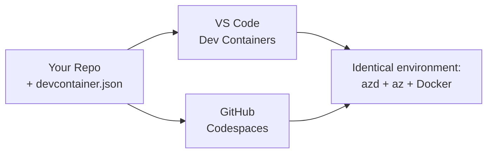

# Conteneurs de développement & GitHub Codespaces pour azd

**Navigation du chapitre :**
- **📚 Accueil du cours** : [AZD Pour Débutants](../../README.md)
- **📖 Chapitre actuel** : Chapitre 1 - Fondations & Démarrage rapide
- **⬅️ Précédent** : [Apportez votre propre application](bring-your-own-app.md)
- **🚀 Chapitre suivant** : [Chapitre 2 : Développement AI-First](../chapter-02-ai-development/README.md)

> Objectif de la revue de commande et configuration : `azd 1.37.2` (novembre 2026). Les constructions de conteneurs et les déploiements Azure n'ont pas été exécutés dans le cadre de cette revue.

## Introduction

Installer azd, le runtime de langage approprié, Docker et l’Azure CLI sur chaque machine est une corvée — et c’est la première raison pour laquelle un tutoriel qui "fonctionne sur ma machine" échoue chez quelqu’un d’autre. Un **conteneur de développement** résout ce problème en décrivant toute votre chaîne d’outils dans un fichier. Toute personne ouvrant le projet dans VS Code ou GitHub Codespaces obtient exactement le même environnement, avec azd déjà installé. Cette leçon vous montre comment en ajouter un.

## Objectifs d’apprentissage

À la fin de cette leçon, vous serez capable de :
- Comprendre ce qu’est un conteneur de développement et pourquoi il facilite l’utilisation d’azd
- Ajouter un `.devcontainer/devcontainer.json` minimal à un projet
- Inclure azd, l’Azure CLI et Docker via des *fonctionnalités* de conteneur de développement
- Ouvrir le projet dans GitHub Codespaces ou VS Code

## Résultats d’apprentissage

Après avoir terminé cette leçon, vous serez capable de :
- Rédiger un `devcontainer.json` pour un projet azd
- Ajouter azd et les outils Azure sans installations manuelles
- Exécuter `azd up` depuis l’intérieur d’un conteneur ou d’un Codespace

---

## Qu’est-ce qu’un conteneur de développement ?

Un conteneur de développement est un environnement de développement basé sur Docker défini par un fichier `.devcontainer/devcontainer.json` dans votre dépôt. Lorsque vous ouvrez le projet :

- **VS Code** (avec l’extension Dev Containers) construit le conteneur et s’y connecte.
- **GitHub Codespaces** construit le même conteneur dans le cloud et vous fournit un éditeur dans le navigateur.

Dans les deux cas, chaque contributeur dispose des mêmes outils — plus besoin de tâtonner avec des "avez-vous installé azd ?".



---

## Étape 1 : Créez le fichier devcontainer

Créez `.devcontainer/devcontainer.json` à la racine de votre projet :

```json
{
  "name": "azd-project",
  "image": "mcr.microsoft.com/devcontainers/base:bookworm",
  "features": {
    "ghcr.io/devcontainers/features/azure-cli:1": {},
    "ghcr.io/azure/azure-dev/azd:0": { "version": "1.37.2" },
    "ghcr.io/devcontainers/features/docker-in-docker:2": {},
    "ghcr.io/devcontainers/features/node:1": {}
  },
  "customizations": {
    "vscode": {
      "extensions": [
        "ms-azuretools.azure-dev",
        "ms-azuretools.vscode-bicep"
      ]
    }
  },
  "forwardPorts": [3000],
  "postCreateCommand": "azd version"
}
```

Ce que chaque partie fait :

| Clé | But |
|-----|-----|
| `image` | Le système d’exploitation de base pour le conteneur |
| `features` | Installateurs préconstruits — ici : Azure CLI, **azd**, Docker, et Node.js |
| `customizations.vscode.extensions` | Installe automatiquement les extensions VS Code azd et Bicep |
| `forwardPorts` | Expose le port de votre application vers votre navigateur |
| `postCreateCommand` | S’exécute une fois après la construction du conteneur (ici, un contrôle de bon fonctionnement) |

> La version de la fonctionnalité (`azd:0`) et la version CLI installée sont différentes. Réglez l’option `version` de la fonctionnalité sur `"1.37.2"` pour fixer la CLI ; n’utilisez pas une version CLI comme tag de fonctionnalité.

---

## Étape 2 : Adaptez la fonctionnalité au langage de votre application

Remplacez la fonctionnalité `node` par celle correspondant à votre application :

```jsonc
// Python project
"ghcr.io/devcontainers/features/python:1": {},

// .NET project
"ghcr.io/devcontainers/features/dotnet:2": {},

// Java project
"ghcr.io/devcontainers/features/java:1": {},

// Go project
"ghcr.io/devcontainers/features/go:1": {}
```

Conservez `docker-in-docker` pour la construction locale d’images. Une construction à distance ACR configurée (`docker.remoteBuild: true`) constitue une alternative ; le type d’hôte seul ne nécessite pas toujours Docker local.

---

## Étape 3 : Ouvrez-le

**Dans VS Code :**
1. Installez l’extension **Dev Containers**.
2. Ouvrez le dossier du projet.
3. Cliquez sur **Réouvrir dans le conteneur** lorsqu’on vous le propose (ou lancez *Dev Containers : Réouvrir dans le conteneur*).

**Dans GitHub Codespaces :**
1. Poussez le dépôt sur GitHub.
2. Cliquez sur **Code → Codespaces → Créer un codespace sur main**.
3. Patientez pendant la construction du conteneur — azd est prêt dans le terminal.

---

## Étape 4 : Déployez depuis l’intérieur du conteneur

Le conteneur a azd préinstallé, donc le flux de travail normal fonctionne simplement :

```bash
azd auth login --use-device-code   # device code is handy inside Codespaces
azd up
```

> **Pourquoi `--use-device-code` ?** Dans un conteneur distant ou un Codespace, il n’y a pas de navigateur local vers lequel rediriger, donc l’authentification par code d’appareil est la méthode fiable. Vous collerez un code dans un onglet de navigateur pour compléter la connexion.

---

## Pièges courants

| Piège | Solution |
|---------|----------|
| `azd up` ne peut pas construire une image | Ajoutez la fonctionnalité `docker-in-docker` |
| La connexion via navigateur bloque dans Codespaces | Utilisez `azd auth login --use-device-code` |
| Outils différents entre collègues | Figez la CLI via l’option `version` de la fonctionnalité azd et figez les runtimes de langage |
| Application inaccessible dans le navigateur | Ajoutez le port à `forwardPorts` |

---

## Résumé

- Un conteneur de développement rend votre chaîne d’outils azd reproductible pour tous.
- Ajoutez azd, l’Azure CLI et Docker via des *fonctionnalités* de conteneur de développement.
- Adaptez la fonctionnalité de langage à votre application et conservez `docker-in-docker` pour les hôtes de conteneur.
- Utilisez la connexion par code d’appareil lors de l’exécution dans Codespaces.

---

## 🔗 Navigation

| Direction | Ressource |
|-----------|----------|
| **Précédent** | [Apportez votre propre application](bring-your-own-app.md) |
| **Accueil du chapitre** | [Chapitre 1 : Fondations & Démarrage rapide](README.md) |
| **Chapitre suivant** | [Chapitre 2 : Développement AI-First](../chapter-02-ai-development/README.md) |

## 📖 Ressources associées

- [Installation & Configuration](installation.md)
- [Fiche de référence des commandes](../../resources/cheat-sheet.md)
- [Spécification officielle des conteneurs de développement](https://containers.dev/)
- [Fonctionnalité de conteneur de développement azd](https://github.com/Azure/azure-dev/tree/main/ext/devcontainer)

---

<!-- CO-OP TRANSLATOR DISCLAIMER START -->
**Avertissement** :
Ce document a été traduit à l'aide du service de traduction automatique [Co-op Translator](https://github.com/Azure/co-op-translator). Bien que nous nous efforçions d'assurer l'exactitude, veuillez noter que les traductions automatisées peuvent contenir des erreurs ou des inexactitudes. Le document original dans sa langue native doit être considéré comme la source faisant autorité. Pour les informations critiques, il est recommandé de recourir à une traduction professionnelle réalisée par un humain. Nous ne saurions être tenus responsables des malentendus ou erreurs d'interprétation découlant de l'utilisation de cette traduction.
<!-- CO-OP TRANSLATOR DISCLAIMER END -->