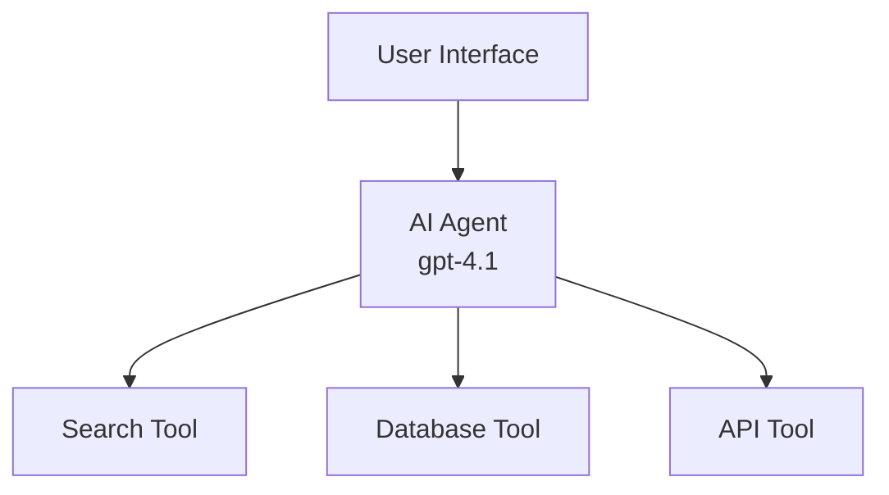
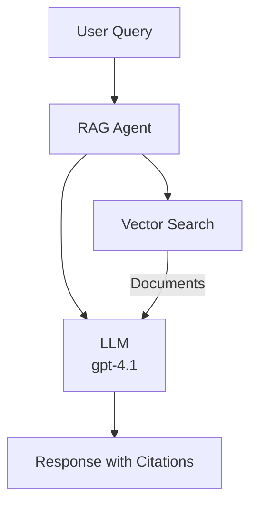
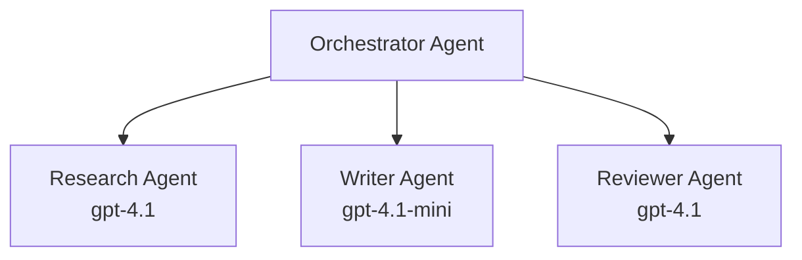

# Agents IA avec Azure Developer CLI

**Navigation dans le chapitre :**
- **📚 Accueil du cours** : [AZD Pour Débutants](../../README.md)
- **📖 Chapitre actuel** : Chapitre 2 - Développement IA-Première
- **⬅️ Précédent** : [Intégration Microsoft Foundry](microsoft-foundry-integration.md)
- **➡️ Suivant** : [Déploiement de Modèles IA](ai-model-deployment.md)
- **🚀 Avancé** : [Solutions Multi-Agents](../../examples/retail-scenario.md)

---

## Introduction

Les agents IA sont des programmes autonomes capables de percevoir leur environnement, prendre des décisions et agir pour atteindre des objectifs spécifiques. Contrairement aux chatbots simples qui répondent aux demandes, les agents peuvent :

- **Utiliser des outils** – Appeler des API, rechercher dans des bases de données, exécuter du code
- **Planifier et raisonner** – Décomposer les tâches complexes en étapes
- **Apprendre du contexte** – Maintenir une mémoire et adapter leur comportement
- **Collaborer** – Travailler avec d’autres agents (systèmes multi-agents)

Ce guide vous montre comment déployer des agents IA sur Azure à l’aide d’Azure Developer CLI (azd).

Utiliser le contexte de conversation n’est pas un entraînement de modèle : la mémoire persistante, le contrôle d’accès et la conservation doivent être mis en œuvre/configurés par l’application.

> **Revue de la version (04-11-2026) :** Les exemples CLI ont été vérifiés par rapport à la documentation/source `azd` `1.37.2`, `azure.ai.agents` `1.0.0-beta.23`, et `azure.ai.evaluations` `1.0.0-beta.2`, pas par un déploiement Azure en direct. Utilisez `azd >= 1.37.0` pour le workflow combiné. Voir [changements et corrections récents](../chapter-08-production/production-ai-practices.md#recent-release-changes-and-fixes) avant de mettre à jour les anciens projets.

## Objectifs d’apprentissage

En suivant ce guide, vous allez :
- Comprendre ce que sont les agents IA et en quoi ils diffèrent des chatbots
- Déployer des modèles d’agents IA pré-construits avec AZD
- Configurer Foundry Agents pour des agents personnalisés
- Mettre en œuvre des modèles d’agents basiques (usage d’outils, RAG, multi-agents)
- Surveiller et déboguer les agents déployés

## Résultats d’apprentissage

À l’issue, vous pourrez :
- Déployer des applications agents IA sur Azure en une seule commande
- Configurer les outils et capacités des agents
- Implémenter la génération augmentée par récupération (RAG) avec les agents
- Concevoir des architectures multi-agents pour des workflows complexes
- Résoudre les problèmes courants de déploiement d’agents

---

## 🤖 Qu’est-ce qui distingue un agent d’un chatbot ?

| Caractéristique | Chatbot | Agent IA |
|---------|---------|----------|
| **Comportement** | Répond aux demandes | Prend des actions autonomes |
| **Outils** | Peut utiliser la récupération ou des outils | Utilise typiquement des outils dans une boucle orientée objectif |
| **Mémoire** | Dépend de l’application | Mémoire persistante seulement si explicitement implémentée |
| **Planification** | Réponse unique | Raisonnement multi-étapes |
| **Collaboration** | Entité unique | Peut travailler avec d’autres agents |

### Analogie simple

- **Chatbot** = Une personne serviable répondant aux questions à un point d’information
- **Agent IA** = Un assistant personnel qui peut passer des appels, prendre des rendez-vous, et accomplir des tâches pour vous

---

## 🚀 Démarrage rapide : déployez votre premier agent

Choisissez une option dans un **nouveau répertoire de travail vide**. Le `.` final initialise à cet endroit ; sans destination explicite, AZD peut créer un sous-répertoire au nom du modèle et ne change pas votre répertoire shell. Gardez des templates/environnements séparés dans des répertoires distincts.

Les gammes de temps/coûts ci-dessous sont indicatives, non des devis validés. Vérifiez les prérequis actuels, tarifs, quotas de modèles et services optionnels avant le déploiement.

### Option 1 : Modèle Foundry Agents (Recommandé)

```bash
# Initialize the AI agents template
azd init --template get-started-with-ai-agents .

# Deploy to Azure
azd up
```

**Ce qui est déployé :** L’infrastructure actuelle de l’exemple et les options choisies déterminent le modèle, les outils, l’hébergement et les ressources de supervision. Consultez son README et `infra/` avant provisionnement ; ne supposez pas que chaque modèle d’agent inclut la Recherche ou une interface web.

**Temps :** ~15-20 minutes
**Coût :** ~100-150 $/mois (développement)

### Option 2 : Agents d’écriture créative avec Prompty

```bash
# Initialize the Prompty-based agent template
azd init --template https://github.com/Azure-Samples/contoso-creative-writer .

# Deploy to Azure
azd up
```

**Ce qui est déployé :** Un exemple multi-agent FastAPI/Prompty utilisant Azure OpenAI, Bing Grounding et Azure AI Search. L'ancien dépôt `agent-openai-python-prompty` redirige ici ; ce n’est pas un modèle minimal agent météo Azure Functions. Suivez son README actuel pour l’hébergement, les quotas modèles et prérequis Bing Grounding.

**Temps :** ~10-15 minutes
**Coût :** ~50-100 $/mois (développement)

### Option 3 : Agent de chat RAG

```bash
# Initialize RAG chat template
azd init --template azure-search-openai-demo .

# Deploy to Azure
azd up
```

**Ce qui est déployé :**
- ✅ Modèles Microsoft Foundry
- ✅ Azure AI Search avec données échantillons
- ✅ Pipeline de traitement documentaire
- ✅ Interface de chat avec citations

**Temps :** ~15-25 minutes
**Coût :** ~80-150 $/mois (développement)

### Option 4 : AZD AI Agent Init (Aperçu modèle projet)

Utilisez `azd ai agent init` de façon interactive, ou adoptez un projet agent `azure.yaml` actuel avec `--template`/`-t`. L’ancienne option `--manifest`/`-m` est un alias obsolète, pas un convertisseur pour manifestes hérités.

```bash
# Install the AI agents extension
azd extension install azure.ai.agents

# Optional: verify the installed preview version
azd extension show azure.ai.agents

# Initialize from a current agent project template (supply your template path)
azd ai agent init --template ./templates/support-agent/azure.yaml

# Deploy to Azure
azd up

# Test the deployed agent (shows latency + time-to-first-byte)
azd ai agent invoke
```

**Quand utiliser `azd ai agent init` vs `azd init --template` :**

| Approche | Idéal Pour | Fonctionnement |
|----------|----------|------|
| `azd init --template` | Partir d’une application exemple fonctionnelle | Clone un repo modèle complet avec code + infra |
| `azd ai agent init --template` | Adopter un projet agent Foundry actuel | Utilise un document projet `azure.yaml` et ses définitions |

> **Conseil :** Utilisez `azd init --template` pour apprendre (options 1-3 ci-dessus). Utilisez `azd ai agent init` pour le workflow des agents Foundry. Pour ajouter une définition agent directe à un projet existant, voir [guide d’initialisation et migration](../chapter-08-production/production-ai-practices.md#initializing-agent-projects-with-azd-ai-agent-init).

Après `azd up`, utilisez `azd ai agent invoke` pour tester, l’extension `azure.ai.evaluations` séparée (`azd ai eval init`, `generate`, et `run start`) pour mesurer la qualité, et `azd ai agent optimize` pour l’améliorer en utilisant la nouvelle configuration d’évaluation. Agents beta.22 a remplacé le workflow d’évaluation ancien et changé le format `--config` d’optimisation. Voir [migration évaluation](../chapter-08-production/production-ai-practices.md#evaluation-migration-and-quality-checks) et [migration optimisation](../chapter-08-production/production-ai-practices.md#optimization-configuration-migration) avant de réutiliser d’anciens exemples.

---

## 🏗️ Modèles d’architecture des agents

### Modèle 1 : Agent unique avec outils

Le modèle d’agent le plus simple – un agent qui peut utiliser plusieurs outils.



**Idéal pour :**
- Bots support client
- Assistants de recherche
- Agents d’analyse de données

**Exemple d’application connexe :** `azure-search-openai-demo` illustre RAG, pas une boucle d’agent à outil arbitraire générique.

### Modèle 2 : Agent RAG (Génération augmentée par récupération)

Un agent qui récupère des documents pertinents avant de générer les réponses.



**Idéal pour :**
- Bases de connaissances d’entreprise
- Systèmes de questions/réponses documentaires
- Recherche conformité et juridique

**Modèle AZD :** `azure-search-openai-demo`

### Modèle 3 : Système multi-agent

Plusieurs agents spécialisés travaillant ensemble sur des tâches complexes.



**Idéal pour :**
- Génération de contenu complexe
- Workflows multi-étapes
- Tâches nécessitant différentes expertises

**En savoir plus :** [Modèles de coordination multi-agents](../chapter-06-pre-deployment/coordination-patterns.md)

---

## ⚙️ Configuration des outils d’agent

Les agents deviennent puissants quand ils peuvent utiliser des outils. Voici comment configurer les outils courants :

### Configuration d’outil dans Foundry Agents

Ce **fragment classique du SDK Agent Service** cible `azure-ai-projects==1.0.0` et `azure-ai-agents==1.1.0` avec `azure-identity`. Ce n’est pas la version plus récente API versionnée agent/Responses utilisée par certains modèles Foundry actuels, ni l’extension `azure.ai.agents` AZD (un autre package). Ne mélangez pas ces générations d’API. Réglez `PROJECT_ENDPOINT` sur un endpoint projet Foundry classique et `MODEL_DEPLOYMENT_NAME` sur un déploiement modèle supporté existant ; authentifiez localement avec `az login` et accordez les droits projet requis.

```python
# agent_config.py
import os
from azure.ai.projects import AIProjectClient
from azure.ai.agents.models import FunctionTool
from azure.identity import DefaultAzureCredential

def search_knowledge_base(query: str) -> str:
    """Search the demonstration knowledge base.

    :param query: Search text.
    :return: Matching demonstration information.
    """
    # Local fixture only, not a production search implementation.
    return "Demo policy: returns are accepted within 30 days."

project_client = AIProjectClient(
    endpoint=os.environ["PROJECT_ENDPOINT"],
    credential=DefaultAzureCredential(),
)
search_tool = FunctionTool(functions={search_knowledge_base})
project_client.agents.enable_auto_function_calls(search_tool)
agent = project_client.agents.create_agent(
    model=os.environ["MODEL_DEPLOYMENT_NAME"],
    name="Support Agent",
    instructions="Use search_knowledge_base for policy questions. Label results as demo data.",
    tools=search_tool.definitions,
)
```

Enregistrer un schéma de fonction n’exécute pas du Python sur le service. Dans ce SDK, `enable_auto_function_calls` plus `agents.runs.create_and_process(...)` exécute dans votre processus client les callbacks enregistrés. Voir l’[exemple SDK publié](https://github.com/Azure/azure-sdk-for-python/blob/azure-ai-agents_1.1.0/sdk/ai/azure-ai-agents/samples/agents_tools/sample_agents_auto_function_call.py). Fermez le client et supprimez les agents/fils de démonstration une fois fini.

### Configuration d’environnement

Les noms suivants sont des **entrées personnalisées illustratives de modèles**, pas des options AZD intégrées. Faites passer chaque valeur via `infra/main.parameters.json`, infrastructure et code application. `azd env set` seul ne change pas les outils ou instructions d’un agent.

```bash
# Set up agent-specific environment variables
azd env set AZURE_OPENAI_MODEL "gpt-4.1"
azd env set AGENT_INSTRUCTIONS "You are a helpful assistant..."
azd env set ENABLE_CODE_INTERPRETER "true"
azd env set ENABLE_FILE_SEARCH "true"

# Apply wired infrastructure and application changes
azd up
```

---

## 📊 Supervision des agents

### Intégration Application Insights

Si votre modèle sélectionné provisionne Application Insights et configure l’instrumentation :

```bash
# Open monitoring dashboard
azd monitor --overview

# Open the Application Insights logs view (not a streaming log tail)
azd monitor --logs

# View live metrics
azd monitor --live
```

### Principales métriques à suivre

| Métrique | Description | Objectif |
|--------|-------------|--------|
| Latence de réponse | Temps de génération de réponse | < 5 secondes |
| Utilisation de tokens | Tokens par requête | Surveiller pour coût |
| Taux de succès appels outils | % d’exécutions outils réussies | > 95% |
| Taux d’erreur | Requêtes agents échouées | < 1 % |
| Satisfaction utilisateur | Scores de feedback | > 4,0/5,0 |

### Journaux personnalisés pour agents

```python
import os
from azure.monitor.opentelemetry import configure_azure_monitor
from opentelemetry import trace

# Configure Azure Monitor with OpenTelemetry
configure_azure_monitor(
    connection_string=os.environ["APPLICATIONINSIGHTS_CONNECTION_STRING"]
)

tracer = trace.get_tracer(__name__)

def log_agent_interaction(user_query, agent_response, tools_used, latency_ms):
    with tracer.start_as_current_span("agent_interaction") as span:
        span.set_attributes({
            "query_length": len(user_query),  # Do not log raw prompts or personal data
            "response_length": len(agent_response),
            "tools_used": tools_used,
            "latency_ms": latency_ms
        })
```

> **Note :** Installez le package requis : `pip install azure-monitor-opentelemetry`. Il apporte les dépendances OpenTelemetry ; le namespace d’import n’est pas une exigence pour installer un package nommé `opentelemetry`.

---

## 💰 Considérations de coût

### Coûts mensuels estimés par modèle

Ces plages sont indicatives pour planification, pas des devis ou plafonds de dépense. Régions, tokens modèle, catégories Search/compute, sessions outils, stockage et trafic peuvent les dépasser. Consultez les conseils coûts des exemples et tarification Azure avant `azd up`.

| Modèle | Environnement dev | Production |
|---------|-----------------|------------|
| Agent unique | 50-100 $ | 200-500 $ |
| Agent RAG | 80-150 $ | 300-800 $ |
| Multi-agent (2-3 agents) | 150-300 $ | 500-1 500 $ |
| Multi-agent entreprise | 300-500 $ | 1 500-5 000 $+ |

### Conseils d’optimisation des coûts

1. **Utilisez gpt-4.1-mini pour les tâches simples** (seulement si votre modèle consomme cette entrée)
   ```bash
   azd env set AZURE_OPENAI_MODEL "gpt-4.1-mini"
   ```

2. **Implémentez un cache à portée limitée pour des requêtes répétées sûres.** Incluez autorisations locataire/utilisateur, déploiement modèle, instructions et version récupération dans la clé cache ; définissez une expiration. Ne partagez pas les réponses conversationnelles privées via un cache global en lecture seule. L’objet agent SDK n’a pas de méthode `agent.run()` générique.

3. **Définissez des limites de tokens par exécution**
   ```python
   # Set max_completion_tokens when running the agent, not during creation
   run = project_client.agents.runs.create_and_process(
       thread_id=thread.id,
       agent_id=agent.id,
       max_completion_tokens=1000  # Budget across the run; may finish as incomplete
   )
   ```

4. **Mettez à l’échelle les Container Apps éligibles à zéro quand inutilisées**
   ```bash
   # Custom-template input: must map to template.scale.minReplicas
   azd env set MIN_REPLICAS "0"
   ```
   Appliquez le changement d’infrastructure avec `azd provision` ou `azd up`. La mise à zéro nécessite un déclencheur adapté et n’arrête pas la Recherche, le stockage ou les frais modèles/outils.

---

## 🔧 Dépannage des agents

### Problèmes courants et solutions

<details>
<summary><strong>❌ Agent ne répond pas aux appels d’outils</strong></summary>

```bash
# Inspect the application deployment (not the agent's registered tools)
azd show

# Verify OpenAI deployment
az cognitiveservices account deployment list \
  --name $AZURE_OPENAI_NAME \
  --resource-group $RG_NAME

# Check agent logs
azd monitor --logs
```

**Causes courantes :**
- Signature des fonctions outils incompatible
- Permissions requises manquantes
- Endpoint API inaccessible
</details>

<details>
<summary><strong>❌ Haute latence dans les réponses d’agent</strong></summary>

```bash
# Check Application Insights for bottlenecks
azd monitor --live

# Consider using a faster model
azd env set AZURE_OPENAI_MODEL "gpt-4.1-mini"
azd up
```

**Conseils d’optimisation :**
- Utiliser les réponses streamées
- Implémenter un cache des réponses
- Réduire la taille de la fenêtre de contexte
</details>

<details>
<summary><strong>❌ Agent retourne des informations incorrectes ou hallucinéess</strong></summary>

```python
# Improve with better system prompts
instructions = """
You are a helpful assistant. IMPORTANT:
- Only answer based on provided context
- If you don't know, say "I don't know"
- Always cite your sources
- Never make up information
"""

# Use these instructions in the agent definition.
# For classic file search, first upload/index documents in a vector store,
# then use FileSearchTool(vector_store_ids=[...]) and pass both its
# .definitions and .resources when creating the agent.
```
 Les instructions et la récupération réduisent le risque ; aucune ne garantit des réponses factuelles. Évaluez les questions ancrées et hors-sujet par rapport aux réponses connues.
</details>

<details>
<summary><strong>❌ Erreurs de dépassement de limite de tokens</strong></summary>

```python
# Implement context window management
def truncate_context(messages, max_tokens=8000, model="gpt-4.1"):
    """Approximate content-only budget for objects with .content strings."""
    import tiktoken
    encoding = tiktoken.encoding_for_model(model)
    total_tokens = 0
    truncated = []
    
    for msg in reversed(messages):
        msg_tokens = len(encoding.encode(msg.content))
        if total_tokens + msg_tokens > max_tokens:
            break
        truncated.insert(0, msg)
        total_tokens += msg_tokens
    
    return truncated
```
 Cet assistant exclut les schémas rôle/outil, instructions système, tokens image et surcharge protocolaire. Réservez de l’espace pour ceux-ci et la complétion ; ne divisez pas les paires appel/résultat outil ni ne supprimez les instructions système requises. Installez `tiktoken` séparément. Ce n’est pas un validateur général de fenêtres de contexte.
</details>

---

## 🎓 Exercices pratiques

### Exercice 1 : Déployer un agent basique (20 minutes)

**Objectif :** Déployer votre premier agent IA avec AZD

```bash
# Step 1: Initialize template
azd init --template get-started-with-ai-agents .

# Step 2: Login to Azure
azd auth login
# If you work across tenants, add --tenant-id <tenant-id>

# Step 3: Deploy
azd up

# Step 4: Test the agent
# Expected output after deployment:
#   Deployment Complete!
#   Endpoint: https://<app-name>.<region>.azurecontainerapps.io
# Open the URL shown in the output and try asking a question

# Step 5: View monitoring
azd monitor --overview

# Step 6: Clean up
azd down --force --purge
```

**Critères de succès :**
- [ ] L’agent répond aux questions
- [ ] Peut accéder au tableau de bord de supervision via `azd monitor`
- [ ] Ressources correctement nettoyées

### Exercice 2 : Ajouter un outil personnalisé (30 minutes)

**Objectif :** Étendre un agent avec un outil personnalisé

**Point de départ :** Utilisez le client SDK classique de [Configuration d’outils](#tool-configuration-in-foundry-agents), pas un modèle arbitraire avec une autre génération SDK.

1. Ajoutez ce fixture déterministe à `agent_config.py` :
   ```python
   def get_weather(location: str) -> str:
       """Return demonstration weather, not live conditions.

       :param location: City name.
       :return: A clearly labelled fixture.
       """
       print(f"TOOL_CALLED: {location}")
       return f"Demo weather in {location}: Sunny, 72°F (fixture, not live)"
   ```
2. Remplacez le bloc d'enregistrement et de création de l'outil de recherche par :
   ```python
   weather_tool = FunctionTool(functions={get_weather})
   project_client.agents.enable_auto_function_calls(weather_tool)
   agent = project_client.agents.create_agent(
       model=os.environ["MODEL_DEPLOYMENT_NAME"],
       name="Weather Agent",
       instructions="Call get_weather for weather questions; explain that it returns demo data.",
       tools=weather_tool.definitions,
   )
   thread = project_client.agents.threads.create()
   try:
       project_client.agents.messages.create(
           thread_id=thread.id, role="user", content="Use get_weather for Seattle."
       )
       run = project_client.agents.runs.create_and_process(
           thread_id=thread.id, agent_id=agent.id
       )
       if run.status != "completed":
           raise RuntimeError(f"Run status: {run.status}; error: {run.last_error}")
       for message in project_client.agents.messages.list(thread_id=thread.id):
           for text in message.text_messages:
               print(text.text.value)
   finally:
       project_client.agents.threads.delete(thread.id)
       project_client.agents.delete_agent(agent.id)
       project_client.close()
   ```
3. Exécutez localement (cela appelle le projet Azure existant et entraîne des coûts de modèle) :
   ```bash
   python agent_config.py
   # Expected: TOOL_CALLED: Seattle, then a completed answer labelled demo data.
   ```

**Critères de réussite :**
- [ ] L'agent reconnaît les requêtes liées à la météo
- [ ] L'outil est appelé correctement
- [ ] La réponse inclut des informations météorologiques

### Exercice 3 : Construire un agent RAG (45 minutes)

**Objectif :** Créer un agent qui répond aux questions à partir de vos documents

```bash
# Step 1: Deploy RAG template
azd init --template azure-search-openai-demo .
azd up

# Step 2: Upload your documents
# For the sample's local ingestion path, place supported files in data/.
# Run from the sample root after following its Python environment setup:
./scripts/prepdocs.sh
# Windows PowerShell equivalent: .\\scripts\\prepdocs.ps1

# Step 3: Test with domain-specific questions
# Open the web app URL from the azd up output
# Ask questions about your uploaded documents
# Responses should include citation references like [doc.pdf]
```

**Critères de réussite :**
- [ ] L'agent répond à partir des documents téléchargés
- [ ] Les réponses incluent des citations
- [ ] Les questions hors de la portée sont traitées sans affirmations non prises en charge (pas une garantie pour chaque future question)

Si `USE_CLOUD_INGESTION=true`, utilisez plutôt le flux d'ingestion/téléversement cloud de l'exemple ; le wrapper local ignore intentionnellement l'ingestion. Après les tests, exécutez `azd down` dans l'environnement RAG et examinez les ressources à supprimer.

---

## 📚 Prochaines étapes

Maintenant que vous comprenez les agents IA, explorez ces sujets avancés :

| Sujet | Description | Lien |
|-------|-------------|------|
| **Systèmes multi-agents** | Construisez des systèmes avec plusieurs agents collaborant | [Exemple de multi-agent retail](../../examples/retail-scenario.md) |
| **Patrons de coordination** | Apprenez les patrons d'orchestration et de communication | [Patrons de coordination](../chapter-06-pre-deployment/coordination-patterns.md) |
| **Déploiement en production** | Déploiement d'agents prêts pour l'entreprise | [Bonnes pratiques IA en production](../chapter-08-production/production-ai-practices.md) |
| **Évaluation des agents** | Testez et évaluez la performance des agents | [Dépannage IA](../chapter-07-troubleshooting/ai-troubleshooting.md) |
| **Atelier laboratoire IA** | Pratique : Rendez votre solution IA prête AZD | [Atelier laboratoire IA](ai-workshop-lab.md) |

---

## 📖 Ressources supplémentaires

### Documentation officielle
- [Microsoft Foundry Agent Service](https://learn.microsoft.com/azure/ai-services/agents/)
- [Démarrage rapide Microsoft Foundry Agent Service](https://learn.microsoft.com/azure/ai-services/agents/quickstart)
- [Framework Semantic Kernel Agent](https://learn.microsoft.com/semantic-kernel/)

### Modèles AZD pour agents
- [Commencer avec les agents IA](https://github.com/Azure-Samples/get-started-with-ai-agents)
- [Agents d'écriture créative avec Prompty](https://github.com/Azure-Samples/contoso-creative-writer)
- [Démo Azure Search OpenAI](https://github.com/Azure-Samples/azure-search-openai-demo)

### Ressources communautaires
- [Awesome AZD - Modèles d'agents](https://azure.github.io/awesome-azd/?tags=ai-agents)
- [Discord Azure AI](https://discord.gg/microsoft-azure)
- [Discord Microsoft Foundry](https://discord.gg/nTYy5BXMWG)

### Compétences agents pour votre éditeur
- [**Compétences agents Microsoft Azure**](https://skills.sh/microsoft/github-copilot-for-azure) - Installez des compétences agents IA réutilisables pour le développement Azure dans GitHub Copilot, Cursor ou tout agent supporté. Comprend des compétences pour [Azure AI](https://skills.sh/microsoft/github-copilot-for-azure/azure-ai), [Microsoft Foundry](https://skills.sh/microsoft/github-copilot-for-azure/microsoft-foundry), [déploiement](https://skills.sh/microsoft/github-copilot-for-azure/azure-deploy) et [diagnostics](https://skills.sh/microsoft/github-copilot-for-azure/azure-diagnostics) :
  ```bash
  npx skills add microsoft/github-copilot-for-azure
  ```

---

**Navigation**
- **Leçon précédente** : [Intégration Microsoft Foundry](microsoft-foundry-integration.md)
- **Leçon suivante** : [Déploiement de modèle IA](ai-model-deployment.md)

---

<!-- CO-OP TRANSLATOR DISCLAIMER START -->
**Avertissement** :
Ce document a été traduit à l'aide du service de traduction automatique [Co-op Translator](https://github.com/Azure/co-op-translator). Bien que nous nous efforçions d'assurer l'exactitude, veuillez noter que les traductions automatisées peuvent contenir des erreurs ou des inexactitudes. Le document original dans sa langue native doit être considéré comme la source faisant autorité. Pour les informations critiques, il est recommandé de recourir à une traduction professionnelle réalisée par un humain. Nous ne saurions être tenus responsables des malentendus ou erreurs d'interprétation découlant de l'utilisation de cette traduction.
<!-- CO-OP TRANSLATOR DISCLAIMER END -->