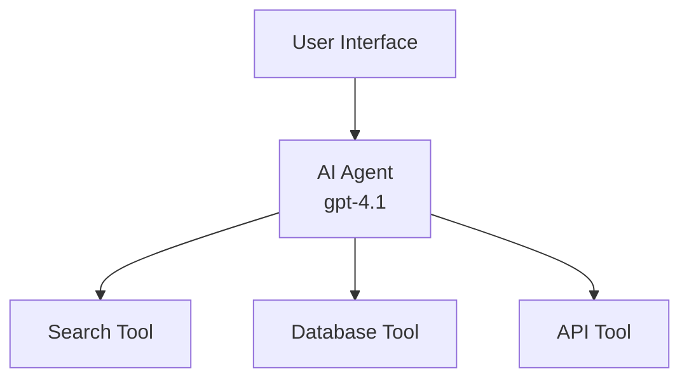
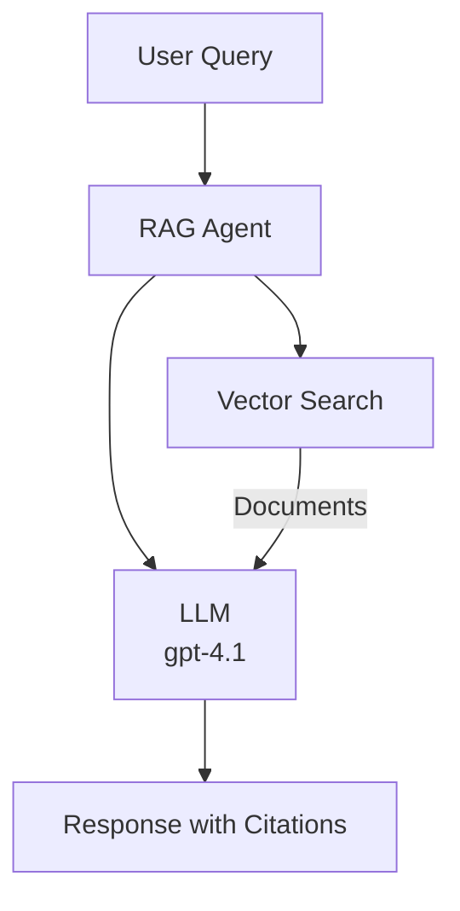
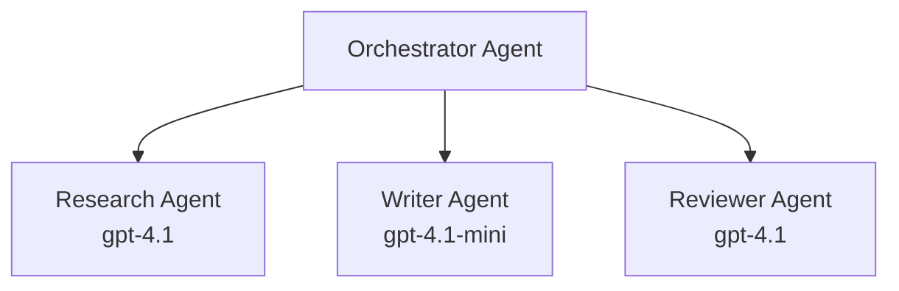

# Agents IA avec Azure Developer CLI

**Navigation dans le chapitre :**
- **📚 Accueil du cours** : [AZD pour débutants](../../README.md)
- **📖 Chapitre actuel** : Chapitre 2 - Développement axé IA
- **⬅️ Précédent** : [Intégration Microsoft Foundry](microsoft-foundry-integration.md)
- **➡️ Suivant** : [Déploiement de modèles IA](ai-model-deployment.md)
- **🚀 Avancé** : [Solutions multi-agents](../../examples/retail-scenario.md)

---

## Introduction

Les agents IA sont des programmes autonomes capables de percevoir leur environnement, de prendre des décisions et d’agir pour atteindre des objectifs spécifiques. Contrairement aux simples chatbots qui répondent aux requêtes, les agents peuvent :

- **Utiliser des outils** – Appeler des API, rechercher dans des bases de données, exécuter du code
- **Planifier et raisonner** – Décomposer des tâches complexes en étapes
- **Apprendre du contexte** – Maintenir une mémoire et adapter le comportement
- **Collaborer** – Travailler avec d’autres agents (systèmes multi-agents)

Ce guide vous montre comment déployer des agents IA sur Azure en utilisant Azure Developer CLI (azd).

Utiliser le contexte de la conversation n’est pas un entraînement de modèle : la mémoire persistante, le contrôle d’accès et la rétention doivent être mis en œuvre/configurés par l’application.

> **Mise à jour Foundry GA (2026-11-09) :** Installez le bundle généralement disponible `microsoft.foundry` 1.0 avec `azd >= 1.37.0`. Les évaluations sont installées séparément ; les fonctionnalités d’aperçu optionnelles et le fragment SDK classique ci-dessous ne sont pas promus en GA par l’annonce du bundle. Ce guide se base sur [l’annonce GA](https://devblogs.microsoft.com/azure-sdk/microsoft-foundry-azure-developer-cli-ga/) et la documentation, pas sur un déploiement actif Azure.

## Objectifs d’apprentissage

En suivant ce guide, vous allez :
- Comprendre ce qu’est un agent IA et en quoi il diffère d’un chatbot
- Déployer des modèles d’agents IA préconstruits avec AZD
- Configurer les agents Foundry pour agents personnalisés
- Mettre en œuvre des patrons d’agents basiques (utilisation d’outils, RAG, multi-agent)
- Surveiller et déboguer les agents déployés

## Résultats d’apprentissage

À la fin, vous serez capable de :
- Déployer des applications agents IA sur Azure avec une seule commande
- Configurer outils et capacités des agents
- Mettre en œuvre la génération augmentée par récupération (RAG) avec agents
- Concevoir des architectures multi-agents pour des workflows complexes
- Résoudre les problèmes courants de déploiement d’agents

---

## 🤖 Qu’est-ce qui différencie un agent d’un chatbot ?

| Fonctionnalité | Chatbot | Agent IA |
|---------|---------|----------|
| **Comportement** | Répond aux requêtes | Prend des actions autonomes |
| **Outils** | Peut utiliser recherche ou outils | Utilise typiquement des outils dans une boucle orientée objectifs |
| **Mémoire** | Dépend de l’application | Mémoire persistante uniquement si explicitement mise en œuvre |
| **Planification** | Réponse unique | Raisonnement en plusieurs étapes |
| **Collaboration** | Entité unique | Peut collaborer avec d’autres agents |

### Analogie simple

- **Chatbot** = Une personne aidante répondant aux questions à un bureau d’information
- **Agent IA** = Un assistant personnel pouvant passer des appels, prendre des rendez-vous et accomplir des tâches pour vous

---

## 🚀 Démarrage rapide : déployez votre premier agent

Choisissez une option dans un **nouveau répertoire de travail vide**. Le `.` final s’initialise dans ce répertoire ; sans destination explicite, AZD actuel peut créer un sous-répertoire nommé d’après le modèle sans changer de dossier shell. Gardez les modèles/environnements séparés dans des répertoires distincts.

Les plages de temps/coûts ci-dessous sont indicatives, non des devis validés. Vérifiez les prérequis actuels, tarifs, quotas modèles et services optionnels de chaque exemple avant déploiement.

### Option 1 : Modèle d’agents Foundry (recommandé)

```bash
# Initialize the AI agents template
azd init --template get-started-with-ai-agents .

# Deploy to Azure
azd up
```

**Ce qui est déployé :** L’infrastructure actuelle de l’exemple et options sélectionnées déterminent modèles, outils, hébergement et ressources de surveillance. Consultez son README et `infra/` avant provisionnement ; ne supposez pas que chaque modèle d’agent inclut Recherche ou interface web.

**Durée :** ~15-20 minutes
**Coût :** ~100-150 $/mois (développement)

### Option 2 : Agents d’écriture créative avec Prompty

```bash
# Initialize the Prompty-based agent template
azd init --template https://github.com/Azure-Samples/contoso-creative-writer .

# Deploy to Azure
azd up
```

**Ce qui est déployé :** Un exemple multi-agent FastAPI/Prompty d’écriture utilisant Azure OpenAI, Bing Grounding et Azure AI Search. L’ancien dépôt `agent-openai-python-prompty` redirige ici ; ce n’est pas un modèle Azure Functions minimaliste d’agent météo. Suivez son README actuel pour hébergement, quotas modèle, et prérequis Bing Grounding.

**Durée :** ~10-15 minutes
**Coût :** ~50-100 $/mois (développement)

### Option 3 : Agent chat RAG

```bash
# Initialize RAG chat template
azd init --template azure-search-openai-demo .

# Deploy to Azure
azd up
```

**Ce qui est déployé :**
- ✅ Modèles Microsoft Foundry
- ✅ Azure AI Search avec données d’exemple
- ✅ Pipeline de traitement documentaire
- ✅ Interface chat avec citations

**Durée :** ~15-25 minutes
**Coût :** ~80-150 $/mois (développement)

### Option 4 : Agent hébergé avec le bundle Foundry GA

Utilisez le [tutoriel complet d’agent hébergé](microsoft-foundry-integration.md#hosted-agent-walkthrough-ga) pour l’exemple basique Python Agent Framework Responses API. Ce chemin de déploiement nécessite Python 3.13+, uv actuel, permissions Foundry, et quota régional modèle. Authentifiez localement les appels SDK séparément en utilisant les identifiants Azure CLI.

```bash
azd auth login
azd ext install microsoft.foundry
```

Dans le répertoire vide, initialisez l’exemple :

```text
azd ai agent init --template https://github.com/microsoft-foundry/foundry-samples/blob/main/samples/python/hosted-agents/agent-framework/responses/01-basic/azure.yaml --deploy-mode code --src .
```

Choisissez un projet nouveau ou existant, examinez `azure.yaml` et lancez `azd provision`. Utilisez `azd ai agent run` pour ouvrir Agent Inspector, et dans un autre terminal dans ce dossier, `azd ai agent invoke --local "Explain how this agent is hosted."`. Après vérification locale, utilisez `azd deploy` et `azd ai agent invoke "Explain how this agent is hosted."` pour comparer la réponse déployée. Foundry construit la source téléversée à distance ; une compilation locale de container n’est pas nécessaire.

**Quand utiliser `azd ai agent init` vs `azd init --template` :**

| Approche | Idéal pour | Fonctionnement |
|----------|----------|------|
| `azd init --template` | Partir d’un exemple fonctionnel | Clone un dépôt complet de modèle avec code + infrastructure |
| `azd ai agent init --template` | Adopter un projet agent Foundry existant | Utilise un document projet `azure.yaml` et ses définitions |

> **Astuce :** Les options 1-3 partent de modèles d’application complets ; l’option 4 enseigne le workflow d’agent hébergé GA. Aucune commande d’initialisation ne migre automatiquement les manifestes agents hérités. Pour ajouter une définition agent directe dans un projet existant, voir [guide d’initialisation et de migration](../chapter-08-production/production-ai-practices.md#initializing-agent-projects-with-azd-ai-agent-init).

Installez `azure.ai.evaluations` séparément pour générer et examiner les données/critères de test, configurer une évaluation, et l’exécuter avec `azd ai eval`. L’optimisation peut réutiliser une évaluation compatible ; examinez les candidats avant de déployer explicitement. Suivez le [workflow d’évaluation](../chapter-08-production/production-ai-practices.md#evaluation-migration-and-quality-checks) et la [migration d’optimisation](../chapter-08-production/production-ai-practices.md#optimization-configuration-migration) avant de réutiliser d’anciens exemples. Pour nettoyage, les ressources d’un projet Foundry réutilisé restent après `azd down` ; le groupe de ressources d’un projet créé neuf est supprimé. Voir le [guide de nettoyage tutoriel](microsoft-foundry-integration.md#7-clean-up-deliberately).

---

## 🏗️ Patrons d’architecture des agents

### Patron 1 : Agent unique avec outils

Le patron d’agent le plus simple - un agent pouvant utiliser plusieurs outils.



**Idéal pour :**
- Bots de support client
- Assistants de recherche
- Agents d’analyse de données

**Exemple d’application associé :** `azure-search-openai-demo` démontre la RAG, pas une boucle d’agent outils arbitraires générique.

### Patron 2 : Agent RAG (génération augmentée par récupération)

Un agent qui récupère des documents pertinents avant de générer des réponses.



**Idéal pour :**
- Bases de connaissances entreprise
- Systèmes Q&R documentaires
- Recherche conformité et juridique

**Modèle AZD :** `azure-search-openai-demo`

### Patron 3 : Système multi-agents

Plusieurs agents spécialisés travaillant ensemble sur des tâches complexes.



**Idéal pour :**
- Génération de contenu complexe
- Workflows en plusieurs étapes
- Tâches nécessitant différentes expertises

**En savoir plus :** [Patrons de coordination multi-agents](../chapter-06-pre-deployment/coordination-patterns.md)

---

## ⚙️ Configuration des outils des agents

Les agents deviennent puissants quand ils peuvent utiliser des outils. Voici comment configurer des outils communs :

### Configuration des outils dans Foundry Agents

Ce **fragment classique du SDK Agent Service** cible `azure-ai-projects==1.0.0` et `azure-ai-agents==1.1.0` avec `azure-identity`. Ce n’est pas la version plus récente versioned-agent/Responses API utilisée par certains modèles Foundry actuels, ni l’extension `azure.ai.agents` AZD (un package différent). Ne pas mélanger ces générations d’API. Définir `PROJECT_ENDPOINT` sur un endpoint projet Foundry classique et `MODEL_DEPLOYMENT_NAME` sur un déploiement modèle supporté existant ; authentifier avec `az login` localement et accorder les permissions requises du projet.

```python
# agent_config.py
import os
from azure.ai.projects import AIProjectClient
from azure.ai.agents.models import FunctionTool
from azure.identity import DefaultAzureCredential

def search_knowledge_base(query: str) -> str:
    """Search the demonstration knowledge base.

    :param query: Search text.
    :return: Matching demonstration information.
    """
    # Local fixture only, not a production search implementation.
    return "Demo policy: returns are accepted within 30 days."

project_client = AIProjectClient(
    endpoint=os.environ["PROJECT_ENDPOINT"],
    credential=DefaultAzureCredential(),
)
search_tool = FunctionTool(functions={search_knowledge_base})
project_client.agents.enable_auto_function_calls(search_tool)
agent = project_client.agents.create_agent(
    model=os.environ["MODEL_DEPLOYMENT_NAME"],
    name="Support Agent",
    instructions="Use search_knowledge_base for policy questions. Label results as demo data.",
    tools=search_tool.definitions,
)
```

L’enregistrement d’un schéma de fonction n’exécute pas de Python sur le service. Dans ce SDK, `enable_auto_function_calls` plus `agents.runs.create_and_process(...)` exécutent les callbacks enregistrés dans votre processus client. Voir l’[exemple SDK publié](https://github.com/Azure/azure-sdk-for-python/blob/azure-ai-agents_1.1.0/sdk/ai/azure-ai-agents/samples/agents_tools/sample_agents_auto_function_call.py). Fermez le client et supprimez les agents/fils démonstration après usage.

### Configuration d’environnement

Les noms suivants sont des **entrées personnalisées de modèles illustratifs**, pas des options natives AZD. D’abord, transmettez chaque valeur via `infra/main.parameters.json`, infrastructure, et code applicatif. `azd env set` seul ne change pas les outils ou instructions d’un agent.

```bash
# Set up agent-specific environment variables
azd env set AZURE_OPENAI_MODEL "gpt-4.1"
azd env set AGENT_INSTRUCTIONS "You are a helpful assistant..."
azd env set ENABLE_CODE_INTERPRETER "true"
azd env set ENABLE_FILE_SEARCH "true"

# Apply wired infrastructure and application changes
azd up
```

---

## 📊 Surveillance des agents

### Intégration Application Insights

Si votre modèle sélectionné provisionne Application Insights et configure l’instrumentation :

```bash
# Open monitoring dashboard
azd monitor --overview

# Open the Application Insights logs view (not a streaming log tail)
azd monitor --logs

# View live metrics
azd monitor --live
```

### Indicateurs clés à suivre

| Indicateur | Description | Cible |
|--------|-------------|--------|
| Latence de réponse | Temps pour générer une réponse | < 5 secondes |
| Utilisation de tokens | Tokens par requête | Surveiller pour coût |
| Taux de succès appels outils | % d’exécutions d’outils réussies | > 95% |
| Taux d’erreur | Requêtes agent échouées | < 1% |
| Satisfaction utilisateur | Scores de retour | > 4.0/5.0 |

### Journaux personnalisés pour agents

```python
import os
from azure.monitor.opentelemetry import configure_azure_monitor
from opentelemetry import trace

# Configure Azure Monitor with OpenTelemetry
configure_azure_monitor(
    connection_string=os.environ["APPLICATIONINSIGHTS_CONNECTION_STRING"]
)

tracer = trace.get_tracer(__name__)

def log_agent_interaction(user_query, agent_response, tools_used, latency_ms):
    with tracer.start_as_current_span("agent_interaction") as span:
        span.set_attributes({
            "query_length": len(user_query),  # Do not log raw prompts or personal data
            "response_length": len(agent_response),
            "tools_used": tools_used,
            "latency_ms": latency_ms
        })
```

> **Note :** Installez le package requis : `pip install azure-monitor-opentelemetry`. Il inclut les dépendances OpenTelemetry ; l’espace de noms d’import n’est pas une exigence pour installer un package nommé `opentelemetry`.

---

## 💰 Considérations de coût

### Coûts mensuels estimés par patron

Ce sont des plages indicatives de planification, pas des devis ou plafonds de dépense. Région, tokens modèle, SKUs Search/compute, sessions outils, stockage, et trafic peuvent les dépasser. Vérifiez les conseils coûts de l’exemple et les tarifs Azure avant `azd up`.

| Patron | Environnement dev | Production |
|---------|-----------------|------------|
| Agent unique | 50-100 $ | 200-500 $ |
| Agent RAG | 80-150 $ | 300-800 $ |
| Multi-Agent (2-3 agents) | 150-300 $ | 500-1 500 $ |
| Multi-Agent entreprise | 300-500 $ | 1 500-5 000 $+ |

### Astuces pour optimisation des coûts

1. **Utilisez gpt-4.1-mini pour tâches simples** (seulement si votre modèle consomme cette entrée)
   ```bash
   azd env set AZURE_OPENAI_MODEL "gpt-4.1-mini"
   ```

2. **Implémentez un cache ciblé pour requêtes répétées sûres.** Incluez autorisation locataire/utilisateur, déploiement modèle, instructions, et version récupération dans la clé de cache ; définissez une expiration. Ne partagez pas de réponses privées via un cache global en lecture seule. L’objet agent SDK n’a pas de méthode générique `agent.run()`.

3. **Fixez des limites de tokens par exécution**
   ```python
   # Set max_completion_tokens when running the agent, not during creation
   run = project_client.agents.runs.create_and_process(
       thread_id=thread.id,
       agent_id=agent.id,
       max_completion_tokens=1000  # Budget across the run; may finish as incomplete
   )
   ```

4. **Mettez à l’échelle les Container Apps éligibles à zéro quand inutilisés**
   ```bash
   # Custom-template input: must map to template.scale.minReplicas
   azd env set MIN_REPLICAS "0"
   ```
   Appliquez le changement infra avec `azd provision` ou `azd up`. La mise à l’échelle à zéro nécessite un déclencheur adapté et ne cesse pas les charges Recherche, stockage ou modèle/outil.

---

## 🔧 Dépannage des agents

### Problèmes courants et solutions

<details>
<summary><strong>❌ Agent ne répond pas aux appels d'outil</strong></summary>

```bash
# Inspect the application deployment (not the agent's registered tools)
azd show

# Verify OpenAI deployment
az cognitiveservices account deployment list \
  --name $AZURE_OPENAI_NAME \
  --resource-group $RG_NAME

# Check agent logs
azd monitor --logs
```

**Causes courantes :**
- Signature de fonction outil incorrecte
- Permissions requises manquantes
- Endpoint API inaccessible
</details>

<details>
<summary><strong>❌ Latence élevée dans les réponses de l’agent</strong></summary>

```bash
# Check Application Insights for bottlenecks
azd monitor --live

# Consider using a faster model
azd env set AZURE_OPENAI_MODEL "gpt-4.1-mini"
azd up
```

**Conseils d’optimisation :**
- Utiliser les réponses en streaming
- Implémenter un cache de réponse
- Réduire la taille de la fenêtre de contexte
</details>

<details>
<summary><strong>❌ Agent retournant des informations incorrectes ou hallucinées</strong></summary>

```python
# Improve with better system prompts
instructions = """
You are a helpful assistant. IMPORTANT:
- Only answer based on provided context
- If you don't know, say "I don't know"
- Always cite your sources
- Never make up information
"""

# Use these instructions in the agent definition.
# For classic file search, first upload/index documents in a vector store,
# then use FileSearchTool(vector_store_ids=[...]) and pass both its
# .definitions and .resources when creating the agent.
```
 Les instructions et la récupération réduisent le risque ; aucune ne garantit des réponses factuelles. Évaluez les questions ancrées et hors scope par rapport à des réponses connues.
</details>

<details>
<summary><strong>❌ Erreurs de dépassement de limite de tokens</strong></summary>

```python
# Implement context window management
def truncate_context(messages, max_tokens=8000, model="gpt-4.1"):
    """Approximate content-only budget for objects with .content strings."""
    import tiktoken
    encoding = tiktoken.encoding_for_model(model)
    total_tokens = 0
    truncated = []
    
    for msg in reversed(messages):
        msg_tokens = len(encoding.encode(msg.content))
        if total_tokens + msg_tokens > max_tokens:
            break
        truncated.insert(0, msg)
        total_tokens += msg_tokens
    
    return truncated
```
 Cet assistant exclut les schémas rôle/outil, instructions système, tokens image, et surcharge protocolaire. Réservez de l’espace pour ces éléments et la complétion ; ne divisez pas paires appel outil/résultat ni ne supprimez les instructions système requises. Installez `tiktoken` séparément. Ce n’est pas un valideur général de fenêtre de contexte.
</details>

---

## 🎓 Exercices pratiques

### Exercice 1 : Déployer un agent basique (20 minutes)

**Objectif :** Déployer votre premier agent IA avec AZD

```bash
# Step 1: Initialize template
azd init --template get-started-with-ai-agents .

# Step 2: Login to Azure
azd auth login
# If you work across tenants, add --tenant-id <tenant-id>

# Step 3: Deploy
azd up

# Step 4: Test the agent
# Expected output after deployment:
#   Deployment Complete!
#   Endpoint: https://<app-name>.<region>.azurecontainerapps.io
# Open the URL shown in the output and try asking a question

# Step 5: View monitoring
azd monitor --overview

# Step 6: Review the listed resources and confirm cleanup
azd down
```

**Critères de réussite :**
- [ ] L'agent répond aux questions
- [ ] Peut accéder au tableau de bord de surveillance via `azd monitor`
- [ ] Les ressources sont nettoyées avec succès

### Exercice 2 : Ajouter un outil personnalisé (30 minutes)

**Objectif :** Étendre un agent avec un outil personnalisé

**Point de départ :** Utiliser le client SDK classique de [Configuration de l'outil](#tool-configuration-in-foundry-agents), pas un modèle arbitraire avec une autre génération SDK.

1. Ajoutez cette fixture déterministe à `agent_config.py` :
   ```python
   def get_weather(location: str) -> str:
       """Return demonstration weather, not live conditions.

       :param location: City name.
       :return: A clearly labelled fixture.
       """
       print(f"TOOL_CALLED: {location}")
       return f"Demo weather in {location}: Sunny, 72°F (fixture, not live)"
   ```
2. Remplacez le bloc d'enregistrement et de création de l'outil de recherche par :
   ```python
   weather_tool = FunctionTool(functions={get_weather})
   project_client.agents.enable_auto_function_calls(weather_tool)
   agent = project_client.agents.create_agent(
       model=os.environ["MODEL_DEPLOYMENT_NAME"],
       name="Weather Agent",
       instructions="Call get_weather for weather questions; explain that it returns demo data.",
       tools=weather_tool.definitions,
   )
   thread = project_client.agents.threads.create()
   try:
       project_client.agents.messages.create(
           thread_id=thread.id, role="user", content="Use get_weather for Seattle."
       )
       run = project_client.agents.runs.create_and_process(
           thread_id=thread.id, agent_id=agent.id
       )
       if run.status != "completed":
           raise RuntimeError(f"Run status: {run.status}; error: {run.last_error}")
       for message in project_client.agents.messages.list(thread_id=thread.id):
           for text in message.text_messages:
               print(text.text.value)
   finally:
       project_client.agents.threads.delete(thread.id)
       project_client.agents.delete_agent(agent.id)
       project_client.close()
   ```
3. Exécutez localement (cela appelle le projet Azure existant et engendre des frais de modèle) :
   ```bash
   python agent_config.py
   # Expected: TOOL_CALLED: Seattle, then a completed answer labelled demo data.
   ```

**Critères de réussite :**
- [ ] L'agent reconnaît les requêtes liées à la météo
- [ ] L'outil est appelé correctement
- [ ] La réponse inclut des informations météorologiques

### Exercice 3 : Construire un agent RAG (45 minutes)

**Objectif :** Créer un agent qui répond aux questions à partir de vos documents

```bash
# Step 1: Deploy RAG template
azd init --template azure-search-openai-demo .
azd up

# Step 2: Upload your documents
# For the sample's local ingestion path, place supported files in data/.
# Run from the sample root after following its Python environment setup:
./scripts/prepdocs.sh
# Windows PowerShell equivalent: .\\scripts\\prepdocs.ps1

# Step 3: Test with domain-specific questions
# Open the web app URL from the azd up output
# Ask questions about your uploaded documents
# Responses should include citation references like [doc.pdf]
```

**Critères de réussite :**
- [ ] L'agent répond à partir des documents téléchargés
- [ ] Les réponses incluent des citations
- [ ] Les questions hors sujet sont traitées sans affirmations non prises en charge (pas une garantie pour chaque question future)

Si `USE_CLOUD_INGESTION=true`, utilisez plutôt le flux d'ingestion/téléchargement cloud exemple ; l'enveloppe locale contourne volontairement l'ingestion. Après le test, exécutez `azd down` dans l'environnement RAG et examinez les ressources à supprimer.

---

## 📚 Étapes suivantes

Maintenant que vous comprenez les agents IA, explorez ces sujets avancés :

| Sujet | Description | Lien |
|-------|-------------|------|
| **Systèmes Multi-Agents** | Construire des systèmes avec plusieurs agents collaboratifs | [Exemple Multi-Agent Retail](../../examples/retail-scenario.md) |
| **Patrons de Coordination** | Apprendre les patrons d'orchestration et de communication | [Patrons de Coordination](../chapter-06-pre-deployment/coordination-patterns.md) |
| **Déploiement en production** | Déploiement d'agents prêts pour l'entreprise | [Pratiques d'IA en Production](../chapter-08-production/production-ai-practices.md) |
| **Évaluation des agents** | Tester et évaluer les performances des agents | [Dépannage IA](../chapter-07-troubleshooting/ai-troubleshooting.md) |
| **Atelier IA en laboratoire** | Pratique : Rendez votre solution IA prête pour AZD | [Atelier IA](ai-workshop-lab.md) |

---

## 📖 Ressources supplémentaires

### Documentation officielle
- [Microsoft Foundry Agent Service](https://learn.microsoft.com/azure/ai-services/agents/)
- [Démarrage rapide Microsoft Foundry Agent Service](https://learn.microsoft.com/azure/ai-services/agents/quickstart)
- [Cadre d'agent Semantic Kernel](https://learn.microsoft.com/semantic-kernel/)

### Modèles AZD pour agents
- [Commencer avec les agents IA](https://github.com/Azure-Samples/get-started-with-ai-agents)
- [Agents d’écriture créative avec Prompty](https://github.com/Azure-Samples/contoso-creative-writer)
- [Démo Azure Search OpenAI](https://github.com/Azure-Samples/azure-search-openai-demo)

### Ressources communautaires
- [Awesome AZD - Modèles d’agents](https://azure.github.io/awesome-azd/?tags=ai-agents)
- [Azure AI Discord](https://discord.gg/microsoft-azure)
- [Microsoft Foundry Discord](https://discord.gg/nTYy5BXMWG)

### Compétences d’agent pour votre éditeur
- [**Compétences Microsoft Azure Agent**](https://skills.sh/microsoft/github-copilot-for-azure) - Installez des compétences d’agents AI réutilisables pour le développement Azure dans GitHub Copilot, Cursor, ou tout agent pris en charge. Inclut des compétences pour [Azure AI](https://skills.sh/microsoft/github-copilot-for-azure/azure-ai), [Microsoft Foundry](https://skills.sh/microsoft/github-copilot-for-azure/microsoft-foundry), [déploiement](https://skills.sh/microsoft/github-copilot-for-azure/azure-deploy), et [diagnostics](https://skills.sh/microsoft/github-copilot-for-azure/azure-diagnostics) :
  ```bash
  npx skills add microsoft/github-copilot-for-azure
  ```

---

**Navigation**
- **Leçon précédente** : [Intégration Microsoft Foundry](microsoft-foundry-integration.md)
- **Leçon suivante** : [Déploiement de modèle IA](ai-model-deployment.md)

---

<!-- CO-OP TRANSLATOR DISCLAIMER START -->
**Avertissement** :
Ce document a été traduit à l'aide du service de traduction automatique [Co-op Translator](https://github.com/Azure/co-op-translator). Bien que nous nous efforçions d'assurer l'exactitude, veuillez noter que les traductions automatisées peuvent contenir des erreurs ou des inexactitudes. Le document original dans sa langue native doit être considéré comme la source faisant autorité. Pour les informations critiques, il est recommandé de recourir à une traduction professionnelle réalisée par un humain. Nous ne saurions être tenus responsables des malentendus ou erreurs d'interprétation découlant de l'utilisation de cette traduction.
<!-- CO-OP TRANSLATOR DISCLAIMER END -->