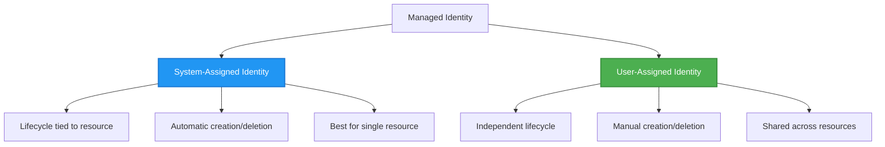

# Modèles d'authentification et identité gérée

⏱️ **Temps estimé** : 45-60 minutes de lecture ; prévoir du temps supplémentaire pour intégrer les exercices | 💰 **Impact sur le coût** : Identité/RBAC gratuits ; calcul, stockage et Key Vault déployés sont facturables | ⭐ **Complexité** : Intermédiaire

> Révisé par rapport à `azd 1.37.2` (novembre 2026). Cette leçon contient des **fragments d’intégration illustratifs, pas un modèle `secure-app` complet téléchargeable**. Créez les fichiers référencés, fournissez l’infrastructure correspondante et remplacez les espaces réservés avant le déploiement. Aucun resource Azure n’a été provisionné lors de la revue.

**📚 Parcours d’apprentissage :**
- ← Précédent : [Gestion de configuration](configuration.md) – Gestion des variables d’environnement et des secrets
- 🎯 **Vous êtes ici** : Authentification & Sécurité (Identité gérée, Key Vault, modèles sécurisés)
- → Suivant : [Infrastructure as Code](../chapter-04-infrastructure/README.md) – Provisionnement et déploiement des ressources
- 🏠 [Page d’accueil du cours](../../README.md)

---

## Ce que vous apprendrez

En complétant cette leçon, vous allez :
- Comprendre les modèles d’authentification Azure (clés, chaînes de connexion, identité gérée)
- Implémenter **l’identité gérée** pour une authentification sans mot de passe
- Sécuriser les secrets avec l’intégration **Azure Key Vault**
- Configurer le **contrôle d’accès basé sur les rôles (RBAC)** pour les déploiements AZD
- Appliquer les bonnes pratiques de sécurité dans Container Apps et les services Azure
- Migrer d’une authentification par clé à une authentification par identité

## Pourquoi l’identité gérée est importante

### Le problème : authentification traditionnelle

**Avant l’identité gérée :**
```javascript
// ❌ SECURITY RISK: Hardcoded secrets in code
const connectionString = "Server=mydb.database.windows.net;User=admin;Password=P@ssw0rd123";
const storageKey = "xK7mN9pQ2wR5tY8uI0oP3aS6dF1gH4jK...";
const cosmosKey = "C2x7B9n4M1p8Q5w3E6r0T2y5U8i1O4p7...";
```

**Problèmes :**
- 🔴 **Secrets exposés** dans le code, fichiers de configuration, variables d’environnement
- 🔴 **Rotation des identifiants** nécessitant des modifications de code et un redeploiement
- 🔴 **Cauchemars d’audit** - qui a accédé à quoi, quand ?
- 🔴 **Dispersion** - secrets éparpillés dans plusieurs systèmes
- 🔴 **Risques de conformité** - échecs aux audits de sécurité

### La solution : identité gérée

**Après l’identité gérée :**
```javascript
// ✅ SECURE: No secrets in code
const credential = new DefaultAzureCredential();
const client = new BlobServiceClient(
  "https://mystorageaccount.blob.core.windows.net",
  credential  // Azure automatically handles authentication
);
```

**Avantages :**
- ✅ **Zéro secret** dans le code ou la configuration
- ✅ **Rotation automatique** - gérée par Azure
- ✅ **Traçabilité complète** dans les journaux Microsoft Entra ID
- ✅ **Sécurité centralisée** - gestion dans le portail Azure
- ✅ **Conforme aux normes** - répond aux standards de sécurité 

**Analogie** : L’authentification traditionnelle revient à porter plusieurs clés physiques pour différentes portes. L’identité gérée est comme un badge de sécurité qui accorde automatiquement l’accès selon qui vous êtes — pas de clés à perdre, copier ou faire tourner.

---

## Vue d’ensemble de l’architecture

### Flux d’authentification avec identité gérée

```mermaid
sequenceDiagram
    participant App as Your Application<br/>(Container App)
    participant MI as Managed Identity<br/>(Microsoft Entra ID)
    participant KV as Key Vault
    participant Storage as Azure Storage
    participant DB as Azure SQL
    
    App->>MI: Request access token<br/>(automatic)
    MI->>MI: Verify identity<br/>(no password needed)
    MI-->>App: Return token for requested audience<br/>(lifetime varies)
    
    App->>KV: Get secret<br/>(using token)
    KV->>KV: Check RBAC permissions
    KV-->>App: Return secret value
    
    App->>Storage: Upload blob<br/>(using token)
    Storage->>Storage: Check RBAC permissions
    Storage-->>App: Success
    
    App->>DB: Query data<br/>(using token)
    DB->>DB: Check SQL permissions
    DB-->>App: Return results
    
    Note over App,DB: Request a separate token for each service audience;<br/>SDK credentials handle caching and renewal
```

### Types d’identités gérées



| Fonctionnalité | Assignée par le système | Assignée par l’utilisateur |
|--------------|-----------------------|---------------------------|
| **Cycle de vie** | Liée à la ressource | Indépendante |
| **Création** | Automatique avec la ressource | Création manuelle |
| **Suppression** | Supprimée avec la ressource | Persiste après suppression de la ressource |
| **Partage** | Une seule ressource | Plusieurs ressources |
| **Cas d’usage** | Scénarios simples | Scénarios multi-ressources complexes |
| **Choix du modèle** | Défini dans l’infrastructure | Défini dans l’infrastructure |

---

## Prérequis

### Outils requis

Vous devez déjà avoir installé ceux-ci lors des leçons précédentes :

```bash
# Verify Azure Developer CLI
azd version
# ✅ Expected: azd version 1.0.0 or higher

# Verify Azure CLI
az --version
# ✅ Expected: azure-cli 2.50.0 or higher
```

### Exigences Azure

- Abonnement Azure actif
- Autorisations pour :
  - Créer des identités gérées
  - Assigner des rôles RBAC
  - Créer des ressources Key Vault
  - Déployer des Container Apps

### Connaissances préalables

Vous devez avoir complété :
- [Guide d’installation](../chapter-01-foundation/installation.md) - Installation AZD
- [Bases d’AZD](../chapter-01-foundation/azd-basics.md) - Concepts principaux
- [Gestion de configuration](configuration.md) - Variables d’environnement

---

## Leçon 1 : Comprendre les modèles d’authentification

### Modèle 1 : Chaînes de connexion (hérité - à éviter)

**Comment ça fonctionne :**
```bash
# Connection string contains credentials
STORAGE_CONNECTION_STRING="DefaultEndpointsProtocol=https;AccountName=myaccount;AccountKey=xK7mN9pQ2wR5..."
COSMOS_CONNECTION_STRING="AccountEndpoint=https://myaccount.documents.azure.com:443/;AccountKey=C2x7..."
SQL_CONNECTION_STRING="Server=myserver.database.windows.net;User=admin;Password=P@ssw0rd..."
```

**Problèmes :**
- ❌ Secrets visibles dans les variables d’environnement
- ❌ Journalisés dans les systèmes de déploiement
- ❌ Difficiles à faire tourner
- ❌ Absence de traçabilité d’accès

**Quand l’utiliser :** Lorsque le service cible exige une authentification par clé. Préférez l’identité où c’est supporté ; sinon stockez les clés en sécurité et faites-les tourner, y compris en production.

---

### Modèle 2 : Références Key Vault (meilleur)

**Comment ça fonctionne :**
**Fragments partiels Bicep :** les champs requis du coffre, l’identité du Container App et son entrée `configuration.secrets` sont omis. `secretRef` nomme un secret Container App ; ce n’est **pas lui-même** une URI Key Vault. Pour utiliser Key Vault, définissez ce secret nommé avec `keyVaultUrl` et une `identity` autorisée.

```bicep
// Store secret in Key Vault
resource keyVault 'Microsoft.KeyVault/vaults@2023-02-01' = {
  name: 'mykv'
  properties: {
    enableRbacAuthorization: true
  }
}

// Reference in Container App
env: [
  {
    name: 'STORAGE_KEY'
    secretRef: 'storage-key'  // References Key Vault
  }
]
```

**Avantages :**
- ✅ Secrets stockés en toute sécurité dans Key Vault
- ✅ Gestion centralisée des secrets
- ✅ Rotation sans modification de code

**Limitations :**
- ⚠️ Utilise toujours des clés/mots de passe
- ⚠️ Nécessite de gérer l’accès à Key Vault

**Quand l’utiliser :** Étape de transition des chaînes de connexion vers l’identité gérée.

---

### Modèle 3 : Identité gérée (meilleure pratique)

**Comment ça fonctionne :**
**Bicep partiel :** fusionnez le bloc identité dans un container App complet et fournissez `storageAccount` ainsi que la définition de rôle. Une attribution de rôle nécessite aussi un `name` déterministe.

```bicep
// Enable managed identity
resource containerApp 'Microsoft.App/containerApps@2023-05-01' = {
  name: 'myapp'
  identity: {
    type: 'SystemAssigned'  // Automatically creates identity
  }
}

// Grant permissions
resource roleAssignment 'Microsoft.Authorization/roleAssignments@2022-04-01' = {
  name: guid(storageAccount.id, containerApp.id, storageBlobDataContributorRole)
  scope: storageAccount
  properties: {
    roleDefinitionId: storageBlobDataContributorRole
    principalId: containerApp.identity.principalId
    principalType: 'ServicePrincipal'
  }
}
```

**Code applicatif :**
```javascript
// No secrets needed!
const { DefaultAzureCredential } = require('@azure/identity');
const { BlobServiceClient } = require('@azure/storage-blob');

const credential = new DefaultAzureCredential();
const blobServiceClient = new BlobServiceClient(
  'https://mystorageaccount.blob.core.windows.net',
  credential
);
```

**Avantages :**
- ✅ Zéro secret dans code/config
- ✅ Rotation automatique des identifiants
- ✅ Traçabilité complète
- ✅ Permissions basées sur RBAC
- ✅ Conforme aux normes

**Quand l’utiliser :** Préférez-le pour les applications hébergées sur Azure accédant à des services supportant l’authentification Microsoft Entra.

---

### Modèle 4 : Principaux de service (CI/CD & automatisation)

L’identité gérée est la référence *pour les ressources fonctionnant à l’intérieur d’Azure*. Mais qu’en est-il des éléments fonctionnant **en dehors** d’Azure — comme un pipeline CI/CD sur un agent de build, ou un script sur votre ordinateur portable qui ne peut pas utiliser votre connexion interactive ? C’est là qu’intervient un **principal de service** : une identité non humaine avec ses propres identifiants qu’un processus automatisé peut utiliser pour se connecter.

**Comment ça fonctionne :**

Créez un principal de service limité à un groupe de ressources (principe du moindre privilège) :

```bash
az ad sp create-for-rbac \
  --name "myapp-cicd" \
  --role contributor \
  --scopes "/subscriptions/<sub-id>/resourceGroups/<rg-name>"
```

Ceci affiche un ID client, un secret client, et un ID locataire. azd peut se connecter avec eux de manière non interactive :

```bash
azd auth login \
  --client-id "<appId>" \
  --client-secret "<password>" \
  --tenant-id "<tenant>"
```

**Préférez les identifiants fédérés (OIDC) aux secrets.** Au lieu d’un secret client à long terme, configurez un identifiant fédéré pour que le pipeline échange un jeton à courte durée de vie — aucun secret à divulguer ou à faire tourner :

```bash
azd auth login \
  --client-id "<appId>" \
  --federated-credential-provider "github" \
  --tenant-id "<tenant>"
```

> `azd pipeline config` configure cela automatiquement pour vous. Voir les tutoriels CI/CD dans le [Chapitre 8](../chapter-08-production/production-ai-practices.md).

**Avantages :**
- ✅ Fonctionne en dehors d’Azure (agents de build, sur site, autres clouds)
- ✅ Peut être limité à un seul groupe de ressources avec un rôle
- ✅ La variante fédérée (OIDC) n’utilise aucun secret stocké

**Inconvénients :**
- ⚠️ Variante basée sur secret nécessite un stockage et une rotation rigoureux
- ⚠️ Un secret divulgué donne tous les droits que le SP détient — gardez les périmètres serrés

**Quand l’utiliser :** Pipelines CI/CD et automatisation ne pouvant pas utiliser l’identité gérée. Préférez toujours la variante **fédérée/OIDC** plutôt qu’un secret client, et préférez l’identité gérée chaque fois que la charge tourne dans Azure.

**Stockage sécurisé des identifiants :**
- Ne jamais commiter les secrets — utilisez le magasin à secrets de votre pipeline (secrets GitHub Actions, groupes de variables Azure DevOps / Key Vault).
- Limitez le principal de service au plus petit rôle et groupe de ressources nécessaires.
- Fixez une date d’expiration et faites tourner, ou éliminez le secret avec OIDC.

---

## Leçon 2 : Implémenter l’identité gérée avec AZD

### Mise en œuvre étape par étape

Les fragments suivants montrent comment intégrer l’identité gérée dans un projet Container App. Ils ne sont **pas un démarrage prêt-à-lancer** : le module Storage, l’environnement géré complet / infrastructure du registre, Dockerfile, et fichier de paramètres ne sont pas tous fournis ici. Commencez d’un modèle Container Apps fonctionnel et fusionnez ces modèles, en conservant sa configuration de registre et ses tags de service.

### Structure du projet

```
secure-app/
├── azure.yaml                 # AZD configuration
├── infra/
│   ├── main.bicep            # Main infrastructure
│   ├── core/
│   │   ├── identity.bicep    # Managed identity setup
│   │   ├── keyvault.bicep    # Key Vault configuration
│   │   └── storage.bicep     # Storage with RBAC
│   └── app/
│       └── container-app.bicep
└── src/
    ├── app.js                # Application code
    ├── package.json
    └── Dockerfile
```

### 1. Configurez AZD (azure.yaml)

```yaml
name: secure-app
metadata:
  template: secure-app@1.0.0

services:
  api:
    project: ./src
    language: js
    host: containerapp

# Managed identity must be enabled in the infrastructure, not by this YAML.
```

### 2. Infrastructure : Activer l’identité gérée

**Fichier : `infra/main.bicep`**

```bicep
targetScope = 'subscription'

param environmentName string
param location string = 'eastus'
param containerAppsEnvironmentId string
param containerImage string

var tags = { 'azd-env-name': environmentName }

// Resource group
resource rg 'Microsoft.Resources/resourceGroups@2021-04-01' = {
  name: 'rg-${environmentName}'
  location: location
  tags: tags
}

// Storage Account
module storage './core/storage.bicep' = {
  name: 'storage'
  scope: rg
  params: {
    name: 'st${uniqueString(rg.id)}'
    location: location
    tags: tags
  }
}

// Key Vault
module keyVault './core/keyvault.bicep' = {
  name: 'keyvault'
  scope: rg
  params: {
    name: 'kv-${uniqueString(rg.id)}'
    location: location
    tags: tags
  }
}

// Container App with Managed Identity
module containerApp './app/container-app.bicep' = {
  name: 'container-app'
  scope: rg
  params: {
    name: 'ca-${environmentName}'
    location: location
    tags: tags
    storageAccountName: storage.outputs.name
    keyVaultName: keyVault.outputs.name
    containerAppsEnvironmentId: containerAppsEnvironmentId
    containerImage: containerImage
  }
}

// Grant Container App access to Storage
module storageRoleAssignment './core/role-assignment.bicep' = {
  name: 'storage-role'
  scope: rg
  params: {
    principalId: containerApp.outputs.identityPrincipalId
    roleDefinitionId: 'ba92f5b4-2d11-453d-a403-e96b0029c9fe'  // Storage Blob Data Contributor
    targetResourceType: 'storage'
    targetResourceName: storage.outputs.name
  }
}

// Grant Container App access to Key Vault
module kvRoleAssignment './core/role-assignment.bicep' = {
  name: 'kv-role'
  scope: rg
  params: {
    principalId: containerApp.outputs.identityPrincipalId
    roleDefinitionId: '4633458b-17de-408a-b874-0445c86b69e6'  // Key Vault Secrets User
    targetResourceType: 'keyvault'
    targetResourceName: keyVault.outputs.name
  }
}

// Outputs
output AZURE_STORAGE_ACCOUNT_NAME string = storage.outputs.name
output AZURE_KEY_VAULT_NAME string = keyVault.outputs.name
output APP_URL string = containerApp.outputs.url
```

### 3. Container App avec identité assignée par le système

**Fichier : `infra/app/container-app.bicep`**

```bicep
param name string
param location string
param tags object = {}
param storageAccountName string
param keyVaultName string
param containerAppsEnvironmentId string
param containerImage string

resource containerApp 'Microsoft.App/containerApps@2023-05-01' = {
  name: name
  location: location
  tags: union(tags, { 'azd-service-name': 'api' })
  identity: {
    type: 'SystemAssigned'  // 🔑 Enable managed identity
  }
  properties: {
    managedEnvironmentId: containerAppsEnvironmentId
    configuration: {
      ingress: {
        external: true
        targetPort: 3000
      }
    }
    template: {
      containers: [
        {
          name: 'api'
          image: containerImage // Must exist; configure registry credentials for private images
          resources: {
            cpu: json('0.5')
            memory: '1Gi'
          }
          env: [
            {
              name: 'AZURE_STORAGE_ACCOUNT_NAME'
              value: storageAccountName
            }
            {
              name: 'AZURE_KEY_VAULT_NAME'
              value: keyVaultName
            }
            // 🔑 No secrets - managed identity handles authentication!
          ]
        }
      ]
    }
  }
}

// Output the identity for RBAC assignments
output identityPrincipalId string = containerApp.identity.principalId
output id string = containerApp.id
output url string = 'https://${containerApp.properties.configuration.ingress.fqdn}'
```

### 4. Module d’assignation de rôle RBAC

**Fichier : `infra/core/role-assignment.bicep`**

```bicep
param principalId string
param roleDefinitionId string  // Azure built-in role ID
@allowed(['storage', 'keyvault'])
param targetResourceType string
param targetResourceName string

// Typed existing resources give Bicep a valid resource scope, not a string ID.
resource storageTarget 'Microsoft.Storage/storageAccounts@2023-01-01' existing = {
  name: targetResourceName
}
resource vaultTarget 'Microsoft.KeyVault/vaults@2023-02-01' existing = {
  name: targetResourceName
}

resource storageAssignment 'Microsoft.Authorization/roleAssignments@2022-04-01' = if (targetResourceType == 'storage') {
  name: guid(storageTarget.id, principalId, roleDefinitionId)
  scope: storageTarget
  properties: {
    roleDefinitionId: subscriptionResourceId('Microsoft.Authorization/roleDefinitions', roleDefinitionId)
    principalId: principalId
    principalType: 'ServicePrincipal'
  }
}

resource vaultAssignment 'Microsoft.Authorization/roleAssignments@2022-04-01' = if (targetResourceType == 'keyvault') {
  name: guid(vaultTarget.id, principalId, roleDefinitionId)
  scope: vaultTarget
  properties: {
    roleDefinitionId: subscriptionResourceId('Microsoft.Authorization/roleDefinitions', roleDefinitionId)
    principalId: principalId
    principalType: 'ServicePrincipal'
  }
}

// This module assigns at the target resource scope, not the whole resource group.
```

### 5. Code applicatif avec identité gérée

**Fichier : `src/app.js`**

```javascript
const express = require('express');
const { DefaultAzureCredential } = require('@azure/identity');
const { BlobServiceClient } = require('@azure/storage-blob');
const { SecretClient } = require('@azure/keyvault-secrets');

const app = express();
const PORT = process.env.PORT || 3000;

// 🔑 Initialize credential (works automatically with managed identity)
const credential = new DefaultAzureCredential();

// Azure Storage setup
const storageAccountName = process.env.AZURE_STORAGE_ACCOUNT_NAME;
const blobServiceClient = new BlobServiceClient(
  `https://${storageAccountName}.blob.core.windows.net`,
  credential  // No keys needed!
);

// Key Vault setup
const keyVaultName = process.env.AZURE_KEY_VAULT_NAME;
const secretClient = new SecretClient(
  `https://${keyVaultName}.vault.azure.net`,
  credential  // No keys needed!
);

// Health check
app.get('/health', (req, res) => {
  res.json({ status: 'healthy', authentication: 'managed-identity' });
});

// Upload file to blob storage
app.post('/upload', async (req, res) => {
  try {
    const containerClient = blobServiceClient.getContainerClient('uploads');
    await containerClient.createIfNotExists();
    
    const blobName = `file-${Date.now()}.txt`;
    const blockBlobClient = containerClient.getBlockBlobClient(blobName);
    
    const content = 'Hello from managed identity!';
    await blockBlobClient.upload(content, Buffer.byteLength(content));
    
    res.json({
      success: true,
      blobName: blobName,
      message: 'File uploaded using managed identity!'
    });
  } catch (error) {
    console.error('Upload error:', error);
    res.status(500).json({ error: error.message });
  }
});

// Get secret from Key Vault
app.get('/secret/:name', async (req, res) => {
  try {
    const secretName = req.params.name;
    const secret = await secretClient.getSecret(secretName);
    
    res.json({
      name: secretName,
      retrieved: secret.value !== undefined, // Never return the secret value to callers
      message: 'Secret retrieved using managed identity!'
    });
  } catch (error) {
    console.error('Secret error:', error);
    res.status(500).json({ error: error.message });
  }
});

// List blob containers (demonstrates read access)
app.get('/containers', async (req, res) => {
  try {
    const containers = [];
    for await (const container of blobServiceClient.listContainers()) {
      containers.push(container.name);
    }
    
    res.json({
      containers: containers,
      count: containers.length,
      message: 'Containers listed using managed identity!'
    });
  } catch (error) {
    console.error('List error:', error);
    res.status(500).json({ error: error.message });
  }
});

app.listen(PORT, () => {
  console.log(`Secure API listening on port ${PORT}`);
  console.log('Authentication: Managed Identity (passwordless)');
});
```

**Fichier : `src/package.json`**

```json
{
  "name": "secure-app",
  "version": "1.0.0",
  "dependencies": {
    "express": "^4.18.2",
    "@azure/identity": "^4.0.0",
    "@azure/storage-blob": "^12.17.0",
    "@azure/keyvault-secrets": "^4.7.0"
  },
  "scripts": {
    "start": "node app.js"
  }
}
```

### 6. Déployer et tester

Exécutez ces commandes **seulement après** avoir complété l’infrastructure manquante, le Dockerfile, et le `main.parameters.json` correspondant dans votre propre projet. Authentifiez azd avec `azd auth login` ; connectez-vous séparément avec `az login` pour les vérifications Azure CLI plus tard. Les points d’accès affichés sont des démonstrations et nécessitent des contrôles d’accès appropriés avant une utilisation publique.

```bash
# Initialize AZD environment
azd init

# Deploy infrastructure and application
azd up

# Get the app URL
APP_URL=$(azd env get-value APP_URL)

# Test health check
curl $APP_URL/health
```

**✅ Sortie attendue :**
```json
{
  "status": "healthy",
  "authentication": "managed-identity"
}
```

**Test d’upload de blob :**
```bash
curl -X POST $APP_URL/upload
```

**✅ Sortie attendue :**
```json
{
  "success": true,
  "blobName": "file-1700404800000.txt",
  "message": "File uploaded using managed identity!"
}
```

**Test de la liste des conteneurs :**
```bash
curl $APP_URL/containers
```

**✅ Sortie attendue :**
```json
{
  "containers": ["uploads"],
  "count": 1,
  "message": "Containers listed using managed identity!"
}
```

---

## Rôles RBAC Azure courants

### IDs des rôles intégrés pour l’identité gérée

| Service | Nom du rôle | ID du rôle | Permissions |
|---------|-------------|------------|-------------|
| **Stockage** | Lecteur de données blob de stockage | `2a2b9908-6ea1-4ae2-8e65-a410df84e7d1` | Lire les blobs et conteneurs |
| **Stockage** | Contributeur des données blob de stockage | `ba92f5b4-2d11-453d-a403-e96b0029c9fe` | Lire, écrire, supprimer des blobs |
| **Stockage** | Contributeur des données de la file d’attente de stockage | `974c5e8b-45b9-4653-ba55-5f855dd0fb88` | Lire, écrire, supprimer des files/messages |
| **Key Vault** | Utilisateur de secrets Key Vault | `4633458b-17de-408a-b874-0445c86b69e6` | Lire des secrets |
| **Key Vault** | Officier des secrets Key Vault | `b86a8fe4-44ce-4948-aee5-eccb2c155cd7` | Lire, écrire, supprimer des secrets |
| **Cosmos DB** | Lecteur de données intégré Cosmos DB | `00000000-0000-0000-0000-000000000001` | Lire les données Cosmos DB |
| **Cosmos DB** | Contributeur de données intégré Cosmos DB | `00000000-0000-0000-0000-000000000002` | Lire, écrire les données Cosmos DB |
| **Base de données SQL** | Contributeur SQL DB | `9b7fa17d-e63e-47b0-bb0a-15c516ac86ec` | Gérer les ressources de base de données ; ne donne pas accès aux données SQL |
| **Service Bus** | Propriétaire des données Azure Service Bus | `090c5cfd-751d-490a-894a-3ce6f1109419` | Envoyer, recevoir, gérer des messages |

### Comment trouver les IDs de rôles

Les deux IDs ci-dessus pour Cosmos DB NoSQL sont des **définitions natives de rôles du plan de données Cosmos**, pas des IDs de rôle d’abonnement Azure RBAC. Assignez-les avec `az cosmosdb sql role assignment create` (ou `Microsoft.DocumentDB/databaseAccounts/sqlRoleAssignments`), pas `az role assignment create`. L’accès aux données SQL nécessite un utilisateur de base de données Entra et des permissions SQL.

```bash
# List all built-in roles
az role definition list --query "[].{Name:roleName, ID:name}" --output table

# Search for specific role
az role definition list --query "[?contains(roleName, 'Storage Blob')].{Name:roleName, ID:name}" --output table

# Get role details
az role definition list --name "Storage Blob Data Contributor"
```

---

## Exercices pratiques

**Prérequis d’intégration pour les trois exercices :** un modèle Container App fonctionnel dans votre propre projet, des ressources Bicep correspondantes, connexion Azure CLI/azd, et autorité pour assigner les rôles requis. Ce sont des adaptations guidées, pas des démarrages locaux autonomes ; remplacez les noms de ressources d’exemple par vos noms déployés.

### Exercice 1 : Activer l’identité gérée pour une application existante ⭐⭐ (Moyen)

**Objectif** : Ajouter l’identité gérée à un déploiement Container App existant

**Scénario** : Vous avez un Container App utilisant des chaînes de connexion. Convertissez-le à l’identité gérée.

**Point de départ** : Container App avec cette configuration :

```bicep
// ❌ Current: Using connection string
env: [
  {
    name: 'STORAGE_CONNECTION_STRING'
    secretRef: 'storage-connection'
  }
]
```

**Étapes** :

1. **Activer l’identité gérée dans Bicep :**

```bicep
resource containerApp 'Microsoft.App/containerApps@2023-05-01' = {
  name: 'myapp'
  identity: {
    type: 'SystemAssigned'  // Add this
  }
  // ... rest of configuration
}
```

2. **Accorder l’accès au stockage :**

```bicep
// Get storage account reference
resource storageAccount 'Microsoft.Storage/storageAccounts@2023-01-01' existing = {
  name: storageAccountName
}

// Assign role
resource roleAssignment 'Microsoft.Authorization/roleAssignments@2022-04-01' = {
  name: guid(containerApp.id, 'ba92f5b4-2d11-453d-a403-e96b0029c9fe', storageAccount.id)
  scope: storageAccount
  properties: {
    roleDefinitionId: subscriptionResourceId('Microsoft.Authorization/roleDefinitions', 'ba92f5b4-2d11-453d-a403-e96b0029c9fe')
    principalId: containerApp.identity.principalId
    principalType: 'ServicePrincipal'
  }
}
```

3. **Mettre à jour le code applicatif :**

**Avant (chaîne de connexion) :**
```javascript
const { BlobServiceClient } = require('@azure/storage-blob');

const blobServiceClient = BlobServiceClient.fromConnectionString(
  process.env.STORAGE_CONNECTION_STRING
);
```

**Après (identité gérée) :**
```javascript
const { DefaultAzureCredential } = require('@azure/identity');
const { BlobServiceClient } = require('@azure/storage-blob');

const credential = new DefaultAzureCredential();
const blobServiceClient = new BlobServiceClient(
  `https://${process.env.STORAGE_ACCOUNT_NAME}.blob.core.windows.net`,
  credential
);
```

4. **Mettre à jour les variables d’environnement :**

```bicep
env: [
  {
    name: 'STORAGE_ACCOUNT_NAME'
    value: storageAccountName  // Just the name, no secrets!
  }
  // Remove STORAGE_CONNECTION_STRING
]
```

5. **Déployer et tester :**

```bash
# Redeploy
azd up

# Test that it still works
APP_URL=$(azd show --output json | jq -er '.services.api.ingressUrl')
curl --fail -X POST "$APP_URL/upload"
```

**✅ Critères de réussite :**
- ✅ L’application se déploie sans erreurs
- ✅ Les opérations de stockage fonctionnent (upload, liste, téléchargement)
- ✅ Pas de chaînes de connexion dans les variables d’environnement
- ✅ Identité visible dans le portail Azure sous l’onglet "Identité"

**Vérification :**

```bash
# Check managed identity is enabled
az containerapp show \
  --name myapp \
  --resource-group rg-myapp \
  --query "identity.type"
# ✅ Expected: "SystemAssigned"

# Check role assignment
az role assignment list \
  --assignee $(az containerapp show --name myapp --resource-group rg-myapp --query "identity.principalId" -o tsv) \
  --scope /subscriptions/{sub-id}/resourceGroups/rg-myapp/providers/Microsoft.Storage/storageAccounts/mystorageaccount
# ✅ Expected: Shows "Storage Blob Data Contributor" role
```

**Temps** : 20-30 minutes

---

### Exercice 2 : Accès multi-service avec identité assignée par l’utilisateur ⭐⭐⭐ (Avancé)

**Objectif** : Créer une identité assignée par l’utilisateur partagée entre plusieurs Container Apps

**Scénario** : Vous avez 3 microservices qui ont tous besoin d’accéder au même compte Stockage et Key Vault.

**Étapes** :

1. **Créer l’identité assignée par l’utilisateur :**

**Fichier : `infra/core/identity.bicep`**

```bicep
param name string
param location string
param tags object = {}

resource userAssignedIdentity 'Microsoft.ManagedIdentity/userAssignedIdentities@2023-01-31' = {
  name: name
  location: location
  tags: tags
}

output id string = userAssignedIdentity.id
output principalId string = userAssignedIdentity.properties.principalId
output clientId string = userAssignedIdentity.properties.clientId
```

2. **Assigner des rôles à l’identité assignée par l’utilisateur :**

```bicep
// In main.bicep
module userIdentity './core/identity.bicep' = {
  name: 'user-identity'
  scope: rg
  params: {
    name: 'id-${environmentName}'
    location: location
    tags: tags
  }
}

// Grant Storage access
resource storageRoleAssignment 'Microsoft.Authorization/roleAssignments@2022-04-01' = {
  name: guid(storageAccount.id, environmentName, 'storage-contributor')
  scope: storageAccount
  properties: {
    roleDefinitionId: subscriptionResourceId('Microsoft.Authorization/roleDefinitions', 'ba92f5b4-2d11-453d-a403-e96b0029c9fe')
    principalId: userIdentity.outputs.principalId
    principalType: 'ServicePrincipal'
  }
}

// Grant Key Vault access
resource kvRoleAssignment 'Microsoft.Authorization/roleAssignments@2022-04-01' = {
  name: guid(keyVault.id, environmentName, 'kv-secrets-user')
  scope: keyVault
  properties: {
    roleDefinitionId: subscriptionResourceId('Microsoft.Authorization/roleDefinitions', '4633458b-17de-408a-b874-0445c86b69e6')
    principalId: userIdentity.outputs.principalId
    principalType: 'ServicePrincipal'
  }
}
```

3. **Attribuer une identité à plusieurs applications conteneurisées :**

```bicep
resource apiGateway 'Microsoft.App/containerApps@2023-05-01' = {
  name: 'api-gateway'
  identity: {
    type: 'UserAssigned'
    userAssignedIdentities: {
      '${userIdentity.outputs.id}': {}
    }
  }
  // ... rest of config
}

resource productService 'Microsoft.App/containerApps@2023-05-01' = {
  name: 'product-service'
  identity: {
    type: 'UserAssigned'
    userAssignedIdentities: {
      '${userIdentity.outputs.id}': {}
    }
  }
  // ... rest of config
}

resource orderService 'Microsoft.App/containerApps@2023-05-01' = {
  name: 'order-service'
  identity: {
    type: 'UserAssigned'
    userAssignedIdentities: {
      '${userIdentity.outputs.id}': {}
    }
  }
  // ... rest of config
}
```

4. **Code de l’application (tous les services utilisent le même modèle) :**

```javascript
const { ManagedIdentityCredential } = require('@azure/identity');
const { BlobServiceClient } = require('@azure/storage-blob');

// For user-assigned identity, specify the client ID
const credential = new ManagedIdentityCredential(
  process.env.AZURE_CLIENT_ID  // User-assigned identity client ID
);

// Alternative (choose ONE credential declaration):
// const { DefaultAzureCredential } = require('@azure/identity');
// const credential = new DefaultAzureCredential({
//   managedIdentityClientId: process.env.AZURE_CLIENT_ID
// });

const blobServiceClient = new BlobServiceClient(
  `https://${process.env.STORAGE_ACCOUNT_NAME}.blob.core.windows.net`,
  credential
);
```

Définissez le runtime de chaque application conteneurisée `AZURE_CLIENT_ID` sur `userIdentity.outputs.clientId` et `STORAGE_ACCOUNT_NAME` sur le nom de votre stockage dans Bicep. Simplement attribuer l’identité ou exécuter `azd env set` ne configure pas ces valeurs de runtime.

5. **Déployer et vérifier :**

```bash
azd up

# Test all services can access storage
# Replace with the actual ingress URLs reported for your three services
curl --fail -X POST "$API_GATEWAY_URL/upload"
curl --fail -X POST "$PRODUCT_SERVICE_URL/upload"
curl --fail -X POST "$ORDER_SERVICE_URL/upload"
```

**✅ Critères de réussite :**
- ✅ Une identité partagée entre 3 services
- ✅ Tous les services peuvent accéder au stockage et au Key Vault
- ✅ L’identité persiste si vous supprimez un service
- ✅ Gestion centralisée des permissions

**Avantages de l’identité assignée par l’utilisateur :**
- Une seule identité à gérer
- Permissions cohérentes entre les services
- Survit à la suppression d’un service
- Mieux pour les architectures complexes

**Durée** : 30-40 minutes

---

### Exercice 3 : Implémenter la rotation des secrets Key Vault ⭐⭐⭐ (Avancé)

**Objectif** : Stocker les clés API tierces dans Key Vault et y accéder à l’aide de l’identité gérée

**Scénario** : Votre application doit appeler une API externe (OpenAI, Stripe, SendGrid) qui nécessite des clés API.

**Étapes** :

1. **Créer un Key Vault avec RBAC :**

**Fichier : `infra/core/keyvault.bicep`**

```bicep
param name string
param location string
param tags object = {}

resource keyVault 'Microsoft.KeyVault/vaults@2023-02-01' = {
  name: name
  location: location
  tags: tags
  properties: {
    enableRbacAuthorization: true  // Use RBAC instead of access policies
    sku: {
      family: 'A'
      name: 'standard'
    }
    tenantId: subscription().tenantId
    enableSoftDelete: true
    softDeleteRetentionInDays: 90
  }
}

// Allow Container App to read secrets
output id string = keyVault.id
output name string = keyVault.name
output uri string = keyVault.properties.vaultUri
```

2. **Stocker les secrets dans Key Vault :**

```bash
# Get Key Vault name
KV_NAME=$(azd env get-value AZURE_KEY_VAULT_NAME)

# Store third-party API keys
az keyvault secret set \
  --vault-name $KV_NAME \
  --name "OpenAI-ApiKey" \
  --value "sk-proj-xxxxxxxxxxxxx"

az keyvault secret set \
  --vault-name $KV_NAME \
  --name "Stripe-ApiKey" \
  --value "sk_live_xxxxxxxxxxxxx"

az keyvault secret set \
  --vault-name $KV_NAME \
  --name "SendGrid-ApiKey" \
  --value "SG.xxxxxxxxxxxxx"
```

3. **Code de l’application pour récupérer les secrets :**

**Fichier : `src/config.js`**

```javascript
const { DefaultAzureCredential } = require('@azure/identity');
const { SecretClient } = require('@azure/keyvault-secrets');

class Config {
  constructor() {
    this.credential = new DefaultAzureCredential();
    this.secretClient = new SecretClient(
      `https://${process.env.AZURE_KEY_VAULT_NAME}.vault.azure.net`,
      this.credential
    );
    this.cache = {};
  }

  async getSecret(secretName) {
    // Check cache first
    if (this.cache[secretName]) {
      return this.cache[secretName];
    }

    try {
      const secret = await this.secretClient.getSecret(secretName);
      this.cache[secretName] = secret.value;
      console.log(`✅ Retrieved secret: ${secretName}`);
      return secret.value;
    } catch (error) {
      console.error(`❌ Failed to get secret ${secretName}:`, error.message);
      throw error;
    }
  }

  async getOpenAIKey() {
    return this.getSecret('OpenAI-ApiKey');
  }

  async getStripeKey() {
    return this.getSecret('Stripe-ApiKey');
  }

  async getSendGridKey() {
    return this.getSecret('SendGrid-ApiKey');
  }
}

module.exports = new Config();
```

4. **Utiliser les secrets dans l’application :**

**Fichier : `src/app.js`**

Ce **fragment d’application de remplacement** nécessite `npm install openai`, une vraie clé tierce, un modèle accessible, et l’infrastructure de votre projet fonctionnel. Il appelle directement OpenAI, pas un déploiement Azure OpenAI. Les clés de substitution ci-dessous n’autorisent pas une requête.

```javascript
const express = require('express');
const config = require('./config');
const { OpenAI } = require('openai');

const app = express();

// Initialize OpenAI with key from Key Vault
let openaiClient;

async function initializeServices() {
  const openaiKey = await config.getOpenAIKey();
  openaiClient = new OpenAI({ apiKey: openaiKey });
  console.log('✅ Services initialized with secrets from Key Vault');
}

app.post('/chat', async (req, res) => {
  try {
    const completion = await openaiClient.chat.completions.create({
      model: 'gpt-4.1',
      messages: [{ role: 'user', content: 'Hello!' }]
    });
    
    res.json({
      response: completion.choices[0].message.content,
      authentication: 'Key from Key Vault via Managed Identity'
    });
  } catch (error) {
    res.status(500).json({ error: error.message });
  }
});

// Start listening only after initialization succeeds.
initializeServices().then(() => {
  app.listen(3000, () => console.log('Key Vault demo running'));
}).catch(error => {
  console.error('Initialization failed:', error.message);
  process.exitCode = 1;
});
```

5. **Déployer et tester :**

```bash
azd up

# Test that API keys work
curl -X POST https://myapp.azurecontainerapps.io/chat \
  -H "Content-Type: application/json" \
  -d '{"message":"Hello AI"}'
```

**✅ Critères de réussite :**
- ✅ Pas de clés API dans le code ou les variables d’environnement
- ✅ L’application récupère les clés depuis le Key Vault
- ✅ Les API tierces fonctionnent correctement
- ✅ Les clés peuvent être tournées sans modification du code

**Faire tourner un secret :**

```bash
# Update secret in Key Vault
az keyvault secret set \
  --vault-name $KV_NAME \
  --name "OpenAI-ApiKey" \
  --value "sk-proj-NEW_KEY_HERE"

# Find the active revision name, then restart it to clear the in-process cache
az containerapp revision list --name myapp --resource-group rg-myapp --output table
az containerapp revision restart \
  --name myapp \
  --resource-group rg-myapp \
  --revision "<active-revision-name>"
```

**Durée** : 25-35 minutes

---

## Point de vérification des connaissances

### 1. Modèles d’authentification ✓

Testez votre compréhension :

- [ ] **Q1** : Quels sont les trois principaux modèles d’authentification ? 
  - **R** : Chaînes de connexion (héritées), références Key Vault (transition), Identité gérée (meilleur)

- [ ] **Q2** : Pourquoi l’identité gérée est-elle meilleure que les chaînes de connexion ?
  - **R** : Pas de secrets dans le code, rotation automatique, trace complète d’audit, permissions RBAC

- [ ] **Q3** : Quand utiliser l’identité assignée par l’utilisateur au lieu de celle assignée par le système ?
  - **R** : Lors du partage d’identité entre plusieurs ressources ou lorsque le cycle de vie de l’identité est indépendant de celui de la ressource

**Vérification pratique :**
```bash
# Check what type of identity your app uses
az containerapp show \
  --name myapp \
  --resource-group rg-myapp \
  --query "identity.type"

# List all role assignments for the identity
az role assignment list \
  --assignee $(az containerapp show --name myapp --resource-group rg-myapp --query "identity.principalId" -o tsv)
```

---

### 2. RBAC et permissions ✓

Testez votre compréhension :

- [ ] **Q1** : Quel est l’ID du rôle « Storage Blob Data Contributor » ?
  - **R** : `ba92f5b4-2d11-453d-a403-e96b0029c9fe`

- [ ] **Q2** : Quelles permissions le rôle « Key Vault Secrets User » donne-t-il ?
  - **R** : Accès en lecture seule aux secrets (pas de création, mise à jour ni suppression)

- [ ] **Q3** : Comment accorder à une application conteneurisée l’accès à Azure SQL ?
  - **R** : Configurer l’authentification Microsoft Entra, créer l’identité en tant qu’utilisateur de base de données, et accorder les permissions SQL nécessaires. « SQL DB Contributor » gère seulement les ressources Azure ; il n’autorise pas les requêtes.

**Vérification pratique :**
```bash
# Find specific role
az role definition list --name "Storage Blob Data Contributor"

# Check what roles are assigned to your identity
PRINCIPAL_ID=$(az containerapp show --name myapp --resource-group rg-myapp --query "identity.principalId" -o tsv)
az role assignment list --assignee $PRINCIPAL_ID --output table
```

---

### 3. Intégration Key Vault ✓

Testez votre compréhension :

- [ ] **Q1** : Comment activer RBAC pour Key Vault au lieu des politiques d’accès ?
  - **R** : Définir `enableRbacAuthorization: true` dans Bicep

- [ ] **Q2** : Quelle bibliothèque du SDK Azure gère l’authentification par identité gérée ?
  - **R** : `@azure/identity` avec la class `DefaultAzureCredential`

- [ ] **Q3** : Combien de temps les secrets Key Vault restent-ils en cache ?
  - **R** : Cela dépend de l’application ; implémentez votre propre stratégie de cache

**Vérification pratique :**
```bash
# Test Key Vault access
az keyvault secret show \
  --vault-name $KV_NAME \
  --name "OpenAI-ApiKey" \
  --query "{name:name,enabled:attributes.enabled}"

# Check RBAC is enabled
az keyvault show \
  --name $KV_NAME \
  --query "properties.enableRbacAuthorization"
# ✅ Expected: true
```

---

## Bonnes pratiques de sécurité

### ✅ À FAIRE :

1. **Toujours utiliser l’identité gérée en production**
   ```bicep
   identity: {
     type: 'SystemAssigned'
   }
   ```

2. **Utiliser les rôles RBAC au moindre privilège**
   - Utiliser les rôles « Reader » quand c’est possible
   - Éviter « Owner » ou « Contributor » sauf si nécessaire

3. **Stocker les clés tierces dans Key Vault**
   ```javascript
   const apiKey = await secretClient.getSecret('ThirdPartyApiKey');
   ```

4. **Activer la journalisation d’audit** (fragment partiel de ressource ; fusionnez avec vos déclarations de coffre et d’espace de travail)
   ```bicep
   resource vaultDiagnostics 'Microsoft.Insights/diagnosticSettings@2021-05-01-preview' = {
     name: 'vault-audit'
     scope: keyVault
     properties: {
       workspaceId: logAnalytics.id
       logs: [{ category: 'AuditEvent', enabled: true }]
     }
   }
   ```

5. **Utiliser des identités différentes pour dev/staging/prod**
   ```bash
   azd env new dev
   azd env new staging
   azd env new prod
   ```

6. **Faire tourner les secrets régulièrement**
   - Définir des dates d’expiration sur les secrets Key Vault
   - Automatiser la rotation avec Azure Functions

### ❌ À NE PAS FAIRE :

1. **Ne jamais coder en dur les secrets**
   ```javascript
   // ❌ BAD
   const apiKey = "sk-proj-xxxxxxxxxxxxx";
   ```

2. **Ne pas utiliser les chaînes de connexion en production**
   ```javascript
   // ❌ BAD
   BlobServiceClient.fromConnectionString(process.env.STORAGE_CONNECTION_STRING)
   ```

3. **Ne pas accorder de permissions excessives**
   ```bicep
   // ❌ BAD - too much access
   roleDefinitionId: subscriptionResourceId('Microsoft.Authorization/roleDefinitions', '8e3af657-a8ff-443c-a75c-2fe8c4bcb635')
   
   // ✅ GOOD - least privilege
   roleDefinitionId: subscriptionResourceId('Microsoft.Authorization/roleDefinitions', '2a2b9908-6ea1-4ae2-8e65-a410df84e7d1')
   ```

4. **Ne pas enregistrer les secrets dans les logs**
   ```javascript
   // ❌ BAD
   console.log('API Key:', apiKey);
   
   // ✅ GOOD
   console.log('API Key retrieved successfully');
   ```

5. **Ne pas partager les identités de production entre environnements**
   ```bicep
   // ❌ BAD - same identity for dev and prod
   // ✅ GOOD - separate identities per environment
   ```

---

## Guide de dépannage

### Problème : « Unauthorized » lors de l’accès à Azure Storage

**Symptômes :**
```
Error: Unauthorized (403)
AuthorizationPermissionMismatch: This request is not authorized to perform this operation
```

**Diagnostic :**

```bash
# Check if managed identity is enabled
az containerapp show \
  --name myapp \
  --resource-group rg-myapp \
  --query "identity.type"
# ✅ Expected: "SystemAssigned" or "UserAssigned"

# Check role assignments
PRINCIPAL_ID=$(az containerapp show --name myapp --resource-group rg-myapp --query "identity.principalId" -o tsv)
az role assignment list --assignee $PRINCIPAL_ID

# Expected: Should see "Storage Blob Data Contributor" or similar role
```

**Solutions :**

1. **Attribuer le rôle RBAC correct :**
```bash
STORAGE_ID=$(az storage account show --name mystorageaccount --resource-group rg-myapp --query "id" -o tsv)
az role assignment create \
  --assignee $PRINCIPAL_ID \
  --role "Storage Blob Data Contributor" \
  --scope $STORAGE_ID
```

2. **Attendre la propagation (peut prendre 5-10 minutes) :**
```bash
# Check role assignment status
az role assignment list --assignee $PRINCIPAL_ID --scope $STORAGE_ID
```

3. **Vérifier que le code de l’application utilise les bonnes informations d’identification :**
```javascript
// Make sure you're using DefaultAzureCredential
const credential = new DefaultAzureCredential();
```

---

### Problème : Accès refusé à Key Vault

**Symptômes :**
```
Error: Forbidden (403)
The user, group or application does not have secrets get permission
```

**Diagnostic :**

```bash
# Check Key Vault RBAC is enabled
az keyvault show \
  --name $KV_NAME \
  --query "properties.enableRbacAuthorization"
# ✅ Expected: true

# Check role assignments
az role assignment list \
  --assignee $PRINCIPAL_ID \
  --scope /subscriptions/{sub-id}/resourceGroups/rg-myapp/providers/Microsoft.KeyVault/vaults/$KV_NAME
```

**Solutions :**

1. **Activer RBAC sur Key Vault :**
```bash
az keyvault update \
  --name $KV_NAME \
  --enable-rbac-authorization true
```

2. **Attribuer le rôle Key Vault Secrets User :**
```bash
KV_ID=$(az keyvault show --name $KV_NAME --query "id" -o tsv)
az role assignment create \
  --assignee $PRINCIPAL_ID \
  --role "Key Vault Secrets User" \
  --scope $KV_ID
```

---

### Problème : DefaultAzureCredential échoue localement

**Symptômes :**
```
Error: DefaultAzureCredential failed to retrieve a token
CredentialUnavailableError: No credential available
```

**Diagnostic :**

```bash
# Check if you're logged in
az account show

# Check Azure CLI authentication
az ad signed-in-user show
```

**Solutions :**

1. **Se connecter à Azure CLI :**
```bash
az login
```

2. **Définir l’abonnement Azure :**
```bash
az account set --subscription "Your Subscription Name"
```

3. **Pour le développement local, utiliser les variables d’environnement :**
```bash
export AZURE_TENANT_ID="your-tenant-id"
export AZURE_CLIENT_ID="your-client-id"
export AZURE_CLIENT_SECRET="your-client-secret"
```

4. **Ou utiliser une autre méthode d’identification localement :**
```javascript
const { DefaultAzureCredential, AzureCliCredential } = require('@azure/identity');

// Use AzureCliCredential for local dev
const credential = process.env.NODE_ENV === 'production' 
  ? new DefaultAzureCredential()
  : new AzureCliCredential();
```

---

### Problème : Attribution de rôle trop lente à se propager

**Symptômes :**
- Rôle attribué avec succès
- Toujours des erreurs 403
- Accès intermittent (parfois ça marche, parfois non)

**Explication :**
Les changements RBAC Azure peuvent prendre 5 à 10 minutes pour se propager globalement.

**Solution :**

```bash
# Wait and retry
echo "Waiting for RBAC propagation..."
sleep 300  # Wait 5 minutes

# Test access
curl --fail -X POST "$APP_URL/upload"

# If still failing, restart the app
az containerapp revision restart \
  --name myapp \
  --resource-group rg-myapp \
  --revision "<active-revision-name>"
```

---

## Considérations de coût

### Coûts liés à l’identité gérée

| Ressource | Coût |
|----------|------|
| **Identité gérée** | 🆓 **GRATUIT** - Sans frais |
| **Attributions de rôle RBAC** | 🆓 **GRATUIT** - Sans frais |
| **Requêtes de jeton Microsoft Entra ID** | 🆓 **GRATUIT** - Inclus |
| **Opérations Key Vault** | 0,03 $ pour 10 000 opérations |
| **Stockage des secrets Key Vault** | Vérifiez les tarifs actuels ; ne supposez pas de frais mensuels par secret |

**L’identité gérée fait économiser de l’argent en :**
- ✅ Éliminant les opérations Key Vault pour l’authentification service-à-service
- ✅ Réduisant les incidents de sécurité (pas de fuites de credentials)
- ✅ Diminution de la charge opérationnelle (pas de rotation manuelle)

Le nombre de requêtes d’application ne correspond pas au nombre d’opérations Key Vault : les modèles de cache et de rotation déterminent les coûts de lecture des secrets. L’identité ne supprime pas les charges de calcul/stockage. Consultez la [tarification Key Vault](https://azure.microsoft.com/pricing/details/key-vault/) et le calculateur de prix Azure pour votre région plutôt que d’inférer les économies mensuelles uniquement sur le nombre de requêtes.

---

## Pour en savoir plus

### Documentation officielle
- [Azure Managed Identity](https://learn.microsoft.com/entra/identity/managed-identities-azure-resources/overview)
- [Azure RBAC](https://learn.microsoft.com/azure/role-based-access-control/overview)
- [Azure Key Vault](https://learn.microsoft.com/azure/key-vault/general/overview)
- [DefaultAzureCredential](https://learn.microsoft.com/dotnet/api/azure.identity.defaultazurecredential)

### Documentation SDK
- [@azure/identity (Node.js)](https://www.npmjs.com/package/@azure/identity)
- [Azure.Identity (C#)](https://www.nuget.org/packages/Azure.Identity/)
- [azure-identity (Python)](https://pypi.org/project/azure-identity/)

### Prochaines étapes dans ce cours
- ← Précédent : [Gestion de configuration](configuration.md)
- → Suivant : [Infrastructure as Code](../chapter-04-infrastructure/README.md)
- 🏠 [Accueil du cours](../../README.md)

### Exemples connexes
- [Exemple de chat Microsoft Foundry Models](../../../../examples/azure-openai-chat) - Utilise l’identité gérée pour Microsoft Foundry Models
- [Exemple microservices](../../../../examples/microservices) - Modèles d’authentification multi-services

---

## Résumé

**Vous avez appris :**
- ✅ Trois modèles d’authentification (chaînes de connexion, Key Vault, identité gérée)
- ✅ Comment activer et configurer l’identité gérée dans AZD
- ✅ Attributions de rôle RBAC pour les services Azure
- ✅ Intégration Key Vault pour les secrets tiers
- ✅ Identités assignées par utilisateur vs système
- ✅ Bonnes pratiques de sécurité et dépannage

**Points clés :**
1. **Toujours utiliser l’identité gérée en production** - Zéro secret, rotation automatique
2. **Utiliser les rôles RBAC au moindre privilège** - Ne donner que les permissions nécessaires
3. **Stocker les clés tierces dans Key Vault** - Gestion centralisée des secrets
4. **Séparer les identités par environnement** - Isolation dev, staging, prod
5. **Activer la journalisation d’audit** - Suivre qui a accédé à quoi

**Prochaines étapes :**
1. Compléter les exercices pratiques ci-dessus
2. Migrer une application existante des chaînes de connexion vers l’identité gérée
3. Revoir le flux de déploiement débutant : [Premier projet](../chapter-01-foundation/first-project.md)

---

<!-- CO-OP TRANSLATOR DISCLAIMER START -->
**Avertissement** :
Ce document a été traduit à l'aide du service de traduction automatique [Co-op Translator](https://github.com/Azure/co-op-translator). Bien que nous nous efforçions d'assurer l'exactitude, veuillez noter que les traductions automatisées peuvent contenir des erreurs ou des inexactitudes. Le document original dans sa langue native doit être considéré comme la source faisant autorité. Pour les informations critiques, il est recommandé de recourir à une traduction professionnelle réalisée par un humain. Nous ne saurions être tenus responsables des malentendus ou erreurs d'interprétation découlant de l'utilisation de cette traduction.
<!-- CO-OP TRANSLATOR DISCLAIMER END -->