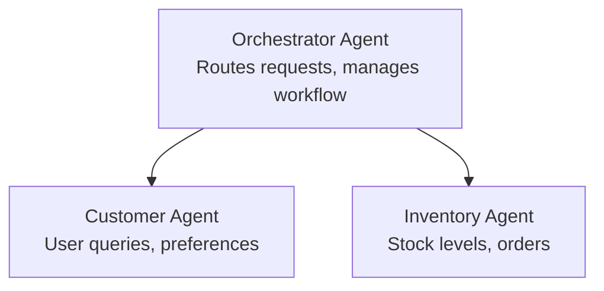

# Chapitre 5 : Solutions IA Multi-Agents

**📚 Cours** : [AZD Pour Débutants](../../README.md) | **⏱️ Durée** : 2-3 heures | **⭐ Complexité** : Avancée

---

## Aperçu

Ce chapitre couvre des modèles d'architecture multi-agents avancés, l'orchestration des agents et les déploiements IA prêts pour la production dans des scénarios complexes.

> Les consignes de commande ont été vérifiées avec la référence `azd 1.37.2` publiée. Les déploiements cloud n'ont pas été exécutés.

## Objectifs d'apprentissage

En terminant ce chapitre, vous allez :
- Comprendre les modèles d'architecture multi-agents
- Déployer des systèmes d'agents IA coordonnés
- Implémenter la communication entre agents
- Construire des solutions multi-agents prêtes pour la production

---

## 📚 Leçons

| # | Leçon | Description | Durée |
|---|--------|-------------|-------|
| 1 | [Bases Multi-Agents](multi-agent-basics.md) | Pratique : déployer une application multi-agent fonctionnelle avec `azd up` | 45 min |
| 2 | [Modèles de Coordination](../chapter-06-pre-deployment/coordination-patterns.md) | Stratégies d'orchestration d'agents (continué dans le Chapitre 6) | 30 min |
| 3 | [Déploiement Template ARM](../../examples/retail-multiagent-arm-template/README.md) | Exemple de déploiement en un clic | 30 min |

> **Commencez par la Leçon 1.** C’est la seule leçon entièrement pratique et déployable de ce chapitre. La Leçon 2 se trouve dans le Chapitre 6 (partagée avec la planification pré-déploiement), et la [Solution Multi-Agent Retail](../../examples/retail-scenario.md) est une architecture type — une référence de conception, pas un template à commande unique.

---

## 🚀 Démarrage rapide

```bash
# Option 1: Deploy the multi-agent template used in Lesson 1
azd init --template Azure-Samples/contoso-creative-writer .
azd up

# Option 2: Initialize a Foundry agent interactively (requires azure.ai.agents)
azd extension install azure.ai.agents
azd ai agent init
azd up
```

> **Quelle approche ?** Utilisez `azd init --template` pour démarrer à partir d’un exemple fonctionnel. Utilisez `azd ai agent init` de façon interactive, ou `azd ai agent init --template <path-to-azure.yaml>` pour adopter un projet d’agent déjà existant. Consultez la [référence AZD AI CLI](../chapter-08-production/production-ai-practices.md#azd-ai-cli-commands-and-extensions) pour les exigences de version et la migration d’évaluation.

Exécutez ces alternatives dans différents dossiers vides. L’extension agents `1.0.0-beta.23` nécessite `azd >= 1.37.0` ; son flux interactif ne génère pas le pipeline Service Bus personnalisé de la leçon de coordination.

---

## 🤖 Architecture Multi-Agent



---

## 🎯 Solution en Vedette : Retail Multi-Agent

La [Solution Multi-Agent Retail](../../examples/retail-scenario.md) démontre :

- **Agent Client** : Gère les interactions utilisateur et les préférences
- **Agent Inventaire** : Gère les stocks et le traitement des commandes
- **Orchestrateur** : Coordonne les agents entre eux
- **Mémoire Partagée** : Gestion du contexte inter-agents

### Services Utilisés

| Service | Objectif |
|---------|---------|
| Microsoft Foundry Models | Compréhension du langage |
| Azure AI Search | Catalogue produits |
| Cosmos DB | État et mémoire des agents |
| Container Apps | Hébergement des agents |
| Application Insights | Supervision |

---

## 🔗 Navigation

| Direction | Chapitre |
|-----------|---------|
| **Précédent** | [Chapitre 4 : Infrastructure](../chapter-04-infrastructure/README.md) |
| **Suivant** | [Chapitre 6 : Pré-déploiement](../chapter-06-pre-deployment/README.md) |

---

## 📖 Ressources Associées

- [Guide Agents IA](../chapter-02-ai-development/agents.md)
- [Pratiques IA en Production](../chapter-08-production/production-ai-practices.md)
- [Dépannage IA](../chapter-07-troubleshooting/ai-troubleshooting.md)

---

<!-- CO-OP TRANSLATOR DISCLAIMER START -->
**Avertissement** :
Ce document a été traduit à l'aide du service de traduction automatique [Co-op Translator](https://github.com/Azure/co-op-translator). Bien que nous nous efforçions d'assurer l'exactitude, veuillez noter que les traductions automatisées peuvent contenir des erreurs ou des inexactitudes. Le document original dans sa langue native doit être considéré comme la source faisant autorité. Pour les informations critiques, il est recommandé de recourir à une traduction professionnelle réalisée par un humain. Nous ne saurions être tenus responsables des malentendus ou erreurs d'interprétation découlant de l'utilisation de cette traduction.
<!-- CO-OP TRANSLATOR DISCLAIMER END -->