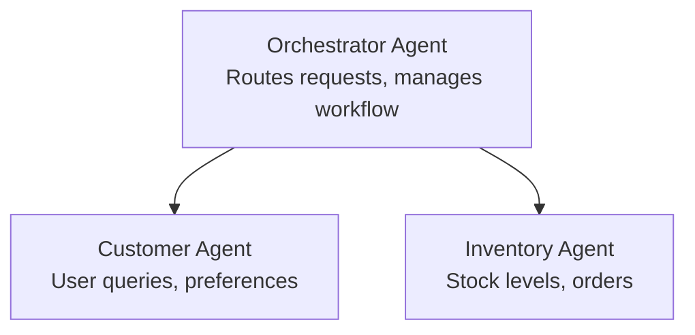

# Chapitre 5 : Solutions d’IA Multi-Agents

**📚 Cours** : [AZD Pour Débutants](../../README.md) | **⏱️ Durée** : 2-3 heures | **⭐ Complexité** : Avancé

---

## Aperçu

Ce chapitre couvre des modèles d’architecture multi-agents avancés, l’orchestration d’agents et les déploiements d’IA prêts pour la production dans des scénarios complexes.

> Guide de commande vérifié contre la référence `azd 1.37.2` publiée. Les déploiements cloud n’ont pas été exécutés.

## Objectifs d’apprentissage

En terminant ce chapitre, vous serez capable de :
- Comprendre les modèles d’architecture multi-agents
- Déployer des systèmes d’agents IA coordonnés
- Mettre en œuvre la communication agent-à-agent
- Construire des solutions multi-agents prêtes pour la production

---

## 📚 Leçons

| # | Leçon | Description | Durée |
|---|--------|-------------|------|
| 1 | [Notions de base multi-agents](multi-agent-basics.md) | Pratique : déployer une application multi-agent fonctionnelle avec `azd up` | 45 min |
| 2 | [Modèles de coordination](../chapter-06-pre-deployment/coordination-patterns.md) | Stratégies d’orchestration d’agents (se poursuit au Chapitre 6) | 30 min |
| 3 | [Déploiement ARM Template](../../examples/retail-multiagent-arm-template/README.md) | Exemple de déploiement en un clic | 30 min |

> **Commencez par la Leçon 1.** C’est la seule leçon entièrement pratique et déployable de ce chapitre. La Leçon 2 est dans le Chapitre 6 (elle est partagée avec la planification pré-déploiement), et la [Solution Multi-Agent Retail](../../examples/retail-scenario.md) est une feuille de route d’architecture — une référence de conception, pas un modèle à exécuter en une commande.

---

## 🚀 Démarrage Rapide

```bash
# Option 1: Deploy the multi-agent template used in Lesson 1
azd init --template Azure-Samples/contoso-creative-writer .
azd up

# Option 2: Initialize a Foundry agent interactively with the GA bundle
azd ext install microsoft.foundry
azd ai agent init
azd up
```

> **Quelle approche ?** Utilisez `azd init --template` pour commencer par un exemple fonctionnel. Utilisez `azd ai agent init` de manière interactive, ou `azd ai agent init --template <path-to-azure.yaml>` pour reprendre un projet agent existant. Consultez la [référence AZD AI CLI](../chapter-08-production/production-ai-practices.md#azd-ai-cli-commands-and-extensions) pour les versions requises et la migration d’évaluation.

Exécutez ces alternatives dans des dossiers vides séparés. Le flux de travail Foundry GA nécessite `azd >= 1.37.0` ; son flux interactif ne génère pas la pipeline Service Bus personnalisée de la leçon de coordination. Pour les tests locaux, le déploiement du code et le nettoyage des projets nouveaux versus réutilisés, suivez le [tutoriel agent hébergé](../chapter-02-ai-development/microsoft-foundry-integration.md#hosted-agent-walkthrough-ga).

---

## 🤖 Architecture Multi-Agents



---

## 🎯 Solution en Vedette : Retail Multi-Agent

La [Solution Multi-Agent Retail](../../examples/retail-scenario.md) démontre :

- **Agent Client** : Gère les interactions utilisateur et préférences
- **Agent Inventaire** : Gère les stocks et le traitement des commandes
- **Orchestrateur** : Coordonne les agents
- **Mémoire Partagée** : Gestion du contexte inter-agents

### Services Utilisés

| Service | Objectif |
|---------|---------|
| Microsoft Foundry Models | Compréhension du langage |
| Azure AI Search | Catalogue produit |
| Cosmos DB | État et mémoire des agents |
| Container Apps | Hébergement des agents |
| Application Insights | Surveillance |

---

## 🔗 Navigation

| Direction | Chapitre |
|-----------|---------|
| **Précédent** | [Chapitre 4 : Infrastructure](../chapter-04-infrastructure/README.md) |
| **Suivant** | [Chapitre 6 : Pré-Déploiement](../chapter-06-pre-deployment/README.md) |

---

## 📖 Ressources Associées

- [Guide des Agents IA](../chapter-02-ai-development/agents.md)
- [Pratiques IA en Production](../chapter-08-production/production-ai-practices.md)
- [Dépannage IA](../chapter-07-troubleshooting/ai-troubleshooting.md)

---

<!-- CO-OP TRANSLATOR DISCLAIMER START -->
**Avertissement** :
Ce document a été traduit à l'aide du service de traduction automatique [Co-op Translator](https://github.com/Azure/co-op-translator). Bien que nous nous efforçions d'assurer l'exactitude, veuillez noter que les traductions automatisées peuvent contenir des erreurs ou des inexactitudes. Le document original dans sa langue native doit être considéré comme la source faisant autorité. Pour les informations critiques, il est recommandé de recourir à une traduction professionnelle réalisée par un humain. Nous ne saurions être tenus responsables des malentendus ou erreurs d'interprétation découlant de l'utilisation de cette traduction.
<!-- CO-OP TRANSLATOR DISCLAIMER END -->