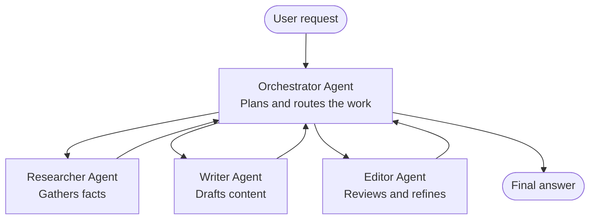

# Bases du multi-agent - Déployez votre premier système d'IA coordonné

**Navigation du chapitre :**
- **📚 Accueil du cours** : [AZD pour débutants](../../README.md)
- **📖 Chapitre actuel** : Chapitre 5 - Solutions d'IA multi-agents
- **⬅️ Précédent** : [Chapitre 4 : Infrastructure](../chapter-04-infrastructure/README.md)
- **➡️ Suivant** : [Modèles de coordination](../chapter-06-pre-deployment/coordination-patterns.md)

> Guide de commande vérifié par rapport à la référence `azd 1.37.2` publiée. Les déploiements Cloud n'ont pas été exécutés.

## Introduction

Dans les chapitres précédents, vous avez déployé une seule application — et dans le Chapitre 2 vous avez déployé un seul agent IA. Cette leçon franchit l'étape suivante : déployer un **système multi-agent**, où plusieurs agents spécialisés collaborent pour résoudre un problème qu'aucun agent unique ne pourrait gérer efficacement seul.

La bonne nouvelle pour les débutants : **vous n'avez pas besoin de nouvelles commandes.** Une solution multi-agent est toujours un projet azd. Vous allez `azd init`, `azd up`, tester, et `azd down` — exactement le flux de travail que vous connaissez déjà. Ce qui change, c'est la *forme* de l'application à l'intérieur.

## Objectifs d'apprentissage

À la fin de cette leçon, vous serez capable de :
- Comprendre ce que signifie « multi-agent » et quand cela vaut la complexité supplémentaire
- Reconnaître les rôles courants dans un système multi-agent (orchestrateur + spécialistes)
- Déployer un modèle multi-agent réel et fonctionnel avec `azd up`
- Comprendre les ressources Azure qui soutiennent une application multi-agent
- Savoir vérifier, personnaliser et démonter la solution en toute sécurité

## Résultats d'apprentissage

Après avoir terminé cette leçon, vous serez capable de :
- Expliquer la différence entre un agent unique et un système multi-agent
- Choisir entre un agent unique avec outils et une véritable conception multi-agent
- Déployer et tester un modèle multi-agent de bout en bout avec azd
- Identifier où chaque agent s'exécute et comment ils communiquent
- Nettoyer toutes les ressources pour éviter des frais continus

---

## Qu'est-ce qu'un système multi-agent ?

Un agent IA unique est un modèle avec un ensemble d'instructions et (optionnellement) certains outils. Cela fonctionne bien pour des tâches ciblées. Mais à mesure qu'une tâche grandit — recherche, puis écriture, puis édition, puis vérification des faits — tout mettre dans une seule invite rend l'agent plus lent, moins fiable, et plus difficile à déboguer.

Un **système multi-agent** divise le travail en spécialistes qui font chacun bien un travail, coordonnés par un orchestrateur :



### Les deux rôles que vous verrez toujours

| Rôle | Travail | Exemple |
|------|--------|---------|
| **Orchestrateur** | Decide *ce qui se passe ensuite* et distribue le travail entre agents | « D'abord recherche, puis écriture, puis édition » |
| **Spécialiste** | Fait un travail ciblé et renvoie un résultat | Un « chercheur » qui ne collecte que des faits |

### Avez-vous vraiment besoin de plusieurs agents ?

Commencez simple. Passez au multi-agent **seulement** si l'une de ces conditions est vraie :

- ✅ La tâche comporte des **étapes distinctes** qui bénéficient d'instructions différentes (recherche vs écriture vs révision)
- ✅ Vous voulez que les spécialistes fonctionnent **en parallèle** pour gagner du temps
- ✅ Différentes étapes ont besoin de **différents outils ou sources de données**
- ✅ Vous avez besoin que chaque étape soit **testable et débogable indépendamment**

Si votre tâche est une question-réponse simple ou un appel d'outil simple, un **agent unique avec outils** (Chapitre 2) est plus simple, moins coûteux, et plus facile à exploiter.

> **Astuce pour débutants :** « Plus d'agents » ne signifie pas « meilleur ». Chaque agent ajoute de la latence, du coût, et un nouvel élément à surveiller. Ajoutez des agents seulement quand le problème se divise clairement en parties.

---

## Deux façons de construire du multi-agent sur Azure

| Approche | Qu'est-ce que c'est | Idéal pour |
|----------|-------------------|-----------|
| **Agent unique + outils** | Un agent Foundry qui appelle fonctions/outils | Flux de travail simples, premiers pas |
| **Agents multiples coordonnés** | Plusieurs agents avec un orchestrateur | Étapes distinctes, travail parallèle, spécialisation |

Cette leçon se concentre sur la deuxième approche avec un **modèle prêt à l'emploi**, pour que vous puissiez voir un vrai système multi-agent tourner avant de construire le vôtre.

---

## Pratique : Déployez une application multi-agent fonctionnelle

Nous allons déployer **Contoso Creative Writer**, un exemple officiel Azure qui coordonne les agents de recherche, produit, écriture, et édition pour produire un article. Avant de continuer, consultez les [pré-requis et coûts de l'exemple](https://github.com/Azure-Samples/contoso-creative-writer#azure-account-requirements) : il nécessite un quota de modèle, Azure AI Search, accès Bing Grounding, Python, Docker, et des scripts compatibles Bash. La disponibilité des modèles et régions dépend de votre abonnement ; le déploiement n'est pas garanti en choisissant une région particulière.

### Étape 1 : Initialiser le modèle

```bash
# Create a working folder
mkdir creative-writer && cd creative-writer

# Initialize from the official multi-agent template
azd init --template Azure-Samples/contoso-creative-writer .
```

> Parcourez d'autres modèles multi-agents à tout moment dans la [galerie Awesome AZD AI](https://azure.github.io/awesome-azd/?tags=ai). D'autres options conviviales pour débutants incluent `get-started-with-ai-agents` et `azure-ai-travel-agents`.

### Étape 2 : Authentification

```bash
# Required for azd workflows
azd auth login

# Also required by this sample's Azure CLI hooks
az login
```

### Étape 3 : Vérifiez l'environnement

```bash
# init normally creates/selects an environment; confirm it before proceeding
azd env list
# Only if you need an additional environment:
# azd env new dev
```

### Étape 4 : Prévisualiser, puis déployer

```bash
# See what will be created before spending anything (recommended)
azd provision --preview

# Provision infrastructure and deploy all agents in one step
azd up
```

`azd up` vous demandera les paramètres d'abonnement et de région manquants, puis provisionnera les ressources et déploiera l'application. La prévisualisation ne réserve pas de quota et ne garantit pas le succès ; les crochets du modèle peuvent s'exécuter pendant une prévisualisation de provisionnement, inspectez-les d'abord. Pour prolonger le temps d'attente d'azd pour chaque **déploiement de service** (pas le provisionnement du modèle) :

```bash
azd deploy --timeout 1800
```

Un délai d'attente interrompt l'attente d'azd ; il n'annule pas le déploiement dans Azure. Vérifiez l'état des ressources avant de réessayer.

> **Attention aux coûts et capacités :** Les applications multi-agents déploient des modèles IA qui consomment des quotas et engendrent des coûts. Si `azd up` échoue sur le quota de modèle, consultez [Dépannage IA](../chapter-07-troubleshooting/ai-troubleshooting.md) pour les correctifs régionaux et de quota, et le Chapitre 6 [Planification de capacité](../chapter-06-pre-deployment/capacity-planning.md).

---

## Comprendre ce que vous avez déployé

Une application multi-agent typique comme celle-ci provisionne un ensemble de ressources Azure qui correspondent directement aux responsabilités du schéma ci-dessus :

| Ressource | Pourquoi elle est là |
|----------|---------------------|
| **Microsoft Foundry / Modèles** | Héberge les modèles linguistiques utilisés par chaque agent |
| **Azure AI Search** | Donne à l'agent chercheur des données fondées à rechercher |
| **Container Apps** (ou App Service) | Héberge le code de l'orchestrateur et des agents |
| **Cosmos DB** (dans certains exemples) | Stocke l'état/mémoire partagée transmise entre agents |
| **Application Insights** | Trace les requêtes *à travers* les agents pour faciliter le débogage du flux |

### Comment les agents communiquent entre eux

Dans la plupart des exemples multi-agents azd, l'**orchestrateur s'exécute dans votre code applicatif** (par exemple, en utilisant un framework comme Semantic Kernel ou Microsoft Agent Framework). L'orchestrateur appelle chaque agent spécialiste à son tour, transmet les résultats et assemble la réponse finale. Les agents partagent le contexte via :

- **Appels de fonction/outils** — l'orchestrateur invoque un spécialiste et reçoit un résultat
- **Mémoire partagée** — une base de données (souvent Cosmos DB) contient un état que les deux agents peuvent lire
- **Messages/événements** — pour un couplage plus lâche, les agents communiquent via une file d'attente ou un Service Bus

> **Pourquoi c'est important pour le débogage :** parce que chaque étape est séparée, Application Insights vous montre *quel* agent a été lent ou a échoué. C'est une raison majeure pour repartir le travail entre agents dès le départ.

---

## Vérifiez le déploiement

Confirmez que le système fonctionne réellement avant de continuer :

```bash
# Show the deployed endpoints
azd show

# Open the app's monitoring dashboard
azd monitor

# Open Application Insights Logs (not a terminal log stream)
azd monitor --logs
```

Ouvrez ensuite l'URL de l'application depuis `azd show` et demandez un article court. Utilisez la vue de débogage de l'exemple pour inspecter le flux de travail des agents. La recherche des transactions dans Application Insights peut montrer les étapes individuelles seulement si l'exemple les instrumente et les corrèle ; azd n'ajoute pas automatiquement des spans agent.

**Critères de succès :**
- ✅ `azd show` liste un point de terminaison accessible
- ✅ Une requête produit un résultat qui a clairement passé plusieurs étapes
- ✅ La vue de débogage montre plusieurs étapes des agents ; si le traçage est activé, vérifiez la télémétrie correspondante après ingestion

---

## Personnalisez : Ajoutez ou ajustez un agent

Parce que chaque agent est juste des instructions plus des outils, la personnalisation est accessible :

1. **Trouvez les définitions des agents** dans le modèle (souvent un ensemble de fichiers `prompts/`, `agents/` ou `*.prompty`).
2. **Ajustez les instructions d'un agent** — par exemple, dites à l'agent éditeur d'imposer un ton ou un nombre de mots spécifiques.
3. **Redéployez uniquement le code** (l'infrastructure reste inchangée) :

   ```bash
   azd deploy
   ```

Pour aller plus loin avec votre *propre* projet d'agent Foundry, utilisez le bundle GA avec AZD 1.37.0+ dans un répertoire vide séparé :

```bash
azd ext install microsoft.foundry
azd ai agent init
azd up
azd ai agent invoke      # test, with response timing
```

Consultez le [tutoriel hébergé pour agent GA](../chapter-02-ai-development/microsoft-foundry-integration.md#hosted-agent-walkthrough-ga) pour les tests locaux Agent Inspector, le déploiement de code distant et la gestion du nettoyage. La [référence AZD AI CLI](../chapter-08-production/production-ai-practices.md#azd-ai-cli-commands-and-extensions) couvre aussi l'extension évaluations séparées, l'optimisation et la suppression d'agents.

---

## Nettoyage

Les applications multi-agents exécutent plusieurs services facturables. Détruisez tout quand vous avez terminé :

```bash
# Review the resources and confirm deletion interactively
azd down
```

La suppression est destructive. Pour un labo jetable, `azd down --force --purge` évite la suppression et les confirmations de purge de suppression douce prises en charge ; la purge est irréversible là où elle est prise en charge et peut être bloquée par la protection contre la purge. La suppression douce concerne une récupération ou une réutilisation de nom, ce n'est pas en soi une preuve de frais continus. Vérifiez les ressources conservées et la facturation après nettoyage.

Si vous avez aussi initialisé un agent hébergé contre un projet Foundry existant, `azd down` laisse l'agent de ce projet et d'autres ressources en place. Supprimez uniquement les ressources indésirables que vous possédez séparément. Pour un nouveau projet Foundry créé par son environnement AZD, `azd down` supprime le groupe de ressources et tout ce qu'il contient.

---

## Une note sur les systèmes multi-agents en production

La [Solution Multi-Agent Retail](../../examples/retail-scenario.md) dans ce repo est un **plan d'architecture**, pas un modèle en une commande — elle documente comment un système de détail en production *serait* construit (et précise qu'un build complet est un effort substantiel). Utilisez-la comme référence de conception *après* avoir déployé un exemple fonctionnel ici. Pour les préoccupations de production (résilience, coûts, surveillance, gouvernance), continuez au [Chapitre 8 : Pratiques IA en production](../chapter-08-production/production-ai-practices.md).

---

## Résumé

- Un système multi-agent répartit le travail entre spécialistes coordonnés par un orchestrateur.
- Ne l'utilisez que lorsque la tâche a des étapes distinctes, du parallélisme, ou des outils différents par étape ; sinon préférez un agent unique.
- Le flux de travail azd reste inchangé : `azd init` → `azd up` → test → `azd down`.
- Un modèle réel comme `contoso-creative-writer` vous permet de voir et personnaliser une app multi-agent fonctionnelle dès aujourd'hui.
- Le traçage Application Insights à travers les agents est l'un des plus grands avantages pratiques du design multi-agent.

---

## 🔗 Navigation

| Direction | Leçon |
|-----------|-------|
| **Précédent** | [Chapitre 4 : Infrastructure](../chapter-04-infrastructure/README.md) |
| **Suivant** | [Modèles de coordination](../chapter-06-pre-deployment/coordination-patterns.md) |

## 📖 Ressources connexes

- [Guide des agents IA](../chapter-02-ai-development/agents.md)
- [Modèles de coordination](../chapter-06-pre-deployment/coordination-patterns.md)
- [Pratiques IA en production](../chapter-08-production/production-ai-practices.md)
- [Dépannage IA](../chapter-07-troubleshooting/ai-troubleshooting.md)

---

<!-- CO-OP TRANSLATOR DISCLAIMER START -->
**Avertissement** :
Ce document a été traduit à l'aide du service de traduction automatique [Co-op Translator](https://github.com/Azure/co-op-translator). Bien que nous nous efforçions d'assurer l'exactitude, veuillez noter que les traductions automatisées peuvent contenir des erreurs ou des inexactitudes. Le document original dans sa langue native doit être considéré comme la source faisant autorité. Pour les informations critiques, il est recommandé de recourir à une traduction professionnelle réalisée par un humain. Nous ne saurions être tenus responsables des malentendus ou erreurs d'interprétation découlant de l'utilisation de cette traduction.
<!-- CO-OP TRANSLATOR DISCLAIMER END -->