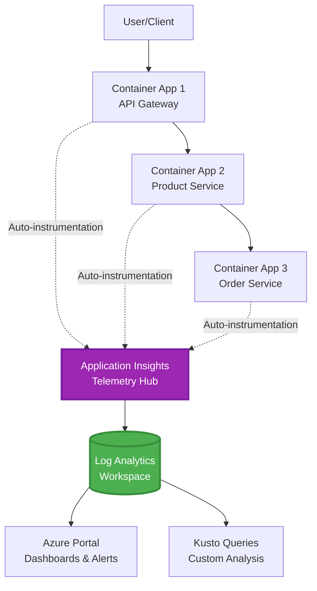
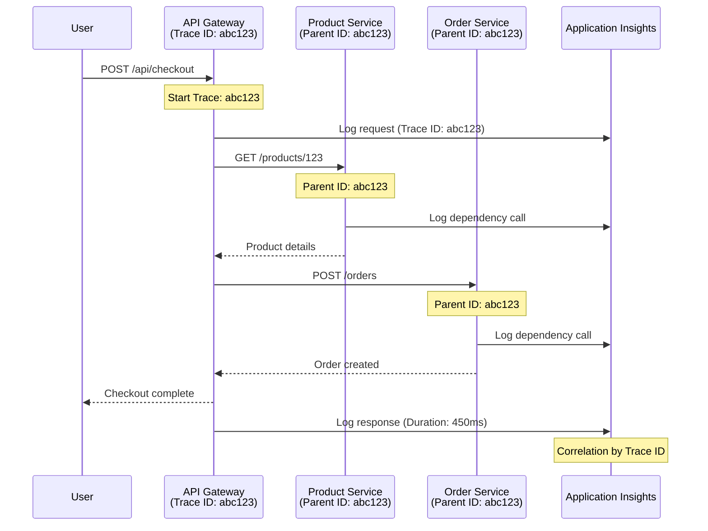

# Intégration d'Application Insights avec AZD

⏱️ **Durée estimée** : 40-50 minutes | 💰 **Impact sur le coût** : ~5-15 $/mois | ⭐ **Complexité** : Intermédiaire

**📚 Parcours d'apprentissage :**
- ← Précédent : [Vérifications préalables](preflight-checks.md) - Validation avant déploiement
- 🎯 **Vous êtes ici** : Intégration Application Insights (Surveillance, télémétrie, débogage)
- → Suivant : [Guide de déploiement](../chapter-04-infrastructure/deployment-guide.md) - Déployer sur Azure
- 🏠 [Accueil du cours](../../README.md)

---

## Ce que vous apprendrez

En suivant cette leçon, vous allez :
- Déclarer **Application Insights** dans l’infrastructure AZD et configurer l'instrumentation SDK
- Configurer le **traçage distribué** pour les microservices
- Implémenter une **télémétrie personnalisée** (métriques, événements, dépendances)
- Mettre en place des **métriques en direct** pour la surveillance en temps réel
- Créer des **alertes et tableaux de bord** à partir des déploiements AZD
- Déboguer les problèmes en production avec des **requêtes de télémétrie**
- Optimiser les **coûts et stratégies d’échantillonnage**
- Surveiller les **applications AI/LLM** (tokens, latence, coûts)

## Pourquoi Application Insights avec AZD est important

### Le défi : la visibilité en production

**Sans Application Insights :**
```
❌ No visibility into production behavior
❌ Manual log aggregation across services
❌ Reactive debugging (wait for customer complaints)
❌ No performance metrics
❌ Cannot trace requests across services
❌ Unknown failure rates and bottlenecks
```

**Avec Application Insights + AZD :**
```
✅ Automatic telemetry collection
✅ Centralized logs from all services
✅ Proactive issue detection
✅ End-to-end request tracing
✅ Performance metrics and insights
✅ Real-time dashboards
✅ AZD provisions the monitoring declared in your templates
```

**Analogie** : Application Insights est comme avoir un enregistreur de vol "boîte noire" + un tableau de bord de cockpit pour votre application. Vous voyez tout ce qui se passe en temps réel et pouvez rejouer n’importe quel incident.

---

## Aperçu de l'architecture

### Application Insights dans l'architecture AZD



### Ce qui est automatiquement surveillé

L’auto-instrumentation supportée capture les requêtes/dépendances pour les bibliothèques instrumentées. Les événements et métriques personnalisés nécessitent du code applicatif ; les tests de disponibilité doivent être configurés séparément. Il ne collecte pas toutes les lignes ci-dessous simplement parce que la ressource existe.

| Type de télémétrie | Ce qui est capturé | Cas d'utilisation |
|------------------|-------------------|------------------|
| **Requêtes** | Requêtes HTTP, codes d’état, durée | Surveillance des performances API |
| **Dépendances** | Appels externes (BD, API, stockage) | Identification des goulets d’étranglement |
| **Exceptions** | Erreurs non gérées avec traces de pile | Débogage des échecs |
| **Événements personnalisés** | Événements métier (inscription, achat) | Analytics et entonnoirs |
| **Métriques** | Compteurs de performance, métriques personnalisées | Planification de capacité |
| **Traces** | Messages de logs avec gravité | Débogage et audit |
| **Disponibilité** | Tests de disponibilité et temps de réponse | Surveillance SLA |

---

## Prérequis

### Outils requis

```bash
# Verify Azure Developer CLI
azd version
# Command reference baseline: azd 1.37.2

# Verify Azure CLI
az --version
# ✅ Expected: azure-cli 2.50.0 or higher
```

### Exigences Azure

- Abonnement Azure actif
- Permissions pour créer :
  - Ressources Application Insights
  - Espaces Log Analytics
  - Container Apps
  - Groupes de ressources

### Prérequis de connaissance

Vous devriez avoir complété :
- [AZD Basics](../chapter-01-foundation/azd-basics.md) - Concepts de base d’AZD
- [Configuration](../chapter-03-configuration/configuration.md) - Configuration de l’environnement
- [Premier projet](../chapter-01-foundation/first-project.md) - Déploiement basique

---

## Leçon 1 : Application Insights automatique avec AZD

### Comment AZD provisionne Application Insights

AZD provisionne Application Insights **uniquement lorsque l'infrastructure du projet le déclare**. `azure.yaml` seul ne crée pas de surveillance ni n'instrumente le code applicatif.

> **Exemple de périmètre :** Cette leçon contient des fragments d’intégration, pas un projet `monitored-app` complet dans ce dépôt. Fournissez un modèle principal et un mappage de paramètres, un environnement Container Apps, la configuration registre/image et identité, Dockerfile, et balises de service avant de déployer. Les leçons suivantes montrent des fragments alternatifs/extensions, pas des fichiers pouvant tous être collés ensemble sans modification. Commencez avec un [exemple microservices fonctionnel](../../../../examples/microservices) si vous avez besoin d’une base exécutable.

### Structure du projet

```
monitored-app/
├── azure.yaml                     # AZD configuration
├── infra/
│   ├── main.bicep                # Main infrastructure
│   ├── core/
│   │   └── monitoring.bicep      # Application Insights + Log Analytics
│   └── app/
│       └── api.bicep             # Container App with monitoring
└── src/
    ├── app.py                    # Application with telemetry
    ├── requirements.txt
    └── Dockerfile
```

---

### Étape 1 : Configurer AZD (azure.yaml)

**Fichier : `azure.yaml`**

```yaml
name: monitored-app
metadata:
  template: monitored-app@1.0.0

services:
  api:
    project: ./src
    language: python
    host: containerapp

# Monitoring must be declared in infra/ and enabled in application code.
```

Cela déclare le service déployable. La configuration Bicep et SDK suivante fournit la surveillance ; azd ne les ajoute pas implicitement.

---

### Étape 2 : Infrastructure de surveillance (Bicep)

**Fichier : `infra/core/monitoring.bicep`**

```bicep
param logAnalyticsName string
param applicationInsightsName string
param location string = resourceGroup().location
param tags object = {}

// Log Analytics Workspace (required for Application Insights)
resource logAnalytics 'Microsoft.OperationalInsights/workspaces@2022-10-01' = {
  name: logAnalyticsName
  location: location
  tags: tags
  properties: {
    sku: {
      name: 'PerGB2018'  // Pay-as-you-go pricing
    }
    retentionInDays: 30  // Keep logs for 30 days
    features: {
      enableLogAccessUsingOnlyResourcePermissions: true
    }
  }
}

// Application Insights
resource applicationInsights 'Microsoft.Insights/components@2020-02-02' = {
  name: applicationInsightsName
  location: location
  tags: tags
  kind: 'web'
  properties: {
    Application_Type: 'web'
    WorkspaceResourceId: logAnalytics.id
    IngestionMode: 'LogAnalytics'
    publicNetworkAccessForIngestion: 'Enabled'
    publicNetworkAccessForQuery: 'Enabled'
  }
}

// Outputs for Container Apps
output logAnalyticsWorkspaceId string = logAnalytics.id
output logAnalyticsWorkspaceName string = logAnalytics.name
output applicationInsightsConnectionString string = applicationInsights.properties.ConnectionString
output applicationInsightsInstrumentationKey string = applicationInsights.properties.InstrumentationKey
output applicationInsightsName string = applicationInsights.name
output applicationInsightsId string = applicationInsights.id
```

---

### Étape 3 : Connecter Container App à Application Insights

**Fichier : `infra/app/api.bicep`**

```bicep
param name string
param location string
param tags object = {}
param containerAppsEnvironmentId string
param containerImage string
param applicationInsightsConnectionString string

resource containerApp 'Microsoft.App/containerApps@2023-05-01' = {
  name: name
  location: location
  tags: tags
  properties: {
    managedEnvironmentId: containerAppsEnvironmentId
    configuration: {
      ingress: {
        external: true
        targetPort: 8000
      }
      secrets: [
        {
          name: 'appinsights-connection-string'
          value: applicationInsightsConnectionString
        }
      ]
    }
    template: {
      containers: [
        {
          name: 'api'
          image: containerImage // Supply an accessible image and registry authentication
          resources: {
            cpu: json('0.5')
            memory: '1Gi'
          }
          env: [
            {
              name: 'APPLICATIONINSIGHTS_CONNECTION_STRING'
              secretRef: 'appinsights-connection-string'
            }
            {
              name: 'APPLICATIONINSIGHTS_ENABLED'
              value: 'true'
            }
          ]
        }
      ]
    }
  }
}

output uri string = 'https://${containerApp.properties.configuration.ingress.fqdn}'
```

---

### Étape 4 : Code applicatif avec télémétrie

**Fichier : `src/app.py`**

```python
from flask import Flask, request, jsonify
from azure.monitor.opentelemetry import configure_azure_monitor
import logging
import os

app = Flask(__name__)

# Get Application Insights connection string
connection_string = os.environ.get('APPLICATIONINSIGHTS_CONNECTION_STRING')

if connection_string:
    # Azure Monitor OpenTelemetry instruments supported libraries, including Flask.
    configure_azure_monitor(
        connection_string=connection_string,
        logger_name=__name__,
        enable_live_metrics=True
    )
    logger = logging.getLogger(__name__)
    logger.setLevel(logging.INFO)
    
    print("✅ Application Insights enabled")
else:
    logger = logging.getLogger(__name__)
    logger.setLevel(logging.INFO)
    print("⚠️ Application Insights not configured")

@app.route('/health')
def health():
    logger.info('Health check endpoint called')
    return jsonify({'status': 'healthy', 'monitoring': 'enabled' if connection_string else 'disabled'})

@app.route('/api/products')
def get_products():
    logger.info('Fetching products')
    
    # In-memory fixture: this is not a database dependency call.
    products = [
        {'id': 1, 'name': 'Laptop', 'price': 999.99},
        {'id': 2, 'name': 'Mouse', 'price': 29.99},
        {'id': 3, 'name': 'Keyboard', 'price': 79.99}
    ]
    
    logger.info(f'Returned {len(products)} products')
    return jsonify(products)

@app.route('/api/error-test')
def error_test():
    """Test error tracking"""
    logger.error('Testing error tracking')
    try:
        raise ValueError('This is a test exception')
    except Exception as e:
        logger.exception('Exception occurred in error-test endpoint')
        return jsonify({'error': str(e)}), 500

@app.route('/api/slow')
def slow_endpoint():
    """Test performance tracking"""
    import time
    logger.info('Slow endpoint called')
    time.sleep(3)  # Simulate slow operation
    logger.warning('Endpoint took 3 seconds to respond')
    return jsonify({'message': 'Slow operation completed'})

if __name__ == '__main__':
    app.run(host='0.0.0.0', port=8000)
```

**Fichier : `src/requirements.txt`**

```txt
Flask
azure-monitor-opentelemetry
gunicorn
requests
openai
```

Résolvez ces dépendances dans votre projet, testez-les ensemble, et verrouillez les versions résultantes. Les nouveaux projets doivent utiliser Azure Monitor OpenTelemetry, pas les exportateurs OpenCensus Python retirés.

---

### Étape 5 : Déployer et vérifier

```bash
# Deploy only after completing and wiring the infrastructure fragments above
azd up

# Get app URL
APP_URL=$(azd env get-value API_URL) # Requires this output in main.bicep

# Generate telemetry
curl $APP_URL/health
curl $APP_URL/api/products
curl $APP_URL/api/error-test
curl $APP_URL/api/slow
```

**✅ Résultat attendu :**
```json
{
  "status": "healthy",
  "monitoring": "enabled"
}
```

---

### Étape 6 : Visualiser la télémétrie dans le portail Azure

```bash
# Get Application Insights details
azd env get-values | grep APPLICATIONINSIGHTS

# Open in Azure Portal
az monitor app-insights component show \
  --app $(azd env get-values | grep APPLICATIONINSIGHTS_NAME | cut -d '=' -f2 | tr -d '"') \
  --resource-group $(azd env get-values | grep AZURE_RESOURCE_GROUP | cut -d '=' -f2 | tr -d '"') \
  --query "appId" -o tsv
```

**Naviguez vers Portail Azure → Application Insights → Recherche de transactions**

Vous devriez voir :
- ✅ Requêtes HTTP avec codes d'état
- ✅ Durée des requêtes (3+ secondes pour `/api/slow`)
- ✅ Détails des exceptions de `/api/error-test`
- ✅ Messages de journal personnalisés

---

## Leçon 2 : Télémétrie personnalisée et événements

### Suivi des événements métier

Ajoutons une télémétrie personnalisée pour les événements critiques métier.

**Fichier : `src/telemetry.py`**

```python
from contextlib import contextmanager
from azure.monitor.opentelemetry import configure_azure_monitor
from opentelemetry import metrics, trace
from opentelemetry.trace import SpanKind
import logging
import os

class TelemetryClient:
    """Custom telemetry client for Application Insights"""
    
    def __init__(self, connection_string=None):
        self.connection_string = connection_string or os.environ.get('APPLICATIONINSIGHTS_CONNECTION_STRING')
        
        # Configure once per process. If app.py already calls this, keep only
        # one configure_azure_monitor call and use logger_name='telemetry'.
        if self.connection_string:
            configure_azure_monitor(
                connection_string=self.connection_string,
                logger_name=__name__,
                enable_live_metrics=True
            )
        self.logger = logging.getLogger(__name__)
        self.logger.setLevel(logging.INFO)
        self.tracer = trace.get_tracer(__name__)
        self.meter = metrics.get_meter(__name__)
        self.instruments = {}
    
    def track_event(self, event_name: str, properties: dict = None):
        """Track custom business event"""
        properties = properties or {}
        self.logger.info(
            f"CustomEvent: {event_name}",
            extra={
                # OTel log attributes become customDimensions in App Insights.
                    'event_name': event_name,
                    **properties
            }
        )
    
    def track_metric(self, metric_name: str, value: float, properties: dict = None):
        """Track custom metric"""
        properties = properties or {}
        if metric_name not in self.instruments:
            self.instruments[metric_name] = self.meter.create_histogram(metric_name)
        self.instruments[metric_name].record(value, attributes=properties)
    
    @contextmanager
    def track_dependency(self, name: str):
        """Time the real operation inside a client span; exceptions mark failure."""
        with self.tracer.start_as_current_span(name, kind=SpanKind.CLIENT) as span:
            yield span

# Global telemetry client
telemetry = TelemetryClient()
```

### Mise à jour de l'application avec événements personnalisés

**Fichier : `src/app.py` (amélioré)**

Ajoutez ces routes à l'application Flask existante ; conservez les routes santé/test précédentes. Le bloc raccourci ci-dessous montre une application séparée pour la clarté. L'initialisation de la télémétrie vit désormais dans `telemetry.py` — n'initialisez pas les exportateurs deux fois.

```python
from flask import Flask, request, jsonify
from telemetry import telemetry
import time
import random
import os

app = Flask(__name__)

@app.route('/api/purchase', methods=['POST'])
def purchase():
    """Track purchase event with custom telemetry"""
    data = request.get_json(silent=True) or {}
    product_id = data.get('product_id')
    quantity = data.get('quantity', 1)
    price = data.get('price', 0)
    if not isinstance(quantity, int) or quantity < 1 or \
       not isinstance(price, (int, float)) or price < 0:
        return jsonify({'error': 'quantity and price must be non-negative numbers; quantity >= 1'}), 400
    
    # Track business event
    telemetry.track_event('Purchase', {
        'product_id': product_id,
        'quantity': quantity,
        'total_amount': price * quantity,
        'user_id': request.headers.get('X-User-Id', 'anonymous')
    })
    
    # Track revenue metric
    telemetry.track_metric('Revenue', price * quantity, {
        'product_id': product_id,
        'currency': 'USD'
    })
    
    return jsonify({
        'order_id': f'ORD-{random.randint(1000, 9999)}',
        'status': 'confirmed',
        'total': price * quantity
    })

@app.route('/api/search')
def search():
    """Track search queries"""
    query = request.args.get('q', '')
    
    start_time = time.time()
    
    # Simulate search (would be real database query)
    results = [{'id': 1, 'name': f'Result for {query}'}]
    
    duration = (time.time() - start_time) * 1000  # Convert to ms
    
    # Track search event
    telemetry.track_event('Search', {
        'query': query,
        'results_count': len(results),
        'duration_ms': duration
    })
    
    # Track search performance metric
    telemetry.track_metric('SearchDuration', duration, {
        'query_length': len(query)
    })
    
    return jsonify({'results': results, 'count': len(results)})

@app.route('/api/external-call')
def external_call():
    """Track external API dependency"""
    import requests
    
    try:
        # Set an actual test endpoint; api.example.com is not a working API.
        with telemetry.track_dependency('ExternalAPI'):
            response = requests.get(os.environ['EXTERNAL_API_URL'], timeout=5)
            response.raise_for_status()
            result = response.json()
    except Exception as e:
        return jsonify({'error': 'External dependency failed'}), 502
    
    return jsonify(result)

if __name__ == '__main__':
    app.run(host='0.0.0.0', port=8000)
```

### Tester la télémétrie personnalisée

```bash
# Track purchase event
curl -X POST $APP_URL/api/purchase \
  -H "Content-Type: application/json" \
  -H "X-User-Id: user123" \
  -d '{"product_id": 1, "quantity": 2, "price": 29.99}'

# Track search event
curl "$APP_URL/api/search?q=laptop"

# Track external dependency
curl $APP_URL/api/external-call
```

**Visualiser dans le portail Azure :**

Naviguez dans Application Insights → Logs, puis exécutez :

```kusto
// View purchase events
traces
| where customDimensions.event_name == "Purchase"
| project 
    timestamp,
    product_id = tostring(customDimensions.product_id),
    total_amount = todouble(customDimensions.total_amount),
    user_id = tostring(customDimensions.user_id)
| order by timestamp desc

// Revenue recorded in Purchase events (not a billing ledger)
traces
| where customDimensions.event_name == "Purchase"
| summarize TotalRevenue = sum(todouble(customDimensions.total_amount)) by bin(timestamp, 1h)
| render timechart

// View search performance
traces
| where customDimensions.event_name == "Search"
| summarize 
    AvgDuration = avg(todouble(customDimensions.duration_ms)),
    SearchCount = count()
  by bin(timestamp, 5m)
| render timechart
```

---

## Leçon 3 : Traçage distribué pour microservices

### Activer le traçage interservices

Avec une instrumentation compatible et la propagation du contexte de trace W3C, Application Insights corrèle les requêtes entre services. Partager une chaîne de connexion seule n’établit pas de spans parent-enfant. Le fragment d’architecture ci-dessous réfère des modules que vous devez implémenter.

**Fichier : `infra/main.bicep`**

```bicep
targetScope = 'subscription'

param environmentName string
param location string = 'eastus'

var tags = { 'azd-env-name': environmentName }

resource rg 'Microsoft.Resources/resourceGroups@2021-04-01' = {
  name: 'rg-${environmentName}'
  location: location
  tags: tags
}

// Monitoring (shared by all services)
module monitoring './core/monitoring.bicep' = {
  name: 'monitoring'
  scope: rg
  params: {
    logAnalyticsName: 'log-${environmentName}'
    applicationInsightsName: 'appi-${environmentName}'
    location: location
    tags: tags
  }
}

// API Gateway
module apiGateway './app/api-gateway.bicep' = {
  name: 'api-gateway'
  scope: rg
  params: {
    name: 'ca-gateway-${environmentName}'
    location: location
    tags: union(tags, { 'azd-service-name': 'gateway' })
    applicationInsightsConnectionString: monitoring.outputs.applicationInsightsConnectionString
  }
}

// Product Service
module productService './app/product-service.bicep' = {
  name: 'product-service'
  scope: rg
  params: {
    name: 'ca-products-${environmentName}'
    location: location
    tags: union(tags, { 'azd-service-name': 'products' })
    applicationInsightsConnectionString: monitoring.outputs.applicationInsightsConnectionString
  }
}

// Order Service
module orderService './app/order-service.bicep' = {
  name: 'order-service'
  scope: rg
  params: {
    name: 'ca-orders-${environmentName}'
    location: location
    tags: union(tags, { 'azd-service-name': 'orders' })
    applicationInsightsConnectionString: monitoring.outputs.applicationInsightsConnectionString
  }
}

output APPLICATIONINSIGHTS_CONNECTION_STRING string = monitoring.outputs.applicationInsightsConnectionString
output GATEWAY_URL string = apiGateway.outputs.uri
```

### Voir la transaction de bout en bout



**Requête de trace de bout en bout :**

```kusto
// Find complete request flow
let traceId = "abc123...";  // Copy operation_Id from a request in Application Insights
dependencies
| union requests
| where operation_Id == traceId
| project 
    timestamp,
    type = itemType,
    name,
    duration,
    success,
    cloud_RoleName
| order by timestamp asc
```

---

## Leçon 4 : Métriques en direct et surveillance en temps réel

### Activer le flux de métriques en direct

Les Métriques en direct fournissent une télémétrie quasi temps réel lorsque supportée et activée par le SDK. Ce n’est pas un SLA de latence. La configuration Python OpenTelemetry ci-dessus opte avec `enable_live_metrics=True`.

**Accéder aux Live Metrics :**

```bash
# Get Application Insights resource
APPI_NAME=$(azd env get-values | grep APPLICATIONINSIGHTS_NAME | cut -d '=' -f2 | tr -d '"')

# Get resource group
RG_NAME=$(azd env get-values | grep AZURE_RESOURCE_GROUP | cut -d '=' -f2 | tr -d '"')

echo "Navigate to: Azure Portal → Resource Groups → $RG_NAME → $APPI_NAME → Live Metrics"
```

**Ce que vous voyez en temps réel :**
- ✅ Taux de requêtes entrantes (requêtes/sec)
- ✅ Appels de dépendances sortantes
- ✅ Nombre d’exceptions
- ✅ Utilisation CPU et mémoire
- ✅ Nombre de serveurs actifs
- ✅ Échantillons de télémétrie

### Générer une charge pour les tests

```bash
# Generate load to see live metrics
for i in {1..100}; do
  curl --silent --max-time 10 "$APP_URL/api/products"
  curl --silent --max-time 10 "$APP_URL/api/search?q=test$i"
done

# Watch live metrics in Azure Portal
# You should see request rate spike
```

---

## Exercices pratiques

### Exercice 1 : Mettre en place des alertes ⭐⭐ (Moyen)

**Objectif** : Créer des alertes pour les taux d’erreur élevés et les réponses lentes.

**Étapes :**

1. **Créer une alerte pour le taux d'erreur :**

```bash
# Get Application Insights resource ID
APPI_ID=$(az monitor app-insights component show \
  --app $APPI_NAME \
  --resource-group $RG_NAME \
  --query "id" -o tsv)

# Create metric alert for failed requests
az monitor metrics alert create \
  --name "High-Error-Rate" \
  --resource-group $RG_NAME \
  --scopes $APPI_ID \
  --condition "count requests/failed > 10" \
  --window-size 5m \
  --evaluation-frequency 1m \
  --description "Alert when failed request count exceeds 10 per 5 minutes"
```

2. **Créer une alerte pour les réponses lentes :**

```bash
az monitor metrics alert create \
  --name "Slow-Responses" \
  --resource-group $RG_NAME \
  --scopes $APPI_ID \
  --condition "avg requests/duration > 3000" \
  --window-size 5m \
  --evaluation-frequency 1m \
  --description "Alert when average response time exceeds 3 seconds"
```

3. **Créer une alerte via Bicep (préféré pour AZD) :**

**Fichier : `infra/core/alerts.bicep`**

```bicep
param applicationInsightsId string
param actionGroupId string = ''
param location string = resourceGroup().location

// High error rate alert
resource errorRateAlert 'Microsoft.Insights/metricAlerts@2018-03-01' = {
  name: 'high-error-rate'
  location: 'global'
  properties: {
    description: 'Alert when error rate exceeds threshold'
    severity: 2
    enabled: true
    scopes: [
      applicationInsightsId
    ]
    evaluationFrequency: 'PT1M'
    windowSize: 'PT5M'
    criteria: {
      'odata.type': 'Microsoft.Azure.Monitor.SingleResourceMultipleMetricCriteria'
      allOf: [
        {
          name: 'Error rate'
          metricName: 'requests/failed'
          operator: 'GreaterThan'
          threshold: 10
          timeAggregation: 'Count'
        }
      ]
    }
    actions: actionGroupId != '' ? [
      {
        actionGroupId: actionGroupId
      }
    ] : []
  }
}

// Slow response alert
resource slowResponseAlert 'Microsoft.Insights/metricAlerts@2018-03-01' = {
  name: 'slow-responses'
  location: 'global'
  properties: {
    description: 'Alert when response time is too high'
    severity: 3
    enabled: true
    scopes: [
      applicationInsightsId
    ]
    evaluationFrequency: 'PT1M'
    windowSize: 'PT5M'
    criteria: {
      'odata.type': 'Microsoft.Azure.Monitor.SingleResourceMultipleMetricCriteria'
      allOf: [
        {
          name: 'Response duration'
          metricName: 'requests/duration'
          operator: 'GreaterThan'
          threshold: 3000
          timeAggregation: 'Average'
        }
      ]
    }
  }
}

output errorAlertId string = errorRateAlert.id
output slowResponseAlertId string = slowResponseAlert.id
```

4. **Tester les alertes :**

```bash
# Generate errors
for i in {1..20}; do
  curl $APP_URL/api/error-test
done

# Generate slow responses
for i in {1..10}; do
  curl $APP_URL/api/slow
done

# Check rule configuration (not fired/resolved alert-instance history)
az monitor metrics alert list \
  --resource-group $RG_NAME \
  --query "[].{Name:name, Enabled:enabled}" \
  --output table
```

**✅ Critères de réussite :**
- ✅ Alertes créées avec succès
- ✅ Alertes déclenchées quand les seuils dépassés
- ✅ Historique des alertes consultable dans le portail Azure
- ✅ Intégrées au déploiement AZD

**Durée** : 20-25 minutes

---

### Exercice 2 : Créer un tableau de bord personnalisé ⭐⭐ (Moyen)

**Objectif** : Construire un tableau de bord affichant les métriques clé de l’application.

**Étapes :**

1. **Créer un tableau de bord via le portail Azure :**

Naviguez vers : Portail Azure → Tableaux de bord → Nouveau tableau de bord

2. **Ajouter des tuiles pour les métriques clés :**

- Nombre de requêtes (24 dernières heures)
- Temps de réponse moyen
- Taux d’erreur
- Top 5 opérations les plus lentes
- Répartition géographique des utilisateurs

3. **Créer le tableau de bord via Bicep :**

**Fichier : `infra/core/dashboard.bicep`**

```bicep
param dashboardName string
param applicationInsightsId string
param location string = resourceGroup().location

resource dashboard 'Microsoft.Portal/dashboards@2020-09-01-preview' = {
  name: dashboardName
  location: location
  properties: {
    lenses: [
      {
        order: 0
        parts: [
          // Request count
          {
            position: {
              x: 0
              y: 0
              rowSpan: 4
              colSpan: 6
            }
            metadata: {
              type: 'Extension/Microsoft_OperationsManagementSuite_Workspace/PartType/LogsDashboardPart'
              inputs: [
                {
                  name: 'resourceId'
                  value: applicationInsightsId
                }
                {
                  name: 'query'
                  value: '''
                    requests
                    | summarize RequestCount = count() by bin(timestamp, 1h)
                    | render timechart
                  '''
                }
              ]
            }
          }
          // Error rate
          {
            position: {
              x: 6
              y: 0
              rowSpan: 4
              colSpan: 6
            }
            metadata: {
              type: 'Extension/Microsoft_OperationsManagementSuite_Workspace/PartType/LogsDashboardPart'
              inputs: [
                {
                  name: 'resourceId'
                  value: applicationInsightsId
                }
                {
                  name: 'query'
                  value: '''
                    requests
                    | summarize 
                        Total = count(),
                        Failed = countif(success == false)
                    | extend ErrorRate = (Failed * 100.0) / Total
                    | project ErrorRate
                  '''
                }
              ]
            }
          }
        ]
      }
    ]
  }
}

output dashboardId string = dashboard.id
```

4. **Déployer le tableau de bord :**

```bicep
// Add to a subscription-scoped main.bicep with rg and monitoring declared
module dashboard './core/dashboard.bicep' = {
  name: 'dashboard'
  scope: rg
  params: {
    dashboardName: 'dashboard-${environmentName}'
    applicationInsightsId: monitoring.outputs.applicationInsightsId
    location: location
  }
}
```

```bash
# Deploy
azd up
```

**✅ Critères de réussite :**
- ✅ Le tableau affiche les métriques clés
- ✅ Peut être épinglé à l’accueil du portail Azure
- ✅ Mise à jour en temps réel
- ✅ Déployable via AZD

**Durée** : 25-30 minutes

---

### Exercice 3 : Surveiller une application AI/LLM ⭐⭐⭐ (Avancé)

**Objectif** : Suivre l'utilisation des modèles Microsoft Foundry (tokens, coûts, latence).

**Étapes :**

1. **Créer un wrapper de surveillance AI :**

**Fichier : `src/ai_telemetry.py`**

```python
from telemetry import telemetry
from openai import AzureOpenAI
import time

class MonitoredAzureOpenAI:
    """Microsoft Foundry Models client with automatic telemetry"""
    
    def __init__(self, api_key, endpoint, input_usd_per_million,
                 output_usd_per_million, api_version="2024-10-21"):
        self.client = AzureOpenAI(
            api_key=api_key,
            api_version=api_version,
            azure_endpoint=endpoint
        )
        self.input_rate = input_usd_per_million
        self.output_rate = output_usd_per_million
    
    def chat_completion(self, model: str, messages: list, **kwargs):
        """Track chat completion with telemetry"""
        start_time = time.time()
        
        try:
            # Call Microsoft Foundry Models
            response = self.client.chat.completions.create(
                model=model,
                messages=messages,
                **kwargs
            )
            
            duration = (time.time() - start_time) * 1000  # ms
            
            # Extract usage
            usage = response.usage
            prompt_tokens = usage.prompt_tokens
            completion_tokens = usage.completion_tokens
            total_tokens = usage.total_tokens
            
            # Approximation: supply actual deployment/region/contract rates.
            # Cached input, batch, provisioned and other charges need separate accounting.
            prompt_cost = (prompt_tokens / 1_000_000) * self.input_rate
            completion_cost = (completion_tokens / 1_000_000) * self.output_rate
            total_cost = prompt_cost + completion_cost
            
            # Track custom event
            telemetry.track_event('OpenAI_Request', {
                'model': model,
                'prompt_tokens': prompt_tokens,
                'completion_tokens': completion_tokens,
                'total_tokens': total_tokens,
                'duration_ms': duration,
                'cost_usd': total_cost,
                'success': True
            })
            
            # Track metrics
            telemetry.track_metric('OpenAI_Tokens', total_tokens, {
                'model': model,
                'type': 'total'
            })
            
            telemetry.track_metric('OpenAI_Cost', total_cost, {
                'model': model,
                'currency': 'USD'
            })
            
            telemetry.track_metric('OpenAI_Duration', duration, {
                'model': model
            })
            
            return response
            
        except Exception as e:
            duration = (time.time() - start_time) * 1000
            
            telemetry.track_event('OpenAI_Request', {
                'model': model,
                'duration_ms': duration,
                'success': False,
                'error': str(e)
            })
            
            raise
```

2. **Utiliser client surveillé :**

```python
from flask import Flask, request, jsonify
from ai_telemetry import MonitoredAzureOpenAI
import os

app = Flask(__name__)

# Initialize monitored OpenAI client
openai_client = MonitoredAzureOpenAI(
    api_key=os.environ['AZURE_OPENAI_API_KEY'],
    endpoint=os.environ['AZURE_OPENAI_ENDPOINT'],
    input_usd_per_million=float(os.environ['INPUT_USD_PER_MILLION']),
    output_usd_per_million=float(os.environ['OUTPUT_USD_PER_MILLION'])
)

@app.route('/api/chat', methods=['POST'])
def chat():
    data = request.json
    user_message = data.get('message')
    
    # Call with automatic monitoring
    response = openai_client.chat_completion(
        model=os.environ['AZURE_OPENAI_DEPLOYMENT'], # Deployment name, not catalog ID
        messages=[
            {'role': 'user', 'content': user_message}
        ]
    )
    
    return jsonify({
        'response': response.choices[0].message.content,
        'tokens': response.usage.total_tokens
    })
```

3. **Interroger les métriques AI :**

```kusto
// Total AI spend over time
traces
| where customDimensions.event_name == "OpenAI_Request"
| where tobool(customDimensions.success) == true
| summarize TotalCost = sum(todouble(customDimensions.cost_usd)) by bin(timestamp, 1h)
| render timechart

// Token usage by model
traces
| where customDimensions.event_name == "OpenAI_Request"
| summarize 
    TotalTokens = sum(toint(customDimensions.total_tokens)),
    RequestCount = count()
  by Model = tostring(customDimensions.model)

// Average latency
traces
| where customDimensions.event_name == "OpenAI_Request"
| summarize AvgDuration = avg(todouble(customDimensions.duration_ms))
| project AvgDurationSeconds = AvgDuration / 1000

// Cost per request
traces
| where customDimensions.event_name == "OpenAI_Request"
| extend Cost = todouble(customDimensions.cost_usd)
| summarize 
    TotalCost = sum(Cost),
    RequestCount = count(),
    AvgCostPerRequest = avg(Cost)
```

**✅ Critères de réussite :**
- ✅ Chaque appel OpenAI suivi automatiquement
- ✅ Utilisation des tokens et coûts visibles
- ✅ Latence surveillée
- ✅ Possibilité de définir des alertes budgets

**Durée** : 35-45 minutes

---

## Optimisation des coûts

### Stratégies d’échantillonnage

Contrôlez les coûts en échantillonnant la télémétrie :

```python
import os

# Configure before the one configure_azure_monitor() call in your process.
os.environ["OTEL_TRACES_SAMPLER"] = "microsoft.fixed_percentage"
os.environ["OTEL_TRACES_SAMPLER_ARG"] = "0.1" # 10% trace sampling
```

L’échantillonnage des traces ne réduit pas toutes les catégories de télémétrie de 90 %. Les métriques et logs émis indépendamment nécessitent leurs propres contrôles de volume. Choisissez le taux selon les besoins d’observabilité, pas une interdiction générale en production.

Configurez explicitement l’échantillonnage dans le SDK ; la propriété `SamplingPercentage` du composant n’est pas un substitut pour configurer le sampler Python OpenTelemetry.

### Rétention des données

```bicep
resource logAnalytics 'Microsoft.OperationalInsights/workspaces@2022-10-01' = {
  name: logAnalyticsName
  properties: {
    retentionInDays: 30  // Minimum (cheapest)
    // Options: 30, 31, 60, 90, 120, 180, 270, 365, 550, 730
  }
}
```

### Estimations mensuelles des coûts

| Volume de données | Rétention | Coût mensuel |
|------------------|-----------|--------------|
| 1 Go/mois | 30 jours | ~2-5 $ |
| 5 Go/mois | 30 jours | ~10-15 $ |
| 10 Go/mois | 90 jours | ~25-40 $ |
| 50 Go/mois | 90 jours | ~100-150 $ |

Ces chiffres sont indicatifs, pas des devis. Vérifiez les prix d’ingestion, rétention, alertes et tests dans votre région et contrat ; les allocations gratuites sont partagées/scopées selon la tarification Azure Monitor, pas un SKU gratuit garanti par ressource Application Insights.

---

## Vérification des connaissances

### 1. Intégration basique ✓

Testez votre compréhension :

- [ ] **Q1** : Comment AZD provisionne-t-il Application Insights ?
  - **R** : Il déploie les ressources de surveillance explicitement déclarées par les templates Bicep/Terraform du projet.

- [ ] **Q2** : Quelle variable d’environnement active Application Insights ?
  - **R** : `APPLICATIONINSIGHTS_CONNECTION_STRING`

- [ ] **Q3** : Quels sont les trois types principaux de télémétrie ?
  - **R** : Requêtes (HTTP), Dépendances (appels externes), Exceptions (erreurs)

**Vérification pratique :**
```bash
# Check if Application Insights is configured
azd env get-values | grep APPLICATIONINSIGHTS

# Verify telemetry is flowing
az monitor app-insights metrics show \
  --app $APPI_NAME \
  --resource-group $RG_NAME \
  --metric "requests/count"
```

---

### 2. Télémétrie personnalisée ✓

Testez votre compréhension :

- [ ] **Q1** : Comment suivez-vous les événements métier personnalisés ?
  - **R** : Le wrapper de cette leçon écrit des logs OTel structurés avec des attributs `event_name`, interrogeables dans `traces` ; ils ne sont pas automatiquement `customEvents`.

- [ ] **Q2** : Quelle est la différence entre événements et métriques ?
  - **R** : Les événements sont des occurrences discrètes, les métriques des mesures numériques

- [ ] **Q3** : Comment corréler la télémétrie entre services ?
  - **R** : Application Insights utilise automatiquement `operation_Id` pour la corrélation

**Vérification pratique :**
```kusto
// Verify custom events
traces
| where customDimensions.event_name != ""
| summarize count() by tostring(customDimensions.event_name)
```

---

### 3. Surveillance en production ✓

Testez votre compréhension :

- [ ] **Q1** : Qu’est-ce que l’échantillonnage et pourquoi l’utiliser ?
  - **R** : L’échantillonnage réduit le volume de données (et le coût) en ne capturant qu’un pourcentage de la télémétrie

- [ ] **Q2** : Comment configurer les alertes ?
  - **R** : Utiliser des alertes métriques en Bicep ou dans le portail Azure basées sur les métriques Application Insights

- [ ] **Q3** : Quelle est la différence entre Log Analytics et Application Insights ?
  - **R** : Application Insights stocke les données dans l’espace Log Analytics ; App Insights fournit des vues spécifiques à l’application

**Vérification pratique :**
```bash
# Check the sampler configured for the running application, not only the ARM component.
az containerapp show --name "$APP_NAME" --resource-group "$RG_NAME" \
  --query "properties.template.containers[].env[?starts_with(name, 'OTEL_TRACES_SAMPLER')]"
```

---

## Bonnes pratiques

### ✅ À FAIRE :

1. **Utiliser des identifiants de corrélation**
   ```python
   logger.info('Processing order', extra={
           'order_id': order_id,
           'user_id': user_id
   })
   ```

2. **Configurer des alertes pour les métriques critiques**
   ```bicep
   // Error rate, slow responses, availability
   ```

3. **Utiliser le logging structuré**
   ```python
   # ✅ GOOD: Structured
   logger.info('User signup', extra={'user_id': 'pseudonymous-id'})
   
   # ❌ BAD: Unstructured
   logger.info(f'User 123 signed up')
   ```

4. **Surveiller les dépendances**
   ```python
   # Automatically track database calls, HTTP requests, etc.
   ```

5. **Utiliser les métriques en direct pendant les déploiements**

### ❌ À NE PAS FAIRE :

1. **Ne consignez pas de données sensibles**
   ```python
   # ❌ BAD
   logger.info(f'Login: {username}:{password}')
   
   # ✅ GOOD
   logger.info('Login attempt', extra={'result': 'failed'})
   ```

2. **Ne choisissez pas l'échantillonnage sans mesurer le volume et les besoins de diagnostic**
   ```python
   # ❌ Expensive
   # 100% traces may be appropriate for a small workload or investigation.
   
   # ✅ Cost-effective
   # A lower trace rate reduces visibility; validate coverage before enabling.
   ```

3. **Ne négligez pas les files d'attente des messages morts**

4. **N'oubliez pas de définir des limites de conservation des données**

---

## Dépannage

### Problème : Aucune télémétrie visible

**Diagnostic :**
```bash
# Check connection string is set
azd env get-values | grep APPLICATIONINSIGHTS

# Check application logs via Azure Monitor
azd monitor --logs

# Or use Azure CLI for Container Apps:
az containerapp logs show --name $APP_NAME --resource-group $RG_NAME --tail 50
```

**Solution :**
```bash
# Verify connection string in Container App
az containerapp show \
  --name $APP_NAME \
  --resource-group $RG_NAME \
  --query "properties.template.containers[0].env" \
  | grep -i applicationinsights
```

---

### Problème : Coûts élevés

**Diagnostic :**
```bash
# Query ingestion volume in the linked Log Analytics workspace.
# WORKSPACE_ID is the workspace customer ID (GUID), not its ARM resource ID.
az monitor log-analytics query --workspace "$WORKSPACE_ID" \
  --analytics-query "Usage | where TimeGenerated > ago(30d) | where IsBillable == true | summarize IngestedMB=sum(Quantity) by DataType"
```

**Solution :**
- Réduire le taux d'échantillonnage
- Diminuer la période de rétention
- Supprimer les journaux verbeux

---

## En savoir plus

### Documentation officielle
- [Présentation d'Application Insights](https://learn.microsoft.com/azure/azure-monitor/app/app-insights-overview)
- [Configuration de Azure Monitor OpenTelemetry](https://learn.microsoft.com/azure/azure-monitor/app/opentelemetry-enable?tabs=python)
- [Langage de requête Kusto](https://learn.microsoft.com/azure/data-explorer/kusto/query/)
- [Surveillance AZD](https://learn.microsoft.com/azure/developer/azure-developer-cli/monitor-your-app)

### Étapes suivantes dans ce cours
- ← Précédent : [Vérifications préalables](preflight-checks.md)
- → Suivant : [Guide de déploiement](../chapter-04-infrastructure/deployment-guide.md)
- 🏠 [Accueil du cours](../../README.md)

### Exemples connexes
- [Exemple Microsoft Foundry Models](../../../../examples/azure-openai-chat) - Télémétrie IA
- [Exemple Microservices](../../../../examples/microservices) - Traçage distribué

---

## Résumé

**Vous avez appris :**
- ✅ Provisionnement automatique d'Application Insights avec AZD
- ✅ Télémétrie personnalisée (événements, métriques, dépendances)
- ✅ Traçage distribué à travers les microservices
- ✅ Métriques en direct et surveillance en temps réel
- ✅ Alertes et tableaux de bord
- ✅ Surveillance des applications IA/LLM
- ✅ Stratégies d'optimisation des coûts

**Points clés :**
1. **Déclarez la surveillance explicitement** - AZD déploie vos modèles ; l'instrumentation SDK envoie la télémétrie
2. **Utilisez la journalisation structurée** - Facilite les requêtes
3. **Suivez les événements métier** - Pas seulement les métriques techniques
4. **Surveillez les coûts de l'IA** - Suivez les jetons et les dépenses
5. **Mettez en place des alertes** - Soyez proactif, pas réactif
6. **Optimisez les coûts** - Utilisez l’échantillonnage et les limites de rétention

**Étapes suivantes :**
1. Complétez les exercices pratiques
2. Ajoutez Application Insights à vos projets AZD
3. Créez des tableaux de bord personnalisés pour votre équipe
4. Apprenez le [Guide de déploiement](../chapter-04-infrastructure/deployment-guide.md)

---

<!-- CO-OP TRANSLATOR DISCLAIMER START -->
**Avertissement** :
Ce document a été traduit à l'aide du service de traduction automatique [Co-op Translator](https://github.com/Azure/co-op-translator). Bien que nous nous efforçions d'assurer l'exactitude, veuillez noter que les traductions automatisées peuvent contenir des erreurs ou des inexactitudes. Le document original dans sa langue native doit être considéré comme la source faisant autorité. Pour les informations critiques, il est recommandé de recourir à une traduction professionnelle réalisée par un humain. Nous ne saurions être tenus responsables des malentendus ou erreurs d'interprétation découlant de l'utilisation de cette traduction.
<!-- CO-OP TRANSLATOR DISCLAIMER END -->