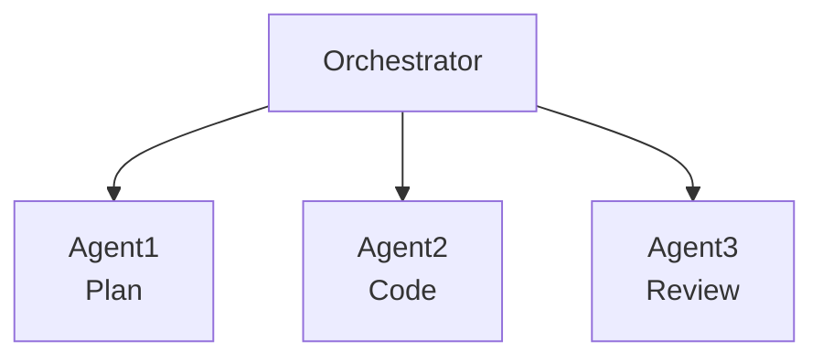
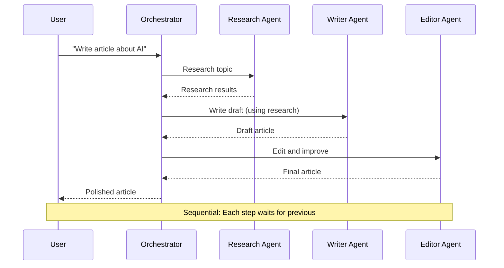
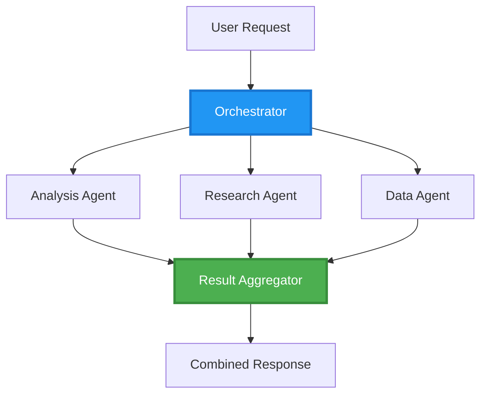
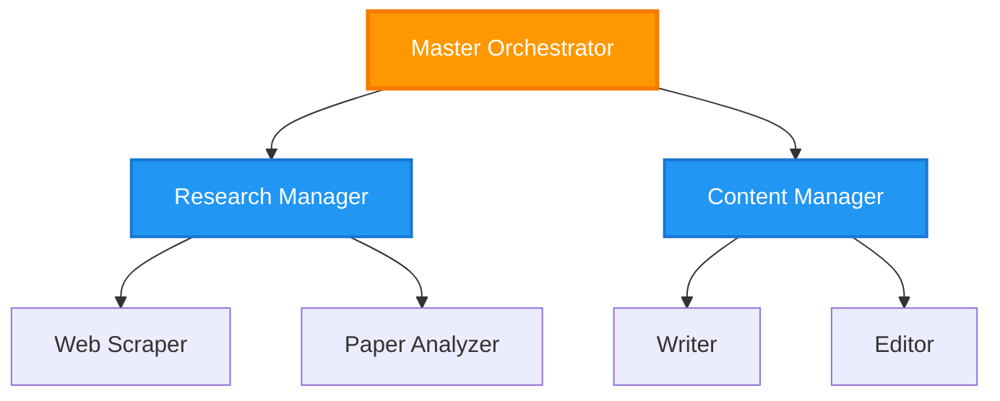
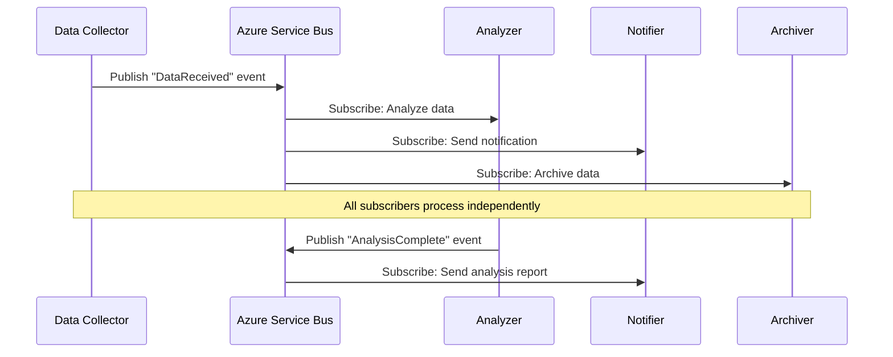
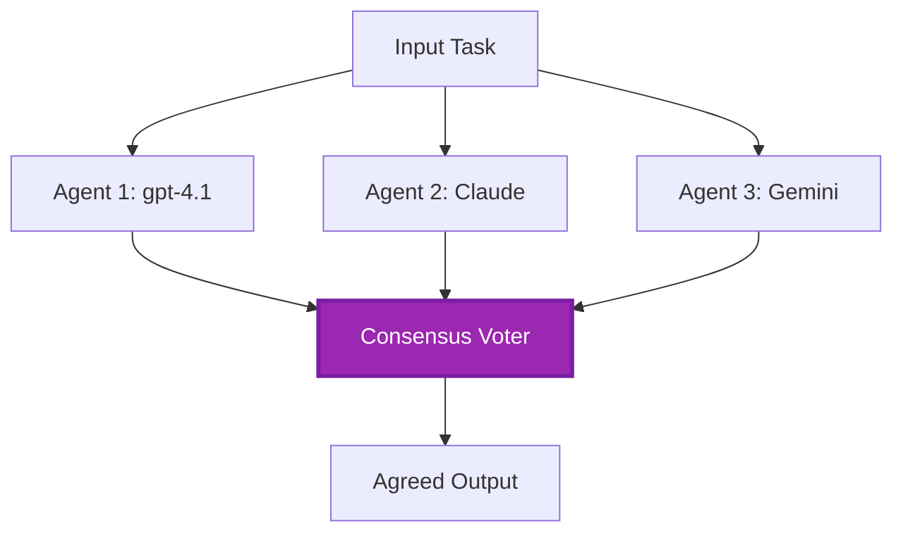
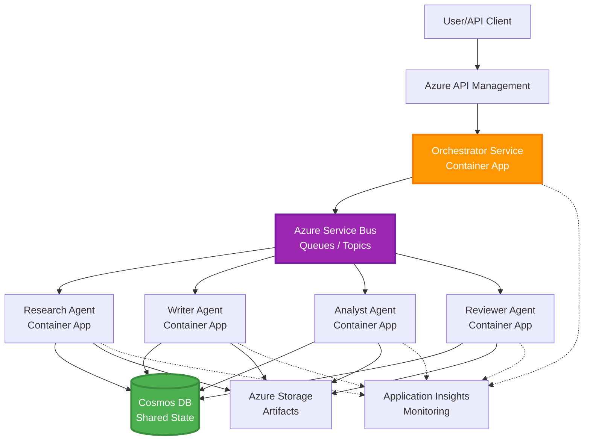

# Modèles de Coordination Multi-Agent

⏱️ **Durée estimée** : 60-75 minutes de lecture ; plusieurs heures pour l’implémentation | 💰 **Coût estimé** : dépend de la charge de travail | ⭐ **Complexité** : Avancé

**📚 Parcours d’apprentissage :**
- ← Précédent : [Planification de capacité](capacity-planning.md) - Stratégies de dimensionnement et de mise à l’échelle des ressources
- 🎯 **Vous êtes ici** : Modèles de coordination multi-agent (orchestration, communication, gestion d’état)
- → Suivant : [Sélection SKU](sku-selection.md) - Choisir les bons services Azure
- 🏠 [Accueil du cours](../../README.md)

---

## Ce que vous apprendrez

En complétant cette leçon, vous allez :
- Comprendre les **modèles d’architecture multi-agent** et quand les utiliser
- Implémenter des **modèles d’orchestration** (centralisés, décentralisés, hiérarchiques)
- Concevoir des stratégies de **communication entre agents** (synchrone, asynchrone, pilotée par événements)
- Gérer l’**état partagé** entre agents distribués
- Déployer des **systèmes multi-agents** sur Azure avec AZD
- Appliquer les **modèles de coordination** pour des scénarios AI réels
- Superviser et déboguer des systèmes d’agents distribués

## Pourquoi la coordination multi-agent est importante

### L’évolution : du simple agent au multi-agent

**Agent unique (simple) :**
```
User → Agent → Response
```
- ✅ Facile à comprendre et à implémenter
- ✅ Rapide pour les tâches simples
- ❌ Limité par les capacités d’un seul modèle
- ❌ Ne peut pas paralléliser les tâches complexes
- ❌ Pas de spécialisation

**Système multi-agent (avancé) :**

- ✅ Agents spécialisés pour des tâches spécifiques
- ✅ Exécution parallèle pour la rapidité
- ✅ Modulaire et maintenable
- ✅ Meilleur pour les flux de travail complexes
- ⚠️ Nécessite une logique de coordination

**Analogie** : Un agent unique est comme une personne qui fait toutes les tâches. Le multi-agent est comme une équipe dont chaque membre a des compétences spécialisées (chercheur, développeur, relecteur, rédacteur) travaillant ensemble.

---

## Principaux modèles de coordination

### Modèle 1 : Coordination séquentielle (Chaine de responsabilité)

**Quand l’utiliser** : Les tâches doivent s’exécuter dans un ordre spécifique, chaque agent se base sur la sortie précédente.



**Avantages :**
- ✅ Flux de données clair
- ✅ Facile à déboguer
- ✅ Ordre d’exécution prévisible

**Limitations :**
- ❌ Plus lent (pas de parallélisme)
- ❌ Une défaillance bloque toute la chaîne
- ❌ Ne peut pas gérer des tâches interdépendantes

**Exemples d’utilisation :**
- Pipeline de création de contenu (recherche → rédaction → édition → publication)
- Génération de code (plan → implémentation → test → déploiement)
- Génération de rapports (collecte de données → analyse → visualisation → résumé)

---

### Modèle 2 : Coordination parallèle (Fan-Out/Fan-In)

**Quand l’utiliser** : Les tâches indépendantes peuvent s’exécuter simultanément, les résultats sont combinés à la fin.



**Avantages :**
- ✅ Rapide (exécution parallèle)
- ✅ Tolérant aux pannes (résultats partiels acceptables)
- ✅ Mise à l’échelle horizontale

**Limitations :**
- ⚠️ Les résultats peuvent arriver dans le désordre
- ⚠️ Nécessite une logique d’agrégation
- ⚠️ Gestion d’état complexe

**Exemples d’utilisation :**
- Collecte de données multi-sources (APIs + bases de données + scraping web)
- Analyse concurrentielle (plusieurs modèles génèrent des solutions, la meilleure est sélectionnée)
- Services de traduction (traduction dans plusieurs langues simultanément)

---

### Modèle 3 : Coordination hiérarchique (Manager-Worker)

**Quand l’utiliser** : Flux de travail complexes avec sous-tâches, délégation nécessaire.



**Avantages :**
- ✅ Gère des flux de travail complexes
- ✅ Modulaire et maintenable
- ✅ Limites claires des responsabilités

**Limitations :**
- ⚠️ Architecture plus complexe
- ⚠️ Latence plus élevée (plusieurs couches de coordination)
- ⚠️ Orchestration sophistiquée requise

**Exemples d’utilisation :**
- Traitement de documents d’entreprise (classification → routage → traitement → archivage)
- Pipelines de données multi-étapes (ingestion → nettoyage → transformation → analyse → rapport)
- Flux d’automatisation complexes (planification → allocation des ressources → exécution → surveillance)

---

### Modèle 4 : Coordination pilotée par événements (Publication-Abonnement)

**Quand l’utiliser** : Les agents doivent réagir aux événements, couplage lâche souhaité.



**Avantages :**
- ✅ Faible couplage entre agents
- ✅ Facile d’ajouter de nouveaux agents (il suffit de s’abonner)
- ✅ Traitement asynchrone
- ✅ Résilient (persistance des messages)

**Limitations :**
- ⚠️ Cohérence éventuelle
- ⚠️ Débogage complexe
- ⚠️ Problèmes d’ordre des messages

**Exemples d’utilisation :**
- Systèmes de surveillance en temps réel (alertes, tableaux de bord, logs)
- Notifications multi-canaux (email, SMS, push, Slack)
- Pipelines de traitement de données (plusieurs consommateurs des mêmes données)

---

### Modèle 5 : Coordination basée sur le consensus (Vote/Quorum)

**Quand l’utiliser** : Accord requis de plusieurs agents avant de continuer.



**Avantages :**
- ✅ Précision accrue (opinions multiples)
- ✅ Tolérance aux pannes (défaillances minoritaires acceptables)
- ✅ Assurance qualité intégrée

**Limitations :**
- ❌ Coûteux (plusieurs appels modèle)
- ❌ Plus lent (attente de tous les agents)
- ⚠️ Résolution de conflits nécessaire

**Exemples d’utilisation :**
- Modération de contenu (plusieurs modèles examinent le contenu)
- Revue de code (plusieurs linters/analyseurs)
- Diagnostic médical (plusieurs modèles AI, validation experte)

---

## Vue d’ensemble de l’architecture

### Système multi-agent complet sur Azure



**Composants clés :**

| Composant | But | Service Azure |
|-----------|---------|---------------|
| **API Gateway** | Point d’entrée, limitation de débit, authentification | API Management |
| **Orchestrateur** | Coordonne les workflows des agents | Container Apps |
| **File de messages** | Communication asynchrone | Service Bus / Event Hubs |
| **Agents** | Travailleurs AI spécialisés | Container Apps / Functions |
| **Store d’état** | État partagé, suivi des tâches | Cosmos DB |
| **Stockage d’artefacts** | Documents, résultats, logs | Blob Storage |
| **Monitoring** | Tracing distribué, journaux | Application Insights |

Les files/sujets Service Bus et Event Hubs sont des services différents avec des modèles de livraison/consommation différents ; Event Hubs n’est pas un remplacement direct du code worker Service Bus ci-dessous. Le parallélisme, les messages persistants et le vote des modèles ne garantissent pas en eux-mêmes la tolérance aux pannes ou une précision supérieure.

---

## Prérequis

### Outils requis

```bash
# Verify Azure Developer CLI
azd version
# Command reference baseline: azd 1.37.2

# Verify Azure CLI
az --version
# ✅ Expected: azure-cli 2.50.0 or higher

# Verify Docker (for local testing)
docker --version
# ✅ Expected: Docker version 20.10 or higher
```

### Exigences Azure

- Une souscription Azure active
- Permissions pour créer :
  - Container Apps
  - Espaces de noms Service Bus
  - Comptes Cosmos DB
  - Comptes de stockage
  - Application Insights

### Prérequis en connaissances

Vous devriez avoir complété :
- [Gestion de configuration](../chapter-03-configuration/configuration.md)
- [Authentification & Sécurité](../chapter-03-configuration/authsecurity.md)
- [Exemple Microservices](../../../../examples/microservices)

---

## Guide d’implémentation

> **Fragments de conception, pas un laboratoire déployable :** L’arborescence du projet et les étiquettes `File:` ci-dessous décrivent les fichiers à créer dans votre propre projet ; ce dépôt ne contient pas d’application complète `multi-agent-system`. Les éléments manquants incluent les modèles main/paramètres, environnement/registre Container Apps, Dockerfiles et verrous de dépendances, configuration base de données/container Cosmos, déploiements modèles, configuration identité/rôles, règles de mise à l’échelle, et workers/queues parallèles. Ne vous attendez pas à ce qu’`azd init` génère ces fichiers ni qu’`azd up` déploie les extraits tels quels. Pour un point de départ exécutable, complétez [Notions de base multi-agent](../chapter-05-multi-agent/multi-agent-basics.md).

**Hypothèses d’exécution :** Python 3.10+, `azure-servicebus`, `azure-cosmos`, `openai`, Flask, et (pour la surveillance) `azure-monitor-opentelemetry` ; placez `shared` dans le chemin d’import Python dans chaque image de service. Le conteneur Cosmos `agent-state/tasks` doit déjà exister avec la clé de partition `/id`. Les connexions par clé simplifient ces fragments, mais ne sont pas une recommandation de production : préférez les identités managées avec des rôles data-plane Service Bus/Cosmos/OpenAI limités. Ne divulguez pas les clés dans les sorties ou les logs.

La livraison Service Bus est **au moins une fois**. Persistez l’idempotence par tâche **et étape**, utilisez la concurrence optimiste (ETags) pour lire/modifier/écrire l’état, et renouvelez les locks des messages lors de traitements longs. Le gestionnaire d’état simple ci-dessous est uniquement séquentiel et n’implémente pas ces garanties de production.

### Structure du projet

```
multi-agent-system/
├── azure.yaml                    # AZD configuration
├── infra/
│   ├── main.bicep               # Main infrastructure
│   ├── core/
│   │   ├── servicebus.bicep     # Message queue
│   │   ├── cosmos.bicep         # State store
│   │   ├── storage.bicep        # Artifact storage
│   │   └── monitoring.bicep     # Application Insights
│   └── app/
│       ├── orchestrator.bicep   # Orchestrator service
│       └── agent.bicep          # Agent template
└── src/
    ├── orchestrator/            # Orchestration logic
    │   ├── app.py
    │   ├── workflows.py
    │   └── Dockerfile
    ├── agents/
    │   ├── research/            # Research agent
    │   ├── writer/              # Writer agent
    │   ├── analyst/             # Analyst agent
    │   └── reviewer/            # Reviewer agent
    └── shared/
        ├── state_manager.py     # Shared state logic
        └── message_handler.py   # Message handling
```

---

## Leçon 1 : Modèle de coordination séquentielle

### Implémentation : Pipeline de création de contenu

Concevons un pipeline séquentiel : Recherche → Rédaction → Édition. La publication est hors de cet exemple.

### 1. Configuration AZD

**Fichier : `azure.yaml`**

```yaml
name: content-pipeline
metadata:
  template: multi-agent-sequential@1.0.0

services:
  orchestrator:
    project: ./src/orchestrator
    language: python
    host: containerapp
  
  research-agent:
    project: ./src/agents/research
    language: python
    host: containerapp
  
  writer-agent:
    project: ./src/agents/writer
    language: python
    host: containerapp
  
  editor-agent:
    project: ./src/agents/editor
    language: python
    host: containerapp
```

### 2. Infrastructure : Service Bus pour coordination

**Fichier : `infra/core/servicebus.bicep`**

```bicep
param name string
param location string
param tags object = {}

resource serviceBusNamespace 'Microsoft.ServiceBus/namespaces@2022-10-01-preview' = {
  name: name
  location: location
  tags: tags
  sku: {
    name: 'Standard'
    tier: 'Standard'
  }
  properties: {
    minimumTlsVersion: '1.2'
  }
}

// Queue for orchestrator → research agent
resource researchQueue 'Microsoft.ServiceBus/namespaces/queues@2022-10-01-preview' = {
  parent: serviceBusNamespace
  name: 'research-tasks'
  properties: {
    maxDeliveryCount: 3
    lockDuration: 'PT5M'
    deadLetteringOnMessageExpiration: true
  }
}

// Queue for research agent → writer agent
resource writerQueue 'Microsoft.ServiceBus/namespaces/queues@2022-10-01-preview' = {
  parent: serviceBusNamespace
  name: 'writer-tasks'
  properties: {
    maxDeliveryCount: 3
    lockDuration: 'PT5M'
  }
}

// Queue for writer agent → editor agent
resource editorQueue 'Microsoft.ServiceBus/namespaces/queues@2022-10-01-preview' = {
  parent: serviceBusNamespace
  name: 'editor-tasks'
  properties: {
    maxDeliveryCount: 3
    lockDuration: 'PT5M'
  }
}

output namespace string = serviceBusNamespace.name
// Do not output RootManageSharedAccessKey. Resolve scoped credentials
// securely or use managed identity in the application and scale rules.
```

### 3. Gestionnaire d’état partagé

**Fichier : `src/shared/state_manager.py`**

```python
from azure.cosmos import CosmosClient, PartitionKey
from datetime import datetime, timezone
import os

class StateManager:
    """Manages shared state across agents using Cosmos DB"""
    
    def __init__(self):
        endpoint = os.environ['COSMOS_ENDPOINT']
        key = os.environ['COSMOS_KEY']
        
        self.client = CosmosClient(endpoint, key)
        self.database = self.client.get_database_client('agent-state')
        self.container = self.database.get_container_client('tasks')
    
    def create_task(self, task_id: str, task_type: str, input_data: dict):
        """Create a new task"""
        task = {
            'id': task_id,
            'type': task_type,
            'status': 'pending',
            'input': input_data,
            'created_at': datetime.now(timezone.utc).isoformat(),
            'steps': []
        }
        self.container.create_item(task)
        return task
    
    def update_task_step(self, task_id: str, step_name: str, result: dict):
        """Update task with completed step"""
        task = self.container.read_item(task_id, partition_key=task_id)
        
        task['steps'].append({
            'name': step_name,
            'completed_at': datetime.now(timezone.utc).isoformat(),
            'result': result
        })
        
        self.container.replace_item(task_id, task)
        return task
    
    def complete_task(self, task_id: str, final_result: dict):
        """Mark task as complete"""
        task = self.container.read_item(task_id, partition_key=task_id)
        task['status'] = 'completed'
        task['result'] = final_result
        task['completed_at'] = datetime.now(timezone.utc).isoformat()
        self.container.replace_item(task_id, task)
        return task
    
    def get_task(self, task_id: str):
        """Retrieve task state"""
        return self.container.read_item(task_id, partition_key=task_id)
```

### 4. Service Orchestrateur

**Fichier : `src/orchestrator/app.py`**

```python
from flask import Flask, request, jsonify
from azure.servicebus import ServiceBusClient, ServiceBusMessage
import json
import uuid
import os
from shared.state_manager import StateManager

app = Flask(__name__)
state_manager = StateManager()

# Service Bus connection
servicebus_connection_str = os.environ['SERVICEBUS_CONNECTION_STRING']
servicebus_client = ServiceBusClient.from_connection_string(servicebus_connection_str)

@app.route('/health', methods=['GET'])
def health():
    return jsonify({'status': 'healthy', 'service': 'orchestrator'})

@app.route('/create-content', methods=['POST'])
def create_content():
    """
    Sequential workflow: Research → Write → Edit (returns a draft; no publishing)
    """
    data = request.get_json(silent=True) or {}
    topic = data.get('topic')
    
    if not topic:
        return jsonify({'error': 'Topic required'}), 400
    
    # Create task in state store
    task_id = str(uuid.uuid4())
    task = state_manager.create_task(
        task_id=task_id,
        task_type='content_creation',
        input_data={'topic': topic}
    )
    
    # Send message to research agent (first step)
    sender = servicebus_client.get_queue_sender('research-tasks')
    message = ServiceBusMessage(
        body=json.dumps({
            'task_id': task_id,
            'topic': topic,
            'next_queue': 'writer-tasks'  # Where to send results
        }),
        content_type='application/json'
    )
    
    with sender:
        sender.send_messages(message)
    
    return jsonify({
        'task_id': task_id,
        'status': 'started',
        'workflow': 'sequential',
        'steps': ['research', 'write', 'edit'],
        'message': 'Content creation pipeline initiated'
    }), 202

@app.route('/task/<task_id>', methods=['GET'])
def get_task_status(task_id):
    """Check task status"""
    try:
        task = state_manager.get_task(task_id)
        return jsonify(task)
    except Exception as e:
        return jsonify({'error': str(e)}), 404

if __name__ == '__main__':
    app.run(host='0.0.0.0', port=8080)
```

### 5. Agent Chercheur

**Fichier : `src/agents/research/app.py`**

```python
from azure.servicebus import ServiceBusClient, ServiceBusMessage
from openai import AzureOpenAI
import json
import os
import time
from shared.state_manager import StateManager

# Initialize clients
state_manager = StateManager()
servicebus_client = ServiceBusClient.from_connection_string(
    os.environ['SERVICEBUS_CONNECTION_STRING']
)

openai_client = AzureOpenAI(
    api_key=os.environ['AZURE_OPENAI_API_KEY'],
    api_version="2024-10-21",
    azure_endpoint=os.environ['AZURE_OPENAI_ENDPOINT']
)

def process_research_task(message_data):
    """Process research request and pass to writer"""
    task_id = message_data['task_id']
    topic = message_data['topic']
    next_queue = message_data['next_queue']
    
    print(f"🔬 Researching: {topic}")
    
    # Call Microsoft Foundry Models for research
    response = openai_client.chat.completions.create(
        model=os.environ['AZURE_OPENAI_DEPLOYMENT'],
        messages=[
            {"role": "system", "content": "You are a research assistant. Provide comprehensive research on the given topic."},
            {"role": "user", "content": f"Research this topic thoroughly: {topic}"}
        ],
        max_tokens=1500
    )
    
    research_results = response.choices[0].message.content
    
    # Update state
    state_manager.update_task_step(
        task_id=task_id,
        step_name='research',
        result={'research': research_results}
    )
    
    # Send to next agent (writer)
    sender = servicebus_client.get_queue_sender(next_queue)
    message = ServiceBusMessage(
        body=json.dumps({
            'task_id': task_id,
            'topic': topic,
            'research': research_results,
            'next_queue': 'editor-tasks'
        }),
        content_type='application/json'
    )
    
    with sender:
        sender.send_messages(message)
    
    print(f"✅ Research complete for task {task_id}")

def main():
    """Listen to research queue"""
    receiver = servicebus_client.get_queue_receiver('research-tasks')
    
    print("🔬 Research Agent started, listening for tasks...")
    
    with receiver:
        while True:
            messages = receiver.receive_messages(max_wait_time=5)
            for message in messages:
                try:
                    message_data = json.loads(str(message))
                    process_research_task(message_data)
                    receiver.complete_message(message)
                except Exception as e:
                    print(f"❌ Error processing message: {e}")
                    receiver.abandon_message(message)

if __name__ == '__main__':
    main()
```

### 6. Agent Rédacteur

**Fichier : `src/agents/writer/app.py`**

```python
from azure.servicebus import ServiceBusClient, ServiceBusMessage
from openai import AzureOpenAI
import json
import os
from shared.state_manager import StateManager

state_manager = StateManager()
servicebus_client = ServiceBusClient.from_connection_string(
    os.environ['SERVICEBUS_CONNECTION_STRING']
)

openai_client = AzureOpenAI(
    api_key=os.environ['AZURE_OPENAI_API_KEY'],
    api_version="2024-10-21",
    azure_endpoint=os.environ['AZURE_OPENAI_ENDPOINT']
)

def process_writing_task(message_data):
    """Write article based on research"""
    task_id = message_data['task_id']
    topic = message_data['topic']
    research = message_data['research']
    next_queue = message_data['next_queue']
    
    print(f"✍️ Writing article: {topic}")
    
    # Call Microsoft Foundry Models to write article
    response = openai_client.chat.completions.create(
        model=os.environ['AZURE_OPENAI_DEPLOYMENT'],
        messages=[
            {"role": "system", "content": "You are a professional writer. Write engaging, well-structured articles."},
            {"role": "user", "content": f"Based on this research:\n\n{research}\n\nWrite a comprehensive article about: {topic}"}
        ],
        max_tokens=2000
    )
    
    article_draft = response.choices[0].message.content
    
    # Update state
    state_manager.update_task_step(
        task_id=task_id,
        step_name='writing',
        result={'draft': article_draft}
    )
    
    # Send to editor
    sender = servicebus_client.get_queue_sender(next_queue)
    message = ServiceBusMessage(
        body=json.dumps({
            'task_id': task_id,
            'topic': topic,
            'draft': article_draft
        }),
        content_type='application/json'
    )
    
    with sender:
        sender.send_messages(message)
    
    print(f"✅ Article draft complete for task {task_id}")

def main():
    """Listen to writer queue"""
    receiver = servicebus_client.get_queue_receiver('writer-tasks')
    
    print("✍️ Writer Agent started, listening for tasks...")
    
    with receiver:
        while True:
            messages = receiver.receive_messages(max_wait_time=5)
            for message in messages:
                try:
                    message_data = json.loads(str(message))
                    process_writing_task(message_data)
                    receiver.complete_message(message)
                except Exception as e:
                    print(f"❌ Error: {e}")
                    receiver.abandon_message(message)

if __name__ == '__main__':
    main()
```

### 7. Agent Éditeur

**Fichier : `src/agents/editor/app.py`**

```python
from azure.servicebus import ServiceBusClient
from openai import AzureOpenAI
import json
import os
from shared.state_manager import StateManager

state_manager = StateManager()
servicebus_client = ServiceBusClient.from_connection_string(
    os.environ['SERVICEBUS_CONNECTION_STRING']
)

openai_client = AzureOpenAI(
    api_key=os.environ['AZURE_OPENAI_API_KEY'],
    api_version="2024-10-21",
    azure_endpoint=os.environ['AZURE_OPENAI_ENDPOINT']
)

def process_editing_task(message_data):
    """Edit and finalize article"""
    task_id = message_data['task_id']
    topic = message_data['topic']
    draft = message_data['draft']
    
    print(f"📝 Editing article: {topic}")
    
    # Call Microsoft Foundry Models to edit
    response = openai_client.chat.completions.create(
        model=os.environ['AZURE_OPENAI_DEPLOYMENT'],
        messages=[
            {"role": "system", "content": "You are an expert editor. Improve grammar, clarity, and structure."},
            {"role": "user", "content": f"Edit and improve this article:\n\n{draft}"}
        ],
        max_tokens=2000
    )
    
    final_article = response.choices[0].message.content
    
    # Mark task as complete
    state_manager.complete_task(
        task_id=task_id,
        final_result={
            'topic': topic,
            'final_article': final_article,
            'word_count': len(final_article.split())
        }
    )
    
    print(f"✅ Article finalized for task {task_id}")

def main():
    """Listen to editor queue"""
    receiver = servicebus_client.get_queue_receiver('editor-tasks')
    
    print("📝 Editor Agent started, listening for tasks...")
    
    with receiver:
        while True:
            messages = receiver.receive_messages(max_wait_time=5)
            for message in messages:
                try:
                    message_data = json.loads(str(message))
                    process_editing_task(message_data)
                    receiver.complete_message(message)
                except Exception as e:
                    print(f"❌ Error: {e}")
                    receiver.abandon_message(message)

if __name__ == '__main__':
    main()
```

### 8. Déploiement et test

Ces commandes s’appliquent **seulement après avoir implémenté les fichiers manquants du projet**. L’initialisation interactive des agents Foundry est un workflow séparé ; elle ne génère pas cette conception Service Bus.

```bash
# In your completed custom project
azd up

# Alternative in a SEPARATE empty folder (agents beta.23 requires azd >= 1.37)
azd extension install azure.ai.agents
azd ai agent init
azd up
```

> Voir [Commandes AZD AI CLI](../chapter-08-production/production-ai-practices.md#azd-ai-cli-commands-and-extensions) pour tous les flags et options `azd ai`.

```bash
# Get orchestrator URL
ORCHESTRATOR_URL=$(azd env get-values | grep ORCHESTRATOR_URL | cut -d '=' -f2 | tr -d '"')

# Create content
curl -X POST $ORCHESTRATOR_URL/create-content \
  -H "Content-Type: application/json" \
  -d '{"topic": "The Future of AI in Healthcare"}'
```

**✅ Sortie attendue :**
```json
{
  "task_id": "a1b2c3d4-e5f6-7890-abcd-ef1234567890",
  "status": "started",
  "workflow": "sequential",
  "steps": ["research", "write", "edit"],
  "message": "Content creation pipeline initiated"
}
```

**Vérifier la progression de la tâche :**
```bash
TASK_ID="a1b2c3d4-e5f6-7890-abcd-ef1234567890"
curl $ORCHESTRATOR_URL/task/$TASK_ID
```

**✅ Sortie attendue (terminé) :**
```json
{
  "id": "a1b2c3d4-e5f6-7890-abcd-ef1234567890",
  "type": "content_creation",
  "status": "completed",
  "steps": [
    {
      "name": "research",
      "completed_at": "2025-11-19T10:30:00Z",
      "result": {"research": "..."}
    },
    {
      "name": "writing",
      "completed_at": "2025-11-19T10:32:00Z",
      "result": {"draft": "..."}
    }
  ],
  "result": {
    "topic": "The Future of AI in Healthcare",
    "final_article": "...",
    "word_count": 1500
  }
}
```

---

## Leçon 2 : Modèle de coordination parallèle

### Implémentation : Agrégateur de recherche multi-source

Construisons un système parallèle qui collecte des informations de plusieurs sources simultanément.

### Orchestrateur parallèle

**Fichier : `src/orchestrator/parallel_workflow.py`**

```python
from flask import Flask, request, jsonify
from azure.servicebus import ServiceBusClient, ServiceBusMessage
import json
import uuid
import os
from shared.state_manager import StateManager

app = Flask(__name__)
state_manager = StateManager()

servicebus_client = ServiceBusClient.from_connection_string(
    os.environ['SERVICEBUS_CONNECTION_STRING']
)

@app.route('/research-parallel', methods=['POST'])
def research_parallel():
    """
    Parallel workflow: Multiple agents work simultaneously
    """
    data = request.json
    query = data.get('query')
    
    task_id = str(uuid.uuid4())
    task = state_manager.create_task(
        task_id=task_id,
        task_type='parallel_research',
        input_data={
            'query': query,
            'agents': ['web', 'academic', 'news', 'social']
        }
    )
    
    # Fan-out: publish sequentially; workers may process concurrently.
    agents = [
        ('web-research-queue', 'web'),
        ('academic-research-queue', 'academic'),
        ('news-research-queue', 'news'),
        ('social-research-queue', 'social')
    ]
    
    for queue_name, agent_type in agents:
        sender = servicebus_client.get_queue_sender(queue_name)
        message = ServiceBusMessage(
            body=json.dumps({
                'task_id': task_id,
                'query': query,
                'agent_type': agent_type,
                'result_queue': 'aggregation-queue'
            }),
            content_type='application/json'
        )
        
        with sender:
            sender.send_messages(message)
    
    return jsonify({
        'task_id': task_id,
        'status': 'started',
        'workflow': 'parallel',
        'agents_dispatched': 4,
        'message': 'Parallel research initiated'
    }), 202

if __name__ == '__main__':
    app.run(host='0.0.0.0', port=8080)
```

### Logique d’agrégation

**Fichier : `src/agents/aggregator/app.py`**

```python
from azure.servicebus import ServiceBusClient
import json
import os
from collections import defaultdict
from shared.state_manager import StateManager

state_manager = StateManager()
servicebus_client = ServiceBusClient.from_connection_string(
    os.environ['SERVICEBUS_CONNECTION_STRING']
)

# Single-process demo only: not durable or shared across replicas.
# Production: use durable unique (task_id, agent_type) result records.
task_results = defaultdict(dict)
expected_agents = 4  # web, academic, news, social

def process_result(message_data):
    """Aggregate results from parallel agents"""
    task_id = message_data['task_id']
    agent_type = message_data['agent_type']
    result = message_data['result']
    
    # Store result
    task_results[task_id][agent_type] = {
        'agent': agent_type,
        'data': result
    }
    
    print(f"📊 Received result from {agent_type} agent ({len(task_results[task_id])}/{expected_agents})")
    
    # Check if all agents completed (fan-in)
    if len(task_results[task_id]) == expected_agents:
        print(f"✅ All agents completed for task {task_id}. Aggregating...")
        
        # Combine results
        aggregated = {
            'query': message_data['query'],
            'sources': list(task_results[task_id].values()),
            'summary': generate_summary(list(task_results[task_id].values()))
        }
        
        # Mark complete
        state_manager.complete_task(task_id, aggregated)
        
        # Clean up
        del task_results[task_id]
        
        print(f"✅ Aggregation complete for task {task_id}")

def generate_summary(results):
    """Generate summary from all sources"""
    summaries = [r['data'].get('summary', '') for r in results]
    return '\n\n'.join(summaries)

def main():
    """Listen to aggregation queue"""
    receiver = servicebus_client.get_queue_receiver('aggregation-queue')
    
    print("📊 Aggregator started, listening for results...")
    
    with receiver:
        while True:
            messages = receiver.receive_messages(max_wait_time=5)
            for message in messages:
                try:
                    message_data = json.loads(str(message))
                    process_result(message_data)
                    receiver.complete_message(message)
                except Exception as e:
                    print(f"❌ Error: {e}")
                    receiver.abandon_message(message)

if __name__ == '__main__':
    main()
```

**Avantages du modèle parallèle :**
- ⚡ **Latence potentiellement plus faible** (limitée par l’agent le plus lent plus les frais de coordination)
- 🔄 **Peut accepter des résultats partiels** avec des délais explicites et politique d’échec (non implémenté par l’agrégateur de base)
- 📈 **Scalable** (ajout facile d’agents)

---

## Exercices pratiques

### Exercice 1 : Ajouter la gestion des délais ⭐⭐ (Moyen)

**Objectif** : Implémenter une logique de timeout pour que l’agrégateur n’attende pas indéfiniment les agents lents.

**Point de départ :** Exécutez cette simulation locale de délai avant de l’intégrer dans un worker de queue. Un timeout vérifié uniquement à l’arrivée d’un autre message ne se déclenche jamais si l’agent manquant n’envoie rien.

**Étapes** :

1. **Ajouter le suivi du timeout dans l’agrégateur :**

```python
import asyncio

async def simulated_agent(name, delay):
    await asyncio.sleep(delay)
    return {'agent': name, 'result': 'done'}

async def main():
    tasks = [asyncio.create_task(simulated_agent(name, delay))
             for name, delay in [('web', 0.1), ('academic', 0.2),
                                 ('news', 0.3), ('social', 3)]]
    done, pending = await asyncio.wait(tasks, timeout=1)
    results = [task.result() for task in done]
    for task in pending:
        task.cancel()
    await asyncio.gather(*pending, return_exceptions=True)
    print({'completed_agents': len(results), 'timed_out': bool(pending)})
    assert len(results) == 3 and pending

asyncio.run(main())
```

2. **Sortie attendue :**

```text
{'completed_agents': 3, 'timed_out': True}
```

3. **Intégration système de queue (tâche de conception) :** Persister la date limite d’envoi et les agents attendus à la création de la tâche, exécuter une passe périodique de contrôle des délais indépendante des résultats entrants, finaliser atomiquement les résultats partiels, et ignorer les messages tardifs/dupliqués pour les tâches finalisées. Un timeout local ne cancel pas les workers distants.

Pour votre projet implémenté uniquement :

```bash
azd deploy aggregator

# Submit task
curl -X POST $ORCHESTRATOR_URL/research-parallel \
  -H "Content-Type: application/json" \
  -d '{"query": "AI safety research"}'

# Check results after 30 seconds
curl $ORCHESTRATOR_URL/task/$TASK_ID
```

**✅ Critères de succès :**
- ✅ Le test local retourne après sa deadline d’une seconde même si un agent est incomplet
- ✅ La réponse indique des résultats partiels (`"timed_out": true`)
- ✅ Les résultats disponibles sont renvoyés (3 agents sur 4)

**Durée** : 20-25 minutes

---

### Exercice 2 : Implémenter une logique de réessai ⭐⭐⭐ (Avancé)

**Objectif** : Réessayer automatiquement les tâches des agents échoués avant d’abandonner.

**Étapes** :

1. **Utiliser les compteurs de livraison Service Bus plutôt que des compteurs de réessai personnalisés dans la queue :**

```python
import json
import time
# Integration fragment: use a live peek-lock ServiceBusReceiver.
# Set queue maxDeliveryCount to 4 for one attempt + up to three retries.
```

2. **Ajouter un gestionnaire de réessai aux agents :**

```python
def process_with_retry(message, receiver, process_func):
    """Process message with automatic retry on failure"""
    try:
        message_data = json.loads(str(message))
        
        # Process the message
        process_func(message_data)
        
        # Success - complete
        receiver.complete_message(message)
        
    except Exception as e:
        if message.delivery_count < 4:
            # Bounded exponential delay: 5s, 10s, 20s.
            # Renew the lock if processing + waiting can exceed its duration.
            time.sleep(5 * 2 ** (message.delivery_count - 1))
            receiver.abandon_message(message)
        else:
            # Max retries exceeded - move to dead letter queue
            print(f"❌ Max attempts exceeded for message {message.message_id}")
            receiver.dead_letter_message(
                message,
                reason="MaxRetriesExceeded",
                error_description=str(e)
            )
```

3. **Surveiller la dead letter queue :**

```python
def monitor_dead_letters():
    """Check dead letter queue for failed messages"""
    receiver = servicebus_client.get_queue_receiver(
        'research-tasks',
        sub_queue='deadletter'
    )
    
    with receiver:
        messages = receiver.receive_messages(max_wait_time=5)
        for message in messages:
            print(f"☠️ Dead letter: {message.message_id}")
            print(f"Reason: {message.dead_letter_reason}")
            print(f"Description: {message.dead_letter_error_description}")
```

**✅ Critères de succès :**
- ✅ Les tâches échouées sont réessayées automatiquement (jusqu’à 3 fois)
- ✅ Récupération exponentielle entre réessais (5s, 10s, 20s), avec renouvellement des locks de messages si nécessaire
- ✅ Après le nombre maximal de réessais, les messages vont en dead letter queue
- ✅ Les messages de dead letter peuvent être inspectés ; le rejeu nécessite un workflow de récupération idempotent distinct

**Durée** : 30-40 minutes

---

### Exercice 3 : Implémenter un disjoncteur (circuit breaker) ⭐⭐⭐ (Avancé)

**Objectif** : Empêcher les échecs en cascade en bloquant les requêtes vers des agents défaillants.

**Étapes** :

1. **Créer une classe disjoncteur :**

```python
from enum import Enum
from datetime import datetime, timedelta, timezone

class CircuitState(Enum):
    CLOSED = "closed"      # Normal operation
    OPEN = "open"          # Failing, reject requests
    HALF_OPEN = "half_open"  # Testing if recovered

class CircuitBreaker:
    def __init__(self, failure_threshold=5, timeout_seconds=60):
        self.failure_threshold = failure_threshold
        self.timeout_seconds = timeout_seconds
        self.failure_count = 0
        self.last_failure_time = None
        self.state = CircuitState.CLOSED
    
    def call(self, func):
        """Execute function with circuit breaker protection"""
        if self.state == CircuitState.OPEN:
            # Check if timeout expired
            if datetime.now(timezone.utc) - self.last_failure_time > timedelta(seconds=self.timeout_seconds):
                self.state = CircuitState.HALF_OPEN
                print("🔄 Circuit breaker: HALF_OPEN (testing)")
            else:
                raise Exception(f"Circuit breaker OPEN for agent. Try again in {self.timeout_seconds}s")
        
        try:
            result = func()
            
            # Success
            self.failure_count = 0 # Count consecutive failures only
            if self.state == CircuitState.HALF_OPEN:
                self.state = CircuitState.CLOSED
                self.failure_count = 0
                print("✅ Circuit breaker: CLOSED (recovered)")
            
            return result
            
        except Exception as e:
            self.failure_count += 1
            self.last_failure_time = datetime.now(timezone.utc)
            
            if self.failure_count >= self.failure_threshold:
                self.state = CircuitState.OPEN
                print(f"🔴 Circuit breaker: OPEN (too many failures)")
            
            raise
```

2. **Appliquer aux appels des agents :**

```python
# In orchestrator
agent_circuits = {
    'web': CircuitBreaker(failure_threshold=5, timeout_seconds=60),
    'academic': CircuitBreaker(failure_threshold=5, timeout_seconds=60),
    'news': CircuitBreaker(failure_threshold=5, timeout_seconds=60),
    'social': CircuitBreaker(failure_threshold=5, timeout_seconds=60)
}

def send_to_agent(agent_type, message_data):
    """Send with circuit breaker protection"""
    circuit = agent_circuits[agent_type]
    
    try:
        circuit.call(lambda: send_message(agent_type, message_data))
    except Exception as e:
        print(f"⚠️ Skipping {agent_type} agent: {e}")
        # Continue with other agents
```

Ce circuit protège l'**opération d'envoi**, pas la complétion par le travailleur distant : réussir à mettre un message en file d'attente ne garantit rien quant à savoir si un agent est actif. `send_message` est la fonction d'envoi de votre application. Pour les circuits d'exécution, alimentez les échecs/deadline de tâche observés dans un coordinateur durable. Cette classe en mémoire est une démonstration monocœur, pas un disjoncteur distribué.

3. **Tester le disjoncteur localement :**

```python
# Run after the class definition; no Azure changes required.
circuit = CircuitBreaker(failure_threshold=5, timeout_seconds=0)
def fail():
    raise RuntimeError("simulated failure")
for _ in range(5):
    try:
        circuit.call(fail)
    except RuntimeError:
        pass
assert circuit.state == CircuitState.OPEN
assert circuit.call(lambda: "recovered") == "recovered"
assert circuit.state == CircuitState.CLOSED
print("Circuit breaker recovery verified")
```

**✅ Critères de réussite :**
- ✅ Après 5 échecs, le circuit s'ouvre (rejette les requêtes)
- ✅ Après 60 secondes, le circuit passe en semi-ouvert (teste la récupération)
- ✅ Les autres agents continuent à fonctionner normalement
- ✅ Le circuit se referme automatiquement lorsque l'agent récupère

**Temps** : 40-50 minutes

---

## Surveillance et Débogage

### Tracing distribué avec Application Insights

**Fichier : `src/shared/tracing.py`**

```python
from azure.monitor.opentelemetry import configure_azure_monitor
from opentelemetry import trace
from opentelemetry.trace import SpanKind
import logging
import os

connection_string = os.environ.get('APPLICATIONINSIGHTS_CONNECTION_STRING')

# Configure once per process. Message send/receive trace-context propagation
# and agent attributes on exceptions need explicit instrumentation.
if connection_string:
    configure_azure_monitor(connection_string=connection_string, logger_name=__name__)
tracer = trace.get_tracer(__name__)

# Configure logging
logger = logging.getLogger(__name__)
logger.setLevel(logging.INFO)

def trace_agent_call(agent_name, task_id, operation_name, operation):
    """Trace agent operations"""
    with tracer.start_as_current_span(f'agent.{agent_name}.{operation_name}', kind=SpanKind.CLIENT) as span:
        span.set_attribute('agent', agent_name)
        span.set_attribute('task_id', task_id)
        span.set_attribute('operation', operation_name)
        
        try:
            result = operation()
            span.set_attribute('status', 'success')
            logger.info('Agent operation completed', extra={
                'agent': agent_name, 'task_id': task_id, 'operation': operation_name
            })
            return result
        except Exception as e:
            span.set_attribute('status', 'error')
            logger.exception('Agent operation failed', extra={
                'agent': agent_name, 'task_id': task_id, 'operation': operation_name
            })
            raise
```

### Requêtes Application Insights

**Suivre les workflows multi-agents :**

```kusto
// Trace complete workflow for a task
traces
| where customDimensions.task_id == "a1b2c3d4-..."
| project timestamp, message, customDimensions.agent, customDimensions.operation
| order by timestamp asc
```

**Comparaison de performance des agents :**

```kusto
// Compare agent execution times
dependencies
| where name contains "agent"
| summarize 
    avg_duration = avg(duration),
    p95_duration = percentile(duration, 95),
    count = count()
  by agent = tostring(customDimensions.agent)
| order by avg_duration desc
```

**Analyse des échecs :**

```kusto
// Find which agents fail most
exceptions
| where customDimensions.agent != ""
| summarize 
    failure_count = count(),
    unique_errors = dcount(outerMessage)
  by agent = tostring(customDimensions.agent)
| order by failure_count desc
```

---

## Analyse des Coûts

### Coûts du système multi-agents (estimations mensuelles)

Chiffres de planification illustratifs uniquement, pas de devis : la somme ci-dessous est **240-565 $/mois**. Vérifiez les tarifs régionaux actuels, les heures actives/inactives des réplicas, le mix jetons d'entrée/sortie, le stockage et la télémétrie. Serverless n'a pas de débit provisionné minimum mais facture toujours les requêtes et le stockage.

| Composant | Configuration | Coût |
|-----------|--------------|------|
| **Orchestrateur** | 1 Container App (1 vCPU, 2GB) | 30-50 $ |
| **4 Agents** | 4 Container Apps (0,5 vCPU, 1GB chacune) | 60-120 $ |
| **Service Bus** | Niveau Standard, 10M messages | 10-20 $ |
| **Cosmos DB** | Serverless, stockage 5GB, 1M RUs | 25-50 $ |
| **Blob Storage** | Stockage 10GB, 100K opérations | 5-10 $ |
| **Application Insights** | 5GB ingestion | 10-15 $ |
| **Microsoft Foundry Models** | gpt-4.1, 10M jetons | 100-300 $ |
| **Total** | | **240-565 $/mois** |

### Stratégies d'optimisation des coûts

1. **Utiliser le serverless autant que possible :**
   ```bicep
   // Cosmos DB serverless (no minimum cost)
   properties: {
     databaseAccountOfferType: 'Standard'
     capabilities: [{ name: 'EnableServerless' }]
   }
   ```

2. **Réduire les agents à zéro quand ils sont inactifs :**
   ```bicep
   scale: {
     minReplicas: 0  // Requires a Service Bus/KEDA scale rule to wake workers
     maxReplicas: 10
   }
   ```

3. **Utiliser le batching pour Service Bus :**
   ```python
   # Send messages in batches (cheaper)
   sender.send_messages([message1, message2, message3])
   ```

4. **Mettre en cache les résultats fréquemment utilisés :**
   ```python
   # Use Azure Cache for Redis
   if cache.exists(query_hash):
       return cache.get(query_hash)
   ```

---

## Bonnes Pratiques

### ✅ À FAIRE :

1. **Utiliser des opérations idempotentes**
   ```python
   # Pseudocode: implement a durable, atomic per-step deduplication claim.
   def process_task(task_id):
       raise NotImplementedError("Claim (task_id, step) atomically, execute, persist outcome")
   ```

2. **Mettre en place une journalisation complète**
   ```python
   logger.info(f"Agent: {agent_name}, Task: {task_id}, Action: {action}")
   ```

3. **Utiliser des identifiants de corrélation**
   ```python
   # Pass task_id through entire workflow
   message_data = {
       'task_id': task_id,  # Correlation ID
       'timestamp': datetime.utcnow().isoformat()
   }
   ```

4. **Définir un TTL des messages (temps de vie)**
   ```bicep
   properties: {
     defaultMessageTimeToLive: 'PT1H'  // 1 hour max
   }
   ```

5. **Surveiller les dead letter queues**
   ```python
   # Regular monitoring of failed messages
   monitor_dead_letters()
   ```

### ❌ À NE PAS FAIRE :

1. **Ne pas créer de dépendances circulaires**
   ```python
   # ❌ BAD: Agent A → Agent B → Agent A (infinite loop)
   # ✅ GOOD: Define clear directed acyclic graph (DAG)
   ```

2. **Ne pas bloquer les threads des agents**
   ```python
   # ❌ BAD: Synchronous wait
   while not task_complete:
       time.sleep(1)
   
   # ✅ GOOD: Use message queue callbacks
   ```

3. **Ne pas ignorer les échecs partiels**
   ```python
   # ❌ BAD: Fail entire workflow if one agent fails
   # ✅ GOOD: Return partial results with error indicators
   ```

4. **Ne pas utiliser des tentatives infinies**
   ```python
   # ❌ BAD: retry forever
   # ✅ GOOD: max_retries = 3, then dead letter
   ```

---

## Guide de Dépannage

### Problème : Messages bloqués dans la file

**Symptômes :**
- Messages s'accumulent dans la file
- Les agents ne traitent pas
- Statut de la tâche bloqué sur "en attente"

**Diagnostic :**
```bash
# Check queue depth
az servicebus queue show \
  --resource-group "$RG_NAME" \
  --namespace-name mybus \
  --name research-tasks \
  --query "countDetails"

# Check agent logs using Azure CLI
az containerapp logs show --name research-agent --resource-group $RG_NAME --tail 50
```

**Solutions :**

1. **Augmenter les réplicas d'agents :**
   ```bash
   az containerapp update \
     --resource-group "$RG_NAME" \
     --name research-agent \
     --min-replicas 3 \
     --max-replicas 10
   ```

2. **Vérifier la dead letter queue :**
   ```bash
   az servicebus queue show \
     --resource-group "$RG_NAME" \
     --namespace-name mybus \
     --name research-tasks \
     --query "countDetails.deadLetterMessageCount"
   ```

---

### Problème : Timeout de tâche / ne se termine jamais

**Symptômes :**
- Statut de la tâche reste "en cours"
- Certains agents terminent, d'autres pas
- Pas de messages d'erreur

**Diagnostic :**
```bash
# Check task state
curl $ORCHESTRATOR_URL/task/$TASK_ID

# Check Application Insights
# Run query: traces | where customDimensions.task_id == "..."
```

**Solutions :**

1. **Implémenter un timeout dans l'agrégateur (Exercice 1)**

2. **Vérifier les échecs d'agents avec Azure Monitor :**
   ```bash
   # View logs via azd monitor
   azd monitor --logs
   
   # Or use Azure CLI to check specific container app logs
   az containerapp logs show --name <agent-name> --resource-group $RG_NAME --follow | grep "ERROR\|FAIL"
   ```

3. **Vérifier que tous les agents fonctionnent :**
   ```bash
   az containerapp list \
     --resource-group rg-agents \
     --query "[].{name:name, status:properties.runningStatus}"
   ```

---

## En savoir plus

### Documentation officielle
- [Azure Service Bus](https://learn.microsoft.com/azure/service-bus-messaging/service-bus-messaging-overview)
- [Cosmos DB](https://learn.microsoft.com/azure/cosmos-db/introduction)
- [Container Apps DAPR](https://learn.microsoft.com/azure/container-apps/dapr-overview)
- [AI Agent Orchestration Patterns](https://learn.microsoft.com/azure/architecture/ai-ml/guide/ai-agent-design-patterns)

### Étapes suivantes dans ce cours
- ← Précédent : [Capacity Planning](capacity-planning.md)
- → Suivant : [SKU Selection](sku-selection.md)
- 🏠 [Page d'accueil du cours](../../README.md)

### Exemples associés
- [Exemple Microservices](../../../../examples/microservices) - Patterns de communication de services
- [Exemple Microsoft Foundry Models](../../../../examples/azure-openai-chat) - Intégration IA

---

## Résumé

**Vous avez appris :**
- ✅ Cinq patrons de coordination (séquentiel, parallèle, hiérarchique, piloté par événements, consensus)
- ✅ Architecture multi-agents sur Azure (Service Bus, Cosmos DB, Container Apps)
- ✅ Gestion de l'état entre agents distribués
- ✅ Gestion des délais, des tentatives, et des disjoncteurs
- ✅ Surveillance et débogage des systèmes distribués
- ✅ Stratégies d'optimisation des coûts

**Points clés à retenir :**
1. **Choisir le bon patron** - Séquentiel pour les workflows ordonnés, parallèle pour la vitesse, piloté par événements pour la flexibilité
2. **Gérer soigneusement l'état** - Utiliser Cosmos DB ou équivalent pour l'état partagé
3. **Gérer les échecs avec soin** - Délais, tentatives, disjoncteurs, dead letter queues
4. **Tout surveiller** - Le tracing distribué est essentiel pour le débogage
5. **Optimiser les coûts** - Mettre à l'échelle à zéro, utiliser serverless, implémenter la mise en cache

**Prochaines étapes :**
1. Terminer les exercices pratiques
2. Construire un système multi-agents pour votre cas d'usage
3. Étudier [SKU Selection](sku-selection.md) pour optimiser performances et coûts

---

<!-- CO-OP TRANSLATOR DISCLAIMER START -->
**Avertissement** :
Ce document a été traduit à l'aide du service de traduction automatique [Co-op Translator](https://github.com/Azure/co-op-translator). Bien que nous nous efforçions d'assurer l'exactitude, veuillez noter que les traductions automatisées peuvent contenir des erreurs ou des inexactitudes. Le document original dans sa langue native doit être considéré comme la source faisant autorité. Pour les informations critiques, il est recommandé de recourir à une traduction professionnelle réalisée par un humain. Nous ne saurions être tenus responsables des malentendus ou erreurs d'interprétation découlant de l'utilisation de cette traduction.
<!-- CO-OP TRANSLATOR DISCLAIMER END -->