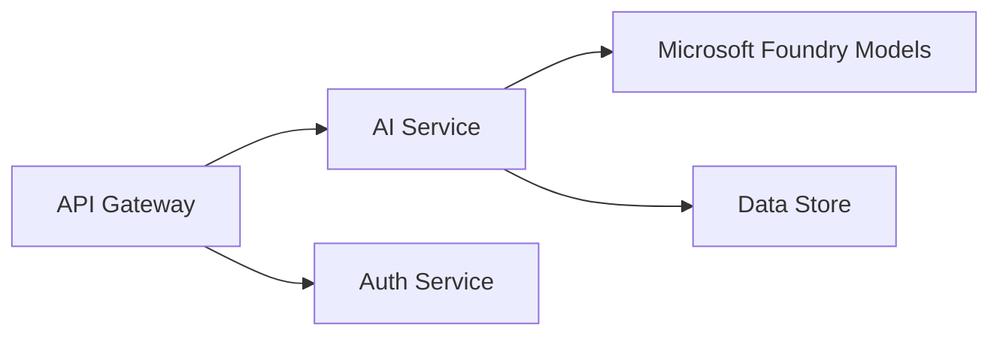
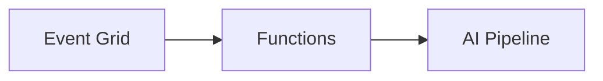

# Chapitre 8 : Modèles de Production & Entreprise

**📚 Cours** : [AZD Pour Débutants](../../README.md) | **⏱️ Durée** : 2-3 heures | **⭐ Complexité** : Avancé

---

## Aperçu

Ce chapitre couvre les modèles de déploiement prêts pour l’entreprise, le renforcement de la sécurité, la surveillance et l’optimisation des coûts pour les charges de travail IA en production.

Il s’agit d’une référence architecturale, pas d’un modèle complet déployable en production. Les exemples omettent les détails d’intégration qui doivent être fournis et testés dans votre propre application ; lire la liste de contrôle ne certifie pas la préparation à la production.

> **Mise à jour Foundry GA (2026-11-09) :** Utilisez `azd >= 1.37.0` et le paquet `microsoft.foundry` 1.0 généralement disponible pour le workflow Foundry ; les évaluations sont installées séparément. Voir [portée de la release et migration](production-ai-practices.md#recent-release-changes-and-fixes) et l’[exemple de pipeline authentifié](production-ai-practices.md#cicd-pipeline-configuration). Il s’agit d’une revue documentaire, pas d’une validation de déploiement en direct ou d’un statut GA global pour les fonctionnalités en aperçu optionnel.

## Objectifs d’apprentissage

En complétant ce chapitre, vous serez capable de :
- Déployer des applications résilientes multi-régions
- Mettre en œuvre des modèles de sécurité d’entreprise
- Configurer une surveillance complète
- Optimiser les coûts à grande échelle
- Mettre en place des pipelines CI/CD avec AZD

---

## 📚 Leçons

| # | Leçon | Description | Durée |
|---|--------|-------------|------|
| 1 | [Pratiques IA en Production](production-ai-practices.md) | Modèles de déploiement d’entreprise | 90 min |

---

## 🚀 Liste de Contrôle Production

- [ ] Déploiement multi-région pour la résilience
- [ ] Identité gérée pour l’authentification (sans clés)
- [ ] Application Insights pour la surveillance
- [ ] Budgets et alertes de coûts configurés
- [ ] Analyse de sécurité activée
- [ ] Intégration du pipeline CI/CD
- [ ] Plan de reprise après sinistre

---

## 🏗️ Modèles Architecturaux

### Modèle 1 : Microservices IA



### Modèle 2 : IA Événementielle



---

## 🔐 Bonnes pratiques de sécurité

```bicep
// Illustrative properties from different resources, NOT a standalone Bicep file.
// Attach identity to the application host:
identity: {
  type: 'SystemAssigned'
}

// AI account properties (also require private endpoints, DNS and app connectivity):
properties: {
  publicNetworkAccess: 'Disabled'
  networkAcls: {
    defaultAction: 'Deny'
  }
}
```

---

## 💰 Optimisation des coûts

| Stratégie | Contraintes principales |
|----------|---------|
| Mise à l’échelle à zéro (Container Apps) | Nécessite un déclencheur adapté ; d’autres services génèrent toujours des coûts |
| Utiliser les niveaux de consommation pour dev | Comparer le prix du service sélectionné et la charge de travail |
| Mise à l’échelle programmée | Échelle via infrastructure/automatisation supportée |
| Réservations/capacité provisionnée | Seulement si pris en charge ; engagements peuvent augmenter les coûts à l’inactivité |

Utilisez le [modèle complet de ressource budget](production-ai-practices.md#2-cost-monitoring-and-budgets) avec une date de début valide, un périmètre de facturation, des destinataires et des permissions. Un budget envoie des alertes ; il ne limite pas les dépenses. Les économies dépendant de l’utilisation mesurée ne sont pas garanties en pourcentage.

---

## 📊 Configuration de la surveillance

```bash
# Open the Application Insights logs view (requires configured monitoring)
azd monitor --logs

# Check Application Insights
azd monitor --overview

# View metrics
az monitor metrics list --resource <resource-id>
```

---

## 🔗 Navigation

| Direction | Chapitre |
|-----------|---------|
| **Précédent** | [Chapitre 7 : Dépannage](../chapter-07-troubleshooting/README.md) |
| **Cours terminé** | [Page d’accueil du cours](../../README.md) |

---

## 📖 Ressources associées

- [Guide des agents IA](../chapter-02-ai-development/agents.md)
- [Application Insights](../chapter-06-pre-deployment/application-insights.md)
- [Solutions Multi-Agent](../chapter-05-multi-agent/README.md)
- [Exemple Microservices](../../examples/microservices/README.md)

---

<!-- CO-OP TRANSLATOR DISCLAIMER START -->
**Avertissement** :
Ce document a été traduit à l'aide du service de traduction automatique [Co-op Translator](https://github.com/Azure/co-op-translator). Bien que nous nous efforçions d'assurer l'exactitude, veuillez noter que les traductions automatisées peuvent contenir des erreurs ou des inexactitudes. Le document original dans sa langue native doit être considéré comme la source faisant autorité. Pour les informations critiques, il est recommandé de recourir à une traduction professionnelle réalisée par un humain. Nous ne saurions être tenus responsables des malentendus ou erreurs d'interprétation découlant de l'utilisation de cette traduction.
<!-- CO-OP TRANSLATOR DISCLAIMER END -->