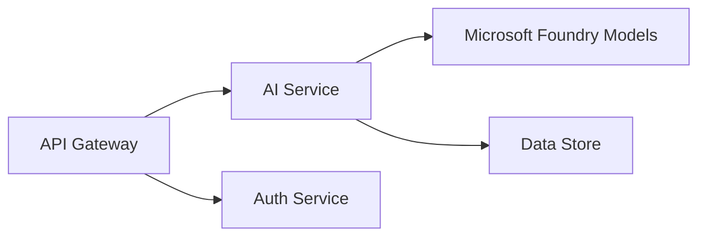
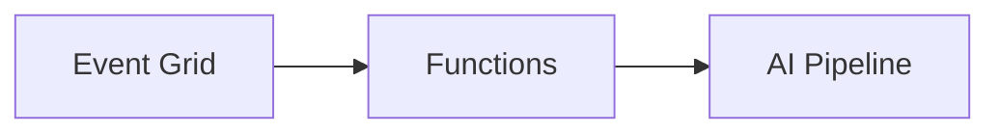

# Chapitre 8 : Modèles de Production & Entreprise

**📚 Cours** : [AZD Pour Débutants](../../README.md) | **⏱️ Durée** : 2-3 heures | **⭐ Complexité** : Avancé

---

## Aperçu

Ce chapitre aborde les modèles de déploiement prêts pour l’entreprise, le renforcement de la sécurité, la surveillance et l’optimisation des coûts pour les charges de travail AI en production.

Il s’agit d’une référence architecturale, non d’un modèle de production complet déployable. Les exemples omettent des détails d’intégration qui doivent être fournis et testés dans votre propre application ; la lecture de la checklist ne certifie pas la préparation à la production.

> **Revue de version (2026-11-04) :** Les directives AI CLI ont été vérifiées par rapport à la documentation/source `azd 1.37.2`, agents `1.0.0-beta.23`, et évaluations `1.0.0-beta.2`. Voir [modifications et corrections de la version](production-ai-practices.md#recent-release-changes-and-fixes) pour les exigences de compatibilité et les détails de migration ; il ne s’agit pas d’une validation de déploiement en direct.

## Objectifs d’apprentissage

En complétant ce chapitre, vous serez capable de :
- Déployer des applications résilientes multi-régions
- Mettre en œuvre des modèles de sécurité d’entreprise
- Configurer une surveillance complète
- Optimiser les coûts à grande échelle
- Mettre en place des pipelines CI/CD avec AZD

---

## 📚 Leçons

| # | Leçon | Description | Durée |
|---|--------|-------------|-------|
| 1 | [Pratiques AI en Production](production-ai-practices.md) | Modèles de déploiement entreprise | 90 min |

---

## 🚀 Checklist de Production

- [ ] Déploiement multi-régions pour la résilience
- [ ] Identité managée pour l’authentification (sans clés)
- [ ] Application Insights pour la surveillance
- [ ] Budgets et alertes de coûts configurés
- [ ] Analyse de sécurité activée
- [ ] Intégration du pipeline CI/CD
- [ ] Plan de reprise après sinistre

---

## 🏗️ Modèles Architecturaux

### Modèle 1 : Microservices AI



### Modèle 2 : AI Orienté Événements



---

## 🔐 Bonnes Pratiques de Sécurité

```bicep
// Illustrative properties from different resources, NOT a standalone Bicep file.
// Attach identity to the application host:
identity: {
  type: 'SystemAssigned'
}

// AI account properties (also require private endpoints, DNS and app connectivity):
properties: {
  publicNetworkAccess: 'Disabled'
  networkAcls: {
    defaultAction: 'Deny'
  }
}
```

---

## 💰 Optimisation des Coûts

| Stratégie | Contrainte Principale |
|----------|--------------------|
| Mise à l’échelle à zéro (Container Apps) | Nécessite un déclencheur adapté ; d’autres services engendrent toujours des coûts |
| Utiliser les paliers à la consommation pour dev | Comparer le tarif du service sélectionné et la charge de travail |
| Mise à l’échelle programmée | Mise à l’échelle via infrastructure/automatisation supportée |
| Réservations/capacité provisionnée | Seulement quand supporté ; les engagements peuvent augmenter les coûts au repos |

Utilisez le [modèle complet de ressource budget](production-ai-practices.md#2-cost-monitoring-and-budgets) avec une date de début valide, un périmètre de facturation, des destinataires et des permissions. Un budget envoie des alertes ; il ne limite pas les dépenses. Les économies dépendent de l’utilisation mesurée et ne sont pas des pourcentages garantis.

---

## 📊 Configuration de la Surveillance

```bash
# Open the Application Insights logs view (requires configured monitoring)
azd monitor --logs

# Check Application Insights
azd monitor --overview

# View metrics
az monitor metrics list --resource <resource-id>
```

---

## 🔗 Navigation

| Direction | Chapitre |
|-----------|---------|
| **Précédent** | [Chapitre 7 : Dépannage](../chapter-07-troubleshooting/README.md) |
| **Cours terminé** | [Accueil du cours](../../README.md) |

---

## 📖 Ressources Associées

- [Guide des Agents AI](../chapter-02-ai-development/agents.md)
- [Application Insights](../chapter-06-pre-deployment/application-insights.md)
- [Solutions Multi-Agents](../chapter-05-multi-agent/README.md)
- [Exemple Microservices](../../examples/microservices/README.md)

---

<!-- CO-OP TRANSLATOR DISCLAIMER START -->
**Avertissement** :
Ce document a été traduit à l'aide du service de traduction automatique [Co-op Translator](https://github.com/Azure/co-op-translator). Bien que nous nous efforçions d'assurer l'exactitude, veuillez noter que les traductions automatisées peuvent contenir des erreurs ou des inexactitudes. Le document original dans sa langue native doit être considéré comme la source faisant autorité. Pour les informations critiques, il est recommandé de recourir à une traduction professionnelle réalisée par un humain. Nous ne saurions être tenus responsables des malentendus ou erreurs d'interprétation découlant de l'utilisation de cette traduction.
<!-- CO-OP TRANSLATOR DISCLAIMER END -->