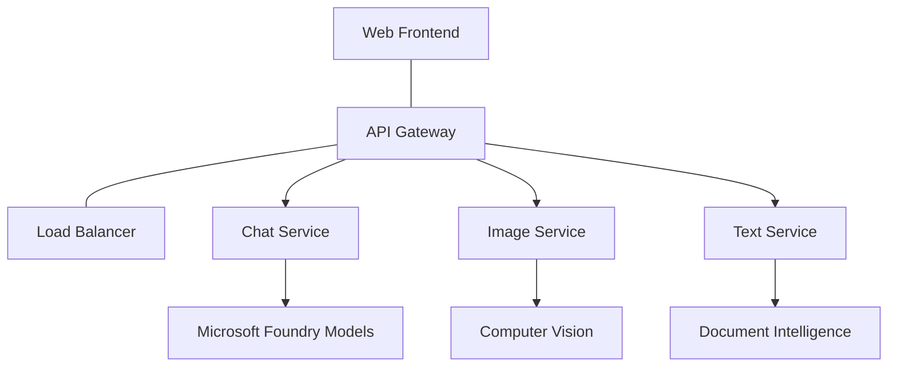

# Bonnes pratiques pour les charges de travail AI en production avec AZD

**Navigation dans le chapitre :**
- **📚 Accueil du cours** : [AZD pour débutants](../../README.md)
- **📖 Chapitre actuel** : Chapitre 8 - Modèles de production et d'entreprise
- **⬅️ Chapitre précédent** : [Chapitre 7 : Dépannage](../chapter-07-troubleshooting/debugging.md)
- **⬅️ Aussi lié** : [Atelier AI](../chapter-02-ai-development/ai-workshop-lab.md)
- **🎯 Cours complet** : [AZD pour débutants](../../README.md)

## Vue d'ensemble

Ce guide explique les modèles de conception AI en production en utilisant Azure Developer CLI (AZD). Il s'agit d'une référence de conception, pas d'une application déployable ni d'une certification de production.

**Limites de l'exemple :** Sauf indication explicite d'une complétude, les fragments Bicep supposent des paramètres et des ressources référencées dans un modèle englobant. Ils omettent les images/plans hôtes, identités, affectations de rôles, DNS, sorties et autres intégrations requises. Les chemins de service YAML et les scripts hook/test sont des fichiers illustratifs à créer dans **votre propre application** ; ils ne sont pas fournis par ce cours. Utilisez un exemple AZD fonctionnel comme base, compilez l'infrastructure complète et testez-la dans un environnement isolé avant la production.

## Défis clés abordés

Les préoccupations courantes en production incluent les déploiements multi-services, la gestion des identités et des secrets, la mise à l'échelle, le contrôle des coûts et la surveillance. Aucune prévalence mesurée n'est revendiquée ici.

## Modèles d'architecture pour l'AI en production

### Modèle 1 : Architecture AI Microservices

**Quand l'utiliser** : Applications AI complexes avec multiples capacités



**Implémentation AZD** :

```yaml
# azure.yaml
name: enterprise-ai-platform
services:
  web:
    project: ./web
    host: staticwebapp
  api-gateway:
    project: ./api-gateway
    host: containerapp
  chat-service:
    project: ./services/chat
    host: containerapp
  vision-service:
    project: ./services/vision
    host: containerapp
  text-service:
    project: ./services/text
    host: containerapp
```

### Modèle 2 : Traitement AI piloté par événements

**Quand l'utiliser** : Traitement par lots, analyse documentaire, workflows asynchrones

```bicep
// Event Hub for AI processing pipeline
resource eventHub 'Microsoft.EventHub/namespaces@2024-01-01' = {
  name: eventHubNamespaceName
  location: location
  sku: {
    name: 'Standard'
    tier: 'Standard'
    capacity: 1
  }
}

// Service Bus for reliable message processing
resource serviceBus 'Microsoft.ServiceBus/namespaces@2024-01-01' = {
  name: serviceBusNamespaceName
  location: location
  sku: {
    name: 'Premium'
    tier: 'Premium'
    capacity: 1
  }
}

// Function App for processing
resource functionApp 'Microsoft.Web/sites@2023-01-01' = {
  name: functionAppName
  location: location
  kind: 'functionapp,linux'
  properties: {
    siteConfig: {
      appSettings: [
        {
          name: 'FUNCTIONS_EXTENSION_VERSION'
          value: '~4'
        }
        {
          name: 'AZURE_OPENAI_ENDPOINT'
          value: '@Microsoft.KeyVault(VaultName=${keyVault.name};SecretName=openai-endpoint)'
        }
      ]
    }
  }
}
```

Cela crée des fragments d'espace de noms, non des hubs, files d'attente, abonnements ou déclencheurs de Function. Une Function exécutable nécessite aussi un plan d'hébergement, une configuration runtime/stockage, une identité attachée, RBAC et un accès réseau. La référence Key Vault nécessite la permission de lire le secret ; une URL d'endpoint n'est pas un identifiant.

## Réflexion sur la santé des agents AI

Lorsqu'une application web traditionnelle tombe en panne, les symptômes sont familiers : une page ne charge pas, une API renvoie une erreur, ou un déploiement échoue. Les applications AI peuvent tomber en panne de ces mêmes manières — mais elles peuvent aussi mal fonctionner de façons plus subtiles sans produire de messages d'erreur évidents.

Cette section vous aide à construire un modèle mental pour surveiller les charges de travail AI afin de savoir où chercher quand les choses ne semblent pas correctes.

### Comment la santé de l'agent diffère de celle d'une application traditionnelle

Les applications traditionnelles peuvent aussi avoir des erreurs subtiles de correction. Un agent AI ajoute une qualité de réponse nondéterministe aux préoccupations habituelles de disponibilité et correction. Pensez à la santé de l'agent en deux couches :

| Couche | À surveiller | Où regarder |
|-------|-------------|--------------|
| **Santé de l'infrastructure** | Le service fonctionne-t-il ? Les ressources sont-elles provisionnées ? Les endpoints sont-ils joignables ? | `azd monitor`, santé des ressources dans Azure Portal, logs des containers/apps |
| **Santé du comportement** | L'agent répond-il avec précision ? Les réponses sont-elles dans les temps ? Le modèle est-il appelé correctement ? | Traces Application Insights, métriques de latence d'appels de modèle, logs de qualité des réponses |

La santé de l'infrastructure est familière — elle est la même pour toute application azd. La santé du comportement est la nouvelle couche introduite par les charges AI.

### Où regarder lorsque les applications AI ne fonctionnent pas comme attendu

Si votre application AI ne produit pas les résultats attendus, voici une liste conceptuelle de contrôle :

1. **Commencez par les bases.** L'application fonctionne-t-elle ? Peut-elle atteindre ses dépendances ? Vérifiez `azd monitor` et la santé de la ressource comme pour toute application.
2. **Vérifiez la connexion au modèle.** Votre application appelle-t-elle avec succès le modèle AI ? Les appels échoués ou en timeout du modèle sont la cause la plus fréquente de problèmes AI et apparaissent dans vos logs d'application.
3. **Inspectez les entrées et le référencement en toute sécurité.** Les mauvaises réponses peuvent provenir de la récupération, des instructions, des limites du modèle ou de l'exécution d'outils. Utilisez des données diagnostiques avec contrôle d'accès et masquées ; n'activez pas la journalisation indiscriminée des prompts/réponses en production.
4. **Examinez la latence des réponses.** Les appels au modèle AI sont plus lents que les appels API typiques. Si votre application semble lente, vérifiez si les temps de réponse du modèle ont augmenté — cela peut indiquer un throttling, des limites de capacité ou une congestion au niveau régional.
5. **Surveillez les signaux de coûts.** Des pics inattendus dans l'utilisation de tokens ou d'appels API peuvent indiquer une boucle, un prompt mal configuré ou trop de tentatives répétées.

Vous n'avez pas besoin de maîtriser immédiatement les outils d'observabilité. L'essentiel est que les applications AI ont une couche supplémentaire de comportement à surveiller, et la surveillance intégrée d'azd (`azd monitor`) vous offre un point de départ pour investiguer ces deux couches.

---

## Bonnes pratiques de sécurité

### 1. Modèle de sécurité Zero-Trust

**Stratégie d'implémentation** :
- Pas de communication service-à-service sans authentification
- Tous les appels API utilisent des identités gérées
- Isolation réseau avec endpoints privés
- Contrôles d'accès au moindre privilège

```bicep
// Managed Identity for each service
resource chatServiceIdentity 'Microsoft.ManagedIdentity/userAssignedIdentities@2023-01-31' = {
  name: 'chat-service-identity'
  location: location
}

// Role assignments with minimal permissions
resource openAIUserRole 'Microsoft.Authorization/roleAssignments@2022-04-01' = {
  scope: openAIAccount
  name: guid(openAIAccount.id, chatServiceIdentity.id, '5e0bd9bd-7b93-4f28-af87-19fc36ad61bd')
  properties: {
    roleDefinitionId: subscriptionResourceId('Microsoft.Authorization/roleDefinitions', '5e0bd9bd-7b93-4f28-af87-19fc36ad61bd')
    principalId: chatServiceIdentity.properties.principalId
    principalType: 'ServicePrincipal'
  }
}
```

### 2. Gestion sécurisée des secrets

**Modèle d'intégration Key Vault** :

```bicep
// Key Vault with proper access policies
resource keyVault 'Microsoft.KeyVault/vaults@2023-02-01' = {
  name: keyVaultName
  location: location
  properties: {
    tenantId: tenant().tenantId
    sku: {
      family: 'A'
      name: 'standard' // Premium is needed for HSM-backed keys, not ordinary secrets
    }
    enableRbacAuthorization: true  // Use RBAC instead of access policies
    enablePurgeProtection: true    // Prevent accidental deletion
    enableSoftDelete: true
    softDeleteRetentionInDays: 90
  }
}

// Optional legacy key-auth alternative; omit when using Entra ID.
resource openAIKeySecret 'Microsoft.KeyVault/vaults/secrets@2023-02-01' = {
  parent: keyVault
  name: 'openai-api-key'
  properties: {
    value: openAIAccount.listKeys().key1
    attributes: {
      enabled: true
    }
  }
}
```

Attribuez l'identité runtime `Key Vault Secrets User` au scope approprié et attachez-la à l'hôte ; `enableRbacAuthorization` seul ne donne aucun accès. Privilégiez l'authentification par identité gérée OpenAI avec `disableLocalAuth: true`. Le secret clé optionnel n'a de sens que pour un compte délibérément activé par clé, et le principal de provisioning doit aussi avoir la permission d'écrire des secrets.

### 3. Sécurité réseau

**Configuration de l'endpoint privé** :

```bicep
// Virtual Network for AI services
resource virtualNetwork 'Microsoft.Network/virtualNetworks@2023-04-01' = {
  name: vnetName
  location: location
  properties: {
    addressSpace: {
      addressPrefixes: ['10.0.0.0/16']
    }
    subnets: [
      {
        name: 'ai-services-subnet'
        properties: {
          addressPrefix: '10.0.1.0/24'
          privateEndpointNetworkPolicies: 'Disabled'
        }
      }
      {
        name: 'app-services-subnet'
        properties: {
          addressPrefix: '10.0.2.0/24'
          delegations: [
            {
              name: 'Microsoft.Web/serverFarms'
              properties: {
                serviceName: 'Microsoft.Web/serverFarms'
              }
            }
          ]
        }
      }
    ]
  }
}

// Private endpoints for all AI services
resource openAIPrivateEndpoint 'Microsoft.Network/privateEndpoints@2023-04-01' = {
  name: '${openAIAccountName}-pe'
  location: location
  properties: {
    subnet: {
      id: virtualNetwork.properties.subnets[0].id
    }
    privateLinkServiceConnections: [
      {
        name: 'openai-connection'
        properties: {
          privateLinkServiceId: openAIAccount.id
          groupIds: ['account']
        }
      }
    ]
  }
}
```

Les endpoints privés requièrent aussi des groupes de zones DNS privées/liens VNet et une intégration VNet d'application. Ils ne bloquent pas automatiquement l'accès public : désactivez explicitement l'accès réseau public du compte AI après validation de la connectivité privée et de l'accès au déploiement.

## Performance et mise à l'échelle

### 1. Stratégies d'auto-scaling

**Auto-scaling Container Apps** :

```bicep
resource containerApp 'Microsoft.App/containerApps@2023-05-01' = {
  name: containerAppName
  location: location
  properties: {
    configuration: {
      ingress: {
        external: true
        targetPort: 8000
        transport: 'http'
      }
    }
    template: {
      scale: {
        minReplicas: 2  // Always have 2 instances minimum
        maxReplicas: 50 // Scale up to 50 for high load
        rules: [
          {
            name: 'http-scaling'
            http: {
              metadata: {
                concurrentRequests: '20'  // Scale when >20 concurrent requests
              }
            }
          }
          {
            name: 'cpu-scaling'
            custom: {
              type: 'cpu'
              metadata: {
                type: 'Utilization'
                value: '70'  // Scale when CPU >70%
              }
            }
          }
        ]
      }
    }
  }
}
```

### 2. Stratégies de mise en cache

**Cache Redis pour réponses AI** :

```bicep
// Legacy Azure Cache for Redis example (not recommended for new deployments)
resource redisCache 'Microsoft.Cache/redis@2023-04-01' = {
  name: redisCacheName
  location: location
  properties: {
    sku: {
      name: 'Premium'
      family: 'P'
      capacity: 1
    }
    enableNonSslPort: false
    minimumTlsVersion: '1.2'
    redisConfiguration: {
      'maxmemory-policy': 'allkeys-lru'
    }
    // Sharding distributes data; replication/failover provides availability.
    shardCount: 2
  }
}

// Cache configuration in application
var cacheConnectionString = '${redisCache.properties.hostName}:6380,password=${redisCache.listKeys().primaryKey},ssl=True,abortConnect=False'
```

Azure Cache for Redis Basic/Standard/Premium est en [voies de retrait](https://learn.microsoft.com/azure/azure-cache-for-redis/retirement-faq). Utilisez Azure Managed Redis pour les nouveaux designs ainsi que sa SKU, identité et configuration TLS documentées, plutôt que de copier cette ressource legacy dans un nouveau système de production. La ligne de chaîne de connexion est un espace réservé non fonctionnel, pas un identifiant. Partitionnez les clés caches selon l'autorisation, le modèle/instructions et la version de récupération, avec expiration ; un cache partagé en lecture seule peut exposer les données d'un autre utilisateur.

### 3. Équilibrage de charge et gestion du trafic

**Application Gateway avec WAF** :

```bicep
// Application Gateway with Web Application Firewall
resource applicationGateway 'Microsoft.Network/applicationGateways@2023-04-01' = {
  name: appGatewayName
  location: location
  properties: {
    sku: {
      name: 'WAF_v2'
      tier: 'WAF_v2'
      capacity: 2
    }
    webApplicationFirewallConfiguration: {
      enabled: true
      firewallMode: 'Prevention'
      ruleSetType: 'OWASP'
      ruleSetVersion: '3.2'
    }
    // Backend pools for AI services
    backendAddressPools: [
      {
        name: 'ai-services-pool'
        properties: {
          backendAddresses: [
            {
              fqdn: '${containerApp.properties.configuration.ingress.fqdn}'
            }
          ]
        }
      }
    ]
  }
}
```

Ceci est une ressource gateway partielle : un déploiement réel nécessite aussi la configuration de sous-réseau/IP gateway, IP frontales et ports, écouteurs/certificats TLS, paramètres/probes HTTP backend, règles/priorités de routage et une politique WAF révisée. Le hostname SNI TLS et l'authentification doivent correspondre au backend Container App.

## 💰 Optimisation des coûts

### 1. Dimensionnement des ressources adapté

**Configurations spécifiques à l'environnement** :

Ces noms sont des **entrées de modèle personnalisé illustratifs**, pas des réglages automatiques AZD. Mappez chacun dans `infra/main.parameters.json`/Bicep et la configuration hôte d'abord. Par exemple, l'exemple RAG utilise `AZURE_SEARCH_SERVICE_SKU` et `AZURE_OPENAI_CHATGPT_DEPLOYMENT_CAPACITY`, pas les noms génériques ci-dessous. Donnez aux Container Apps une mémoire avec une unité supportée telle que `1Gi` dans la ressource réelle. Appliquez les modifications d'infrastructure avec `azd up` ou `azd provision` ; `azd deploy` seul n'applique pas les changements Bicep.

```bash
# Development environment
azd env new development
azd env set AZURE_OPENAI_SKU "S0"
azd env set AZURE_OPENAI_CAPACITY 10
azd env set AZURE_SEARCH_SKU "basic"
azd env set CONTAINER_CPU 0.5
azd env set CONTAINER_MEMORY 1.0

# Production environment  
azd env new production
azd env set AZURE_OPENAI_SKU "S0"
azd env set AZURE_OPENAI_CAPACITY 100
azd env set AZURE_SEARCH_SKU "standard"
azd env set CONTAINER_CPU 2.0
azd env set CONTAINER_MEMORY 4.0
```

### 2. Surveillance des coûts et budgets

```bicep
// Supply the first day of the current UTC month, e.g. 2026-11-01T00:00:00Z.
param budgetStartDate string

// Cost management and budgets
resource budget 'Microsoft.Consumption/budgets@2024-08-01' = {
  name: 'ai-workload-budget'
  properties: {
    timePeriod: {
      startDate: budgetStartDate
    }
    timeGrain: 'Monthly'
    amount: 2000  // In the billing currency, not necessarily USD
    category: 'Cost'
    notifications: {
      warning: {
        enabled: true
        operator: 'GreaterThan'
        threshold: 80
        contactEmails: [
          'finance@company.com'
          'engineering@company.com'
        ]
        contactRoles: [
          'Owner'
          'Contributor'
        ]
      }
      critical: {
        enabled: true
        operator: 'GreaterThan'
        threshold: 95
        contactEmails: [
          'cto@company.com'
        ]
      }
    }
  }
}
```

Remplacez les destinataires d'exemple et vérifiez scope/permissions. Les alertes budget utilisent des données de facturation différées et n'imposent pas de plafond de dépense.

### 3. Optimisation de l'utilisation des tokens

**Gestion des coûts OpenAI** :

Ceci est seulement une heuristique basée sur les caractères pour une prévisualisation UI, **pas** un validateur de limites de tokens modèle. Le code production doit utiliser un tokenizer adapté au modèle déployé et tenir compte des instructions système, des schémas d'outil, de l'historique et du budget de sortie. Rejetez un message utilisateur trop volumineux plutôt que de le tronquer silencieusement.

```typescript
// Application-level token optimization
class TokenOptimizer {
  private readonly maxTokens = 4000;
  private readonly reserveTokens = 500;
  
  optimizePrompt(userInput: string, context: string): string {
    const availableTokens = this.maxTokens - this.reserveTokens;
    if (this.estimateTokens(userInput) + 8 >= availableTokens) {
      throw new Error("User input exceeds the illustrative prompt budget");
    }
    const estimatedTokens = this.estimateTokens(userInput + context) + 8;
    
    if (estimatedTokens > availableTokens) {
      // Truncate context, not user input
      context = this.truncateContext(context, Math.max(0, availableTokens - this.estimateTokens(userInput) - 8));
    }
    
    return `${context}\n\nUser: ${userInput}`;
  }
  
  private estimateTokens(text: string): number {
    // Rough estimation: 1 token ≈ 4 characters
    return Math.ceil(text.length / 4);
  }

  private truncateContext(text: string, estimatedBudget: number): string {
    return text.slice(0, Math.max(0, estimatedBudget) * 4);
  }
}
```

## Surveillance et observabilité

### 1. Application Insights complète

```bicep
// Application Insights with advanced features
resource applicationInsights 'Microsoft.Insights/components@2020-02-02' = {
  name: applicationInsightsName
  location: location
  kind: 'web'
  properties: {
    Application_Type: 'web'
    WorkspaceResourceId: logAnalyticsWorkspace.id
    SamplingPercentage: 100  // Ingestion setting; review cost and SDK sampling separately
    DisableIpMasking: false  // Retain IP masking
  }
}

// Custom metrics for AI operations
resource aiMetricAlerts 'Microsoft.Insights/metricAlerts@2018-03-01' = {
  name: 'ai-high-error-rate'
  location: 'global'
  properties: {
    description: 'Alert when failed request count exceeds 10 in five minutes'
    severity: 2
    enabled: true
    scopes: [
      applicationInsights.id
    ]
    evaluationFrequency: 'PT1M'
    windowSize: 'PT5M'
    criteria: {
      'odata.type': 'Microsoft.Azure.Monitor.SingleResourceMultipleMetricCriteria'
      allOf: [
        {
          name: 'high-error-rate'
          metricName: 'requests/failed'
          operator: 'GreaterThan'
          threshold: 10
          timeAggregation: 'Count'
        }
      ]
    }
  }
}
```

### 2. Surveillance spécifique AI

**Tableaux de bord personnalisés pour métriques AI** :

```json
{
  "dashboard": {
    "name": "AI Application Monitoring",
    "tiles": [
      {
        "name": "OpenAI Request Volume",
        "query": "dependencies | where target contains 'openai' | summarize count() by bin(timestamp, 5m)"
      },
      {
        "name": "AI Response Latency",
        "query": "dependencies | where target contains 'openai' | summarize avg(duration) by bin(timestamp, 5m)"
      },
      {
        "name": "Token Usage",
        "query": "customMetrics | where name == 'openai_tokens_used' | summarize sum(value) by bin(timestamp, 1h)"
      },
      {
        "name": "Cost per Hour",
        "query": "customMetrics | where name == 'openai_cost' | summarize sum(value) by bin(timestamp, 1h)"
      }
    ]
  }
}
```

Ce JSON est une esquisse définie par l'application, pas un schéma de tableau de bord importable Azure portal. Les requêtes token/coût nécessitent que votre app émette ces métriques personnalisées exactes ; elles ne sont pas créées par AZD. Adaptez les filtres de dépendance à vos noms réels d'endpoint/span modèle.

### 3. Vérifications de santé et monitoring de disponibilité

```bicep
// Application Insights availability tests
resource availabilityTest 'Microsoft.Insights/webtests@2022-06-15' = {
  name: 'ai-app-availability-test'
  location: location
  tags: {
    'hidden-link:${applicationInsights.id}': 'Resource'
  }
  properties: {
    SyntheticMonitorId: 'ai-app-availability-test'
    Name: 'AI Application Availability Test'
    Description: 'Tests AI application endpoints'
    Enabled: true
    Frequency: 300  // 5 minutes
    Timeout: 120    // 2 minutes
    Kind: 'standard'
    Locations: [
      {
        Id: 'us-east-2-azr'
      }
      {
        Id: 'us-west-2-azr'
      }
    ]
    Request: {
      RequestUrl: 'https://${webApp.properties.defaultHostName}/health'
      HttpVerb: 'GET'
      FollowRedirects: true
      ParseDependentRequests: false
    }
    ValidationRules: {
      ExpectedHttpStatusCode: 200
      SSLCheck: true
      SSLCertRemainingLifetimeCheck: 7
    }
  }
}
```

## Reprise après sinistre et haute disponibilité

Le test ci-dessus suppose un App Service existant `webApp` et une ressource Application Insights. Les tests de disponibilité standard sont facturables et requièrent un endpoint accessible ; les apps privées seulement nécessitent un design de monitoring privé adapté. Les tests ping URL sont dépréciés ; utilisez les [tests de disponibilité standard](https://learn.microsoft.com/azure/azure-monitor/app/availability).

### 1. Déploiement multi-région

```yaml
# azure.yaml - Multi-region configuration
name: ai-app-multiregion
services:
  api-primary:
    project: ./api
    host: containerapp
    env:
      AZURE_REGION: eastus
  api-secondary:
    project: ./api
    host: containerapp
    env:
      AZURE_REGION: westus2
```

```bicep
// Separate App Service topology, not the Container Apps declarations above
resource trafficManager 'Microsoft.Network/trafficManagerProfiles@2022-04-01' = {
  name: trafficManagerProfileName
  location: 'global'
  properties: {
    profileStatus: 'Enabled'
    trafficRoutingMethod: 'Priority'
    dnsConfig: {
      relativeName: trafficManagerProfileName
      ttl: 30
    }
    monitorConfig: {
      protocol: 'HTTPS'
      port: 443
      path: '/health'
      intervalInSeconds: 30
      toleratedNumberOfFailures: 3
      timeoutInSeconds: 10
    }
    endpoints: [
      {
        name: 'primary-endpoint'
        type: 'Microsoft.Network/trafficManagerProfiles/azureEndpoints'
        properties: {
          targetResourceId: primaryAppService.id
          endpointStatus: 'Enabled'
          priority: 1
        }
      }
      {
        name: 'secondary-endpoint'
        type: 'Microsoft.Network/trafficManagerProfiles/azureEndpoints'
        properties: {
          targetResourceId: secondaryAppService.id
          endpointStatus: 'Enabled'
          priority: 2
        }
      }
    ]
  }
}
```

Les variables d'environnement ne choisissent pas les localisations des ressources. L'IaC doit provisionner des hôtes régionaux distincts et associer chaque service avec des tags `resourceName` ou `azd-service-name`. L'exemple Traffic Manager est une **topologie App Service séparée** (`primaryAppService`/`secondaryAppService`), pas un routage pour les déclarations Container Apps. Container Apps exige un endpoint/front door externe configuré, routage TLS/domaine personnalisé et probes de santé.

### 2. Sauvegarde et récupération des données

```bicep
// Backup configuration for critical data
resource backupVault 'Microsoft.DataProtection/backupVaults@2023-05-01' = {
  name: backupVaultName
  location: location
  identity: {
    type: 'SystemAssigned'
  }
  properties: {
    storageSettings: [
      {
        datastoreType: 'VaultStore'
        type: 'LocallyRedundant'
      }
    ]
  }
}

```

Le vault seul ne sauvegarde rien. Configurez une **politique et instance de sauvegarde spécifiques à la charge**, permissions source, rétention et tests de restauration via les [matrices de support Azure Backup](https://learn.microsoft.com/azure/backup/backup-support-matrix). Il n'existe pas de politique Azure Backup générique pour les déploiements Azure OpenAI hébergés. Conservez les définitions d'infrastructure/déploiement modèle dans le contrôle de source ; protégez documents uploadés, données d'application et artefacts de fine-tuning via les fonctionnalités sauvegarde/export des services sous-jacents. Définissez et testez explicitement RPO/RTO.

## Intégration DevOps et CI/CD

### 1. Workflow GitHub Actions

```yaml
# .github/workflows/deploy-ai-app.yml
name: Deploy AI Application

on:
  push:
    branches: [main]
  pull_request:
    branches: [main]

jobs:
  test:
    runs-on: ubuntu-latest
    steps:
      - uses: actions/checkout@v4
      
      - name: Setup Python
        uses: actions/setup-python@v4
        with:
          python-version: '3.11'
          
      - name: Install dependencies
        run: |
          pip install -r requirements.txt
          pip install pytest
          
      - name: Run tests
        run: pytest tests/
        
      - name: AI Safety Tests
        run: |
          python scripts/test_ai_safety.py
          python scripts/validate_prompts.py

```

Ceci est la **partie test uniquement** d'un workflow et suppose que vous avez créé `requirements.txt`, `tests/`, et les deux scripts de sécurité. Ajoutez les jobs de provisioning/déploiement authentifiés OIDC depuis [Configuration du pipeline CI/CD](#cicd-pipeline-configuration), avec `needs: test`, un trigger push/manual de confiance et des environnements GitHub protégés. Ne déployez pas de code pull-request non fiable avec des identifiants cloud. Un runner fraîchement démarré n'a aucune environnement local AZD sélectionné ; fournissez environnement/abonnement/localisation en entrée et utilisez `azd auth login`, pas seulement `azure/login`.

### 2. Validation d'infrastructure

```bash
# scripts/validate_infrastructure.sh
#!/bin/bash
set -euo pipefail

echo "Validating AI infrastructure deployment..."

# Requires Azure CLI login and the resource group selected explicitly.
: "${AZURE_RESOURCE_GROUP:?Set AZURE_RESOURCE_GROUP}"
: "${AZURE_OPENAI_NAME:?Set AZURE_OPENAI_NAME}"
: "${AZURE_OPENAI_CHAT_DEPLOYMENT:?Set the actual deployment name}"

# A successful empty list is not proof that resources exist.
types=("Microsoft.CognitiveServices/accounts" "Microsoft.Search/searchServices"
       "Microsoft.Storage/storageAccounts" "Microsoft.KeyVault/vaults")
for resource_type in "${types[@]}"; do
    count=$(az resource list --resource-group "$AZURE_RESOURCE_GROUP" \
        --resource-type "$resource_type" --query "length(@)" -o tsv)
    if [[ "$count" -lt 1 ]]; then
        echo "ERROR: No $resource_type found in $AZURE_RESOURCE_GROUP"
        exit 1
    fi
done

# Validate OpenAI model deployments
echo "Validating OpenAI model deployments..."
state=$(az cognitiveservices account deployment show \
  --name "$AZURE_OPENAI_NAME" --resource-group "$AZURE_RESOURCE_GROUP" \
  --deployment-name "$AZURE_OPENAI_CHAT_DEPLOYMENT" \
  --query "properties.provisioningState" -o tsv)
if [[ "$state" != "Succeeded" ]]; then
    echo "ERROR: Required model deployment is not provisioned successfully"
    exit 1
fi

echo "Infrastructure validation completed successfully!"
```

Attendu : un exit zéro et un message de complétion seulement si tous les types attendus existent et le déploiement modèle nommé est provisionné. Cela vérifie l'inventaire/état du provisioning, **pas** la santé des ressources, la topologie exacte, RBAC, accessibilité réseau ou comportement modèle. Adaptez les types attendus à votre architecture, puis effectuez un test de readiness application authentifié séparé.

## Checklist de préparation à la production

### Sécurité ✅
- [ ] Tous les services utilisent des identités gérées
- [ ] Secrets stockés dans Key Vault
- [ ] Endpoints privés configurés
- [ ] Groupes de sécurité réseau implémentés
- [ ] RBAC au moindre privilège
- [ ] WAF activé sur les endpoints publics

### Performance ✅
- [ ] Auto-scaling configuré
- [ ] Mise en cache implémentée
- [ ] Équilibrage de charge configuré
- [ ] CDN pour contenu statique
- [ ] Pooling des connexions base de données
- [ ] Optimisation de l'utilisation des tokens

### Surveillance ✅
- [ ] Application Insights configuré
- [ ] Métriques personnalisées définies
- [ ] Règles d'alerte configurées
- [ ] Tableau de bord créé
- [ ] Vérifications de santé implémentées
- [ ] Politiques de rétention des logs

### Fiabilité ✅
- [ ] Déploiement multi-région
- [ ] Plan de sauvegarde et récupération
- [ ] Disjoncteurs implémentés
- [ ] Politiques de retry configurées
- [ ] Dégradation progressive
- [ ] Endpoints de contrôle de santé

### Gestion des coûts ✅
- [ ] Alertes budget configurées
- [ ] Dimensionnement des ressources adapté
- [ ] Remises dev/test appliquées
- [ ] Instances réservées achetées
- [ ] Tableau de bord de suivi des coûts
- [ ] Revues régulières des coûts

### Conformité ✅
- [ ] Exigences de résidence des données respectées
- [ ] Journalisation d'audit activée
- [ ] Politiques de conformité appliquées
- [ ] Référentiels de sécurité implémentés
- [ ] Évaluations régulières de sécurité
- [ ] Plan de réponse aux incidents

## Références de performance

### Objectifs de production illustratifs

Ce sont des SLO d'exemple à négocier et tester en charge, pas des benchmarks mesurés ni garanties. La latence de réponse dépend du modèle/longueur de sortie; la dépense mensuelle en tokens dépend du trafic et des prix, pas du seul nombre de tokens.

| Mesure | Objectif | Surveillance |
|--------|---------|-------------|
| **Temps de réponse** | < 2 secondes | Application Insights |
| **Disponibilité** | 99,9 % | Monitoring de disponibilité |
| **Taux d'erreur** | < 0,1 % | Logs d'application |
| **Dépense modèle** | < 500 $/mois (budget exemple) | Gestion des coûts |
| **Utilisateurs concurrents** | 1000+ | Test de charge |
| **Temps de récupération** | < 1 heure | Tests de reprise après sinistre |

### Test de charge

Voici une esquisse d'interface pour un script de test de charge **que vous devez implémenter** ; ce dépôt ne fournit pas `scripts/load_test.py`. Définissez les charges utiles des requêtes, l'authentification, les charges représentatives, les assertions de latence/erreur par centile et un plafond de dépenses dans votre outil de test de charge choisi avant de l'exécuter :

```bash
# Load testing script for AI applications
python scripts/load_test.py \
  --endpoint https://your-ai-app.azurewebsites.net \
  --concurrent-users 100 \
  --duration 300 \
  --ramp-up 60
```

## 🤝 Meilleures pratiques de la communauté

Basé sur les retours de la communauté Microsoft Foundry Discord :

### Principales recommandations de la communauté :

1. **Commencez petit, évoluez progressivement** : commencez avec des SKUs basiques et augmentez en fonction de l'usage réel
2. **Surveillez tout** : mettez en place une surveillance complète dès le premier jour
3. **Automatisez la sécurité** : utilisez l'infrastructure as code pour une sécurité cohérente
4. **Testez minutieusement** : incluez des tests spécifiques à l'IA dans votre pipeline
5. **Prévoyez les coûts** : surveillez l'utilisation des tokens et définissez des alertes budgétaires tôt

### Pièges fréquents à éviter :

- ❌ Clés API codées en dur dans le code
- ❌ Absence de surveillance adéquate
- ❌ Ignorer l'optimisation des coûts
- ❌ Ne pas tester les scénarios d’échec
- ❌ Déployer sans vérifications de santé

## Commandes et extensions AZD AI CLI

AZD inclut un ensemble croissant de commandes et extensions spécifiques à l'IA qui simplifient les flux de travail de production IA. Ces outils comblent le fossé entre le développement local et le déploiement en production pour les charges IA.

> **Mise à jour Foundry GA (2026-11-09) :** Le bundle `microsoft.foundry` a atteint **1.0 / disponibilité générale** le [5 novembre 2026](https://devblogs.microsoft.com/azure-sdk/microsoft-foundry-azure-developer-cli-ga/). Utilisez **`azd >= 1.37.0`** pour ce flux. L’ancienne revue `azd 1.37.2`, agents beta.23, et evaluations beta.2 est conservée ci-dessous comme historique de migration, pas la version actuelle du bundle. Il s’agit d’une revue documentaire/source, non d’une validation de déploiement en direct ou d’une affirmation que toutes les extensions optionnelles, API ou fonctionnalités en avant-première sont GA.

### Extensions AZD pour l'IA

AZD utilise un système d’extensions pour ajouter des capacités spécifiques à l’IA. Installez et gérez les extensions avec :

```bash
# List all available extensions (including AI)
azd extension list

# Inspect installed versions
azd version
azd ext list --installed

# Install the GA Foundry bundle
azd ext install microsoft.foundry

# Install the separate Foundry evaluations extension
azd extension install azure.ai.evaluations

# Install the fine-tuning extension
azd extension install azure.ai.finetune

# Install the custom models extension
azd extension install azure.ai.models

# Upgrade the Foundry bundle
azd ext upgrade microsoft.foundry
```

**Extensions IA disponibles :**

| Extension | Objectif | Statut |
|-----------|---------|--------|
| `microsoft.foundry` | Métapaquet installant les sept extensions principales ci-dessous ; pas de groupe de commandes propre | Bundle GA 1.0 |
| `azure.ai.agents` | `azd ai agent` : configuration d’agents, exécution locale et opérations | Inclus ; versionné indépendamment |
| `azure.ai.connections` | `azd ai connection` : connexions de projet | Inclus ; versionné indépendamment |
| `azure.ai.inspector` | `azd ai inspector` : interface Agent Inspector locale | Inclus ; versionné indépendamment |
| `azure.ai.projects` | `azd ai project` : ressources projet et déploiements de modèles | Inclus ; versionné indépendamment |
| `azure.ai.routines` | `azd ai routine` : horaires et déclencheurs | Inclus ; versionné indépendamment |
| `azure.ai.skills` | `azd ai skill` : directives comportementales réutilisables | Inclus ; versionné indépendamment |
| `azure.ai.toolboxes` | `azd ai toolbox` : collections d'outils versionnées | Inclus ; versionné indépendamment |
| `azure.ai.evaluations` | Jeux de données d’évaluation, évaluateurs, groupes d’évaluation et exécutions | Installation/publication séparée |
| `azure.ai.dataset` | Enregistrement et versionnage de jeux de données | Installation/publication séparée |
| `azure.ai.finetune` | Fine-tuning des modèles Foundry | Installation/publication séparée |
| `azure.ai.models` | Modèles personnalisés Foundry | Installation/publication séparée |

Installer `azure.ai.agents` individuellement reste supporté et installe ses dépendances ; le bundle est le choix par défaut du cours pour le flux GA. Le bundle GA n'est pas une garantie du statut de publication pour toutes les fonctionnalités optionnelles de ses composants. Voir [emballage et vérification des extensions](https://learn.microsoft.com/azure/foundry/agents/how-to/install-cli-foundry-extensions) et inspecter l’aide des commandes installées avant de les utiliser.

> Mettez à jour d’abord le CLI principal avec `azd update` ou la [méthode d’installation/mise à jour appropriée](https://learn.microsoft.com/azure/developer/azure-developer-cli/install-azd), puis exécutez `azd ext upgrade microsoft.foundry`. Mettez à jour les évaluations installées séparément si nécessaire avec `azd ext upgrade azure.ai.evaluations`. Il n’y a pas de commande `azd upgrade` principale. Enregistrez et contrôlez les extensions versionnées indépendamment dans l'automatisation de production ; une mise à jour ne migre pas automatiquement l'ancienne configuration.

### Changements récents dans les versions et corrections

| Version | Changements pour ce cours |
|---------|--------------------------|
| `microsoft.foundry` 1.0 GA (2026-11-05) | Par défaut le bundle sept extensions, conservation des paramètres agent/déploiement dans `azure.yaml`, test local avec Agent Inspector, et upload du code pour build Foundry distant. Installer les évaluations séparément et réinstaller les extensions obligatoires sur les runners CI. |
| `azd 1.37.0` | Ajoute des API de déploiement-preview stables et corrige la réécriture par les modifications d’extension de paramètres `azure.yaml` non liés. |
| `azd 1.37.1` | Corrige la propagation Ctrl+C dans les extensions et distingue annulation/délais d’attente des échecs génériques. |
| `azd 1.37.2` | Améliore la validation du provisioning : les avertissements critiques par défaut sur **Non**, échec sans confirmation dans les exécutions non supervisées et annulation sautant les hooks post-provision. Corrige aussi les valeurs d’environnement non résolues dans les listes de refus Deployment Stacks quand cette fonctionnalité alpha est activée. |
| Agents `beta.22` | Migre l’évaluation vers `azd ai eval`, passe l’optimisation à l’API GA v1, requiert `toolboxes` au pluriel, et sépare managed-harness, voix et opt-ins preview longue durée. Corrige la sélection de modèle spécifique à l’environnement et l’authentification toolbox. |
| Agents `beta.23` | Expose `init --harness` ; corrige la sortie de réponses A2A 0.3, chemins/modules prompts-agent invalides à travers les couches d’infrastructure, diagnostics timeout activation, et avertissements RBAC développeur retenus. |
| Evaluations `beta.2` | Requiert une configuration camelCase, ajoute une rédaction de conversation statique/simulée et sources fichiers locaux explicites, corrige gestion identité/version de dataset, compte qualité-portail, et diagnostics d’exécutions échouées. |

Un timeout d’activation d’agent ne prouve **pas** un échec de déploiement : inspectez la version tentée et son état avant de réessayer. Les avertissements RBAC développeur peuvent rester même si le provisioning réussit ; résolvez l’accès manquant avant d’invoquer en tant que ce développeur.

Les lignes beta ci-dessus décrivent des corrections antérieures et des limites de migration, pas une obligation de figer les nouveaux projets à ces versions.

Sources : [Annonce Foundry GA](https://devblogs.microsoft.com/azure-sdk/microsoft-foundry-azure-developer-cli-ga/), [versions AZD](https://github.com/Azure/azure-dev/releases), [versions agents beta.23](https://github.com/Azure/azure-dev/releases/tag/azd-ext-azure-ai-agents_1.0.0-beta.23), [migration agents beta.22](https://github.com/Azure/azure-dev/releases/tag/azd-ext-azure-ai-agents_1.0.0-beta.22), et [versions evaluations beta.2](https://github.com/Azure/azure-dev/releases/tag/azd-ext-azure-ai-evaluations_1.0.0-beta.2).

**Quelles sont les extensions `skills` et `connections` packagées ?**

Elles sont installées avec le bundle principal mais ont des objectifs différents :

- **`azure.ai.skills`** — Une **compétence** regroupe les directives comportementales réutilisables pour agents. Partagez les instructions validées entre agents au lieu de les copier. Une compétence n’implémente pas elle-même un outil ni ne donne accès aux données ; utilisez les toolbox et le code applicatif pour exécuter les outils.
- **`azure.ai.connections`** — Une **connexion** est un lien géré de votre projet Foundry vers une ressource externe dont vos agents ont besoin : une source de données (comme Azure AI Search), un point de terminaison d’outil ou un autre service. Les connexions centralisent *où* et *comment* les agents accèdent aux données, stockant identifiants et points d’accès en un lieu gouverné plutôt que dispersés dans le code.

Vous n’avez pas besoin de configurer toutes les capacités packagées pour déployer votre premier agent. Utilisez les compétences quand les agents partagent des directives comportementales et les connexions quand ils partagent des ressources externes.

### Initialisation des projets d’agent avec `azd ai agent init`

La commande `azd ai agent init` génère un projet agent Microsoft Foundry. Pour un exemple déployable avec Python 3.13+ et uv actuel, suivez le [tutoriel GA hosted-agent](../chapter-02-ai-development/microsoft-foundry-integration.md#hosted-agent-walkthrough-ga). Les commandes ci-dessous illustrent plutôt l’adoption **de votre propre** template de projet `azure.yaml` ; le template local nommé n’est pas fourni par ce cours :

```bash
# Initialize a new agent project from a local project template
azd ai agent init --template ./templates/support-agent/azure.yaml

# Initialize and target a specific Foundry project
azd ai agent init --template ./templates/support-agent/azure.yaml --project-id <foundry-project-id>

# Adopt the template into a different directory
azd ai agent init --template ./templates/support-agent/azure.yaml --src ./agents/my-agent
```

**Flags clés :**

| Flag | Description |
|------|-------------|
| `-t, --template` | Chemin ou URI GitHub supporté vers un document projet `azure.yaml` |
| `-p, --project-id` | ID Projet Microsoft Foundry existant pour votre environnement azd |
| `-s, --src` | Répertoire source pour agents générés, ou cible lors d’adoption de projet |
| `--deploy-mode code` | Upload source pour build Foundry distant plutôt que build local container |
| `--model-deployment` | Réutiliser un déploiement de modèle nommé existant lors de l’initialisation |
| `--kind` | Initialiser un `hosted`, `prompt`, ou agent preview `prompt-voice` |
| `--harness` | Harnais d’exécution optionnel pour `--kind prompt` ; nécessite son opt-in preview |
| `-e, --environment` | L’environnement azd à utiliser |

`--manifest`/`-m` est un alias déprécié de `--template`/`-t` ; renommer le flag ne convertit pas un ancien manifeste en document projet actuel. `--host containerapp` n’est pas un flag agent-init actuel. Pour une application Container Apps ordinaire, utilisez `azd init --template` avec un template déclarant `host: containerapp`.

Pour un projet existant avec exactement un service `azure.ai.project`, `azd ai agent add support-agent --file ./agents/support-agent.yaml` ajoute ou met à jour une définition directe d’agent sans provisionnement ni déploiement. Les commandes runtime rejettent les `agent.yaml`/AgentManifest implicites hérités et les définitions imbriquées de service `config:` ; migrez-les vers un service `azure.ai.agent` actuel. Lorsque init affiche une prochaine étape `cd`, exécutez-la avant `azd up` : init ne change pas votre répertoire shell.

**Conseil production** : Utilisez `--project-id` pour vous connecter directement à un projet Foundry existant, gardant votre code agent et ressources cloud liés dès le départ.

#### Fonctionnalités preview optionnelles

Managed harness, voix et invocation longue durée sont indépendamment désactivés par défaut. Activez uniquement l’interrupteur de la fonction nécessaire dans **l’environnement process shell/CI**, pas via `azd env set` :

| Fonctionnalité | Variable d’environnement process |
|---------|------------------------------|
| Managed harness (`init --kind prompt --harness ...`) | `AZD_ALPHA_ENABLE_AGENTS_MANAGED_HARNESS=true` |
| Voix (`init --kind prompt-voice`) | `AZD_ALPHA_ENABLE_AGENTS_VOICE=true` |
| Invocation longue durée | `AZD_ALPHA_ENABLE_AGENTS_LONG_RUNNING=true` |

Par exemple, utilisez `export AZD_ALPHA_ENABLE_AGENTS_MANAGED_HARNESS=true` en Bash ou `$env:AZD_ALPHA_ENABLE_AGENTS_MANAGED_HARNESS = "true"` en PowerShell avant d’exécuter la commande pertinente. Un interrupteur n’active pas les autres. Voir le [README agents publiés](https://github.com/Azure/azure-dev/blob/azd-ext-azure-ai-agents_1.0.0-beta.23/cli/azd/extensions/azure.ai.agents/README.md) pour tous les interrupteurs preview et limitations.

### Gestion du cycle de vie de l’agent

L’extension `azure.ai.agents` du bundle supporte le test local et les opérations d’agents déployés. Installez `azure.ai.evaluations` séparément pour mesurer la qualité :

```bash
# Start the local agent and Agent Inspector (leave running)
azd ai agent run

# From a second terminal in the project directory
azd ai agent invoke --local "Explain how this agent is deployed."

# Invoke a deployed agent and view server response timing
# (total latency and time to first byte)
azd ai agent invoke

# Show the live endpoint configuration before changing it
azd ai agent endpoint show

# Download the deployed source of a code-based hosted agent
# (with SHA-256 verification)
azd ai agent code download

# Delete a hosted agent and all of its versions
# (--force terminates active sessions)
azd ai agent delete --force
```

**Cycle de vie en un coup d’œil :**

| Étape | Commande | Utilisation en production |
|-------|---------|----------------|
| Test local | `azd ai agent run`, puis `azd ai agent invoke --local "Test prompt"` | Inspecter requêtes et réponses avant déploiement ; appels modèle Azure facturés |
| Déployer | `azd deploy` | En mode code, construire la source uploadée à distance dans Foundry |
| Tester | `azd ai agent invoke` | Valider réponses et mesurer latence avant mise en production |
| Diagnostiquer | `azd ai agent doctor`, `azd ai agent monitor --follow` | Vérifier configuration/permissions et streamer logs agent |
| Inspecter | `azd ai agent endpoint show` | Revoir auth/config endpoint ; détecter tôt changements bloquants |
| Mesurer | `azd ai eval init`, `generate`, `run start` | Définir, déployer et lancer évaluations répétables |
| Améliorer | `azd ai agent optimize --eval <evaluation-name> --optimize-model <optimizer-deployment>` | Réutiliser une évaluation compatible pour optimiser l’agent |
| Récupérer | `azd ai agent code download` | Récupérer la source déployée exacte pour audit/rollback |
| Retirer | `azd ai agent delete --force` | Démonter proprement un agent et ses versions |

> Exécutez `azd ai agent --help` pour inspecter les commandes dans votre version installée. Le bundle est GA ; les fonctionnalités preview à porte indépendante restent optionnelles. Avant nettoyage, distinguez suppression d’agent de suppression de projet : `azd down` supprime le groupe de ressources d’un projet nouvellement créé, mais laisse en place les ressources d’un projet réutilisé. Suivez les [instructions de nettoyage](../chapter-02-ai-development/microsoft-foundry-integration.md#7-clean-up-deliberately).

`endpoint show` supporte agents hosted, prompt et voix, mais les mises à jour d’endpoint sont only hosted ; les agents workflow ne sont pas supportés. Le téléchargement du code et l’exemple de retrait hosted-agent ci-dessus ne sont pas des opérations génériques pour tous types d’agents.

#### Migration d’évaluation et contrôle qualité

À partir de agents **1.0.0-beta.22 (2026-10-23)**, les anciennes commandes `azd ai agent eval` fournissent des recommandations de migration en lieu et place du précédent flux d’évaluation. Ne copiez pas les anciens exemples `eval generate --dataset ...` : l’évaluation vit maintenant sous **`azd ai eval`**.

Dans un projet d'agent initialisé, authentifiez-vous avec `azd auth login`, confirmez l'environnement/projet Foundry sélectionné, et installez `azure.ai.evaluations`. Un déploiement de modèle de juge est nécessaire pour la notation basée sur le modèle ; la génération et la simulation de conversation peuvent nécessiter leurs propres sélections de modèles et entraîner des frais supplémentaires.

```bash
# Generate a draft rubric and dataset from the deployed agent
azd ai eval generate

# After reviewing the assets, configure a named evaluation
azd ai eval init --name quality

# Review generated files, then register datasets, evaluators, and eval groups
azd up

# Start an evaluation and wait for its results
azd ai eval run start --eval quality --wait

# Inspect runs and available test-case output
azd ai eval run list
azd ai eval run show <run-id>
azd ai eval run output list <run-id>
```

Pour l'exemple de l'annonce GA, sélectionnez **Dataset and evaluator** et **Turn** lors de la génération, puis sélectionnez ces assets révisés et un modèle de juge lors de l'initialisation. Suivez les étapes imprimées suivantes plutôt que de supposer que les assets générés sont déjà enregistrés. Vous pouvez également initialiser contre un jeu de données/rubrique révisé existant sans générer de nouvelles données. La configuration d'évaluation vit normalement dans `evals/azure.eval.yaml`, référencée par le service `azure.ai.eval` dans `azure.yaml`. Les clés sont en **camelCase** (`evaluationLevel`, `maxSamples`, `initializationParameters`, `dataMapping`) ; les anciennes clés de configuration snake_case sont rejetées. Les chemins à l'intérieur d'une configuration référencée se résolvent par rapport à ce fichier, et non à la racine du dépôt.

Pour les évaluations de conversation, choisissez **static** pour noter des transcripts complets sans invoquer d'agent, ou **simulation** pour générer des conversations à partir de graines de scénario. La simulation nécessite une cible d'agent, un modèle de simulateur et une sélection distincte de modèle de juge. Pour les commandes non supervisées, fournissez les entrées listées par `azd ai eval init --help` et `azd ai eval generate --help` ; ne supposez pas que le modèle de génération est aussi le juge ou le simulateur.

Pour CI, configurez une politique de qualité explicite en utilisant `azd ai eval run start --help` (`--fail-on`) et considérez une sortie d'hôte non nulle comme un échec. Un run complété n'est pas automatiquement un passage de qualité. Examinez les lignes échouées/erreur et les diagnostics ; un compte de résultats manquants ou incohérent n'est pas une preuve de succès. Les jeux de données enregistrés conservent leur identité/version de service ; `--max-samples` ne peut pas sous-ensemencer un jeu de données enregistré. Publiez un jeu de données plus petit délibérément, ou utilisez une source de fichier local supportée.

```bash
# Example CI policy: at least 90% of all test cases must pass
azd ai eval run start --eval quality --wait --no-prompt --fail-on "pass-rate=0.9"
```

La porte du taux de réussite utilise les cas de test passés divisés par le nombre total de cas de test ; les lignes échouées, en erreur, ignorées et autrement non passées comptent contre elle. Ne combinez pas une porte avec `--no-wait`, qui retourne avant qu'un verdict ne soit disponible.

#### Migration de la configuration d'optimisation

L'optimisation utilise maintenant l'API GA v1. Pour réutiliser une évaluation compatible **au niveau du tour, basée sur un jeu de données** de ce nouveau workflow :

```bash
# Replace placeholders with the evaluation name and optimizer model deployment
azd ai agent optimize --eval-config ./evals/azure.eval.yaml --eval <evaluation-name> --optimize-model <optimizer-deployment>
```

`--eval` sélectionne une évaluation ; `--eval-config` sélectionne son fichier de configuration (y compris les définitions basées sur fichier). `--config` prend à la place une **requête API d'optimisation autonome** en YAML ou JSON. Ne passez pas un ancien agent `eval.yaml` ni le nouveau `azure.eval.yaml` à `--config`, et ne combinez pas `--config` avec `--eval`/`--eval-config`. Les évaluations de conversation, basées sur trace, ou de simulation ne sont pas interchangeables avec le raccourci d'optimisation basé sur jeu de données ; utilisez le format de requête d'optimisation supporté pour ces scénarios. Examinez les candidats avant de les appliquer ou déployer.

Consultez la [référence des évaluations pour la version revue](https://github.com/Azure/azure-dev/blob/azd-ext-azure-ai-evaluations_1.0.0-beta.2/cli/azd/extensions/azure.ai.evaluations/README.md) et la [source de commande d'optimisation pour la version revue](https://github.com/Azure/azure-dev/blob/azd-ext-azure-ai-agents_1.0.0-beta.23/cli/azd/extensions/azure.ai.agents/internal/cmd/optimize.go) pour les options exactes.

#### Aperçu de déploiement d'agent hébergé en lecture seule

Pour un environnement existant lié à Foundry avec un service `azure.ai.agent` unifié de `kind: hosted`, comparez la configuration supportée avant déploiement :

```bash
azd deploy <service-name> --preview --no-prompt
```

Cette prévisualisation ne déploie pas l'agent. Ce n’est pas une diff complète d’infrastructure/sécurité : agents de prompt/voix/workflow, agencements de configuration héritée et certains paramètres hébergés sont hors de son champ. Un résultat `unknown` n’est pas une approbation pour déployer. Il n’y a pas de commande `azd ai agent deploy` autonome ni de commande `--dry-run` d’agent ; utilisez le workflow central de déploiement.

### Protocole de Contexte de Modèle (MCP) avec `azd mcp`

AZD inclut un support intégré du serveur MCP (Alpha), permettant aux agents et outils IA d’interagir avec vos ressources Azure via un protocole standardisé :

```bash
# Start the MCP server for your project
azd mcp start

# Review current Copilot consent rules for tool execution
azd copilot consent list
```

Le serveur MCP expose le contexte de votre projet azd—environnements, services, et ressources Azure—aux outils de développement assistés par IA. Cela permet :

- **Déploiement assisté par IA** : Laissez des agents de codage interroger l'état de votre projet et déclencher des déploiements
- **Découverte de ressources** : Les outils IA peuvent découvrir quelles ressources Azure votre projet utilise
- **Gestion des environnements** : Les agents peuvent basculer entre environnements dev/staging/production

### Génération d'infrastructure avec `azd infra generate`

Pour les charges de travail IA en production, vous pouvez générer et personnaliser l’infrastructure en tant que code au lieu de compter sur le provisionnement automatique :

```bash
# Generate supported infrastructure for this project type
azd infra generate
```

Le support dépend du projet/hôte et des fournisseurs installés ; ce n’est pas une commande générique d’ingénierie inverse pour des ressources Azure arbitraires ni une promesse de générer à la fois Bicep et Terraform. Exécutez `azd infra generate --help` et inspectez le format généré. Là où supporté, écrire l’IaC sur disque vous permet :
- Examiner et auditer l'infrastructure avant déploiement
- Ajouter des politiques de sécurité personnalisées (règles réseau, points de terminaison privés)
- Intégrer aux processus existants d’audit IaC
- Gérer séparément le contrôle de version des modifications d'infrastructure par rapport au code applicatif

### Hooks du cycle de vie en production

Les hooks AZD vous permettent d’injecter une logique personnalisée à chaque étape du cycle de vie du déploiement—critique pour les workflows IA en production :

```yaml
# azure.yaml - Production hooks example
name: ai-production-app
hooks:
  preprovision:
    shell: sh
    run: scripts/validate-quotas.sh    # Check AI model quota before provisioning
  postprovision:
    shell: sh
    run: scripts/verify-networking.sh  # Verify IaC-provisioned private connectivity
  predeploy:
    shell: sh
    run: scripts/run-ai-safety-tests.sh  # Run prompt safety checks
  postdeploy:
    shell: sh
    run: scripts/smoke-test.sh           # Verify agent responses post-deploy
services:
  agent-api:
    project: ./src/agent
    host: containerapp
    hooks:
      predeploy:
        shell: sh
        run: scripts/validate-model-access.sh  # Per-service hook
```

```bash
# Run a specific hook manually during development
azd hooks run predeploy
```

**Hooks recommandés en production pour charges de travail IA :**

| Hook | Cas d'utilisation |
|------|--------------|
| `preprovision` | Valider les quotas d’abonnement pour la capacité du modèle IA |
| `postprovision` | Vérifier la connectivité privée et les sorties de ressources requises |
| `predeploy` | Exécuter des tests de sécurité IA, valider les modèles de prompt |
| `postdeploy` | Test de fumée des réponses d’agent, vérifier la connectivité du modèle |

### Configuration de pipeline CI/CD

Validez d’abord le projet localement et complétez un `azd up` réussi. Puis utilisez `azd pipeline config` pour connecter à GitHub Actions ou Azure Pipelines avec authentification Azure sécurisée :

```bash
# Configure CI/CD pipeline (interactive)
azd pipeline config

# Configure with a specific provider
azd pipeline config --provider github
```

Cette commande :
- Crée ou configure une identité de pipeline ; examinez son rôle et ses permissions générés plutôt que de supposer le moindre privilège
- Configure les identifiants fédérés (pas de secrets stockés)
- Génère ou met à jour votre fichier de définition de pipeline
- Définit des variables d’environnement requises dans votre système CI/CD

#### Pas à pas : votre premier pipeline GitHub Actions

Voici le guide complet d’un projet azd fonctionnel jusqu’à des déploiements automatisés à chaque push.

**1. Assurez-vous que votre projet est sur GitHub**

```bash
git init
git add .
git commit -m "Initial azd project"
gh repo create my-ai-app --private --source=. --push
```

**2. Lancez la configuration du pipeline**

```bash
azd pipeline config --provider github
```

azd va, de manière interactive :
- Demander quelle abonnement Azure et environnement cibler
- Créer un Entra **enregistrement d’app + principal de service** pour le pipeline
- Mettre en place **les identifiants fédérés (OIDC)** — ainsi GitHub s’authentifie auprès d’Azure avec des jetons à durée limitée et **aucun secret n’est stocké**
- Pousser les **variables** requises dans votre repo GitHub (`AZURE_CLIENT_ID`, `AZURE_TENANT_ID`, `AZURE_SUBSCRIPTION_ID`, `AZURE_ENV_NAME`, `AZURE_LOCATION`)

**3. Comprenez le workflow généré**

Pour un modèle supporté, configurez/revisez `.github/workflows/azure-dev.yml`. L'exemple Foundry suivant retient checkout, connexion OIDC, et paramètres d’environnement cible et installe le bundle GA plus les évaluations sur le runner. Ajoutez la chaîne d’outils de votre app et les exigences du fournisseur d’infrastructure ; pour Terraform, conservez sa configuration générée, état distant et étapes d’authentification. Choisissez et épinglez une version AZD révisée à 1.37.0 ou plus ; cet extrait utilise le minimum de l’annonce.

```yaml
# .github/workflows/azure-dev.yml
on:
  push:
    branches: [ main ]
  workflow_dispatch:        # lets you run it manually too

permissions:
  id-token: write           # required for OIDC federated login
  contents: read

concurrency:
  group: foundry-production-deployment
  cancel-in-progress: false

jobs:
  build:
    runs-on: ubuntu-latest
    env:
      AZURE_CLIENT_ID: ${{ vars.AZURE_CLIENT_ID }}
      AZURE_TENANT_ID: ${{ vars.AZURE_TENANT_ID }}
      AZURE_SUBSCRIPTION_ID: ${{ vars.AZURE_SUBSCRIPTION_ID }}
      AZURE_ENV_NAME: ${{ vars.AZURE_ENV_NAME }}
      AZURE_LOCATION: ${{ vars.AZURE_LOCATION }}
    steps:
      - uses: actions/checkout@v4
      - name: Install azd
        uses: Azure/setup-azd@v2
        with:
          version: 1.37.0
      - name: Install Foundry extensions
        run: azd ext install microsoft.foundry azure.ai.evaluations
      - name: Log in with OIDC
        run: azd auth login --client-id "$AZURE_CLIENT_ID" --federated-credential-provider "github" --tenant-id "$AZURE_TENANT_ID"
      - name: Provision infrastructure
        run: azd provision --no-prompt
      - name: Deploy application
        run: azd deploy --no-prompt
      - name: Evaluate deployed agent
        run: azd ai eval run start --eval quality --wait --no-prompt --fail-on "pass-rate=0.9"
```

L’étape d’évaluation requiert un `evals/azure.eval.yaml` engagé, sa référence de service dans `azure.yaml`, des assets de test non secrets révisés, et un accès pipeline aux jeux de données, évaluateurs et déploiements de modèles référencés. Configurez l’évaluation `quality` avant d’activer cette étape ; omettez à la fois cette étape et l’installation des évaluations si votre projet ne l’utilise pas. Un run complété seul n’est pas une porte qualité : cet exemple requiert au moins 90% de tous les cas passés.

Utilisez un environnement AZD séparé et les approbations appropriées pour chaque étape. Le groupe de concurrence sérialise seulement ce workflow, pas d'autres outils ou dépôts mettant à jour le même agent. Accordez les permissions nécessaires de ressources et Foundry à l’identité pipeline et stockez les identifiants d’exécution nécessaires dans les secrets, pas la configuration engagée. Consultez le [guide complet Foundry CI/CD](https://learn.microsoft.com/azure/foundry/agents/how-to/set-up-ci-cd-cli) pour les exigences spécifiques aux fournisseurs.

**4. Vérifiez que ça fonctionne**

```bash
# Push a change to trigger the pipeline
git commit -am "Trigger pipeline" --allow-empty
git push
```

Ouvrez l’onglet **Actions** dans votre repo GitHub et regardez le workflow s’exécuter automatiquement `azd provision` et `azd deploy`.

> **Pourquoi les identifiants fédérés sont importants :** les anciens pipelines stockaient un secret client dans GitHub. Les identifiants fédérés OIDC suppriment entièrement ce secret — GitHub demande un token à durée limitée à l’exécution, ce qui est à la fois plus sûr et ne nécessite aucune rotation ou risque de fuite. C’est la configuration par défaut que `azd pipeline config` met en place.

> **Secrets vs variables :** les identifiants non sensibles (`AZURE_CLIENT_ID`, etc.) vont dans les **variables** du repo. Si votre app a vraiment besoin d’un secret au build, ajoutez-le comme **secret** GitHub et référencez-le avec `${{ secrets.NAME }}` — mais préférez Key Vault + identité managée à l’exécution (voir [Chapitre 3](../chapter-03-configuration/authsecurity.md)).

**Workflow production avec config pipeline :**

```bash
# 1. Set up production environment
azd env new production
azd env set AZURE_OPENAI_CAPACITY 100

# 2. Configure the pipeline
azd pipeline config --provider github

# 3. Review the generated trigger, provisioning/deployment steps, and approvals
```

#### Pas à pas : Azure DevOps Pipelines

Vous préférez Azure DevOps plutôt que GitHub Actions ? azd le supporte nativement avec le fournisseur `azdo`. Le flux est quasi identique — azd génère le fichier de pipeline, crée une connexion de service, et configure l’authentification.

**1. Assurez-vous d’avoir un projet Azure DevOps**

Vous avez besoin d’une organisation et d’un projet sur `https://dev.azure.com/<your-org>`. Générez un jeton d’accès personnel (PAT) avec les étendues **Build (Read & execute)**, **Code (Read & write)**, et **Service Connections (Read, query & manage)** — azd vous le demandera.

**2. Configurez le pipeline**

```bash
azd pipeline config --provider azdo
```

azd va :
- Demander votre organisation Azure DevOps et projet
- Créer (ou réutiliser) une **connexion de service** à Azure utilisant un principal de service
- Configurer **la fédération d’identité de workload (OIDC)** afin qu’aucun secret client ne soit stocké
- Configurer une définition de pipeline (souvent `.azdo/pipelines/azure-dev.yml`) depuis le modèle pipeline du projet

**3. Passez en revue le pipeline généré**

Utilisez le pipeline généré par le projet, incluant sa **connexion de service Azure et étapes d'authentification AZD**. Le guide officiel [Azure Pipelines setup](https://learn.microsoft.com/azure/developer/azure-developer-cli/pipeline-azure-pipelines) montre le fragment d’installateur ci-dessous ; ceci est une **installation seulement**, pas un workflow déploiement authentifié exécutable :

```yaml
# .azdo/pipelines/azure-dev.yml (installer fragment only)
trigger:
  - main

pool:
  vmImage: ubuntu-latest

steps:
  - task: setup-azd@0
    displayName: Install azd
```

Installez l’extension AZD Azure DevOps si cette tâche n’est pas disponible dans votre organisation. Pour les jobs Foundry, vérifiez AZD 1.37.0+ et installez `microsoft.foundry` sur le runner, plus `azure.ai.evaluations` lorsque des évaluations sont requises. Ne copiez pas de simples étapes shell `azd provision`/`azd deploy` sans authentification : avoir une connexion de service configurée ne connecte pas automatiquement chaque processus à AZD. Suivez la connexion OIDC du template généré et le contexte de tâche autorisé, et fournissez l’environnement/abonnement/emplacement sélectionnés.

**4. D'où viennent les variables**

azd stocke les valeurs d’environnement (`AZURE_ENV_NAME`, `AZURE_LOCATION`, `AZURE_SUBSCRIPTION_ID`) comme **groupe de variables** dans Azure DevOps afin que le pipeline puisse les lire. Vous pouvez les voir et modifier sous **Pipelines → Library**.

> **Même avantage OIDC que GitHub :** le fournisseur `azdo` configure également la fédération d’identité de workload par défaut, donc aucun secret client n’est stocké dans la connexion de service—Azure DevOps échange un token à durée limitée à l’exécution. Passez `--auth-type client-credentials` seulement si votre organisation ne peut pas encore utiliser OIDC.

**5. Exécutez-le**

```bash
git commit -am "Add Azure DevOps pipeline" --allow-empty
git push
```

Ouvrez **Pipelines** dans Azure DevOps pour voir `azd provision` et `azd deploy` s’exécuter.

### Ajout de composants avec `azd add`

Ajoutez progressivement des services Azure à un projet existant :

```bash
# Add a new service component interactively
azd add
```

Ceci est particulièrement utile pour étendre les applications IA en production—par exemple, ajouter un service de recherche vectorielle, un nouveau point de terminaison agent, ou un composant de surveillance à un déploiement existant.

## Ressources supplémentaires

- **Azure Well-Architected Framework** : [Guidance charge de travail IA](https://learn.microsoft.com/azure/well-architected/ai/)
- **Documentation Microsoft Foundry** : [Docs officielles](https://learn.microsoft.com/azure/ai-studio/)
- **Templates Communautaires** : [Exemples Azure](https://github.com/Azure-Samples)
- **Communauté Discord** : [canal #Azure](https://discord.gg/microsoft-azure)
- **Compétences agent pour Azure** : [microsoft/github-copilot-for-azure on skills.sh](https://skills.sh/microsoft/github-copilot-for-azure) - Compétences agent réutilisables pour Azure AI, Foundry, déploiement, optimisation des coûts, et diagnostics. Installer dans votre éditeur :
  ```bash
  npx skills add microsoft/github-copilot-for-azure
  ```

---

**Navigation Chapitre :**
- **📚 Accueil du cours** : [AZD Pour débutants](../../README.md)
- **📖 Chapitre actuel** : Chapitre 8 - Schémas de production & entreprise
- **⬅️ Chapitre Précédent** : [Chapitre 7 : Résolution de problèmes](../chapter-07-troubleshooting/debugging.md)
- **⬅️ Aussi lié** : [Atelier AI](../chapter-02-ai-development/ai-workshop-lab.md)
- **🎯 Cours Terminé** : [AZD pour Débutants](../../README.md)

**Rappel** : Les charges de travail d’IA en production nécessitent une planification minutieuse, une surveillance et une optimisation continues. Commencez avec ces modèles et adaptez-les à vos besoins spécifiques.

---

<!-- CO-OP TRANSLATOR DISCLAIMER START -->
**Avertissement** :
Ce document a été traduit à l'aide du service de traduction automatique [Co-op Translator](https://github.com/Azure/co-op-translator). Bien que nous nous efforçions d'assurer l'exactitude, veuillez noter que les traductions automatisées peuvent contenir des erreurs ou des inexactitudes. Le document original dans sa langue native doit être considéré comme la source faisant autorité. Pour les informations critiques, il est recommandé de recourir à une traduction professionnelle réalisée par un humain. Nous ne saurions être tenus responsables des malentendus ou erreurs d'interprétation découlant de l'utilisation de cette traduction.
<!-- CO-OP TRANSLATOR DISCLAIMER END -->