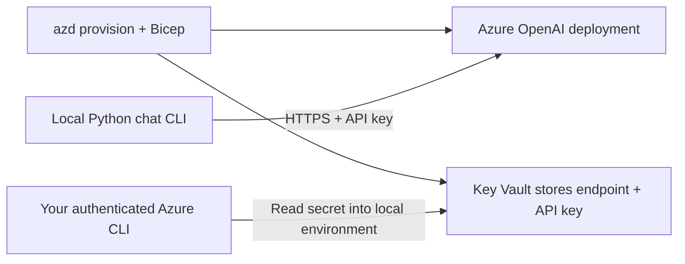

# Azure OpenAI Chat — CLI local et infrastructure AZD

**Niveau :** Intermédiaire · **Durée :** 35–60 minutes, installation incluse

Cet exemple provisionne une **ressource Azure OpenAI et un Key Vault**, puis exécute un
CLI de chat Python interactif **sur votre machine**. Il n’héberge pas d’application web
ni de Container App. Le modèle par défaut est `gpt-4.1`, version `2025-04-14`, avec
une capacité de déploiement `GlobalStandard` de 20. Vérifiez la disponibilité actuelle et le quota dans
votre région sélectionnée avant de provisionner ; les dates du cycle de vie du modèle peuvent changer.

## Objectifs d’apprentissage

- Provisionner l’infrastructure du modèle avec Bicep et azd.
- Récupérer une clé API depuis Key Vault sans la mettre dans les sorties du déploiement.
- Envoyer des requêtes de complétion de chat et maintenir l’historique de conversation.
- Interpréter les comptes de tokens et les limites des estimations de coût.



Il n’y a pas d’intégration d’identité gérée à l’exécution, de basculement multi-régions, de limitation de débit personnalisée,
de mode streaming ou de calcul hébergé dans cet exemple. Le SDK OpenAI
effectue jusqu’à deux nouvelles tentatives en cas d’échecs récupérables ; le CLI rapporte les erreurs restantes.

## Prérequis

- Une version stable actuelle de [azd](https://learn.microsoft.com/azure/developer/azure-developer-cli/install-azd)
  (version publiée au moment de la revue : 1.37.2).
- [Azure CLI](https://learn.microsoft.com/cli/azure/install-azure-cli).
- Python **3.10+** (3.11 recommandé) et un environnement virtuel.
- Un abonnement Azure avec les permissions pour créer des services cognitifs et des ressources Key Vault,
  déployer des modèles et lire les secrets du coffre.
- Disponibilité régionale et quota `GlobalStandard` pour `gpt-4.1`. Les exigences d’accès
  dépendent de l’abonnement et de la fonctionnalité ; il n’y a pas de délai d’approbation garanti.

```bash
azd version
az version
python --version
azd auth login
az login
```

Ce sont des sessions d’authentification distinctes. Sélectionnez le même abonnement dans les deux
outils avant d’exécuter les commandes ci-dessous.

## Démarrage rapide (Bash)

Exécutez depuis la racine du dépôt :

```bash
cd examples/azure-openai-chat
azd env new myopenai
azd provision
```

Choisissez une région prise en charge. Le provisionnement crée un groupe de ressources, un compte OpenAI,
un déploiement de modèle, un Key Vault, ainsi que les secrets `openai-endpoint`/`openai-api-key`.
Il n’y a **aucun service à déployer** dans `azure.yaml`.

Chargez les sorties non secrètes et récupérez le secret dans votre shell actuel :

```bash
export AZURE_OPENAI_ENDPOINT="$(azd env get-value AZURE_OPENAI_ENDPOINT)"
export AZURE_OPENAI_MODEL="$(azd env get-value AZURE_OPENAI_MODEL)"
KV_NAME="$(azd env get-value AZURE_KEY_VAULT_NAME)"
export AZURE_OPENAI_API_KEY="$(az keyvault secret show \
  --vault-name "$KV_NAME" --name openai-api-key --query value --output tsv)"

python -m venv .venv
source .venv/bin/activate
python -m pip install -r src/requirements.txt
python src/chat.py
```

Dans PowerShell, activez avec `.\.venv\Scripts\Activate.ps1` et assignez les variables d'environnement
avec `$env:AZURE_OPENAI_ENDPOINT = azd env get-value AZURE_OPENAI_ENDPOINT`
(et de même pour le modèle). Récupérez la clé API en utilisant
`$env:AZURE_OPENAI_API_KEY = az keyvault secret show --vault-name $KV_NAME --name openai-api-key --query value -o tsv`.
Définissez `$KV_NAME = azd env get-value AZURE_KEY_VAULT_NAME` en premier.

N'imprimez pas, ne commettez pas, et ne collez pas la clé API dans les rapports de problèmes. Le CLI lit les variables
d'environnement du processus ; il ne récupère **pas** les secrets Key Vault ni ne charge les fichiers `.env`.
`config.py` valide le point de terminaison, la limite de jetons et la température au démarrage.

Sortie attendue (contenu et usage variables) :

```text
Azure OpenAI Chat Application
Model: gpt-4.1
...
You: Say hello in one sentence.
Assistant: Hello! How can I help you today?
[Tokens: ... | Cost: $...]
```

Commandes : `stats` affiche les totaux, `clear` efface l'historique de conversation, et
`quit`/`exit` termine la session. Il n'y a pas de commandes `--stream`, `--show-tokens`, `tokens`,
ou `cost`.

## Vérifier le déploiement

Après avoir chargé les variables shell ci-dessus :

```bash
curl --fail-with-body \
  "${AZURE_OPENAI_ENDPOINT%/}/openai/deployments/${AZURE_OPENAI_MODEL}/chat/completions?api-version=2024-10-21" \
  -H "Content-Type: application/json" \
  -H "api-key: $AZURE_OPENAI_API_KEY" \
  -d '{"messages":[{"role":"user","content":"Say hello!"}],"max_tokens":50}'

az keyvault secret list --vault-name "$KV_NAME" --query "[].name" -o table
```

Succès : l'API retourne HTTP 200 avec `choices[0].message.content` et `usage` ;
le coffre liste `openai-api-key` et `openai-endpoint`. Un déploiement ARM réussi
seul ne vérifie pas l'inférence.

## Fichiers et configuration

```text
azure.yaml                         # Infrastructure-only AZD project
infra/main.bicep                   # Subscription deployment
infra/main.parameters.json         # Environment, location, principal ID
infra/resources/openai.bicep       # Account + model
infra/resources/keyvault.bicep     # Vault + deploying user's secret access policy
infra/resources/secrets.bicep      # Writes secrets, no key output
src/chat.py                        # Interactive CLI
src/config.py                      # Environment validation
src/requirements.txt               # Python packages
```

Pour changer le modèle/version/capacité provisionné, modifiez les valeurs par défaut dans
`infra/main.bicep` et exécutez `azd provision`. Définir `AZURE_OPENAI_MODEL` dans votre
shell ne sélectionne qu'un **nom de déploiement existant** ; cela ne déploie pas un autre modèle.

| Variable d'exécution | Défault / source |
|---|---|
| `AZURE_OPENAI_ENDPOINT` | Obligatoire ; sortie non secrète d'azd |
| `AZURE_OPENAI_API_KEY` | Obligatoire ; récupération depuis Key Vault |
| `AZURE_OPENAI_MODEL` | `gpt-4.1` ; nom du déploiement Azure |
| `AZURE_OPENAI_MAX_TOKENS` | 800 (plage de validation 1–4096) |
| `AZURE_OPENAI_TEMPERATURE` | 0,7 (plage 0–2) |
| `AZURE_OPENAI_INPUT_PRICE_PER_1K` | 0,002 USD ; taux d'entrée non mis en cache illustratif |
| `AZURE_OPENAI_OUTPUT_PRICE_PER_1K` | 0,008 USD ; taux de sortie illustratif |

## Coûts et limites de sécurité

L'affichage des coûts est une **estimation**, pas la facturation Azure. Il multiplie l'utilisation des jetons de l'API
par les taux configurés et ne tient pas compte des remises pour entrées mises en cache,
des différences régionales / SKU, des taxes, des modifications de prix ou des appels échoués / réessayés.
Remplacez **les deux taux** lors de l'utilisation d'un autre modèle ou SKU et vérifiez la
[tarification Azure OpenAI](https://azure.microsoft.com/pricing/details/cognitive-services/openai-service/) actuelle.

À titre d'illustration, 100 requêtes utilisant 500 jetons d'entrée non mis en cache et 200 jetons de sortie chacune
au taux par défaut coûtent `100 × (500/1000 × .002 + 200/1000 × .008) = $0.26`.
Les opérations / stockage Key Vault entraînent des frais séparés. Il n'y a pas de frais fixes de 50$/mois
pour ce CLI local et pas de calcul hébergé dans le modèle.

Le coffre utilise une politique d'accès pour le principal déployeur ; ce n'est pas un exemple d'application RBAC ou
à identité gérée. Des points d'accès publics et une authentification par clé API
sont utilisés à des fins pédagogiques. Limitez les permissions et ajoutez les contrôles d'identité / réseau
appropriés avant de l'adapter pour la production.

## Exercices pratiques

### 1. Vérifiez le contexte et réinitialisez-le

**Départ :** CLI en fonctionnement. **Objectif :** observer l'historique.
Dites « Souviens-toi du mot cèdre », puis demandez « Quel mot t'ai-je demandé de retenir ? »
Exécutez `stats` ; deux tours réussis devraient compter comme deux messages échangés.
Exécutez `clear` et `stats` ; les messages échangés devraient être zéro (les totaux de jetons restent).
La formulation exacte du modèle n'est pas déterministe.

### 2. Changez la limite de réponse

**Départ :** quittez le CLI en gardant le même shell.
Exécutez `export AZURE_OPENAI_MAX_TOKENS=100`, redémarrez `python src/chat.py` et demandez
une brève explication d'azd. Vérifiez que la bannière affiche 100.
Restaurez avec `unset AZURE_OPENAI_MAX_TOKENS`. Une limite de réponse plus petite ne
réduit pas les jetons d'historique déjà envoyés.

### Problèmes courants

- **Variables d'environnement manquantes :** le provisionnement n'exporte pas les valeurs du shell ;
  répétez les étapes d'exportation. Un nouveau terminal en aura besoin à nouveau.
- **403 lors de la lecture de Key Vault :** vérifiez l'abonnement / connexion Azure CLI et le principal
  dans la politique d'accès du coffre. Les modifications de politique peuvent prendre du temps à se propager.
- **404 inférence :** vérifiez le nom du déploiement, le point de terminaison et le statut du déploiement.
- **429 inférence :** attendez que les limites de taux se réinitialisent ; vérifiez le quota régional du modèle.
  Le CLI supprime les tours échoués de l'historique afin que les réessais ne les dupliquent pas.
- **Longueur du contexte :** l'exemple ne tronque pas les longues conversations ; utilisez `clear`.
- **Modèle indisponible / retiré :** consultez la disponibilité actuelle du modèle et mettez à jour
  modèle/version/SKU ensemble ; la version API et la version du modèle sont des paramètres différents.

## Nettoyage et étapes suivantes

```bash
azd down
unset AZURE_OPENAI_API_KEY
```

La rétention de suppression douce de Key Vault est de sept jours ; la purge nécessite des autorisations séparées.
Il n'y a pas de suite de tests engagée ; ne lancez pas une commande `pytest tests/` inexistante.
Ajoutez des tests API simulés avant d'étendre le code.

[Exemples de conteneurs](../../../../examples/container-app) · [Plan directeur d'architecture Retail](../retail-scenario.md) ·
[Page d'accueil du cours](../../README.md) · [Signaler un problème](https://github.com/microsoft/AZD-for-beginners/issues)

---

<!-- CO-OP TRANSLATOR DISCLAIMER START -->
**Avertissement** :
Ce document a été traduit à l'aide du service de traduction automatique [Co-op Translator](https://github.com/Azure/co-op-translator). Bien que nous nous efforçions d'assurer l'exactitude, veuillez noter que les traductions automatisées peuvent contenir des erreurs ou des inexactitudes. Le document original dans sa langue native doit être considéré comme la source faisant autorité. Pour les informations critiques, il est recommandé de recourir à une traduction professionnelle réalisée par un humain. Nous ne saurions être tenus responsables des malentendus ou erreurs d'interprétation découlant de l'utilisation de cette traduction.
<!-- CO-OP TRANSLATOR DISCLAIMER END -->