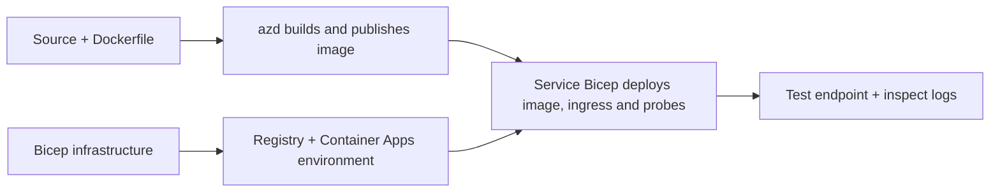

# Exemples de déploiement d'applications conteneurisées avec AZD

Ce répertoire contient deux exemples d’apprentissage avec code source, Dockerfiles,
infrastructure Bicep et `azure.yaml`. Aucun n’est renforcé pour la production.

## Choisissez un exemple

| Exemple | Ce qui est implémenté | Prérequis |
|---|---|---|
| [Simple API Flask](../../../../examples/container-app/simple-flask-api) | API CRUD Python unique, éléments en mémoire, sondes de santé, mise à l’échelle HTTP | Connaissances de base en CLI et HTTP |
| [Microservices à deux services](../../../../examples/container-app/microservices) | Passerelle Node.js, service produit Python en lecture seule interne, télémétrie et mise à l’échelle | Compléter d’abord l'exemple à service unique |

Prévoyez 30 à 60 minutes incluant la configuration et la vérification. Les temps de provisionnement Azure varient.

## Prérequis

- [Azure Developer CLI](https://learn.microsoft.com/azure/developer/azure-developer-cli/install-azd)
- [Azure CLI](https://learn.microsoft.com/cli/azure/install-azure-cli) pour les commandes de vérification
- Docker avec son démon en fonctionnement pour construire ces images conteneurisées
- Un abonnement Azure avec des permissions de création de ressources et un quota régional suffisant
- Bash pour les exemples shell, ou commandes PowerShell équivalentes

```bash
azd version
az version
docker info
azd auth login
az login
```

Les deux outils ont des sessions de connexion séparées. Utilisez une version stable récente de azd ; la version publiée
actuelle au moment de la revue est la 1.37.2. Les exigences de version minimale plus anciennes ne garantissent pas une
compatibilité.

## Démarrage rapide

Depuis la racine du dépôt :

```bash
cd examples/container-app/simple-flask-api
azd env new flask-demo
azd up
API_URL=$(azd env get-value API_ENDPOINT)
curl --fail-with-body "${API_URL}/health"
```

Attendu : HTTP 200 avec `"status": "healthy"`. Suivez le README d'exemple pour créer,
lire, mettre à jour et supprimer un élément, et pour inspecter les logs.



Le provisioning initial utilise une image publique hello-world sur le port 80. Les fichiers
de paramètres Bicep spécifiques au service permettent à `azd deploy` de la remplacer par l'image de l'application construite
et le port/app probes corrects (8000 pour Flask/produit, 8080 pour la passerelle).
Gardez ces fichiers avec leurs paramètres `azure.yaml` `module`.

## Configuration : ce qui change quoi

`azure.yaml` sélectionne les répertoires source, les langues, les hôtes et les modules de déploiement.
Le CPU/mémoire du conteneur, l’ingress, les probes, le nombre de réplicas et les règles de mise à l’échelle sont définis
en **Bicep**, pas dans des propriétés de service `resources`, `scale` ou `regions` arbitraires.

`azd env set SOME_VALUE ...` stocke une valeur localement. Elle ne modifie une ressource déployée
que lorsqu’un paramètre, un mappage d’environnement ou un hook consomme explicitement cette
valeur. Ces exemples ne consomment pas `MAX_REPLICAS`, `SCALE_TO_ZERO_TIMEOUT`,
`CONTAINER_APP_REPLICA_TYPE`, ni des réglages canary personnalisés à partir des valeurs d’environnement azd.
Modifiez le Bicep pertinent et exécutez `azd up` pour re-provisionner et déployer.

Ne placez pas le code source de l’application sous `infra/`. `project` doit pointer vers le répertoire source
contenant le Dockerfile et le manifeste des dépendances.

## Surveillance et coûts

- `azd monitor --logs` ouvre une vue portail ; ce n’est pas un flux de logs terminal.
  Utilisez `az containerapp logs show --follow` avec le nom réel de la ressource.
- L’API simple écrit les logs stdout collectés via Container Apps/Log Analytics.
  La ressource Application Insights provisionnée n’est pas instrumentée automatiquement.
- La passerelle de microservices utilise le SDK Node.js Application Insights ; le service Python
  exporte les traces de logs d’application. Le traçage complet des requêtes/dépendances Python
  n’est pas configuré.
- La mise à l’échelle à zéro peut réduire les frais de calcul, mais le registre ainsi que l’ingestion/le stockage des logs
  peuvent toujours coûter de l’argent. Les valeurs par défaut des microservices maintiennent des réplicas en fonctionnement.
  Estimez votre région et usage dans la
  [calculatrice de tarification Azure](https://azure.microsoft.com/pricing/calculator/).

## Modèles avancés — mises en œuvre non incluses

Ce sont des orientations de conception, pas des projets locaux supplémentaires ni des extraits à copier-coller :

- **Données persistantes et authentification :** remplacez les magasins en mémoire et ajoutez
  l’authentification/autorisation Microsoft Entra ID avant la production.
- **Blue-green/canary :** utilisez le mode multi-révisions de Container Apps, les étiquettes de révision,
  les poids de trafic, la vérification de santé et les procédures de rollback.
  Il n’y a pas de configuration `deploymentStrategy: canary` azd dans ces exemples.
  Voir [gestion des révisions](https://learn.microsoft.com/azure/container-apps/revisions).
- **Multi-région :** créez des environnements et applications séparés dans Bicep et concevez
  un routage global et la cohérence des données. Une liste `regions` de services n’est pas un
  mécanisme de déploiement azd.
- **Travailleurs de file d’attente :** ajoutez la source du travailleur, les dépendances, les ressources de file d’attente, une identité managée
  avec des rôles plane-données, et une règle d’échelle authentifiée. Ne copiez pas
  un chemin `src/worker` vide en espérant un projet fonctionnel.
- **Dapr :** provisionnez les composants, configurez le sidecar, installez le SDK correspondant,
  et implémentez la gestion d’erreurs état/pub-sub.
- **Secrets :** utilisez l’identité managée et les attributions de rôles autant que possible. Créer un Key Vault
  ne donne pas automatiquement accès aux applications ni ne charge les secrets.

## Nettoyage

Depuis le répertoire de l’exemple :

```bash
azd down
```

Vérifiez les invites de suppression et confirmez que le groupe de ressources dédié est supprimé.
N’utilisez pas ces exemples comme base de production sans conception et tests supplémentaires.

[Index des exemples](../README.md) · [Accueil du cours](../../README.md) ·
[Documentation Container Apps](https://learn.microsoft.com/azure/container-apps/) ·
[Signaler un problème](https://github.com/microsoft/AZD-for-beginners/issues)

---

<!-- CO-OP TRANSLATOR DISCLAIMER START -->
**Avertissement** :
Ce document a été traduit à l'aide du service de traduction automatique [Co-op Translator](https://github.com/Azure/co-op-translator). Bien que nous nous efforçions d'assurer l'exactitude, veuillez noter que les traductions automatisées peuvent contenir des erreurs ou des inexactitudes. Le document original dans sa langue native doit être considéré comme la source faisant autorité. Pour les informations critiques, il est recommandé de recourir à une traduction professionnelle réalisée par un humain. Nous ne saurions être tenus responsables des malentendus ou erreurs d'interprétation découlant de l'utilisation de cette traduction.
<!-- CO-OP TRANSLATOR DISCLAIMER END -->