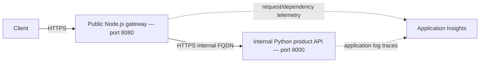

# Microservices à deux services — Azure Container Apps

**Niveau :** Intermédiaire · **Durée :** 45–60 minutes incluant la configuration

Cet exemple pédagogique implémente une **passerelle API Node.js** et un **service produit Python en lecture seule**.
Le code source, les Dockerfiles, Bicep et la configuration azd sont inclus.
Ce n'est pas un système renforcé pour la production.

## Ce que vous apprendrez

- Déployer deux services indépendamment.
- Utiliser un FQDN interne backend via HTTPS.
- Vérifier les réponses de succès, non trouvé et service indisponible.
- Comprendre la télémétrie et les frontières de mise à l’échelle indépendantes.



Le catalogue produit contient cinq produits fixes en mémoire. Il n’y a **aucun gestionnaire POST,
PUT ou DELETE**, base de données, Service Bus, service commande/utilisateur/notification,
code C# ou Go. Ce sont des idées de développements futurs, non incluses ici.
La passerelle n’authentifie pas les utilisateurs ; l’ingress interne ne remplace pas
l’autorisation applicative.

## Prérequis

Complétez d'abord le [single Flask API](../../../../../examples/container-app/simple-flask-api).
Installez une version stable actuelle d'azd (version publiée au moment de la revue : 1.37.2), Azure CLI,
et Docker avec le daemon en marche. Vous avez besoin d'un abonnement Azure, de permissions
pour la création de ressources, et d'un quota régional Container Apps.

```bash
azd version
az version
docker info
azd auth login
az login
```

Utilisez le même abonnement dans les deux outils CLI. Les commandes ci-dessous utilisent Bash.

## Déployer et vérifier

Depuis la racine du dépôt :

```bash
cd examples/container-app/microservices
azd env new microservices-demo
azd up
GATEWAY_URL=$(azd env get-value API_GATEWAY_URL)
RG_NAME=$(azd env get-value AZURE_RESOURCE_GROUP)
GATEWAY_NAME=$(azd env get-value API_GATEWAY_NAME)
PRODUCT_NAME=$(azd env get-value PRODUCT_SERVICE_NAME)

curl --fail-with-body "${GATEWAY_URL}/health"
curl --fail-with-body "${GATEWAY_URL}/api/products"
curl --fail-with-body "${GATEWAY_URL}/api/products/1"
curl -i "${GATEWAY_URL}/api/products/999"
```

**Succès :** health 200 ; list 200 avec **cinq** produits ; produit 1 est un Ordinateur portable
au prix de 999,99 avec un stock de 50 ; un produit inconnu retourne 404.
Les descriptions sont incluses dans les réponses ; les horodatages varient.

La mise en service initiale utilise des images hello-world publiques sur le port 80 afin de ne pas
essayer de récupérer des images inexistantes depuis un registre vide. Les modules Bicep spécifiques aux services
et les fichiers de paramètres les remplacent par des images construites et des ports/probes d'app pendant
`azd deploy`. Les paramètres principaux conservent les noms des images publiées pour une mise en service ultérieure.

## Services et réseau

| Service | Points d'extrémité exposés | Ressources par défaut |
|---|---|---|
| Gateway | GET `/`, `/health`, `/api/products`, `/api/products/:id` | 1 vCPU, 2 GiB, 2–20 répliques |
| Product | GET `/`, `/health`, `/products`, `/products/<id>` | 0.5 vCPU, 1 GiB, 1–10 répliques |

L'ingress du produit dispose de `external: false` et `allowInsecure: false`. Bicep injecte
`PRODUCT_SERVICE_URL=https://<actual-internal-fqdn>` dans la passerelle. HTTP pourrait
rediriger ; HTTPS correspond à l'entrée configurée. Un nom DNS court doit correspondre au
**nom réel de l'application Container**, pas à la clé de service logique `product-service`.
N'essayez pas d'appeler l'URL interne directement depuis votre ordinateur portable.

La passerelle a un délai d'attente de cinq secondes pour les appels produits. Les identifiants de produit manquants
se propagent en 404 ; les échecs de transport/autres échecs du backend renvoient 503. La passerelle
`/health` ne vérifie que la passerelle, pas la disponibilité du backend.

## Fichiers et configuration

```text
azure.yaml
infra/main.bicep
infra/main.parameters.json
infra/abbreviations.json
infra/core/container-apps-environment.bicep
infra/core/monitor.bicep
infra/app/api-gateway.bicep
infra/app/api-gateway.parameters.json
infra/app/product-service.bicep
infra/app/product-service.parameters.json
src/api-gateway/{app.js,package.json,Dockerfile}
src/product-service/{main.py,requirements.txt,Dockerfile}
```

La mise à l'échelle, le processeur/mémoire, les ports et les sondes sont définis dans `infra/app/*.bicep`. Modifiez ces
fichiers et exécutez `azd up` pour appliquer l'infrastructure et redéployer. Il n'y a pas
de paramètre d'environnement `GATEWAY_MAX_REPLICAS` dans cet exemple.

Pour les modifications uniquement au niveau du code :

```bash
azd deploy product-service
azd deploy api-gateway
```

L'image Node utilise Node 22 ; l'image Python utilise Python 3.11. Les deux se lient à
`0.0.0.0`. L'entrée/les sondes utilisent respectivement les ports 8080 (passerelle) et 8000 (produit).

## Développement local avec Docker

Exécutez depuis ce répertoire d'exemple. Utilisez un réseau défini par l'utilisateur, **pas `localhost`
d'un conteneur pour atteindre l'autre** :

```bash
docker network create azd-microservices-demo
docker build -t local-product ./src/product-service
docker build -t local-gateway ./src/api-gateway
docker run -d --name azd-product --network azd-microservices-demo local-product
docker run -d --name azd-gateway --network azd-microservices-demo \
  -p 8080:8080 -e PRODUCT_SERVICE_URL=http://azd-product:8000 local-gateway
curl --fail-with-body http://localhost:8080/api/products
```

Attendu : cinq produits. HTTP est utilisé uniquement pour ce réseau Docker local.

```bash
docker stop azd-product azd-gateway
docker rm azd-product azd-gateway
docker network rm azd-microservices-demo
```

## Surveillance

```bash
az containerapp logs show --name "$GATEWAY_NAME" --resource-group "$RG_NAME" --follow
# In a separate terminal:
az containerapp logs show --name "$PRODUCT_NAME" --resource-group "$RG_NAME" --tail 100
```

`azd monitor --logs` ouvre une vue portail ; il ne diffuse pas les journaux du terminal.
Le SDK Node collecte les demandes/dépendances de la passerelle. Le `AzureLogHandler` de Python
exporte **les traces des journaux**, pas les requêtes Flask automatiques, les dépendances SQL ou les traces
distribuées complètes. OpenCensus est un SDK obsolète ; préférez Azure Monitor OpenTelemetry
lors de l'extension de cet exemple.

Dans Application Insights Logs, générez des requêtes et inspectez :

```kusto
requests
| where timestamp > ago(1h)
| where name contains "products"
| summarize RequestCount=count(), AvgDuration=avg(duration) by bin(timestamp, 5m)
```

Pour les messages d'application Python :

```kusto
traces
| where timestamp > ago(1h)
| where message contains "products"
| project timestamp, message, severityLevel
```

Prenez en compte le délai d'ingestion et l'échantillonnage ; ne vous attendez pas à un nombre exact de requêtes ni à une
latence garantie. Aucun alertes personnalisées ou tableaux de bord ne sont configurés.

## Exercices pratiques

### Exercice 1 : Modifier le catalogue

**Point de départ :** `src/product-service/main.py`.
**Objectif :** vérifier le déploiement indépendant du service.
Modifiez le stock de Laptop de 50 à 49 dans la liste fixe `products`, exécutez
`azd deploy product-service`, puis demandez `${GATEWAY_URL}/api/products/1`.

**Critères de réussite / solution :** HTTP 200 avec `"stock":49`. Restaurez 50 et redéployez.
**Problème courant :** modification de la passerelle au lieu du service qui possède le catalogue.
Cela change les données sources, pas une base de données d'inventaire persistante.

### Exercice 2 : Vérifier la configuration des réplicas

**Point de départ :** `infra/app/product-service.bicep`.
**Objectif :** observer un changement d'infrastructure sans deviner l'autoscaling.
Changez `minReplicas: 1` en `minReplicas: 2`, exécutez `azd up`, puis :

```bash
az containerapp show --name "$PRODUCT_NAME" --resource-group "$RG_NAME" \
  --query properties.template.scale -o json
```

**Critères de réussite :** le minimum configuré est 2 et le maximum reste 10.
Restaurez le minimum à 1 et exécutez `azd up`.
**Problème courant :** `azd deploy` seul ne s'applique pas aux infrastructures partagées non liées.
Ne définissez pas `maxReplicas` à zéro comme simulation d'échec.
Ceci vérifie la configuration, ce n'est pas un test de charge ou un nombre de réplicas instantané garanti.

### Exercice 3 : Tester localement la gestion des services indisponibles

**Point de départ :** les deux conteneurs Docker locaux ci-dessus sont en cours d'exécution.
**Objectif :** distinguer une panne du backend d'un produit manquant.
Arrêtez uniquement le conteneur produit :

```bash
docker stop azd-product
curl -i http://localhost:8080/api/products
docker start azd-product
curl --fail-with-body http://localhost:8080/api/products
```

**Critères de réussite :** pendant l'arrêt, la passerelle renvoie 503 avec
`"error":"Product service unavailable"` ; après redémarrage, la liste renvoie 200.
Réessayez après un court délai de démarrage si nécessaire.
**Problème courant :** arrêter la passerelle teste une panne différente (pas de réponse HTTP).

## Coûts et lacunes en production

Les réplicas minimum par défaut gardent le calcul en fonctionnement. Le registre et la surveillance entraînent également
des frais. Il n'y a pas de total fixe validé à 50 $/mois : estimez le processeur/mémoire régional,
les heures de réplicas, les requêtes, le registre et la rétention des journaux dans le
[calculateur de prix Azure](https://azure.microsoft.com/pricing/calculator/).
Supprimez rapidement les ressources d'apprentissage.

Le travail en production inclut l'authentification/l'autorisation, les identités managées ciblées,
les données persistantes, la validation des entrées/réponses, l'instrumentation d'observabilité prise en charge,
les tests de charge/échec, CI/CD, les alertes et les procédures de récupération. Ajouter un service de commande,
une file d'attente ou une base de données est une tâche d'implémentation distincte, pas un exercice fini
ni une fonctionnalité déjà disponible ici.

## Dépannage et nettoyage

- **Image non trouvée lors du premier provisionnement :** le bootstrap doit utiliser l'image publique ;
  vérifiez les paramètres par défaut de l'image principale et les correspondances des modules de déploiement.
- **503 produits :** vérifiez les journaux des produits, la révision de l'image et l'URL HTTPS interne injectée.
- **404 chemin inattendu :** l'API produit est en lecture seule ; vérifiez la route, pas un gestionnaire CRUD inexistant.
- **Pas de télémétrie :** inspectez les chaînes de connexion à l'exécution sans les exposer et
  autorisez le délai d'ingestion. Les tables de requêtes Python ne sont pas remplies par son gestionnaire de journaux.

Depuis ce répertoire d'exemple :

```bash
azd down
```

Examinez les messages de suppression et vérifiez que le groupe de ressources dédié est supprimé.

[Précédent : Flask API](../../../../../examples/container-app/simple-flask-api) · [Suivant : application base de données](../../../../../examples/database-app) ·
[Développement IA](../../../docs/chapter-02-ai-development/README.md) ·
[Accueil du cours](../../../README.md) · [Signaler un problème](https://github.com/microsoft/AZD-for-beginners/issues)

---

<!-- CO-OP TRANSLATOR DISCLAIMER START -->
**Avertissement** :
Ce document a été traduit à l'aide du service de traduction automatique [Co-op Translator](https://github.com/Azure/co-op-translator). Bien que nous nous efforçions d'assurer l'exactitude, veuillez noter que les traductions automatisées peuvent contenir des erreurs ou des inexactitudes. Le document original dans sa langue native doit être considéré comme la source faisant autorité. Pour les informations critiques, il est recommandé de recourir à une traduction professionnelle réalisée par un humain. Nous ne saurions être tenus responsables des malentendus ou erreurs d'interprétation découlant de l'utilisation de cette traduction.
<!-- CO-OP TRANSLATOR DISCLAIMER END -->