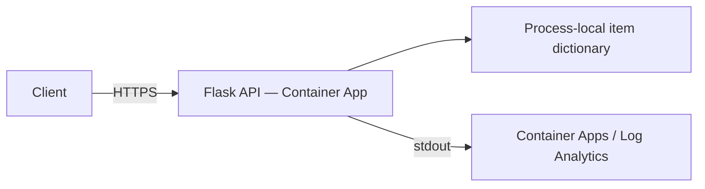

# API Flask simple — Azure Container Apps

**Niveau :** Débutant · **Durée :** 30 à 45 minutes, installation comprise

Déployer une API CRUD Python Flask avec Azure Developer CLI (azd). Le code source, Dockerfile,
Bicep et les paramètres de déploiement sont inclus. Ceci est un **exemple d’apprentissage**, pas
une API prête pour la production.

## Ce que vous apprendrez

- Construire et publier un conteneur avec azd.
- Configurer les sondes d'ingress et de vivacité/préparation.
- Vérifier les réponses CRUD et inspecter les journaux de l'application.
- Comprendre pourquoi les données en mémoire ne conviennent pas aux applications durables.



**Important :** les éléments sont conservés dans un seul processus. La valeur par défaut est **un seul worker Gunicorn,
0–1 répliques**, évitant intentionnellement des données incohérentes entre les workers/répliques.
Les éléments sont perdus au redémarrage, lors d’un changement de révision ou en cas de réduction à zéro. L’augmentation du nombre de répliques
nécessite un stockage persistant partagé. L’API ne dispose d’aucune authentification ni autorisation.

## Prérequis

- [azd stable actuel](https://learn.microsoft.com/azure/developer/azure-developer-cli/install-azd)
  (version publiée au moment de la revue : 1.37.2).
- [Azure CLI](https://learn.microsoft.com/cli/azure/install-azure-cli) pour vérification.
- Docker avec son démon en fonctionnement ; requis pour la construction d’image locale par défaut.
- Abonnement Azure, autorisations de création de ressources et quota régional des Container Apps.
- Bash pour les commandes ci-dessous (ou PowerShell équivalent).
- Python 3.11 pour le développement local optionnel.

```bash
azd version
az version
docker info
azd auth login
az login
```

Les outils CLI ont des sessions de connexion distinctes. Utilisez le même abonnement dans les deux.

## Démarrage rapide

Depuis la racine du dépôt :

```bash
cd examples/container-app/simple-flask-api
azd env new flask-demo
azd up
API_URL=$(azd env get-value API_ENDPOINT)
RG_NAME=$(azd env get-value AZURE_RESOURCE_GROUP)
API_NAME=$(azd env get-value API_NAME)
curl --fail-with-body "${API_URL}/health"
```

Attendu : HTTP 200 et JSON avec `"status":"healthy"`,
`"service":"simple-flask-api"`, et un horodatage UTC actuel.
Le provisionnement et la construction d’image prennent généralement plusieurs minutes ; les délais varient.

Le provisionnement initial utilise une image publique hello-world écoutant sur le port 80.
`azure.yaml` sélectionne `infra/app/api.bicep` et son fichier de paramètres correspondant pour
le déploiement du service, ce qui change l'image, l'ingress et les probes vers le port 8000.
Ne supprimez pas ces paramètres de déploiement.

## Vérifier CRUD

Exécutez ce qui suit séquentiellement tant que la même réplique reste active :

```bash
# Create: HTTP 201; note the returned id (1 for a fresh process).
curl -i -X POST "${API_URL}/api/items" \
  -H "Content-Type: application/json" \
  -d '{"name":"Test Item","description":"My first item"}'

# Read list: HTTP 200, total 1 in a fresh process.
curl --fail-with-body "${API_URL}/api/items"

# Replace 1 if your create response returned another id.
curl --fail-with-body "${API_URL}/api/items/1"
curl -i -X PUT "${API_URL}/api/items/1" \
  -H "Content-Type: application/json" -d '{"name":"Updated Item"}'
curl -i -X DELETE "${API_URL}/api/items/1"
curl -i "${API_URL}/api/items/1"
```

Succès : POST 201, lectures/PUT 200, DELETE 204 sans corps, puis élément manquant 404.
JSON mal formé/non objet ou un nom vide renvoie 400.
Si un élément disparaît entre les requêtes, vérifiez un redémarrage ou une mise à l'échelle à zéro ;
il s'agit d'une limitation intentionnelle en mémoire, pas de persistance.

| Point de terminaison | Méthodes |
|---|---|
| `/` | GET — informations du service |
| `/health` | GET — vivacité/préparation |
| `/api/items` | GET, POST |
| `/api/items/{id}` | GET, PUT, DELETE |

## Journaux et configuration

```bash
az containerapp logs show --name "$API_NAME" --resource-group "$RG_NAME" --follow
```

Attendu : démarrage de Gunicorn, journaux d'accès aux requêtes et messages de l'application.
`azd monitor --logs` ouvre une vue du portail ; il ne diffuse pas vers le terminal.
Application Insights est provisionné mais **pas instrumenté par ce code Flask** ;
utilisez Container Apps/Log Analytics pour les journaux stdout.

Modifiez `infra/app/api.bicep` pour le CPU/la mémoire, les limites de réplicas, ou les règles de mise à l’échelle, puis
exécutez `azd up`. Les valeurs par défaut sont 0,5 vCPU, 1 Gio, un minimum de 0 / maximum 1 réplique, et un
seuil HTTP de 50 requêtes simultanées. La mise à l’échelle à zéro peut ajouter une latence de démarrage à froid.

Des valeurs arbitraires `azd env set MAX_REPLICAS`, `API_KEY`, `LOG_LEVEL`, ou
`SCALE_TO_ZERO_TIMEOUT` ne sont **pas connectées à ce modèle ou application**.
Définir une valeur ne la transforme pas automatiquement en variable d’environnement d’exécution.
L’image lie explicitement le port 8000 ; mettez à jour Dockerfile, l’ingress Bicep, et les probes
ensemble si vous changez le port.

## Fichiers

```text
azure.yaml
infra/main.bicep
infra/main.parameters.json
infra/app/container-apps.bicep       # Environment, registry, monitoring
infra/app/api.bicep                  # App, ingress, probes, scale settings
infra/app/api.parameters.json        # Image and resource values for azd deploy
src/app.py
src/Dockerfile
src/requirements.txt
```

## Développement local

Depuis ce répertoire d'exemple :

```bash
python -m venv .venv
source .venv/bin/activate  # PowerShell: .\.venv\Scripts\Activate.ps1
python -m pip install -r src/requirements.txt
python src/app.py
```

Dans un autre terminal, testez `http://localhost:8000/health` et les points de terminaison CRUD.
Ou construisez et exécutez l'image réelle :

```bash
docker build -t flask-api:local ./src
docker run --rm -p 8000:8000 flask-api:local
```

Pour les modifications de code uniquement après le premier déploiement, exécutez `azd deploy api`.
Pour les modifications Bicep, exécutez `azd up` pour reprovisionner et déployer.

## Exercices pratiques

### 1. Valider le rejet de l’entrée

**Point de départ :** API déployée, `API_URL` ci-dessus.
**Objectif :** vérifier que l'API rejette les formes JSON invalides et les noms manquants.

```bash
curl -i -X POST "${API_URL}/api/items" \
  -H "Content-Type: application/json" -d '[]'
curl -i -X POST "${API_URL}/api/items" \
  -H "Content-Type: application/json" -d '{"name":""}'
```

**Critères de réussite / solution :** les deux renvoient 400 avec une erreur JSON, pas 500.
**Problème courant :** omission de l'en-tête content-type JSON.

### 2. Ajouter un point de terminaison en lecture seule

**Point de départ :** `src/app.py`. **Objectif :** étendre et redéployer l'API.
Ajoutez ceci avant le bloc `if __name__ == '__main__':` :

```python
@app.route('/version', methods=['GET'])
def version():
    return jsonify({'version': '1.0.0'})
```

Exécutez `azd deploy api`, puis `curl --fail-with-body "${API_URL}/version"`.
**Critères de réussite :** HTTP 200 et `{"version":"1.0.0"}`.
**Problème courant :** placer la route après l'appel bloquant `app.run()` lors du
test avec `python src/app.py`.

### Point de contrôle des connaissances

Pourquoi un seul worker est-il insuffisant pour des données durables ? Parce que même un seul processus perd
son dictionnaire au redémarrage. Une version de production nécessite un stockage partagé persistant,
une authentification, une autorisation, des migrations, des tests et une surveillance opérationnelle.

## Coûts et dépannage

Ceci n’est pas un déploiement $0 garanti : le registre Basic et le stockage/ingestion des journaux
peuvent entraîner des frais même lorsque le calcul de l’application est à zéro. Utilisez le
[calculateur de prix](https://azure.microsoft.com/pricing/calculator/) pour votre région.

- **Échec de la construction Docker :** confirmez `docker info`, l'accès réseau et les dépendances.
- **Application non saine :** inspectez les journaux console/système et vérifiez que le port de l'image, l'ingress,
  et les sondes correspondent. Un espace réservé ne doit pas être sondé sur le port Flask.
- **403/permissions :** confirmez les autorisations d’abonnement et de création de ressources.
- **Les éléments disparaissent :** l'état en mémoire se réinitialise au redémarrage/mise à l'échelle à zéro ; ajoutez une base de données
  pour un comportement durable.

## Nettoyage et prochaines étapes

```bash
azd down
```

Passez en revue l’invite de suppression et vérifiez que le groupe de ressources dédié est supprimé.
N’utilisez pas de nettoyage destructeur sur un groupe de ressources contenant des données non liées.

[Suivant : Application de base de données](../../../../../examples/database-app) · [Microservices](../../../../../examples/container-app/microservices) ·
[Aperçu des conteneurs](../README.md) · [Accueil du cours](../../../README.md) ·
[Signaler un problème](https://github.com/microsoft/AZD-for-beginners/issues)

---

<!-- CO-OP TRANSLATOR DISCLAIMER START -->
**Avertissement** :
Ce document a été traduit à l'aide du service de traduction automatique [Co-op Translator](https://github.com/Azure/co-op-translator). Bien que nous nous efforçions d'assurer l'exactitude, veuillez noter que les traductions automatisées peuvent contenir des erreurs ou des inexactitudes. Le document original dans sa langue native doit être considéré comme la source faisant autorité. Pour les informations critiques, il est recommandé de recourir à une traduction professionnelle réalisée par un humain. Nous ne saurions être tenus responsables des malentendus ou erreurs d'interprétation découlant de l'utilisation de cette traduction.
<!-- CO-OP TRANSLATOR DISCLAIMER END -->