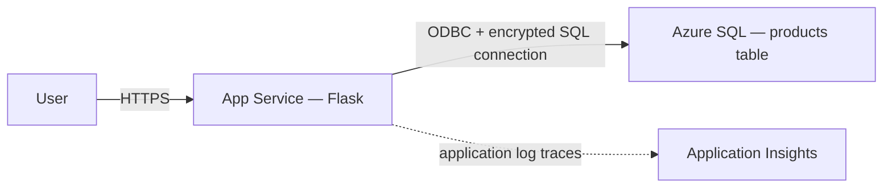

# Flask et Azure SQL sur App Service

**Niveau :** Intermédiaire · **Durée :** 30–60 minutes incluant les prérequis

Cet exemple déploie une API de lecture Python Flask sur **Linux App Service** et une base de données Azure SQL Basic.
Le code source, les fichiers Bicep et la configuration azd sont inclus. Il s'agit d'une
application d'apprentissage, et non d'une architecture de base de données prête pour la production.

## Ce que vous apprendrez

- Provisionner les ressources App Service, SQL et de surveillance avec Bicep.
- Configurer une connectivité SQL sécurisée sans compromettre les identifiants.
- Initialiser un schéma avant de démarrer les travailleurs Gunicorn.
- Vérifier les données semées, les réponses « non trouvé » et la santé de la base de données.



Ressources : groupe de ressources dédié, plan App Service Linux B1, application Web Python 3.11,
serveur SQL et base de données Basique 2 Go, Application Insights et Log Analytics.
L’application Web utilise **le déploiement source/ZIP et l’installation de dépendances Oryx** ;
`azd deploy` ne construit ni ne déploie le Dockerfile optionnel.

## Prérequis

- Version stable actuelle de [azd](https://learn.microsoft.com/azure/developer/azure-developer-cli/install-azd)
  (version publiée au moment de la revue : 1.37.2).
- [Azure CLI](https://learn.microsoft.com/cli/azure/install-azure-cli) pour vérification.
- Abonnement Azure, permissions pour créer les ressources listées, et quota régional.
- Python **3.11** pour le développement local ; le `pyodbc==5.0.1` commité peut nécessiter
  des outils de build natifs sur les versions plus récentes de Python.
- Microsoft ODBC Driver 18 (ou 17) pour SQL Server sur les machines locales. `pip install
  pyodbc` n’installe pas le pilote système. Voir
  [installation ODBC](https://learn.microsoft.com/sql/connect/odbc/download-odbc-driver-for-sql-server).
- Docker uniquement si vous testez le conteneur optionnel localement.

```bash
azd version
az version
azd auth login
az login
```

Utilisez le même abonnement dans les deux outils. Les commandes ci-dessous utilisent Bash.

## Déployer

Depuis la racine du dépôt :

```bash
cd examples/database-app
azd env new sql-demo
azd provision
azd deploy
WEB_URL=$(azd env get-value WEB_APP_URI)
WEB_NAME=$(azd env get-value WEB_APP_NAME)
RG_NAME=$(azd env get-value AZURE_RESOURCE_GROUP)
```

Choisissez une région prise en charge. `sqlAdminLogin` utilise par défaut `sqladmin` ; le
`sqlAdminPassword` requis est un paramètre sécurisé. Fournissez un mot de passe fort lorsqu’il est demandé.
Gardez les identifiants de déploiement hors de Git et des rapports de problèmes. L’interpolation actuelle de la chaîne de connexion
attend un mot de passe sans les délimiteurs de chaîne de connexion tels que
`;` ; adaptez l’échappement avant d’utiliser de telles valeurs.

Bicep définit une commande de démarrage qui exécute `init_database()` **avant** Gunicorn
les workers démarrent. Cela est nécessaire car importer `app:app` n'exécute pas
le bloc `if __name__ == '__main__'` de Python. Sur une base de données neuve, l'initialisation
crée `products` et insère cinq lignes. C'est une graine pédagogique simple, pas un
cadre de migration concurrente ; utilisez des migrations appropriées avant de déployer plusieurs instances.

L'application sélectionne le pilote Microsoft ODBC Driver 18 installé, puis le 17, si la chaîne de connexion
ne nomme pas explicitement un pilote. Si aucun n'existe, le démarrage échoue avec
une erreur d'installation exploitable. Vérifiez la disponibilité du pilote dans votre runtime
App Service choisi au lieu de l'assumer.

## Vérification

```bash
curl --fail-with-body "${WEB_URL}/"
curl --fail-with-body "${WEB_URL}/health"
curl --fail-with-body "${WEB_URL}/products"
curl --fail-with-body "${WEB_URL}/products/1"
curl -i "${WEB_URL}/products/999"
```

Attendu :

- `/` renvoie les informations de point de terminaison.
- `/health` renvoie 200 avec `{"status":"healthy","database":"connected"}`.
- `/products` retourne cinq produits initialisés sur une base de données neuve.
- `/products/1` retourne Laptop avec un prix de 1299.99.
- Un produit inexistant renvoie 404 avec `{"error":"Product not found"}`.

L'API est en lecture seule. Il n'y a pas de route POST/PUT/DELETE ni d'interface navigateur.
L’échec de connectivité à la base de données renvoie 503 depuis `/health` ; ce n'est pas un succès.

## Fichiers et configuration

```text
azure.yaml                         # Python App Service source deployment
infra/main.bicep
infra/main.parameters.json
infra/abbreviations.json
infra/resources/sql-server.bicep
infra/resources/sql-database.bicep
infra/resources/app-service-plan.bicep
infra/resources/web-app.bicep       # Settings + initialization/startup command
infra/resources/app-insights.bicep
src/web/app.py
src/web/requirements.txt
src/web/Dockerfile                 # Optional local container, not the azd target
.env.sample
```

`SQL_CONNECTION_STRING` est passé comme paramètre sécurisé Bicep au module Web App
et stocké dans les paramètres App Service, non dans les sorties de déploiement.
`APPLICATIONINSIGHTS_CONNECTION_STRING` configure l’export des logs.
`SCM_DO_BUILD_DURING_DEPLOYMENT=true` active l'installation de dépendances côté serveur.
Définir des valeurs `azd env` arbitraires ne modifie pas automatiquement les paramètres de l’application.

La règle `0.0.0.0` du pare-feu SQL autorise les connexions provenant des **services Azure,
y compris des abonnements d’autres clients**, sous réserve d’une authentification SQL. Elle n'est
pas limitée à cette application ou abonnement. L'accès réseau public SQL est activé.
Utilisez un réseau à portée restreinte et une identité d'application non admin avant la production.

## Développement local

Utilisez Python 3.11 et un pilote Microsoft SQL ODBC installé :

```bash
python -m venv .venv
source .venv/bin/activate  # PowerShell: .\.venv\Scripts\Activate.ps1
python -m pip install -r src/web/requirements.txt
export SQL_CONNECTION_STRING='Server=tcp:YOUR_SERVER.database.windows.net,1433;Database=YOUR_DATABASE;UID=YOUR_USER;PWD=YOUR_PASSWORD;Encrypt=yes;TrustServerCertificate=no;Connection Timeout=30;'
python src/web/app.py
```

Remplacez les espaces réservés de manière sécurisée. Un fichier `.env` copié **n’est pas chargé automatiquement**
par cette application. Exportez plutôt les variables dans votre shell actuel.
Pour Azure SQL depuis un ordinateur portable, autorisez temporairement uniquement votre IP publique :

```bash
SQL_SERVER=$(azd env get-value SQL_SERVER_NAME)
MY_IP=YOUR_PUBLIC_IP
az sql server firewall-rule create -g "$RG_NAME" -s "$SQL_SERVER" \
  -n AllowMyLearningIP --start-ip-address "$MY_IP" --end-ip-address "$MY_IP"
```

Supprimez la règle après les tests :

```bash
az sql server firewall-rule delete -g "$RG_NAME" -s "$SQL_SERVER" -n AllowMyLearningIP
```

Test facultatif en conteneur depuis ce répertoire d’exemple :

```bash
docker build -t sql-flask:local src/web
docker run --rm -p 8000:8000 -e SQL_CONNECTION_STRING sql-flask:local
```

Cette image installe le Driver 18 via le dépôt Debian 12 correspondant à sa base
Bookworm, initialise la base de données une fois, puis lance Gunicorn.

## Supervision et dépannage

Activez/suivez les logs d’application du système de fichiers App Service lors du diagnostic du démarrage :

```bash
az webapp log config --name "$WEB_NAME" --resource-group "$RG_NAME" \
  --application-logging filesystem --level information
az webapp log tail --name "$WEB_NAME" --resource-group "$RG_NAME"
```

Ce code exporte des **traces logs** d’application via un gestionnaire OpenCensus hérité.
Il ne configure pas la traçabilité automatique de requêtes/dépendances Flask, Live Metrics,
l’audit SQL, les paramètres diagnostics ou les alertes. Ces fonctions nécessitent une configuration séparée.
Pour une instrumentation nouvelle, préférez Azure Monitor OpenTelemetry.

Dans Application Insights Logs, après des requêtes API :

```kusto
traces
| where timestamp > ago(1h)
| where message contains "products" or message contains "Health check"
| project timestamp, message, severityLevel
```

Tenez compte d’un délai d’ingestion. L’activité dans la table de requêtes ou Live Metrics n’est pas un
critère d’achèvement pour cette instrumentation dédiée aux logs.

- **Pilote manquant :** inspectez `pyodbc.drivers()` dans le runtime et installez
  un pilote Microsoft ODBC supporté. Un paquet Python seul est insuffisant.
- **Échec de connexion :** vérifiez paramètres SQL, authentifications, pare-feu, et abonnement choisi.
  Ne désactivez pas le chiffrement pour contourner une erreur.
- **Table produits manquante :** confirmez que la commande de démarrage Bicep a été déployée ;
  démarrer `gunicorn app:app` seul saute l'initialisation.
- **Échec de construction du paquet :** utilisez Python 3.11 ou fournissez les prérequis natifs.
- **Données à prix zéro :** zéro est un prix décimal valide ; il doit se sérialiser en 0.0,
  pas en `null`.

## Exercices pratiques

### Exercice 1 : Vérifier le comportement en cas de produit manquant

**Point de départ :** API déployée et `WEB_URL` ci-dessus.
**Objectif :** distinguer une ligne manquante d’une base de données cassée.
Requêtez `/health` et `/products/999` avec les commandes ci-dessus.
**Critères de réussite / réponse:** santé 200, produit inexistant 404 (pas 500 ou 503).
**Problème fréquent :** supposer qu’une réponse « non trouvée » prouve que la connexion SQL est cassée.

### Exercice 2 : Modifier une valeur initialisée

**Point de départ :** éditeur de requêtes Azure SQL, connecté à la base de données d'exemple.
**Objectif :** montrer que les données de l’API sont stockées dans SQL plutôt que dans la mémoire du processus.

```sql
UPDATE products SET price = 0 WHERE id = 1;
SELECT id, name, price FROM products WHERE id = 1;
```

Requêtez `${WEB_URL}/products/1`. **Critères de réussite :** le prix est `0.0`, pas `null`.
Restaurez la valeur :

```sql
UPDATE products SET price = 1299.99 WHERE id = 1;
```

**Problème fréquent :** modifier la liste de graines Python ne met pas à jour les lignes déjà en SQL.
Ne faites pas d'exercices de schéma/données sur une base de production.

### Exercice 3 : Ajouter un endpoint de comptage en lecture seule

**Point de départ :** `src/web/app.py`.
**Objectif :** étendre l’API avec une requête agrégée sans paramètre.
Ajoutez ceci avant le bloc `if __name__ == '__main__':` :

```python
@app.route('/product-count')
def product_count():
    from contextlib import closing
    with closing(get_db_connection()) as conn, closing(conn.cursor()) as cursor:
        cursor.execute("SELECT COUNT(*) FROM products")
        return jsonify({'count': cursor.fetchone()[0]})
```

Lancez `azd deploy web`, puis requêtez `${WEB_URL}/product-count`.
**Critères de réussite :** 200 avec `{"count":5}` sur la base initialisée intacte.
**Problème fréquent :** changer la route sans redéployer.
En production, ajoutez gestion d’erreur/tests ; cet exercice court se concentre sur la requête.

## Coûts, lacunes production et nettoyage

Le service B1 App Service et la base Basic sont facturés tant qu’ils sont provisionnés. Arrêter
le Web App ne met **pas** fin à la facturation du plan App Service. Les logs et stockage peuvent générer des coûts.
Utilisez la [calculatrice de prix Azure](https://azure.microsoft.com/pricing/calculator/)
pour les tarifs régionaux actuels. Passer à F1 nécessite aussi de désactiver `alwaysOn` ;
ce n’est pas un remplacement plug-and-play en une ligne. Le SQL serverless n’est pas gratuit automatiquement.

Le travail en production inclut une identité d’application à privilèges minimaux (pas admin SQL),
l’authentification/autorisation, un réseau privé, des migrations sûres, la gestion/validation du pool de connexions,
la télémétrie, l’audit, les alertes, les tests et les procédures de récupération.
La mise en cache Redis et des tables supplémentaires sont des idées de développement, non des exercices mis en œuvre.

Depuis ce répertoire d’exemple :

```bash
azd down
```

Vérifiez l’invite de suppression et assurez-vous que le groupe de ressources dédié est supprimé.
Ne supprimez pas les groupes contenant des données non liées.

[Exemples de conteneurs](../../../../examples/container-app) ·
[Développement IA](../../docs/chapter-02-ai-development/README.md) ·
[Accueil du cours](../../README.md) · [Signaler un problème](https://github.com/microsoft/AZD-for-beginners/issues)

---

<!-- CO-OP TRANSLATOR DISCLAIMER START -->
**Avertissement** :
Ce document a été traduit à l'aide du service de traduction automatique [Co-op Translator](https://github.com/Azure/co-op-translator). Bien que nous nous efforçions d'assurer l'exactitude, veuillez noter que les traductions automatisées peuvent contenir des erreurs ou des inexactitudes. Le document original dans sa langue native doit être considéré comme la source faisant autorité. Pour les informations critiques, il est recommandé de recourir à une traduction professionnelle réalisée par un humain. Nous ne saurions être tenus responsables des malentendus ou erreurs d'interprétation découlant de l'utilisation de cette traduction.
<!-- CO-OP TRANSLATOR DISCLAIMER END -->