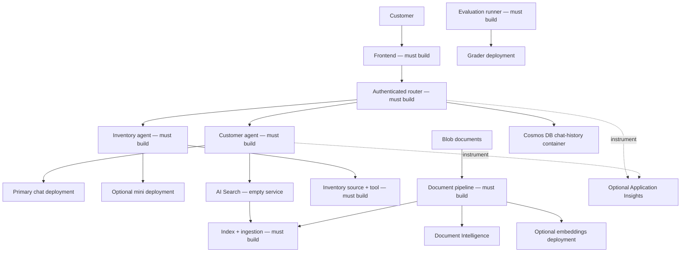

# Support client multi-agent — Plan directeur d'architecture Retail

**Chapitre 5 : Solutions IA multi-agents**

- [Accueil du cours](../README.md)
- [Chapitre 5](../docs/chapter-05-multi-agent/README.md)
- [Prérequis : intégration IA](../docs/chapter-02-ai-development/microsoft-foundry-integration.md)
- [Suivant : planification de capacité](../docs/chapter-06-pre-deployment/capacity-planning.md)
- [Infrastructure ARM comme squelette](retail-multiagent-arm-template/README.md)

> **Guide d'architecture, non une application opérationnelle.** Les seuls fichiers d'implémentation retail
> sont `azuredeploy.json`, `azuredeploy.parameters.json`, et `deploy.sh` dans
> `retail-multiagent-arm-template/`. Les conteneurs du routeur/frontend sont des espaces réservés "hello-world".
> Aucun agent retail, interface utilisateur, pipeline d’ingestion, évaluateur, scanner, ou
> suite de tests applicatifs n’existent localement.

## Vue d’ensemble

**Objectif :** concevoir un système de support client avec un agent client et un agent inventaire,
identifier ce que l'infrastructure fournit, et planifier les contrats applicatifs manquants
ainsi que la vérification.

**Public :** développeurs ayant terminé l’exemple local
[chat sample](../../../examples/azure-openai-chat) et [exemple de conteneur à deux services](../../../examples/container-app/microservices).
Prévoyez 2 à 3 heures pour l’étude architecturale. La construction de l’application est un projet séparé :
80 à 120 heures de développement est une estimation indicative à destination de développeurs expérimentés,
**pas une promesse de livraison** ; la mise en production, les tests,
la revue de sécurité, et l’exploitation nécessitent du travail additionnel.

### Résultats d’apprentissage

- Expliquer le routage, la contextualisation, les permissions d'outils, et la propriété des conversations.
- Distinguer identifiants de modèles, noms de déploiement, versions API et versions ARM.
- Concevoir ingestion et récupération de documents avec des dimensions vectorielles correspondantes.
- Définir des exigences fonctionnelles, d’évaluation et de récupération après échec vérifiables.
- Séparer les objectifs d’architecture optionnels des ressources réellement provisionnées.

## Architecture de la solution



Il s’agit d’une **architecture applicative cible**, non d’un diagramme des services agents en fonctionnement.
Le squelette ARM crée uniquement les services sous-jacents et deux conteneurs espaces réservés.
Front Door, registre, identités managées, attributions de rôle,
points de terminaison privés, basculement, instrumentation applicative et alertes ne sont pas inclus.

### Responsabilités et contrats

| Composant | Comportement requis | Preuve avant de considérer comme terminé |
|---|---|---|
| Frontend | Authentifier les utilisateurs, afficher le chat, télécharger des documents en toute sécurité | Tests UI et de téléchargement, erreurs accessibles |
| Routeur | Autoriser les requêtes, choisir l’agent, limiter appels/outils et délais | Tests de routage, vérifications d’autorisation, tests d’échec |
| Agent client | Ancrer les réponses politique/produit dans des sources approuvées | Citations correctes, abstention si données absentes |
| Outil inventaire | Lire un stock autoritaire avec permissions ciblées | Tests déterministes sur le stock ; pas d'inventions de disponibilité |
| Pipeline documentaire | Extraire, segmenter, intégrer, indexer, mettre à jour/supprimer | Fixtures indexées et comportement de retry/bureau des erreurs |
| Stockage de conversations | Isoler les utilisateurs, appliquer la rétention | Tests d’autorisation inter-utilisateurs et de TTL |
| Exécuteur d’évaluation | Comparer les résultats à la vérité terrain et grille d’évaluation | Couverture, comptage des échecs, rapports reproductibles |

Considérez le routeur comme une réception et les outils comme des systèmes internes restreints :
choisir un spécialiste n’autorise pas l’accès aux dossiers de tous les clients.
Faites appliquer identité et permissions dans le code applicatif et les services de données, pas dans les prompts.

## Infrastructure vs Application

Lisez le [README du squelette](retail-multiagent-arm-template/README.md) avant la
provision. Il liste les ressources exactes, modes, coûts, et limitations.

| Usage logique | Nom de déploiement ARM | Modèle / version | Région par défaut |
|---|---|---|---|
| Chat client | `gpt-4.1-chat` | `gpt-4.1` / `2025-04-14` | `eastus2` |
| Inventaire | `gpt-4.1-mini-inventory` | `gpt-4.1-mini` / `2025-04-14` | `westus2`, optionnel |
| Intégrations vectorielles | `text-embedding-ada-002` | `text-embedding-ada-002` / `2` | `francecentral`, optionnel |
| Évaluation | `gpt-4.1-grader` | `gpt-4.1` / `2025-04-14` | Région principale par défaut |

Vérifiez disponibilité et quota modèle/version/SKU dans **chaque région**. Chat/mini/grader
utilisent `GlobalStandard` ; les intégrations utilisent `Standard`. Les correspondances unité de capacité à TPM sont
spécifiques au modèle. N’ajoutez pas des unités de capacité inégales comme garantie de quota universelle.

L’argument `model` d’une requête Azure OpenAI est le **nom de déploiement**, pas
nécessairement l’identifiant de modèle catalogue. La version API du plan de données `2024-10-21`
est distincte de la version modèle `2025-04-14` et de la ressource ARM `apiVersion`.
On ne peut pas corriger un modèle indisponible en changeant uniquement la version API du plan de données.

`--no-multi-region` ignore les comptes secondaires et d’intégrations vectorielles. Un chat principal et un
compte.evaluateur indépendant demeurent. Des comptes de modèles séparés ne fournissent pas de basculement automatique ;
cela demande un routage applicatif, des déploiements compatibles, contrôles santé,
limites de retry, et revue de résidence des données.

## Feuille de route de mise en œuvre

### 1. Commencer par une interaction testée

Avant de provisionner le grand squelette, utilisez l’exemple local de chat pour établir
la connectivité d’inférence. Définissez une question client représentative, la source de réponse approuvée,
la citation attendue, et le comportement en cas d’absence de cette source.

### 2. Définir le routage et les limites des outils

Créez votre propre source routeur, manifeste de dépendances, Dockerfile, et tests. Un
contrat illustratif pourrait être `POST /chat` avec `{"message":"...","conversation_id":"..."}`.
**Ce point d’accès est une proposition de design ; il n’est pas implémenté par le template ARM.**

Validez types/limites de corps, dérivez identité utilisateur via authentification, appliquez
propriété des conversations, appliquez délais de requête, et retournez des codes erreur pertinents.
Ne considérez pas les échecs HTTP ou les réponses vides comme des résultats agents réussis.

### 3. Implémenter contextualisation et ingestion

Le template ARM ne crée pas d’index de recherche. Ceci est un **fragment JSON de référence
à adapter dans votre propre définition d’index**, pas un fichier déjà dans le repo :

```json
{
  "name": "retail-product-index",
  "fields": [
    {"name": "id", "type": "Edm.String", "key": true},
    {"name": "title", "type": "Edm.String", "searchable": true},
    {"name": "content", "type": "Edm.String", "searchable": true},
    {"name": "category", "type": "Edm.String", "filterable": true},
    {
      "name": "content_vector",
      "type": "Collection(Edm.Single)",
      "searchable": true,
      "dimensions": 1536,
      "vectorSearchProfile": "retail-profile"
    }
  ],
  "vectorSearch": {
    "algorithms": [{"name": "retail-hnsw", "kind": "hnsw"}],
    "profiles": [{"name": "retail-profile", "algorithm": "retail-hnsw"}]
  }
}
```

Le profil lie le champ vectoriel à son algorithme. Les dimensions doivent correspondre à la
sortie embedding réelle (1536 pour ce déploiement `ada-002`). Pour la récupération Python,
utilisez `azure.search.documents.models.VectorizedQuery` plutôt qu’un dictionnaire incomplet
manquant son type de requête vectorielle :

```python
# Reference function only: supply an authenticated async SearchClient and an embedding.
from azure.search.documents.models import VectorizedQuery

async def retrieve(search_client, embedding):
    results = await search_client.search(
        search_text=None,
        vector_queries=[VectorizedQuery(
            vector=embedding,
            k_nearest_neighbors=5,
            fields="content_vector"
        )],
        select=["id", "title", "content"]
    )
    return [document async for document in results]
```

Créez une implémentation d’ingestion séparée qui :

1. Autorise l’accès au téléchargement et valide le type de contenu et la taille.
2. Lit les blobs privés via les appels SDK authentifiés. Une URL de blob privée seule
   **n’est pas** une entrée Document Intelligence lisible ; envoyez les octets téléchargés avec
   `AnalyzeDocumentRequest(bytes_source=...)` ou utilisez un SAS à périmètre adapté,
   et à courte durée après avoir examiné les exigences d’accès.
3. Extrait le texte, le découpe pour respecter les limites d’intégration, et génère les intégrations.
4. Crée des clés de document stables et valides et télécharge les morceaux avec des vecteurs correspondants.
5. Vérifie les résultats d’indexation par document, gère les tentatives, et met à jour/supprime les données obsolètes.

N’interpolez pas des clés/valeurs utilisateur arbitraires dans les filtres OData. Listez en blanc les champs,
validez les types de valeur, et échappez les guillemets de chaîne. Les filtres booléens et numériques nécessitent
des littéraux typés, pas des chaînes citées.

### 4. Ancrage Web

**Bing Search v7 a été retiré le 11 août 2025.** L’ancien `Microsoft.Bing/accounts`
ressource et les exemples `api.bing.microsoft.com/v7.0/search` ne sont pas une voie d’implémentation
prise en charge. Évaluez une intégration d’ancrage actuellement supportée dans
Microsoft Foundry et son SDK, permissions, facturation, et exigences de citation;
aucune n’est implémentée ici. Ce n’est pas un remplacement direct du point de terminaison retiré.

### 5. Ajouter la télémétrie et l’évaluation

Créer Application Insights n’instrumente pas le code. Utilisez l’instrumentation Azure Monitor
OpenTelemetry prise en charge lors de la construction d’une nouvelle application, propagez le contexte de trace
entre les services, et évitez de consigner les invites client, documents, ou secrets.
Tronquer une requête ne l’anonymise pas.

Mesurez la durée des requêtes, les défaillances de routage/outils, la pertinence de récupération, la
correction des citations, l’utilisation des jetons, et l’abstention. Stockez les faits d’inventaire/politique
de vérité terrain aux côtés des cas d’évaluation : un évaluateur ne peut pas déterminer de façon fiable la précision factuelle
avec seulement une question et une réponse.

Un déploiement d’évaluateur n’est pas un exécutant d’évaluation. Implémentez un barème versionné,
une sortie structurée/validation de schéma, des contrôles de plages de notes, le comptage des défaillances de transport,
et des cas revus par des humains. Signalez séparément les cas incomplets/erronés ; ne les convertissez pas
en réussites ou ne les incluez pas silencieusement en tant que réponses de modèle de qualité zéro.

De même, quelques contrôles de mots-clés ne constituent pas une certification de sécurité. Une requête HTTP
échouée, une stratégie de test manquante, ou une réponse vide doit rendre un test **inconclusif ou
échoué**, pas un score “100% sécurisé”. Effectuez des tests autorisés avec des outils appropriés
et une revue humaine avant toute revendication de préparation à la production.

### 6. Déployez votre application

Créez vos propres répertoires source, manifests, tests, registre, et permissions de récupération d’image.
Remplacez les espaces réservés par des images compilées et mettez à jour les ingress/probes pour
correspondre au port d’écoute de chaque application. Configurez les variables d’environnement d’exécution dans Bicep
ou un mapping explicite de l’environnement azd pris en charge.

Il n’existe pas de dictionnaire `config` générique sous un service azd qui crée automatiquement
des variables d’environnement d’exécution. `azd env set` ne modifie que les ressources qui
consomment explicitement ces valeurs. Aucun test canari, liste de régions, ou hook d’ajustement fin
n’est implémenté dans ce squelette.

## Exercices pratiques de conception

Ce sont des **exercices d’architecture**, pas des revendications de code de démarrage retail exécutable.

### Exercice 1 : Vérifier la frontière

**Point de départ :** les trois fichiers dans `retail-multiagent-arm-template/`.
**Objectif :** distinguer la fourniture de la fonctionnalité de l’application.
Ouvrez `azuredeploy.json`, localisez à la fois les images de conteneurs et les valeurs `targetPort`,
puis listez les composants d’application manquants dans le dépôt.

**Critère de réussite / réponse :** les deux images sont des espaces réservés hello-world écoutant
sur le port 80 ; agents, UI de chat, gestionnaires de routeur, indexation/ingestion, évaluateur, et scanner
sont absents. Une requête racine réussie sur l’espace réservé ne valide pas `/chat`.
**Problème courant :** interpréter des noms de ressources comme `retail-router` comme du code fonctionnel.

### Exercice 2 : Suivre la configuration du vecteur

**Point de départ :** index JSON ci-dessus.
**Objectif :** comprendre la relation champ → profil → algorithme.
Identifiez quelles valeurs doivent changer lors du passage à un modèle d’intégration avec une
dimension de sortie différente, puis inspectez la fonction `retrieve`.

**Critère de réussite / réponse :** changer le champ `dimensions` pour la longueur réelle du vecteur ;
garder `vectorSearchProfile` aligné avec un profil déclaré et son algorithme ;
la requête `fields` doit nommer le champ vecteur. Régénérez les vecteurs de documents existants
lorsque le modèle d’intégration change.
**Problème courant :** ne changer que le nom du modèle tout en gardant des vecteurs incompatibles.

### Exercice 3 : Définir un test d’échec

**Point de départ :** tableau des responsabilités.
**Objectif :** empêcher un faux succès.
Écrivez le comportement attendu pour une API d’inventaire indisponible, un index de recherche sans
documents correspondants, et une requête d’évaluation retournant un HTTP 503.

**Critère de réussite / réponse :** pas de valeurs d’inventaire inventées ; abstention explicite ou
escalade en cas de contexte manquant ; l’évaluation rapporte une défaillance de transport plutôt
qu’une réussite de qualité ou de sécurité. Ajoutez des tests exécutables lorsque vous construisez l’application.
**Problème courant :** attraper toutes les exceptions et continuer avec une réponse vide.

## Coûts, dépannage et nettoyage

- L’infrastructure génère des frais continus même avec des index de recherche vides et des applications
  espaces réservés. Utilisez les prix régionaux actuels ; ni “minimal” ni multi-région ne signifie gratuit.
- Les coûts en jetons dépendent du modèle, de l’entrée mise en cache/non mise en cache, de la sortie, et du SKU de déploiement.
  Le routage peut économiser de l’argent seulement si la charge mesurée et les résultats de qualité le justifient ;
  une économie fixe de 60–80 % n’est pas garantie.
- Vérifiez la disponibilité du modèle et le quota avant la fourniture ; distinguez les erreurs de permission,
  nom de déploiement, région, version de modèle, et version API.
- Ne lancez pas les `setup-data.sh` manquants, les CLI évaluateurs, ou les commandes `pytest tests/`.
  Leurs implémentations font partie de votre backlog de développement.
- Le squelette est uniquement ARM : suivez ses
  [instructions de vérification et de nettoyage](retail-multiagent-arm-template/README.md).
  `azd down` ne gère pas ces ressources.

## Ressources associées

- [Exemple de chat local fonctionnel](../../../examples/azure-openai-chat)
- [Exemple fonctionnel deux services conteneur](../../../examples/container-app/microservices)
- [Indexes vectoriels AI Search](https://learn.microsoft.com/azure/search/vector-search-how-to-create-index)
- [Documentation Container Apps](https://learn.microsoft.com/azure/container-apps/)
- [Dépannage](../docs/chapter-07-troubleshooting/common-issues.md)
- [Signaler un problème](https://github.com/microsoft/AZD-for-beginners/issues)

---

<!-- CO-OP TRANSLATOR DISCLAIMER START -->
**Avertissement** :
Ce document a été traduit à l'aide du service de traduction automatique [Co-op Translator](https://github.com/Azure/co-op-translator). Bien que nous nous efforçions d'assurer l'exactitude, veuillez noter que les traductions automatisées peuvent contenir des erreurs ou des inexactitudes. Le document original dans sa langue native doit être considéré comme la source faisant autorité. Pour les informations critiques, il est recommandé de recourir à une traduction professionnelle réalisée par un humain. Nous ne saurions être tenus responsables des malentendus ou erreurs d'interprétation découlant de l'utilisation de cette traduction.
<!-- CO-OP TRANSLATOR DISCLAIMER END -->