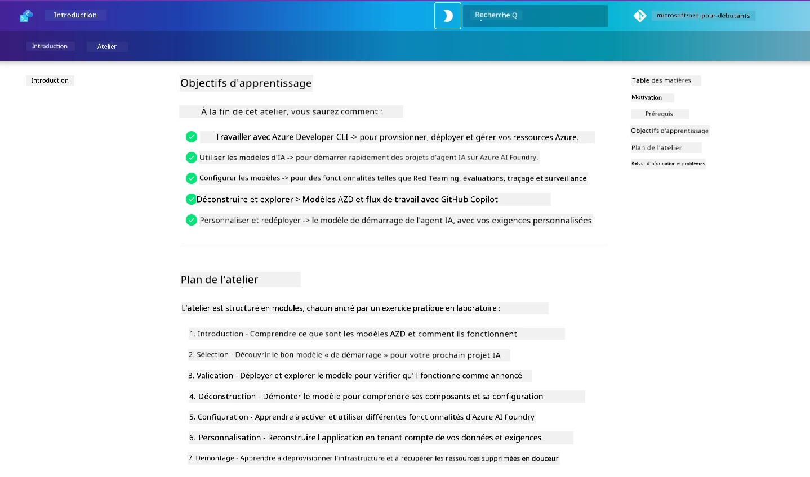

<div align="center">
  <div style="background: linear-gradient(135deg, #0078d4, #106ebe); border-radius: 10px; padding: 20px; margin: 20px 0; box-shadow: 0 4px 15px rgba(0, 120, 212, 0.3); border: 2px solid #005a9e;">
    <h2 style="color: white; margin: 0; font-size: 24px; text-shadow: 1px 1px 2px rgba(0,0,0,0.3);">
      🎯 Atelier AZD pour développeurs IA
    </h2>
    <p style="color: white; margin: 10px 0 0 0; font-size: 16px; text-shadow: 1px 1px 2px rgba(0,0,0,0.3);">
      <strong>Un atelier pratique pour créer des applications IA avec Azure Developer CLI.</strong><br>
      Complétez 7 modules pour maîtriser les modèles AZD et les workflows de déploiement IA.
    </p>
    <div style="margin-top: 15px;">
      <span style="background: rgba(255,255,255,0.2); padding: 5px 10px; border-radius: 15px; color: white; font-size: 14px;">
        📅 Source de la guidance revue : Novembre 2026
      </span>
    </div>
  </div>
</div>

# Atelier AZD pour développeurs IA

Bienvenue dans l'atelier pratique pour apprendre Azure Developer CLI (AZD) avec un focus sur le déploiement d'applications IA. Cet atelier vous aide à acquérir une compréhension appliquée des modèles AZD en 3 étapes :

1. **Découverte** - trouvez le modèle qui vous convient.
1. **Déploiement** - déployez et validez que cela fonctionne
1. **Personnalisation** - modifiez et itérez pour le rendre vôtre !

Au cours de cet atelier, vous serez également présenté aux outils de développement et workflows essentiels, pour vous aider à rationaliser votre parcours de développement de bout en bout.

<br/>

## Guide basé sur le navigateur

Les leçons de l'atelier sont en Markdown. Vous pouvez les parcourir directement sur GitHub - ou lancer un aperçu dans un navigateur comme montré dans la capture d'écran ci-dessous.



Pour utiliser cette option – forkez le dépôt sur votre profil et lancez GitHub Codespaces. Une fois le terminal VS Code actif, tapez cette commande :

Cet aperçu dans le navigateur fonctionne dans GitHub Codespaces, des conteneurs de développement ou un clone local avec Python et MkDocs installés.

```bash title="" linenums="0"
python -m pip install -r requirements-dev.txt
python -m mkdocs serve --config-file workshop/mkdocs.yml
```

Exécutez ces commandes depuis la **racine du dépôt du cours**, pas depuis l'exemple AI initialisé séparément. Gardez l'aperçu au premier plan pour que les erreurs restent visibles ; arrêtez-le avec Ctrl+C. Pour vérifier le site sans le servir, exécutez `python -m mkdocs build --strict --config-file workshop/mkdocs.yml`.

En quelques secondes, vous verrez une boîte de dialogue pop-up. Sélectionnez l’option `Open in browser`. Le guide basé sur le web s’ouvrira désormais dans un nouvel onglet du navigateur. Voici quelques avantages de cet aperçu :

1. **Recherche intégrée** - trouvez rapidement des mots-clés ou leçons.
1. **Icône copier** - survolez les blocs de code pour voir cette option
1. **Changement de thème** - passez du thème sombre au clair
1. **Obtenez de l’aide** - cliquez sur l’icône Discord dans le pied-de-page pour rejoindre !

<br/>

## Aperçu de l’atelier

**Durée :** 3-4 heures  
**Niveau :** Débutant à Intermédiaire  
**Prérequis :** Connaissance d’Azure, concepts IA, VS Code & outils en ligne de commande.

C’est un atelier pratique où vous apprenez en faisant. Une fois les exercices terminés, nous vous recommandons de consulter le programme AZD pour débutants afin de poursuivre votre apprentissage sur les bonnes pratiques en sécurité et productivité.

| Temps | Module  | Objectif |
|:---|:---|:---|
| 15 min | [Introduction](docs/instructions/0-Introduction.md) | Poser le cadre, comprendre les objectifs |
| 30 min | [Sélectionner un modèle IA](docs/instructions/1-Select-AI-Template.md) | Explorer les options et choisir un point de départ | 
| 30 min | [Valider le modèle IA](docs/instructions/2-Validate-AI-Template.md) | Déployer la solution par défaut sur Azure |
| 30 min | [Décomposer le modèle IA](docs/instructions/3-Deconstruct-AI-Template.md) | Explorer la structure et la configuration |
| 30 min | [Configurer le modèle IA](docs/instructions/4-Configure-AI-Template.md) | Activer et tester les fonctionnalités disponibles |
| 30 min | [Personnaliser le modèle IA](docs/instructions/5-Customize-AI-Template.md) | Adapter le modèle à vos besoins |
| 30 min | [Démanteler l’infrastructure](docs/instructions/6-Teardown-Infrastructure.md) | Nettoyer et libérer les ressources |
| 15 min | [Conclusion & prochaines étapes](docs/instructions/7-Wrap-up.md) | Ressources d’apprentissage, défi d’atelier |

<br/>

## Ce que vous allez apprendre

Pensez au modèle AZD comme un bac à sable d’apprentissage pour explorer diverses capacités et outils pour le développement de bout en bout sur Microsoft Foundry. À la fin de cet atelier, vous devriez avoir un sens intuitif des divers outils et concepts dans ce contexte.

| Concept  | Objectif |
|:---|:---|
| **Azure Developer CLI** | Comprendre les commandes et workflows de l’outil |
| **Modèles AZD** | Comprendre la structure du projet et la configuration |
| **Azure AI Agent** | Provisionner et déployer un projet Microsoft Foundry  |
| **Azure AI Search** | Activer l’ingénierie contextuelle avec des agents |
| **Observabilité** | Explorer le traçage, la surveillance et les évaluations |
| **Red Teaming** | Explorer les tests adversariaux et les mesures d’atténuation |

<br/>

## Structure de l’atelier

L’atelier est structuré pour vous emmener d’une découverte du modèle, au déploiement, à la déconstruction et à la personnalisation - en utilisant le modèle de démarrage officiel [Getting Started with AI Agents](https://github.com/Azure-Samples/get-started-with-ai-agents) comme base.

### [Module 1 : Sélectionner un modèle IA](docs/instructions/1-Select-AI-Template.md) (30 min)

- Qu’est-ce qu’un modèle IA ?
- Où puis-je trouver des modèles IA ?
- Comment puis-je commencer à construire des agents IA ?
- **Atelier** : Démarrage rapide dans Codespaces ou un conteneur de développement

### [Module 2 : Valider le modèle IA](docs/instructions/2-Validate-AI-Template.md) (30 min)

- Quelle est l’architecture du modèle IA ?
- Quel est le workflow de développement AZD ?
- Comment puis-je obtenir de l’aide avec le développement AZD ?
- **Atelier** : Déployer et valider le modèle AI Agents

### [Module 3 : Décomposer le modèle IA](docs/instructions/3-Deconstruct-AI-Template.md) (30 min)

- Explorez votre environnement dans `.azure/` 
- Explorez votre configuration de ressources dans `infra/` 
- Explorez votre configuration AZD dans `azure.yaml`s
- **Atelier** : Modifier les variables d’environnement & redéployer

### [Module 4 : Configurer le modèle IA](docs/instructions/4-Configure-AI-Template.md) (30 min)
- Explorez : Retrieval Augmented Generation
- Explorez : Évaluation des agents & Red Teaming
- Explorez : Tracing & Monitoring
- **Atelier** : Explorer l’agent IA + observabilité 

### [Module 5 : Personnaliser le modèle IA](docs/instructions/5-Customize-AI-Template.md) (30 min)
- Définir : PRD avec exigences du scénario
- Configurer : variables d’environnement pour AZD
- Implémenter : hooks de cycle de vie pour tâches additionnelles
- **Atelier** : Personnaliser le modèle pour mon scénario

### [Module 6 : Démanteler l’infrastructure](docs/instructions/6-Teardown-Infrastructure.md) (30 min)
- Récapitulatif : Qu’est-ce que les modèles AZD ?
- Récapitulatif : Pourquoi utiliser Azure Developer CLI ?
- Étapes suivantes : Essayez un autre modèle !
- **Atelier** : Déprovisionner l’infrastructure & nettoyage

<br/>

## Défi de l’atelier

Envie de vous challenger davantage ? Voici quelques suggestions de projets - ou partagez vos idées avec nous !!

| Projet | Description |
|:---|:---|
|1. **Décomposer un modèle IA complexe** | Utilisez le workflow et les outils que nous avons présentés et voyez si vous pouvez déployer, valider et personnaliser un autre modèle de solution IA. _Qu’avez-vous appris ?_|
|2. **Personnaliser selon votre scénario**  | Essayez de rédiger un PRD (document de spécifications produit) pour un scénario différent. Puis utilisez GitHub Copilot dans votre dépôt de modèles en mode Agent - et demandez lui de générer un workflow de personnalisation. _Qu’avez-vous appris ? Comment pouvez-vous améliorer ces suggestions ?_|
| | |

## Avez-vous des retours ?

1. Ouvrez une issue sur ce dépôt - taguez-la `Workshop` pour plus de commodité.
1. Rejoignez le Discord Microsoft Foundry - connectez-vous avec vos pairs !


| | | 
|:---|:---|
| **📚 Accueil du cours**| [AZD pour débutants](../README.md)|
| **📖 Documentation** | [Commencer avec les modèles IA](https://learn.microsoft.com/en-us/azure/ai-foundry/how-to/develop/ai-template-get-started)|
| **🛠️Modèles IA** | [Modèles Microsoft Foundry](https://ai.azure.com/templates) |
|**🚀 Prochaines étapes** | [Commencer l’atelier](#workshop-overview) |
| | |

<br/>

---

**Navigation :** [Cours principal](../README.md) | [Introduction](docs/instructions/0-Introduction.md) | [Module 1 : Sélectionner un modèle](docs/instructions/1-Select-AI-Template.md)

**Prêt à commencer à construire des applications IA avec AZD ?**

[Commencer l’atelier : Introduction →](docs/instructions/0-Introduction.md)

---

<!-- CO-OP TRANSLATOR DISCLAIMER START -->
**Avertissement** :
Ce document a été traduit à l'aide du service de traduction automatique [Co-op Translator](https://github.com/Azure/co-op-translator). Bien que nous nous efforçions d'assurer l'exactitude, veuillez noter que les traductions automatisées peuvent contenir des erreurs ou des inexactitudes. Le document original dans sa langue native doit être considéré comme la source faisant autorité. Pour les informations critiques, il est recommandé de recourir à une traduction professionnelle réalisée par un humain. Nous ne saurions être tenus responsables des malentendus ou erreurs d'interprétation découlant de l'utilisation de cette traduction.
<!-- CO-OP TRANSLATOR DISCLAIMER END -->