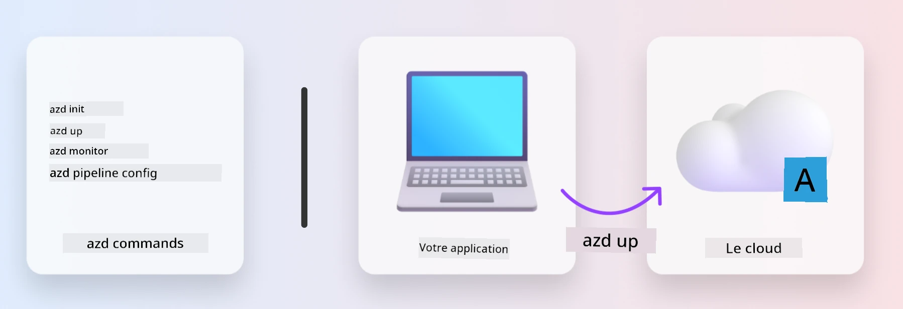
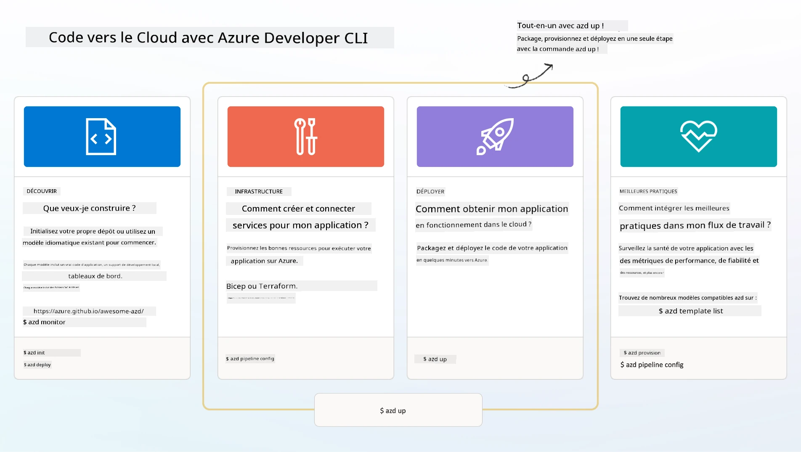

# 1. Sélectionner un modèle

!!! tip "À LA FIN DE CE MODULE, VOUS SAUREZ"

    - [ ] Describe what AZD templates are
    - [ ] Discover and use AZD templates for AI
    - [ ] Get started with the AI Agents template
    - [ ] **Lab 1:** AZD Quickstart in Codespaces or a dev container

---

## 1. Une analogie avec un constructeur

Construire une application IA moderne prête pour l’entreprise _à partir de zéro_ peut être décourageant. C’est un peu comme construire votre nouvelle maison vous-même, brique par brique. Oui, c’est possible ! Mais ce n’est pas la manière la plus efficace d’obtenir le résultat souhaité !

Au lieu de cela, nous commençons souvent avec un _plan de conception_ existant, et travaillons avec un architecte pour le personnaliser selon nos exigences personnelles. Et c’est exactement l’approche à adopter pour construire des applications intelligentes. Trouvez d’abord une bonne architecture de conception qui correspond à votre domaine de problème. Puis travaillez avec un architecte solution pour personnaliser et développer la solution pour votre scénario spécifique.

Mais où trouver ces plans de conception ? Et comment trouver un architecte prêt à nous apprendre à personnaliser et déployer ces plans par nous-mêmes ? Dans cet atelier, nous répondons à ces questions en vous présentant trois technologies :

1. [Azure Developer CLI](https://aka.ms/azd) - un outil open-source qui accélère le parcours du développeur depuis le développement local (build) jusqu’au déploiement cloud (ship).
1. [Microsoft Foundry Templates](https://ai.azure.com/templates) - des dépôts open-source standardisés contenant du code exemple, des fichiers d’infrastructure et de configuration pour déployer une architecture de solution IA.
1. [GitHub Copilot Agent Mode](https://code.visualstudio.com/docs/copilot/chat/chat-agent-mode) - un agent de codage basé sur la connaissance Azure, qui peut nous guider dans la navigation du code et faire des modifications – en utilisant le langage naturel.

Avec ces outils en main, nous pouvons maintenant _découvrir_ le bon modèle, _le déployer_ pour valider qu’il fonctionne, et _le personnaliser_ pour correspondre à nos scénarios spécifiques. Plongeons et découvrons comment ils fonctionnent.


---

## 2. Azure Developer CLI

Le [Azure Developer CLI](https://learn.microsoft.com/en-us/azure/developer/azure-developer-cli/) (ou `azd`) est un outil en ligne de commande open-source qui peut accélérer votre parcours code-vers-cloud avec un ensemble de commandes conviviales pour les développeurs, qui fonctionnent de manière cohérente à travers votre IDE (développement) et vos environnements CI/CD (devops).

Avec `azd`, votre parcours de déploiement peut être aussi simple que :

- `azd init` - Initialise un nouveau projet IA à partir d’un modèle AZD existant.
- `azd up` - Provisionne l’infrastructure et déploie votre application en une étape.
- `azd monitor` - Obtenez une surveillance et un diagnostic en temps réel de votre application déployée.
- `azd pipeline config` - Configurez des pipelines CI/CD pour automatiser le déploiement vers Azure.

**🎯 | EXERCICE** : <br/> Explorez l’outil en ligne de commande `azd` dans votre environnement actuel d’atelier. Cela peut être GitHub Codespaces, un conteneur dev, ou un clone local avec les prérequis installés. Commencez par taper cette commande pour voir ce que l’outil peut faire :

```bash title="" linenums="0"
azd help
```



---

## 3. Le modèle AZD

Pour qu’`azd` puisse faire cela, il doit connaître l’infrastructure à provisionner, les paramètres de configuration à appliquer, et l’application à déployer. C’est là qu’interviennent les [modèles AZD](https://learn.microsoft.com/en-us/azure/developer/azure-developer-cli/azd-templates?tabs=csharp).

Les modèles AZD sont des dépôts open-source qui combinent du code exemple avec les fichiers d’infrastructure et de configuration nécessaires au déploiement de l’architecture de la solution.
En utilisant une approche _Infrastructure-as-Code_ (IaC), ils permettent aux définitions de ressources du modèle et aux paramètres de configuration d’être contrôlés en version (tout comme le code source de l’application) - créant des workflows réutilisables et cohérents entre les utilisateurs de ce projet.

Lors de la création ou de la réutilisation d’un modèle AZD pour _votre_ scénario, considérez ces questions :

1. Que construisez-vous ? → Existe-t-il un modèle qui inclut un code de départ pour ce scénario ?
1. Comment votre solution est-elle architecturée ? → Existe-t-il un modèle avec les ressources nécessaires ?
1. Comment votre solution est-elle déployée ? → Pensez à `azd deploy` avec des hooks pré/post-traitement !
1. Comment pouvez-vous l’optimiser davantage ? → Pensez à la surveillance intégrée et aux pipelines d’automatisation !

**🎯 | EXERCICE** : <br/>
Visitez la galerie [Awesome AZD](https://azure.github.io/awesome-azd/) et utilisez les filtres pour explorer les 250+ modèles actuellement disponibles. Voyez si vous pouvez en trouver un qui correspond aux exigences de _votre_ scénario.



---

## 4. Modèles d’applications IA

Pour les applications alimentées par IA, Microsoft fournit des modèles spécialisés mettant en vedette **Microsoft Foundry** et **Foundry Agents**. Ces modèles accélèrent votre chemin vers la construction d’applications intelligentes prêtes pour la production.

### Modèles Microsoft Foundry & Foundry Agents

Sélectionnez un modèle ci-dessous pour le déployer. Chaque modèle est disponible sur [Awesome AZD](https://azure.github.io/awesome-azd/) et peut être initialisé en une seule commande.

| Modèle | Description | Commande de déploiement |
|----------|-------------|----------------|
| **[AI Chat with RAG](https://github.com/Azure-Samples/azure-search-openai-demo)** | Application de chat basée sur la recherche | `azd init -t Azure-Samples/azure-search-openai-demo .` |
| **[Get Started with AI Agents](https://github.com/Azure-Samples/get-started-with-ai-agents)** | Application de chat avec agents ; utilisée tout au long de cet atelier | `azd init -t Azure-Samples/get-started-with-ai-agents .` |
| **[Get Started with AI Chat](https://github.com/Azure-Samples/get-started-with-ai-chat)** | Application de chat IA de démarrage | `azd init -t Azure-Samples/get-started-with-ai-chat .` |

Ce sont des alternatives : initialisez **un** modèle dans son propre répertoire vide. Le `.` à la fin sélectionne ce répertoire ; le laisser de côté dans les versions actuelles d’AZD crée un sous-répertoire du nom du modèle. L’initialisation télécharge un projet ; `azd up` effectue le déploiement facturable après que vous avez revu les prérequis, ressources, support régional et quotas.

### Démarrage rapide

1. **Parcourir les modèles** : Visitez [https://azure.github.io/awesome-azd/](https://azure.github.io/awesome-azd/) et filtrez par `AI`, `Agents`, ou `Microsoft Foundry`
2. **Sélectionnez votre modèle** : Choisissez celui qui correspond à votre cas d’usage
3. **Initialisez** : Exécutez la commande `azd init` pour votre modèle choisi
4. **Déployez** : Exécutez `azd up` pour provisionner et déployer

**🎯 | EXERCICE** : <br/>
Sélectionnez un des modèles ci-dessus selon votre scénario :

- **Vous continuez cet atelier ?** → Choisissez **Get Started with AI Agents**
- **Vous construisez un chat basé sur la recherche ?** → Explorez **AI Chat with RAG** séparément
- **Besoin d’une autre architecture ?** → Cherchez dans la galerie et vérifiez le dépôt réel, le statut d’implémentation, et les prérequis

```bash title="Initialize the workshop template in an empty directory" linenums="0"
azd init -t Azure-Samples/get-started-with-ai-agents .
azd auth login
azd up
```

!!! info "Explorez plus de modèles"
    La [galerie Awesome AZD](https://azure.github.io/awesome-azd/) contient plus de 250 modèles. Utilisez les filtres pour trouver des modèles correspondant à vos exigences spécifiques en langue, framework, et services Azure.

---

<!-- CO-OP TRANSLATOR DISCLAIMER START -->
**Avertissement** :
Ce document a été traduit à l'aide du service de traduction automatique [Co-op Translator](https://github.com/Azure/co-op-translator). Bien que nous nous efforçions d'assurer l'exactitude, veuillez noter que les traductions automatisées peuvent contenir des erreurs ou des inexactitudes. Le document original dans sa langue native doit être considéré comme la source faisant autorité. Pour les informations critiques, il est recommandé de recourir à une traduction professionnelle réalisée par un humain. Nous ne saurions être tenus responsables des malentendus ou erreurs d'interprétation découlant de l'utilisation de cette traduction.
<!-- CO-OP TRANSLATOR DISCLAIMER END -->