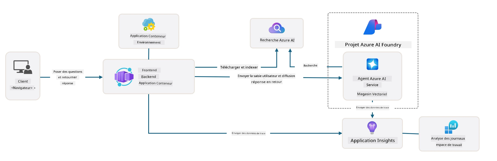
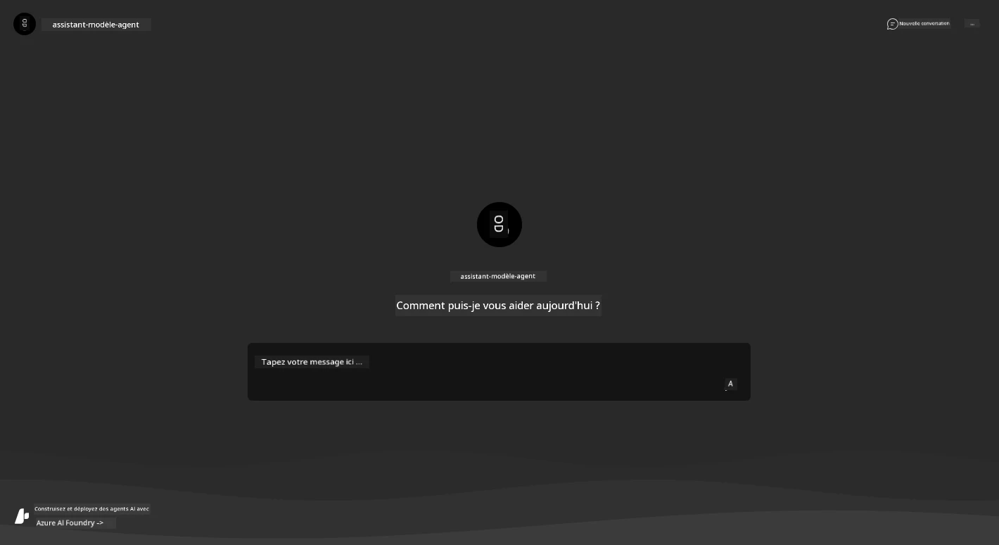

# 2. Valider un modèle

> Orientation source revue avec AZD 1.37.2 et l'exemple actuel au 4 novembre 2026. Les captures d’écran sont illustratives ; la navigation dans le portail, les paramètres par défaut des modèles et la disponibilité des services peuvent changer. Cette revue n’a pas effectué de déploiement live Azure.

!!! tip "À LA FIN DE CE MODULE, VOUS SAUREZ"

    - [ ] Identify the sample's prerequisites and intended resources
    - [ ] Deploy the selected template into an intentional environment
    - [ ] Verify the application and agent behavior separately from deployment success
    - [ ] **Lab 2:** Record evidence of a working baseline, or an actionable deployment blocker

---

## 1. Vérifier les prérequis

Le [Azure Developer CLI](https://learn.microsoft.com/azure/developer/azure-developer-cli/) gère le déploiement d’application en utilisant la configuration, l’infrastructure et le code du modèle. Vérifiez votre version installée :

```bash
azd version
```

Utilisez les [instructions actuelles d’installation/mise à jour](https://learn.microsoft.com/azure/developer/azure-developer-cli/install-azd) si nécessaire. L’exemple examiné déclare AZD `>=1.14.0`, mais une version prise en charge actuelle est recommandée. Les extensions optionnelles d’IA ont des exigences de version distinctes ; le flux de travail normal `azd up` de cet exemple ne nécessite pas l’extension agents.

Avant le provisionnement, lisez le [paramétrage du compte Azure](https://github.com/Azure-Samples/get-started-with-ai-agents/blob/main/docs/azure_account_setup.md) et le [guide de déploiement](https://github.com/Azure-Samples/get-started-with-ai-agents/blob/main/docs/deployment.md) de l’exemple. Confirmez votre abonnement, vos permissions, la disponibilité du modèle, le quota régional et les coûts attendus. Un compte Azure gratuit ne garantit pas l’accès ni une utilisation gratuite à chaque service requis.

## 2. Ouvrir l’exemple sélectionné

Utilisez le dépôt [Get Started with AI Agents](https://github.com/Azure-Samples/get-started-with-ai-agents) initialisé dans le Module 1. Si vous ne l’avez pas initialisé, choisissez une de ces alternatives :

- Ouvrir un [Codespace pour l’exemple](https://github.com/codespaces/new/Azure-Samples/get-started-with-ai-agents).
- Cloner l’exemple et suivre sa configuration locale/dev-container.
- Dans un **répertoire vide**, exécutez :

```bash
azd init --template Azure-Samples/get-started-with-ai-agents .
```

Ne pas initialiser un deuxième modèle par-dessus un projet existant. Exécutez les commandes suivantes depuis la racine de l’exemple contenant `azure.yaml`, et non depuis la racine du dépôt du cours.

L’exemple héberge une application de chat supportée par agent dans Container Apps et provisionne des ressources Foundry complémentaires. Examinez l’architecture actuelle et les services optionnels plutôt que de considérer une ancienne capture comme l’inventaire exact des ressources.



## 3. Déployer intentionnellement

```bash
azd auth login
azd up
```

Examinez les invites :

1. Choisissez un nom d’environnement AZD unique.
2. Sélectionnez l’abonnement prévu, pas simplement le premier proposé.
3. Sélectionnez une région supportée par le modèle/version/SKU requis et votre quota.
4. Lisez les sorties des étapes de provisionnement, déploiement et post-déploiement.

Les paramètres par défaut examinés incluent `gpt-5-mini`, la version `2025-08-07`, et `GlobalStandard`. Vérifiez votre modèle initialisé et les [combinaisons modèle/région supportées](https://learn.microsoft.com/azure/ai-services/agents/concepts/model-region-support). Aucune région n’est universellement garantie.

La durée de déploiement varie. En cas d’échec du provisionnement, conservez l’erreur et corrigez sa cause avant de réessayer. Ne supprimez pas le déploiement ni ne purgez définitivement les ressources en guise de dépannage générique.

## 4. Valider l’application

```bash
azd show
```

Ouvrez le point de terminaison pour `api_and_frontend`, ou trouvez l’application Container App dans le groupe de ressources du déploiement via le [portail Azure](https://portal.azure.com/). Suivez les instructions d’accès/authentification de l’exemple si une connexion est requise ; ne désactivez pas l’authentification pour faire passer un test sommaire.



Essayez quelques [questions d’exemple](https://github.com/Azure-Samples/get-started-with-ai-agents/blob/main/docs/sample_questions.md) :

- Une question factuelle générale.
- Une question dont la réponse devrait être présente dans les documents téléchargés de l’exemple.
- Une question qui ne peut être répondue à partir de ces documents.

Vérifiez que l’interface charge, que l’API répond, que la recherche utilise les données attendues, que les citations correspondent au contenu source, et que les questions non supportées sont gérées correctement. Un message `azd up` réussi seul n’établit pas ces résultats.

## 5. Inspecter l’agent déployé

Ouvrez votre projet dans le [portail Foundry](https://ai.azure.com/). Dans le flux de portail examiné, sélectionnez **Build**, puis **Agents**, et localisez l’agent créé par l’exemple. Les libellés de navigation peuvent changer.

Notez :

- Le nom de l’agent et sa version.
- Son déploiement modèle configuré.
- Les instructions actuelles et les outils activés.
- Quels fichiers ou index de recherche sont connectés, et si la configuration a été complétée.

L’exemple examiné utilise un identifiant d’agent sous forme `agent_name:agent_version` pour ses tests d’évaluation. Ne copiez pas un identifiant d’agent/thread classique d’une ancienne capture d’écran vers un flux API plus récent.

Comparez les documents téléchargés avec `src/files/` dans votre version initialisée. Des captures antérieures montraient 32 fichiers ; ce nombre n’est pas un paramètre par défaut actuel garanti. Vérifiez toute réponse concernant les clients/produits d’exemple avec les données sources synthétiques réelles, et ne téléchargez pas de données clients réelles pour cet exercice.

## 6. Comparer avec le terrain de jeu

Ouvrez le terrain de jeu de l’agent sélectionné dans Foundry et posez la même question de recherche. Comparez la version agent configurée, les outils, les citations, et la qualité des réponses avec l’application déployée.

Les réponses sont probabilistes ; une correspondance mot à mot n’est pas le critère. Si les résultats diffèrent substantiellement, vérifiez que l’application et le terrain de jeu ciblent le même projet, agent/version, et source de connaissances.

## 7. Vérifier les prérequis d’observabilité

Le [guide d’observabilité](https://github.com/Azure-Samples/get-started-with-ai-agents/blob/main/docs/observability.md) de l’exemple est la source de vérité pour la configuration du traçage, de l’évaluation et du red-teaming.

Dans les paramètres d’infrastructure examinés, Application Insights est activé mais **le traçage client est désactivé** (`ENABLE_AZURE_MONITOR_TRACING=false`). Créer une ressource de surveillance ne prouve pas que l’application exporte des traces. Le Module 5 couvre l’activation du traçage et la génération d’une requête de test.

Utilisez les journaux d’application du Container App pour examiner les erreurs de démarrage/API. Dans Foundry, inspectez les vues de traçage et de surveillance disponibles pour l’agent. Les entrées d’évaluation nécessitent la configuration correspondante, des évaluateurs/supporteurs régionaux, et des requêtes réelles ; elles ne sont pas garanties automatiquement à chaque exécution.

Laissez la capture du contenu des invites/réponses désactivée sauf si ses exigences de confidentialité, conservation, accès et suppression ont été examinées.

## 8. Comprendre les valeurs d’environnement

AZD stocke l’environnement sélectionné sous `.azure/<environment-name>/`. Les entrées persistantes et les sorties de déploiement peuvent être lues avec :

```bash
azd env list
azd env get-value AZURE_ENV_NAME
azd env get-value AZURE_LOCATION
```

`azd env get-values` liste toutes les valeurs, qui peuvent inclure une configuration sensible. Ne collez pas cette sortie dans des problèmes publics ou des journaux.

AZD utilise l’environnement sélectionné lorsqu’il exécute ses commandes/hooks, tandis que les variables d’environnement de processus peuvent aussi influencer les commandes et modèles. Cela **n’exporte pas** les valeurs dans votre shell parent ou dans chaque processus Python démarré de manière indépendante. Suivez les [instructions de développement local](https://github.com/Azure-Samples/get-started-with-ai-agents/blob/main/docs/local_development.md) de l’exemple.

Les paramètres par défaut du modèle peuvent être appliqués dans `infra/main.parameters.json` sans apparaître comme valeurs locales explicites. Définir une variable arbitraire ne change pas l’infrastructure sauf si le modèle la consomme.

Par exemple, pour sélectionner explicitement les paramètres par défaut du modèle examiné :

```bash
azd env set AZURE_AI_AGENT_MODEL_NAME gpt-5-mini
azd env set AZURE_AI_AGENT_MODEL_VERSION 2025-08-07
azd env set AZURE_AI_AGENT_DEPLOYMENT_SKU GlobalStandard
azd provision --preview
azd up
```

Révisez d’abord la compatibilité, la capacité, la disponibilité et les modifications prévues. Les mises à jour de l’infrastructure nécessitent un provisionnement ; `azd deploy` seul n’est pas suffisant. Les changements de modèle pris en charge ne nécessitent normalement pas la destruction complète de l’application.

`azd env refresh` récupère les sorties de déploiement pour un environnement accessible ; il ne reconstitue pas toutes les entrées personnalisées, ne synchronise pas les secrets, ni ne remplace la gestion de la configuration.

## 9. Enregistrer votre référence

- [ ] Environnement, abonnement, région et modèle corrects vérifiés.
- [ ] Provisionnement, déploiement, et hooks requis terminés sans erreurs non résolues.
- [ ] Accès à l’application, chat, recherche et citations vérifiés.
- [ ] Agent/version et source de connaissance identifiés.
- [ ] Prérequis d’observabilité et tout blocage restant documentés.

Continuez avec [Déconstruire un modèle](3-Deconstruct-AI-Template.md).

---

<!-- CO-OP TRANSLATOR DISCLAIMER START -->
**Avertissement** :
Ce document a été traduit à l'aide du service de traduction automatique [Co-op Translator](https://github.com/Azure/co-op-translator). Bien que nous nous efforçions d'assurer l'exactitude, veuillez noter que les traductions automatisées peuvent contenir des erreurs ou des inexactitudes. Le document original dans sa langue native doit être considéré comme la source faisant autorité. Pour les informations critiques, il est recommandé de recourir à une traduction professionnelle réalisée par un humain. Nous ne saurions être tenus responsables des malentendus ou erreurs d'interprétation découlant de l'utilisation de cette traduction.
<!-- CO-OP TRANSLATOR DISCLAIMER END -->