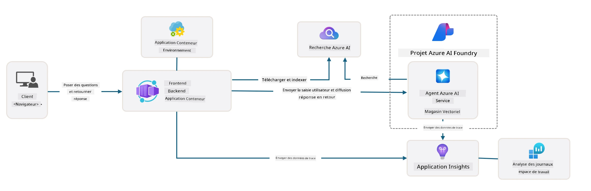

# 3. Déconstruire un Modèle

!!! tip "À LA FIN DE CE MODULE, VOUS SEREZ CAPABLE DE"

    - [ ] Use GitHub Copilot and optional MCP tools for Azure documentation and read-only exploration
    - [ ] Identify the template's application, infrastructure, configuration, and test entry points
    - [ ] Verify generated explanations against actual repository files
    - [ ] **Lab 3:** Trace one request and one configuration input through the project

---

## 1. Activer GitHub Copilot

Ouvrez l'exemple d'IA initialisé dans VS Code et activez [GitHub Copilot](https://code.visualstudio.com/docs/copilot/chat/chat-agent-mode). Connectez-vous avec un compte disposant d'un plan éligible ; les limites d'utilisation varient. Demandez à Copilot d'expliquer le dépôt avant d'autoriser des modifications.

### Serveurs MCP optionnels

Ces services peuvent fournir des outils supplémentaires :

- [Serveur MCP Azure](https://learn.microsoft.com/azure/developer/azure-mcp-server/overview)
- [Serveur MCP Microsoft Learn](https://learn.microsoft.com/training/support/mcp)

Dans VS Code, consultez la [documentation de configuration MCP](https://code.visualstudio.com/docs/copilot/chat/mcp-servers) et créez `.vscode/mcp.json` si nécessaire :

```json
{
  "servers": {
    "Azure MCP Server": {
      "type": "stdio",
      "command": "npx",
      "args": ["-y", "@azure/mcp@latest", "server", "start"]
    },
    "microsoft.docs.mcp": {
      "type": "http",
      "url": "https://learn.microsoft.com/api/mcp"
    }
  }
}
```

La commande `npx` requiert une installation prise en charge de Node.js/npm et télécharge du code exécutable. Passez en revue le package et épinglez une version approuvée pour un environnement d'équipe reproductible. Démarrez les serveurs avec les contrôles MCP de VS Code et inspectez leurs outils disponibles ; les noms peuvent changer entre les versions.

**L'authentification est distincte.** Utilisez `azd auth login` pour AZD. Suivez le flux d'authentification documenté pour MCP Azure avec ses outils ; seule la connexion AZD n'établit pas une session MCP. Utilisez `az login` séparément lorsque un exercice ou un hook invoque Azure CLI.

Essayez des invites en lecture seule :

1. « Utilisez Microsoft Learn MCP pour trouver la documentation de configuration Azure Developer CLI. »
2. « Expliquez le `azure.yaml` de ce dépôt ; citez les fichiers qui implémentent chaque hook. »
3. « En utilisant les outils Azure MCP disponibles, listez mes ressources déployées sans modifier quoi que ce soit. »

Vérifiez le locataire/abonnement sélectionné et chaque appel d'outil proposé. N'approuvez pas la création, suppression ou modification d'accès aux ressources simplement pour explorer l'architecture.

## 2. Comprendre l'architecture

L'exemple héberge un backend Python FastAPI et un frontend React/TypeScript dans Azure Container Apps. Le backend communique avec un agent dans un projet Microsoft Foundry. La récupération et l'observabilité dépendent des fonctionnalités activées du modèle et de la configuration réussie ; elles ne sont pas garanties simplement parce que l'application a été déployée.



Comparez ce diagramme avec le [guide de déploiement amont actuel](https://github.com/Azure-Samples/get-started-with-ai-agents/blob/main/docs/deployment.md) et vos ressources réelles. Vérifiez le déploiement du modèle configuré, les outils de l'agent, l'identité gérée, les affectations de rôle et les ressources facultatives Azure AI Search/Application Insights.

**Exercice :** Demandez à Copilot de tracer une requête de chat depuis le frontend via l'API jusqu'à Foundry, avec références aux fichiers et fonctions. Ouvrez ces références et vérifiez l'explication. Ne déduisez pas les authentifications, le routage ou les autorisations implementées uniquement à partir d'un diagramme.

## 3. Structure du dépôt

Les chemins sélectionnés suivants ont été vérifiés par rapport à l'exemple au 4 novembre 2026. Votre révision initialisée reste la source de vérité :

```text
get-started-with-ai-agents/
  azure.yaml
  docker-compose.yaml
  requirements-dev.txt
  .devcontainer/
  infra/
    main.bicep
    main.parameters.json
    api.bicep
    core/
  src/
    Dockerfile
    pyproject.toml
    requirements.txt
    api/
      main.py
      routes.py
      search_index_manager.py
    frontend/
      package.json
      src/
    files/
  scripts/
    validate_env_vars.sh
    validate_env_vars.ps1
    postdeploy.sh
    postdeploy.ps1
  tests/
    test_evaluation.py
    test_red_teaming.py
  docs/
    deployment.md
    deploy_customization.md
    ai_search.md
    observability.md
    local_development.md
    troubleshooting.md
```

### Infrastructure et configuration

`infra/main.bicep` orchestre les ressources ; `main.parameters.json` relie les entrées du modèle aux valeurs d'environnement AZD. `azure.yaml` sélectionne le service d'application et les hooks du cycle de vie. Suivez une entrée comme `USE_AZURE_AI_SEARCH_SERVICE` dans ces fichiers pour trouver ce qui change réellement.

### Application et identité

Lisez `src/api/` et `src/frontend/` ensemble. Identifiez où l'agent est créé ou récupéré, où les instructions/outils sont configurés, et quelle identité chaque appel Azure utilise. Les fichiers exemples sous `src/files/` sont des données de démonstration, pas un catalogue de production ni un modèle d'autorisation.

### Tests et observabilité

Les points d'entrée actuels pour l'évaluation et le red-teaming sont sous `tests/` ; les anciennes références de répertoire `evals/` et `airedteaming/` sont obsolètes pour cet exemple. Lisez `docs/observability.md` pour les prérequis et les coûts avant d'exécuter des tests cloud. Ces tests Python sont séparés de l'extension AZD facultative `azure.ai.evaluations`.

## 4. Vérifiez vos conclusions

- Identifiez la route API, l'interaction de l'agent et le code de récupération pour une question d'exemple.
- Expliquez quelle identité accède à Foundry et quelle configuration sélectionne son point de terminaison.
- Trouvez les vrais scripts pré-déploiement et post-déploiement ainsi que leur gestion des erreurs.
- Listez les dépendances ou fonctionnalités optionnelles absentes de votre déploiement.

Continuez avec [Configurer un Modèle](4-Configure-AI-Template.md).

---

<!-- CO-OP TRANSLATOR DISCLAIMER START -->
**Avertissement** :
Ce document a été traduit à l'aide du service de traduction automatique [Co-op Translator](https://github.com/Azure/co-op-translator). Bien que nous nous efforçions d'assurer l'exactitude, veuillez noter que les traductions automatisées peuvent contenir des erreurs ou des inexactitudes. Le document original dans sa langue native doit être considéré comme la source faisant autorité. Pour les informations critiques, il est recommandé de recourir à une traduction professionnelle réalisée par un humain. Nous ne saurions être tenus responsables des malentendus ou erreurs d'interprétation découlant de l'utilisation de cette traduction.
<!-- CO-OP TRANSLATOR DISCLAIMER END -->