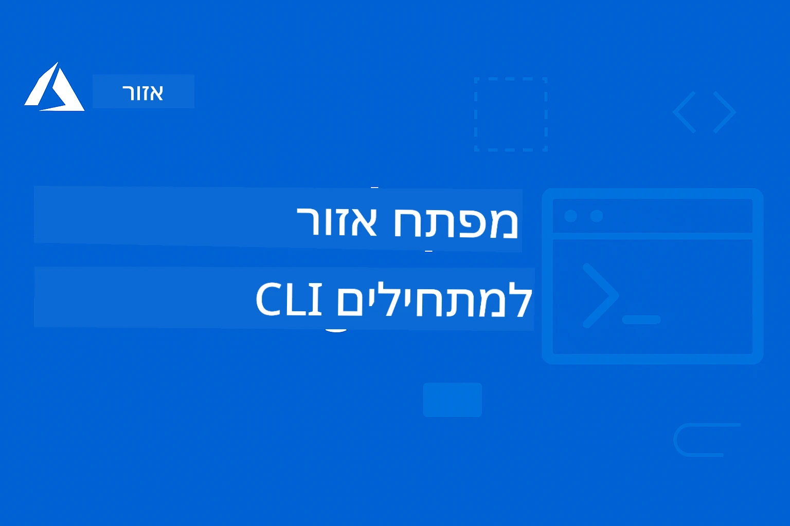

# AZD למתחילים: מסע למידה מובנה

 

[](https://github.com/microsoft/AZD-for-beginners)
[](https://GitHub.com/microsoft/azd-for-beginners/network/)
[](https://github.com/microsoft/AZD-for-beginners)

[](https://discord.com/invite/nkVh3dp)
[](https://discord.gg/nTYy5BXMWG)

---

### תרגומים אוטומטיים (תמיד מעודכנים)

<!-- CO-OP TRANSLATOR LANGUAGES TABLE START -->
[ערבית](../ar/README.md) | [בנגלית](../bn/README.md) | [בולגרית](../bg/README.md) | [בורמזית (מיאנמר)](../my/README.md) | [סינית (מפושטת)](../zh-CN/README.md) | [סינית (מסורתית, הונג קונג)](../zh-HK/README.md) | [סינית (מסורתית, מאקאו)](../zh-MO/README.md) | [סינית (מסורתית, טייוואן)](../zh-TW/README.md) | [קרואטית](../hr/README.md) | [צ'כית](../cs/README.md) | [דנית](../da/README.md) | [הולנדית](../nl/README.md) | [אסטונית](../et/README.md) | [פינית](../fi/README.md) | [צרפתית](../fr/README.md) | [גרמנית](../de/README.md) | [יוונית](../el/README.md) | [עברית](./README.md) | [הינדי](../hi/README.md) | [הונגרית](../hu/README.md) | [אינדונזית](../id/README.md) | [איטלקית](../it/README.md) | [יפנית](../ja/README.md) | [קאנדה](../kn/README.md) | [חמר](../km/README.md) | [קוריאנית](../ko/README.md) | [ליטאית](../lt/README.md) | [מלאית](../ms/README.md) | [מליאלאם](../ml/README.md) | [מרטהי](../mr/README.md) | [נפאלית](../ne/README.md) | [פידג'ין ניגרי](../pcm/README.md) | [נורווגית](../no/README.md) | [פרסית (פרסי)](../fa/README.md) | [פולנית](../pl/README.md) | [פורטוגזית (ברזיל)](../pt-BR/README.md) | [פורטוגזית (פורטוגל)](../pt-PT/README.md) | [פנג'אבית (גורמוכי)](../pa/README.md) | [רומנית](../ro/README.md) | [רוסית](../ru/README.md) | [סרבית (קירילית)](../sr/README.md) | [סלובקית](../sk/README.md) | [סלובנית](../sl/README.md) | [ספרדית](../es/README.md) | [סווהילי](../sw/README.md) | [שוודית](../sv/README.md) | [טגלוג (פיליפינית)](../tl/README.md) | [טמילית](../ta/README.md) | [טלוגו](../te/README.md) | [תאית](../th/README.md) | [טורקית](../tr/README.md) | [אוקראינית](../uk/README.md) | [אורדו](../ur/README.md) | [וייטנאמית](../vi/README.md)

> **מעדיפים לשכפל מקומית?**
>
> מאגר זה כולל למעלה מ-50 תרגומים בשפות שונות שמגדילים משמעותית את גודל ההורדה. כדי לשכפל בלי תרגומים, השתמשו בבדיקת sparse checkout:
>
> **Bash / macOS / Linux:**
> ```bash
> git clone --filter=blob:none --sparse https://github.com/microsoft/AZD-for-beginners.git
> cd AZD-for-beginners
> git sparse-checkout set --no-cone '/*' '!translations' '!translated_images'
> ```
>
> **CMD (Windows):**
> ```cmd
> git clone --filter=blob:none --sparse https://github.com/microsoft/AZD-for-beginners.git
> cd AZD-for-beginners
> git sparse-checkout set --no-cone "/*" "!translations" "!translated_images"
> ```
>
> זה נותן לכם את כל מה שצריך להשלמת הקורס עם הורדה מהירה הרבה יותר.
<!-- CO-OP TRANSLATOR LANGUAGES TABLE END -->

## 🆕 מה חדש ב-azd היום

> 📌 **עדכון GA ל-Foundry (2026-11-09):** חבילת **`microsoft.foundry` 1.0 זמינה לכלל המשתמשים**, הוכרזה ב-[5 בנובמבר 2026](https://devblogs.microsoft.com/azure-sdk/microsoft-foundry-azure-developer-cli-ga/). השתמש ב-**`azd >= 1.37.0`** והתקן עם `azd ext install microsoft.foundry`. עקוב אחרי [מדריך הסוכן המתארח](docs/chapter-02-ai-development/microsoft-foundry-integration.md#hosted-agent-walkthrough-ga) להתקנה, בדיקות מקומיות ופריסה. עדכון זה מבוסס על הנחיות שפורסמו, לא פריסה חיה ב-Azure; חבילת GA לא הופכת כל תכונה, תוסף או SDK לזמינים באופן רשמי.

Azure Developer CLI תומך בהרבה סוגי אפליקציות, כולל אפליקציות ווב, APIs ו-agents AI, דרך מארחים, תבניות ותוספים נתמכים.

הנה מה שזה אומר בשבילך:

- **חבילת GA לפיתוח Foundry.** `microsoft.foundry` מתקין שבעה תוספים עיקריים, כולל סוכנים, פרויקטים ו-Agent Inspector. קוד הסוכן והגדרות הפריסה נשמרים יחד בתוך `azure.yaml`.
- **בדוק מקומית, ואז פרוס את הקוד שלך.** השתמש ב-`azd ai agent init --deploy-mode code`, `azd provision`, ו-`azd ai agent run` לבדיקת בקשות ותשובות מקומיות. אז השתמש ב-`azd deploy` לבניית מרחוק ב-Foundry, ללא בניית קונטיינר מקומית.
- **מדוד איכות בנפרד.** התקן את **`azure.ai.evaluations`** עבור `azd ai eval generate`, `init` ו-`run start`; הוא לא כלול בחבילה. שמור מערכי נתונים ונקודות בדיקה עם הקוד שלך. פרויקטים ישנים צריכים לעקוב אחרי [מדריך ההגרלה להערכה ואופטימיזציה](docs/chapter-08-production/production-ai-practices.md#evaluation-migration-and-quality-checks).
- **שימוש חוזר בתצורה ב-CI/CD.** לאחר `azd up` מוצלח, הגדר צינור עם `azd pipeline config`. התקן את החבילה על הרצה ושמר את הגדרות האימות והסביבה שנוצרו.
- **הבסיס היומי חלק יותר.** עדכונים אחרונים הפכו את `azd init` לאידמפטנטי (בטוח להרצה חוזרת), הפכו את `azd auth login` לנקות אסימונים ישנים באופן אוטומטי, והוסיפו בקשת הגדרה ידידותית `azd tool` להרצה ראשונה.
- **זרימת העבודה הבסיסית לא השתנתה.** בין אם אתם מפרסים אפליקציית todo, שירות מיקרו, או פתרון AI מרובה סוכנים, הפקודות זהות.

> **הערה למשתמשי Aspire:** מיקרוסופט כעת קוראת למוצר פשוט **Aspire** (בעבר ".NET Aspire"). התמיכה ב-azd עבור Aspire לא השתנתה—רק השם עודכן.

אם השתמשתם ב-azd בעבר, התמיכה ב-AI היא הרחבה טבעית—לא כלי נפרד או מסלול מתקדם. אם אתם מתחילים, תלמדו זרימת עבודה אחת שעובדת עבור הכל.

---

## 🚀 מה זה Azure Developer CLI (azd)?

**Azure Developer CLI (azd)** הוא כלי שורת פקודה ידידותי למפתח שמפשט את פריסת האפליקציות ל-Azure. במקום ליצור ולחבר עשרות משאבי Azure ידנית, ניתן לפרוס אפליקציות שלמות באמצעות פקודה אחת.

### הקסם של `azd up`

```bash
# This single command does everything:
# ✅ Creates all Azure resources  
# ✅ Configures networking and security
# ✅ Builds your application code
# ✅ Deploys to Azure
# ✅ Gives you a working URL
azd up
```

התבנית מספקת את תצורת האפליקציה והתשתית. פריסה מוצלחת דורשת שירותים/דגמים נתמכים, מספיק מכסה ושהרשאות, קלטים נכונים ואימות האפליקציה שפורסה. `azd up` אינו מוודא שהתבנית בטוחה, עומדת בדרישות או מוכנה לייצור.

---

## ❓ Azure Developer CLI מול Azure CLI: מה ההבדל?

זו השאלה הנפוצה ביותר שמתחילים שואלים. ההסבר הפשוט:

| תכונה | **Azure CLI (`az`)** | **Azure Developer CLI (`azd`)** |
|---------|---------------------|--------------------------------|
| **מטרה** | ניהול משאבי Azure בודדים | פריסת אפליקציות שלמות |
| **גישה** | ממוקדת תשתית | ממוקדת אפליקציה |
| **דוגמה** | `az webapp create --name myapp...` | `azd up` |
| **עקומת למידה** | חייב לדעת שירותי Azure | מספיק להכיר את האפליקציה שלך |
| **מתאים ל-** | DevOps, תשתית | מפתחים, ניסויים |

### אנלוגיה פשוטה

- **Azure CLI** זה כמו שיש לך את כל הכלים לבניית בית - פטישים, מסורים, מסמרים. אתה יכול לבנות הכל, אבל צריך להבין בנייה.
- **Azure Developer CLI** זה כמו לשכור קבלן - אתה מתאר מה אתה רוצה, והוא מטפל בבנייה.

### מתי להשתמש בכל אחד

| תרחיש | השתמש בזה |
|----------|----------|
| "אני רוצה לפרוס את אפליקציית הווב שלי במהירות" | `azd up` |
| "אני צריך ליצור רק חשבון אחסון" | `az storage account create` |
| "אני בונה אפליקציית AI מלאה" | `azd init --template azure-search-openai-demo` |
| "אני צריך לנפות באג במשאב Azure מסוים" | `az resource show` |
| "אני רוצה לפרוס לסביבת הייצור שהגדרתי" | בדוק תצורה, גישה, עלות ושערים תפעוליים לפני `azd up --environment production` |

### הם עובדים ביחד!

AZD ו-Azure CLI הם עם אימות ותצורה נפרדים. השתמש ב-`azd auth login` ל-AZD, ו-`az login` כשרצון משתמש בצורה מפורשת בפקודת Azure CLI. ניתן להשתמש בשניהם:
```bash
# Deploy your app with AZD
azd up

# Then fine-tune specific resources with Azure CLI
az webapp config set --name myapp --always-on true
```

---

## 🌟 מצא תבניות ב-Awesome AZD

אל תתחיל מאפס! **Awesome AZD** היא אוסף קהילתי של תבניות מוכנות לפריסה:

| משאב | תיאור |
|----------|-------------|
| 🔗 [**גלריית Awesome AZD**](https://azure.github.io/awesome-azd/) | דפדף ב-200+ תבניות עם פריסה בלחיצה אחת |
| 🔗 [**שלח תבנית**](https://github.com/Azure/awesome-azd/issues) | תרום תבנית משלך לקהילה |
| 🔗 [**מאגר GitHub**](https://github.com/Azure/awesome-azd) | תן כוכב וחקור את הקוד |

### תבניות AI פופולריות מ-Awesome AZD

בחר תבנית אחת בתיקייה ריקה משלה; הפקודות למטה הן חלופות. `.` בסוף מאתחל את התיקייה.

```bash
# RAG Chat with Microsoft Foundry Models + AI Search
azd init --template azure-search-openai-demo .

# Quick AI Chat Application
azd init --template openai-chat-app-quickstart .

# AI Agents with Foundry Agents
azd init --template get-started-with-ai-agents .
```

---

## 🎯 התחלה ב-3 שלבים

לפני שאתה מתחיל, ודא שהמחשב שלך מוכן לתבנית שברצונך לפרוס:

**Windows:**
```powershell
.\validate-setup.ps1
```

**macOS / Linux:**
```bash
bash ./validate-setup.sh
```

אם בדיקה נדרשת נכשלת, תקן זאת תחילה ואז המשך להתחלה המהירה.

### שלב 1: התקן את AZD (שתי דקות)

**Windows:**
```powershell
winget install microsoft.azd
```

**macOS:**
```bash
brew tap azure/azd && brew install azd
```

**Linux:**
```bash
curl -fsSL https://aka.ms/install-azd.sh | bash
```

### שלב 2: אתחל זיהוי עבור AZD

```bash
# Optional if you plan to use Azure CLI commands directly in this course
az login

# Required for AZD workflows
azd auth login
```

אם אינך בטוח מה אתה צריך, עקוב אחרי כל תהליך ההתקנה ב-[Installation & Setup](docs/chapter-01-foundation/installation.md#authentication-setup).

### שלב 3: פרוס את האפליקציה הראשונה שלך

```bash
# Initialize from a template
azd init --template todo-nodejs-mongo .

# Deploy to Azure (creates everything!)
azd up
```

**🎉 זהו!** האפליקציה שלך עכשיו חיה ב-Azure.

### נקה אחריך (אל תשכח!)

```bash
# Remove all resources when done experimenting
azd down --force --purge
```

---

## 📚 איך להשתמש בקורס הזה

הקורס הזה תוכנן ללמידה הדרגתית - התחל איפה שנוח לך ועבוד למעלה:

| הרמה שלך | התחל כאן |
|-----------------|------------|
| **חדש לגמרי ל-Azure** | [פרק 1: יסודות](#-chapter-1-foundation--quick-start) |
| **יודע Azure, חדש ל-AZD** | [פרק 1: יסודות](#-chapter-1-foundation--quick-start) |
| **רוצה לפרוס אפליקציות AI** | [פרק 2: פיתוח AI-ראשון](#-chapter-2-ai-first-development-recommended-for-ai-developers) |
| **רוצה תרגול מעשי** | [🎓 סדנה אינטראקטיבית](workshop/README.md) - 3-4 שעות הכוונה |
| **צריך דפוסי ייצור** | [פרק 8: ייצור וארגוני](#-chapter-8-production--enterprise-patterns) |

### הגדרת מהירה

1. **פוצל את המאגר הזה**: [](https://GitHub.com/microsoft/azd-for-beginners/fork)
2. **שכפל אותו**: `git clone https://github.com/YOUR-USERNAME/azd-for-beginners.git`
3. **קבל עזרה**: [קהילת Azure Discord](https://discord.com/invite/ByRwuEEgH4)

> **מעדיפים לשכפל מקומית?**

> מאגר זה כולל למעלה מ-50 תרגומים לשפות שונות, מה שמגדיל משמעותית את גודל ההורדה. כדי לשכפל ללא תרגומים, השתמש ב-sparse checkout:
> ```bash
> git clone --filter=blob:none --sparse https://github.com/microsoft/AZD-for-beginners.git
> cd AZD-for-beginners
> git sparse-checkout set --no-cone '/*' '!translations' '!translated_images'
> ```
> זה נותן לך את כל מה שאתה צריך כדי להשלים את הקורס עם הורדה הרבה יותר מהירה.


## סקירת הקורס

שלוט ב-Azure Developer CLI (azd) דרך פרקים מובנים שנועדו ללמידה הדרגתית. **מיקוד מיוחד בפריסת יישומי AI עם אינטגרציה של Microsoft Foundry.**

### מדוע הקורס הזה חיוני למפתחים מודרניים

מפתחים שמפרסמים עומסי עבודה של AI נזקקים בדרך כלל להכוונה ב:
- ארכיטקטורות AI מורכבות מרובות שירותים
- שיטות עבודה מומלצות לפריסת AI בפרודקשן  
- אינטגרציה וקונפיגורציה של שירותי Azure AI
- אופטימיזציה של עלויות לעומסי עבודה של AI
- פתרון בעיות ספציפיות לפריסת AI

### מטרות הלמידה

בסיום הקורס המובנה הזה, תוכל:
- **לשלוט ביסודות AZD**: מושגים מרכזיים, התקנה וקונפיגורציה
- **לפרוס יישומי AI**: שימוש ב-AZD עם שירותי Microsoft Foundry
- **להטמיע תשתית כקוד**: ניהול משאבי Azure באמצעות תבניות Bicep
- **לפתור בעיות בפריסה**: לזהות ולתקן בעיות נפוצות
- **לאופטימיזציה לפרודקשן**: אבטחה, סקיילינג, ניטור וניהול עלויות
- **לבנות פתרונות מרובי סוכנים**: לפרוס ארכיטקטורות AI מורכבות

## לפני שמתחילים: חשבונות, גישה והנחות

לפני שתתחיל בפרק 1, ודא שיש לך את הדברים הבאים. שלבי ההתקנה בהמשך המדריך מניחים שהבסיסים האלה כבר מטופלים.

- **מנוי ל-Azure**: ניתן להשתמש במנוי קיים מעבודה או מחשבון אישי, או ליצור [מנוי נסיון חינמי](https://aka.ms/azurefreetrial) כדי להתחיל.
- **הרשאה ליצור משאבי Azure**: ברוב התרגילים יש צורך בגישה לפחות כ-**Contributor** במנוי או בקבוצת משאבים היעד. חלק מהפרקים מניחים גם שניתן ליצור קבוצות משאבים, זהויות מנוהלות והקצאות RBAC.
- [**חשבון GitHub**](https://github.com): שימושי לפיצול המאגר, לעקוב אחרי שינויים אישיים, ולהשתמש ב-GitHub Codespaces לסדנה.
- **דרישות מקדימות לכלי זמן ריצה**: חלק מהתבניות זקוקות לכלים מקומיים כמו Node.js, Python, Java או Docker. הפעל את בודק ההתקנה לפני ההתחלה כדי לגלות חוסרים מוקדם.
- **היכרות בסיסית עם טרמינל**: אין צורך להיות מומחה, אבל עליך להרגיש נוח בהרצת פקודות כגון `git clone`, `azd auth login`, ו-`azd up`.

> **עובדים במנוי ארגוני?**
> אם הסביבה שלך ב-Azure מנוהלת על ידי מנהל, ודא מראש כי אתה יכול לפרוס משאבים במנוי או בקבוצת המשאבים שאתה מתכוון להשתמש בהם. אם לא, בקש מנוי סנדבוקס או גישת Contributor לפני שתתחיל.

> **חדש ל-Azure?**
> התחל עם מנוי הניסיון האישי שלך או מנוי בתשלום לפי שימוש ב-https://aka.ms/azurefreetrial כדי שתוכל להשלים את התרגילים מקצה לקצה בלי להמתין לאישורים ברמת ה-tenant.

## 🗺️ מפת הקורס: ניווט מהיר לפי פרק

לכל פרק יש קובץ README ייעודי עם מטרות למידה, התחלות מהירות ותרגילים:

| פרק | נושא | שיעורים | משך | מורכבות |
|---------|-------|---------|----------|------------|
| **[פרק 1: יסודות](docs/chapter-01-foundation/README.md)** | התחלה | [יסודות AZD](docs/chapter-01-foundation/azd-basics.md) &#124; [התקנה](docs/chapter-01-foundation/installation.md) &#124; [הפרויקט הראשון](docs/chapter-01-foundation/first-project.md) | 30-45 דקות | ⭐ |
| **[פרק 2: פיתוח AI](docs/chapter-02-ai-development/README.md)** | יישומי AI ראשוניים | [אינטגרציה עם Foundry](docs/chapter-02-ai-development/microsoft-foundry-integration.md) &#124; [סוכני AI](docs/chapter-02-ai-development/agents.md) &#124; [פריסת מודלים](docs/chapter-02-ai-development/ai-model-deployment.md) &#124; [סדנה](docs/chapter-02-ai-development/ai-workshop-lab.md) | 1-2 שעות | ⭐⭐ |
| **[פרק 3: קונפיגורציה](docs/chapter-03-configuration/README.md)** | אימות ואבטחה | [קונפיגורציה](docs/chapter-03-configuration/configuration.md) &#124; [אימות ואבטחה](docs/chapter-03-configuration/authsecurity.md) | 45-60 דקות | ⭐⭐ |
| **[פרק 4: תשתית](docs/chapter-04-infrastructure/README.md)** | IaC ופריסה | [מדריך פריסה](docs/chapter-04-infrastructure/deployment-guide.md) &#124; [אספקה](docs/chapter-04-infrastructure/provisioning.md) | 1-1.5 שעות | ⭐⭐⭐ |
| **[פרק 5: מרובי סוכנים](docs/chapter-05-multi-agent/README.md)** | פתרונות סוכני AI | [תסריט קמעונאות](examples/retail-scenario.md) &#124; [דפוסי ריכוז](docs/chapter-06-pre-deployment/coordination-patterns.md) | 2-3 שעות | ⭐⭐⭐⭐ |
| **[פרק 6: לפני פריסה](docs/chapter-06-pre-deployment/README.md)** | תכנון ואימות | [בדיקות מוקדמות](docs/chapter-06-pre-deployment/preflight-checks.md) &#124; [תכנון קיבולת](docs/chapter-06-pre-deployment/capacity-planning.md) &#124; [בחירת SKU](docs/chapter-06-pre-deployment/sku-selection.md) &#124; [תובנות אפליקציה](docs/chapter-06-pre-deployment/application-insights.md) | שעה | ⭐⭐ |
| **[פרק 7: פתרון בעיות](docs/chapter-07-troubleshooting/README.md)** | דיבוג ותיקון | [בעיות נפוצות](docs/chapter-07-troubleshooting/common-issues.md) &#124; [דיבוג](docs/chapter-07-troubleshooting/debugging.md) &#124; [בעיות AI](docs/chapter-07-troubleshooting/ai-troubleshooting.md) | 1-1.5 שעות | ⭐⭐ |
| **[פרק 8: פרודקשן](docs/chapter-08-production/README.md)** | דפוסי ארגון | [שיטות עבודה בפרודקשן](docs/chapter-08-production/production-ai-practices.md) | 2-3 שעות | ⭐⭐⭐⭐ |
| **[🎓 סדנה](workshop/README.md)** | מעבדה מעשית | [הקדמה](workshop/docs/instructions/0-Introduction.md) &#124; [בחירה](workshop/docs/instructions/1-Select-AI-Template.md) &#124; [אימות](workshop/docs/instructions/2-Validate-AI-Template.md) &#124; [פירוק](workshop/docs/instructions/3-Deconstruct-AI-Template.md) &#124; [קונפיגורציה](workshop/docs/instructions/4-Configure-AI-Template.md) &#124; [התאמה אישית](workshop/docs/instructions/5-Customize-AI-Template.md) &#124; [פירוק](workshop/docs/instructions/6-Teardown-Infrastructure.md) &#124; [סיכום](workshop/docs/instructions/7-Wrap-up.md) | 3-4 שעות | ⭐⭐ |

**משך כולל:** כ-10-14 שעות | **התפתחות מיומנות:** מתחיל → מוכן לפרודקשן

---

## 📚 פרקי למידה

*בחר את מסלול הלמידה בהתאם לרמת הניסיון והמטרות שלך*

### 🚀 פרק 1: יסודות והתחלה מהירה
**דרישות מוקדמות**: מנוי Azure, ידע בסיסי בשורת הפקודה  
**משך:** 30-45 דקות  
**מורכבות:** ⭐

#### מה תלמד
- הבנת יסודות Azure Developer CLI
- התקנת AZD בפלטפורמה שלך
- הפריסה הראשונית המוצלחת שלך

#### משאבי למידה
- **🎯 התחלה כאן**: [מה זה Azure Developer CLI?](#-what-is-azure-developer-cli-azd)
- **📖 תאוריה**: [יסודות AZD](docs/chapter-01-foundation/azd-basics.md) - מושגים מרכזיים ומונחים
- **⚙️ התקנה**: [הדרכה להתקנה](docs/chapter-01-foundation/installation.md) - מדריכים בהתאם לפלטפורמה
- **🛠️ מעשי**: [הפרויקט הראשון שלך](docs/chapter-01-foundation/first-project.md) - הדרכה שלב אחר שלב
- **📋 הפניה מהירה**: [גיליון פקודות](resources/cheat-sheet.md)

#### תרגילים מעשיים
```bash
# Quick installation check
azd version

# Deploy your first application
azd init --template todo-nodejs-mongo .
azd up
```

**💡 תוצאת הפרק**: לפרוס בהצלחה יישום ווב פשוט ל-Azure באמצעות AZD

**✅ אימות הצלחה:**
```bash
# After completing Chapter 1, you should be able to:
azd version              # Shows installed version
azd init --template todo-nodejs-mongo  # Initializes project
azd up                  # Deploys to Azure
azd show                # Displays running app URL
# Application opens in browser and works
azd down --force --purge  # Cleans up resources
```

**📊 זמן משוער:** 30-45 דקות  
**📈 רמת מיומנות לאחר:** מסוגל לפרוס יישומים בסיסיים באופן עצמאי

---

### 🤖 פרק 2: פיתוח AI-ראשוני (מומלץ למפתחי AI)
**דרישות מוקדמות**: סיום פרק 1  
**משך:** 1-2 שעות  
**מורכבות:** ⭐⭐

#### מה תלמד
- אינטגרציה עם Microsoft Foundry ו- AZD
- פריסת יישומים מופעלים ב-AI
- הבנת קונפיגורציות שירותי AI

#### משאבי למידה
- **🎯 התחלה כאן**: [אינטגרציה עם Microsoft Foundry](docs/chapter-02-ai-development/microsoft-foundry-integration.md)
- **🤖 סוכני AI**: [מדריך סוכני AI](docs/chapter-02-ai-development/agents.md) - פריסת סוכנים אינטיליגנטים עם AZD
- **📖 דפוסים**: [פריסת מודלי AI](docs/chapter-02-ai-development/ai-model-deployment.md) - פריסה וניהול של מודלים
- **🛠️ סדנה**: [מעבדת סדנת AI](docs/chapter-02-ai-development/ai-workshop-lab.md) - הפוך את פתרונות ה-AI שלך למוכנים ב-AZD
- **🎥 מדריך אינטראקטיבי**: [חומרי סדנה](workshop/README.md) - למידה דפדפן עם MkDocs * סביבה עם DevContainer
- **📋 תבניות**: [תבניות Microsoft Foundry](#featured-microsoft-foundry-templates)
- **📝 דוגמאות**: [דוגמאות לפריסת AZD](examples/README.md)

#### תרגילים מעשיים
```bash
# Deploy your first AI application
azd init --template azure-search-openai-demo .
azd up

# Try additional AI templates
azd init --template openai-chat-app-quickstart .
azd init --template agent-openai-python-prompty .
```

**💡 תוצאת הפרק**: לפרוס ולתכנן יישום צ׳אט מופעל ב-AI עם יכולות RAG

**✅ אימות הצלחה:**
```bash
# After Chapter 2, you should be able to:
azd init --template azure-search-openai-demo .
azd up
# Test the AI chat interface
# Ask questions and get AI-powered responses with sources
# Verify search integration works
azd monitor  # Check Application Insights shows telemetry
azd down --force --purge
```

**📊 זמן משוער:** 1-2 שעות  
**📈 רמת מיומנות לאחר:** מסוגל לפרוס יישומי למידה ב-AI ולזהות דרישות נוספות לפרודקשן
**💰 מודעות לעלות:** מבין עלויות פיתוח $80-150 לחודש, ועלויות פרודקשן $300-3500 לחודש

#### 💰 שיקולי עלות לפריסות AI

**סביבת פיתוח (משוער $80-150 לחודש):**
- מודלים של Microsoft Foundry (תשלום לפי שימוש): $0-50 לחודש (תלוי בשימוש במטבעות)
- חיפוש AI (רמת בסיס): $75 לחודש
- אפליקציות מכולה (צריכה): $0-20 לחודש
- אחסון (סטנדרטי): $1-5 לחודש

**סביבת פרודקשן (משוער $300-3,500+/חודש):**
- מודלים של Microsoft Foundry (PTU לביצועים עקביים): $3,000+/חודש או תשלום לפי שימוש עם נפח גבוה
- חיפוש AI (רמת סטנדרט): $250 לחודש
- אפליקציות מכולה (ייעודי): $50-100 לחודש
- Application Insights: $5-50 לחודש
- אחסון (פרימיום): $10-50 לחודש

**💡 טיפים לאופטימיזציה של עלויות:**
- בדוק מחירי אינפרנס למודל וזיכויים ספציפיים לחשבון; Azure OpenAI לא כולל הקצבת טוקנים חופשית אוניברסלית של 50,000 טוקנים לחודש
- הרץ `azd down` למחיקת משאבים כשכבר לא נצרכים, לאחר בדיקת הסביבה שנבחרה
- התחל בחיוב לפי צריכה, שדרג ל-PTU רק לפרודקשן
- השתמש ב-`azd provision --preview` לבדוק את התשתית המתוכננת, לאחר מכן חשב את המחיר של המשאבים עם מחשבון מחירי Azure
- אפשר סקיילינג אוטומטי: שלם רק על השימוש האמיתי

**ניטור עלויות:**
```bash
# Inspect planned resources (this does not calculate prices)
azd provision --preview

# Monitor actual costs in Azure Portal
az consumption budget list --resource-group <your-rg>
```

---

### ⚙️ פרק 3: קונפיגורציה ואימות
**דרישות מוקדמות**: סיום פרק 1  
**משך:** 45-60 דקות  
**מורכבות:** ⭐⭐

#### מה תלמד
- קונפיגורציה וניהול סביבה
- שיטות אימות ואבטחה מומלצות
- שמות ומשאב ארגון

#### משאבי למידה
- **📖 קונפיגורציה**: [מדריך קונפיגורציה](docs/chapter-03-configuration/configuration.md) - הגדרת סביבה
- **🔐 אבטחה**: [דפוסי אימות וזהות מנוהלת](docs/chapter-03-configuration/authsecurity.md) - דפוסי אימות
- **📝 דוגמאות**: [דוגמת אפליקציית בסיס נתונים](examples/database-app/README.md) - דוגמאות AZD לבסיס נתונים

#### תרגילים מעשיים
- קונפיגורציה של סביבות מרובות (פיתוח, בדיקה, פרודקשן)
- הקמת אימות זהות מנוהלת
- יישום קונפיגורציות ספציפיות לסביבה

**💡 תוצאת הפרק**: ניהול סביבות מרובות עם אימות ואבטחה נכונים

---

### 🏗️ פרק 4: תשתית כקוד ופריסה
**דרישות מוקדמות**: סיום פרקים 1-3  
**משך:** 1-1.5 שעות  
**מורכבות:** ⭐⭐⭐

#### מה תלמד
- דפוסי פריסה מתקדמים
- תשתית כקוד עם Bicep
- אסטרטגיות לאספקת משאבים

#### משאבי למידה
- **📖 פריסה**: [מדריך פריסה](docs/chapter-04-infrastructure/deployment-guide.md) - זרימות עבודה מלאות
- **🏗️ אספקה**: [ניהול משאבי Azure](docs/chapter-04-infrastructure/provisioning.md) - ניהול משאבים ב-Azure
- **📝 דוגמאות**: [דוגמת אפליקציית מכולה](../../examples/container-app) - פריסות מוכלות

#### תרגילים מעשיים
- יצירת תבניות Bicep מותאמות אישית
- פריסת יישומים רב-שירותיים
- יישום אסטרטגיות פריסה כחול-ירוק

**💡 תוצאת הפרק**: לפרוס יישומים מורכבים רב-שירותיים באמצעות תבניות תשתית מותאמות אישית

---

### 🎯 פרק 5: פתרונות AI מרובי סוכנים (מתקדמים)
**דרישות מוקדמות**: סיום פרקים 1-2  
**משך:** 2-3 שעות  
**מורכבות:** ⭐⭐⭐⭐

#### מה תלמד
- דפוסי ארכיטקטורה של סוכנים מרובים
- תזמור ותיאום סוכנים
- פריסות AI מוכנות לפרודקשן

#### משאבי למידה
- **🤖 עיצוב מובלט**: [פתרון רב-סוכני קמעונאי](examples/retail-scenario.md) - תכנון ארכיטקטורה, לא יישום מלא
- **🛠️ תבניות ARM**: [חבילת תבניות ARM](../../examples/retail-multiagent-arm-template) - תשתית; עיין בתנאים מוקדמים וברכיבי היישום החסרים
- **📖 ארכיטקטורה**: [תבניות תיאום רב-סוכני](docs/chapter-06-pre-deployment/coordination-patterns.md) - תבניות

#### תרגילים מעשיים
```bash
# Inspect the retail infrastructure scaffold before choosing to deploy it
cd examples/retail-multiagent-arm-template
cat README.md

# After an intentional deployment, inspect infrastructure state
az deployment group show --resource-group <rg-name> --name <deployment-name>
```

**💡 תוצאת הפרק**: להבין עיצוב רב-סוכני ולזהות את העבודה של יישום, אימות ותפעול הנדרשות מעבר לתשתית מבנית

---

### 🔍 פרק 6: אימות ותכנון לפני פריסה
**תנאים מוקדמים**: סיום פרק 4  
**משך**: שעה אחת  
**מורכבות**: ⭐⭐

#### מה תלמדו
- תכנון קיבולת ואימות משאבים
- אסטרטגיות בחירת SKU
- בדיקות מקדימות ואוטומציה

#### משאבי למידה
- **📊 תכנון**: [תכנון קיבולת](docs/chapter-06-pre-deployment/capacity-planning.md) - אימות משאבים
- **💰 בחירה**: [בחירת SKU](docs/chapter-06-pre-deployment/sku-selection.md) - בחירות חסכוניות
- **✅ אימות**: [בדיקות מקדימות](docs/chapter-06-pre-deployment/preflight-checks.md) - סקריפטים אוטומטיים

#### תרגילים מעשיים
- הפעלת סקריפטי אימות קיבולת
- אופטימיזציה של בחירות SKU לחיסכון בעלויות
- יישום בדיקות מקדימות אוטומטיות לפני פריסה

**💡 תוצאת הפרק**: לאמת ולאופטם פריסות לפני ביצוע

---

### 🚨 פרק 7: פתרון בעיות ודיבוג
**תנאים מוקדמים**: סיום כל פרק פריסה  
**משך**: שעה עד שעה וחצי  
**מורכבות**: ⭐⭐

#### מה תלמדו
- שיטות דיבוג שיטתיות
- בעיות נפוצות ופתרונות
- פתרון בעיות ספציפי לבינה מלאכותית

#### משאבי למידה
- **🔧 בעיות נפוצות**: [בעיות נפוצות](docs/chapter-07-troubleshooting/common-issues.md) - שאלות נפוצות ופתרונות
- **🕵️ דיבוג**: [מדריך לדיבוג](docs/chapter-07-troubleshooting/debugging.md) - אסטרטגיות שלב אחר שלב
- **🤖 בעיות AI**: [פתרון בעיות AI ספציפיות](docs/chapter-07-troubleshooting/ai-troubleshooting.md) - בעיות שירותי AI

#### תרגילים מעשיים
- אבחון כשלים בפריסה
- פתרון בעיות אימות
- דיבוג קישוריות לשירות AI

**💡 תוצאת הפרק**: לאבחן ולפתור בעיות פריסה נפוצות באופן עצמאי

---

### 🏢 פרק 8: תבניות ייצור וארגוניות
**תנאים מוקדמים**: סיום פרקים 1-4  
**משך**: 2-3 שעות  
**מורכבות**: ⭐⭐⭐⭐

#### מה תלמדו
- אסטרטגיות פריסת ייצור
- תבניות אבטחה ארגוניות
- ניטור ואופטימיזציה של עלויות

#### משאבי למידה
- **🏭 ייצור**: [פרקטיקות AI מיטביות בייצור](docs/chapter-08-production/production-ai-practices.md) - תבניות ארגוניות
- **📝 דוגמאות**: [דוגמת מיקרו-שירותים](../../examples/microservices) - ארכיטקטורות מורכבות
- **📊 ניטור**: [אינטגרציית Application Insights](docs/chapter-06-pre-deployment/application-insights.md) - ניטור

#### תרגילים מעשיים
- יישום תבניות אבטחה ארגוניות
- הקמת ניטור מקיף
- פריסה לייצור עם ממשל תקין

**💡 תוצאת הפרק**: לפרוס יישומים מוכנים לארגון עם יכולות ייצור מלאות

---

## 🎓 סקירת סדנה: חוויית למידה מעשית

> **⚠️ מצב הסדנה: פיתוח פעיל**  
> חומרי הסדנה נמצאים כעת בפיתוח ושיפור. המודולים הראשיים פעילים, אך חלק מהחלקים המתקדמים אינם שלמים. אנו עובדים באופן פעיל להשלמת כל התוכן. [מעקב התקדמות →](workshop/README.md)

### חומרי סדנה אינטראקטיביים
**למידה מקיפה מעשית עם כלים מבוססי דפדפן ותרגילים מודרכים**

חומרי הסדנה שלנו מספקים חוויית למידה מובנית ואינטראקטיבית שמ ergänzt את תוכנית הלימודים מבוססת הפרקים למעלה. הסדנה מיועדת ללמידה בקצב עצמאי וגם למפגשים בהנחיית מדריך.

#### 🛠️ תכונות הסדנה
- **ממשק מבוסס דפדפן**: סדנה שלמה מבוססת MkDocs עם חיפוש, העתקה ותכונות נושא
- **אינטגרציית GitHub Codespaces**: הקמת סביבת פיתוח בלחיצה אחת
- **נתיב למידה מובנה**: 8 מודולים של תרגילים מודרכים (3-4 שעות סה"כ)
- **מתודולוגיה מתקדמת**: מבוא → בחירה → אימות → פירוק → תצורה → התאמה אישית → פירוק → סיכום
- **סביבת DevContainer אינטראקטיבית**: כלים ותלויות מוגדרים מראש

#### 📚 מבנה מודולי הסדנה
הסדנה עוקבת אחר **מתודולוגיה פרוגרסיבית עם 8 מודולים** שלוקחת אתכם מגילוי ועד התמחות בפריסה:

| מודול | נושא | מה תעשו | משך |
|--------|-------|----------------|----------|
| **0. מבוא** | סקירת הסדנה | הבנת מטרות הלמידה, תנאים מוקדמים ומבנה הסדנה | 15 דקות |
| **1. בחירה** | גילוי תבניות | חקור תבניות AZD ובחר את תבנית ה-AI המתאימה לתרחיש שלך | 20 דקות |
| **2. אימות** | פריסה ואימות | פרוס את התבנית עם `azd up` ואמת את פעולת התשתית | 30 דקות |
| **3. פירוק** | הבנת המבנה | השתמש ב-GitHub Copilot כדי לחקור ארכיטקטורת התבנית, קבצי Bicep וארגון הקוד | 30 דקות |
| **4. תצורה** | עומק azure.yaml | שולט בתצורת `azure.yaml`, hooks במחזור חיים ומשתני סביבה | 30 דקות |
| **5. התאמה אישית** | הפוך אותו לשלך | אפשר חיפוש AI, מעקב, הערכה והתאם לתרחיש שלך | 45 דקות |
| **6. פירוק** | ניקוי | הורד משאבים בבטחה עם `azd down --purge` | 15 דקות |
| **7. סיכום** | צעדים הבאים | סקור הישגים, מושגים מפתח והמשך מסע הלמידה שלך | 15 דקות |

**מהלך הסדנה:**
```
Introduction → Selection → Validation → Deconstruction → Configuration → Customization → Teardown → Wrap-up
     ↓            ↓           ↓              ↓               ↓              ↓            ↓           ↓
  Overview    Find the     Deploy &      Explore        Master         Customize     Clean up    Review &
             right        verify        code &        azure.yaml      for your      resources   next steps
             template                   structure                     scenario
```

#### 🚀 התחלת הסדנה
```bash
# Option 1: GitHub Codespaces (Recommended)
# Click "Code" → "Create codespace on main" in the repository

# Option 2: Local Development
git clone https://github.com/microsoft/azd-for-beginners.git
cd azd-for-beginners/workshop
# Follow the setup instructions in workshop/README.md
```

#### 🎯 תוצאות הלמידה בסדנה
עם סיום הסדנה, המשתתפים:
- **יפרסו יישומי AI לייצור**: ישתמשו ב-AZD עם שירותי Microsoft Foundry
- **ישלטו בארכיטקטורות רב-סוכניות**: יישום פתרונות סוכנים AI מתואמים
- **יבצעו פרקטיקות אבטחה מיטביות**: הגדרת אימות ושליטה בגישה
- **יאפטמו להיקף**: עיצוב פריסות חסכוניות וביצועיות
- **יפתרו בעיות פריסה**: פתרון בעיות נפוצות באופן עצמאי

#### 📖 משאבי הסדנה
- **🎥 מדריך אינטראקטיבי**: [חומרי הסדנה](workshop/README.md) - סביבה ללמידה מבוססת דפדפן
- **📋 הוראות מודול אחר מודול**:
  - [0. מבוא](workshop/docs/instructions/0-Introduction.md) - סקירת הסדנה ומטרותיה
  - [1. בחירה](workshop/docs/instructions/1-Select-AI-Template.md) - מצא ובחר תבניות AI
  - [2. אימות](workshop/docs/instructions/2-Validate-AI-Template.md) - פרוס ואמת תבניות
  - [3. פירוק](workshop/docs/instructions/3-Deconstruct-AI-Template.md) - חקור ארכיטקטורת תבנית
  - [4. תצורה](workshop/docs/instructions/4-Configure-AI-Template.md) - שלוט ב-azure.yaml
  - [5. התאמה אישית](workshop/docs/instructions/5-Customize-AI-Template.md) - התאמה לתרחיש שלך
  - [6. פירוק](workshop/docs/instructions/6-Teardown-Infrastructure.md) - ניקוי משאבים
  - [7. סיכום](workshop/docs/instructions/7-Wrap-up.md) - סקירה וצעדים הבאים
- **🛠️ מעבדת סדנת AI**: [מעבדת AI](docs/chapter-02-ai-development/ai-workshop-lab.md) - תרגילים ממוקדי AI
- **💡 התחלה מהירה**: [מדריך הקמת סדנה](workshop/README.md#browser-based-guide) - קונפיגורציית סביבה

**מתאים ל**: הדרכות ארגוניות, קורסים אקדמיים, למידה בקצב עצמי וקמפי בוטקאראמפ למפתחים.

---

## 📖 העמקה: יכולות AZD

מעבר ליסודות, AZD מספק תכונות חזקה לפריסות ייצור:

- **פריסות מבוססות תבניות** - השתמש בתבניות מוכנות מראש לדפוסי יישום נפוצים
- **תשתית כסקריפט** - נהל משאבי Azure באמצעות Bicep או Terraform  
- **זרימות עבודה משולבות** - אספקה, פריסה וניטור חלק של יישומים
- **מפותח ידידותי** - מותאם לפרודוקטיביות וחוויית מפתח

### **AZD + Microsoft Foundry: מושלם לפריסות AI**

**למה AZD לפתרונות AI?** AZD מטפל באתגרים המרכזיים שמפתחים AI מתמודדים איתם:

- **תבניות מוכנות ל-AI** - תבניות מוגדרות מראש למודלים Microsoft Foundry, שירותי Azure AI ועומסי עבודה ML
- **פריסות AI מאובטחות** - תבניות אבטחה מובנות לשירותי AI, מפתחות API וקצוות מודל  
- **תבניות AI לייצור** - הפרקטיקות המיטביות לפריסות יישומי AI מדרגיות וחסכוניות
- **זרימות עבודה מקצה לקצה ל-AI** - מפיתוח מודל ועד פריסה לייצור עם ניטור מתאים
- **אופטימיזציה של עלויות** - הקצאת משאבים חכמה ואסטרטגיות סקיילינג לעומסי עבודה AI
- **אינטגרציית Microsoft Foundry** - חיבור חלק עם קטלוג וממשקי Microsoft Foundry

---

## 🎯 ספריית תבניות ודוגמאות

### מובלט: תבניות Microsoft Foundry
**התחילו כאן אם אתם מפעילים יישומי AI!**

> **הערה:** תבניות אלו מדגימות דפוסי AI שונים. חלקן דוגמאות Azure חיצוניות, אחרות מימושים מקומיים.

| תבנית | פרק | מורכבות | שירותים | סוג |
|----------|---------|------------|----------|------|
| [**התחלה עם צ׳אט AI**](https://github.com/Azure-Samples/get-started-with-ai-chat) | פרק 2 | ⭐⭐ | AzureOpenAI + Azure AI Model Inference API + Azure AI Search + Azure Container Apps + Application Insights | חיצוני |
| [**התחלה עם סוכני AI**](https://github.com/Azure-Samples/get-started-with-ai-agents) | פרק 2 | ⭐⭐ | Foundry Agents + AzureOpenAI + Azure AI Search + Azure Container Apps + Application Insights| חיצוני |
| [**דמו Azure Search + OpenAI**](https://github.com/Azure-Samples/azure-search-openai-demo) | פרק 2 | ⭐⭐ | Azure OpenAI + Azure AI Search + Container Apps (ברירת מחדל) + Storage | חיצוני |
| [**התחלה מהירה באפליקציית צ׳אט OpenAI**](https://github.com/Azure-Samples/openai-chat-app-quickstart) | פרק 2 | ⭐ | AzureOpenAI + Container Apps + Application Insights | חיצוני |
| [**Agent OpenAI Python Prompty**](https://github.com/Azure-Samples/agent-openai-python-prompty) | פרק 5 | ⭐⭐⭐ | AzureOpenAI + Azure Functions + Prompty | חיצוני |
| [**Contoso Chat RAG**](https://github.com/Azure-Samples/contoso-chat) | פרק 8 | ⭐⭐⭐⭐ | AzureOpenAI + AI Search + Cosmos DB + Container Apps | חיצוני |
| [**פתרון רב-סוכני קמעונאי**](examples/retail-scenario.md) | פרק 5 | ⭐⭐⭐⭐ | מבנה ארכיטקטוני מוצע ותשתית מבנית; נדרש יישום אפליקציה | **שירטוט מקומי** |

### מובלט: תרחישי למידה מלאים
**תבניות יישום מוכנות לייצור המשויכות לפרקי הלימוד**

| תבנית | פרק למידה | מורכבות | למידה מרכזית |
|----------|------------------|------------|--------------|
| [**openai-chat-app-quickstart**](https://github.com/Azure-Samples/openai-chat-app-quickstart) | פרק 2 | ⭐ | דפוסי פריסה בסיסיים ל-AI |
| [**azure-search-openai-demo**](https://github.com/Azure-Samples/azure-search-openai-demo) | פרק 2 | ⭐⭐ | יישום RAG עם Azure AI Search |
| [**get-started-with-ai-agents**](https://github.com/Azure-Samples/get-started-with-ai-agents) | פרק 2 | ⭐⭐ | צ׳אט מגובה סוכנים ומבחני הערכה ספציפיים לדוגמה |
| [**agent-openai-python-prompty**](https://github.com/Azure-Samples/agent-openai-python-prompty) | פרק 5 | ⭐⭐⭐ | מסגרת סוכנים וקריאות פונקציות |
| [**contoso-chat**](https://github.com/Azure-Samples/contoso-chat) | פרק 8 | ⭐⭐⭐ | תזמור AI ארגוני |
| [**retail-multi-agent-solution**](examples/retail-scenario.md) | פרק 5 | ⭐⭐⭐⭐ | ארכיטקטורה רב-סוכנית עם סוכני לקוחות ומלאי |

### למידה לפי סוג דוגמה

> **📌 דוגמאות מקומיות לעומת חיצוניות:**  
> **דוגמאות מקומיות** (בריפו זה) = עיין ב-README של הדוגמה למצב היישום ותנאים מוקדמים
> **דוגמאות חיצוניות** (Azure Samples) = שכפל מהריפוזיטוריות המקושרות

#### דוגמאות מקומיות (מוכנות לשימוש)
- [**פתרון רב-סוכני קמעונאי**](examples/retail-scenario.md) - תכנון ארכיטקטורה עם תשתית מבוססת ARM
  - תפקידי סוכן לקוח וסוכן מלאי מוצעים
  - ניטור, הערכה וקוד אפליקציה חייבים להיות ממומשים ומאומתים
  - רק אספקת משאבים לא מייצרת אפליקציית קמעונאות עובדת

#### דוגמאות מקומיות - אפליקציות מכולה (פרקים 2-5)
**דוגמאות פריסה של מכולות מקיפות בריפוזיטור זה:**
- [**דוגמאות אפליקציות מכולה**](examples/container-app/README.md) - מדריך מלא לפריסות מכולות
  - [API Flask פשוט](../../examples/container-app/simple-flask-api) - REST API בסיסי עם סקייל-לאפס
  - [ארכיטקטורת מיקרו-שירותים](../../examples/container-app/microservices) - דוגמת למידה עם שתי שירותים; חיזוק לייצור הוא עבודה נוספת
  - דפוסי התחלה מהירה, ייצור, ופריסה מתקדמת
  - הנחיות ניטור, אבטחה ואופטימיזציית עלויות

#### דוגמאות חיצוניות - אפליקציות פשוטות (פרקים 1-2)
**שכפל את ריפוזיטוריות דוגמאות Azure אלו כדי להתחיל:**
- [אפליקציית ווב פשוטה - Node.js + MongoDB](https://github.com/Azure-Samples/todo-nodejs-mongo) - דפוסי פריסה בסיסיים
- [אתר סטטי - React SPA](https://github.com/Azure-Samples/todo-csharp-sql-swa-func) - פריסת תוכן סטטי
- [אפליקציית מכולות - Python Flask](https://github.com/Azure-Samples/container-apps-store-api-microservice) - פריסת REST API

#### דוגמאות חיצוניות - אינטגרציה עם בסיסי נתונים (פרקים 3-4)  
- [אפליקציית בסיס נתונים - C# + SQL](https://github.com/Azure-Samples/todo-csharp-sql) - דפוסי חיבור לבסיס נתונים
- [פונקציות + Cosmos DB](https://github.com/Azure-Samples/todo-python-mongo-swa-func) - זרימת עבודה ללא שרת לאחסון נתונים

#### דוגמאות חיצוניות - דפוסים מתקדמים (פרקים 4-8)
- [מיקרו-שירותים בג'אווה](https://github.com/Azure-Samples/java-microservices-aca-lab) - ארכיטקטורות מרובי שירותים
- [עבודות אפליקציות מכולה](https://github.com/Azure-Samples/container-apps-jobs) - עיבוד ברקע  
- [צינור ML ארגוני](https://github.com/Azure/mlops-v2) - דפוסי MLOps להמחשה; לא תבנית AZD מוכנה לשימוש מיידי

### אוספי תבניות חיצוניים
- [**גלריית התבניות הרשמית של AZD**](https://azure.github.io/awesome-azd/) - אוסף מתואם של תבניות רשמיות וקהילתיות
- [**תבניות Azure Developer CLI**](https://learn.microsoft.com/en-us/azure/developer/azure-developer-cli/azd-templates) - תיעוד תבניות של Microsoft Learn
- [**ספריית דוגמאות**](examples/README.md) - דוגמאות למידה מקומיות עם הסברים מפורטים

---

## 📚 משאבי למידה ו/או הפניות

### הפניות מהירות
- [**גיליון פקודות**](resources/cheat-sheet.md) - פקודות azd חיוניות מאורגנות לפי פרק
- [**מונחים**](resources/glossary.md) - מונחי Azure ו-azd  
- [**שאלות נפוצות**](resources/faq.md) - שאלות נפוצות מאורגנות לפי פרק למידה
- [**מדריך לימוד**](resources/study-guide.md) - תרגולים מעשיים נרחבים

### סדנאות התנסות מעשית
- [**מעבדת סדנת AI**](docs/chapter-02-ai-development/ai-workshop-lab.md) - הפוך את פתרונות AI שלך לפריסת AZD (2-3 שעות)
- [**סדנה אינטראקטיבית**](workshop/README.md) - תרגילים מודולריים מונחים עם MkDocs ו-GitHub Codespaces
  - עוקב אחרי: מבוא → בחירה → אימות → פירוק → תצורה → התאמה אישית → פירוק → סיכום

### משאבי למידה חיצוניים
- [תיעוד Azure Developer CLI](https://learn.microsoft.com/en-us/azure/developer/azure-developer-cli/)
- [מרכז ארכיטקטורת Azure](https://learn.microsoft.com/en-us/azure/architecture/)
- [מחשבון תמחור Azure](https://azure.microsoft.com/pricing/calculator/)
- [סטטוס Azure](https://status.azure.com/)

### כישורי סוכן AI לעורך שלך
- [**כישורים של Microsoft Azure ב-skills.sh**](https://skills.sh/microsoft/github-copilot-for-azure) - 37 כישורי סוכן פתוחים ל-Azure AI, Foundry, פריסה, אבחון, אופטימיזציה לעלות ועוד. התקן אותם ב-GitHub Copilot, Cursor, Claude Code או בכל סוכן נתמך:
  ```bash
  npx skills add microsoft/github-copilot-for-azure
  ```

---

## 🔧 מדריך פתרון בעיות מהיר

**בעיות נפוצות של מתחילים ופתרונות מידיים:**

<details>
<summary><strong>❌ "azd: פקודה לא נמצאה"</strong></summary>

```bash
# Install AZD first
# Windows (PowerShell):
winget install microsoft.azd

# macOS:
brew tap azure/azd && brew install azd

# Linux:
curl -fsSL https://aka.ms/install-azd.sh | bash

# Verify installation
azd version
```
</details>

<details>
<summary><strong>❌ "לא נמצא מנוי" או "המנוי לא הוגדר"</strong></summary>

```bash
# List available subscriptions
az account list --output table

# Set default subscription
az account set --subscription "<subscription-id-or-name>"

# Set for AZD environment
azd env set AZURE_SUBSCRIPTION_ID "<subscription-id>"

# Verify
az account show
```
</details>

<details>
<summary><strong>❌ "InsufficientQuota" או "מעל למניין המוקצב"</strong></summary>

```bash
# Try different Azure region
azd env set AZURE_LOCATION "westus2"
azd up

# Or use smaller SKUs in development
# Edit infra/main.parameters.json:
{
  "sku": "B1"  // Instead of "P1V2"
}
```
</details>

<details>
<summary><strong>❌ "azd up" נכשל באמצע התהליך</strong></summary>

```bash
# Option 1: Inspect the error and retry after correcting its cause
azd show
azd up --debug

# Option 2: Just fix infrastructure
azd provision

# Option 3: Check detailed status
azd show

# Option 4: Check logs in Azure Monitor
azd monitor --logs
```
</details>

<details>
<summary><strong>❌ "אימות נכשל" או "אסימון פג תוקף"</strong></summary>

```bash
# Re-authenticate for AZD
azd auth logout
azd auth login

# Optional: refresh Azure CLI too if you are running az commands
az logout
az login

# Verify authentication
az account show
```
</details>

<details>
<summary><strong>❌ "המשאב כבר קיים" או קונפליקטים בשמות</strong></summary>

```bash
# Inspect the conflicting resource before changing or deleting anything.
# For an isolated new deployment, create a separate environment:
azd env new dev-v2
azd up
```
</details>

<details>
<summary><strong>❌ פריסת תבנית ארוכה מדי</strong></summary>

**זמני המתנה רגילים:**
- אפליקציית רשת פשוטה: 5-10 דקות
- אפליקציה עם בסיס נתונים: 10-15 דקות
- יישומי AI: 15-25 דקות (ספק האספקה של OpenAI איטי)

```bash
# Check progress
azd show

# If stuck >30 minutes, check Azure Portal:
azd monitor --overview
# Look for failed deployments
```
</details>

<details>
<summary><strong>❌ "גישה נדחתה" או "אסור"</strong></summary>

```bash
# Check your Azure role
az role assignment list --assignee $(az account show --query user.name -o tsv)

# You need at least "Contributor" role
# Ask your Azure admin to grant:
# - Contributor (for resources)
# - User Access Administrator (for role assignments)
```
</details>

<details>
<summary><strong>❌ לא ניתן למצוא את כתובת ה-URL של האפליקציה שהופעלה</strong></summary>

```bash
# Show all service endpoints
azd show

# Or open Azure Portal
azd monitor

# Check specific service
azd env get-values
# Look for *_URL variables
```
</details>

### 📚 משאבים לפתרון בעיות מלא

- **מדריך בעיות נפוצות:** [פתרונות מפורטים](docs/chapter-07-troubleshooting/common-issues.md)
- **בעיות ספציפיות ל-AI:** [פתרון בעיות AI](docs/chapter-07-troubleshooting/ai-troubleshooting.md)
- **מדריך לתיקון באגים:** [תיקון באגים שלב אחר שלב](docs/chapter-07-troubleshooting/debugging.md)
- **קבלת עזרה:** [Azure Discord](https://discord.gg/microsoft-azure) #azure-developer-cli

---

## 🎓 סיום קורס ותעודה

### מעקב התקדמות
עקוב אחר התקדמות הלמידה שלך בכל פרק:

- [ ] **פרק 1**: יסודות והתחלה מהירה ✅
- [ ] **פרק 2**: פיתוח מוביל AI ✅  
- [ ] **פרק 3**: תצורה ואימות ✅
- [ ] **פרק 4**: תשתית כקוד ופריסה ✅
- [ ] **פרק 5**: פתרונות AI מרובי סוכנים ✅
- [ ] **פרק 6**: תכנון ואימות לפני פריסה ✅
- [ ] **פרק 7**: פתרון תקלות ותיקון באגים ✅
- [ ] **פרק 8**: דפוסים להפקה וארגוניים ✅

### אימות הלמידה
לאחר סיום כל פרק, אמת את הידע שלך על ידי:
1. **תרגול מעשי**: השלמת פריסת הפרק בהנחיה
2. **בדיקת ידע**: סקור את קטע השאלות הנפוצות של הפרק
3. **דיון קהילתי**: שתף את חוויותך ב-Azure Discord
4. **המשך לפרק הבא**: עבור לרמת המורכבות הבאה

### יתרונות סיום הקורס
עם סיום כל הפרקים, יהיה לך:
- **ניסיון בהפקה**: פריסת יישומי AI ממשיים ל-Azure
- **כישורים מקצועיים**: יכולות פריסה מוכנות לארגון  
- **הכרה קהילתית**: חבר פעיל בקהילת מפתחי Azure
- **קידום קריירה**: מומחיות מבוקשת בפריסת AZD ו-AI

---

## 🤝 קהילה ותמיכה

### קבלת עזרה ותמיכה
- **בעיות טכניות**: [דווח על באגים ובקש תכונות](https://github.com/microsoft/azd-for-beginners/issues)
- **שאלות לימוד**: [קהילת Microsoft Azure Discord](https://discord.gg/microsoft-azure) ו-[](https://discord.gg/nTYy5BXMWG)
- **עזרה ספציפית ל-AI**: הצטרף ל-[](https://discord.gg/nTYy5BXMWG)
- **תיעוד**: [תיעוד רשמי של Azure Developer CLI](https://learn.microsoft.com/en-us/azure/developer/azure-developer-cli/)

### תובנות מהקהילה של Microsoft Foundry Discord

**נושאים שנדונו בקהילה:**
- פריסות מרובי שירותים, ניהול אישורים, ומוכנות להפקה
- תבניות AI ספציפיות, מדריכי פתרון תקלות, ושיטות עבודה מומלצות

**הצטרף לקהילה שלנו כדי:**
- לשתף את חוויות ה-AZD + AI שלך ולקבל עזרה
- לקבל גישה מוקדמת לתבניות AI חדשות
- לתרום לשיטות עבודה מומלצות לפריסת AI
- להשפיע על פיתוח תכונות עתידיות של AI + AZD

### תרומה לקורס
נשמח לתרומות! אנא קרא את [מדריך התרומה](CONTRIBUTING.md) לפרטים על:
- **שיפורים בתכנים**: שיפור פרקים ודוגמאות קיימות
- **דוגמאות חדשות**: הוספת תרחישים ותבניות מהעולם האמיתי  
- **תרגום**: סיוע בשמירת תמיכה רב-שפתית
- **דיווחי שגיאות**: שיפור דיוק ובהירות
- **תקנות קהילה**: עקוב אחר קווי ההנחיה המקיפים שלנו

---

## 📄 מידע על הקורס

### רישיון
פרויקט זה מורשה תחת רישיון MIT - ראה את הקובץ [LICENSE](../../LICENSE) לפרטים.

### משאבי למידה קשורים של Microsoft

הצוות שלנו מייצר קורסים למידה אחרים מקיפים:

<!-- CO-OP TRANSLATOR OTHER COURSES START -->
### LangChain
[](https://aka.ms/langchain4j-for-beginners)
[](https://aka.ms/langchainjs-for-beginners?WT.mc_id=m365-94501-dwahlin)
[](https://github.com/microsoft/langchain-for-beginners?WT.mc_id=m365-94501-dwahlin)
---

### Azure / Edge / MCP / סוכנים
[](https://github.com/microsoft/AZD-for-beginners?WT.mc_id=academic-105485-koreyst)
[](https://github.com/microsoft/edgeai-for-beginners?WT.mc_id=academic-105485-koreyst)
[](https://github.com/microsoft/mcp-for-beginners?WT.mc_id=academic-105485-koreyst)
[](https://github.com/microsoft/ai-agents-for-beginners?WT.mc_id=academic-105485-koreyst)

---
 
### סדרת AI גנרטיבי
[](https://github.com/microsoft/generative-ai-for-beginners?WT.mc_id=academic-105485-koreyst)
[-9333EA?style=for-the-badge&labelColor=E5E7EB&color=9333EA)](https://github.com/microsoft/Generative-AI-for-beginners-dotnet?WT.mc_id=academic-105485-koreyst)
[-C084FC?style=for-the-badge&labelColor=E5E7EB&color=C084FC)](https://github.com/microsoft/generative-ai-for-beginners-java?WT.mc_id=academic-105485-koreyst)
[-E879F9?style=for-the-badge&labelColor=E5E7EB&color=E879F9)](https://github.com/microsoft/generative-ai-with-javascript?WT.mc_id=academic-105485-koreyst)

---
 
### למידה בסיסית
[](https://aka.ms/ml-beginners?WT.mc_id=academic-105485-koreyst)
[](https://aka.ms/datascience-beginners?WT.mc_id=academic-105485-koreyst)
[](https://aka.ms/ai-beginners?WT.mc_id=academic-105485-koreyst)
[](https://github.com/microsoft/Security-101?WT.mc_id=academic-96948-sayoung)
[](https://aka.ms/webdev-beginners?WT.mc_id=academic-105485-koreyst)
[](https://aka.ms/iot-beginners?WT.mc_id=academic-105485-koreyst)
[](https://github.com/microsoft/xr-development-for-beginners?WT.mc_id=academic-105485-koreyst)

---
 
### סדרת Copilot
[](https://aka.ms/GitHubCopilotAI?WT.mc_id=academic-105485-koreyst)
[](https://github.com/microsoft/mastering-github-copilot-for-dotnet-csharp-developers?WT.mc_id=academic-105485-koreyst)
[](https://github.com/microsoft/CopilotAdventures?WT.mc_id=academic-105485-koreyst)
<!-- CO-OP TRANSLATOR OTHER COURSES END -->

---

## 🗺️ ניווט בקורס

**🚀 מוכן להתחיל ללמוד?**

**מתחילים**: התחל עם [פרק 1: יסודות והתחלה מהירה](#-chapter-1-foundation--quick-start)  
**מפתחי AI**: דלג ל-[פרק 2: פיתוח מוביל AI](#-chapter-2-ai-first-development-recommended-for-ai-developers)  
**מפתחים מנוסים**: התחל עם [פרק 3: תצורה ואימות](#️-chapter-3-configuration--authentication)

**שלבים הבאים**: [התחל פרק 1 - יסודות AZD](docs/chapter-01-foundation/azd-basics.md) →

---

<!-- CO-OP TRANSLATOR DISCLAIMER START -->
**כתב ויתור**:
מסמך זה תורגם באמצעות שירות תרגום אוטומטי [Co-op Translator](https://github.com/Azure/co-op-translator). למרות שאנו שואפים לדיוק, יש לקחת בחשבון שתרגומים אוטומטיים עלולים להכיל שגיאות או אי-דיוקים. יש להחשיב את המסמך המקורי בשפתו הטבעית כמקור הסמכות. למידע קריטי מומלץ להשתמש בתרגום מקצועי על ידי מתרגם אדם. אנו לא אחראים לכל אי-הבנה או פירוש שגוי הנובע מהשימוש בתרגום זה.
<!-- CO-OP TRANSLATOR DISCLAIMER END -->