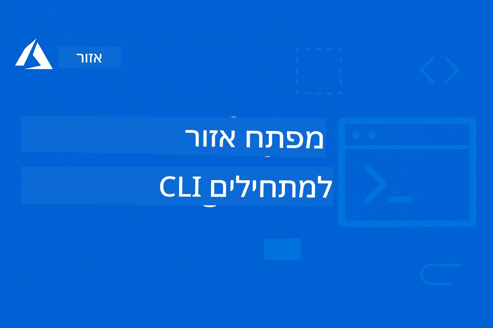

# AZD למתחילים: מסלול למידה מובנה

 

[](https://github.com/microsoft/AZD-for-beginners)
[](https://GitHub.com/microsoft/azd-for-beginners/network/)
[](https://github.com/microsoft/AZD-for-beginners)

[](https://discord.com/invite/nkVh3dp)
[](https://discord.gg/nTYy5BXMWG)

---

### תרגומים אוטומטיים (תמיד מעודכנים)

<!-- CO-OP TRANSLATOR LANGUAGES TABLE START -->
[Arabic](../ar/README.md) | [Bengali](../bn/README.md) | [Bulgarian](../bg/README.md) | [Burmese (Myanmar)](../my/README.md) | [Chinese (Simplified)](../zh-CN/README.md) | [Chinese (Traditional, Hong Kong)](../zh-HK/README.md) | [Chinese (Traditional, Macau)](../zh-MO/README.md) | [Chinese (Traditional, Taiwan)](../zh-TW/README.md) | [Croatian](../hr/README.md) | [Czech](../cs/README.md) | [Danish](../da/README.md) | [Dutch](../nl/README.md) | [Estonian](../et/README.md) | [Finnish](../fi/README.md) | [French](../fr/README.md) | [German](../de/README.md) | [Greek](../el/README.md) | [Hebrew](./README.md) | [Hindi](../hi/README.md) | [Hungarian](../hu/README.md) | [Indonesian](../id/README.md) | [Italian](../it/README.md) | [Japanese](../ja/README.md) | [Kannada](../kn/README.md) | [Khmer](../km/README.md) | [Korean](../ko/README.md) | [Lithuanian](../lt/README.md) | [Malay](../ms/README.md) | [Malayalam](../ml/README.md) | [Manipuri (Meitei Mayek)](../mni/README.md) | [Marathi](../mr/README.md) | [Nepali](../ne/README.md) | [Nigerian Pidgin](../pcm/README.md) | [Norwegian](../no/README.md) | [Persian (Farsi)](../fa/README.md) | [Polish](../pl/README.md) | [Portuguese (Brazil)](../pt-BR/README.md) | [Portuguese (Portugal)](../pt-PT/README.md) | [Punjabi (Gurmukhi)](../pa/README.md) | [Romanian](../ro/README.md) | [Russian](../ru/README.md) | [Serbian (Cyrillic)](../sr/README.md) | [Slovak](../sk/README.md) | [Slovenian](../sl/README.md) | [Spanish](../es/README.md) | [Swahili](../sw/README.md) | [Swedish](../sv/README.md) | [Tagalog (Filipino)](../tl/README.md) | [Tamil](../ta/README.md) | [Telugu](../te/README.md) | [Thai](../th/README.md) | [Turkish](../tr/README.md) | [Ukrainian](../uk/README.md) | [Urdu](../ur/README.md) | [Vietnamese](../vi/README.md)

> **מעוניין לשכפל מקומית?**
>
> מאגר זה כולל יותר מ-50 שפות תרגום אשר מגדילים משמעותית את גודל ההורדה. לשכפל ללא תרגומים, השתמש ב-sparse checkout:
>
> **Bash / macOS / Linux:**
> ```bash
> git clone --filter=blob:none --sparse https://github.com/microsoft/AZD-for-beginners.git
> cd AZD-for-beginners
> git sparse-checkout set --no-cone '/*' '!translations' '!translated_images'
> ```
>
> **CMD (Windows):**
> ```cmd
> git clone --filter=blob:none --sparse https://github.com/microsoft/AZD-for-beginners.git
> cd AZD-for-beginners
> git sparse-checkout set --no-cone "/*" "!translations" "!translated_images"
> ```
>
> זה נותן לך את כל מה שצריך כדי להשלים את הקורס עם הורדה הרבה יותר מהירה.
<!-- CO-OP TRANSLATOR LANGUAGES TABLE END -->

## 🆕 מה חדש ב-azd היום

> 📌 **סקירת גרסת AI CLI (2026-11-04):** ההנחיות נבדקו מול **`azd 1.37.2`**, **סוכנים `1.0.0-beta.23`**, ו-**הערכות `1.0.0-beta.2`** שפורסמו/מסמכים מקוריים. השתמש ב-`azd >= 1.37.0` עבור תהליך משולב. הרץ את `azd version` ו-[עדכן את הליבה של CLI](https://learn.microsoft.com/azure/developer/azure-developer-cli/install-azd) לפני הרחבות. ראה [שינויים ותיקונים בגרסה](docs/chapter-08-production/production-ai-practices.md#recent-release-changes-and-fixes). זה אינו אימות הפצה בשידור חי של כל הקורס.

Azure Developer CLI תומך בהרבה סוגי אפליקציות, כולל אפליקציות ווב, APIs, וסוכני AI, דרך מארחים, תבניות, והרחבות נתמכות.

הנה מה שזה אומר עבורך:

- **סוכני AI הם עכשיו עומסי עבודה מובילים ב-azd.** ניתן לאתחל, לפרוס ולנהל פרויקטים של סוכני AI באמצעות אותו תהליך `azd init` → `azd up` שאתה כבר מכיר.
- **מחזור חיי סוכן בשתי הרחבות.** השתמש ב-`azure.ai.agents` לאתחל, לקרוא, לאופטימיזציה, ולפרוש סוכנים. התקן בנפרד **`azure.ai.evaluations`** עבור `azd ai eval init`, `generate`, ו-`run start`. סוכני beta.22 החליפו את תהליך ההערכה הישן ושינו את תצורת האופטימיזציה; עקוב אחרי [מדריך ההגירה](docs/chapter-08-production/production-ai-practices.md#evaluation-migration-and-quality-checks).
- **בלוקים נוספים לבניית AI.** הרחבות תצוגה מקדימה חדשות—`azure.ai.skills` ו-`azure.ai.connections`—מאפשרות ניהול מיומנויות סוכן שניתנות לשימוש חוזר וקישורים Foundry ישירות עם azd.
- **אינטגרציה עם Microsoft Foundry** מביאה פריסת מודלים, אירוח סוכנים, וקונפיגורציית שירותי AI ישירות לאקוסיסטם התבניות של azd.
- **יסודות היום-יומיים חלקים יותר.** גרסאות אחרונות הפכו את `azd init` לאידמפוטנטי (בטוח להרצה חוזרת), מנקים אוטומטית אסימוני תוקף שפג תוקפם ב-`azd auth login`, והוסיפו תהליך התקנה ידידותי להרצה ראשונה ב-`azd tool`.
- **התהליך המרכזי לא השתנה.** בין אם אתה מפעיל אפליקציית משימות, מיקרוסרוויס, או פתרון AI מרובה סוכנים, הפקודות הן אותו הדבר.

> **הערה למשתמשי Aspire:** מיקרוסופט קוראת כעת למוצר פשוט "Aspire" (לשעבר ".NET Aspire"). התמיכה ב-Aspire של azd לא השתנתה—רק השם עודכן.

אם השתמשת ב-azd בעבר, התמיכה ב-AI היא הרחבה טבעית—לא כלי נפרד או מסלול מתקדם. אם אתה מתחיל מאפס, תלמד תהליך אחד שמתאים להכל.

---

## 🚀 מהו Azure Developer CLI (azd)?

**Azure Developer CLI (azd)** הוא כלי שורת פקודה ידידותי למפתחים המפשט פריסת אפליקציות ב-Azure. במקום ליצור ולקשר עשרות משאבים באופן ידני, אפשר לפרוס אפליקציות שלמות בפקודה אחת.

### הקסם של `azd up`

```bash
# This single command does everything:
# ✅ Creates all Azure resources  
# ✅ Configures networking and security
# ✅ Builds your application code
# ✅ Deploys to Azure
# ✅ Gives you a working URL
azd up
```

התבנית מספקת את תצורת האפליקציה והתשתית. פריסה מוצלחת עדיין דורשת שירותים/מודלים נתמכים, מכסה והרשאות מתאימות, קלט נכון, ואימות של האפליקציה המתפרסת. `azd up` אינו הופך תבנית לבטוחה, תואמת או מוכנה לייצור באופן אוטומטי.

---

## ❓ Azure Developer CLI לעומת Azure CLI: מה ההבדל?

זו השאלה השכיחה ביותר שמתחילים שואלים. הנה התשובה הפשוטה:

| תכונה | **Azure CLI (`az`)** | **Azure Developer CLI (`azd`)** |
|---------|---------------------|--------------------------------|
| **מטרה** | ניהול משאבי Azure בודדים | פריסת אפליקציות שלמות |
| **נקודת מבט** | ממוקד תשתית | ממוקד אפליקציה |
| **דוגמה** | `az webapp create --name myapp...` | `azd up` |
| **עקומת למידה** | צריך לדעת שירותי Azure | מספיק להכיר את האפליקציה שלך |
| **מתאים ל** | DevOps, תשתית | מפתחים, אבטיפוס |

### אנלוגיה פשוטה

- **Azure CLI** הוא כמו שיש לך את כל הכלים לבניית בית - פטישים, מסורים, מסמרות. אתה יכול לבנות כל דבר, אבל חייב לדעת בנייה.
- **Azure Developer CLI** הוא כמו שכירת קבלן - אתה מתאר מה שאתה רוצה, והוא מטפל בבנייה.

### מתי להשתמש בכל אחד

| תרחיש | השתמש בזה |
|----------|----------|
| "אני רוצה לפרוס את אפליקציית הווב שלי במהירות" | `azd up` |
| "אני צריך ליצור חשבון אחסון בלבד" | `az storage account create` |
| "אני בונה אפליקציית AI מלאה" | `azd init --template azure-search-openai-demo` |
| "אני צריך לאבחן משאב Azure ספציפי" | `az resource show` |
| "אני רוצה לפרוס לסביבת הייצור המוגדרת שלי" | בדוק תצורה, גישה, עלות, ודלתות תפעוליות לפני `azd up --environment production` |

### הם עובדים ביחד!

ל-AZD ו-Azure CLI יש אימות ותצורה נפרדים. השתמש ב-`azd auth login` ל-AZD, ו-`az login` כאשר פקודת ווּק או דיאגנוסטיקה דורשת במפורש את Azure CLI. ניתן להשתמש בשניהם:
```bash
# Deploy your app with AZD
azd up

# Then fine-tune specific resources with Azure CLI
az webapp config set --name myapp --always-on true
```

---

## 🌟 מצא תבניות באזד מדהים

אל תתחיל מאפס! **Awesome AZD** הוא אוסף הקהילה של תבניות מוכנות לפריסה:

| משאב | תיאור |
|----------|-------------|
| 🔗 [**גלריית Awesome AZD**](https://azure.github.io/awesome-azd/) | עיין ב-200+ תבניות עם פריסה בלחיצה אחת |
| 🔗 [**הגש תבנית**](https://github.com/Azure/awesome-azd/issues) | תרום את התבנית שלך לקהילה |
| 🔗 [**מאגר GitHub**](https://github.com/Azure/awesome-azd) | תן כוכב וחקור את המקור |

### תבניות AI פופולריות מ-Awesome AZD

בחר תבנית אחת בתיקייה ריקה משלה; הפקודות למטה הן חלופות. הפקודה המסתיימת ב-`.` מאתחלת את התיקייה הזאת.

```bash
# RAG Chat with Microsoft Foundry Models + AI Search
azd init --template azure-search-openai-demo .

# Quick AI Chat Application
azd init --template openai-chat-app-quickstart .

# AI Agents with Foundry Agents
azd init --template get-started-with-ai-agents .
```

---

## 🎯 התחלה בשלושה צעדים

לפני שאתה מתחיל, ודא שהמחשב שלך מוכן לתבנית שברצונך לפרוס:

**Windows:**
```powershell
.\validate-setup.ps1
```

**macOS / Linux:**
```bash
bash ./validate-setup.sh
```

אם כל בדיקה נדרשת נכשלה, תקן זאת ראשון ואז המשך להתחלה מהירה.

### שלב 1: התקן AZD (2 דקות)

**Windows:**
```powershell
winget install microsoft.azd
```

**macOS:**
```bash
brew tap azure/azd && brew install azd
```

**Linux:**
```bash
curl -fsSL https://aka.ms/install-azd.sh | bash
```

### שלב 2: אימות ל-AZD

```bash
# Optional if you plan to use Azure CLI commands directly in this course
az login

# Required for AZD workflows
azd auth login
```

אם אינך בטוח מה אתה צריך, עקוב אחרי תהליך ההתקנה המלא ב-[התקנה וקונפיגורציה](docs/chapter-01-foundation/installation.md#authentication-setup).

### שלב 3: פרוס את האפליקציה הראשונה שלך

```bash
# Initialize from a template
azd init --template todo-nodejs-mongo .

# Deploy to Azure (creates everything!)
azd up
```

**🎉 זהו זה!** האפליקציה שלך כעת חיה ב-Azure.

### ניקוי (אל תשכח!)

```bash
# Remove all resources when done experimenting
azd down --force --purge
```

---

## 📚 איך להשתמש בקורס הזה

קורס זה מעוצב ללמידה הדרגתית - התחל במקום שנוח לך והתקדם:

| הניסיון שלך | התחל כאן |
|-----------------|------------|
| **חדש לגמרי ב-Azure** | [פרק 1: יסודות](#-chapter-1-foundation--quick-start) |
| **מכיר את Azure, חדש ל-AZD** | [פרק 1: יסודות](#-chapter-1-foundation--quick-start) |
| **רוצה לפרוס אפליקציות AI** | [פרק 2: פיתוח AI ראשון](#-chapter-2-ai-first-development-recommended-for-ai-developers) |
| **רוצה תרגול מעשי** | [🎓 סדנה אינטראקטיבית](workshop/README.md) - מעבדה מודרכת 3-4 שעות |
| **צריך דפוסי ייצור** | [פרק 8: ייצור וארגוני](#-chapter-8-production--enterprise-patterns) |

### התקנה מהירה

1. **פצל מאגר זה**: [](https://GitHub.com/microsoft/azd-for-beginners/fork)
2. **שכפל אותו**: `git clone https://github.com/YOUR-USERNAME/azd-for-beginners.git`
3. **קבל עזרה**: [קהילת Azure Discord](https://discord.com/invite/ByRwuEEgH4)

> **מעוניין לשכפל מקומית?**

> מאגר זה כולל יותר מ-50 שפות תרגום אשר מגדילים משמעותית את גודל ההורדה. לשכפל ללא תרגומים, השתמש ב-sparse checkout:
> ```bash
> git clone --filter=blob:none --sparse https://github.com/microsoft/AZD-for-beginners.git
> cd AZD-for-beginners
> git sparse-checkout set --no-cone '/*' '!translations' '!translated_images'
> ```
> זה נותן לך את כל מה שאתה צריך כדי להשלים את הקורס עם הורדה מהירה הרבה יותר.


## מבוא לקורס

שלוט ב-Azure Developer CLI (azd) דרך פרקים מובנים שתוכננו ללמידה התקדמותית. **מוקד מיוחד על פריסת אפליקציות AI עם אינטגרציית Microsoft Foundry.**

### למה הקורס הזה חיוני למפתחים מודרניים

מפתחים שמפרסים עומסי עבודה ב-AI זקוקים בדרך כלל להנחיות על:
- ארכיטקטורות AI מורכבות רב-שירותיות
- שיטות עבודה מומלצות לפריסת AI בסביבת ייצור
- אינטגרציה וקינפוג של שירותי AI ב-Azure
- אופטימיזציה של עלויות עבור עומסי עבודה של AI
- פתרון תקלות בפריסות ספציפיות ל-AI

### מטרות הלמידה

בסיום קורס מובנה זה, תוכל:
- **לשלוט ביסודות AZD**: מושגי יסוד, התקנה וקינפוג
- **לפרוס אפליקציות AI**: להשתמש ב-AZD עם שירותי Microsoft Foundry
- **ליישם Infrastructure as Code**: לנהל משאבי Azure עם תבניות Bicep
- **לתקן בעיות פריסה**: לפתור בעיות נפוצות ולבצע דיבוג
- **לאופטימיזציה לייצור**: אבטחה, סקיילינג, ניטור וניהול עלויות
- **לבנות פתרונות מולטי-אייג'נט**: לפרוס ארכיטקטורות AI מורכבות

## לפני שאתה מתחיל: חשבונות, גישה והנחות

לפני שתתחיל בפרק 1, ודא שיש לך את הדברים הבאים. שלבי ההתקנה בהמשך מדריך זה מניחים שהיסודות האלה כבר מטופלים.

- **מנוי Azure**: תוכל להשתמש במנוי קיים מעבודה או מחשבון אישי, או ליצור [ניסיון חינם](https://aka.ms/azurefreetrial) כדי להתחיל.
- **הרשאה ליצירת משאבי Azure**: ברוב התרגילים, עליך להיות בעל גישת **Contributor** לפחות למנוי או לקבוצת המשאבים היעדית. חלק מהפרקים מניחים גם שניתן ליצור קבוצות משאבים, זהויות מנוהלות, והקצאות RBAC.
- [**חשבון GitHub**](https://github.com): שימושי ליצירת fork למאגר, מעקב אחר שינוייך, ושימוש ב-GitHub Codespaces לסדנה.
- **תנאי הפעלת תבניות**: חלק מהתבניות דורשות כלים מקומיים כמו Node.js, Python, Java, או Docker. הרץ את בודק ההתקנה לפני ההתחלה כדי לגלות כלים חסרים מוקדם.
- **היכרות בסיסית עם טרמינל**: אין צורך להיות מומחה, אך עליך להרגיש בנוח בהרצת פקודות כמו `git clone`, `azd auth login`, ו-`azd up`.

> **עובדים במנוי ארגוני?**
> אם סביבת Azure שלך מנוהלת על ידי מנהל, ודא מראש כי ניתן לפרוס משאבים במנוי או בקבוצת המשאבים המתוכננת לשימוש. אם לא, בקש מנוי sandbox או גישת Contributor לפני שתתחיל.

> **חדש ב-Azure?**
> התחל עם מנוי הניסיון או המנוי בתשלום בעת שימוש בכתובת https://aka.ms/azurefreetrial כך שתוכל להשלים את התרגילים מההתחלה ועד הסוף ללא המתנה לאישורים ברמת השוכר.

## 🗺️ מפת הקורס: ניווט מהיר לפי פרק

לכל פרק יש README ייעודי עם מטרות למידה, התחלה מהירה ותרגילים:

| פרק | נושא | שיעורים | משך זמן | מורכבות |
|---------|-------|---------|----------|------------|
| **[פרק 1: יסודות](docs/chapter-01-foundation/README.md)** | התחלה | [יסודות AZD](docs/chapter-01-foundation/azd-basics.md) &#124; [התקנה](docs/chapter-01-foundation/installation.md) &#124; [פרויקט ראשון](docs/chapter-01-foundation/first-project.md) | 30-45 דק' | ⭐ |
| **[פרק 2: פיתוח AI](docs/chapter-02-ai-development/README.md)** | אפליקציות AI ראשונות | [אינטגרציית Foundry](docs/chapter-02-ai-development/microsoft-foundry-integration.md) &#124; [סוכני AI](docs/chapter-02-ai-development/agents.md) &#124; [פריסת מודלים](docs/chapter-02-ai-development/ai-model-deployment.md) &#124; [סדנה](docs/chapter-02-ai-development/ai-workshop-lab.md) | 1-2 שעות | ⭐⭐ |
| **[פרק 3: קונפיגורציה](docs/chapter-03-configuration/README.md)** | אבטחה ואימות | [קינפוג](docs/chapter-03-configuration/configuration.md) &#124; [אימות ואבטחה](docs/chapter-03-configuration/authsecurity.md) | 45-60 דק' | ⭐⭐ |
| **[פרק 4: תשתית](docs/chapter-04-infrastructure/README.md)** | IaC ופריסה | [מדריך פריסה](docs/chapter-04-infrastructure/deployment-guide.md) &#124; [אספקה](docs/chapter-04-infrastructure/provisioning.md) | 1-1.5 שעות | ⭐⭐⭐ |
| **[פרק 5: מולטי-אייג'נט](docs/chapter-05-multi-agent/README.md)** | פתרונות סוכני AI | [תסריט קמעונאות](examples/retail-scenario.md) &#124; [תבניות תיאום](docs/chapter-06-pre-deployment/coordination-patterns.md) | 2-3 שעות | ⭐⭐⭐⭐ |
| **[פרק 6: טרום-פריסה](docs/chapter-06-pre-deployment/README.md)** | תכנון ואימות | [בדיקות טרום-טיסה](docs/chapter-06-pre-deployment/preflight-checks.md) &#124; [תכנון קיבולת](docs/chapter-06-pre-deployment/capacity-planning.md) &#124; [בחירת SKU](docs/chapter-06-pre-deployment/sku-selection.md) &#124; [App Insights](docs/chapter-06-pre-deployment/application-insights.md) | 1 שעה | ⭐⭐ |
| **[פרק 7: פתרון תקלות](docs/chapter-07-troubleshooting/README.md)** | דיבוג ותיקון | [בעיות נפוצות](docs/chapter-07-troubleshooting/common-issues.md) &#124; [דיבוג](docs/chapter-07-troubleshooting/debugging.md) &#124; [בעיות AI](docs/chapter-07-troubleshooting/ai-troubleshooting.md) | 1-1.5 שעות | ⭐⭐ |
| **[פרק 8: ייצור](docs/chapter-08-production/README.md)** | תבניות ארגוניות | [שיטות עבודה בייצור](docs/chapter-08-production/production-ai-practices.md) | 2-3 שעות | ⭐⭐⭐⭐ |
| **[🎓 סדנה](workshop/README.md)** | מעבדה מעשית | [מבוא](workshop/docs/instructions/0-Introduction.md) &#124; [בחירה](workshop/docs/instructions/1-Select-AI-Template.md) &#124; [אימות](workshop/docs/instructions/2-Validate-AI-Template.md) &#124; [פירוק](workshop/docs/instructions/3-Deconstruct-AI-Template.md) &#124; [קינפוג](workshop/docs/instructions/4-Configure-AI-Template.md) &#124; [התאמה אישית](workshop/docs/instructions/5-Customize-AI-Template.md) &#124; [פירוק](workshop/docs/instructions/6-Teardown-Infrastructure.md) &#124; [סיכום](workshop/docs/instructions/7-Wrap-up.md) | 3-4 שעות | ⭐⭐ |

**משך כולל של הקורס:** ~10-14 שעות | **התקדמות במיומנות:** מתחילים → מוכנים לייצור

---

## 📚 פרקי למידה

*בחר את מסלול הלמידה שלך לפי רמת הניסיון והמטרות*

### 🚀 פרק 1: יסודות והתחלה מהירה
**דרישות קדם**: מנוי Azure, ידע בסיסי בשורת הפקודה  
**משך זמן**: 30-45 דקות  
**מורכבות**: ⭐

#### מה תלמד
- הבנת יסודות Azure Developer CLI
- התקנת AZD בפלטפורמה שלך
- הפריסה הראשונה המוצלחת שלך

#### משאבי למידה
- **🎯 התחלה כאן**: [מה זה Azure Developer CLI?](#-what-is-azure-developer-cli-azd)
- **📖 תיאוריה**: [יסודות AZD](docs/chapter-01-foundation/azd-basics.md) - מושגי יסוד וטרמינולוגיה
- **⚙️ התקנה**: [התקנה והגדרה](docs/chapter-01-foundation/installation.md) - מדריכים ספציפיים לפלטפורמה
- **🛠️ מעשי**: [הפרויקט הראשון שלך](docs/chapter-01-foundation/first-project.md) - מדריך שלב אחר שלב
- **📋 רפרנס מהיר**: [גיליון רמזים לפקודות](resources/cheat-sheet.md)

#### תרגילים מעשיים
```bash
# Quick installation check
azd version

# Deploy your first application
azd init --template todo-nodejs-mongo .
azd up
```

**💡 תוצר פרק**: לפרוס בהצלחה יישום אינטרנט פשוט ל-Azure באמצעות AZD

**✅ אימות הצלחה:**
```bash
# After completing Chapter 1, you should be able to:
azd version              # Shows installed version
azd init --template todo-nodejs-mongo  # Initializes project
azd up                  # Deploys to Azure
azd show                # Displays running app URL
# Application opens in browser and works
azd down --force --purge  # Cleans up resources
```

**📊 זמן השקעה:** 30-45 דקות  
**📈 רמת מיומנות לאחר:** יכול לפרוס אפליקציות בסיסיות באופן עצמאי

---

### 🤖 פרק 2: פיתוח AI-ראשון (מומלץ למפתחי AI)
**דרישות קדם**: סיום פרק 1  
**משך זמן**: 1-2 שעות  
**מורכבות**: ⭐⭐

#### מה תלמד
- אינטגרציית Microsoft Foundry עם AZD
- פריסת אפליקציות ממונעות AI
- הבנת קונפיגורציות שירות AI

#### משאבי למידה
- **🎯 התחלה כאן**: [אינטגרציית Microsoft Foundry](docs/chapter-02-ai-development/microsoft-foundry-integration.md)
- **🤖 סוכני AI**: [מדריך סוכני AI](docs/chapter-02-ai-development/agents.md) - פריסת סוכנים אינטליגנטיים עם AZD
- **📖 תבניות**: [פריסת מודלים AI](docs/chapter-02-ai-development/ai-model-deployment.md) - פרסם וניהול מודלים AI
- **🛠️ סדנה**: [סדנת AI](docs/chapter-02-ai-development/ai-workshop-lab.md) - הפוך פתרונות AI למוכנים ל-AZD
- **🎥 מדריך אינטראקטיבי**: [חומרי הסדנה](workshop/README.md) - למידה מבוססת דפדפן עם MkDocs * סביבה DevContainer
- **📋 תבניות**: [תבניות Microsoft Foundry](#featured-microsoft-foundry-templates)
- **📝 דוגמאות**: [דוגמאות פריסת AZD](examples/README.md)

#### תרגילים מעשיים
```bash
# Deploy your first AI application
azd init --template azure-search-openai-demo .
azd up

# Try additional AI templates
azd init --template openai-chat-app-quickstart .
azd init --template agent-openai-python-prompty .
```

**💡 תוצר פרק**: לפרוס ולתכנן אפליקציית צ'אט ממונעת AI עם יכולות RAG

**✅ אימות הצלחה:**
```bash
# After Chapter 2, you should be able to:
azd init --template azure-search-openai-demo .
azd up
# Test the AI chat interface
# Ask questions and get AI-powered responses with sources
# Verify search integration works
azd monitor  # Check Application Insights shows telemetry
azd down --force --purge
```

**📊 זמן השקעה:** 1-2 שעות  
**📈 רמת מיומנות לאחר:** יכול לפרוס אפליקציות למידה מבוססות AI ולזהות דרישות נוספות למוכנות לייצור
**💰 מודעות לעלות:** הבן עלויות פיתוח של $80-150/חודש, ועלויות ייצור של $300-3500/חודש

#### 💰 שיקולי עלות לפריסות AI

**סביבת פיתוח (מוערך $80-150/חודש):**
- מודלים Microsoft Foundry (תשלום לפי שימוש): $0-50/חודש (בהתאם לשימוש בטוקנים)
- חיפוש AI (שכבת בסיס): $75/חודש
- אפליקציות מכולה (צריכה): $0-20/חודש
- אחסון (סטנדרטי): $1-5/חודש

**סביבת ייצור (מוערך $300-3,500+/חודש):**
- מודלים Microsoft Foundry (PTU לביצועים עקביים): $3,000+/חודש או תשלום לפי שימוש בנפח גבוה
- חיפוש AI (שכבת סטנדרט): $250/חודש
- אפליקציות מכולה (מיוחדות): $50-100/חודש
- Application Insights: $5-50/חודש
- אחסון (פרימיום): $10-50/חודש

**💡 טיפים לאופטימיזציה של עלויות:**
- בדוק מחירי inference לדגם והטבות ספציפיות לחשבון; Azure OpenAI אינה כוללת הקצבה חודשית חופשית אוניברסלית של 50,000 טוקנים
- הרץ `azd down` למחיקת משאבים כשלא נדרשים עוד, לאחר סקירת הסביבה הנבחרת
- התחל בחשבון מבוסס צריכה, שדרג ל-PTU רק בייצור
- השתמש ב-`azd provision --preview` כדי לבדוק את התשתית המתוכננת, ואז לחשב עלויות באמצעות מחשבון המחירים של Azure
- אפשר סקיילינג אוטומטי: תשלם רק עבור שימוש בפועל

**ניטור עלויות:**
```bash
# Inspect planned resources (this does not calculate prices)
azd provision --preview

# Monitor actual costs in Azure Portal
az consumption budget list --resource-group <your-rg>
```

---

### ⚙️ פרק 3: קונפיגורציה ואימות
**דרישות קדם**: סיום פרק 1  
**משך זמן**: 45-60 דקות  
**מורכבות**: ⭐⭐

#### מה תלמד
- קונפיגורציה וניהול סביבת עבודה
- שיטות עבודה מומלצות לאימות ואבטחה
- שמות משאבים וארגון

#### משאבי למידה
- **📖 קינפוג**: [מדריך קונפיגורציה](docs/chapter-03-configuration/configuration.md) - הגדרת סביבת עבודה
- **🔐 אבטחה**: [דפוסי אימות וזהות מנוהלת](docs/chapter-03-configuration/authsecurity.md) - דפוסי אימות
- **📝 דוגמאות**: [דוגמת אפליקציית מסד נתונים](examples/database-app/README.md) - דוגמאות מסד נתונים ב-AZD

#### תרגילים מעשיים
- קונפיגורציה לריבוי סביבות (פיתוח, סטייג', ייצור)
- הקמת אימות זהות מנוהלת
- יישום קונפיגורציות ספציפיות לסביבה

**💡 תוצר פרק**: נהל סביבות מרובות עם אימות ואבטחה נכונים

---

### 🏗️ פרק 4: אינפרסט럭צ׳ר כסקריפט ופריסה
**דרישות קדם**: סיום פרקים 1-3  
**משך זמן**: 1-1.5 שעות  
**מורכבות**: ⭐⭐⭐

#### מה תלמד
- דפוסי פריסה מתקדמים
- Infrastructure as Code עם Bicep
- אסטרטגיות אספקת משאבים

#### משאבי למידה
- **📖 פריסה**: [מדריך פריסה](docs/chapter-04-infrastructure/deployment-guide.md) - תרחישי עבודה שלמים
- **🏗️ אספקה**: [מתן משאבים](docs/chapter-04-infrastructure/provisioning.md) - ניהול משאבי Azure
- **📝 דוגמאות**: [דוגמת אפליקציית מכולה](../../examples/container-app) - פריסות מכולות

#### תרגילים מעשיים
- צור תבניות Bicep מותאמות אישית
- פרוס אפליקציות רב-שירותיות
- יישם אסטרטגיות פריסה כחולה-ירוקה

**💡 תוצר פרק**: פרוס אפליקציות מורכבות רב-שירותיות באמצעות תבניות תשתית מותאמות אישית

---

### 🎯 פרק 5: פתרונות AI עם סוכנים מרובים (מתקדמים)
**דרישות קדם**: סיום פרקים 1-2  
**משך זמן**: 2-3 שעות  
**מורכבות**: ⭐⭐⭐⭐

#### מה תלמד
- דפוסי ארכיטקטורת סוכנים מרובים
- תיאום ואורקסטרציה של סוכנים
- פריסות AI מוכנות לייצור

#### משאבי למידה
- **🤖 עיצוב מובלט**: [פתרון מולטי-אייג’נט בקמעונאות](examples/retail-scenario.md) - טלאות ארכיטקטורה, לא אפליקציה שלמה
- **🛠️ תבניות ARM**: [ARM Template Package](../../examples/retail-multiagent-arm-template) - תשתית בסיסית; בדיקת דרישות מוקדמות ורכיבי אפליקציה חסרים
- **📖 ארכיטקטורה**: [Multi-agent coordination patterns](docs/chapter-06-pre-deployment/coordination-patterns.md) - דפוסים

#### תרגילים מעשיים
```bash
# Inspect the retail infrastructure scaffold before choosing to deploy it
cd examples/retail-multiagent-arm-template
cat README.md

# After an intentional deployment, inspect infrastructure state
az deployment group show --resource-group <rg-name> --name <deployment-name>
```

**💡 תוצאה בפרק**: להבין עיצוב רב-סוכני ולזהות את העבודה של יישום, אימות ותפעול הנדרשת מעבר לתשתית בסיסית

---

### 🔍 פרק 6: אימות ותכנון לפני פריסה
**דרישות מוקדמות**: סיום פרק 4  
**משך**: שעה אחת  
**מורכבות**: ⭐⭐

#### מה תלמדו
- תכנון קיבולת ואימות משאבים
- אסטרטגיות לבחירת SKU
- בדיקות טרום-טיסה ואוטומציה

#### משאבי לימוד
- **📊 תכנון**: [Capacity Planning](docs/chapter-06-pre-deployment/capacity-planning.md) - אימות משאבים
- **💰 בחירה**: [SKU Selection](docs/chapter-06-pre-deployment/sku-selection.md) - בחירות חסכוניות
- **✅ אימות**: [Pre-flight Checks](docs/chapter-06-pre-deployment/preflight-checks.md) - סקריפטים אוטומטיים

#### תרגילים מעשיים
- הרצת סקריפטים לאימות קיבולת
- אופטימיזציה של בחירות SKU לפי עלות
- יישום בדיקות טרום פריסה אוטומטיות

**💡 תוצאה בפרק**: לאמת ולאופטימיזציה של פריסות לפני ביצוע

---

### 🚨 פרק 7: פתרון בעיות ואיתור שגיאות
**דרישות מוקדמות**: סיום כל פרק פריסה  
**משך**: שעה עד שעה וחצי  
**מורכבות**: ⭐⭐

#### מה תלמדו
- גישות סיסטמטיות לאיתור שגיאות
- בעיות נפוצות ופתרונות
- פתרון בעיות ספציפיות לבינה מלאכותית

#### משאבי לימוד
- **🔧 בעיות נפוצות**: [Common Issues](docs/chapter-07-troubleshooting/common-issues.md) - שאלות נפוצות ופתרונות
- **🕵️ איתור שגיאות**: [Debugging Guide](docs/chapter-07-troubleshooting/debugging.md) - אסטרטגיות שלב אחרי שלב
- **🤖 בעיות AI**: [AI-Specific Troubleshooting](docs/chapter-07-troubleshooting/ai-troubleshooting.md) - בעיות בשירותי AI

#### תרגילים מעשיים
- אבחון כישלונות בפריסה
- פתרון בעיות אימות
- איתור שגיאות בחיבור לשירותי AI

**💡 תוצאה בפרק**: לאבחן ולפתור בעיות פריסה נפוצות באופן עצמאי

---

### 🏢 פרק 8: דפוסי ייצור וארגוניים
**דרישות מוקדמות**: סיום פרקים 1-4  
**משך**: 2-3 שעות  
**מורכבות**: ⭐⭐⭐⭐

#### מה תלמדו
- אסטרטגיות פריסה בייצור
- דפוסי אבטחה ארגוניים
- ניטור ואופטימיזציה של עלויות

#### משאבי לימוד
- **🏭 ייצור**: [Production AI Best Practices](docs/chapter-08-production/production-ai-practices.md) - דפוסים ארגוניים
- **📝 דוגמאות**: [Microservices Example](../../examples/microservices) - ארכיטקטורות מורכבות
- **📊 ניטור**: [Application Insights integration](docs/chapter-06-pre-deployment/application-insights.md) - ניטור

#### תרגילים מעשיים
- יישום דפוסי אבטחה ארגוניים
- הקמת ניטור מקיף
- פריסה לייצור עם ממשל תקין

**💡 תוצאה בפרק**: לפרוס אפליקציות מוכנות לארגון עם כל היכולות של ייצור

---

## 🎓 סקירת סדנה: חווית לימוד מעשית

> **⚠️ מצב סדנה: בפיתוח פעיל**  
> חומרי הסדנה נמצאים כעת בפיתוח ובגיבוש. המודולים הראשיים פונקציונליים, אך חלק מהנושאים המתקדמים אינם מושלמים. אנו עובדים בחריצות להשלים את כל התוכן. [עקוב אחרי ההתקדמות →](workshop/README.md)

### חומרי סדנה אינטראקטיביים
**לימוד מעשי ומקיף עם כלים מבוססי דפדפן ותרגילים מונחים**

חומרי הסדנה שלנו מספקים חווית לימוד מובנית ואינטראקטיבית שמשלימה את מבנה הלמידה מבוסס הפרקים לעיל. הסדנה מיועדת הן ללמידה בקצב עצמאי והן למפגשים מונחי מדריך.

#### 🛠️ מאפייני הסדנה
- **ממשק מבוסס דפדפן**: סדנה שלמה מופעלת על MkDocs עם חיפוש, העתקה ותכונות נושא
- **שילוב GitHub Codespaces**: הקמת סביבת פיתוח בלחיצה אחת
- **מסלול למידה מובנה**: 8 מודולים עם תרגילים מונחים (3-4 שעות בסך הכל)
- **מתודולוגיה פרוגרסיבית**: מבוא → בחירה → אימות → פירוק → קונפיגורציה → התאמה אישית → פירוק → סיכום
- **סביבת DevContainer אינטראקטיבית**: כלים ותלויות מוגדרים מראש

#### 📚 מבנה מודולי הסדנה
הסדנה מבוססת על **מתודולוגיה פרוגרסיבית עם 8 מודולים** שלוקחת אתכם מגילוי ועד לשליטה בפריסה:

| מודול | נושא | מה תעשו | משך |
|--------|-------|----------------|----------|
| **0. מבוא** | סקירת הסדנה | להבין מטרות הלמידה, דרישות מוקדמות ומבנה הסדנה | 15 דקות |
| **1. בחירה** | גילוי תבניות | לחקור תבניות AZD ולבחור את תבנית ה-AI המתאימה לתרחיש שלכם | 20 דקות |
| **2. אימות** | פריסה ואימות | לפרוס את התבנית עם `azd up` ולאמת תפקוד תשתית | 30 דקות |
| **3. פירוק** | הבנת המבנה | שימוש ב-GitHub Copilot לחקירת ארכיטקטורת התבנית, קבצי Bicep וארגון הקוד | 30 דקות |
| **4. קונפיגורציה** | מבט מעמיק ב-azure.yaml | שליטה ב-`azure.yaml`, hooks מחזור חיים, ומשתני סביבה | 30 דקות |
| **5. התאמה אישית** | להפוך אותו לשלכם | הפעלת חיפוש AI, מעקב, הערכה, והתאמה אישית לתרחיש שלכם | 45 דקות |
| **6. פירוק** | ניקוי | ביטול משאבים בבטחה עם `azd down --purge` | 15 דקות |
| **7. סיכום** | צעדים הבאים | סקירת הישגים, מושגים מרכזיים, והמשך מסע הלמידה | 15 דקות |

**זרימת הסדנה:**
```
Introduction → Selection → Validation → Deconstruction → Configuration → Customization → Teardown → Wrap-up
     ↓            ↓           ↓              ↓               ↓              ↓            ↓           ↓
  Overview    Find the     Deploy &      Explore        Master         Customize     Clean up    Review &
             right        verify        code &        azure.yaml      for your      resources   next steps
             template                   structure                     scenario
```

#### 🚀 התחלת הסדנה
```bash
# Option 1: GitHub Codespaces (Recommended)
# Click "Code" → "Create codespace on main" in the repository

# Option 2: Local Development
git clone https://github.com/microsoft/azd-for-beginners.git
cd azd-for-beginners/workshop
# Follow the setup instructions in workshop/README.md
```

#### 🎯 תוצאות למידה בסדנה
בהשלמת הסדנה המשתתפים יוכלו:
- **לפרוס אפליקציות AI בפרודקשן**: שימוש ב-AZD עם שירותי Microsoft Foundry
- **לשלוט בארכיטקטורות רב-סוכניות**: יישום פתרונות סוכני AI מתואמים
- **ליישם שיטות אבטחה מיטביות**: קונפיגורציה של אימות ושליטה בגישה
- **לאופטימיזציה לפי סקייל**: תכנון פריסות חסכוניות וביצועיות
- **לפתור בעיות פריסה**: פתרון בעיות נפוצות באופן עצמאי

#### 📖 משאבי הסדנה
- **🎥 מדריך אינטראקטיבי**: [Workshop Materials](workshop/README.md) - סביבת לימוד מבוססת דפדפן
- **📋 הוראות פר מודול**:
  - [0. מבוא](workshop/docs/instructions/0-Introduction.md) - סקירה ומטרות הסדנה
  - [1. בחירה](workshop/docs/instructions/1-Select-AI-Template.md) - מציאת ובחירת תבניות AI
  - [2. אימות](workshop/docs/instructions/2-Validate-AI-Template.md) - פריסה ואימות תבניות
  - [3. פירוק](workshop/docs/instructions/3-Deconstruct-AI-Template.md) - חקר ארכיטקטורת תבניות
  - [4. קונפיגורציה](workshop/docs/instructions/4-Configure-AI-Template.md) - שליטה ב-azure.yaml
  - [5. התאמה אישית](workshop/docs/instructions/5-Customize-AI-Template.md) - התאמה לתרחיש שלכם
  - [6. פירוק](workshop/docs/instructions/6-Teardown-Infrastructure.md) - ניקוי משאבים
  - [7. סיכום](workshop/docs/instructions/7-Wrap-up.md) - סקירה וצעדים הבאים
- **🛠️ מעבדת סדנה AI**: [AI Workshop Lab](docs/chapter-02-ai-development/ai-workshop-lab.md) - תרגילי AI ממוקדים
- **💡 התחלה מהירה**: [Workshop Setup Guide](workshop/README.md#browser-based-guide) - קונפיגורציית סביבה

**מושלם עבור**: הכשרות ארגוניות, קורסים באוניברסיטה, למידה בקצב עצמאי ומחנות למידה למפתחים.

---

## 📖 מעמיק: יכולות AZD

מעבר ליסודות, AZD מספק יכולות עוצמתיות לפריסות ייצור:

- **פריסות מבוססות תבניות** - שימוש בתבניות מוכנות לדפוסי אפליקציות נפוצים
- **תשתית כקוד** - ניהול משאבי Azure באמצעות Bicep או Terraform  
- **זרימות עבודה משולבות** - פריסה, ניטור והפעלה חלקה של אפליקציות
- **ידידותי למפתחים** - מיטוב לפרודוקטיביות ולחוויית המפתח

### **AZD + Microsoft Foundry: מושלם לפריסות AI**

**למה AZD לפתרונות AI?** AZD מתמודד עם האתגרים המרכזיים של מפתחי AI:

- **תבניות מוכנות ל-AI** - תבניות מוגדרות מראש לדגמי Microsoft Foundry, שירותי Azure AI ועומסי ML
- **פריסות AI מאובטחות** - דפוסי אבטחה מובנים לשירותי AI, מפתחות API ונקודות קצה של דגמים  
- **דפוסי AI לייצור** - שיטות מיטביות לפריסות אפליקציות AI סקיילביליות וחסכוניות
- **זרימות עבודה מקצה לקצה של AI** - מפיתוח דגם ועד פריסה עם ניטור נכון
- **אופטימיזציה של עלות** - הקצאת משאבים חכמה ואסטרטגיות סקיילינג לעומסי AI
- **שילוב עם Microsoft Foundry** - חיבור חלק לקטלוג דגמים ונקודות קצה של Microsoft Foundry

---

## 🎯 ספריית תבניות ודוגמאות

### מודגשים: תבניות Microsoft Foundry
**התחילו כאן אם אתם מפרסים אפליקציות AI!**

> **הערה:** תבניות אלו מדגימות דפוסי AI שונים. חלקן דוגמאות Azure חיצוניות, ואחרות יישומים מקומיים.

| תבנית | פרק | מורכבות | שירותים | סוג |
|----------|---------|------------|----------|------|
| [**התחלה עם צ׳אט AI**](https://github.com/Azure-Samples/get-started-with-ai-chat) | פרק 2 | ⭐⭐ | AzureOpenAI + Azure AI Model Inference API + Azure AI Search + Azure Container Apps + Application Insights | חיצוני |
| [**התחלה עם סוכני AI**](https://github.com/Azure-Samples/get-started-with-ai-agents) | פרק 2 | ⭐⭐ | Foundry Agents + AzureOpenAI + Azure AI Search + Azure Container Apps + Application Insights| חיצוני |
| [**הדגמת Azure Search + OpenAI**](https://github.com/Azure-Samples/azure-search-openai-demo) | פרק 2 | ⭐⭐ | Azure OpenAI + Azure AI Search + Container Apps (ברירת מחדל) + Storage | חיצוני |
| [**התחלה מהירה לאפליקציית OpenAI Chat**](https://github.com/Azure-Samples/openai-chat-app-quickstart) | פרק 2 | ⭐ | AzureOpenAI + Container Apps + Application Insights | חיצוני |
| [**Agent OpenAI Python Prompty**](https://github.com/Azure-Samples/agent-openai-python-prompty) | פרק 5 | ⭐⭐⭐ | AzureOpenAI + Azure Functions + Prompty | חיצוני |
| [**צ׳אט Contoso RAG**](https://github.com/Azure-Samples/contoso-chat) | פרק 8 | ⭐⭐⭐⭐ | AzureOpenAI + AI Search + Cosmos DB + Container Apps | חיצוני |
| [**פתרון רב-סוכני לקמעונאות**](examples/retail-scenario.md) | פרק 5 | ⭐⭐⭐⭐ | תבנית ארכיטקטורה ותשתית מוצעת; נדרש יישום אפליקציה | **תבנית מקומית** |

### מודגשים: תרחישי למידה שלמים
**תבניות אפליקציה מוכנות לייצור שממופות לפרקי הלמידה**

| תבנית | פרק למידה | מורכבות | למידה מרכזית |
|----------|------------------|------------|--------------|
| [**openai-chat-app-quickstart**](https://github.com/Azure-Samples/openai-chat-app-quickstart) | פרק 2 | ⭐ | דפוסי פריסת AI בסיסיים |
| [**azure-search-openai-demo**](https://github.com/Azure-Samples/azure-search-openai-demo) | פרק 2 | ⭐⭐ | יישום RAG עם Azure AI Search |
| [**get-started-with-ai-agents**](https://github.com/Azure-Samples/get-started-with-ai-agents) | פרק 2 | ⭐⭐ | שיחות מגובות בסוכנים ומבחני הערכה למקרים ספציפיים |
| [**agent-openai-python-prompty**](https://github.com/Azure-Samples/agent-openai-python-prompty) | פרק 5 | ⭐⭐⭐ | מסגרת סוכנים וקריאת פונקציות |
| [**contoso-chat**](https://github.com/Azure-Samples/contoso-chat) | פרק 8 | ⭐⭐⭐ | ארגון AI ארגוני |
| [**retail-multi-agent-solution**](examples/retail-scenario.md) | פרק 5 | ⭐⭐⭐⭐ | ארכיטקטורה רב-סוכנית עם סוכני לקוח ומלאי |

### למידה לפי סוג דוגמה

> **📌 דוגמאות מקומיות לעומת חיצוניות:**  
> **דוגמאות מקומיות** (באוסף זה) = בדוק את README של הדוגמה לגבי מצב יישום ודרישות מוקדמות
> **דוגמאות חיצוניות** (דוגמאות Azure) = שיבוט מתוך מאגרים מקושרים

#### דוגמאות מקומיות (מוכנות לשימוש)
- [**פתרון רב-סוכני לקמעונאות**](examples/retail-scenario.md) - תבנית ארכיטקטורה עם תשתית ARM
  - תפקידי סוכן לקוח וסוכן מלאי מוצעים
  - יש לבצע ולאמת עקיבת למידה וקוד אפליקציה
  - הקצאת משאבים בלבד אינה יוצרת אפליקציית קמעונאות עובדת

#### דוגמאות מקומיות - אפליקציות מכולות (פרקים 2-5)
**דוגמאות פריסה מקיפות של מכולות באוסף זה:**
- [**דוגמאות לאפליקציית מכולות**](examples/container-app/README.md) - מדריך מלא לפריסות מכולות
  - [API Flask פשוט](../../examples/container-app/simple-flask-api) - REST API בסיסי עם יכולת סקייל לאפס
  - [ארכיטקטורת מיקרו-שירותים](../../examples/container-app/microservices) - דוגמת למידה עם שני שירותים; חידוד לייצור נדרש עבודה נוספת
  - דפוסי פריסה מהירה, ייצור ומתקדמים
  - הנחיות ניטור, אבטחה ואופטימיזציה של עלויות

#### דוגמאות חיצוניות - אפליקציות פשוטות (פרקים 1-2)
**שיבוט מאגרים אלה של דוגמאות Azure להתחלה:**
- [אפליקציית ווב פשוטה - Node.js + MongoDB](https://github.com/Azure-Samples/todo-nodejs-mongo) - דפוסי פריסה בסיסיים
- [אתר סטטי - React SPA](https://github.com/Azure-Samples/todo-csharp-sql-swa-func) - פריסת תוכן סטטי
- [אפליקציית מכולה - Python Flask](https://github.com/Azure-Samples/container-apps-store-api-microservice) - פריסת REST API

#### דוגמאות חיצוניות - אינטגרציית מאגר נתונים (פרקים 3-4)  
- [אפליקציית בסיס נתונים - C# + SQL](https://github.com/Azure-Samples/todo-csharp-sql) - תבניות חיבור למסדי נתונים  
- [פונקציות + Cosmos DB](https://github.com/Azure-Samples/todo-python-mongo-swa-func) - תזרים עבודה ללא שרת  

#### דוגמאות חיצוניות - תבניות מתקדמות (פרקים 4-8)  
- [Java Microservices](https://github.com/Azure-Samples/java-microservices-aca-lab) - ארכיטקטורות רב-שירותיות  
- [Container Apps Jobs](https://github.com/Azure-Samples/container-apps-jobs) - עיבוד ברקע  
- [Enterprise ML Pipeline](https://github.com/Azure/mlops-v2) - תבניות התייחסות ל-MLOps; לא תבנית AZD מוכנה לשימוש  

### אוספי תבניות חיצוניות  
- [**גלריית תבניות רשמית של AZD**](https://azure.github.io/awesome-azd/) - אוסף מתוחכם של תבניות רשמיות וקהילתיות  
- [**תבניות Azure Developer CLI**](https://learn.microsoft.com/en-us/azure/developer/azure-developer-cli/azd-templates) - תיעוד תבניות מיקרוסופט למידה  
- [**ספריית דוגמאות**](examples/README.md) - דוגמאות למידה מקומיות עם הסברים מפורטים  

---

## 📚 משאבי למידה והפניות  

### הפניות מהירות  
- [**שיטת פקודות**](resources/cheat-sheet.md) - פקודות azd חיוניות מאורגנות לפי פרק  
- [**מילון מונחים**](resources/glossary.md) - מונחי Azure ו-azd  
- [**שאלות נפוצות**](resources/faq.md) - שאלות נפוצות מאורגנות לפי פרק הלימוד  
- [**מדריך למידה**](resources/study-guide.md) - תרגילים מעשיים מקיפים  

### סדנאות מעשיות  
- [**מעבדת סדנת בינה מלאכותית**](docs/chapter-02-ai-development/ai-workshop-lab.md) - הפוך את פתרונות ה-AI שלך לפרוסים עם AZD (2-3 שעות)  
- [**סדנה אינטראקטיבית**](workshop/README.md) - 8 מודולים של תרגילים מודרכים עם MkDocs ו-GitHub Codespaces  
  - עוקב אחר: מבוא → בחירה → אימות → פירוק → קונפיגורציה → התאמה אישית → פירוק → סיכום  

### משאבי למידה חיצוניים  
- [תיעוד Azure Developer CLI](https://learn.microsoft.com/en-us/azure/developer/azure-developer-cli/)  
- [מרכז ארכיטקטורת Azure](https://learn.microsoft.com/en-us/azure/architecture/)  
- [מחשבון תמחור Azure](https://azure.microsoft.com/pricing/calculator/)  
- [סטטוס Azure](https://status.azure.com/)  

### מיומנויות סוכן AI לעורך שלך  
- [**מיומנויות מיקרוסופט Azure ב-skills.sh**](https://skills.sh/microsoft/github-copilot-for-azure) - 37 מיומנויות סוכן פתוחות ל-Azure AI, Foundry, פריסה, אבחונים, אופטימיזציית עלות ועוד. התקן אותם ב-GitHub Copilot, Cursor, Claude Code או כל סוכן נתמך אחר:  
  ```bash
  npx skills add microsoft/github-copilot-for-azure
  ```

---

## 🔧 מדריך פתרון מהיר לבעיות  

**בעיות נפוצות למתחילים ופתרונות מיידיים:**  

<details>
<summary><strong>❌ "azd: פקודה לא נמצאה"</strong></summary>

```bash
# Install AZD first
# Windows (PowerShell):
winget install microsoft.azd

# macOS:
brew tap azure/azd && brew install azd

# Linux:
curl -fsSL https://aka.ms/install-azd.sh | bash

# Verify installation
azd version
```
</details>

<details>
<summary><strong>❌ "לא נמצאה מינוי" או "המינוי לא הוגדר"</strong></summary>

```bash
# List available subscriptions
az account list --output table

# Set default subscription
az account set --subscription "<subscription-id-or-name>"

# Set for AZD environment
azd env set AZURE_SUBSCRIPTION_ID "<subscription-id>"

# Verify
az account show
```
</details>

<details>
<summary><strong>❌ "InsufficientQuota" או "מכסת משאבים חורגת"</strong></summary>

```bash
# Try different Azure region
azd env set AZURE_LOCATION "westus2"
azd up

# Or use smaller SKUs in development
# Edit infra/main.parameters.json:
{
  "sku": "B1"  // Instead of "P1V2"
}
```
</details>

<details>
<summary><strong>❌ "azd up" נכשל באמצע התהליך</strong></summary>

```bash
# Option 1: Inspect the error and retry after correcting its cause
azd show
azd up --debug

# Option 2: Just fix infrastructure
azd provision

# Option 3: Check detailed status
azd show

# Option 4: Check logs in Azure Monitor
azd monitor --logs
```
</details>

<details>
<summary><strong>❌ "אימות נכשל" או "הטוקן פג תוקף"</strong></summary>

```bash
# Re-authenticate for AZD
azd auth logout
azd auth login

# Optional: refresh Azure CLI too if you are running az commands
az logout
az login

# Verify authentication
az account show
```
</details>

<details>
<summary><strong>❌ "המשאב כבר קיים" או קונפליקטים בשמות</strong></summary>

```bash
# Inspect the conflicting resource before changing or deleting anything.
# For an isolated new deployment, create a separate environment:
azd env new dev-v2
azd up
```
</details>

<details>
<summary><strong>❌ פריסת תבנית לוקחת יותר מדי זמן</strong></summary>

**זמני המתנה רגילים:**  
- אפליקציית ווב פשוטה: 5-10 דקות  
- אפליקציה עם בסיס נתונים: 10-15 דקות  
- יישומי AI: 15-25 דקות (פריסת OpenAI איטית)  

```bash
# Check progress
azd show

# If stuck >30 minutes, check Azure Portal:
azd monitor --overview
# Look for failed deployments
```
</details>

<details>
<summary><strong>❌ "הרשאה נדחתה" או "אסור"</strong></summary>

```bash
# Check your Azure role
az role assignment list --assignee $(az account show --query user.name -o tsv)

# You need at least "Contributor" role
# Ask your Azure admin to grant:
# - Contributor (for resources)
# - User Access Administrator (for role assignments)
```
</details>

<details>
<summary><strong>❌ לא ניתן למצוא את כתובת ה-URL של האפליקציה שפורסה</strong></summary>

```bash
# Show all service endpoints
azd show

# Or open Azure Portal
azd monitor

# Check specific service
azd env get-values
# Look for *_URL variables
```
</details>

### 📚 משאבים מלאים לפתרון בעיות  

- **מדריך בעיות נפוצות:** [פתרונות מפורטים](docs/chapter-07-troubleshooting/common-issues.md)  
- **בעיות ספציפיות ל-AI:** [פתרון בעיות AI](docs/chapter-07-troubleshooting/ai-troubleshooting.md)  
- **מדריך איתור תקלות:** [איתור תקלות שלב אחר שלב](docs/chapter-07-troubleshooting/debugging.md)  
- **קבל עזרה:** [Azure Discord](https://discord.gg/microsoft-azure) #azure-developer-cli  

---

## 🎓 סיום קורס והסמכה  

### מעקב התקדמות  
עקוב אחר התקדמות הלמידה שלך בכל פרק:  

- [ ] **פרק 1**: יסודות ותחילת מהירה ✅  
- [ ] **פרק 2**: פיתוח מונחה AI ✅  
- [ ] **פרק 3**: קונפיגורציה ואימות ✅  
- [ ] **פרק 4**: תשתית כקוד ופריסה ✅  
- [ ] **פרק 5**: פתרונות AI מרובי סוכנים ✅  
- [ ] **פרק 6**: אימות ותכנון לפני פריסה ✅  
- [ ] **פרק 7**: פתרון תקלות ואיתור שגיאות ✅  
- [ ] **פרק 8**: תבניות ייצור וארגוניות ✅  

### אימות למידה  
לאחר השלמת כל פרק, אמת את הידע שלך על ידי:  
1. **תרגיל מעשי**: שלם את הפריסה המעשית בפרק  
2. **בדיקת ידע**: עיין בסעיף השאלות הנפוצות על הפרק שלך  
3. **דיון קהילתי**: שתף את הניסיון שלך ב-Azure Discord  
4. **פרק הבא**: התקדם לרמת המורכבות הבאה  

### יתרונות סיום הקורס  
לאחר השלמת כל הפרקים, יהיה לך:  
- **ניסיון בייצור**: פריסת יישומים אמיתיים מבוססי AI ל-Azure  
- **מיומנויות מקצועיות**: יכולות פריסה מוכנות לארגון  
- **הכרה קהילתית**: חבר פעיל בקהילת מפתחי Azure  
- **קידום קריירה**: מומחיות מבוקשת בפריסת AZD ו-AI  

---

## 🤝 קהילה ותמיכה  

### קבל עזרה ותמיכה  
- **בעיות טכניות**: [דווח על תקלות ובקש תכונות](https://github.com/microsoft/azd-for-beginners/issues)  
- **שאלות למידה**: [קהילת Microsoft Azure Discord](https://discord.gg/microsoft-azure) ו-[](https://discord.gg/nTYy5BXMWG)  
- **עזרה ספציפית ל-AI**: הצטרף ל-[](https://discord.gg/nTYy5BXMWG)  
- **תיעוד**: [תיעוד רשמי של Azure Developer CLI](https://learn.microsoft.com/en-us/azure/developer/azure-developer-cli/)  

### תובנות קהילתיות מ-Microsoft Foundry Discord  

**נושאים שנדונו בקהילה:**  
- פריסות רב-שירותיות, ניהול אישורים, ומוכנות לייצור  
- תבניות ספציפיות ל-AI, מדריכי פתרון בעיות, ונוהלי עבודה מומלצים  

**הצטרפו לקהילה שלנו כדי:**  
- לשתף חוויות AZD + AI ולקבל עזרה  
- לקבל גישה להדגמות מוקדמות של תבניות AI חדשות  
- לתרום לנוהלי עבודה מומלצים בפריסת AI  
- להשפיע על פיתוח תכונות עתידיות של AI + AZD  

### תרומה לקורס  
אנו מקבלים בברכה תרומות! אנא קרא את [מדריך התרומה שלנו](CONTRIBUTING.md) לפרטים על:  
- **שיפורים בתוכן**: שפר פרקים ודוגמאות קיימות  
- **דוגמאות חדשות**: הוסף תרחישים ותבניות מהעולם האמיתי  
- **תרגום**: סייע בתחזוקת תמיכה ברבו-שפות  
- **דיווח על תקלות**: שפר דיוק ובהירות  
- **סטנדרטים קהילתיים**: עקוב אחר הקווים המנחים הכוללים שלנו  

---

## 📄 מידע על הקורס  

### רישיון  
פרויקט זה מורשה תחת רישיון MIT - עיין בקובץ [LICENSE](../../LICENSE) לפרטים.  

### משאבי למידה קשורים של מיקרוסופט  

הצוות שלנו מייצר קורסי למידה מקיפים נוספים:  

<!-- CO-OP TRANSLATOR OTHER COURSES START -->
### LangChain  
[](https://aka.ms/langchain4j-for-beginners)  
[](https://aka.ms/langchainjs-for-beginners?WT.mc_id=m365-94501-dwahlin)  
[](https://github.com/microsoft/langchain-for-beginners?WT.mc_id=m365-94501-dwahlin)  
---

### Azure / Edge / MCP / סוכנים  
[](https://github.com/microsoft/AZD-for-beginners?WT.mc_id=academic-105485-koreyst)  
[](https://github.com/microsoft/edgeai-for-beginners?WT.mc_id=academic-105485-koreyst)  
[](https://github.com/microsoft/mcp-for-beginners?WT.mc_id=academic-105485-koreyst)  
[](https://github.com/microsoft/ai-agents-for-beginners?WT.mc_id=academic-105485-koreyst)  

---
 
### סדרת Generative AI  
[](https://github.com/microsoft/generative-ai-for-beginners?WT.mc_id=academic-105485-koreyst)  
[-9333EA?style=for-the-badge&labelColor=E5E7EB&color=9333EA)](https://github.com/microsoft/Generative-AI-for-beginners-dotnet?WT.mc_id=academic-105485-koreyst)  
[-C084FC?style=for-the-badge&labelColor=E5E7EB&color=C084FC)](https://github.com/microsoft/generative-ai-for-beginners-java?WT.mc_id=academic-105485-koreyst)  
[-E879F9?style=for-the-badge&labelColor=E5E7EB&color=E879F9)](https://github.com/microsoft/generative-ai-with-javascript?WT.mc_id=academic-105485-koreyst)  

---
 
### ליבת הלמידה  
[](https://aka.ms/ml-beginners?WT.mc_id=academic-105485-koreyst)  
[](https://aka.ms/datascience-beginners?WT.mc_id=academic-105485-koreyst)  
[](https://aka.ms/ai-beginners?WT.mc_id=academic-105485-koreyst)  
[](https://github.com/microsoft/Security-101?WT.mc_id=academic-96948-sayoung)  
[](https://aka.ms/webdev-beginners?WT.mc_id=academic-105485-koreyst)  
[](https://aka.ms/iot-beginners?WT.mc_id=academic-105485-koreyst)  
[](https://github.com/microsoft/xr-development-for-beginners?WT.mc_id=academic-105485-koreyst)  

---
 
### סדרת Copilot  
[](https://aka.ms/GitHubCopilotAI?WT.mc_id=academic-105485-koreyst)  
[](https://github.com/microsoft/mastering-github-copilot-for-dotnet-csharp-developers?WT.mc_id=academic-105485-koreyst)  
[](https://github.com/microsoft/CopilotAdventures?WT.mc_id=academic-105485-koreyst)  
<!-- CO-OP TRANSLATOR OTHER COURSES END -->

---

## 🗺️ ניווט בקורס  

**🚀 מוכנים להתחיל ללמוד?**  

**מתחילים**: התחילו עם [פרק 1: יסודות ותחילת מהירה](#-chapter-1-foundation--quick-start)  
**מפתחים בתחום AI**: קפצו ל-[פרק 2: פיתוח מונחה AI](#-chapter-2-ai-first-development-recommended-for-ai-developers)  
**מפתחים מנוסים**: התחילו עם [פרק 3: קונפיגורציה ואימות](#️-chapter-3-configuration--authentication)  

**השלבים הבאים**: [התחילו פרק 1 - יסודות AZD](docs/chapter-01-foundation/azd-basics.md) →

---

<!-- CO-OP TRANSLATOR DISCLAIMER START -->
**כתב ויתור**:
מסמך זה תורגם באמצעות שירות תרגום אוטומטי [Co-op Translator](https://github.com/Azure/co-op-translator). למרות שאנו שואפים לדיוק, יש לקחת בחשבון שתרגומים אוטומטיים עלולים להכיל שגיאות או אי-דיוקים. יש להחשיב את המסמך המקורי בשפתו הטבעית כמקור הסמכות. למידע קריטי מומלץ להשתמש בתרגום מקצועי על ידי מתרגם אדם. אנו לא אחראים לכל אי-הבנה או פירוש שגוי הנובע מהשימוש בתרגום זה.
<!-- CO-OP TRANSLATOR DISCLAIMER END -->