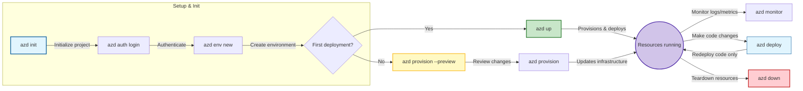
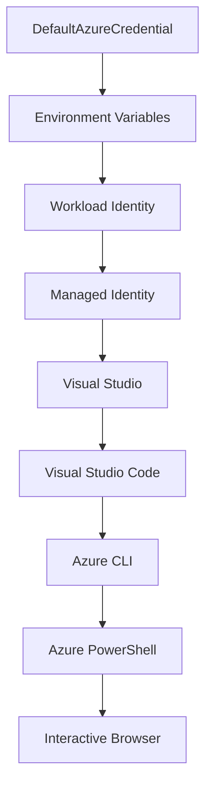

# יסודות AZD - מושגים בסיסיים ועקרונות

**ניווט בפרק:**
- **📚 דף הבית של הקורס**: [AZD למתחילים](../../README.md)
- **📖 הפרק הנוכחי**: פרק 1 - יסוד והתחלה מהירה
- **⬅️ קודם**: [סקירת הקורס](../../README.md#-chapter-1-foundation--quick-start)
- **➡️ הבא**: [התקנה והגדרה](installation.md)
- **🚀 הפרק הבא**: [פרק 2: פיתוח המבוסס AI](../chapter-02-ai-development/microsoft-foundry-integration.md)

## مقدمة

> נבדק מול `azd 1.37.2` (נובמבר 2026). פקודות ב-Bash משתמשות במשתני מקום במרכאות שעליכם להחליף. תבניות זרימות עבודה משתמשות ב-`.` לאתחול תיקיית העבודה הנוכחית; ללא ארגומנט תיקייה, אתחול התבנית יוצר תיקיית משנה ואינו משנה את תיקיית העבודה של ה-shell שלך. קטעי קוד מתקדמים הם להדגמה בלבד, לא פרויקטים שלמים.

בשיעור זה תכירו את Azure Developer CLI (azd), כלי שורת פקודה עוצמתי שמאיץ את המסע שלך מפיתוח מקומי לפריסה ב-Azure. תלמדו את המושגים הבסיסיים, התכונות העיקריות, ותבינו כיצד azd מפשט את פריסת היישומים בענן.

## מטרות הלמידה

בסוף השיעור הזה תוכל:
- להבין מהו Azure Developer CLI ומה תכליתו העיקרית
- ללמוד את המושגים המרכזיים של תבניות, סביבות, ושירותים
- לחקור תכונות מרכזיות כולל פיתוח מונחה תבנית ו-Infrastructure as Code
- להבין את מבנה הפרויקט azd וזרימת העבודה
- להתכונן להתקנה והגדרה של azd לסביבת הפיתוח שלך

## תוצאות הלמידה

לאחר סיום השיעור, תוכל:
- להסביר את תפקיד azd בזרימות עבודה מודרניות לפיתוח ענן
- לזהות את רכיבי מבנה פרויקט azd
- לתאר כיצד תבניות, סביבות, ושירותים פועלים יחד
- להבין את היתרונות של Infrastructure as Code עם azd
- להכיר פקודות azd שונות ואת מטרותיהן

## מהו Azure Developer CLI (azd)?

Azure Developer CLI (azd) הוא כלי שורת פקודה שנועד לזרז את המסע שלך מפיתוח מקומי לפריסה ב-Azure. הוא מפשט את תהליך הבנייה, הפריסה והניהול של יישומי ענן טבעיים ב-Azure.

### מה אפשר לפרוס עם azd?

azd תומך במגוון רחב של עומסי עבודה - והרשימה ממשיכה לגדול. היום ניתן להשתמש ב-azd כדי לפרוס:

| סוג העומס | דוגמאות | אותה זרימת עבודה? |
|---------------|----------|----------------|
| **יישומים מסורתיים** | אפליקציות ווב, REST APIs, אתרים סטטיים | ✅ `azd up` |
| **שירותים ומיקרו-שירותים** | Container Apps, Function Apps, backend מרובה שירותים | ✅ `azd up` |
| **יישומים מבוססי AI** | אפליקציות צ'אט עם דגמי Microsoft Foundry, פתרונות RAG עם AI Search | ✅ `azd up` |
| **סוכנים אינטיליגנטיים** | סוכנים מותקנים ב-Foundry, תזמוני סוכנים מרובים | ✅ `azd up` |

התובנה המרכזית היא ש-**מחזור החיים של azd נשאר זהה ללא קשר למה שאתה מפעיל**. אתה מאתחל פרויקט, מספק תשתית, מפרוס את הקוד שלך, מנטר את האפליקציה, ומנקה – בין אם זה אתר פשוט או סוכן AI מתקדם.

המשכיות זו היא על פי עיצוב. azd רואה ביכולות AI כסוג נוסף של שירות שהאפליקציה שלך יכולה להשתמש בו, לא משהו שונה בסיסית. נקודת קצה צ'אט הנתמכת על ידי דגמי Microsoft Foundry היא, מנקודת מבט של azd, רק שירות נוסף להגדיר ולפרוס.

### 🎯 למה להשתמש ב-AZD? השוואה מהעולם האמיתי

בוא נשווה פריסת אפליקציית ווב פשוטה עם בסיס נתונים:

#### ❌ בלי AZD: פריסה ידנית ב-Azure (מעל 30 דקות)

**השוואת Bash להמחשה בלבד, לא יוזם אפליקציה להרצה.** זה מניח קוד אפליקציה קיים, שמות משאבים ייחודיים, אימות Azure CLI, וכל הרחבות CLI נדרשות. השתמש בתרגיל התבנית למטה בשביל הנתיב הנתמך מקצה לקצה.

```bash
# Step 1: Create resource group
az group create --name myapp-rg --location eastus

# Step 2: Create App Service Plan
az appservice plan create --name myapp-plan \
  --resource-group myapp-rg \
  --sku B1 --is-linux

# Step 3: Create Web App
az webapp create --name myapp-web-unique123 \
  --resource-group myapp-rg \
  --plan myapp-plan \
  --runtime "NODE:22-lts"

# Step 4: Create Cosmos DB account (10-15 minutes)
az cosmosdb create --name myapp-cosmos-unique123 \
  --resource-group myapp-rg \
  --kind MongoDB

# Step 5: Create database
az cosmosdb mongodb database create \
  --account-name myapp-cosmos-unique123 \
  --resource-group myapp-rg \
  --name tododb

# Step 6: Create collection
az cosmosdb mongodb collection create \
  --account-name myapp-cosmos-unique123 \
  --resource-group myapp-rg \
  --database-name tododb \
  --name todos

# Step 7: Get connection string
CONN_STR=$(az cosmosdb keys list \
  --name myapp-cosmos-unique123 \
  --resource-group myapp-rg \
  --type connection-strings \
  --query "connectionStrings[0].connectionString" -o tsv)

# Step 8: Configure app settings
az webapp config appsettings set \
  --name myapp-web-unique123 \
  --resource-group myapp-rg \
  --settings MONGODB_URI="$CONN_STR"

# Step 9: Enable logging
az webapp log config --name myapp-web-unique123 \
  --resource-group myapp-rg \
  --application-logging filesystem \
  --detailed-error-messages true

# Step 10: Set up Application Insights
az monitor app-insights component create \
  --app myapp-insights \
  --location eastus \
  --resource-group myapp-rg

# Step 11: Link App Insights to Web App
INSTRUMENTATION_KEY=$(az monitor app-insights component show \
  --app myapp-insights \
  --resource-group myapp-rg \
  --query "instrumentationKey" -o tsv)

az webapp config appsettings set \
  --name myapp-web-unique123 \
  --resource-group myapp-rg \
  --settings APPINSIGHTS_INSTRUMENTATIONKEY="$INSTRUMENTATION_KEY"

# Step 12: Build application locally
npm install
npm run build

# Step 13: Create deployment package
zip -r app.zip . -x "*.git*" "node_modules/*"

# Step 14: Deploy application
az webapp deployment source config-zip \
  --resource-group myapp-rg \
  --name myapp-web-unique123 \
  --src app.zip

# Step 15: Wait and pray it works 🙏
# (No automated validation, manual testing required)
```

**בעיות:**
- ❌ מעל 15 פקודות לזכור ולבצע לפי הסדר
- ❌ עבודה ידנית של 30-45 דקות
- ❌ קל לטעות (טעויות הקלדה, ארגומנטים שגויים)
- ❌ דרוש טיפול מפורש באישורים; יומני איתור שגיאות ו-tracing של shell יכולים לחשוף אותם
- ❌ אין Rollback אוטומטי אם משהו נכשל
- ❌ קשה לשכפל עבור חברי הצוות
- ❌ שונה כל פעם (לא ניתן לשחזר)

#### ✅ עם AZD: פריסה אוטומטית (5 פקודות, 10-15 דקות)

```bash
# Step 1: Initialize from template
azd init --template todo-nodejs-mongo .

# Step 2: Authenticate
azd auth login

# Step 3: Select the environment created during init
azd env select dev

# Step 4: Preview changes (optional but recommended)
azd provision --preview

# Step 5: Deploy everything
azd up

# ✨ Done! Everything is deployed, configured, and monitored
```

**יתרונות:**
- ✅ **5 פקודות** במקום 15+ שלבים ידניים
- ✅ **10-15 דקות** סה"כ זמן (בעיקר בהמתנה ל-Azure)
- ✅ **פחות טעויות ידניות** - זרימת עבודה עקבית ומונחית תבנית
- ✅ **ניהול סודי מאובטח** - הרבה תבניות משתמשות באחסון סודי מנוהל של Azure
- ✅ **פריסות חוזרות** - אותה זרימה כל פעם
- ✅ **הגדרות תשתית חוזרות** - כפוף למכסים, זמינות אזוריים, וגרסאות תבניות
- ✅ **מוכן לצוות** - כל אחד יכול לפרוס עם אותן פקודות
- ✅ **Infrastructure as Code** - תבניות Bicep בגרסאות מבוקרות
- ✅ **ניטור מוגדר תבנית** - Application Insights כאשר כלול בתבנית

### זמן ואמינות

הזמנים שלמעלה הם הערכות, לא מדדים. azd מקטין את הפקודות שעליך לתאם, אך אינו מבטיח משך פריסה, אינו מבטל טעויות, ואינו מספק Rollback אוטומטי לאפליקציות/מסד נתונים. שמור גרסאות עובדות בבקרת קוד ובדוק נהלי שחזור.

## מושגים בסיסיים

### תבניות
תבניות הן הבסיס של azd. הן כוללות:
- **קוד אפליקציה** - קוד המקור ותלויות
- **הגדרות תשתית** - משאבי Azure המוגדרים ב-Bicep או Terraform
- **קבצי קונפיגורציה** - הגדרות ומשתני סביבה
- **סקריפטי פריסה** - זרימות עבודה אוטומטיות לפריסה

### סביבות
סביבות מייצגות יעדי פריסה שונים:
- **פיתוח** - לבדיקה ופיתוח
- **במהלך הביניים** - סביבה לפני הפקה
- **הפקה** - סביבה חיה לייצור

כל סביבה שומרת על שלה:
- שם וערכי הסביבה; בידוד משאבים תלוי בתבנית התשתית
- הגדרות קונפיגורציה
- מצב הפריסה

### שירותים
שירותים ב-`azure.yaml` מתארים רכיבי אפליקציה שניתן לפרוס:
- **חזית** - אפליקציות ווב, SPAs
- **גב** - APIs, מיקרו-שירותים

בדרך כלל מסדי נתונים ואחסון מסופקים כמשאבי תשתית, לא כאחסונים לשירותים כמו `host: postgres`.

## תכונות עיקריות

### 1. פיתוח מונחה תבנית
```bash
# Browse available templates
azd template list

# Initialize from a template
azd init --template "<template-name>" .
```

### 2. Infrastructure as Code
- **Bicep** - שפת Domain-Specific של Azure
- **Terraform** - כלי תשתית רב-ענני
- Bicep מתורגם לתבניות ARM; JSON ARM גולמי אינו `infra.provider` מובנה נפרד.

### 3. זרימות עבודה משולבות
```bash
# Complete deployment workflow
azd up            # Provision + Deploy this is hands off for first time setup

# 🧪 NEW: Preview infrastructure changes before deployment (SAFE)
azd provision --preview    # Simulate infrastructure deployment without making changes

azd provision     # Create Azure resources if you update the infrastructure use this
azd deploy        # Deploy application code or redeploy application code once update
azd down          # Clean up resources
```

#### 🛡️ תכנון תשתית בטוח עם מראש
הפקודה `azd provision --preview` משנה את הכללים לפריסות בטוחות:
- **הרצת יבשה** - מראה מה ייווצר, ישונה או יימחק
- **אין הפעלת תשתית** - בודק שינויים אצל ה ספק; בדוק את ה hooks של הפרויקט לפני, כי hooks יכולים להריץ פקודות עם השפעות צדדיות
- **שיתוף צוות** - שתף תוצאות תצוגה מקדימה לפני פריסה
- **קלט לתכנון עלויות** - בדוק SKU מוצעים, לאחר מכן חשב אותם עם מחשבון המחירים של Azure; התצוגה המקדימה אינה מחשבת מחירים

```bash
# Example preview workflow
azd provision --preview           # See what will change
# Review the output, discuss with team
azd provision                     # Apply changes with confidence
```

### 📊 ויזואלי: זרימת העבודה של פיתוח AZD



**הסבר זרימת עבודה:**
1. **Init** - התחל עם תבנית או פרויקט חדש
2. **Auth** - אשר את עצמך ב-Azure
3. **Environment** - צור סביבה מבודדת לפריסה
4. **Preview** - 🆕 תמיד הצג שינויים בתשתית מראש (פרקטיקה בטוחה)
5. **Provision** - צור/עדכן משאבי Azure
6. **Deploy** - דחף את קוד האפליקציה שלך
7. **Monitor** - הפק תובנות על ביצועי האפליקציה
8. **Iterate** - ערוך שינויים והחל פריסה מחדש
9. **Cleanup** - הסר משאבים כשסיימת

### 4. ניהול סביבה
```bash
# Create and manage environments
azd env new "<environment-name>"
azd env select "<environment-name>"
azd env list
```

### 5. הרחבות ופקודות AI

azd משתמש במערכת הרחבות להוספת יכולות מעבר ל-CLI המרכזי. זה שימושי במיוחד לעומסי עבודה של AI:

```bash
# List available extensions
azd extension list

# Install the GA Foundry bundle (requires azd >= 1.37.0)
azd ext install microsoft.foundry

# Initialize an AI agent project interactively
azd ai agent init

# Test a deployed agent (shows latency and time-to-first-byte)
azd ai agent invoke

# Start the MCP server for AI-assisted development (Alpha)
azd mcp start
```

**מחזור חיי סוכן, מקצה לקצה.** חבילת GA `microsoft.foundry` כוללת את `azure.ai.agents` ושש הרחבות מרכזיות נוספות. התקן בנפרד את `azure.ai.evaluations` להערכה. השתמש ב-`azd >= 1.37.0` לזרימת עבודה זו. אינך צריך את כולן ביום הראשון:

| שלב | פקודה | מה היא עושה |
|-------|---------|--------------|
| **Scaffold** | `azd ai agent init --template <path-to-azure.yaml>` | אימוץ תבנית פרויקט סוכן נוכחית |
| **Run locally** | `azd ai agent run`, ולאחר מכן `azd ai agent invoke --local "Test prompt"` בטרמינל נוסף | בדוק פעילות מקומית ב-Agent Inspector; קריאות למודל עדיין משתמשות ב-Azure |
| **Deploy** | `azd deploy` | לסוכנים מתארחים במצב קוד, העלה מקור לבניית Foundry מרוחקת |
| **Test** | `azd ai agent invoke` | קרא לסוכן וצפה בזמן תגובה |
| **Measure** | `azd ai eval init`, `generate`, `run start` | הגדר, פרוס, והרץ הערכות באמצעות ההרחבה הנפרדת |
| **Improve** | `azd ai agent optimize --eval <evaluation-name> --optimize-model <optimizer-deployment>` | השתמש מחדש בהערכה תואמת לאופטימיזציה של הסוכן |
| **Inspect** | `azd ai agent endpoint show` | צפה בקונפיגורציית הנקודה החיה |
| **Clean up** | `azd ai agent delete` | מחק סוכן מתארח ואת כל גרסאותיו |

> התחל עם [מדריך סוכן מתארח GA](../chapter-02-ai-development/microsoft-foundry-integration.md#hosted-agent-walkthrough-ga), המכסה תנאים מוקדמים, פריסה וניקוי בטוח. ההרחבות מוסברות בהמשך במדריך [פקודות AI CLI של AZD](../chapter-08-production/production-ai-practices.md#azd-ai-cli-commands-and-extensions).

## 📁 מבנה הפרויקט

מבנה פרויקט azd טיפוסי:
```
my-app/
├── .azure/                  # Local environments and selected-environment config
│   ├── config.json
│   └── dev/.env
├── .devcontainer/          # Development container config
├── .github/workflows/      # GitHub Actions
├── .vscode/               # VS Code settings
├── infra/                 # Infrastructure code
│   ├── main.bicep        # Main infrastructure template
│   ├── main.parameters.json
│   └── modules/          # Reusable modules
├── src/                  # Application source code
│   ├── api/             # Backend services
│   └── web/             # Frontend application
├── azure.yaml           # azd project configuration
└── README.md
```

## 🔧 קבצי קונפיגורציה

### azure.yaml
קובץ ההגדרות הראשי של הפרויקט:
```yaml
name: my-awesome-app
metadata:
  template: my-template@1.0.0

services:
  web:
    project: ./src/web
    language: js
    host: appservice
  api:
    project: ./src/api
    language: js
    host: appservice

hooks:
  preprovision:
    shell: pwsh
    run: echo "Preparing to provision..."
```

### .azure/config.json
בחירה מקומית לפרויקט של הסביבה ברירת המחדל (המחשה; מנוהל על ידי azd):
```json
{
  "defaultEnvironment": "dev"
}
```

## 🎪 זרימות עבודה נפוצות עם תרגילים מעשיים

> **💡 טיפ ללמידה:** בצע את התרגילים בסדר כדי לפתח את יכולות AZD בהדרגה.

### 🎯 תרגיל 1: אתחל את הפרויקט הראשון שלך

**מטרה:** צור פרויקט AZD וחקור את מבנהו

**צעדים:**
```bash
# Use a proven template
mkdir azd-basics-practice
cd azd-basics-practice
# Choose "dev" for the environment name when prompted
azd init --template todo-nodejs-mongo .

# Explore the generated files
ls -la  # View all files including hidden ones

# Key files created:
# - azure.yaml (main config)
# - infra/ (infrastructure code)
# - src/ (application code)
```

**✅ הצלחה:** יש לך את azure.yaml, תקיות infra/, ו-src/

---

### 🎯 תרגיל 2: פרוס ל-Azure

**מטרה:** השלמת פריסה מקצה לקצה

**צעדים:**
```bash
# 1. Authenticate
azd auth login

# 2. Select the dev environment created in Exercise 1
azd env select dev
azd env set AZURE_LOCATION eastus

# 3. Preview changes (RECOMMENDED)
azd provision --preview

# 4. Deploy everything
azd up

# 5. Verify deployment
azd show    # View your app URL
```

**זמן מוערך:** 10-15 דקות  
**✅ הצלחה:** כתובת ה-URL של האפליקציה נפתחת בדפדפן

---

### 🎯 תרגיל 3: מספר סביבות

**מטרה:** פרוס לסביבות הפיתוח והבמה התיכונה

**צעדים:**
```bash
# Already have dev, create staging
azd env new staging
azd env set AZURE_LOCATION westus2
azd up

# Switch between them
azd env list
azd env select dev
```

**✅ הצלחה:** שתי קבוצות משאבים נפרדות בפורטל Azure

**ניקוי:** תרגיל 3 יוצר פריסת חיוב שנייה. מחק את שתיהן כשסיימת:

```bash
azd down --environment dev
azd down --environment staging
```

---

### 🛡️ ניקוי הרסני: `azd down --force --purge`

כאשר אתה רוצה בכוונה למחוק משאבי Azure של הסביבה הנבחרת:

```bash
azd down --force --purge
```

**מה זה עושה:**
- `--force`: ללא בקשות אישור
- `--purge`: גם מוחק לצמיתות משאבים שנתמכים שנמחקו ברוך (כמו Key Vaults), כאשר הגנת סילוק מאפשרת זאת. אינו מוחק את תיקיית `.azure/` המקומית.

**שימוש כאשר:** סיימת עם סביבה ידידותית להחלפה. אין להתייחס לניקוי הרסני כתגובה ראשונה לשגיאת אימות, מכסה או הגדרות.

---

## 🎪 הפניה לזרימת עבודה מקורית

### התחלת פרויקט חדש
```bash
# Method 1: Use existing template
azd init --template todo-nodejs-mongo .

# Method 2: Start from scratch
azd init

# Method 3: Use current directory
azd init .
```

### מחזור הפיתוח
```bash
# Set up development environment
azd auth login
azd env new dev
azd env select dev

# Deploy everything
azd up

# Make changes and redeploy
azd deploy

# Clean up when done
azd down --force --purge # Deletes this environment's discovered Azure resources; review before forcing deletion.
```

## הבנת `azd down --force --purge`
הפקודה `azd down --force --purge` היא אמצעי עוצמתי להריסה מלאה של סביבת azd וכל המשאבים הקשורים לה. להלן פירוט על מה שכל דגל עושה:
```
--force
```
- מדלג על בקשות אישור.
- שימושי באוטומציה או סקריפט שבו קלט ידני אינו אפשרי.
- אינו עוקף הרשאות, הגנת סילוק או כישלונות מחיקה.

```
--purge
```
 מוחק לצמיתות משאבי Azure שנתמכים שנמחקו ברוך ללא אישור נוסף. הגנת סילוק והרשאות עדיין חלות. זה **אינו** מסיר סביבות מקומיות או את תיקיית `.azure/`.


### למה להשתמש בשניהם?
השתמש בשניהם רק אם בכוונתך למחוק את משאבי Azure של הסביבה הנבחרת ולנקות משאבים הניתנים לשחזור. זה ניקוי הרסני, לא תיקון כללי או איפוס מצב מקומי.

זה מועיל במיוחד לאחר מחיקות משאבים ידניות בפורטל Azure או כאשר משנים תבניות, סביבות, או קונבנציות שמות קבוצות משאבים.


### ניהול סביבות מרובות
```bash
# Create staging environment
azd env new staging
azd env select staging
azd up

# Switch back to dev
azd env select dev

# Compare environments
azd env list
```

## 🔐 אימות ואישורים

יש להבחין בין אימות לפריסה (`azd auth login`) לבין אימות SDK של האפליקציה (`DefaultAzureCredential`). הם נפרדים. azd אינו משתמש כברירת מחדל באישורי Azure CLI.

### אימות ב-Azure CLI (`az login`)

הרץ `azd auth login` עבור azd. פקודות Azure CLI הבאות הן אופציונליות ומאמתות פקודות `az` בנפרד:

```bash
# Interactive login (opens browser)
az login

# Login with specific tenant
az login --tenant "<tenant-id>"

# Login with service principal
az login --service-principal -u "<app-id>" -p "<password>" --tenant "<tenant-id>"

# Check current login status
az account show

# List available subscriptions
az account list --output table

# Set default subscription
az account set --subscription "<subscription-id>"
```

### זרימת אימות
1. **כניסה אינטראקטיבית**: פותח את הדפדפן המוגדר כברירת מחדל לאימות
2. **זרימת קוד התקן**: עבור סביבות ללא גישה לדפדפן
3. **יישות שירות**: עבור תרחישי אוטומציה ו-CI/CD
4. **זהות מנוהלת**: עבור יישומים המתארחים ב-Azure

### שרשרת DefaultAzureCredential

`DefaultAzureCredential` הוא סוג אישור המציע חווית אימות פשוטה יותר על ידי ניסיון אוטומטי של מקורות אישור מרובים בסדר מסוים:

#### שרשרת אישורי SDK יישום

השרשרת המדויקת תלויה בשפת Azure Identity SDK, בגרסה, בתוספים מותקנים ובאפשרויות. התרשים הוא רעיוני, לא רצף אימות קבוע ב-azd; SDK חדשים יכולים לכלול גם אישורי Azure Developer CLI.


#### 1. משתני סביבה
```bash
# Set environment variables for service principal
export AZURE_CLIENT_ID="<app-id>"
export AZURE_CLIENT_SECRET="<password>"
export AZURE_TENANT_ID="<tenant-id>"
```

#### 2. זהות עומס עבודה (Kubernetes/GitHub Actions)
משמש אוטומטית ב:
- שירות Kubernetes של Azure (AKS) עם זהות עומס עבודה
- GitHub Actions עם איחוד OIDC
- תרחישי זהות מאוחדת אחרים

#### 3. זהות מנוהלת
עבור משאבי Azure כמו:
- מכונות וירטואליות
- App Service
- Azure Functions
- מופעי מכולה

```bash
# Inspect a deployed Container App's configured identity (requires az login)
az containerapp show --name "<app-name>" --resource-group "<rg-name>" --query identity
```

#### 4. אינטגרציה עם כלי מפתחים
- **Visual Studio**: משתמש אוטומטית בחשבון מחובר
- **VS Code**: תמיכה תלויה ב-SDK ובתצורת הברוקר/תוסף הנתמכים
- **Azure CLI**: משתמש באישורי `az login` (השימוש השכיח ביותר לפיתוח מקומי)

### הגדרת אימות AZD

```bash
# Method 1: Direct azd authentication (recommended)
azd auth login

# Method 2: Direct azd authentication
azd auth login --use-device-code  # For headless environments

# Method 3: Check authentication status
azd auth login --check-status

# Method 4: Logout and re-authenticate
azd auth logout
azd auth login
```

### שיטות עבודה מומלצות לאימות

#### עבור פיתוח מקומי
```bash
# 1. Log in to azd
azd auth login

# 2. Select the subscription for this initialized environment
azd env set AZURE_SUBSCRIPTION_ID "<subscription-id>"

# 3. Check azd sign-in details (read the status message)
azd auth login --check-status
```

#### עבור צינורות CI/CD
```yaml
# Partial GitHub Actions steps: assumes checkout, azd installation,
# required AZURE_* environment values, and pipeline secret configuration.
- name: Deploy with azd
  run: |
    azd auth login --client-id ${{ secrets.AZURE_CLIENT_ID }} \
                    --client-secret ${{ secrets.AZURE_CLIENT_SECRET }} \
                    --tenant-id ${{ secrets.AZURE_TENANT_ID }}
    azd up --no-prompt
```

#### עבור סביבות ייצור
- השתמש ב**זהות מנוהלת** בעת הריצה על משאבי Azure
- השתמש ב**יישות שירות** עבור תרחישי אוטומציה
- הימנע מאחסון אישורים בקוד או בקובצי תצורה
- השתמש ב**Azure Key Vault** עבור תצורה רגישה

### בעיות אימות נפוצות ופתרונות

#### בעיה: "לא נמצאה הרשאה"
```bash
# Solution: Set default subscription
az account list --output table
az account set --subscription "<subscription-id>"
azd env set AZURE_SUBSCRIPTION_ID "<subscription-id>"
```

#### בעיה: "הרשאות בלתי מספקות"
```bash
# Solution: Check and assign required roles
az role assignment list --assignee $(az account show --query user.name --output tsv)

# Common required roles:
# - Contributor (for resource management)
# - User Access Administrator (for role assignments)
```

#### בעיה: "הטוקן פג תוקף"
```bash
# Solution: Re-authenticate
az logout
az login
azd auth logout
azd auth login
```

### אימות בתרחישים שונים

#### פיתוח מקומי
```bash
# Personal development account
az login
azd auth login
```

#### פיתוח בצוות
```bash
# Use specific tenant for organization
az login --tenant contoso.onmicrosoft.com
azd auth login --tenant-id "<tenant-id>"
```

#### תרחישים רב-שוכנים
```bash
# Switch between tenants
az login --tenant tenant1.onmicrosoft.com
azd auth login --tenant-id "<tenant-1-id>"
# Select an environment configured with tenant 1's subscription
azd env select tenant1-dev
# Deploy to tenant 1
azd up

az login --tenant tenant2.onmicrosoft.com  
azd auth login --tenant-id "<tenant-2-id>"
azd env select tenant2-dev
# Deploy to tenant 2
azd up
```

### שיקולי אבטחה

1. **אחסון אישורים**: לעולם אל תאחסן אישורים בקוד המקור
2. **הגבלת תחום**: השתמש בעיקרון ההרשאה המינימלית עבור ישויות שירות
3. **סיבוב טוקנים**: סובב סודות של ישויות שירות בקביעות
4. **רישום בקרה**: מעקב אחרי פעילויות אימות ופריסה
5. **אבטחת רשת**: השתמש בקצוות פרטיים כשאפשרי

### פתרון בעיות אימות

```bash
# Debug authentication issues
azd auth login --check-status
az account show
az account get-access-token

# Common diagnostic commands
whoami                          # Current user context
az ad signed-in-user show      # Microsoft Entra ID user details
az group list                  # Test resource access
```

## גילוי פקודות

### גילוי
```bash
azd template list              # Browse templates
azd template list --help       # Template discovery options
azd init --help               # Initialization options
```

### ניהול פרויקטים
```bash
azd show                     # Project overview
azd env list                # Available environments and selected default
azd config show            # Configuration settings
```

### ניטור
```bash
azd monitor                  # Open Azure portal monitoring
azd monitor --logs           # View application logs
azd monitor --live           # View live metrics
azd pipeline config          # Set up CI/CD
```

## שיטות עבודה מומלצות

### 1. השתמש בשמות משמעותיים
```bash
# Good
azd env new production-east
azd init --template todo-nodejs-mongo .

# Avoid
azd env new env1
azd init --template template1 .
```

### 2. נצל תבניות
- התחל מתבניות קיימות
- התאם לצרכיך
- צור תבניות רב-שימושיות לארגון שלך

### 3. בידוד סביבה
- השתמש בסביבות נפרדות לפיתוח/ביניים/ייצור
- לעולם אל תפרוש ישירות לייצור מהמכונה המקומית
- השתמש בצינורות CI/CD לפריסות ייצור

### 4. ניהול תצורה
- השתמש בזהות מנוהלת ו-Key Vault לסודות; ערכי `azd env set` רגילים הם טקסט פשוט מקומי
- שמור תצורה תחת בקרת גרסאות
- תעד הגדרות ספציפיות לסביבה

## סולם לימוד

### מתחיל (שבועות 1-2)
1. התקן את azd ואמת את עצמך
2. פרוס תבנית פשוטה
3. הבן את מבנה הפרויקט
4. למד פקודות בסיסיות (up, down, deploy)

### בינוני (שבועות 3-4)
1. התאם תבניות
2. נהל סביבות מרובות
3. הבן קוד תשתית
4. הקם צינורות CI/CD

### מתקדם (שבוע 5+)
1. צור תבניות מותאמות אישית
2. תבניות תשתית מתקדמות
3. פריסות מרובות אזורים
4. תצורות ברמת ארגון

## הצעדים הבאים

**📖 המשך בפרק 1:**
- [התקנה והגדרה](installation.md) - התקן וגדיר את azd
- [הפרויקט הראשון שלך](first-project.md) - מדריך מעשי מלא
- [מדריך תצורה](../chapter-03-configuration/configuration.md) - אפשרויות הגדרה מתקדמות

**🎯 מוכן לפרק הבא?**
- [פרק 2: פיתוח עם מיקוד ב-AI](../chapter-02-ai-development/microsoft-foundry-integration.md) - התחלת בניית יישומי AI

## משאבים נוספים

- [סקירת Azure Developer CLI](https://learn.microsoft.com/en-us/azure/developer/azure-developer-cli/)
- [גלריית תבניות](https://azure.github.io/awesome-azd/)
- [דוגמאות קהילה](https://github.com/Azure-Samples)

---

## 🙋 שאלות נפוצות

### שאלות כלליות

**שאלה: מה ההבדל בין AZD ל-Azure CLI?**

תשובה: Azure CLI (`az`) מיועד לניהול משאבי Azure בודדים. AZD (`azd`) לניהול יישומים שלמים:

```bash
# Azure CLI - Low-level resource management
az webapp create --name myapp --resource-group rg
az sql server create --name myserver --resource-group rg
# ...many more commands needed

# AZD - Application-level management
azd up  # Deploys entire app with all resources
```

**תחשוב כך:**
- `az` = עבודה עם לבני לגו בודדות
- `azd` = עבודה עם סטים שלמים של לגו

---

**שאלה: האם אני צריך לדעת Bicep או Terraform כדי להשתמש ב-AZD?**

תשובה: לא! התחל עם תבניות:
```bash
# Use existing template - no IaC knowledge needed
azd init --template todo-nodejs-mongo .
azd up
```

אפשר ללמוד Bicep מאוחר יותר כדי להתאים את התשתית. תבניות מספקות דוגמאות עבודה ללמוד מהן.

---

**שאלה: כמה עולה להריץ תבניות AZD?**

תשובה: העלויות משתנות לפי אזור, SKU, זמן פעילות, מצב מסד נתונים ושימוש במודל. סביבה לפיתוח יכולה לגרום להוצאות חודשיות ניכרות אפילו כשהיא לא בשימוש; אל תניח טווח אחיד של $50-150:

```bash
# Preview resource changes (not prices)
azd provision --preview

# Always cleanup when not using
azd down --force --purge  # Removes all resources
```

**טיפ מקצועי:** השתמש בשכבות חינמיות כשזמינות:
- App Service: שכבת F1 (חינמית)
- Azure OpenAI: אין זכות חינמית חודשית כללית; בדוק מחירי המודל וההצעה הנוכחיים
- Cosmos DB: חשבונות פרוביז'ן-תעבורה זכאים לשכבה חינמית; תבניות ללא שרתים אינן מתאימות אוטומטית

---

**שאלה: האם אפשר להשתמש ב-AZD עם משאבי Azure קיימים?**

תשובה: כן, אך קל יותר להתחיל מחדש. AZD עובד הכי טוב כשמנהל את כל מחזור החיים. עבור משאבים קיימים:

```bash
# Option 1: Import existing resources (advanced)
azd init
# Then modify infra/ to reference existing resources

# Option 2: Start fresh (recommended)
azd init --template "<verified-template-name>" .
azd up  # Creates new environment
```

---

**שאלה: איך משתפים את הפרויקט עם חברי צוות?**

תשובה: בצע commit לפרויקט AZD ב-Git (אבל לא לתיקיית .azure):

```bash
# Already in .gitignore by default
.azure/        # Contains secrets and environment data
*.env          # Environment variables

# Team members then:
git clone "<your-repo>"
# Change into the cloned repository before running the remaining commands.
azd auth login
azd env new "<their-name>-dev"
azd up
```

כולם מקבלים תשתית זהה מאותה תבניות.

---

### שאלות לפתרון בעיות

**שאלה: הפקודה "azd up" נכשלה בחצי הדרך. מה עושים?**

תשובה: בדוק את השגיאה, תקן, ואז נסה שוב:

```bash
# Capture detailed diagnostics (redact sensitive values before sharing)
azd up --debug

# Common fixes:

# 1. If quota exceeded:
azd env set AZURE_LOCATION "westus2"  # Try different region

# 2. If resource name conflict:
azd down --force --purge  # Clean slate
azd up  # Retry

# 3. If auth expired:
az login
azd auth login
azd up
```

**הבעיה הנפוצה ביותר:** נבחרה הרשאת Azure שגויה
```bash
az account list --output table
az account set --subscription "<correct-subscription>"
azd env set AZURE_SUBSCRIPTION_ID "<correct-subscription-id>"
```

---

**שאלה: איך לפרוס רק שינויים בקוד ללא פריסה מחדש של התשתית?**

תשובה: השתמש ב-`azd deploy` במקום ב-`azd up`:

```bash
azd up          # First time: provision + deploy (slow)

# Make code changes...

azd deploy      # Subsequent times: deploy only (fast)
```

השוואת מהירות:
- `azd up`: 10-15 דקות (גורם לפריסה של התשתית)
- `azd deploy`: 2-5 דקות (רק קוד)

---

**שאלה: האם אפשר להתאים את תבניות התשתית?**

תשובה: כן! ערוך את קבצי Bicep ב-`infra/`:

```bash
# After azd init
cd infra/
code main.bicep  # Edit in VS Code

# Preview changes
azd provision --preview

# Apply changes
azd provision
```

**טיפ:** התחל בקטן - שנה SKU ראשונים:
```bicep
// infra/main.bicep
sku: {
  name: 'B1'  // Change to 'P1V2' for production
}
```

---

**שאלה: איך מוחקים הכל ש-AZD יצר?**

תשובה: פקודה אחת מסירה את כל המשאבים:

```bash
azd down --force --purge

# This deletes:
# - Azure resources/resource groups discovered for the selected environment
# - Supported soft-deleted resources, if purge protection allows
# Local .azure files remain; shared/external resources may remain too.
```

**הרץ את זה תמיד כאשר:**
- סיימת לבדוק תבנית
- עובר לפרויקט אחר
- רוצה להתחיל מחדש

**בדיקת עלות:** אשר מחיקה ב-Azure ובדוק משאבים נשמרים/משותפים. חיובים קודמים עדיין חלים.

---

**שאלה: מה אם מחקתי בטעות משאבים בפורטל של Azure?**

תשובה: מצב ה-AZD עלול להתנתק. גישה לניקוי טוטאלי:

```bash
# 1. Delete remaining resources only if that is your intent
azd down --force --purge

# 2. Start fresh
azd up

# Alternative: Let AZD detect and fix
azd provision  # Will create missing resources
```

---

### שאלות מתקדמות

**שאלה: האם אפשר להשתמש ב-AZD בצינורות CI/CD?**

תשובה: כן! דוגמה ל-GitHub Actions:

```yaml
# .github/workflows/deploy.yml
name: Deploy with AZD

on:
  push:
    branches: [main]

jobs:
  deploy:
    runs-on: ubuntu-latest
    steps:
      - uses: actions/checkout@v4
      
      - name: Install azd
        run: curl -fsSL https://aka.ms/install-azd.sh | bash
      
      - name: Azure Login
        run: |
          azd auth login \
            --client-id ${{ secrets.AZURE_CLIENT_ID }} \
            --client-secret ${{ secrets.AZURE_CLIENT_SECRET }} \
            --tenant-id ${{ secrets.AZURE_TENANT_ID }}
      
      - name: Deploy
        env:
          AZURE_ENV_NAME: dev
          AZURE_LOCATION: ${{ vars.AZURE_LOCATION }}
          AZURE_SUBSCRIPTION_ID: ${{ vars.AZURE_SUBSCRIPTION_ID }}
        run: azd up --no-prompt
```

---

**שאלה: איך מטפלים בסודות ונתונים רגישים?**

תשובה: השתמש ב-Key Vault במפורש. `azd env set` כותב ערכים רגילים לקובץ סביבה מקומי; אינו יוצר ארון סודות, מייחס תפקידים או מזריק סודות ליישום שלך אוטומטית.

```bash
# Interactive: create/select a Key Vault secret and save its reference
azd env set-secret DATABASE_PASSWORD
```

נדרשות הרשאות מתאימות בארון סודות. התשתית/יישום שלך עדיין חייב לחבר את הסוד לצרכן ולתת גישה לזהות ריצה. אל תדפיס ערכי סודות בפתרונות יומן.

**לעולם אל תבצע commit:**
- תיקיית `.azure/` (מכילה נתוני סביבה)
- קבצי `.env` (סודות מקומיים)
- מחרוזות חיבור

---

**שאלה: האם אפשר לפרוס לאזורי שירות מרובים?**

תשובה: כן, צור סביבה לכל אזור:

```bash
# East US environment
azd env new prod-eastus
azd env set AZURE_LOCATION eastus
azd up

# West Europe environment
azd env new prod-westeurope
azd env set AZURE_LOCATION westeurope
azd up

# Each environment is independent
azd env list
```

עבור אפליקציות באמת מרובות אזורים, התאם אישית תבניות Bicep לפריסה במקביל לאזורים מרובים.

---

**שאלה: איפה אפשר לקבל עזרה אם אני תקוע?**

1. **תיעוד AZD:** https://learn.microsoft.com/azure/developer/azure-developer-cli/
2. **בעיות ב-GitHub:** https://github.com/Azure/azure-dev/issues
3. **Discord:** [Azure Discord](https://discord.gg/microsoft-azure) - ערוץ #azure-developer-cli
4. **Stack Overflow:** תגית `azure-developer-cli`
5. **הקורס הזה:** [מדריך פתרון בעיות](../chapter-07-troubleshooting/common-issues.md)

**טיפ מקצועי:** לפני שאתה שואל, הרץ:
```bash
azd show       # Shows current state
azd version    # Shows your version
```
כלול את המידע בשאלתך לקבלת עזרה מהירה יותר.

---

## 🎓 מה הלאה?

עכשיו אתה מבין את יסודות AZD. בחר את הדרך שלך:

### 🎯 למתחילים:
1. **הבא:** [התקנה והגדרה](installation.md) - התקן את AZD על המחשב שלך
2. **אחר כך:** [הפרויקט הראשון שלך](first-project.md) - פרוס את האפליקציה הראשונה שלך
3. **תרגל:** השלם את כל 3 התרגילים בשיעור זה

### 🚀 למפתחי AI:
1. **דלג ל:** [פרק 2: פיתוח במיקוד AI](../chapter-02-ai-development/microsoft-foundry-integration.md)
2. **פרוס:** בספריית פרויקט ריקה, התחל עם `azd init --template get-started-with-ai-chat .`
3. **למד:** בנה תוך כדי פריסה

### 🏗️ למפתחים מנוסים:
1. **עיין ב:** [מדריך תצורה](../chapter-03-configuration/configuration.md) - הגדרות מתקדמות
2. **חקור:** [תשתית כקוד](../chapter-04-infrastructure/provisioning.md) - העמקה ב-Bicep
3. **בנה:** צור תבניות מותאמות למחסנית שלך

---

**ניווט בפרק:**
- **📚 דף הבית הקורס**: [AZD למתחילים](../../README.md)
- **📖 הפרק הנוכחי**: פרק 1 - יסודות והתחלה מהירה  
- **⬅️ קודם**: [סקירת הקורס](../../README.md#-chapter-1-foundation--quick-start)
- **➡️ הבא**: [התקנה והגדרה](installation.md)
- **🚀 פרק הבא**: [פרק 2: פיתוח במיקוד AI](../chapter-02-ai-development/microsoft-foundry-integration.md)

---

<!-- CO-OP TRANSLATOR DISCLAIMER START -->
**כתב ויתור**:
מסמך זה תורגם באמצעות שירות תרגום אוטומטי [Co-op Translator](https://github.com/Azure/co-op-translator). למרות שאנו שואפים לדיוק, יש לקחת בחשבון שתרגומים אוטומטיים עלולים להכיל שגיאות או אי-דיוקים. יש להחשיב את המסמך המקורי בשפתו הטבעית כמקור הסמכות. למידע קריטי מומלץ להשתמש בתרגום מקצועי על ידי מתרגם אדם. אנו לא אחראים לכל אי-הבנה או פירוש שגוי הנובע מהשימוש בתרגום זה.
<!-- CO-OP TRANSLATOR DISCLAIMER END -->