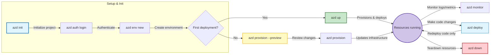
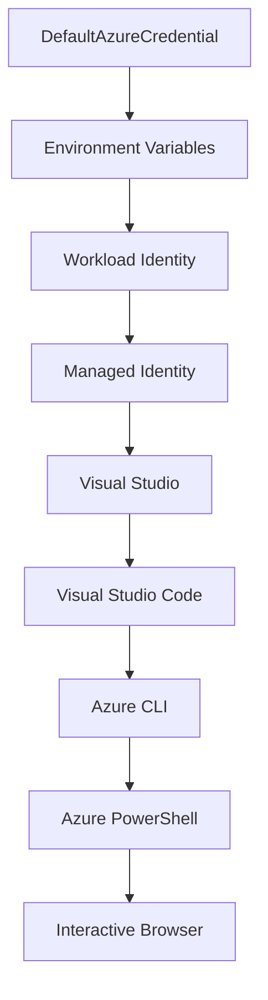

# יסודות AZD - מושגים ועקרונות מרכזיים

**ניווט הפרק:**
- **📚 דף הקורס הראשי**: [AZD למתחילים](../../README.md)
- **📖 הפרק הנוכחי**: פרק 1 - יסוד והתחלה מהירה
- **⬅️ הקודם**: [סקירת הקורס](../../README.md#-chapter-1-foundation--quick-start)
- **➡️ הבא**: [התקנה והגדרה](installation.md)
- **🚀 הפרק הבא**: [פרק 2: פיתוח מונחה AI](../chapter-02-ai-development/microsoft-foundry-integration.md)

## הקדמה

> נסקר מול `azd 1.37.2` (נובמבר 2026). פקודות בשורת הפקודה משתמשות במשתני פלאס-הולדרים שמחייבים החלפה. זרמי עבודה בתבניות משתמשים ב-`.` לאתחול ספריית העבודה הנוכחית; ללא ארגומנט ספרייה, אתחול התבנית יוצר תת-ספרייה ואינו משנה את ספריית העבודה של ה-shell שלך. קטעי קוד מתקדמים הם להמחשה בלבד, לא פרויקטים מלאים.

שיעור זה מציג את Azure Developer CLI (azd), כלי שורת פקודה חזק שמאיץ את המסלול שלך מפיתוח מקומי לפריסה ב-Azure. תלמד את עקרונות היסוד, התכונות המרכזיות, ותבין כיצד azd מפשט פריסת יישומים מבוססי ענן.

## מטרות הלמידה

בסוף שיעור זה תדע:
- להבין מהו Azure Developer CLI ומה מטרתו העיקרית
- ללמוד את המושגים המרכזיים של תבניות, סביבות ושירותים
- לחקור תכונות עיקריות כולל פיתוח מונחה תבניות ותשתית כקוד
- להבין את מבנה הפרויקט וזרימת העבודה של azd
- להיות מוכן להתקין ולהגדיר את azd לסביבת הפיתוח שלך

## תוצאות הלמידה

לאחר השלמת שיעור זה, תוכל:
- להסביר את תפקיד azd בזרמי עבודה מודרניים לפיתוח ענני
- לזהות את המרכיבים במבנה פרויקט azd
- לתאר כיצד תבניות, סביבות ושירותים פועלים יחד
- להבין את היתרונות של תשתית כקוד עם azd
- לזהות פקודות שונות של azd ואת מטרתן

## מהו Azure Developer CLI (azd)?

Azure Developer CLI (azd) הוא כלי שורת פקודה שנועד להאיץ את המסלול שלך מפיתוח מקומי לפריסה בענן Azure. הוא מפשט את תהליך הבנייה, הפריסה, והניהול של יישומים מבוססי ענן ב-Azure.

### מה ניתן לפרוס עם azd?

azd תומך במגוון רחב של עומסי עבודה – והרשימה ממשיכה לגדול. כיום, באפשרותך להשתמש ב-azd כדי לפרוס:

| סוג עומס עבודה | דוגמאות | אותה זרימת עבודה? |
|---------------|----------|----------------|
| **יישומים מסורתיים** | אפליקציות ווב, REST APIs, אתרים סטטיים | ✅ `azd up` |
| **שירותים ומיקרו-שירותים** | Container Apps, Function Apps, מערכות שירות מרובות | ✅ `azd up` |
| **יישומי בינה מלאכותית** | אפליקציית צ'אט עם דגמי Microsoft Foundry, פתרונות RAG עם AI Search | ✅ `azd up` |
| **סוכנים אינטיליגנטיים** | סוכנים מתוחזקים על Foundry, ארכיטקטורות מרובות סוכנים | ✅ `azd up` |

התובנה המרכזית היא ש-**מחזור החיים של azd נשאר זהה ללא קשר למה שאתה מפרוס**. אתה מאתחל פרויקט, מספק את התשתית, מפרוס את הקוד, מנטר את האפליקציה, ומנקה משאבים – בין אם מדובר באתר פשוט או סוכן AI מתקדם.

המשכיות זו מתוכננת מראש. azd מתייחס ליכולות בינה מלאכותית כשירות נוסף שהאפליקציה שלך יכולה להשתמש בו, ולא כמשהו שונה באופן מהותי. נקודת קצה לצ'אט שמגובה בדגמי Microsoft Foundry היא, מנקודת מבט של azd, שירות נוסף שיש להגדיר ולפרוס.

### 🎯 מדוע להשתמש ב-AZD? השוואה מהעולם האמיתי

נשווה פריסת אפליקציית ווב פשוטה עם בסיס נתונים:

#### ❌ בלי AZD: פריסה ידנית ב-Azure (30+ דקות)

**השוואת Bash להמחשה בלבד, לא יישום הפעלה.** מניח קוד יישום קיים, שמות משאבים ייחודיים, אימות CLI של Azure, וכל תוספים נדרשים ב-CLI. השתמש בתרגיל התבנית למטה בשביל המסלול הנתמך מקצה לקצה.

```bash
# Step 1: Create resource group
az group create --name myapp-rg --location eastus

# Step 2: Create App Service Plan
az appservice plan create --name myapp-plan \
  --resource-group myapp-rg \
  --sku B1 --is-linux

# Step 3: Create Web App
az webapp create --name myapp-web-unique123 \
  --resource-group myapp-rg \
  --plan myapp-plan \
  --runtime "NODE:22-lts"

# Step 4: Create Cosmos DB account (10-15 minutes)
az cosmosdb create --name myapp-cosmos-unique123 \
  --resource-group myapp-rg \
  --kind MongoDB

# Step 5: Create database
az cosmosdb mongodb database create \
  --account-name myapp-cosmos-unique123 \
  --resource-group myapp-rg \
  --name tododb

# Step 6: Create collection
az cosmosdb mongodb collection create \
  --account-name myapp-cosmos-unique123 \
  --resource-group myapp-rg \
  --database-name tododb \
  --name todos

# Step 7: Get connection string
CONN_STR=$(az cosmosdb keys list \
  --name myapp-cosmos-unique123 \
  --resource-group myapp-rg \
  --type connection-strings \
  --query "connectionStrings[0].connectionString" -o tsv)

# Step 8: Configure app settings
az webapp config appsettings set \
  --name myapp-web-unique123 \
  --resource-group myapp-rg \
  --settings MONGODB_URI="$CONN_STR"

# Step 9: Enable logging
az webapp log config --name myapp-web-unique123 \
  --resource-group myapp-rg \
  --application-logging filesystem \
  --detailed-error-messages true

# Step 10: Set up Application Insights
az monitor app-insights component create \
  --app myapp-insights \
  --location eastus \
  --resource-group myapp-rg

# Step 11: Link App Insights to Web App
INSTRUMENTATION_KEY=$(az monitor app-insights component show \
  --app myapp-insights \
  --resource-group myapp-rg \
  --query "instrumentationKey" -o tsv)

az webapp config appsettings set \
  --name myapp-web-unique123 \
  --resource-group myapp-rg \
  --settings APPINSIGHTS_INSTRUMENTATIONKEY="$INSTRUMENTATION_KEY"

# Step 12: Build application locally
npm install
npm run build

# Step 13: Create deployment package
zip -r app.zip . -x "*.git*" "node_modules/*"

# Step 14: Deploy application
az webapp deployment source config-zip \
  --resource-group myapp-rg \
  --name myapp-web-unique123 \
  --src app.zip

# Step 15: Wait and pray it works 🙏
# (No automated validation, manual testing required)
```

**בעיות:**
- ❌ יותר מ-15 פקודות לזכור ולבצע לפי סדר
- ❌ 30-45 דקות עבודה ידנית
- ❌ קל לעשות טעויות (שגיאות הקלדה, פרמטרים שגויים)
- ❌ אימותים דורשים טיפול מפורש; יומני איתור שגיאות ו-tracing של ה-shell עלולים לחשוף אותם
- ❌ אין גלילה אוטומטית לאחור אם משהו נכשל
- ❌ קשה לשכפל עבור חברי צוות
- ❌ שונה בכל פעם (לא שחזורית)

#### ✅ עם AZD: פריסה אוטומטית (5 פקודות, 10-15 דקות)

```bash
# Step 1: Initialize from template
azd init --template todo-nodejs-mongo .

# Step 2: Authenticate
azd auth login

# Step 3: Select the environment created during init
azd env select dev

# Step 4: Preview changes (optional but recommended)
azd provision --preview

# Step 5: Deploy everything
azd up

# ✨ Done! Everything is deployed, configured, and monitored
```

**יתרונות:**
- ✅ **5 פקודות** לעומת יותר מ-15 שלבים ידניים
- ✅ **10-15 דקות** סך הכל (בעיקר המתנה ל-Azure)
- ✅ **טעויות ידניות מופחתות** - זרימת עבודה עקבית ומונחית תבניות
- ✅ **טיפול סודי מאובטח** - רבות מהתבניות משתמשות באחסון סודי מנוהל ב-Azure
- ✅ **פריסות ניתנות לחזרה** - אותו תהליך בכל פעם
- ✅ **הגדרות תשתית ניתנות לחזרה** - כפוף למגבלות, זמינות אזור, וגרסאות תבנית
- ✅ **מוכן לצוות** - כל אחד יכול לפרוס עם אותן פקודות
- ✅ **תשתית כקוד** - תבניות Bicep מבוקרות בגרסאות
- ✅ **ניטור מוגדר בתבנית** - Application Insights כאשר כלול בתבנית

### זמן ואמינות

הזמנים שמוצגים הם אומדנים, לא מדדים מדויקים. azd מצמצם את מספר הפקודות שעליך לתאם, אך אינו מבטיח משך פריסה, לא מבטל שגיאות, ואינו מספק גלילה אוטומטית לאחור של האפליקציה/בסיס הנתונים. שמור גרסאות עובדות בשליטת מקור ונסה פרוצדורות שחזור.

## מושגים מרכזיים

### תבניות
התבניות הן הבסיס של azd. הן מכילות:
- **קוד אפליקציה** - קוד המקור והספריות התלויות
- **הגדרות תשתית** - משאבי Azure המוגדרים ב-Bicep או Terraform
- **קבצי הגדרות** - הגדרות ומשתני סביבה
- **סקריפטי פריסה** - זרמי עבודה לפריסה אוטומטית

### סביבות
סביבות מייצגות יעדי פריסה שונים:
- **פיתוח** - לבדיקות ופיתוח
- **הכנה** - סביבה לפני-ייצור
- **ייצור** - סביבה חיה בפועל

לכל סביבה יש:
- שם הסביבה וערכיה; בידוד המשאבים תלוי בתבנית התשתית
- הגדרות קונפיגורציה
- מצב הפריסה

### שירותים
שירותים ב-`azure.yaml` מתארים רכיבי יישום שניתנים לפריסה:
- **פרונטאנד** - אפליקציות ווב, אפליקציות SPA
- **בקאנד** - APIs, מיקרו-שירותים

בסיסי נתונים ואחסון מסופקים בדרך כלל כמשאבי תשתית, לא כאירוח שירות חדשני כגון `host: postgres`.

## תכונות מפתח

### 1. פיתוח מונחה תבניות
```bash
# Browse available templates
azd template list

# Initialize from a template
azd init --template "<template-name>" .
```

### 2. תשתית כקוד
- **Bicep** - שפת תחום ספציפית של Azure
- **Terraform** - כלי תשתית רב-ענני
- Bicep מתורגם לתבניות ARM; JSON גולמי של ARM אינו `infra.provider` מובנה נפרד.

### 3. זרימות עבודה משולבות
```bash
# Complete deployment workflow
azd up            # Provision + Deploy this is hands off for first time setup

# 🧪 NEW: Preview infrastructure changes before deployment (SAFE)
azd provision --preview    # Simulate infrastructure deployment without making changes

azd provision     # Create Azure resources if you update the infrastructure use this
azd deploy        # Deploy application code or redeploy application code once update
azd down          # Clean up resources
```

#### 🛡️ תכנון תשתית בטוח עם תצוגה מקדימה
הפקודה `azd provision --preview` משנה את התמונה לפריסות בטוחות:
- **הרצת יבש** - מציג מה יווצר, ישונה או יימחק
- **ללא יישום תשתית** - סוקר שינויים של הספק; בדוק קודם את נקודות החיבור של הפרויקט, מכיוון שהן עלולות להריץ פקודות עם תופעות לוואי
- **שיתוף צוות** - שיתוף תוצאות התצוגה המקדימה לפני הפריסה
- **קלט לתכנון עלויות** - בדוק את ה-SKU המוצעים, ולאחר מכן חשב מחירים עם מחשבון המחירים של Azure; תצוגה מקדימה לא מחשבת מחירים

```bash
# Example preview workflow
azd provision --preview           # See what will change
# Review the output, discuss with team
azd provision                     # Apply changes with confidence
```

### 📊 המחשה: זרימת עבודה בפיתוח עם AZD



**הסבר זרימת העבודה:**
1. **Init** - התחלה עם תבנית או פרויקט חדש
2. **Auth** - האימות עם Azure
3. **Environment** - יצירת סביבת פריסה מבודדת
4. **Preview** - 🆕 תמיד תצוגה מקדימה של שינויים בתשתית תחילה (נהלי בטיחות)
5. **Provision** - יצירה/עדכון של משאבי Azure
6. **Deploy** - דחיפת קוד האפליקציה שלך
7. **Monitor** - תצפית על ביצועי האפליקציה
8. **Iterate** - ביצוע שינויים ופריסת קוד מחודשת
9. **Cleanup** - הסרת משאבים כשמסיימים

### 4. ניהול סביבות
```bash
# Create and manage environments
azd env new "<environment-name>"
azd env select "<environment-name>"
azd env list
```

### 5. תוספים ופקודות AI

azd משתמש במערכת תוספים להוספת יכולות מעבר ל-CLI המרכזי. זה שימושי במיוחד לעומסי עבודה של בינה מלאכותית:

```bash
# List available extensions
azd extension list

# Install the Foundry agents extension
azd extension install azure.ai.agents

# Initialize an AI agent project interactively
azd ai agent init

# Test a deployed agent (shows latency and time-to-first-byte)
azd ai agent invoke

# Start the MCP server for AI-assisted development (Alpha)
azd mcp start
```

**מחזור החיים של הסוכן, מקצה לקצה.** השתמש ב-`azure.ai.agents` עבור פעולות מחזור חיים של סוכן והתקן בנפרד את `azure.ai.evaluations` להערכה. השתמש ב-`azd >= 1.37.0` עבור זרימת עבודה משולבת. אתה לא חייב את כולם מהיום הראשון:

| שלב | פקודה | מה היא עושה |
|-------|---------|--------------|
| **יצירה** | `azd ai agent init --template <path-to-azure.yaml>` | לאמץ תבנית פרויקט סוכן עדכנית |
| **בדיקה** | `azd ai agent invoke` | קריאה לסוכן וצפייה בזמני תגובה |
| **מדידה** | `azd ai eval init`, `generate`, `run start` | הגדרה, פריסה והרצת הערכות באמצעות התוסף הנפרד |
| **שיפור** | `azd ai agent optimize --eval <evaluation-name> --optimize-model <optimizer-deployment>` | שימוש חוזר בהערכה תואמת לשיפור הסוכן |
| **בדיקה** | `azd ai agent endpoint show` | צפייה בקונפיגורציית נקודת הקצה החיה |
| **ניקוי** | `azd ai agent delete` | מחיקת סוכן אירוח וכל הגרסאות שלו |

> התוספים מכוסים בפירוט ב[פרק 2: פיתוח מונחה AI](../chapter-02-ai-development/agents.md) ובמדריך הפקודות [AZD AI CLI Commands](../chapter-08-production/production-ai-practices.md#azd-ai-cli-commands-and-extensions).

## 📁 מבנה הפרויקט

מבנה פרויקט טיפוסי של azd:
```
my-app/
├── .azure/                  # Local environments and selected-environment config
│   ├── config.json
│   └── dev/.env
├── .devcontainer/          # Development container config
├── .github/workflows/      # GitHub Actions
├── .vscode/               # VS Code settings
├── infra/                 # Infrastructure code
│   ├── main.bicep        # Main infrastructure template
│   ├── main.parameters.json
│   └── modules/          # Reusable modules
├── src/                  # Application source code
│   ├── api/             # Backend services
│   └── web/             # Frontend application
├── azure.yaml           # azd project configuration
└── README.md
```

## 🔧 קבצי קונפיגורציה

### azure.yaml
קובץ הקונפיגורציה הראשי של הפרויקט:
```yaml
name: my-awesome-app
metadata:
  template: my-template@1.0.0

services:
  web:
    project: ./src/web
    language: js
    host: appservice
  api:
    project: ./src/api
    language: js
    host: appservice

hooks:
  preprovision:
    shell: pwsh
    run: echo "Preparing to provision..."
```

### .azure/config.json
בחירת סביבה ברירת מחדל מקומית לפרויקט (להמחשה; מנוהל על ידי azd):
```json
{
  "defaultEnvironment": "dev"
}
```

## 🎪 זרימות עבודה נפוצות עם תרגילים מעשיים

> **💡 טיפ למידה:** עקוב אחרי התרגילים הללו לסדר כדי לפתח את מיומנויות AZD שלך בהדרגה.

### 🎯 תרגיל 1: אתחול הפרויקט הראשון שלך

**מטרה:** יצירת פרויקט AZD וחקר מבנהו

**שלבים:**
```bash
# Use a proven template
mkdir azd-basics-practice
cd azd-basics-practice
# Choose "dev" for the environment name when prompted
azd init --template todo-nodejs-mongo .

# Explore the generated files
ls -la  # View all files including hidden ones

# Key files created:
# - azure.yaml (main config)
# - infra/ (infrastructure code)
# - src/ (application code)
```

**✅ הצלחה:** יש לך את הקבצים azure.yaml, infra/ ו-src/

---

### 🎯 תרגיל 2: פריסה ל-Azure

**מטרה:** השלם פריסה מקצה לקצה

**שלבים:**
```bash
# 1. Authenticate
azd auth login

# 2. Select the dev environment created in Exercise 1
azd env select dev
azd env set AZURE_LOCATION eastus

# 3. Preview changes (RECOMMENDED)
azd provision --preview

# 4. Deploy everything
azd up

# 5. Verify deployment
azd show    # View your app URL
```

**זמן מוערך:** 10-15 דקות  
**✅ הצלחה:** כתובת ה-URL של האפליקציה נפתחת בדפדפן

---

### 🎯 תרגיל 3: סביבות מרובות

**מטרה:** פריסת dev ו-staging

**שלבים:**
```bash
# Already have dev, create staging
azd env new staging
azd env set AZURE_LOCATION westus2
azd up

# Switch between them
azd env list
azd env select dev
```

**✅ הצלחה:** שתי קבוצות משאבים נפרדות בפורטל Azure

**ניקוי:** התרגיל יוצר פריסה שנייה עם חיוב. מחק את השניים בסיום:

```bash
azd down --environment dev
azd down --environment staging
```

---

### 🛡️ ניקוי הרסני: `azd down --force --purge`

כאשר ברצונך למחוק במתכוון משאבים של סביבת Azure שנבחרה:

```bash
azd down --force --purge
```

**מה שזה עושה:**
- `--force`: ללא בקשות אישור
- `--purge`: מוחק לצמיתות גם משאבים למחוקים ברכות שנתמכים (לדוגמה Key Vaults), כאשר הגנת הניקוי מתירה זאת. הוא אינו מוחק את תיקיית `.azure/` המקומית.

**שימוש מתי:** סיימת עם סביבה חד-פעמית. אל תטפל בניקוי הרסני כתגובה ראשונה לבעיה באימות, מכסת שימוש או בהגדרת תצורה.

---

## 🎪 הפניה לזרימת עבודה מקורית

### התחלת פרויקט חדש
```bash
# Method 1: Use existing template
azd init --template todo-nodejs-mongo .

# Method 2: Start from scratch
azd init

# Method 3: Use current directory
azd init .
```

### מחזור פיתוח
```bash
# Set up development environment
azd auth login
azd env new dev
azd env select dev

# Deploy everything
azd up

# Make changes and redeploy
azd deploy

# Clean up when done
azd down --force --purge # Deletes this environment's discovered Azure resources; review before forcing deletion.
```

## הבנת `azd down --force --purge`
הפקודה `azd down --force --purge` היא דרך עוצמתית לפרק לחלוטין את סביבה azd שלך ואת כל המשאבים הקשורים לה. הנה פירוט מה עושה כל דגל:
```
--force
```
- מדלג על בקשות אישור.
- שימושי לאוטומציה או לסקריפטים שבהם קלט ידני אינו אפשרי.
- אינו עוקף הרשאות, הגנת ניקוי או כישלונות מחיקה.

```
--purge
```
מוחק לצמיתות משאבי Azure במחיקה רכה שנתמכים ללא אישור נוסף. הגנת הניקוי וההרשאות עדיין חלות. הוא **אינו** מסיר סביבות מקומיות או את תיקיית `.azure/`.


### למה להשתמש בשניהם?
השתמש בשניהם רק כאשר בכוונתך למחוק את משאבי ה-Azure של הסביבה הנבחרת ולנקות משאבים שניתנים לשחזור. זהו ניקוי הרסני, לא תיקון כללי או איפוס מצב מקומי.

זה שימושי במיוחד לאחר מחיקות ידניות של משאבים בפורטל Azure או בעת החלפת תבניות, סביבות או קונבנציות שמות קבוצות משאבים.


### ניהול סביבות מרובות
```bash
# Create staging environment
azd env new staging
azd env select staging
azd up

# Switch back to dev
azd env select dev

# Compare environments
azd env list
```

## 🔐 אימות ואישורים

הבדל בין אימות פריסת (`azd auth login`) לבין אימות SDK עבור אפליקציות (`DefaultAzureCredential`). הם נפרדים. azd אינה משתמשת כברירת מחדל בהרשאות Azure CLI.

### אימות Azure CLI (`az login`)

הרץ `azd auth login` עבור azd. פקודות Azure CLI הבאות הן אופציונליות ומאמתות פקודות `az` בנפרד:

```bash
# Interactive login (opens browser)
az login

# Login with specific tenant
az login --tenant "<tenant-id>"

# Login with service principal
az login --service-principal -u "<app-id>" -p "<password>" --tenant "<tenant-id>"

# Check current login status
az account show

# List available subscriptions
az account list --output table

# Set default subscription
az account set --subscription "<subscription-id>"
```

### רצף אימות
1. **התחברות אינטראקטיבית**: פותחת את הדפדפן ברירת המחדל שלך לאימות
2. **זרימת קוד מכשיר**: לסביבות שאין להן גישה לדפדפן
3. **נושא שירות**: לאוטומציה ותרחישי CI/CD
4. **זהות מנוהלת**: לאפליקציות המארחות ב-Azure

### שרשרת DefaultAzureCredential

`DefaultAzureCredential` הוא סוג של אישור שנותן חוויית אימות מופשטת על ידי ניסיון אוטומטי של מקורות הרשאות מרובים בסדר מסוים:

#### שרשרת אישורי SDK של אפליקציה

שרשרת המדויקת תלויה בשפת Azure Identity SDK, בגרסה, בתוספים המותקנים, ובאפשרויות. הדיאגרמה הזו היא רעיונית, לא רצף אימות azd קבוע; SDKs עדכניים יכולים לכלול גם הרשאות Azure Developer CLI.


#### 1. משתני סביבה
```bash
# Set environment variables for service principal
export AZURE_CLIENT_ID="<app-id>"
export AZURE_CLIENT_SECRET="<password>"
export AZURE_TENANT_ID="<tenant-id>"
```

#### 2. Workload Identity (Kubernetes/GitHub Actions)
משומש אוטומטית ב:
- שירות Kubernetes של Azure (AKS) עם Workload Identity
- GitHub Actions עם פדרציית OIDC
- תרחישי זהות מאוחדת אחרים

#### 3. זהות מנוהלת
עבור משאבי Azure כמו:
- מכונות וירטואליות
- App Service
- Azure Functions
- מכולות מופעלות

```bash
# Inspect a deployed Container App's configured identity (requires az login)
az containerapp show --name "<app-name>" --resource-group "<rg-name>" --query identity
```

#### 4. שילוב כלים למפתחים
- **Visual Studio**: משתמש אוטומטית בחשבון מחובר
- **VS Code**: התמיכה תלויה ב-SDK ובהגדרות התווך/תוסף הנתמכים
- **Azure CLI**: משתמש בהרשאות `az login` (השכיח ביותר לפיתוח מקומי)

### הקמת אימות ב-AZD

```bash
# Method 1: Direct azd authentication (recommended)
azd auth login

# Method 2: Direct azd authentication
azd auth login --use-device-code  # For headless environments

# Method 3: Check authentication status
azd auth login --check-status

# Method 4: Logout and re-authenticate
azd auth logout
azd auth login
```

### שיטות עבודה מומלצות לאימות

#### לפיתוח מקומי
```bash
# 1. Log in to azd
azd auth login

# 2. Select the subscription for this initialized environment
azd env set AZURE_SUBSCRIPTION_ID "<subscription-id>"

# 3. Check azd sign-in details (read the status message)
azd auth login --check-status
```

#### לצינורות CI/CD
```yaml
# Partial GitHub Actions steps: assumes checkout, azd installation,
# required AZURE_* environment values, and pipeline secret configuration.
- name: Deploy with azd
  run: |
    azd auth login --client-id ${{ secrets.AZURE_CLIENT_ID }} \
                    --client-secret ${{ secrets.AZURE_CLIENT_SECRET }} \
                    --tenant-id ${{ secrets.AZURE_TENANT_ID }}
    azd up --no-prompt
```

#### לסביבות הפקה
- השתמשו ב-**זהות מנוהלת** כשמריצים על משאבי Azure
- השתמשו ב-**Service Principal** לתרחישי אוטומציה
- הימנעו מאחסון הרשאות בקוד או בקבצי תצורה
- השתמשו ב-**Azure Key Vault** עבור תצורה רגישה

### בעיות אימות נפוצות ופתרונות

#### בעיה: "לא נמצאה מנוי"
```bash
# Solution: Set default subscription
az account list --output table
az account set --subscription "<subscription-id>"
azd env set AZURE_SUBSCRIPTION_ID "<subscription-id>"
```

#### בעיה: "הרשאות לא מספיקות"
```bash
# Solution: Check and assign required roles
az role assignment list --assignee $(az account show --query user.name --output tsv)

# Common required roles:
# - Contributor (for resource management)
# - User Access Administrator (for role assignments)
```

#### בעיה: "הטוקן פג תוקף"
```bash
# Solution: Re-authenticate
az logout
az login
azd auth logout
azd auth login
```

### אימות בתרחישים שונים

#### פיתוח מקומי
```bash
# Personal development account
az login
azd auth login
```

#### פיתוח צוותי
```bash
# Use specific tenant for organization
az login --tenant contoso.onmicrosoft.com
azd auth login --tenant-id "<tenant-id>"
```

#### תרחישי רב-שוכני
```bash
# Switch between tenants
az login --tenant tenant1.onmicrosoft.com
azd auth login --tenant-id "<tenant-1-id>"
# Select an environment configured with tenant 1's subscription
azd env select tenant1-dev
# Deploy to tenant 1
azd up

az login --tenant tenant2.onmicrosoft.com  
azd auth login --tenant-id "<tenant-2-id>"
azd env select tenant2-dev
# Deploy to tenant 2
azd up
```

### התחשבות באבטחה

1. **אחסון הרשאות**: לעולם אל תאחסן הרשאות בקוד המקור
2. **הגבלת תחום**: השתמשו בעיקרון הפחות הרשאות עבור service principals
3. **סיבוב טוקנים**: סובבו סודות service principal באופן קבוע
4. **עקבות ביקורת**: נטרו פעילויות אימות ופריסה
5. **אבטחת רשת**: השתמשו בנקודות קצה פרטיות כשאפשרי

### פתרון בעיות אימות

```bash
# Debug authentication issues
azd auth login --check-status
az account show
az account get-access-token

# Common diagnostic commands
whoami                          # Current user context
az ad signed-in-user show      # Microsoft Entra ID user details
az group list                  # Test resource access
```

## גילוי פקודות

### גילוי
```bash
azd template list              # Browse templates
azd template list --help       # Template discovery options
azd init --help               # Initialization options
```

### ניהול פרויקטים
```bash
azd show                     # Project overview
azd env list                # Available environments and selected default
azd config show            # Configuration settings
```

### ניטור
```bash
azd monitor                  # Open Azure portal monitoring
azd monitor --logs           # View application logs
azd monitor --live           # View live metrics
azd pipeline config          # Set up CI/CD
```

## שיטות עבודה מומלצות

### 1. השתמש בשמות בעלי משמעות
```bash
# Good
azd env new production-east
azd init --template todo-nodejs-mongo .

# Avoid
azd env new env1
azd init --template template1 .
```

### 2. נצל תבניות
- התחל בתבניות קיימות
- התאם לצרכיך
- צור תבניות לשימוש חוזר בארגונך

### 3. בידוד סביבות
- השתמש בסביבות נפרדות לפיתוח/ביניים/הפקה
- לעולם אל תפיץ ישירות לסביבת ההפקה מהמחשב המקומי
- השתמש בצינורות CI/CD לפריסות הפקה

### 4. ניהול תצורה
- השתמש בזהות מנוהלת ו-Key Vault עבור סודות; ערכי `azd env set` רגילים הם טקסט רגיל מקומי
- שמור תצורה בבקרת גרסאות
- תעד הגדרות ייחודיות לסביבה

## התקדמות בלמידה

### מתחילים (שבוע 1-2)
1. התקן את azd ואמת
2. פרוס תבנית פשוטה
3. הבן את מבנה הפרויקט
4. למד פקודות בסיסיות (up, down, deploy)

### בינוניים (שבוע 3-4)
1. התאם תבניות אישית
2. נהל מספר סביבות
3. הבן קוד תשתיתי
4. הקם צינורות CI/CD

### מתקדמים (שבוע 5+)
1. צור תבניות מותאמות אישית
2. דפוסי תשתית מתקדמים
3. פריסות רב-אזוריות
4. תצורות ברמת ארגון

## צעדים הבאים

**📖 המשך למידה פרק 1:**
- [התקנה והגדרה](installation.md) - קבל את azd מותקן ומוגדר
- [הפרויקט הראשון שלך](first-project.md) - סיים מדריך מעשי
- [מדריך תצורה](../chapter-03-configuration/configuration.md) - אפשרויות תצורה מתקדמות

**🎯 מוכן לפרק הבא?**
- [פרק 2: פיתוח עם AI](../chapter-02-ai-development/microsoft-foundry-integration.md) - התחל לבנות אפליקציות AI

## משאבים נוספים

- [סקירת Azure Developer CLI](https://learn.microsoft.com/en-us/azure/developer/azure-developer-cli/)
- [גלריית תבניות](https://azure.github.io/awesome-azd/)
- [דוגמאות מהקהילה](https://github.com/Azure-Samples)

---

## 🙋 שאלות נפוצות

### שאלות כלליות

**ש: מה ההבדל בין AZD ל-Azure CLI?**

ת: Azure CLI (`az`) מיועד לניהול משאבי Azure יחידים. AZD (`azd`) מיועד לניהול אפליקציות שלמות:

```bash
# Azure CLI - Low-level resource management
az webapp create --name myapp --resource-group rg
az sql server create --name myserver --resource-group rg
# ...many more commands needed

# AZD - Application-level management
azd up  # Deploys entire app with all resources
```

**תחשוב על זה כך:**
- `az` = הפעלה על לבני לגו יחידים
- `azd` = עבודה עם סטים מלאים של לגו

---

**ש: האם צריך לדעת Bicep או Terraform כדי להשתמש ב-AZD?**

ת: לא! התחל בתבניות:
```bash
# Use existing template - no IaC knowledge needed
azd init --template todo-nodejs-mongo .
azd up
```

ניתן ללמוד Bicep מאוחר יותר להתאמת התשתית. התבניות מספקות דוגמאות עובדות ללמוד מהן.

---

**ש: כמה עולה להריץ תבניות AZD?**

ת: העלויות משתנות לפי אזור, SKU, זמינות, מצב בסיס נתונים, ושימוש במודל. סביבת פיתוח יכולה לגרום לעלויות חודשיות משמעותיות גם במצב מנוחה; אל תסמוך על טווח כללי של 50-150 דולר:

```bash
# Preview resource changes (not prices)
azd provision --preview

# Always cleanup when not using
azd down --force --purge  # Removes all resources
```

**טיפ מקצועי:** השתמש בשכבות חינמיות כשאפשרי:
- App Service: שכבת F1 (חינמית)
- Azure OpenAI: אין עלות חודשית חופשית מובטחת כללית; בדוק מחירון ודגם נוכחי
- Cosmos DB: חשבונות עם תעבורה מסופקת זכאים לבחור בשכבה חינמית; תבניות serverless אינן זכאיות אוטומטית

---

**ש: האם אפשר להשתמש ב-AZD עם משאבי Azure קיימים?**

ת: כן, אך קל יותר להתחיל מחדש. AZD עובד טוב ביותר כאשר הוא מנהל את כל המחזור חיים. עבור משאבים קיימים:

```bash
# Option 1: Import existing resources (advanced)
azd init
# Then modify infra/ to reference existing resources

# Option 2: Start fresh (recommended)
azd init --template "<verified-template-name>" .
azd up  # Creates new environment
```

---

**ש: איך משתפים את הפרויקט עם חברי צוות?**

ת: שנה את פרויקט AZD ל-Git (אבל לא את התיקייה .azure):

```bash
# Already in .gitignore by default
.azure/        # Contains secrets and environment data
*.env          # Environment variables

# Team members then:
git clone "<your-repo>"
# Change into the cloned repository before running the remaining commands.
azd auth login
azd env new "<their-name>-dev"
azd up
```

כולם מקבלים תשתית זהה מאותן תבניות.

---

### שאלות פתרון בעיות

**ש: "azd up" נכשל באמצע ריצתו. מה עושים?**

ת: בדוק את השגיאה, תקן, ונסה שוב:

```bash
# Capture detailed diagnostics (redact sensitive values before sharing)
azd up --debug

# Common fixes:

# 1. If quota exceeded:
azd env set AZURE_LOCATION "westus2"  # Try different region

# 2. If resource name conflict:
azd down --force --purge  # Clean slate
azd up  # Retry

# 3. If auth expired:
az login
azd auth login
azd up
```

**בעיה נפוצה ביותר:** נבחר מנוי Azure שגוי
```bash
az account list --output table
az account set --subscription "<correct-subscription>"
azd env set AZURE_SUBSCRIPTION_ID "<correct-subscription-id>"
```

---

**ש: איך מפעילים רק שינויים בקוד בלי פריסה מחודשת?**

ת: השתמש ב-`azd deploy` במקום `azd up`:

```bash
azd up          # First time: provision + deploy (slow)

# Make code changes...

azd deploy      # Subsequent times: deploy only (fast)
```

השוואת מהירות:
- `azd up`: 10-15 דקות (מגדיר תשתית)
- `azd deploy`: 2-5 דקות (רק קוד)

---

**ש: אפשר להתאים תבניות תשתית?**

ת: כן! ערוך את קבצי Bicep ב-`infra/`:

```bash
# After azd init
cd infra/
code main.bicep  # Edit in VS Code

# Preview changes
azd provision --preview

# Apply changes
azd provision
```

**טיפ:** התחל בקטן - שנה קודם כל SKU:
```bicep
// infra/main.bicep
sku: {
  name: 'B1'  // Change to 'P1V2' for production
}
```

---

**ש: איך מוחקים את כל מה ש-AZD יצר?**

ת: פקודה אחת מסירה את כל המשאבים:

```bash
azd down --force --purge

# This deletes:
# - Azure resources/resource groups discovered for the selected environment
# - Supported soft-deleted resources, if purge protection allows
# Local .azure files remain; shared/external resources may remain too.
```

**הרץ זאת תמיד כאשר:**
- סיימת לבדוק תבנית
- עובר לפרויקט שונה
- רוצה להתחיל מחדש

**בדיקת עלויות:** אשר מחיקה ב-Azure ובדוק משאבים שנשארו/שיתופיים. חיובים שהתחייבו עדיין תקפים.

---

**ש: מה אם בטעות מחקתי משאבים ב-Azure Portal?**

ת: מצב AZD עלול להתנתק מסנכרון. גישה של התחלה נקייה:

```bash
# 1. Delete remaining resources only if that is your intent
azd down --force --purge

# 2. Start fresh
azd up

# Alternative: Let AZD detect and fix
azd provision  # Will create missing resources
```

---

### שאלות מתקדמות

**ש: האם אפשר להשתמש ב-AZD בצינורות CI/CD?**

ת: כן! דוגמה ל-GitHub Actions:

```yaml
# .github/workflows/deploy.yml
name: Deploy with AZD

on:
  push:
    branches: [main]

jobs:
  deploy:
    runs-on: ubuntu-latest
    steps:
      - uses: actions/checkout@v4
      
      - name: Install azd
        run: curl -fsSL https://aka.ms/install-azd.sh | bash
      
      - name: Azure Login
        run: |
          azd auth login \
            --client-id ${{ secrets.AZURE_CLIENT_ID }} \
            --client-secret ${{ secrets.AZURE_CLIENT_SECRET }} \
            --tenant-id ${{ secrets.AZURE_TENANT_ID }}
      
      - name: Deploy
        env:
          AZURE_ENV_NAME: dev
          AZURE_LOCATION: ${{ vars.AZURE_LOCATION }}
          AZURE_SUBSCRIPTION_ID: ${{ vars.AZURE_SUBSCRIPTION_ID }}
        run: azd up --no-prompt
```

---

**ש: איך מטפלים בסודות ונתונים רגישים?**

ת: השתמש ב-Key Vault במפורש. `azd env set` כותב ערכים רגילים לקובץ הסביבה המקומי; אינו יוצר אוטומטית ארון, לא מגדיר תפקידים, ואינו מזריק סודות לאפליקציה.

```bash
# Interactive: create/select a Key Vault secret and save its reference
azd env set-secret DATABASE_PASSWORD
```

אתה זקוק להרשאות מתאימות בארון. התשתית/אפליקציה שלך חייבות עדיין לכוון את הסוד לצרכן ולהעניק גישה לזהות בזמן ריצה. אל תדפיס ערכים של סודות שנפתרו ביומנים.

**לעולם אל תבצע commit על:**
- תיקיית `.azure/` (מכילה נתוני סביבה)
- קבצי `.env` (סודות מקומיים)
- מחרוזות חיבור

---

**ש: אפשר לפרוס למספר אזורים?**

ת: כן, צור סביבה לכל אזור:

```bash
# East US environment
azd env new prod-eastus
azd env set AZURE_LOCATION eastus
azd up

# West Europe environment
azd env new prod-westeurope
azd env set AZURE_LOCATION westeurope
azd up

# Each environment is independent
azd env list
```

עבור אפליקציות אמתיות רב-אזוריות, התאם תבניות Bicep לפריסה בו-זמנית באזורים מרובים.

---

**ש: איפה אוכל לקבל עזרה כשאני תקוע?**

1. **תיעוד AZD:** https://learn.microsoft.com/azure/developer/azure-developer-cli/
2. **בעיות ב-GitHub:** https://github.com/Azure/azure-dev/issues
3. **Discord:** [Azure Discord](https://discord.gg/microsoft-azure) - ערוץ #azure-developer-cli
4. **Stack Overflow:** תגית `azure-developer-cli`
5. **קורס זה:** [מדריך פתרון בעיות](../chapter-07-troubleshooting/common-issues.md)

**טיפ מקצועי:** לפני שתשאל, הרץ:
```bash
azd show       # Shows current state
azd version    # Shows your version
```
כלול מידע זה בשאלה שלך לקבלת עזרה מהירה יותר.

---

## 🎓 מה הלאה?

כעת אתה מבין את יסודות AZD. בחר את דרכך:

### 🎯 למתחילים:
1. **הבא:** [התקנה והגדרה](installation.md) - התקן את AZD במחשב שלך
2. **אחר כך:** [הפרויקט הראשון שלך](first-project.md) - פרוס את האפליקציה הראשונה שלך
3. **תרגל:** השלם את כל 3 התרגילים בשיעור זה

### 🚀 למפתחי AI:
1. **דילג ל:** [פרק 2: פיתוח עם AI](../chapter-02-ai-development/microsoft-foundry-integration.md)
2. **פרוס:** בתיקיית פרויקט ריקה, התחל עם `azd init --template get-started-with-ai-chat .`
3. **למד:** בנה תוך כדי פריסה

### 🏗️ למפתחים מנוסים:
1. **סקור:** [מדריך תצורה](../chapter-03-configuration/configuration.md) - הגדרות מתקדמות
2. **חקור:** [תשתית כקוד](../chapter-04-infrastructure/provisioning.md) - צלול עמוק ל-Bicep
3. **בנה:** צור תבניות מותאמות אישית לערכה שלך

---

**ניווט פרקים:**
- **📚 דף הבית של הקורס**: [AZD למתחילים](../../README.md)
- **📖 פרק נוכחי**: פרק 1 - יסודות והתחלה מהירה  
- **⬅️ קודם**: [סקירת הקורס](../../README.md#-chapter-1-foundation--quick-start)
- **➡️ הבא**: [התקנה והגדרה](installation.md)
- **🚀 פרק הבא**: [פרק 2: פיתוח עם AI](../chapter-02-ai-development/microsoft-foundry-integration.md)

---

<!-- CO-OP TRANSLATOR DISCLAIMER START -->
**כתב ויתור**:
מסמך זה תורגם באמצעות שירות תרגום אוטומטי [Co-op Translator](https://github.com/Azure/co-op-translator). למרות שאנו שואפים לדיוק, יש לקחת בחשבון שתרגומים אוטומטיים עלולים להכיל שגיאות או אי-דיוקים. יש להחשיב את המסמך המקורי בשפתו הטבעית כמקור הסמכות. למידע קריטי מומלץ להשתמש בתרגום מקצועי על ידי מתרגם אדם. אנו לא אחראים לכל אי-הבנה או פירוש שגוי הנובע מהשימוש בתרגום זה.
<!-- CO-OP TRANSLATOR DISCLAIMER END -->