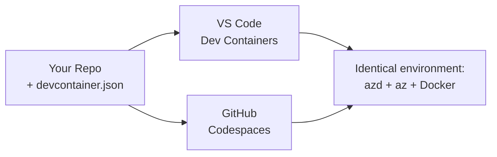

# מכולות פיתוח ו-GitHub Codespaces עבור azd

**ניווט בפרק:**
- **📚 דף הבית של הקורס**: [AZD למתחילים](../../README.md)
- **📖 הפרק הנוכחי**: פרק 1 - יסודות והתחלה מהירה
- **⬅️ הקודם**: [הבא את האפליקציה שלך](bring-your-own-app.md)
- **🚀 הפרק הבא**: [פרק 2: פיתוח AI-ראשון](../chapter-02-ai-development/README.md)

> יעד סקירת הפקודות והקונפיגורציה: `azd 1.37.2` (נובמבר 2026). בניית מכולות והפצות Azure לא בוצעו כחלק מסקירה זו.

## הקדמה

התקנת azd, סביבת הריצה הנכונה, Docker, ו-Azure CLI על כל מכונה היא מטלה - וזה הסיבה הראשונה שמדריך ש"חולף על המחשב שלי" נכשל עבור מישהו אחר. **מכולת פיתוח** פותרת זאת על ידי תיאור כל שרשרת הכלים שלך בקובץ. כל מי שפותח את הפרויקט ב-VS Code או GitHub Codespaces מקבל את אותה סביבה בדיוק, עם azd מותקן כבר. שיעור זה מראה לך כיצד להוסיף אחת.

## יעדי הלמידה

בסיום שיעור זה תוכל:
- להבין מהי מכולת פיתוח ולמה היא עוזרת עם azd
- להוסיף `.devcontainer/devcontainer.json` מינימלי לפרויקט
- לכלול את azd, Azure CLI, ו-Docker באמצעות *תכונות* של מכולת הפיתוח
- לפתוח את הפרויקט ב-GitHub Codespaces או VS Code

## תוצאות הלמידה

לאחר השלמת שיעור זה תוכל:
- ליצור `devcontainer.json` לפרויקט azd
- להוסיף את azd וכלי Azure בלי התקנות ידניות
- להריץ `azd up` מתוך מכולה או Codespace

---

## מהי מכולת פיתוח?

מכולת פיתוח היא סביבת פיתוח מבוססת Docker המוגדרת על ידי קובץ `.devcontainer/devcontainer.json` במאגר הקוד שלך. כשהפרויקט נפתח:

- **VS Code** (עם תוסף Dev Containers) בונה את המכולה ומתחבר אליה.
- **GitHub Codespaces** בונה את אותה מכולה בענן ומספק עורך מבוסס דפדפן.

כך או כך, כל תורם מקבל את אותם כלים — בלי "התקנת את azd?" לבעיות.



---

## שלב 1: יצירת קובץ devcontainer

צור `.devcontainer/devcontainer.json` בשורש הפרויקט שלך:

```json
{
  "name": "azd-project",
  "image": "mcr.microsoft.com/devcontainers/base:bookworm",
  "features": {
    "ghcr.io/devcontainers/features/azure-cli:1": {},
    "ghcr.io/azure/azure-dev/azd:0": { "version": "1.37.2" },
    "ghcr.io/devcontainers/features/docker-in-docker:2": {},
    "ghcr.io/devcontainers/features/node:1": {}
  },
  "customizations": {
    "vscode": {
      "extensions": [
        "ms-azuretools.azure-dev",
        "ms-azuretools.vscode-bicep"
      ]
    }
  },
  "forwardPorts": [3000],
  "postCreateCommand": "azd version"
}
```

מה כל חלק עושה:

| מפתח | מטרה |
|-----|---------|
| `image` | מערכת ההפעלה הבסיסית למכולה |
| `features` | מתקינים מוכנים מראש — כאן: Azure CLI, **azd**, Docker, ו-Node.js |
| `customizations.vscode.extensions` | מתקין אוטומטית את תוספי azd ו-Bicep ל-VS Code |
| `forwardPorts` | חושף את פורט האפליקציה שלך לדפדפן |
| `postCreateCommand` | מריץ פעם אחת אחרי בניית המכולה (כאן, בדיקת תפקוד בסיסית) |

> גרסת התכונה (`azd:0`) וגרסת ה-CLI המותקנת שונות. הגדר את האפשרות `version` של התכונה ל-`"1.37.2"` כדי לקבע את ה-CLI; אל תשתמש בגרסת CLI כתווית התכונה.

---

## שלב 2: התאמת התכונה לשפת האפליקציה שלך

החלף את תכונת `node` בכל מה שהאפליקציה שלך משתמשת:

```jsonc
// Python project
"ghcr.io/devcontainers/features/python:1": {},

// .NET project
"ghcr.io/devcontainers/features/dotnet:2": {},

// Java project
"ghcr.io/devcontainers/features/java:1": {},

// Go project
"ghcr.io/devcontainers/features/go:1": {}
```

שמור על `docker-in-docker` בבניית תמונות מקומית. בנייה מרוחקת ב-ACR (`docker.remoteBuild: true`) היא אלטרנטיבה; סוג ה-host לבדו לא תמיד דורש Docker מקומי.

---

## שלב 3: פתיחה

**ב-VS Code:**
1. התקן את תוסף **Dev Containers**.
2. פתח את תיקיית הפרויקט.
3. לחץ על **Reopen in Container** כשהוא מתבקש (או הפעל את *Dev Containers: Reopen in Container*).

**ב-GitHub Codespaces:**
1. דחוף את המאגר ל-GitHub.
2. לחץ על **Code → Codespaces → Create codespace on main**.
3. המתן לבניית המכולה — azd מוכן בטרמינל.

---

## שלב 4: פריסה מתוך המכולה

המכולה כוללת את azd כבר מותקן, כך שזרימת העבודה הרגילה פשוט עובדת:

```bash
azd auth login --use-device-code   # device code is handy inside Codespaces
azd up
```

> **למה `--use-device-code`?** במכולה מרוחקת או Codespace אין דפדפן מקומי להפניה, לכן כניסה באמצעות device-code היא המסלול האמין. תדביק קוד בלשונית בדפדפן כדי להשלים את ההתחברות.

---

## טעויות נפוצות

| טעות | תיקון |
|---------|-----|
| `azd up` לא מצליח לבנות תמונה | הוסף את התכונה `docker-in-docker` |
| התחברות בדפדפן תקועה ב-Codespaces | השתמש ב-`azd auth login --use-device-code` |
| כלים שונים בין חברי צוות | קבע את ה-CLI דרך אופציית `version` בתכונת azd וקבע סביבת ריצה לשפה |
| האפליקציה לא נגישה בדפדפן | הוסף את הפורט ל-`forwardPorts` |

---

## סיכום

- מכולת פיתוח עושה את שרשרת הכלים של azd שלך לשחזור לכולם.
- הוסף את azd, Azure CLI, ו-Docker דרך *תכונות* של מכולת הפיתוח.
- התאם את תכונת השפה לאפליקציה שלך ושמור על `docker-in-docker` עבור מארחי מכולות.
- השתמש בכניסת device-code כשאתה מריץ בתוך Codespaces.

---

## 🔗 ניווט

| כיוון | מקור |
|-----------|----------|
| **הקודם** | [הבא את האפליקציה שלך](bring-your-own-app.md) |
| **דף הבית של הפרק** | [פרק 1: יסודות והתחלה מהירה](README.md) |
| **הפרק הבא** | [פרק 2: פיתוח AI-ראשון](../chapter-02-ai-development/README.md) |

## 📖 משאבים קשורים

- [התקנה והגדרה](installation.md)
- [דף תרגילי פקודות](../../resources/cheat-sheet.md)
- [מפרט רשמי של מכולות פיתוח](https://containers.dev/)
- [תכונת מכולת פיתוח של azd](https://github.com/Azure/azure-dev/tree/main/ext/devcontainer)

---

<!-- CO-OP TRANSLATOR DISCLAIMER START -->
**כתב ויתור**:
מסמך זה תורגם באמצעות שירות תרגום אוטומטי [Co-op Translator](https://github.com/Azure/co-op-translator). למרות שאנו שואפים לדיוק, יש לקחת בחשבון שתרגומים אוטומטיים עלולים להכיל שגיאות או אי-דיוקים. יש להחשיב את המסמך המקורי בשפתו הטבעית כמקור הסמכות. למידע קריטי מומלץ להשתמש בתרגום מקצועי על ידי מתרגם אדם. אנו לא אחראים לכל אי-הבנה או פירוש שגוי הנובע מהשימוש בתרגום זה.
<!-- CO-OP TRANSLATOR DISCLAIMER END -->