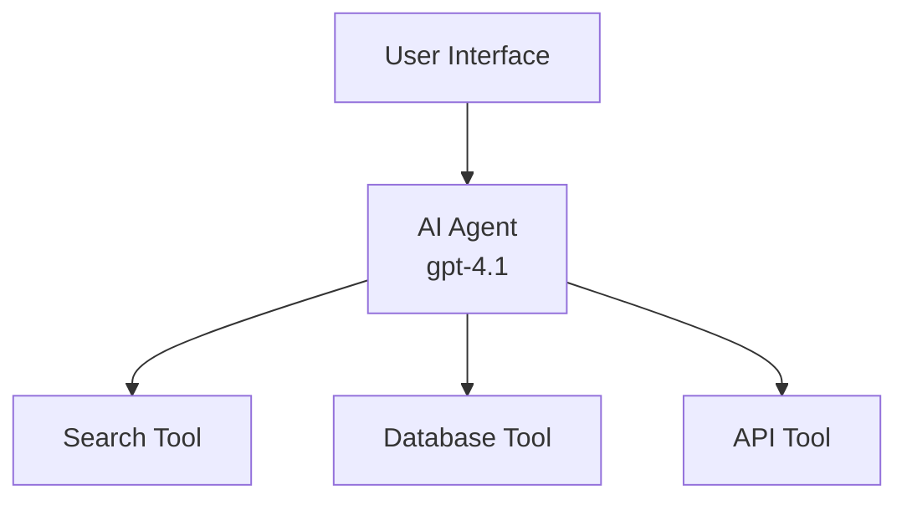
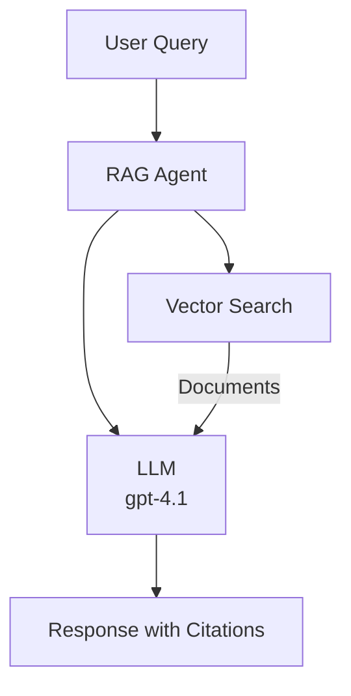
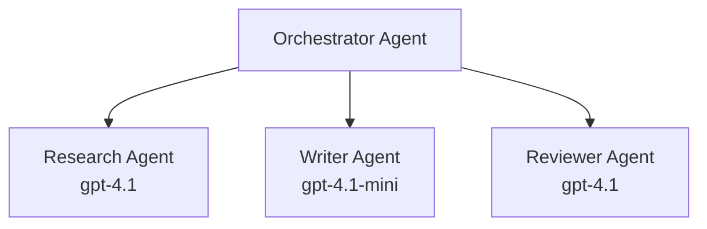

# סוכני בינה מלאכותית עם Azure Developer CLI

**ניווט פרקים:**
- **📚 עמוד הבית של הקורס**: [AZD למתחילים](../../README.md)
- **📖 הפרק הנוכחי**: פרק 2 - פיתוח מונחה בינה מלאכותית
- **⬅️ קודם**: [אינטגרציית Microsoft Foundry](microsoft-foundry-integration.md)
- **➡️ הבא**: [פריסת מודל בינה מלאכותית](ai-model-deployment.md)
- **🚀 מתקדם**: [פתרונות רב-סוכניים](../../examples/retail-scenario.md)

---

## מבוא

סוכני בינה מלאכותית הם תוכניות אוטונומיות שיכולות לתפוס את סביבתן, לקבל החלטות ולנקוט פעולות להשגת מטרות ספציפיות. בניגוד לצ'אטבוטים פשוטים שמגיבים לפקודות, סוכנים יכולים:

- **להשתמש בכלים** - לקרוא APIs, לחפש בבסיסי נתונים, להריץ קוד
- **לתכנן ולהסביר** - לפרק משימות מורכבות לשלבים
- **ללמוד מהקשר** - לשמור זיכרון ולהתאים התנהגות
- **לשתף פעולה** - לעבוד עם סוכנים אחרים (מערכות רב-סוכניות)

מדריך זה מראה כיצד לפרוס סוכני AI ל-Azure באמצעות Azure Developer CLI (azd).

שימוש בהקשר שיחה אינו אימון מודל: זיכרון מתמשך, בקרת גישה ושמירה חייבים להיות מיושמים/מוגדרים על ידי היישום.

> **עדכון Foundry GA (2026-11-09):** התקן את חבילת `microsoft.foundry` 1.0 הזמינה באופן כללי באמצעות `azd >= 1.37.0`. ההערכות מותקנות בנפרד; תכונות תצוגה מקדימה אופציונליות וקטע ה-SDK הקלאסי למטה אינם מקודמים ל-GA בהכרזת החבילה. הנחיה זו מבוססת על [הכרזת GA](https://devblogs.microsoft.com/azure-sdk/microsoft-foundry-azure-developer-cli-ga/) והתיעוד, לא על פריסת Azure חיה.

## מטרות הלמידה

עם השלמת מדריך זה, תלמדו:
- להבין מה הם סוכני AI וכיצד הם שונים מצ'אטבוטים
- לפרוס תבניות סוכני AI מוכנות מראש באמצעות AZD
- להגדיר סוכני Foundry לסוכנים מותאמים אישית
- לממש דפוסי סוכנים בסיסיים (שימוש בכלים, RAG, רב-סוכני)
- לנטר ולפתור בעיות בסוכנים בפריסה

## תוצאות למידה

בסיום, תוכל/י:
- לפרוס יישומי סוכני AI ל-Azure עם פקודה אחת
- להגדיר כלים ויכולות של סוכן
- לממש יצירת תוכן מועשרת באמצעות שאלות (RAG) עם סוכנים
- לתכנן ארכיטקטורות רב-סוכניות עבור זרימות עבודה מורכבות
- לטפל בבעיות נפוצות בפריסת סוכנים

---

## 🤖 מה מבדיל סוכן מצ'אטבוט?

| מאפיין | צ'אטבוט | סוכן AI |
|---------|---------|----------|
| **התנהגות** | מגיב לפקודות | נוקט פעולות אוטונומיות |
| **כלים** | עשוי להשתמש בכלים או בהבאה | בדרך כלל משתמש בכלים בלולאה מכוונת מטרה |
| **זיכרון** | תלוי ביישום | זיכרון מתמשך רק אם מיושם במפורש |
| **תכנון** | תגובה בודדת | הסקת מסקנות מרובת שלבים |
| **שיתוף פעולה** | ישות בודדת | יכול לעבוד עם סוכנים אחרים |

### אנלוגיה פשוטה

- **צ'אטבוט** = אדם מועיל שעונה על שאלות בדלפק מידע
- **סוכן AI** = עוזר אישי שיכול לבצע שיחות, לקבוע פגישות ולבצע משימות עבורך

---

## 🚀 התחלה מהירה: פרוס את הסוכן הראשון שלך

בחר אפשרות אחת ב**ספריית עבודה חדשה וריקה**. ה-`.` בסופה מאתחל שם; ללא יעד מפורש, AZD הנוכחי עשוי ליצור תת-ספרייה בשם התבנית ואינו משנה את ספריית ה-shell שלך. שמור תבניות/סביבות נפרדות בספריות נפרדות.

טווחי זמן/עלות למטה הם להמחשה בלבד, אינם הצעות מאומתות. בדוק דרישות מוקדמות, תמחור, מכסת מודלים ושירותים אופציונליים בכל דוגמה לפני פריסה.

### אפשרות 1: תבנית סוכני Foundry (מומלץ)

```bash
# Initialize the AI agents template
azd init --template get-started-with-ai-agents .

# Deploy to Azure
azd up
```

**מה יוצא לפריסה:** התשתית הנוכחית של הדוגמה והאפשרויות שנבחרו קובעות את המודל, הכלים, אירוח ומשאבי ניטור. עיין ב-README שלה ו-`infra/` לפני הספקה; אל תניח שכל תבנית סוכן כוללת חיפוש או ממשק אינטרנט.

**זמן:** כ-15-20 דקות
**עלות:** כ-100-150$ לחודש (פיתוח)

### אפשרות 2: סוכני כתיבה יצירתית עם Prompty

```bash
# Initialize the Prompty-based agent template
azd init --template https://github.com/Azure-Samples/contoso-creative-writer .

# Deploy to Azure
azd up
```

**מה יוצא לפריסה:** דוגמת כתיבה רב-סוכנית FastAPI/Prompty המשתמשת ב-Azure OpenAI, Bing Grounding ו-Azure AI Search. מאגר הקוד הקודם `agent-openai-python-prompty` מפנה לכאן; זו לא תבנית סוכן מזג אוויר מינימלית ב-Azure Functions. עקוב אחרי README העדכני שלה לאירוח, מכסת מודל ודרישות Bing Grounding.

**זמן:** כ-10-15 דקות
**עלות:** כ-50-100$ לחודש (פיתוח)

### אפשרות 3: סוכן שיחה RAG

```bash
# Initialize RAG chat template
azd init --template azure-search-openai-demo .

# Deploy to Azure
azd up
```

**מה יוצא לפריסה:**
- ✅ מודלים של Microsoft Foundry
- ✅ Azure AI Search עם נתוני דוגמה
- ✅ צינור עיבוד מסמכים
- ✅ ממשק שיחה עם ציטוטים

**זמן:** כ-15-25 דקות
**עלות:** כ-80-150$ לחודש (פיתוח)

### אפשרות 4: סוכן מתארח עם חבילת Foundry GA

השתמש ב[מדריך השלמה לסוכן מתארח](microsoft-foundry-integration.md#hosted-agent-walkthrough-ga) לדוגמת Python Agent Framework Responses API בסיסית. מסלול פריסת קוד זה דורש Python 3.13+, uv נוכחי, הרשאות Foundry ומכסת מודלים אזורית. אמת קריאות SDK מקומיות בנפרד בעת שימוש באישורי Azure CLI.

```bash
azd auth login
azd ext install microsoft.foundry
```

בספרייה הריקה, אתחל את הדוגמה:

```text
azd ai agent init --template https://github.com/microsoft-foundry/foundry-samples/blob/main/samples/python/hosted-agents/agent-framework/responses/01-basic/azure.yaml --deploy-mode code --src .
```

בחר פרויקט חדש או קיים, בדוק את `azure.yaml`, והרץ את `azd provision`. השתמש ב-`azd ai agent run` כדי לפתוח את Agent Inspector, ומטרמינל אחר באותה תיקייה, הרץ את `azd ai agent invoke --local "Explain how this agent is hosted."`. לאחר אימות מקומי, השתמש ב-`azd deploy` וב-`azd ai agent invoke "Explain how this agent is hosted."` להשוות את התגובה שהופעלה. Foundry בונה את הקוד שהועלה מרחוק; אין צורך בבניית קונטיינר מקומית.

**מתי להשתמש ב-`azd ai agent init` לעומת `azd init --template`:**

| גישה | מתאים ל- | איך זה עובד |
|----------|----------|------|
| `azd init --template` | התחלה מדגם אפליקציה עובד | משכפל רפוזיטורי תבנית מלאה עם קוד ותשתית |
| `azd ai agent init --template` | אימוץ פרויקט Foundry של סוכן קיים | משתמש במסמך פרויקט `azure.yaml` והגדרותיו |

> **טיפ:** אפשרויות 1-3 מתחילות מתבניות אפליקציה מלאות; אפשרות 4 מלמדת את זרימת העבודה של סוכן מאוחסן ב-GA. אף פקודת אתחול אינה מזרימה באופן אוטומטי מכתבי סוכן מיושנים. להוספת הגדרת סוכן ישירה לפרויקט קיים, ראה [הנחיות אתחול והגירה](../chapter-08-production/production-ai-practices.md#initializing-agent-projects-with-azd-ai-agent-init).

התקן את `azure.ai.evaluations` בנפרד כדי לייצר ולבדוק נתוני מבחן/קריטריונים, לקונפג הערכה ולהריץ אותה בעזרת `azd ai eval`. אופטימיזציה יכולה להשתמש מחדש בהערכה תואמת; בדוק מועמדים לפני פריסת אחד מהם במפורש. עקוב אחר [זרימת העבודה של ההערכה](../chapter-08-production/production-ai-practices.md#evaluation-migration-and-quality-checks) ו-[הגירת אופטימיזציה](../chapter-08-production/production-ai-practices.md#optimization-configuration-migration) לפני שימוש חוזר בדוגמאות ישנות. לניקוי, משאבי פרויקט Foundry בשימוש נשארים לאחר `azd down`; קבוצה של משאבי פרויקט שיצרת זה עתה נמחקת. ראה את [הנחיות הניקוי במסלול](microsoft-foundry-integration.md#7-clean-up-deliberately).

---

## 🏗️ דפוסי ארכיטקטורת סוכן

### דפוס 1: סוכן יחיד עם כלים

דפוס הסוכן הפשוט ביותר - סוכן אחד שיכול להשתמש בכלים מרובים.



**מתאים במיוחד עבור:**
- רובוטי תמיכה בלקוחות
- עוזרי מחקר
- סוכני ניתוח נתונים

**דגם יישום קשור:** `azure-search-openai-demo` מדגים RAG, לא לולאת סוכן כלים שרירותית כללית.

### דפוס 2: סוכן RAG (יצירה מוגברת שליפה)

סוכן שמוציא מסמכים רלוונטיים לפני יצירת התגובות.



**מתאים במיוחד עבור:**
- בסיסי ידע ארגוניים
- מערכות שאלות ותשובות על מסמכים
- תאימות ומחקר משפטי

**תבנית AZD:** `azure-search-openai-demo`

### דפוס 3: מערכת רב-סוכנית

מספר סוכנים מומחים שעובדים יחד על משימות מורכבות.



**מתאים במיוחד עבור:**
- יצירת תוכן מורכב
- זרימות עבודה מרובות שלבים
- משימות שדורשות מומחיות שונה

**למידע נוסף:** [דפוסי תיאום רב-סוכני](../chapter-06-pre-deployment/coordination-patterns.md)

---

## ⚙️ קונפיגורציית כלי סוכן

סוכנים הופכים לעוצמתיים כשהם יכולים להשתמש בכלים. כך מגדירים כלים נפוצים:

### קונפיגורציית כלים בסוכני Foundry

קטע **SDK של שירות סוכן קלאסי** זה פונה ל-`azure-ai-projects==1.0.0` ו-`azure-ai-agents==1.1.0` עם `azure-identity`. זה אינו גרסת API חדשה יותר של סוכן/תגובות שמשתמשת בחלק מתבניות Foundry הנוכחיות, ולא הארכת AZD `azure.ai.agents` (חבילה שונה). אל תערבב דורות API אלה. הגדר את `PROJECT_ENDPOINT` כנקודת קצה של פרויקט Foundry קלאסי ואת `MODEL_DEPLOYMENT_NAME` בפריסת מודל נתמכת קיימת; אשר את עצמך עם `az login` מקומית ותן את ההרשאות הנדרשות לפרויקט.

```python
# agent_config.py
import os
from azure.ai.projects import AIProjectClient
from azure.ai.agents.models import FunctionTool
from azure.identity import DefaultAzureCredential

def search_knowledge_base(query: str) -> str:
    """Search the demonstration knowledge base.

    :param query: Search text.
    :return: Matching demonstration information.
    """
    # Local fixture only, not a production search implementation.
    return "Demo policy: returns are accepted within 30 days."

project_client = AIProjectClient(
    endpoint=os.environ["PROJECT_ENDPOINT"],
    credential=DefaultAzureCredential(),
)
search_tool = FunctionTool(functions={search_knowledge_base})
project_client.agents.enable_auto_function_calls(search_tool)
agent = project_client.agents.create_agent(
    model=os.environ["MODEL_DEPLOYMENT_NAME"],
    name="Support Agent",
    instructions="Use search_knowledge_base for policy questions. Label results as demo data.",
    tools=search_tool.definitions,
)
```

רישום סכמת פונקציה אינו מריץ Python על השירות. ב-SDK זה, `enable_auto_function_calls` בתוספת `agents.runs.create_and_process(...)` מריצים את הקריאות חזרה הרשומות בתהליך הלקוח שלך. ראה את [דוגמת SDK שפורסמה](https://github.com/Azure/azure-sdk-for-python/blob/azure-ai-agents_1.1.0/sdk/ai/azure-ai-agents/samples/agents_tools/sample_agents_auto_function_call.py). סגור את הלקוח ומחק סוכנים/שרשורים להדגמה כשסיימת.

### קונפיגורציית סביבה

השמות הבאים הם **קלטי תבנית מותאמים להמחשה**, לא מתגים מובנים ב-AZD. תחילה העבר כל ערך דרך `infra/main.parameters.json`, תשתית, וקוד אפליקציה. `azd env set` בלבד אינו משנה את כלי הסוכן או ההוראות שלו.

```bash
# Set up agent-specific environment variables
azd env set AZURE_OPENAI_MODEL "gpt-4.1"
azd env set AGENT_INSTRUCTIONS "You are a helpful assistant..."
azd env set ENABLE_CODE_INTERPRETER "true"
azd env set ENABLE_FILE_SEARCH "true"

# Apply wired infrastructure and application changes
azd up
```

---

## 📊 ניטור סוכנים

### אינטגרציה עם Application Insights

אם התבנית שנבחרה מגדירה Application Insights וקונפגורה לאיסוף נתונים:

```bash
# Open monitoring dashboard
azd monitor --overview

# Open the Application Insights logs view (not a streaming log tail)
azd monitor --logs

# View live metrics
azd monitor --live
```

### מדדים מרכזיים למעקב

| מדד | תיאור | יעד |
|--------|-------------|--------|
| השהיית תגובה | זמן ליצירת תגובה | < 5 שניות |
| שימוש בטוקנים | טוקנים לכל בקשה | לפקח על עלויות |
| שיעור הצלחה בקריאות כלי | % הצלחה בהפעלת כלים | > 95% |
| שיעור שגיאות | בקשות סוכן שנכשלו | < 1% |
| שביעות רצון המשתמש | ציוני משוב | > 4.0/5.0 |

### רישום מותאם אישית לסוכנים

```python
import os
from azure.monitor.opentelemetry import configure_azure_monitor
from opentelemetry import trace

# Configure Azure Monitor with OpenTelemetry
configure_azure_monitor(
    connection_string=os.environ["APPLICATIONINSIGHTS_CONNECTION_STRING"]
)

tracer = trace.get_tracer(__name__)

def log_agent_interaction(user_query, agent_response, tools_used, latency_ms):
    with tracer.start_as_current_span("agent_interaction") as span:
        span.set_attributes({
            "query_length": len(user_query),  # Do not log raw prompts or personal data
            "response_length": len(agent_response),
            "tools_used": tools_used,
            "latency_ms": latency_ms
        })
```

> **הערה:** התקן את החבילה הנדרשת: `pip install azure-monitor-opentelemetry`. היא מכילה את תלות OpenTelemetry; מרחב שמות הייבוא אינו דרישה להתקנת חבילה בשם `opentelemetry`.

---

## 💰 שיקולי עלות

### עלויות חודשיות משוערות לפי דפוס

טווחי תכנון ממחישים אלה, אינם הצעות מחיר או תקרות הוצאה. אזור, טוקנים במודל, SKUs של חיפוש/חישוב, סשנים של כלים, אחסון ותעבורה יכולים לחרוג מהם. בדוק את הנחיות העלויות בדגם ואת תמחור Azure לפני `azd up`.

| דפוס | סביבת פיתוח | הפקה |
|---------|-----------------|------------|
| סוכן יחיד | $50-100 | $200-500 |
| סוכן RAG | $80-150 | $300-800 |
| רב-סוכני (2-3 סוכנים) | $150-300 | $500-1,500 |
| רב-סוכן ארגוני | $300-500 | $1,500-5,000+ |

### טיפים לאופטימיזציה של עלויות

1. **השתמש ב-gpt-4.1-mini למשימות פשוטות** (רק אם התבנית שלך צורכת קלט זה)
   ```bash
   azd env set AZURE_OPENAI_MODEL "gpt-4.1-mini"
   ```

2. **הטמע מטמון מקומי לשאלות חוזרות ובטוחות.** כלול הרשאות דייר/משתמש, פריסת מודל, הוראות, וגרסת שליפה במפתח המטמון; הגדר תפוגה. אל תשתף תגובות שיחה פרטיות דרך מטמון שאלות בלבד גלובלי. לאובייקט סוכן ב-SDK אין שיטת `agent.run()` כללית.

3. **קבע מגבלות טוקנים לכל הרצה**
   ```python
   # Set max_completion_tokens when running the agent, not during creation
   run = project_client.agents.runs.create_and_process(
       thread_id=thread.id,
       agent_id=agent.id,
       max_completion_tokens=1000  # Budget across the run; may finish as incomplete
   )
   ```

4. **הדרג אפליקציות סוגרים ל-0 כשהן לא בשימוש**
   ```bash
   # Custom-template input: must map to template.scale.minReplicas
   azd env set MIN_REPLICAS "0"
   ```
   החל את שינוי התשתית עם `azd provision` או `azd up`. קנה מידה ל-0 דורש טריגר מתאים ואינו מפסיק חיובי חיפוש, אחסון או חיובי מודל/כלים.

---

## 🔧 פתרון בעיות בסוכנים

### בעיות נפוצות ופתרונות

<details>
<summary><strong>❌ הסוכן לא מגיב לקריאות לכלים</strong></summary>

```bash
# Inspect the application deployment (not the agent's registered tools)
azd show

# Verify OpenAI deployment
az cognitiveservices account deployment list \
  --name $AZURE_OPENAI_NAME \
  --resource-group $RG_NAME

# Check agent logs
azd monitor --logs
```

**סיבות נפוצות:**
- אי התאמה בין חתימת הפונקציה לכלי
- הרשאות נדרשות חסרות
- נקודת הקצה של ה-API לא נגישה
</details>

<details>
<summary><strong>❌ השהייה גבוהה בתגובות הסוכן</strong></summary>

```bash
# Check Application Insights for bottlenecks
azd monitor --live

# Consider using a faster model
azd env set AZURE_OPENAI_MODEL "gpt-4.1-mini"
azd up
```

**טיפים לאופטימיזציה:**
- השתמש בתגובות סטרימינג
- הטמע מטמון תגובות
- הפחת את גודל חלון ההקשר
</details>

<details>
<summary><strong>❌ הסוכן מחזיר מידע לא נכון או מהולוסינציה</strong></summary>

```python
# Improve with better system prompts
instructions = """
You are a helpful assistant. IMPORTANT:
- Only answer based on provided context
- If you don't know, say "I don't know"
- Always cite your sources
- Never make up information
"""

# Use these instructions in the agent definition.
# For classic file search, first upload/index documents in a vector store,
# then use FileSearchTool(vector_store_ids=[...]) and pass both its
# .definitions and .resources when creating the agent.
```
הוראות ושליפה מפחיתים סיכונים; אף אחד לא מבטיח תשובות עובדתיות. הערך שאלות מבוססות ובלתי מההיקף על תשובות ידועות.
</details>

<details>
<summary><strong>❌ שגיאות עקב חריגה ממגבלת טוקנים</strong></summary>

```python
# Implement context window management
def truncate_context(messages, max_tokens=8000, model="gpt-4.1"):
    """Approximate content-only budget for objects with .content strings."""
    import tiktoken
    encoding = tiktoken.encoding_for_model(model)
    total_tokens = 0
    truncated = []
    
    for msg in reversed(messages):
        msg_tokens = len(encoding.encode(msg.content))
        if total_tokens + msg_tokens > max_tokens:
            break
        truncated.insert(0, msg)
        total_tokens += msg_tokens
    
    return truncated
```
סייע זה מחוץ לסכמות תפקיד/כלי, הוראות מערכת, טוקני תמונה, ועלויות פרוטוקול. שמור מקום עבור אלה וההשלמה; אל תפריד זוגות קריאה/תוצאה לכלי או תסיר הוראות מערכת נדרשות. התקן בנפרד את `tiktoken`. זה אינו מאמת גלובלי לחלון הקשר.
</details>

---

## 🎓 תרגילים מעשיים

### תרגיל 1: פרוס סוכן בסיסי (20 דקות)

**מטרה:** פרוס את סוכן ה-AI הראשון שלך באמצעות AZD

```bash
# Step 1: Initialize template
azd init --template get-started-with-ai-agents .

# Step 2: Login to Azure
azd auth login
# If you work across tenants, add --tenant-id <tenant-id>

# Step 3: Deploy
azd up

# Step 4: Test the agent
# Expected output after deployment:
#   Deployment Complete!
#   Endpoint: https://<app-name>.<region>.azurecontainerapps.io
# Open the URL shown in the output and try asking a question

# Step 5: View monitoring
azd monitor --overview

# Step 6: Review the listed resources and confirm cleanup
azd down
```

**קריטריוני הצלחה:**
- [ ] הסוכן משיב על שאלות
- [ ] יכול לגשת ללוח הניטור דרך `azd monitor`
- [ ] המשאבים נוקו בהצלחה

### תרגיל 2: הוסף כלי מותאם אישית (30 דקות)

**מטרה:** להרחיב סוכן עם כלי מותאם אישית

**נקודת התחלה:** השתמש בלקוח ה-SDK הקלאסי מ-[תצורת הכלי](#tool-configuration-in-foundry-agents), לא בתבנית שרירותית עם דור SDK שונה.

1. הוסף את התיקון הדטרמיניסטי הבא ל-`agent_config.py`:
   ```python
   def get_weather(location: str) -> str:
       """Return demonstration weather, not live conditions.

       :param location: City name.
       :return: A clearly labelled fixture.
       """
       print(f"TOOL_CALLED: {location}")
       return f"Demo weather in {location}: Sunny, 72°F (fixture, not live)"
   ```
2. החלף את בלוק הרישום והיצירה של כלי החיפוש ב:
   ```python
   weather_tool = FunctionTool(functions={get_weather})
   project_client.agents.enable_auto_function_calls(weather_tool)
   agent = project_client.agents.create_agent(
       model=os.environ["MODEL_DEPLOYMENT_NAME"],
       name="Weather Agent",
       instructions="Call get_weather for weather questions; explain that it returns demo data.",
       tools=weather_tool.definitions,
   )
   thread = project_client.agents.threads.create()
   try:
       project_client.agents.messages.create(
           thread_id=thread.id, role="user", content="Use get_weather for Seattle."
       )
       run = project_client.agents.runs.create_and_process(
           thread_id=thread.id, agent_id=agent.id
       )
       if run.status != "completed":
           raise RuntimeError(f"Run status: {run.status}; error: {run.last_error}")
       for message in project_client.agents.messages.list(thread_id=thread.id):
           for text in message.text_messages:
               print(text.text.value)
   finally:
       project_client.agents.threads.delete(thread.id)
       project_client.agents.delete_agent(agent.id)
       project_client.close()
   ```
3. הרץ מקומית (זה מפעיל את פרויקט Azure הקיים וגובה דמי שימוש בדגם):
   ```bash
   python agent_config.py
   # Expected: TOOL_CALLED: Seattle, then a completed answer labelled demo data.
   ```

**קריטריוני הצלחה:**
- [ ] הסוכן מזהה שאילות הקשורות למזג האוויר
- [ ] הכלי נקרא כראוי
- [ ] התגובה כוללת מידע על מזג האוויר

### תרגיל 3: בניית סוכן RAG (45 דקות)

**מטרה:** יצירת סוכן שתשובות לשאלות מתוך המסמכים שלך

```bash
# Step 1: Deploy RAG template
azd init --template azure-search-openai-demo .
azd up

# Step 2: Upload your documents
# For the sample's local ingestion path, place supported files in data/.
# Run from the sample root after following its Python environment setup:
./scripts/prepdocs.sh
# Windows PowerShell equivalent: .\\scripts\\prepdocs.ps1

# Step 3: Test with domain-specific questions
# Open the web app URL from the azd up output
# Ask questions about your uploaded documents
# Responses should include citation references like [doc.pdf]
```

**קריטריוני הצלחה:**
- [ ] הסוכן משיב מתוך המסמכים שהועלו
- [ ] התגובות כוללות ציטוטים
- [ ] שאלות خارج תחום הבדיקה מטופלות ללא טענות לא נתמכות (אין ערבות לכל שאלה עתידית)

אם `USE_CLOUD_INGESTION=true`, השתמש במקום זאת בזרימת העבודה לדליקה/העלאה בענן מהדוגמה; ה-wrapper המקומי מדלג במכוון על הדליקה. לאחר הבדיקה, הרץ `azd down` בסביבת RAG ובחן את המשאבים למחיקה.

---

## 📚 שלבים הבאים

עכשיו כשאתה מבין את סוכני ה-AI, חקור את הנושאים המתקדמים האלה:

| נושא | תיאור | קישור |
|-------|-------------|------|
| **מערכות רב-סוכניות** | בניית מערכות עם מספר סוכנים משתפים פעולה | [דוגמת סוכן קמעונאי רב-סוכני](../../examples/retail-scenario.md) |
| **דפוסי תיאום** | למד דפוסי תזמור ותקשורת | [דפוסי תיאום](../chapter-06-pre-deployment/coordination-patterns.md) |
| **פריסה לייצור** | פריסת סוכן מוכנה לארגון | [פרקטיקות AI לייצור](../chapter-08-production/production-ai-practices.md) |
| **הערכת סוכן** | בדיקת ביצועים והערכת הסוכן | [פתרון תקלות AI](../chapter-07-troubleshooting/ai-troubleshooting.md) |
| **מעבדת סדנת AI** | התנסות מעשית: הפוך את פתרון ה-AI שלך למוכן AZD | [מעבדת סדנת AI](ai-workshop-lab.md) |

---

## 📖 משאבים נוספים

### תיעוד רשמי
- [שירות סוכן Microsoft Foundry](https://learn.microsoft.com/azure/ai-services/agents/)
- [התחלה מהירה לשירות סוכן Microsoft Foundry](https://learn.microsoft.com/azure/ai-services/agents/quickstart)
- [מסגרת סוכן Semantic Kernel](https://learn.microsoft.com/semantic-kernel/)

### תבניות AZD לסוכנים
- [התחלת עבודה עם סוכני AI](https://github.com/Azure-Samples/get-started-with-ai-agents)
- [סוכני כתיבה יצירתית עם Prompty](https://github.com/Azure-Samples/contoso-creative-writer)
- [דוגמה לשילוב Azure Search ו-OpenAI](https://github.com/Azure-Samples/azure-search-openai-demo)

### משאבים בקהילה
- [AZD מדהים - תבניות סוכנים](https://azure.github.io/awesome-azd/?tags=ai-agents)
- [השרת Discord של Azure AI](https://discord.gg/microsoft-azure)
- [השרת Discord של Microsoft Foundry](https://discord.gg/nTYy5BXMWG)

### מיומנויות סוכן עבור העורך שלך
- [**מיומנויות סוכן Microsoft Azure**](https://skills.sh/microsoft/github-copilot-for-azure) - התקן מיומנויות סוכן AI לשימוש חוזר לפיתוח Azure ב-GitHub Copilot, Cursor או כל סוכן נתמך אחר. כולל מיומנויות ל-[Azure AI](https://skills.sh/microsoft/github-copilot-for-azure/azure-ai), [Microsoft Foundry](https://skills.sh/microsoft/github-copilot-for-azure/microsoft-foundry), [פריסה](https://skills.sh/microsoft/github-copilot-for-azure/azure-deploy), ו-[אבחון](https://skills.sh/microsoft/github-copilot-for-azure/azure-diagnostics):
  ```bash
  npx skills add microsoft/github-copilot-for-azure
  ```

---

**ניווט**
- **השיעור הקודם**: [שילוב Microsoft Foundry](microsoft-foundry-integration.md)
- **השיעור הבא**: [פריסת דגם AI](ai-model-deployment.md)

---

<!-- CO-OP TRANSLATOR DISCLAIMER START -->
**כתב ויתור**:
מסמך זה תורגם באמצעות שירות תרגום אוטומטי [Co-op Translator](https://github.com/Azure/co-op-translator). למרות שאנו שואפים לדיוק, יש לקחת בחשבון שתרגומים אוטומטיים עלולים להכיל שגיאות או אי-דיוקים. יש להחשיב את המסמך המקורי בשפתו הטבעית כמקור הסמכות. למידע קריטי מומלץ להשתמש בתרגום מקצועי על ידי מתרגם אדם. אנו לא אחראים לכל אי-הבנה או פירוש שגוי הנובע מהשימוש בתרגום זה.
<!-- CO-OP TRANSLATOR DISCLAIMER END -->