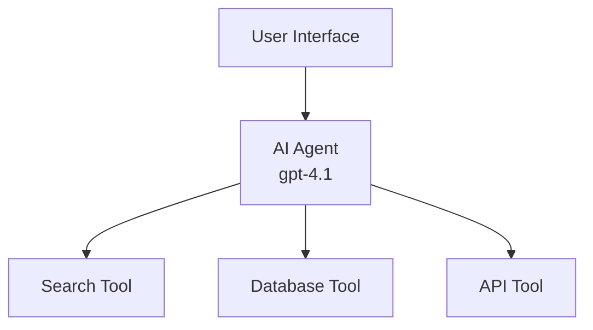
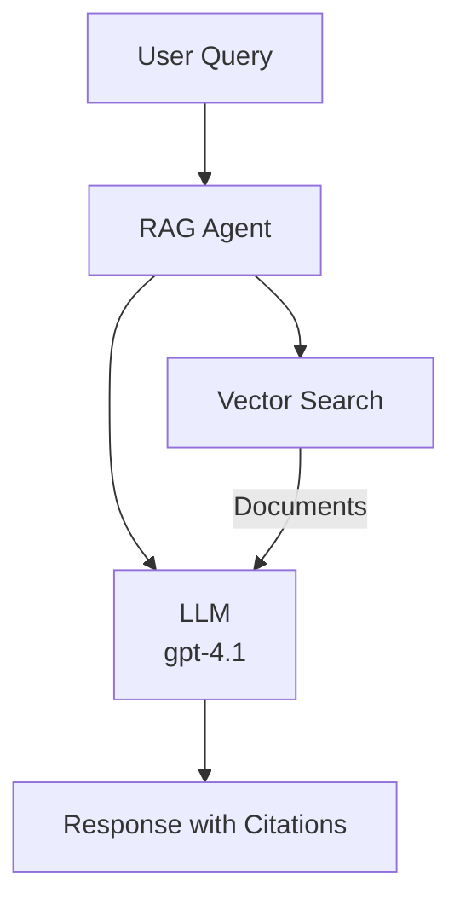
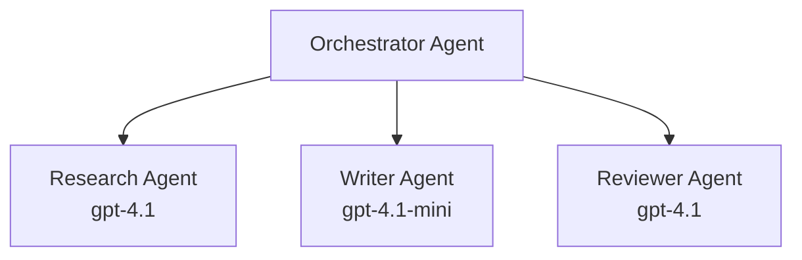

# סוכני בינה מלאכותית עם Azure Developer CLI

**ניווט פרקים:**
- **📚 דף הבית של הקורס**: [AZD למתחילים](../../README.md)
- **📖 פרק נוכחי**: פרק 2 - פיתוח ממוקד בינה מלאכותית
- **⬅️ הקודם**: [שילוב Microsoft Foundry](microsoft-foundry-integration.md)
- **➡️ הבא**: [פריסת מודל בינה מלאכותית](ai-model-deployment.md)
- **🚀 מתקדם**: [פתרונות מרובי סוכנים](../../examples/retail-scenario.md)

---

## מבוא

סוכני בינה מלאכותית הם תוכניות אוטונומיות היכולות לתפוס את סביבתן, לקבל החלטות ולנקוט פעולות להשגת מטרות ספציפיות. בניגוד לצ׳טבוטים פשוטים שמגיבים להנחיות, הסוכנים יכולים:

- **להשתמש בכלים** - לקרוא ל-APIs, לחפש במסדי נתונים, להריץ קוד
- **לתכנן ולהסביר** - לפרק משימות מורכבות לשלבים
- **ללמוד מהקשר** - לשמור זיכרון ולהתאים את ההתנהגות
- **לשתף פעולה** - לעבוד עם סוכנים אחרים (מערכות מרובות סוכנים)

מדריך זה מראה כיצד לפרוס סוכני בינה מלאכותית ל-Azure באמצעות Azure Developer CLI (azd).

שימוש בהקשר שיחה אינו אימון מודל: זיכרון מתמשך, בקרת גישה ושמירה חייבים להיות מיושמים/מוגדרים על ידי האפליקציה.

> **סקירת גרסה (2026-11-04):** דוגמאות CLI נבדקו מול תיעוד/מקור של `azd` `1.37.2`, `azure.ai.agents` `1.0.0-beta.23` ו-`azure.ai.evaluations` `1.0.0-beta.2`, לא פריסה חיה ב-Azure. השתמש ב-`azd >= 1.37.0` עבור זרימת עבודה משולבת. ראו [שינויים ותיקונים אחרונים](../chapter-08-production/production-ai-practices.md#recent-release-changes-and-fixes) לפני שדרוג פרויקטים ישנים.

## יעדי למידה

בסיום מדריך זה, תוכל:
- להבין מה הם סוכני בינה מלאכותית וכיצד הם שונים מצ׳טבוטים
- לפרוס תבניות סוכן בינה מלאכותית מוכנות מראש באמצעות AZD
- להגדיר סוכני Foundry לסוכנים מותאמים אישית
- ליישם דפוסי סוכנים בסיסיים (שימוש בכלים, RAG, מרובי סוכנים)
- לעקוב ולפתור תקלות בסוכנים מפורסמים

## תוצאות למידה

עם סיום המדריך תוכל:
- לפרוס יישומי סוכן בינה מלאכותית ל-Azure עם פקודה אחת
- להגדיר כלים ויכולות סוכן
- ליישם יצירה מְתוּסֶפֶת-שליפתית (RAG) עם סוכנים
- לתכנן ארכיטקטורות מרובות סוכנים עבור זרימות עבודה מורכבות
- לפתור בעיות נפוצות בפריסת סוכנים

---

## 🤖 מה מבדל סוכן מצ׳טבוט?

| מאפיין | צ׳טבוט | סוכן בינה מלאכותית |
|---------|---------|----------|
| **התנהגות** | מגיב להנחיות | נוקט בפעולות אוטונומיות |
| **כלים** | עשוי להשתמש בשליפה או כלים | בדרך כלל משתמש בכלים בלולאת מטרה |
| **זיכרון** | תלוי באפליקציה | זיכרון מתמשך רק אם מיושם במפורש |
| **תכנון** | תגובה בודדת | חשיבה רב-שלבית |
| **שיתופיות** | ישות בודדת | יכול לעבוד עם סוכנים אחרים |

### אנלוגיה פשוטה

- **צ׳טבוט** = אדם מועיל שעונה על שאלות בדלפק מידע
- **סוכן בינה מלאכותית** = עוזר אישי שיכול לבצע שיחות, לקבוע פגישות, ולבצע משימות עבורך

---

## 🚀 התחלה מהירה: פרוס את הסוכן הראשון שלך

בחר אפשרות אחת ב**ספריית עבודה חדשה וריקה**. הפקודה `.` מאתחלת שם; ללא יעד מפורש, AZD הנוכחי עשוי ליצור תחת目录 בשם התבנית ואינו משנה את ספריית הפקודה שלך. שמור תבניות/סביבות נפרדות בספריות נפרדות.

טווחי זמן/עלות מטה הם להמחשה בלבד, לא הצעות מאומתות. בדוק דרישות, תמחור, מכסת מודל ושירותים אופציונליים של כל דוגמה לפני הפריסה.

### אפשרות 1: תבנית סוכני Foundry (מומלץ)

```bash
# Initialize the AI agents template
azd init --template get-started-with-ai-agents .

# Deploy to Azure
azd up
```

**מה נפרס:** תשתית נוכחית ואפשרויות נבחרות בדוגמה קובעות את המודל, הכלים, האירוח ומשאבי המעקב. עיין בקובץ README שלה וב-`infra/` לפני האספקה; אל תניח שכל תבנית סוכן כוללת חיפוש או ממשק רשת.

**זמן:** כ-15-20 דקות
**עלות:** כ-100-150 דולר לחודש (פיתוח)

### אפשרות 2: סוכני כתיבה יצירתית עם Prompty

```bash
# Initialize the Prompty-based agent template
azd init --template https://github.com/Azure-Samples/contoso-creative-writer .

# Deploy to Azure
azd up
```

**מה נפרס:** דוגמת כתיבה מרובת סוכנים FastAPI/Prompty המשתמשת ב-Azure OpenAI, Bing Grounding ו-Azure AI Search. מאגר `agent-openai-python-prompty` הקודם מפנה לכאן; זו לא תבנית סוכן מזג אוויר מינימלית של Azure Functions. עקוב אחר README הנוכחי עבור אירוח, מכסת מודל ודרישות Bing Grounding.

**זמן:** כ-10-15 דקות
**עלות:** כ-50-100 דולר לחודש (פיתוח)

### אפשרות 3: סוכן צ׳ט RAG

```bash
# Initialize RAG chat template
azd init --template azure-search-openai-demo .

# Deploy to Azure
azd up
```

**מה נפרס:**
- ✅ מודלים של Microsoft Foundry
- ✅ Azure AI Search עם נתוני דוגמה
- ✅ קו עיבוד מסמכים
- ✅ ממשק שיחה עם ציטוטים

**זמן:** כ-15-25 דקות
**עלות:** כ-80-150 דולר לחודש (פיתוח)

### אפשרות 4: AZD AI Agent Init (סקירת תבנית פרויקט)

השתמש ב-`azd ai agent init` בצורה אינטראקטיבית, או אימץ פרויקט סוכן `azure.yaml` נוכחי עם `--template`/`-t`. האפשרות הישנה `--manifest`/`-m` היא שם ישן שמוטל לפח, לא ממיר לתצורות ישנות.

```bash
# Install the AI agents extension
azd extension install azure.ai.agents

# Optional: verify the installed preview version
azd extension show azure.ai.agents

# Initialize from a current agent project template (supply your template path)
azd ai agent init --template ./templates/support-agent/azure.yaml

# Deploy to Azure
azd up

# Test the deployed agent (shows latency + time-to-first-byte)
azd ai agent invoke
```

**מתי להשתמש ב-`azd ai agent init` לעומת `azd init --template`:**

| גישה | מתאים ביותר ל- | איך זה עובד |
|----------|----------|------|
| `azd init --template` | התחלה מדוגמה של אפליקציה שעובדת | משכפל מאגר תבנית שלם עם קוד ותשתית |
| `azd ai agent init --template` | אימוץ פרויקט סוכן Foundry נוכחי | משתמש במסמך פרויקט `azure.yaml` ובהגדרותיו |

> **טיפ:** השתמש ב-`azd init --template` כשאתה לומד (אפשרויות 1-3 מעלה). השתמש ב-`azd ai agent init` עבור תהליך העבודה של סוכן Foundry. כדי להוסיף הגדרת סוכן ישירה לפרויקט קיים, עיין ב-[הנחיות התחלה והגירה](../chapter-08-production/production-ai-practices.md#initializing-agent-projects-with-azd-ai-agent-init).

אחרי `azd up`, השתמש ב-`azd ai agent invoke` כדי לבדוק, בהרחבת `azure.ai.evaluations` הנפרדת (`azd ai eval init`, `generate`, ו-`run start`) למדידת איכות, וב-`azd ai agent optimize` כדי לשפר באמצעות תצורת הערכה חדשה. סוכני beta.22 החליפו את תהליך ההערכה הישן ושינו את פורמט `--config` של האופטימיזציה. ראה [הגירת הערכה](../chapter-08-production/production-ai-practices.md#evaluation-migration-and-quality-checks) ו-[הגירת אופטימיזציה](../chapter-08-production/production-ai-practices.md#optimization-configuration-migration) לפני שימוש חוזר בדוגמאות ישנות.

---

## 🏗️ דפוסי ארכיטקטורת סוכן

### דפוס 1: סוכן יחיד עם כלים

דפוס הסוכן הפשוט ביותר - סוכן אחד שיכול להשתמש בכלים מרובים.



**מתאים ביותר ל:**
- בוטים לתמיכה בלקוחות
- עוזרי מחקר
- סוכני ניתוח נתונים

**דוגמה לאפליקציה קשורה:** `azure-search-openai-demo` מדגים RAG, לא לולאת סוכן כלים שרירותית כללית.

### דפוס 2: סוכן RAG (Retrieval-Augmented Generation)

סוכן שמושך מסמכים רלוונטיים לפני יצירת תגובות.



**מתאים ביותר ל:**
- בסיסי ידע ארגוניים
- מערכות שאלות ותשובות למסמכים
- מחקר חוקי וציות

**תבנית AZD:** `azure-search-openai-demo`

### דפוס 3: מערכת סוכנים מרובה

סוכנים מרובים מתמחים הפועלים יחד על משימות מורכבות.



**מתאים ביותר ל:**
- יצירת תוכן מורכבת
- תהליכי עבודה מרובי שלבים
- משימות שדורשות מומחיות שונה

**למידע נוסף:** [דפוסי תיאום סוכנים מרובים](../chapter-06-pre-deployment/coordination-patterns.md)

---

## ⚙️ הגדרת כלים לסוכן

סוכנים הופכים חזקים כשאפשר להשתמש בכלים. הנה כיצד להגדיר כלים נפוצים:

### הגדרת כלים בסוכני Foundry

קטע **שירות סוכן קלאסי SDK זה** מיועד ל-`azure-ai-projects==1.0.0` ו-`azure-ai-agents==1.1.0` עם `azure-identity`. זה אינו ה-API הישן versioned-agent/Responses שבו משתמשים חלק מתבניות Foundry הנוכחיות, ואינו תוסף `azure.ai.agents` של AZD (חבילה שונה). אל תערבבו בין דורות ה-API הללו. הגדירו את `PROJECT_ENDPOINT` לנקודת סיום של פרויקט Foundry קלאסי ואת `MODEL_DEPLOYMENT_NAME` לפריסת מודל קיימת הנתמכת; אותתו עם `az login` באופן מקומי ותנו את ההרשאות הנדרשות לפרויקט.

```python
# agent_config.py
import os
from azure.ai.projects import AIProjectClient
from azure.ai.agents.models import FunctionTool
from azure.identity import DefaultAzureCredential

def search_knowledge_base(query: str) -> str:
    """Search the demonstration knowledge base.

    :param query: Search text.
    :return: Matching demonstration information.
    """
    # Local fixture only, not a production search implementation.
    return "Demo policy: returns are accepted within 30 days."

project_client = AIProjectClient(
    endpoint=os.environ["PROJECT_ENDPOINT"],
    credential=DefaultAzureCredential(),
)
search_tool = FunctionTool(functions={search_knowledge_base})
project_client.agents.enable_auto_function_calls(search_tool)
agent = project_client.agents.create_agent(
    model=os.environ["MODEL_DEPLOYMENT_NAME"],
    name="Support Agent",
    instructions="Use search_knowledge_base for policy questions. Label results as demo data.",
    tools=search_tool.definitions,
)
```

רישום סכמת פונקציה אינו מריץ פייתון בשירות. ב-SDK זה, `enable_auto_function_calls` יחד עם `agents.runs.create_and_process(...)` מריצים קריאות חוזרות שנרשמו בתהליך הלקוח שלך. ראה את [דוגמת SDK שפורסמה](https://github.com/Azure/azure-sdk-for-python/blob/azure-ai-agents_1.1.0/sdk/ai/azure-ai-agents/samples/agents_tools/sample_agents_auto_function_call.py). סגור את הלקוח ומחק את הסוכנים/תהליכי ההדגמה בסיום.

### הגדרת סביבה

השמות הבאים הם **קלטים מותאמים לתבנית לדוגמה**, לא מתגים מובנים של AZD. תחילה העבר כל ערך דרך `infra/main.parameters.json`, התשתית וקוד היישום. `azd env set` לבדו אינו משנה את הכלים או ההוראות של הסוכן.

```bash
# Set up agent-specific environment variables
azd env set AZURE_OPENAI_MODEL "gpt-4.1"
azd env set AGENT_INSTRUCTIONS "You are a helpful assistant..."
azd env set ENABLE_CODE_INTERPRETER "true"
azd env set ENABLE_FILE_SEARCH "true"

# Apply wired infrastructure and application changes
azd up
```

---

## 📊 ניטור סוכנים

### אינטגרציה עם Application Insights

אם התבנית שבחרתם מקימה את Application Insights ומגדירה הכלי:

```bash
# Open monitoring dashboard
azd monitor --overview

# Open the Application Insights logs view (not a streaming log tail)
azd monitor --logs

# View live metrics
azd monitor --live
```

### מדדים מרכזיים למעקב

| מדד | תיאור | יעד |
|--------|-------------|--------|
| זמן תגובה | זמן ליצירת תגובה | < 5 שניות |
| שימוש בטוקנים | טוקנים לכל בקשה | למעקב עלויות |
| אחוז הצלחת קריאות כלי | % של ביצועי כלים מוצלחים | > 95% |
| שיעור שגיאות | בקשות סוכן שנכשלו | < 1% |
| שביעות רצון משתמש | נקודות משוב | > 4.0/5.0 |

### רישום מותאם אישית לסוכנים

```python
import os
from azure.monitor.opentelemetry import configure_azure_monitor
from opentelemetry import trace

# Configure Azure Monitor with OpenTelemetry
configure_azure_monitor(
    connection_string=os.environ["APPLICATIONINSIGHTS_CONNECTION_STRING"]
)

tracer = trace.get_tracer(__name__)

def log_agent_interaction(user_query, agent_response, tools_used, latency_ms):
    with tracer.start_as_current_span("agent_interaction") as span:
        span.set_attributes({
            "query_length": len(user_query),  # Do not log raw prompts or personal data
            "response_length": len(agent_response),
            "tools_used": tools_used,
            "latency_ms": latency_ms
        })
```

> **הערה:** התקן את החבילה הנדרשת: `pip install azure-monitor-opentelemetry`. היא מביאה את התלויות של OpenTelemetry; מרחב השמות לייבוא אינו דרישה להתקנת חבילה בשם `opentelemetry`.

---

## 💰 שיקולי עלויות

### הערכות עלויות חודשיות לפי תבנית

אלו טווחי תכנון לדוגמה בלבד, לא הצעות מחיר או תקרות הוצאות. אזור, טוקנים לדגם, SKU-ים של חיפוש/חישוב, מפגשי כלים, אחסון ותעבורה עלולים לחרוג מהם. בדקו את הנחיות העלות בדוגמה ואת מחירי Azure לפני `azd up`.

| תבנית | סביבה לפיתוח | סביבה לייצור |
|---------|-----------------|------------|
| סוכן יחיד | $50-100 | $200-500 |
| סוכן RAG | $80-150 | $300-800 |
| רב-סוכנים (2-3 סוכנים) | $150-300 | $500-1,500 |
| ארגוני רב-סוכנים | $300-500 | $1,500-5,000+ |

### טיפים לאופטימיזציית עלויות

1. **השתמש ב-gpt-4.1-mini למשימות פשוטות** (רק אם התבנית שלך משתמשת בקלט זה)
   ```bash
   azd env set AZURE_OPENAI_MODEL "gpt-4.1-mini"
   ```

2. **ממש מטמון מומחה לשאילתות חוזרות בטוחות.** כלול הרשאת שוכר/משתמש, פריסת מודל, הוראות וגרסת אחזור במפתח המטמון; הגדר תאריך תפוגה. אל תשתף תגובות לשיחות פרטיות במטמון שאילתה גלובלי בתהליך. לאובייקט סוכן ב-SDK אין שיטת `agent.run()` כללית.

3. **הגדר מגבלות טוקנים לכל הרצה**
   ```python
   # Set max_completion_tokens when running the agent, not during creation
   run = project_client.agents.runs.create_and_process(
       thread_id=thread.id,
       agent_id=agent.id,
       max_completion_tokens=1000  # Budget across the run; may finish as incomplete
   )
   ```

4. **הרחב אפליקציות Container כשאינן בשימוש לאפס**
   ```bash
   # Custom-template input: must map to template.scale.minReplicas
   azd env set MIN_REPLICAS "0"
   ```
   החל את שינוי התשתית עם `azd provision` או `azd up`. הרחבה לאפס דורשת טריגר מתאים ואינה מפסיקה חיובים עבור חיפוש, אחסון או מודל/כלי.

---

## 🔧 פתרון תקלות סוכנים

### בעיות נפוצות ופתרונות

<details>
<summary><strong>❌ הסוכן אינו מגיב לקריאות כלים</strong></summary>

```bash
# Inspect the application deployment (not the agent's registered tools)
azd show

# Verify OpenAI deployment
az cognitiveservices account deployment list \
  --name $AZURE_OPENAI_NAME \
  --resource-group $RG_NAME

# Check agent logs
azd monitor --logs
```

**גורמים נפוצים:**
- חוסר התאמה בחתימת פונקציית כלי
- חסרים הרשאות נדרשות
- נקודת הקצה ב-API אינה נגישה
</details>

<details>
<summary><strong>❌ זמן תגובה גבוה בתגובות הסוכן</strong></summary>

```bash
# Check Application Insights for bottlenecks
azd monitor --live

# Consider using a faster model
azd env set AZURE_OPENAI_MODEL "gpt-4.1-mini"
azd up
```

**טיפים לאופטימיזציה:**
- שימוש בתגובות בשידור סטרימינג
- יישום מטמון תגובות
- הקטנת גודל חלון ההקשר
</details>

<details>
<summary><strong>❌ הסוכן מחזיר מידע שגוי או הולוגרפי</strong></summary>

```python
# Improve with better system prompts
instructions = """
You are a helpful assistant. IMPORTANT:
- Only answer based on provided context
- If you don't know, say "I don't know"
- Always cite your sources
- Never make up information
"""

# Use these instructions in the agent definition.
# For classic file search, first upload/index documents in a vector store,
# then use FileSearchTool(vector_store_ids=[...]) and pass both its
# .definitions and .resources when creating the agent.
```
הוראות ואחזור מצמצמים סיכון; אף אחד מהם אינו מבטיח תשובות עובדתיות. הערך שאלות מבוססות ומחוץ להיקף בניגוד לתשובות ידועות.
</details>

<details>
<summary><strong>❌ שגיאות עקב חריגה מהמגבלת טוקנים</strong></summary>

```python
# Implement context window management
def truncate_context(messages, max_tokens=8000, model="gpt-4.1"):
    """Approximate content-only budget for objects with .content strings."""
    import tiktoken
    encoding = tiktoken.encoding_for_model(model)
    total_tokens = 0
    truncated = []
    
    for msg in reversed(messages):
        msg_tokens = len(encoding.encode(msg.content))
        if total_tokens + msg_tokens > max_tokens:
            break
        truncated.insert(0, msg)
        total_tokens += msg_tokens
    
    return truncated
```
סייעת זו מחריגה סכמות תפקידים/כלים, הוראות מערכת, טוקנים של תמונות ועומס פרוטוקול. שמור מקום עבור אלו ועבור השלמה; אל תפצל זוגות קריאות כלי/תוצאה ואל תזרוק הוראות מערכת נדרשות. התקן את `tiktoken` בנפרד. זה לא מאמת כללי לחלונית הקשר.
</details>

---

## 🎓 תרגילים מעשיים

### תרגיל 1: פרוס סוכן בסיסי (20 דקות)

**מטרה:** פרוס את הסוכן AI הראשון שלך באמצעות AZD

```bash
# Step 1: Initialize template
azd init --template get-started-with-ai-agents .

# Step 2: Login to Azure
azd auth login
# If you work across tenants, add --tenant-id <tenant-id>

# Step 3: Deploy
azd up

# Step 4: Test the agent
# Expected output after deployment:
#   Deployment Complete!
#   Endpoint: https://<app-name>.<region>.azurecontainerapps.io
# Open the URL shown in the output and try asking a question

# Step 5: View monitoring
azd monitor --overview

# Step 6: Clean up
azd down --force --purge
```

**קריטריוני הצלחה:**
- [ ] הסוכן מגיב לשאלות
- [ ] יכול לגשת ללוח ניטור דרך `azd monitor`
- [ ] משאבים נוקו בהצלחה

### תרגיל 2: הוסף כלי מותאם אישית (30 דקות)

**מטרה:** הרחב סוכן עם כלי מותאם אישית

**נקודת התחלה:** השתמש בלקוח ה-SDK הקלאסי מ-[הגדרת הכלי](#tool-configuration-in-foundry-agents), לא בתבנית שרירותית עם דור SDK שונה.

1. הוסף את התקן הדטרמיניסטי הזה ל`agent_config.py`:
   ```python
   def get_weather(location: str) -> str:
       """Return demonstration weather, not live conditions.

       :param location: City name.
       :return: A clearly labelled fixture.
       """
       print(f"TOOL_CALLED: {location}")
       return f"Demo weather in {location}: Sunny, 72°F (fixture, not live)"
   ```
2. החלף את בלוק ההרשמה והיצירה של כלי החיפוש ב:
   ```python
   weather_tool = FunctionTool(functions={get_weather})
   project_client.agents.enable_auto_function_calls(weather_tool)
   agent = project_client.agents.create_agent(
       model=os.environ["MODEL_DEPLOYMENT_NAME"],
       name="Weather Agent",
       instructions="Call get_weather for weather questions; explain that it returns demo data.",
       tools=weather_tool.definitions,
   )
   thread = project_client.agents.threads.create()
   try:
       project_client.agents.messages.create(
           thread_id=thread.id, role="user", content="Use get_weather for Seattle."
       )
       run = project_client.agents.runs.create_and_process(
           thread_id=thread.id, agent_id=agent.id
       )
       if run.status != "completed":
           raise RuntimeError(f"Run status: {run.status}; error: {run.last_error}")
       for message in project_client.agents.messages.list(thread_id=thread.id):
           for text in message.text_messages:
               print(text.text.value)
   finally:
       project_client.agents.threads.delete(thread.id)
       project_client.agents.delete_agent(agent.id)
       project_client.close()
   ```
3. הרץ מקומית (זה קורא לפרויקט Azure הקיים ומטיל חיובים על המודל):
   ```bash
   python agent_config.py
   # Expected: TOOL_CALLED: Seattle, then a completed answer labelled demo data.
   ```

**קריטריוני הצלחה:**
- [ ] הסוכן מזהה שאילתות קשורות למזג האוויר
- [ ] הקורא לכלי נעשה כראוי
- [ ] התגובה כוללת מידע על מזג האוויר

### תרגיל 3: בניית סוכן RAG (45 דקות)

**מטרה:** ליצור סוכן שמענה על שאלות מתוך המסמכים שלך

```bash
# Step 1: Deploy RAG template
azd init --template azure-search-openai-demo .
azd up

# Step 2: Upload your documents
# For the sample's local ingestion path, place supported files in data/.
# Run from the sample root after following its Python environment setup:
./scripts/prepdocs.sh
# Windows PowerShell equivalent: .\\scripts\\prepdocs.ps1

# Step 3: Test with domain-specific questions
# Open the web app URL from the azd up output
# Ask questions about your uploaded documents
# Responses should include citation references like [doc.pdf]
```

**קריטריוני הצלחה:**
- [ ] הסוכן עונה מתוך המסמכים שהועלו
- [ ] התגובות כוללות הפניות
- [ ] שאלות מחוץ להיקף הטסט מטופלות ללא טענות בלתי נתמכות (אין ערבות לכל שאלה עתידית)

אם `USE_CLOUD_INGESTION=true`, השתמש בזרימת ההעלאה/אכיפה מהדוגמה בענן במקום זאת; העטיפה המקומית מתעלמת בכוונה מאכיפה. לאחר הבדיקה, הרץ את `azd down` בסביבת RAG וסקור את המשאבים שיימחקו.

---

## 📚 הצעדים הבאים

עכשיו כשאתה מבין סוכני AI, חקור את הנושאים המתקדמים האלה:

| נושא | תיאור | קישור |
|-------|-------------|------|
| **מערכות רב-סוכניים** | בניית מערכות עם סוכנים משתפים פעולה רבים | [Retail Multi-Agent Example](../../examples/retail-scenario.md) |
| **תבניות תיאום** | למידת דפוסי תיאום ותקשורת | [Coordination Patterns](../chapter-06-pre-deployment/coordination-patterns.md) |
| **פריסת ייצור** | פריסת סוכן ברמת ארגון | [Production AI Practices](../chapter-08-production/production-ai-practices.md) |
| **הערכת סוכן** | בדיקה והערכת ביצועי סוכן | [AI Troubleshooting](../chapter-07-troubleshooting/ai-troubleshooting.md) |
| **מעבדת סדנת AI** | תרגול מעשי: הפוך את פתרון ה-AI שלך ל-AZD-מוכן | [AI Workshop Lab](ai-workshop-lab.md) |

---

## 📖 משאבים נוספים

### תיעוד רשמי
- [Microsoft Foundry Agent Service](https://learn.microsoft.com/azure/ai-services/agents/)
- [Microsoft Foundry Agent Service Quickstart](https://learn.microsoft.com/azure/ai-services/agents/quickstart)
- [Semantic Kernel Agent Framework](https://learn.microsoft.com/semantic-kernel/)

### תבניות AZD לסוכנים
- [התחל עם סוכני AI](https://github.com/Azure-Samples/get-started-with-ai-agents)
- [סוכני כתיבה יצירתית עם Prompty](https://github.com/Azure-Samples/contoso-creative-writer)
- [הדגמת Azure Search OpenAI](https://github.com/Azure-Samples/azure-search-openai-demo)

### משאבים בקהילה
- [Awesome AZD - תבניות סוכן](https://azure.github.io/awesome-azd/?tags=ai-agents)
- [Azure AI Discord](https://discord.gg/microsoft-azure)
- [Microsoft Foundry Discord](https://discord.gg/nTYy5BXMWG)

### כישורי סוכן לעורך שלך
- [**כישורי סוכן Microsoft Azure**](https://skills.sh/microsoft/github-copilot-for-azure) - התקן כישורי סוכן AI לשימוש חוזר לפיתוח ב-Azure ב-GitHub Copilot, Cursor או כל סוכן נתמך אחר. כולל כישורים עבור [Azure AI](https://skills.sh/microsoft/github-copilot-for-azure/azure-ai), [Microsoft Foundry](https://skills.sh/microsoft/github-copilot-for-azure/microsoft-foundry), [פריסה](https://skills.sh/microsoft/github-copilot-for-azure/azure-deploy), ו[דיאגנוסטיקה](https://skills.sh/microsoft/github-copilot-for-azure/azure-diagnostics):
  ```bash
  npx skills add microsoft/github-copilot-for-azure
  ```

---

**ניווט**
- **שיעור קודם**: [Microsoft Foundry Integration](microsoft-foundry-integration.md)
- **שיעור הבא**: [פריסת מודל AI](ai-model-deployment.md)

---

<!-- CO-OP TRANSLATOR DISCLAIMER START -->
**כתב ויתור**:
מסמך זה תורגם באמצעות שירות תרגום אוטומטי [Co-op Translator](https://github.com/Azure/co-op-translator). למרות שאנו שואפים לדיוק, יש לקחת בחשבון שתרגומים אוטומטיים עלולים להכיל שגיאות או אי-דיוקים. יש להחשיב את המסמך המקורי בשפתו הטבעית כמקור הסמכות. למידע קריטי מומלץ להשתמש בתרגום מקצועי על ידי מתרגם אדם. אנו לא אחראים לכל אי-הבנה או פירוש שגוי הנובע מהשימוש בתרגום זה.
<!-- CO-OP TRANSLATOR DISCLAIMER END -->