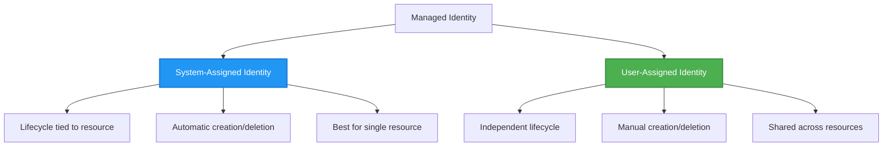

# תבניות אימות וזהות מנוהלת

⏱️ **זמן משוער**: 45-60 דקות קריאה; אפשר זמן נוסף לשילוב תרגילים | 💰 **השפעה על עלות**: זהות/RBAC הם בחינם; חישוב, אחסון ו-Key Vault מנוהלים מחויבים | ⭐ **רמת מורכבות**: בינונית

> סוקר בהתאם ל-`azd 1.37.2` (נובמבר 2026). שיעור זה מכיל **קטעי אינטגרציה להמחשה, לא תבנית `secure-app` להורדה מלאה**. צור את הקבצים המוזכרים, ספק תשתית תואמת והחלף מקומיים לפני הפריסה. לא סופקו משאבי Azure במהלך הסקירה.

**📚 מסלול למידה:**
- ← קודם: [ניהול תצורה](configuration.md) - ניהול משתני סביבה וסודות
- 🎯 **אתה כאן**: אימות ואבטחה (זהות מנוהלת, Key Vault, תבניות מאובטחות)
- → הבא: [תשתית כקוד](../chapter-04-infrastructure/README.md) - פריסה והקצאת משאבים
- 🏠 [בית הקורס](../../README.md)

---

## מה תלמד

עם השלמת שיעור זה, תלמד:
- להבין תבניות אימות ב-Azure (מפתחות, מחרוזות חיבור, זהות מנוהלת)
- ליישם **זהות מנוהלת** לאימות ללא סיסמה
- לאבטח סודות באמצעות אינטגרציית **Azure Key Vault**
- להגדיר **שליטה בהתבסס על תפקיד (RBAC)** עבור פריסות AZD
- ליישם שיטות אבטחה מיטביות ב-Container Apps ובשירותי Azure
- לעבור מאימות מבוסס מפתח לאימות מבוסס זהות

## מדוע זהות מנוהלת חשובה

### הבעיה: אימות מסורתי

**לפני זהות מנוהלת:**
```javascript
// ❌ SECURITY RISK: Hardcoded secrets in code
const connectionString = "Server=mydb.database.windows.net;User=admin;Password=P@ssw0rd123";
const storageKey = "xK7mN9pQ2wR5tY8uI0oP3aS6dF1gH4jK...";
const cosmosKey = "C2x7B9n4M1p8Q5w3E6r0T2y5U8i1O4p7...";
```

**בעיות:**
- 🔴 **סודות חשופים** בקוד, בקבצי תצורה ובמשתני סביבה
- 🔴 **סיבוב אישורים** דורש שינויים בקוד ופריסה מחודשת
- 🔴 **סיוטי ביקורת** - מי ניגש למה ומתי?
- 🔴 **פיזור** - סודות מפוזרים במערכות רבות
- 🔴 **סיכוני תאימות** - נכשל בביקורות אבטחה

### הפתרון: זהות מנוהלת

**אחרי זהות מנוהלת:**
```javascript
// ✅ SECURE: No secrets in code
const credential = new DefaultAzureCredential();
const client = new BlobServiceClient(
  "https://mystorageaccount.blob.core.windows.net",
  credential  // Azure automatically handles authentication
);
```

**יתרונות:**
- ✅ **אפס סודות** בקוד או בתצורה
- ✅ **סיבוב אוטומטי** - Azure מנהל זאת
- ✅ **רישום ביקורת מלא** ביומני Microsoft Entra ID
- ✅ **אבטחה מרוכזת** - ניהול דרך פורטל Azure
- ✅ **מוכנות תאימות** - עומד בסטנדרטים אבטחתיים

**אנלוגיה**: אימות מסורתי הוא כמו לשאת מספר מפתחות פיזיים לדלתות שונות. זהות מנוהלת היא כמו תג אבטחה שמאפשר גישה אוטומטית בהתאם למי שאתה — ללא מפתחות לאבד, להעתיק או לסובב.

---

## סקירת אדריכלות

### זרימת אימות עם זהות מנוהלת

```mermaid
sequenceDiagram
    participant App as Your Application<br/>(Container App)
    participant MI as Managed Identity<br/>(Microsoft Entra ID)
    participant KV as Key Vault
    participant Storage as Azure Storage
    participant DB as Azure SQL
    
    App->>MI: Request access token<br/>(automatic)
    MI->>MI: Verify identity<br/>(no password needed)
    MI-->>App: Return token for requested audience<br/>(lifetime varies)
    
    App->>KV: Get secret<br/>(using token)
    KV->>KV: Check RBAC permissions
    KV-->>App: Return secret value
    
    App->>Storage: Upload blob<br/>(using token)
    Storage->>Storage: Check RBAC permissions
    Storage-->>App: Success
    
    App->>DB: Query data<br/>(using token)
    DB->>DB: Check SQL permissions
    DB-->>App: Return results
    
    Note over App,DB: Request a separate token for each service audience;<br/>SDK credentials handle caching and renewal
```

### סוגי זהויות מנוהלות



| תכונה | זהות שהוקצתה למערכת | זהות שהוקצתה למשתמש |
|---------|----------------|---------------|
| **מחזור חיים** | קשור למשאב | עצמאי |
| **יצירה** | אוטומטית עם המשאב | יצירה ידנית |
| **מחיקה** | נמחק עם המשאב | נמשך אחרי מחיקת המשאב |
| **שיתוף** | משאב אחד בלבד | מספר משאבים |
| **מקרה שימוש** | תרחישים פשוטים | תרחישי ריבוי משאבים מורכבים |
| **בחירת תבנית** | מוגדר בתשתית | מוגדר בתשתית |

---

## דרישות מוקדמות

### כלים נדרשים

עליך כבר להחזיק בכלים אלה שהותקנו משיעורים קודמים:

```bash
# Verify Azure Developer CLI
azd version
# ✅ Expected: azd version 1.0.0 or higher

# Verify Azure CLI
az --version
# ✅ Expected: azure-cli 2.50.0 or higher
```

### דרישות Azure

- מנוי Azure פעיל
- הרשאות ל:
  - יצירת זהויות מנוהלות
  - הקצאת תפקידי RBAC
  - יצירת משאבי Key Vault
  - פריסת Container Apps

### דרישות ידע מוקדמות

עליך להשלים:
- [מדריך התקנה](../chapter-01-foundation/installation.md) - הגדרת AZD
- [יסודות AZD](../chapter-01-foundation/azd-basics.md) - מושגים מרכזיים
- [ניהול תצורה](configuration.md) - משתני סביבה

---

## שיעור 1: הבנת תבניות אימות

### תבנית 1: מחרוזות חיבור (ישן - להימנע)

**איך זה עובד:**
```bash
# Connection string contains credentials
STORAGE_CONNECTION_STRING="DefaultEndpointsProtocol=https;AccountName=myaccount;AccountKey=xK7mN9pQ2wR5..."
COSMOS_CONNECTION_STRING="AccountEndpoint=https://myaccount.documents.azure.com:443/;AccountKey=C2x7..."
SQL_CONNECTION_STRING="Server=myserver.database.windows.net;User=admin;Password=P@ssw0rd..."
```

**בעיות:**
- ❌ סודות גלויים במשתני סביבה
- ❌ מתועדים במערכות פריסה
- ❌ קשה לסובב
- ❌ ללא רישום ביקורת גישה

**מתי להשתמש:** כאשר השירות היעד דורש אימות מבוסס מפתח. העדף זהות כאשר נתמך; אחרת אחסן מפתחות באבטחה וסבב אותם, כולל בייצור.

---

### תבנית 2: הפניות ל-Key Vault (טובה יותר)

**איך זה עובד:**
**קטעי Bicep חלקיים:** שדות הכרחיים לוולט, זהות Container App והכניסה `configuration.secrets` שלו הושמטו. `secretRef` מציין סוד של Container App; הוא **אינו** URI של Key Vault. כדי להשתמש ב-Key Vault, הגדר סוד בשם זה עם `keyVaultUrl` ואישור `identity` מורשה.

```bicep
// Store secret in Key Vault
resource keyVault 'Microsoft.KeyVault/vaults@2023-02-01' = {
  name: 'mykv'
  properties: {
    enableRbacAuthorization: true
  }
}

// Reference in Container App
env: [
  {
    name: 'STORAGE_KEY'
    secretRef: 'storage-key'  // References Key Vault
  }
]
```

**יתרונות:**
- ✅ סודות מאוחסנים בבטחה ב-Key Vault
- ✅ ניהול סודות מרוכז
- ✅ סיבוב ללא שינויים בקוד

**מגבלות:**
- ⚠️ עדיין משתמשים במפתחות/סיסמאות
- ⚠️ יש לנהל גישת Key Vault

**מתי להשתמש:** שלב מעבר ממחרוזות חיבור לזהות מנוהלת.

---

### תבנית 3: זהות מנוהלת (שיטה מיטבית)

**איך זה עובד:**
**Bicep חלקי:** מיזוג בלוק הזהות לתוך Container App מלא וסיפוק `storageAccount` והגדרת התפקיד. הקצאת תפקיד דורשת גם `name` דטרמיניסטי.

```bicep
// Enable managed identity
resource containerApp 'Microsoft.App/containerApps@2023-05-01' = {
  name: 'myapp'
  identity: {
    type: 'SystemAssigned'  // Automatically creates identity
  }
}

// Grant permissions
resource roleAssignment 'Microsoft.Authorization/roleAssignments@2022-04-01' = {
  name: guid(storageAccount.id, containerApp.id, storageBlobDataContributorRole)
  scope: storageAccount
  properties: {
    roleDefinitionId: storageBlobDataContributorRole
    principalId: containerApp.identity.principalId
    principalType: 'ServicePrincipal'
  }
}
```

**קוד אפליקציה:**
```javascript
// No secrets needed!
const { DefaultAzureCredential } = require('@azure/identity');
const { BlobServiceClient } = require('@azure/storage-blob');

const credential = new DefaultAzureCredential();
const blobServiceClient = new BlobServiceClient(
  'https://mystorageaccount.blob.core.windows.net',
  credential
);
```

**יתרונות:**
- ✅ אפס סודות בקוד/תצורה
- ✅ סיבוב אוטומטי של אישורים
- ✅ רישום ביקורת מלא
- ✅ הרשאות מבוססות RBAC
- ✅ מוכנות תאימות

**מתי להשתמש:** העדף לאפליקציות מתארחות ב-Azure שניגשות לשירותים התומכים באימות Microsoft Entra.

---

### תבנית 4: Service Principals (CI/CD ואוטומציה)

זהות מנוהלת היא התקן הזהב *למשאבים הפועלים בתוך Azure*. אבל מה לגבי דברים הפועלים **מחוץ** ל-Azure—כמו צינור CI/CD בסוכן בנייה, או סקריפט במחשבך הנייד שלא יכול להשתמש בכניסה האינטראקטיבית שלך? כאן נכנס **service principal**: זהות שאינה אנושית עם אישורים משלה, שתהליך אוטומטי יכול להיכנס באמצעותם.

**איך זה עובד:**

צור service principal בפרופיל של קבוצת משאבים (הרשאה מינימלית):

```bash
az ad sp create-for-rbac \
  --name "myapp-cicd" \
  --role contributor \
  --scopes "/subscriptions/<sub-id>/resourceGroups/<rg-name>"
```

זה מדפיס מזהה לקוח, סוד לקוח ומזהה שוכר. azd יכול להיכנס איתם באופן לא אינטראקטיבי:

```bash
azd auth login \
  --client-id "<appId>" \
  --client-secret "<password>" \
  --tenant-id "<tenant>"
```

**העדף אישורים מאוחדים (OIDC) על פני סודות.** במקום סוד לקוח ארוך טווח, הגדר אישור מאוחד כך שהצינור יחליף אסימון קצר טווח—לא סוד לדליפה או לסיבוב:

```bash
azd auth login \
  --client-id "<appId>" \
  --federated-credential-provider "github" \
  --tenant-id "<tenant>"
```

> `azd pipeline config` מגדיר זאת עבורך אוטומטית. ראה את ההליכות של CI/CD ב-[פרק 8](../chapter-08-production/production-ai-practices.md).

**יתרונות:**
- ✅ עובד מחוץ ל-Azure (סוכני בנייה, במקומי, עננים נוספים)
- ✅ ניתן להקצות לקבוצת משאבים בודדת עם תפקיד אחד
- ✅ גרסת OIDC המאוחדת אינה משתמשת בסוד מאוחסן

**חסרונות:**
- ⚠️ גרסת סוד דורשת אחסון זהיר וסיבוב
- ⚠️ סוד שנחשף מעניק את כל מה שה-SP יכול לעשות—השאר את ההקצאות מדויקות

**מתי להשתמש:** צינורות CI/CD ואוטומציה שלא יכולים להשתמש בזהות מנוהלת. תמיד העדיף את גרסת ה-**מאוחדת/OIDC** על פני סוד לקוח, והעדף זהות מנוהלת כאשר העומס רץ בתוך Azure.

**אחסון בטוח של אישורים:**
- לעולם אל תתחייב סודות—השתמש בחנות הסודות של הצינור (GitHub Actions secrets, קבוצות משתנים Azure DevOps / Key Vault).
- הגדר את ה-SP לתפקיד ולקבוצת משאבים הקטנים ביותר הדרושים.
- הגדר תאריך תפוגה וסבב, או השמט את הסוד לחלוטין עם OIDC.

---

## שיעור 2: יישום זהות מנוהלת עם AZD

### יישום שלב-אחר-שלב

הקטעים הבאים מראים כיצד לשלב זהות מנוהלת בפרויקט Container App. הם **לא התחלה להעתקה והרצה**: מודול האחסון, תשתית סביבה מנוהלת/רישום מלאה, Dockerfile, וקובץ הפרמטרים אינם כלולים כאן. התחל מתבנית Container Apps עובדת ומזג את התבניות האלה, תוך שמירה על תצורת הרישום והתגים של השירות.

### מבנה פרויקט

```
secure-app/
├── azure.yaml                 # AZD configuration
├── infra/
│   ├── main.bicep            # Main infrastructure
│   ├── core/
│   │   ├── identity.bicep    # Managed identity setup
│   │   ├── keyvault.bicep    # Key Vault configuration
│   │   └── storage.bicep     # Storage with RBAC
│   └── app/
│       └── container-app.bicep
└── src/
    ├── app.js                # Application code
    ├── package.json
    └── Dockerfile
```

### 1. הגדרות AZD (azure.yaml)

```yaml
name: secure-app
metadata:
  template: secure-app@1.0.0

services:
  api:
    project: ./src
    language: js
    host: containerapp

# Managed identity must be enabled in the infrastructure, not by this YAML.
```

### 2. תשתית: הפעלת זהות מנוהלת

**קובץ: `infra/main.bicep`**

```bicep
targetScope = 'subscription'

param environmentName string
param location string = 'eastus'
param containerAppsEnvironmentId string
param containerImage string

var tags = { 'azd-env-name': environmentName }

// Resource group
resource rg 'Microsoft.Resources/resourceGroups@2021-04-01' = {
  name: 'rg-${environmentName}'
  location: location
  tags: tags
}

// Storage Account
module storage './core/storage.bicep' = {
  name: 'storage'
  scope: rg
  params: {
    name: 'st${uniqueString(rg.id)}'
    location: location
    tags: tags
  }
}

// Key Vault
module keyVault './core/keyvault.bicep' = {
  name: 'keyvault'
  scope: rg
  params: {
    name: 'kv-${uniqueString(rg.id)}'
    location: location
    tags: tags
  }
}

// Container App with Managed Identity
module containerApp './app/container-app.bicep' = {
  name: 'container-app'
  scope: rg
  params: {
    name: 'ca-${environmentName}'
    location: location
    tags: tags
    storageAccountName: storage.outputs.name
    keyVaultName: keyVault.outputs.name
    containerAppsEnvironmentId: containerAppsEnvironmentId
    containerImage: containerImage
  }
}

// Grant Container App access to Storage
module storageRoleAssignment './core/role-assignment.bicep' = {
  name: 'storage-role'
  scope: rg
  params: {
    principalId: containerApp.outputs.identityPrincipalId
    roleDefinitionId: 'ba92f5b4-2d11-453d-a403-e96b0029c9fe'  // Storage Blob Data Contributor
    targetResourceType: 'storage'
    targetResourceName: storage.outputs.name
  }
}

// Grant Container App access to Key Vault
module kvRoleAssignment './core/role-assignment.bicep' = {
  name: 'kv-role'
  scope: rg
  params: {
    principalId: containerApp.outputs.identityPrincipalId
    roleDefinitionId: '4633458b-17de-408a-b874-0445c86b69e6'  // Key Vault Secrets User
    targetResourceType: 'keyvault'
    targetResourceName: keyVault.outputs.name
  }
}

// Outputs
output AZURE_STORAGE_ACCOUNT_NAME string = storage.outputs.name
output AZURE_KEY_VAULT_NAME string = keyVault.outputs.name
output APP_URL string = containerApp.outputs.url
```

### 3. Container App עם זהות שהוקצתה למערכת

**קובץ: `infra/app/container-app.bicep`**

```bicep
param name string
param location string
param tags object = {}
param storageAccountName string
param keyVaultName string
param containerAppsEnvironmentId string
param containerImage string

resource containerApp 'Microsoft.App/containerApps@2023-05-01' = {
  name: name
  location: location
  tags: union(tags, { 'azd-service-name': 'api' })
  identity: {
    type: 'SystemAssigned'  // 🔑 Enable managed identity
  }
  properties: {
    managedEnvironmentId: containerAppsEnvironmentId
    configuration: {
      ingress: {
        external: true
        targetPort: 3000
      }
    }
    template: {
      containers: [
        {
          name: 'api'
          image: containerImage // Must exist; configure registry credentials for private images
          resources: {
            cpu: json('0.5')
            memory: '1Gi'
          }
          env: [
            {
              name: 'AZURE_STORAGE_ACCOUNT_NAME'
              value: storageAccountName
            }
            {
              name: 'AZURE_KEY_VAULT_NAME'
              value: keyVaultName
            }
            // 🔑 No secrets - managed identity handles authentication!
          ]
        }
      ]
    }
  }
}

// Output the identity for RBAC assignments
output identityPrincipalId string = containerApp.identity.principalId
output id string = containerApp.id
output url string = 'https://${containerApp.properties.configuration.ingress.fqdn}'
```

### 4. מודול הקצאת תפקידים RBAC

**קובץ: `infra/core/role-assignment.bicep`**

```bicep
param principalId string
param roleDefinitionId string  // Azure built-in role ID
@allowed(['storage', 'keyvault'])
param targetResourceType string
param targetResourceName string

// Typed existing resources give Bicep a valid resource scope, not a string ID.
resource storageTarget 'Microsoft.Storage/storageAccounts@2023-01-01' existing = {
  name: targetResourceName
}
resource vaultTarget 'Microsoft.KeyVault/vaults@2023-02-01' existing = {
  name: targetResourceName
}

resource storageAssignment 'Microsoft.Authorization/roleAssignments@2022-04-01' = if (targetResourceType == 'storage') {
  name: guid(storageTarget.id, principalId, roleDefinitionId)
  scope: storageTarget
  properties: {
    roleDefinitionId: subscriptionResourceId('Microsoft.Authorization/roleDefinitions', roleDefinitionId)
    principalId: principalId
    principalType: 'ServicePrincipal'
  }
}

resource vaultAssignment 'Microsoft.Authorization/roleAssignments@2022-04-01' = if (targetResourceType == 'keyvault') {
  name: guid(vaultTarget.id, principalId, roleDefinitionId)
  scope: vaultTarget
  properties: {
    roleDefinitionId: subscriptionResourceId('Microsoft.Authorization/roleDefinitions', roleDefinitionId)
    principalId: principalId
    principalType: 'ServicePrincipal'
  }
}

// This module assigns at the target resource scope, not the whole resource group.
```

### 5. קוד אפליקציה עם זהות מנוהלת

**קובץ: `src/app.js`**

```javascript
const express = require('express');
const { DefaultAzureCredential } = require('@azure/identity');
const { BlobServiceClient } = require('@azure/storage-blob');
const { SecretClient } = require('@azure/keyvault-secrets');

const app = express();
const PORT = process.env.PORT || 3000;

// 🔑 Initialize credential (works automatically with managed identity)
const credential = new DefaultAzureCredential();

// Azure Storage setup
const storageAccountName = process.env.AZURE_STORAGE_ACCOUNT_NAME;
const blobServiceClient = new BlobServiceClient(
  `https://${storageAccountName}.blob.core.windows.net`,
  credential  // No keys needed!
);

// Key Vault setup
const keyVaultName = process.env.AZURE_KEY_VAULT_NAME;
const secretClient = new SecretClient(
  `https://${keyVaultName}.vault.azure.net`,
  credential  // No keys needed!
);

// Health check
app.get('/health', (req, res) => {
  res.json({ status: 'healthy', authentication: 'managed-identity' });
});

// Upload file to blob storage
app.post('/upload', async (req, res) => {
  try {
    const containerClient = blobServiceClient.getContainerClient('uploads');
    await containerClient.createIfNotExists();
    
    const blobName = `file-${Date.now()}.txt`;
    const blockBlobClient = containerClient.getBlockBlobClient(blobName);
    
    const content = 'Hello from managed identity!';
    await blockBlobClient.upload(content, Buffer.byteLength(content));
    
    res.json({
      success: true,
      blobName: blobName,
      message: 'File uploaded using managed identity!'
    });
  } catch (error) {
    console.error('Upload error:', error);
    res.status(500).json({ error: error.message });
  }
});

// Get secret from Key Vault
app.get('/secret/:name', async (req, res) => {
  try {
    const secretName = req.params.name;
    const secret = await secretClient.getSecret(secretName);
    
    res.json({
      name: secretName,
      retrieved: secret.value !== undefined, // Never return the secret value to callers
      message: 'Secret retrieved using managed identity!'
    });
  } catch (error) {
    console.error('Secret error:', error);
    res.status(500).json({ error: error.message });
  }
});

// List blob containers (demonstrates read access)
app.get('/containers', async (req, res) => {
  try {
    const containers = [];
    for await (const container of blobServiceClient.listContainers()) {
      containers.push(container.name);
    }
    
    res.json({
      containers: containers,
      count: containers.length,
      message: 'Containers listed using managed identity!'
    });
  } catch (error) {
    console.error('List error:', error);
    res.status(500).json({ error: error.message });
  }
});

app.listen(PORT, () => {
  console.log(`Secure API listening on port ${PORT}`);
  console.log('Authentication: Managed Identity (passwordless)');
});
```

**קובץ: `src/package.json`**

```json
{
  "name": "secure-app",
  "version": "1.0.0",
  "dependencies": {
    "express": "^4.18.2",
    "@azure/identity": "^4.0.0",
    "@azure/storage-blob": "^12.17.0",
    "@azure/keyvault-secrets": "^4.7.0"
  },
  "scripts": {
    "start": "node app.js"
  }
}
```

### 6. פריסה ובדיקה

הרץ פקודות אלה **רק לאחר** השלמת התשתית, Dockerfile, ו-`main.parameters.json` תואמים בפרויקט שלך. אמת את azd עם `azd auth login`; היכנס נפרד עם `az login` לבדיקה כלקוח Azure CLI. נקודות הקצה המוצגות הן להדגמה ודורשות בקרות גישה מתאימות לפני שימוש ציבורי.

```bash
# Initialize AZD environment
azd init

# Deploy infrastructure and application
azd up

# Get the app URL
APP_URL=$(azd env get-value APP_URL)

# Test health check
curl $APP_URL/health
```

**✅ פלט צפוי:**
```json
{
  "status": "healthy",
  "authentication": "managed-identity"
}
```

**בדיקת העלאת blob:**
```bash
curl -X POST $APP_URL/upload
```

**✅ פלט צפוי:**
```json
{
  "success": true,
  "blobName": "file-1700404800000.txt",
  "message": "File uploaded using managed identity!"
}
```

**בדיקת רשימת קונטיינרים:**
```bash
curl $APP_URL/containers
```

**✅ פלט צפוי:**
```json
{
  "containers": ["uploads"],
  "count": 1,
  "message": "Containers listed using managed identity!"
}
```

---

## תפקידי RBAC נפוצים ל-Azure

### מזהי תפקיד מובנים לזהות מנוהלת

| שירות | שם התפקיד | מזהה התפקיד | הרשאות |
|---------|-----------|---------|-------------|
| **Storage** | Storage Blob Data Reader | `2a2b9908-6ea1-4ae2-8e65-a410df84e7d1` | קריאת blobs וקונטיינרים |
| **Storage** | Storage Blob Data Contributor | `ba92f5b4-2d11-453d-a403-e96b0029c9fe` | קריאה, כתיבה, מחיקה של blobs |
| **Storage** | Storage Queue Data Contributor | `974c5e8b-45b9-4653-ba55-5f855dd0fb88` | קריאה, כתיבה, מחיקה של תורים/הודעות |
| **Key Vault** | Key Vault Secrets User | `4633458b-17de-408a-b874-0445c86b69e6` | קריאת סודות |
| **Key Vault** | Key Vault Secrets Officer | `b86a8fe4-44ce-4948-aee5-eccb2c155cd7` | קריאה, כתיבה, מחיקת סודות |
| **Cosmos DB** | Cosmos DB Built-in Data Reader | `00000000-0000-0000-0000-000000000001` | קריאת נתוני Cosmos DB |
| **Cosmos DB** | Cosmos DB Built-in Data Contributor | `00000000-0000-0000-0000-000000000002` | קריאה וכתיבת נתוני Cosmos DB |
| **SQL Database** | SQL DB Contributor | `9b7fa17d-e63e-47b0-bb0a-15c516ac86ec` | ניהול משאבי מסד נתונים; לא מעניק גישה לנתוני SQL |
| **Service Bus** | Azure Service Bus Data Owner | `090c5cfd-751d-490a-894a-3ce6f1109419` | שליחה, קבלה וניהול הודעות |

### כיצד למצוא מזהי תפקידים

שני המזהים של Cosmos DB עבור NoSQL לעיל הם **הגדרות תפקידי נתוני Cosmos מקומיים**, לא מזהי תפקידי מנוי Azure RBAC. הקצה אותם עם `az cosmosdb sql role assignment create` (או `Microsoft.DocumentDB/databaseAccounts/sqlRoleAssignments`), לא עם `az role assignment create`. גישה לנתוני SQL דורשת משתמש מסד נתונים Entra והרשאות SQL.

```bash
# List all built-in roles
az role definition list --query "[].{Name:roleName, ID:name}" --output table

# Search for specific role
az role definition list --query "[?contains(roleName, 'Storage Blob')].{Name:roleName, ID:name}" --output table

# Get role details
az role definition list --name "Storage Blob Data Contributor"
```

---

## תרגולים מעשיים

**דרישות מוקדמות לאינטגרציה לכל שלושת התרגילים:** תבנית Container App פעילה בפרויקט שלך, משאבי Bicep תואמים, כניסה עם Azure CLI/azd, וסמכות להקצות את התפקידים הדרושים. אלה התאמות מודרכות, לא התחלות עצמאיות מקומיות; החלף את שמות המשאבים המדגמים בשמות שהקצת.

### תרגיל 1: הפעלת זהות מנוהלת לאפליקציה קיימת ⭐⭐ (בינוני)

**מטרה**: הוסף זהות מנוהלת לפריסת Container App קיימת

**תרחיש**: יש לך Container App שמשתמש במחרוזות חיבור. המר אותו לזהות מנוהלת.

**נקודת התחלה**: Container App עם תצורה זו:

```bicep
// ❌ Current: Using connection string
env: [
  {
    name: 'STORAGE_CONNECTION_STRING'
    secretRef: 'storage-connection'
  }
]
```

**שלבים**:

1. **הפעל זהות מנוהלת ב-Bicep:**

```bicep
resource containerApp 'Microsoft.App/containerApps@2023-05-01' = {
  name: 'myapp'
  identity: {
    type: 'SystemAssigned'  // Add this
  }
  // ... rest of configuration
}
```

2. **הענק גישת Storage:**

```bicep
// Get storage account reference
resource storageAccount 'Microsoft.Storage/storageAccounts@2023-01-01' existing = {
  name: storageAccountName
}

// Assign role
resource roleAssignment 'Microsoft.Authorization/roleAssignments@2022-04-01' = {
  name: guid(containerApp.id, 'ba92f5b4-2d11-453d-a403-e96b0029c9fe', storageAccount.id)
  scope: storageAccount
  properties: {
    roleDefinitionId: subscriptionResourceId('Microsoft.Authorization/roleDefinitions', 'ba92f5b4-2d11-453d-a403-e96b0029c9fe')
    principalId: containerApp.identity.principalId
    principalType: 'ServicePrincipal'
  }
}
```

3. **עדכן את קוד האפליקציה:**

**לפני (מחרוזת חיבור):**
```javascript
const { BlobServiceClient } = require('@azure/storage-blob');

const blobServiceClient = BlobServiceClient.fromConnectionString(
  process.env.STORAGE_CONNECTION_STRING
);
```

**אחרי (זהות מנוהלת):**
```javascript
const { DefaultAzureCredential } = require('@azure/identity');
const { BlobServiceClient } = require('@azure/storage-blob');

const credential = new DefaultAzureCredential();
const blobServiceClient = new BlobServiceClient(
  `https://${process.env.STORAGE_ACCOUNT_NAME}.blob.core.windows.net`,
  credential
);
```

4. **עדכן משתני סביבה:**

```bicep
env: [
  {
    name: 'STORAGE_ACCOUNT_NAME'
    value: storageAccountName  // Just the name, no secrets!
  }
  // Remove STORAGE_CONNECTION_STRING
]
```

5. **פרוס ובדוק:**

```bash
# Redeploy
azd up

# Test that it still works
APP_URL=$(azd show --output json | jq -er '.services.api.ingressUrl')
curl --fail -X POST "$APP_URL/upload"
```

**✅ קריטריוני הצלחה:**
- ✅ האפליקציה מתפרסת ללא שגיאות
- ✅ פעולות אחסון עובדות (העלאה, רשימה, הורדה)
- ✅ אין מחרוזות חיבור במשתני סביבה
- ✅ זהות נראית בפורטל Azure בלשונית "זהות"

**אימות:**

```bash
# Check managed identity is enabled
az containerapp show \
  --name myapp \
  --resource-group rg-myapp \
  --query "identity.type"
# ✅ Expected: "SystemAssigned"

# Check role assignment
az role assignment list \
  --assignee $(az containerapp show --name myapp --resource-group rg-myapp --query "identity.principalId" -o tsv) \
  --scope /subscriptions/{sub-id}/resourceGroups/rg-myapp/providers/Microsoft.Storage/storageAccounts/mystorageaccount
# ✅ Expected: Shows "Storage Blob Data Contributor" role
```

**זמן**: 20-30 דקות

---

### תרגיל 2: גישה מרובת שירותים עם זהות שהוקצתה למשתמש ⭐⭐⭐ (מתקדם)

**מטרה**: צור זהות שהוקצתה למשתמש משותפת בין מספר Container Apps

**תרחיש**: יש לך 3 מיקרו-שירותים שכולם צריכים גישה לאותו חשבון Storage ו-Key Vault.

**שלבים**:

1. **צור זהות שהוקצתה למשתמש:**

**קובץ: `infra/core/identity.bicep`**

```bicep
param name string
param location string
param tags object = {}

resource userAssignedIdentity 'Microsoft.ManagedIdentity/userAssignedIdentities@2023-01-31' = {
  name: name
  location: location
  tags: tags
}

output id string = userAssignedIdentity.id
output principalId string = userAssignedIdentity.properties.principalId
output clientId string = userAssignedIdentity.properties.clientId
```

2. **הקצה תפקידים לזהות שהוקצתה למשתמש:**

```bicep
// In main.bicep
module userIdentity './core/identity.bicep' = {
  name: 'user-identity'
  scope: rg
  params: {
    name: 'id-${environmentName}'
    location: location
    tags: tags
  }
}

// Grant Storage access
resource storageRoleAssignment 'Microsoft.Authorization/roleAssignments@2022-04-01' = {
  name: guid(storageAccount.id, environmentName, 'storage-contributor')
  scope: storageAccount
  properties: {
    roleDefinitionId: subscriptionResourceId('Microsoft.Authorization/roleDefinitions', 'ba92f5b4-2d11-453d-a403-e96b0029c9fe')
    principalId: userIdentity.outputs.principalId
    principalType: 'ServicePrincipal'
  }
}

// Grant Key Vault access
resource kvRoleAssignment 'Microsoft.Authorization/roleAssignments@2022-04-01' = {
  name: guid(keyVault.id, environmentName, 'kv-secrets-user')
  scope: keyVault
  properties: {
    roleDefinitionId: subscriptionResourceId('Microsoft.Authorization/roleDefinitions', '4633458b-17de-408a-b874-0445c86b69e6')
    principalId: userIdentity.outputs.principalId
    principalType: 'ServicePrincipal'
  }
}
```

3. **הקצה זהות למספר אפליקציות מכולה:**

```bicep
resource apiGateway 'Microsoft.App/containerApps@2023-05-01' = {
  name: 'api-gateway'
  identity: {
    type: 'UserAssigned'
    userAssignedIdentities: {
      '${userIdentity.outputs.id}': {}
    }
  }
  // ... rest of config
}

resource productService 'Microsoft.App/containerApps@2023-05-01' = {
  name: 'product-service'
  identity: {
    type: 'UserAssigned'
    userAssignedIdentities: {
      '${userIdentity.outputs.id}': {}
    }
  }
  // ... rest of config
}

resource orderService 'Microsoft.App/containerApps@2023-05-01' = {
  name: 'order-service'
  identity: {
    type: 'UserAssigned'
    userAssignedIdentities: {
      '${userIdentity.outputs.id}': {}
    }
  }
  // ... rest of config
}
```

4. **קוד האפליקציה (כל השירותים משתמשים באותו דפוס):**

```javascript
const { ManagedIdentityCredential } = require('@azure/identity');
const { BlobServiceClient } = require('@azure/storage-blob');

// For user-assigned identity, specify the client ID
const credential = new ManagedIdentityCredential(
  process.env.AZURE_CLIENT_ID  // User-assigned identity client ID
);

// Alternative (choose ONE credential declaration):
// const { DefaultAzureCredential } = require('@azure/identity');
// const credential = new DefaultAzureCredential({
//   managedIdentityClientId: process.env.AZURE_CLIENT_ID
// });

const blobServiceClient = new BlobServiceClient(
  `https://${process.env.STORAGE_ACCOUNT_NAME}.blob.core.windows.net`,
  credential
);
```

קבע לכל אפליקציית מכולה את זמן הריצה `AZURE_CLIENT_ID` ל-`userIdentity.outputs.clientId` ואת `STORAGE_ACCOUNT_NAME` לשם האחסון שלך ב-Bicep. רק הקצאת הזהות או הרצת `azd env set` לא מגדירה ערכי זמן ריצה אלו.

5. **פרוס ובדוק:**

```bash
azd up

# Test all services can access storage
# Replace with the actual ingress URLs reported for your three services
curl --fail -X POST "$API_GATEWAY_URL/upload"
curl --fail -X POST "$PRODUCT_SERVICE_URL/upload"
curl --fail -X POST "$ORDER_SERVICE_URL/upload"
```

**✅ קריטריוני הצלחה:**
- ✅ זהות אחת משותפת בין 3 שירותים
- ✅ כל השירותים יכולים לגשת לאחסון ולמפתח Vault
- ✅ הזהות נשמרת גם אם מחקתם שירות אחד
- ✅ ניהול הרשאות מרוכז

**יתרונות זהות מוקצית למשתמש:**
- זהות יחידה לניהול
- הרשאות עקביות בין השירותים
- שורדת מחיקת שירות
- טובה יותר לארכיטקטורות מורכבות

**זמן**: 30-40 דקות

---

### תרגיל 3: יישום סיבוב סודות ב-Key Vault ⭐⭐⭐ (מתקדם)

**מטרה**: לאחסן מפתחות API של צד שלישי ב-Key Vault ולגשת אליהם באמצעות זהות מנוהלת

**תרחיש**: האפליקציה שלך צריכה לקרוא ל-API חיצוני (OpenAI, Stripe, SendGrid) שדורש מפתחות API.

**שלבים**:

1. **צור Key Vault עם RBAC:**

**קובץ: `infra/core/keyvault.bicep`**

```bicep
param name string
param location string
param tags object = {}

resource keyVault 'Microsoft.KeyVault/vaults@2023-02-01' = {
  name: name
  location: location
  tags: tags
  properties: {
    enableRbacAuthorization: true  // Use RBAC instead of access policies
    sku: {
      family: 'A'
      name: 'standard'
    }
    tenantId: subscription().tenantId
    enableSoftDelete: true
    softDeleteRetentionInDays: 90
  }
}

// Allow Container App to read secrets
output id string = keyVault.id
output name string = keyVault.name
output uri string = keyVault.properties.vaultUri
```

2. **אחסן סודות ב-Key Vault:**

```bash
# Get Key Vault name
KV_NAME=$(azd env get-value AZURE_KEY_VAULT_NAME)

# Store third-party API keys
az keyvault secret set \
  --vault-name $KV_NAME \
  --name "OpenAI-ApiKey" \
  --value "sk-proj-xxxxxxxxxxxxx"

az keyvault secret set \
  --vault-name $KV_NAME \
  --name "Stripe-ApiKey" \
  --value "sk_live_xxxxxxxxxxxxx"

az keyvault secret set \
  --vault-name $KV_NAME \
  --name "SendGrid-ApiKey" \
  --value "SG.xxxxxxxxxxxxx"
```

3. **קוד האפליקציה לשליפת סודות:**

**קובץ: `src/config.js`**

```javascript
const { DefaultAzureCredential } = require('@azure/identity');
const { SecretClient } = require('@azure/keyvault-secrets');

class Config {
  constructor() {
    this.credential = new DefaultAzureCredential();
    this.secretClient = new SecretClient(
      `https://${process.env.AZURE_KEY_VAULT_NAME}.vault.azure.net`,
      this.credential
    );
    this.cache = {};
  }

  async getSecret(secretName) {
    // Check cache first
    if (this.cache[secretName]) {
      return this.cache[secretName];
    }

    try {
      const secret = await this.secretClient.getSecret(secretName);
      this.cache[secretName] = secret.value;
      console.log(`✅ Retrieved secret: ${secretName}`);
      return secret.value;
    } catch (error) {
      console.error(`❌ Failed to get secret ${secretName}:`, error.message);
      throw error;
    }
  }

  async getOpenAIKey() {
    return this.getSecret('OpenAI-ApiKey');
  }

  async getStripeKey() {
    return this.getSecret('Stripe-ApiKey');
  }

  async getSendGridKey() {
    return this.getSecret('SendGrid-ApiKey');
  }
}

module.exports = new Config();
```

4. **השתמש בסודות באפליקציה:**

**קובץ: `src/app.js`**

קטע **אפליקציה חלפית** זה דורש `npm install openai`, מפתח צד שלישי אמיתי, דגם נגיש, ותשתית מהפרויקט שלך. הוא קורא ל-OpenAI ישירות, לא לפריסה של Azure OpenAI. מפתחות המילוי להלן אינם מאשרים בקשה.

```javascript
const express = require('express');
const config = require('./config');
const { OpenAI } = require('openai');

const app = express();

// Initialize OpenAI with key from Key Vault
let openaiClient;

async function initializeServices() {
  const openaiKey = await config.getOpenAIKey();
  openaiClient = new OpenAI({ apiKey: openaiKey });
  console.log('✅ Services initialized with secrets from Key Vault');
}

app.post('/chat', async (req, res) => {
  try {
    const completion = await openaiClient.chat.completions.create({
      model: 'gpt-4.1',
      messages: [{ role: 'user', content: 'Hello!' }]
    });
    
    res.json({
      response: completion.choices[0].message.content,
      authentication: 'Key from Key Vault via Managed Identity'
    });
  } catch (error) {
    res.status(500).json({ error: error.message });
  }
});

// Start listening only after initialization succeeds.
initializeServices().then(() => {
  app.listen(3000, () => console.log('Key Vault demo running'));
}).catch(error => {
  console.error('Initialization failed:', error.message);
  process.exitCode = 1;
});
```

5. **פרוס ובדוק:**

```bash
azd up

# Test that API keys work
curl -X POST https://myapp.azurecontainerapps.io/chat \
  -H "Content-Type: application/json" \
  -d '{"message":"Hello AI"}'
```

**✅ קריטריוני הצלחה:**
- ✅ אין מפתחות API בקוד או במשתני סביבה
- ✅ האפליקציה שולפת את המפתחות מה-Key Vault
- ✅ APIs של צד שלישי פועלים כראוי
- ✅ ניתן לסובב מפתחות מבלי לשנות את הקוד

**סובב סוד:**

```bash
# Update secret in Key Vault
az keyvault secret set \
  --vault-name $KV_NAME \
  --name "OpenAI-ApiKey" \
  --value "sk-proj-NEW_KEY_HERE"

# Find the active revision name, then restart it to clear the in-process cache
az containerapp revision list --name myapp --resource-group rg-myapp --output table
az containerapp revision restart \
  --name myapp \
  --resource-group rg-myapp \
  --revision "<active-revision-name>"
```

**זמן**: 25-35 דקות

---

## נקודת בדיקת ידע

### 1. דפוסי הזדהות ✓

בדוק את הבנתך:

- [ ] **שאלה 1**: מהם שלושת דפוסי ההזדהות העיקריים? 
  - **תשובה**: מחרוזות חיבור (מסורתיות), הפניות ל-Key Vault (מעבר), זהות מנוהלת (הטובה ביותר)

- [ ] **שאלה 2**: מדוע זהות מנוהלת טובה יותר ממחרוזות חיבור?
  - **תשובה**: אין סודות בקוד, סיבוב אוטומטי, רישום מלא, הרשאות RBAC

- [ ] **שאלה 3**: מתי תשתמש בזהות מוקצית למשתמש במקום בזהות מוקצית למערכת?
  - **תשובה**: כשמשתפים זהות בין משאבים מרובים או כשמחזור חיי הזהות עצמאי ממחזור חיי המשאב

**אימות מעשי:**
```bash
# Check what type of identity your app uses
az containerapp show \
  --name myapp \
  --resource-group rg-myapp \
  --query "identity.type"

# List all role assignments for the identity
az role assignment list \
  --assignee $(az containerapp show --name myapp --resource-group rg-myapp --query "identity.principalId" -o tsv)
```

---

### 2. RBAC והרשאות ✓

בדוק את הבנתך:

- [ ] **שאלה 1**: מהו מזהה התפקיד של "Storage Blob Data Contributor"?
  - **תשובה**: `ba92f5b4-2d11-453d-a403-e96b0029c9fe`

- [ ] **שאלה 2**: אילו הרשאות נותן "Key Vault Secrets User"?
  - **תשובה**: גישה לקריאה בלבד לסודות (אי אפשר ליצור, לעדכן או למחוק)

- [ ] **שאלה 3**: איך מעניקים לאפליקציית מכולה גישה ל-Azure SQL?
  - **תשובה**: הגדר אימות Microsoft Entra, צור את הזהות כמשתמש מסד נתונים, והענק הרשאות SQL נדרשות. "SQL DB Contributor" מנהל רק משאבי Azure; אינו מאשר שאילתות.

**אימות מעשי:**
```bash
# Find specific role
az role definition list --name "Storage Blob Data Contributor"

# Check what roles are assigned to your identity
PRINCIPAL_ID=$(az containerapp show --name myapp --resource-group rg-myapp --query "identity.principalId" -o tsv)
az role assignment list --assignee $PRINCIPAL_ID --output table
```

---

### 3. שילוב עם Key Vault ✓

בדוק את הבנתך:

- [ ] **שאלה 1**: איך מפעילים RBAC ל-Key Vault במקום מדיניות גישה?
  - **תשובה**: קבע `enableRbacAuthorization: true` ב-Bicep

- [ ] **שאלה 2**: איזו ספריית SDK של Azure מטפלת באימות זהות מנוהלת?
  - **תשובה**: `@azure/identity` עם מחלקת `DefaultAzureCredential`

- [ ] **שאלה 3**: כמה זמן סודות Key Vault נשארים במטמון?
  - **תשובה**: תלוי באפליקציה; יש ליישם אסטרטגיית מטמון משלך

**אימות מעשי:**
```bash
# Test Key Vault access
az keyvault secret show \
  --vault-name $KV_NAME \
  --name "OpenAI-ApiKey" \
  --query "{name:name,enabled:attributes.enabled}"

# Check RBAC is enabled
az keyvault show \
  --name $KV_NAME \
  --query "properties.enableRbacAuthorization"
# ✅ Expected: true
```

---

## שיטות עבודה מומלצות לאבטחה

### ✅ עשו:

1. **תמיד השתמש בזהות מנוהלת בסביבת הייצור**
   ```bicep
   identity: {
     type: 'SystemAssigned'
   }
   ```

2. **השתמש בתפקידי RBAC עם ההרשאות המינימליות**
   - השתמש בתפקידי "קורא" כשניתן
   - הימנע מתפקידי "בעלים" או "עוזר" אלא אם כן נדרש

3. **אחסן מפתחות צד שלישי ב-Key Vault**
   ```javascript
   const apiKey = await secretClient.getSecret('ThirdPartyApiKey');
   ```

4. **אפשר רישום ביקורת** (קטע חלקי של משאב; שלב עם ההצהרות של הכספת והסביבת עבודה שלך)
   ```bicep
   resource vaultDiagnostics 'Microsoft.Insights/diagnosticSettings@2021-05-01-preview' = {
     name: 'vault-audit'
     scope: keyVault
     properties: {
       workspaceId: logAnalytics.id
       logs: [{ category: 'AuditEvent', enabled: true }]
     }
   }
   ```

5. **השתמש בזהויות שונות לסביבת פיתוח/בדיקה/ייצור**
   ```bash
   azd env new dev
   azd env new staging
   azd env new prod
   ```

6. **סובב סודות באופן קבוע**
   - קבע תאריכי תפוגה על סודות Key Vault
   - הפעל סיבוב אוטומטי עם Azure Functions

### ❌ אל תעשו:

1. **אל תכתוב סודות ישירות בקוד**
   ```javascript
   // ❌ BAD
   const apiKey = "sk-proj-xxxxxxxxxxxxx";
   ```

2. **אל תשתמש במחרוזות חיבור בסביבת הייצור**
   ```javascript
   // ❌ BAD
   BlobServiceClient.fromConnectionString(process.env.STORAGE_CONNECTION_STRING)
   ```

3. **אל תעניק הרשאות מופרזות**
   ```bicep
   // ❌ BAD - too much access
   roleDefinitionId: subscriptionResourceId('Microsoft.Authorization/roleDefinitions', '8e3af657-a8ff-443c-a75c-2fe8c4bcb635')
   
   // ✅ GOOD - least privilege
   roleDefinitionId: subscriptionResourceId('Microsoft.Authorization/roleDefinitions', '2a2b9908-6ea1-4ae2-8e65-a410df84e7d1')
   ```

4. **אל תרשום סודות ביומנים**
   ```javascript
   // ❌ BAD
   console.log('API Key:', apiKey);
   
   // ✅ GOOD
   console.log('API Key retrieved successfully');
   ```

5. **אל תשתף זהויות ייצור בין סביבות**
   ```bicep
   // ❌ BAD - same identity for dev and prod
   // ✅ GOOD - separate identities per environment
   ```

---

## מדריך לפתרון תקלות

### בעיה: "לא מורשה" בעת גישה ל-Azure Storage

**תסמינים:**
```
Error: Unauthorized (403)
AuthorizationPermissionMismatch: This request is not authorized to perform this operation
```

**אבחנה:**

```bash
# Check if managed identity is enabled
az containerapp show \
  --name myapp \
  --resource-group rg-myapp \
  --query "identity.type"
# ✅ Expected: "SystemAssigned" or "UserAssigned"

# Check role assignments
PRINCIPAL_ID=$(az containerapp show --name myapp --resource-group rg-myapp --query "identity.principalId" -o tsv)
az role assignment list --assignee $PRINCIPAL_ID

# Expected: Should see "Storage Blob Data Contributor" or similar role
```

**פתרונות:**

1. **הענק תפקיד RBAC נכון:**
```bash
STORAGE_ID=$(az storage account show --name mystorageaccount --resource-group rg-myapp --query "id" -o tsv)
az role assignment create \
  --assignee $PRINCIPAL_ID \
  --role "Storage Blob Data Contributor" \
  --scope $STORAGE_ID
```

2. **המתן להפצה (יכול לקחת 5-10 דקות):**
```bash
# Check role assignment status
az role assignment list --assignee $PRINCIPAL_ID --scope $STORAGE_ID
```

3. **ודא שקוד האפליקציה משתמש באישורי גישה נכונים:**
```javascript
// Make sure you're using DefaultAzureCredential
const credential = new DefaultAzureCredential();
```

---

### בעיה: גישה ל-Key Vault נדחתה

**תסמינים:**
```
Error: Forbidden (403)
The user, group or application does not have secrets get permission
```

**אבחנה:**

```bash
# Check Key Vault RBAC is enabled
az keyvault show \
  --name $KV_NAME \
  --query "properties.enableRbacAuthorization"
# ✅ Expected: true

# Check role assignments
az role assignment list \
  --assignee $PRINCIPAL_ID \
  --scope /subscriptions/{sub-id}/resourceGroups/rg-myapp/providers/Microsoft.KeyVault/vaults/$KV_NAME
```

**פתרונות:**

1. **הפעל RBAC ב-Key Vault:**
```bash
az keyvault update \
  --name $KV_NAME \
  --enable-rbac-authorization true
```

2. **הענק תפקיד Key Vault Secrets User:**
```bash
KV_ID=$(az keyvault show --name $KV_NAME --query "id" -o tsv)
az role assignment create \
  --assignee $PRINCIPAL_ID \
  --role "Key Vault Secrets User" \
  --scope $KV_ID
```

---

### בעיה: DefaultAzureCredential נכשל מקומית

**תסמינים:**
```
Error: DefaultAzureCredential failed to retrieve a token
CredentialUnavailableError: No credential available
```

**אבחנה:**

```bash
# Check if you're logged in
az account show

# Check Azure CLI authentication
az ad signed-in-user show
```

**פתרונות:**

1. **התחבר ל-Azure CLI:**
```bash
az login
```

2. **קבע את המנוי ב-Azure:**
```bash
az account set --subscription "Your Subscription Name"
```

3. **לפיתוח מקומי, השתמש במשתני סביבה:**
```bash
export AZURE_TENANT_ID="your-tenant-id"
export AZURE_CLIENT_ID="your-client-id"
export AZURE_CLIENT_SECRET="your-client-secret"
```

4. **או השתמש באישורי גישה אחרים מקומית:**
```javascript
const { DefaultAzureCredential, AzureCliCredential } = require('@azure/identity');

// Use AzureCliCredential for local dev
const credential = process.env.NODE_ENV === 'production' 
  ? new DefaultAzureCredential()
  : new AzureCliCredential();
```

---

### בעיה: הקצאת תפקיד לוקחת יותר מדי זמן להפצה

**תסמינים:**
- התפקיד הוקצה בהצלחה
- עדיין מקבלים שגיאות 403
- גישה מתחלפת (לפעמים עובד, לפעמים לא)

**הסבר:**
שינויים ב-RBAC של Azure יכולים לקחת 5-10 דקות להתפשט גלובלית.

**פתרון:**

```bash
# Wait and retry
echo "Waiting for RBAC propagation..."
sleep 300  # Wait 5 minutes

# Test access
curl --fail -X POST "$APP_URL/upload"

# If still failing, restart the app
az containerapp revision restart \
  --name myapp \
  --resource-group rg-myapp \
  --revision "<active-revision-name>"
```

---

## שיקולי עלות

### עלויות זהות מנוהלת

| משאב | עלות |
|----------|------|
| **זהות מנוהלת** | 🆓 **חינם** - ללא תשלום |
| **הקצאות תפקידי RBAC** | 🆓 **חינם** - ללא תשלום |
| **בקשות אסימון Microsoft Entra ID** | 🆓 **חינם** - כלול |
| **פעולות Key Vault** | $0.03 לכל 10,000 פעולות |
| **אחסון סודות Key Vault** | בדוק תמחור עדכני; אל תניח תשלום חודשי לכל סוד |

**זהות מנוהלת חוסכת כסף על ידי:**
- ✅ ביטול פעולות Key Vault לאימות שירות-לשירות
- ✅ הפחתת אירועי אבטחה (ללא מידע רגיש שנחשף)
- ✅ הפחתת עומס תפעולי (ללא סיבוב ידני)

כמות בקשות האפליקציה אינה שווה לכמות פעולות Key Vault: דפוסי מטמון וסיבוב קובעים עלויות קריאת סודות. זהות לא מורידה חיובי מחשוב/אחסון. בדוק [תמחור Key Vault](https://azure.microsoft.com/pricing/details/key-vault/) ומחשבון תמחור Azure לאזור שלך במקום להסיק חיסכון מחודשי רק לפי בקשות.

---

## למידה נוספת

### תיעוד רשמי
- [זהות מנוהלת של Azure](https://learn.microsoft.com/entra/identity/managed-identities-azure-resources/overview)
- [RBAC ב-Azure](https://learn.microsoft.com/azure/role-based-access-control/overview)
- [Azure Key Vault](https://learn.microsoft.com/azure/key-vault/general/overview)
- [DefaultAzureCredential](https://learn.microsoft.com/dotnet/api/azure.identity.defaultazurecredential)

### תיעוד SDK
- [@azure/identity (Node.js)](https://www.npmjs.com/package/@azure/identity)
- [Azure.Identity (C#)](https://www.nuget.org/packages/Azure.Identity/)
- [azure-identity (Python)](https://pypi.org/project/azure-identity/)

### צעדים הבאים בקורס זה
- ← קודם: [ניהול תצורה](configuration.md)
- → הבא: [תשתית כקוד](../chapter-04-infrastructure/README.md)
- 🏠 [בית הקורס](../../README.md)

### דוגמאות קשורות
- [דוגמת שיחה עם דגמי Microsoft Foundry](../../../../examples/azure-openai-chat) - משתמש בזהות מנוהלת עבור Microsoft Foundry Models
- [דוגמת מיקרוסרוויסים](../../../../examples/microservices) - דפוסי הזדהות בין-שירותיים מרובי שירותים

---

## סיכום

**למדת:**
- ✅ שלושה דפוסי הזדהות (מחרוזות חיבור, Key Vault, זהות מנוהלת)
- ✅ כיצד להפעיל ולתצור זהות מנוהלת ב-AZD
- ✅ הקצאת תפקידי RBAC לשירותי Azure
- ✅ שילוב Key Vault לסודות צד שלישי
- ✅ זהויות מוקצות למשתמש לעומת מוקצות למערכת
- ✅ שיטות אבטחה מומלצות ופתרון תקלות

**נקודות מפתח:**
1. **תמיד השתמש בזהות מנוהלת בסביבת הייצור** - ללא סודות, סיבוב אוטומטי
2. **השתמש בתפקידי RBAC עם ההרשאות המינימליות** - הענק רק הרשאות נחוצות
3. **אחסן מפתחות צד שלישי ב-Key Vault** - ניהול סודות מרוכז
4. **זהויות מופרדות לפי סביבה** - הפרדה בין פיתוח, בדיקה וייצור
5. **אפשר רישום ביקורת** - מעקב אחרי מי גישש למה

**השלבים הבאים:**
1. השלם את התרגילים המעשים למעלה
2. העבר אפליקציה קיימת ממחרוזות חיבור לזהות מנוהלת
3. חזור על תהליך הפריסה למתחילים: [פרויקט ראשון](../chapter-01-foundation/first-project.md)

---

<!-- CO-OP TRANSLATOR DISCLAIMER START -->
**כתב ויתור**:
מסמך זה תורגם באמצעות שירות תרגום אוטומטי [Co-op Translator](https://github.com/Azure/co-op-translator). למרות שאנו שואפים לדיוק, יש לקחת בחשבון שתרגומים אוטומטיים עלולים להכיל שגיאות או אי-דיוקים. יש להחשיב את המסמך המקורי בשפתו הטבעית כמקור הסמכות. למידע קריטי מומלץ להשתמש בתרגום מקצועי על ידי מתרגם אדם. אנו לא אחראים לכל אי-הבנה או פירוש שגוי הנובע מהשימוש בתרגום זה.
<!-- CO-OP TRANSLATOR DISCLAIMER END -->