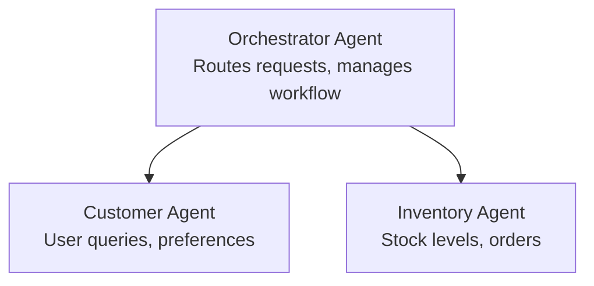

# פרק 5: פתרונות בינה מלאכותית רב-סוכניים

**📚 קורס**: [AZD למתחילים](../../README.md) | **⏱️ משך**: 2-3 שעות | **⭐ מורכבות**: מתקדם

---

## סקירה כללית

פרק זה מכסה דפוסי ארכיטקטורה מתקדמים של רב-סוכנים, תיאום סוכנים ופריסות בינה מלאכותית מוכנות לייצור לתרחישים מורכבים.

> הנחיות הפקודה נבדקו מול המדריך הרשמי שפורסם `azd 1.37.2`. פריסות בענן לא בוצעו.

## מטרות הלמידה

בסיום פרק זה תוכל:
- להבין דפוסי ארכיטקטורה רב-סוכניים
- לפרוס מערכות סוכנים מתואמות של בינה מלאכותית
- ליישם תקשורת בין סוכן לסוכן
- לבנות פתרונות רב-סוכניים מוכנים לייצור

---

## 📚 שיעורים

| # | שיעור | תיאור | זמן |
|---|--------|-------------|------|
| 1 | [יסודות רב-סוכניים](multi-agent-basics.md) | מעשי: פריסת אפליקציית רב-סוכנים עובדת עם `azd up` | 45 דקות |
| 2 | [דפוסי תיאום](../chapter-06-pre-deployment/coordination-patterns.md) | אסטרטגיות תיאום סוכנים (נמשך בפרק 6) | 30 דקות |
| 3 | [פריסת תבנית ARM](../../examples/retail-multiagent-arm-template/README.md) | דוגמת פריסה בלחיצה אחת | 30 דקות |

> **התחל בשיעור 1.** זהו השיעור היחיד פרקטי ומוכן לפריסה מלא בפרק זה. שיעור 2 נמצא בפרק 6 (משותף לתכנון טרום-הפריסה), ו[פתרון רב-סוכני לקמעונאות](../../examples/retail-scenario.md) הוא תכנית ארכיטקטורה — מתווה עיצוב, לא תבנית פקודה אחת.

---

## 🚀 התחלה מהירה

```bash
# Option 1: Deploy the multi-agent template used in Lesson 1
azd init --template Azure-Samples/contoso-creative-writer .
azd up

# Option 2: Initialize a Foundry agent interactively with the GA bundle
azd ext install microsoft.foundry
azd ai agent init
azd up
```

> **איזה גישה?** השתמש ב-`azd init --template` כדי להתחיל מדוגמה עובדת. השתמש ב-`azd ai agent init` באופן אינטראקטיבי, או ב-`azd ai agent init --template <path-to-azure.yaml>` כדי לאמץ פרויקט סוכן קיים. ראה את [מדריך הפקודות של AZD AI](../chapter-08-production/production-ai-practices.md#azd-ai-cli-commands-and-extensions) לדרישות גרסה והעברת הערכה.

הפעל את החלופות האלה בתיקיות ריקות נפרדות. תהליך העבודה GA Foundry דורש `azd >= 1.37.0`; זרם העבודה האינטראקטיבי שלו אינו מייצר את צינור השירות המותאם בלקח התיאום. לבדיקות מקומיות, פריסת קוד וניקוי בין פרויקטים חדשים לממוחזרים, עקוב אחר [מדריך סוכן מאוחסן](../chapter-02-ai-development/microsoft-foundry-integration.md#hosted-agent-walkthrough-ga).

---

## 🤖 ארכיטקטורה רב-סוכנית



---

## 🎯 פתרון מובלט: רב-סוכן לקמעונאות

הפתרון [Retail Multi-Agent Solution](../../examples/retail-scenario.md) ממחיש:

- **סוכן לקוח**: מטפל באינטראקציות ובהעדפות המשתמש
- **סוכן מלאי**: מנהל מלאי ועיבוד הזמנות
- **המנצח**: מתאם בין הסוכנים
- **זכרון משותף**: ניהול הקשר בין סוכנים

### שירותים בשימוש

| שירות | מטרה |
|---------|---------|
| Microsoft Foundry Models | הבנת שפה |
| Azure AI Search | קטלוג מוצרים |
| Cosmos DB | מצב וזכרון הסוכן |
| Container Apps | אירוח סוכן |
| Application Insights | ניטור |

---

## 🔗 ניווט

| כיוון | פרק |
|-----------|---------|
| **הקודם** | [פרק 4: תשתית](../chapter-04-infrastructure/README.md) |
| **הבא** | [פרק 6: לפני פריסה](../chapter-06-pre-deployment/README.md) |

---

## 📖 משאבים קשורים

- [מדריך סוכני AI](../chapter-02-ai-development/agents.md)
- [שיטות AI בפרודקשן](../chapter-08-production/production-ai-practices.md)
- [פתרון בעיות AI](../chapter-07-troubleshooting/ai-troubleshooting.md)

---

<!-- CO-OP TRANSLATOR DISCLAIMER START -->
**כתב ויתור**:
מסמך זה תורגם באמצעות שירות תרגום אוטומטי [Co-op Translator](https://github.com/Azure/co-op-translator). למרות שאנו שואפים לדיוק, יש לקחת בחשבון שתרגומים אוטומטיים עלולים להכיל שגיאות או אי-דיוקים. יש להחשיב את המסמך המקורי בשפתו הטבעית כמקור הסמכות. למידע קריטי מומלץ להשתמש בתרגום מקצועי על ידי מתרגם אדם. אנו לא אחראים לכל אי-הבנה או פירוש שגוי הנובע מהשימוש בתרגום זה.
<!-- CO-OP TRANSLATOR DISCLAIMER END -->