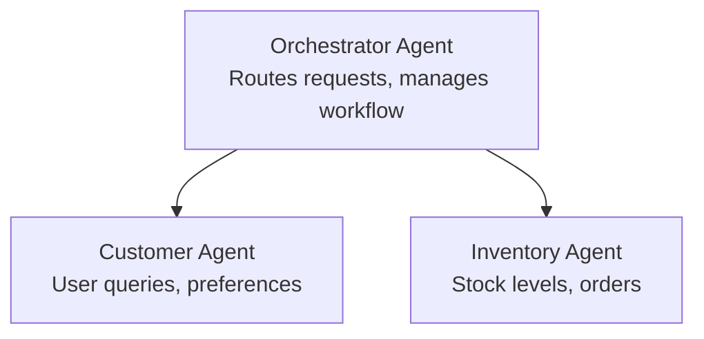

# פרק 5: פתרונות AI מרובי-סוכנים

**📚 קורס**: [AZD למתחילים](../../README.md) | **⏱️ משך**: 2-3 שעות | **⭐ מורכבות**: מתקדם

---

## סקירה כללית

פרק זה עוסק בדפוסי ארכיטקטורה מתקדמים מרובי-סוכנים, תיאום סוכנים, ופריסות AI מוכנות לייצור לתרחישים מורכבים.

> הנחיות פקודה נבדקו מול התיעוד הרשמי שהונפק `azd 1.37.2`. פריסות ענן לא בוצעו.

## מטרות למידה

בסיום פרק זה תוכל:
- להבין דפוסי ארכיטקטורה מרובי-סוכנים
- לפרוס מערכות סוכני AI מתואמות
- לממש תקשורת בין סוכנים
- לבנות פתרונות מרובי-סוכנים מוכנים לייצור

---

## 📚 שיעורים

| # | שיעור | תיאור | זמן |
|---|--------|-------------|------|
| 1 | [יסודות מרובי-סוכנים](multi-agent-basics.md) | עבודה מעשית: פרוס אפליקציית מרובי-סוכנים עובדת עם `azd up` | 45 דק' |
| 2 | [דפוסי תיאום](../chapter-06-pre-deployment/coordination-patterns.md) | אסטרטגיות תיאום סוכנים (נמשך בפרק 6) | 30 דק' |
| 3 | [פריסת תבנית ARM](../../examples/retail-multiagent-arm-template/README.md) | דוגמת פריסה בלחיצה אחת | 30 דק' |

> **התחל בשיעור 1.** זהו השיעור היחיד המעשיר והפרוס בפרק זה. שיעור 2 מופיע בפרק 6 (משותף עם תכנון טרום-פריסה), ופתרון [מרובי-סוכנים למסחר קמעונאי](../../examples/retail-scenario.md) הוא תבנית ארכיטקטורה – הפניה עיצובית, לא תבנית פקודה בודדת.

---

## 🚀 התחלה מהירה

```bash
# Option 1: Deploy the multi-agent template used in Lesson 1
azd init --template Azure-Samples/contoso-creative-writer .
azd up

# Option 2: Initialize a Foundry agent interactively (requires azure.ai.agents)
azd extension install azure.ai.agents
azd ai agent init
azd up
```

> **איזה גישה?** השתמש ב-`azd init --template` כדי להתחיל מדוגמה עובדת. השתמש ב-`azd ai agent init` באינטראקטיביות, או ב-`azd ai agent init --template <path-to-azure.yaml>` כדי לאמץ פרויקט סוכנים קיים. עיין ב-[תיעוד AZD AI CLI](../chapter-08-production/production-ai-practices.md#azd-ai-cli-commands-and-extensions) לדרישות גרסה והגירת הערכה.

הפעל חלופות אלה בתיקיות ריקות נפרדות. תוסף סוכנים `1.0.0-beta.23` דורש `azd >= 1.37.0`; זרימת האינטראקטיביות שלו אינה יוצרת את צינור Service Bus מותאם אישית בשיעור התיאום.

---

## 🤖 ארכיטקטורה מרובי-סוכנים



---

## 🎯 פתרון מוצג: מרובי-סוכנים למסחר קמעונאי

פתרון [מרובי-סוכנים למסחר קמעונאי](../../examples/retail-scenario.md) ממחיש:

- **סוכן לקוח**: מטפל באינטראקציות והעדפות המשתמש
- **סוכן מלאי**: מנהל מלאי ועיבוד הזמנות
- **מנהל התיאום**: מתאם בין הסוכנים
- **זיכרון משותף**: ניהול הקשר בין הסוכנים

### שירותים בשימוש

| שירות | מטרה |
|---------|---------|
| דגמי Foundry של Microsoft | הבנת שפה |
| Azure AI Search | קטלוג מוצרים |
| Cosmos DB | מצב וזיכרון סוכן |
| Container Apps | אירוח סוכן |
| Application Insights | ניטור |

---

## 🔗 ניווט

| כיוון | פרק |
|-----------|---------|
| **קודם** | [פרק 4: תשתית](../chapter-04-infrastructure/README.md) |
| **הבא** | [פרק 6: טרום-פריסה](../chapter-06-pre-deployment/README.md) |

---

## 📖 משאבים קשורים

- [מדריך סוכני AI](../chapter-02-ai-development/agents.md)
- [פרקטיקות AI לייצור](../chapter-08-production/production-ai-practices.md)
- [פתרון בעיות AI](../chapter-07-troubleshooting/ai-troubleshooting.md)

---

<!-- CO-OP TRANSLATOR DISCLAIMER START -->
**כתב ויתור**:
מסמך זה תורגם באמצעות שירות תרגום אוטומטי [Co-op Translator](https://github.com/Azure/co-op-translator). למרות שאנו שואפים לדיוק, יש לקחת בחשבון שתרגומים אוטומטיים עלולים להכיל שגיאות או אי-דיוקים. יש להחשיב את המסמך המקורי בשפתו הטבעית כמקור הסמכות. למידע קריטי מומלץ להשתמש בתרגום מקצועי על ידי מתרגם אדם. אנו לא אחראים לכל אי-הבנה או פירוש שגוי הנובע מהשימוש בתרגום זה.
<!-- CO-OP TRANSLATOR DISCLAIMER END -->