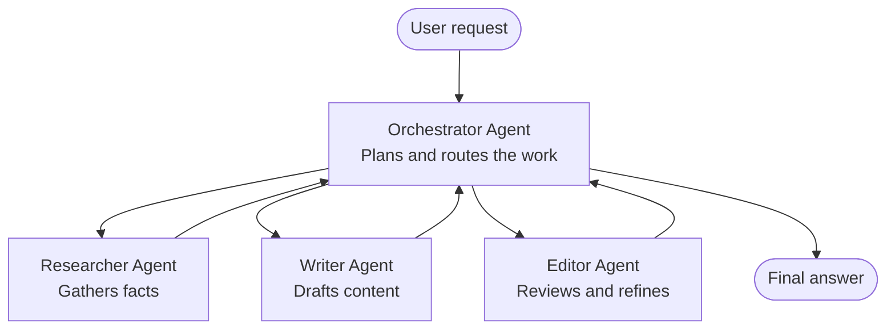

# יסודות רב-סוכנים - פרוס את מערכת ה-AI המתואמת הראשונה שלך

**ניווט בפרק:**
- **📚 דף הבית של הקורס**: [AZD למתחילים](../../README.md)
- **📖 הפרק הנוכחי**: פרק 5 - פתרונות AI רב-סוכנים
- **⬅️ הקודם**: [פרק 4: תשתיות](../chapter-04-infrastructure/README.md)
- **➡️ הבא**: [תבניות תיאום](../chapter-06-pre-deployment/coordination-patterns.md)

> הנחיית הפקודה תואמה מול הקוד התייחסות המפורסם של `azd 1.37.2`. פריסות ענן לא בוצעו.

## הקדמה

בפרקים הקודמים פרסתם יישום יחיד — ובפרק 2 פרסתם סוכן AI יחיד. השיעור הזה לוקח את הצעד הבא: פריסת **מערכת רב-סוכנים**, שבה מספר סוכנים מומחים עובדים יחד לפתור בעיה שאף סוכן אחד לא יכול היה לטפל בה היטב לבדו.

החדשות הטובות למתחילים: **אתם לא צריכים פקודות חדשות.** פתרון רב-סוכנים הוא עדיין פרויקט azd. תשתמשו ב-`azd init`, `azd up`, תבדקו, ו-`azd down` — בדיוק את תהליך העבודה שאתם כבר מכירים. מה שמשתנה הוא *הצורה* של האפליקציה מבפנים.

## מטרות הלמידה

בסיום שיעור זה, תוכלו:
- להבין מה משמעות "רב-סוכנים" ומתי שווה את המורכבות הנוספת
- לזהות את התפקידים הנפוצים במערכת רב-סוכנים (מנחה + מומחים)
- לפרוס תבנית רב-סוכנים עובדת אמיתית עם `azd up`
- להבין את משאבי Azure שתומכים באפליקציה רב-סוכנית
- לדעת כיצד לאמת, להתאים ולפרק את הפתרון בבטחה

## תוצאות הלמידה

לאחר סיום שיעור זה, תדעו:
- להסביר את ההבדל בין סוכן יחיד למערכת רב-סוכנים
- לבחור בין סוכן יחיד עם כלים לעיצוב רב-סוכנים אמיתי
- לפרוס ולבדוק תבנית רב-סוכנים מקצה לקצה באמצעות azd
- לזהות איפה כל סוכן רץ ואיך הם מתקשרים
- לנקות את כל המשאבים כדי למנוע חיובים שוטפים

---

## מהי מערכת רב-סוכנים?

סוכן AI יחיד הוא מודל אחד עם מערך הוראות ו(אופציונלית) כמה כלים. זה עובד טוב למשימות ממוקדות. אבל כשהמשימה גדלה — מחקר, כתיבה, עריכה, אימות עובדות — לדחוס הכל לתוך פרומפט אחד הופך את הסוכן לאיטי יותר, פחות אמין, ויותר קשה לבדוק ולפתור בעיות.

**מערכת רב-סוכנים** מחלקת את העבודה למומחים שכל אחד מהם עושה עבודה אחת היטב, ומתואמת על ידי מנחה:



### שני התפקידים שתראו תמיד

| תפקיד | משימה | דוגמה |
|------|--------|---------|
| **מנחה** | מחליט *מה קורה הלאה* ומנתב עבודה בין סוכנים | "מחקר תחילה, ואז כתיבה, ואז עריכה" |
| **מומחה** | מבצע עבודה ממוקדת אחת ומחזיר תוצאה | "חוקר" שאוסף רק עובדות |

### האם באמת צריך מספר סוכנים?

התחילו בפשוט. גשו לרב-סוכנים **רק** כאשר אחד מהבאים נכון:

- ✅ למשימה יש **שלבים מובחנים** שמרוויחים מהוראות שונות (מחקר מול כתיבה מול סקירה)
- ✅ אתם רוצים שמומחים יפעלו **במקביל** לחיסכון בזמן
- ✅ שלבים שונים צריכים **כלים או מקורות מידע שונים**
- ✅ כל שלב צריך להיות **ניתן לבדיקה ופתרון בעיות עצמאית**

אם המשימה שלכם היא שאלה ותשובה ייחודית או קריאה פשוטה לכלי, **סוכן יחיד עם כלים** (פרק 2) הוא פשט, זול וקל יותר לתפעול.

> **טיפ למתחילים:** "יותר סוכנים" לא תמיד "טוב יותר." כל סוכן מוסיף השהייה, עלות ודבר חדש לפקח עליו. הוסיפו סוכנים רק אם הבעיה מתפצלת בבירור לחלקים.

---

## שתי דרכים לבנות רב סוכנים ב-Azure

| גישה | מה זה | מתאים ל- |
|----------|-----------|----------|
| **סוכן יחיד + כלים** | סוכן Foundry יחיד שקורא לפונקציות/כלים | תהליכים פשוטים, התחלה |
| **מספר סוכנים מתואמים** | כמה סוכנים עם מנחה | שלבים מובחנים, עבודה במקביל, התמחות |

השיעור הזה מתמקד בגישה השנייה באמצעות **תבנית מוכנה**, כך שתוכלו לראות מערכת רב-סוכנים קיימת פועלת לפני שתבנו אחת משלכם.

---

## בידיים: פרוסו אפליקציית רב-סוכנים עובדת

נפרוס את **Contoso Creative Writer**, דוגמה רשמית של Azure שמתאמת סוכני מחקר, מוצר, כתיבה ועריכה כדי לייצר מאמר. לפני ההמשך, בדקו את [הדרישות והעלויות של הדוגמה](https://github.com/Azure-Samples/contoso-creative-writer#azure-account-requirements): היא זקוקה למכסת מודלים, Azure AI Search, גישה ל-Bing Grounding, Python, Docker, וחיבורים תואמי Bash. זמינות המודל והאזור תלויה במינוי שלכם; הפריסה אינה מובטחת ע"י בחירת אזור מסוים.

### שלב 1: אתחול התבנית

```bash
# Create a working folder
mkdir creative-writer && cd creative-writer

# Initialize from the official multi-agent template
azd init --template Azure-Samples/contoso-creative-writer .
```

> דפדפו עוד תבניות רב-סוכנים בכל עת ב[גלריית Awesome AZD AI](https://azure.github.io/awesome-azd/?tags=ai). אפשרויות ידידותיות למתחילים נוספות כוללות את `get-started-with-ai-agents` ו-`azure-ai-travel-agents`.

### שלב 2: אימות

```bash
# Required for azd workflows
azd auth login

# Also required by this sample's Azure CLI hooks
az login
```

### שלב 3: בדיקת הסביבה

```bash
# init normally creates/selects an environment; confirm it before proceeding
azd env list
# Only if you need an additional environment:
# azd env new dev
```

### שלב 4: תצוגה מקדימה, ואז פרוס

```bash
# See what will be created before spending anything (recommended)
azd provision --preview

# Provision infrastructure and deploy all agents in one step
azd up
```

`azd up` יבקש הגדרות חסרות של המנוי והאזור, ואז יספק משאבים ויפרס את היישום. התצוגה המקדימה לא שומרת על מכסה ואינה מבטיחה הצלחה; יתכן שקרסות התבנית יתבצעו בזמן תצוגה מקדימה של הפריסה, לכן בדקו אותן קודם. כדי להאריך כמה azd מחכה לכל **פריסת שירות** (לא פריסת מודל):

```bash
azd deploy --timeout 1800
```

הפסקת זמן עוצרת את ההמתנה של azd; היא אינה מבטלת את הפריסה ב-Azure. בדקו את מצב המשאב לפני ניסיון חוזר.

> **הערה על עלויות וקיבולת:** אפליקציות רב-סוכנים מפעילות מודלי AI שצורכים מכסה ומייצרים עלות. אם `azd up` נכשל במכסת מודל, ראו ב[פתרון בעיות AI](../chapter-07-troubleshooting/ai-troubleshooting.md) לתיקוני אזור ומכסה, ופרק 6 [תכנון קיבולת](../chapter-06-pre-deployment/capacity-planning.md).

---

## הבנת מה שפרסתם

אפליקציית רב-סוכנים טיפוסית כזו מספקת סט של משאבי Azure שממופים ישירות לאחריות בתרשים מעלה:

| משאב | למה הוא שם |
|----------|----------------|
| **Microsoft Foundry / Models** | מארח את דגמי השפה שכל סוכן משתמש בהם |
| **Azure AI Search** | מספק לסוכן המחקר נתונים בוססים לחיפוש |
| **Container Apps** (או App Service) | מארח את המנחה ואת קוד הסוכנים |
| **Cosmos DB** (בחלק מהדוגמאות) | מאחסן מצב/זיכרון משותף שמועבר בין סוכנים |
| **Application Insights** | עוקב אחרי בקשות *בין* סוכנים כדי שתוכלו לפתור בעיות בזרימה |

### איך הסוכנים מתקשרים זה עם זה

ברוב דגמי הרב-סוכנים של azd, **המנחה רץ בתוך קוד היישום שלכם** (למשל, באמצעות מסגרת כמו Semantic Kernel או Microsoft Agent Framework). המנחה מקרא לכל סוכן מומחה לפי סדר, מעביר את התוצאות, ומרכיב את התשובה הסופית. הסוכנים משתפים הקשר דרך:

- **קריאות פונקציה/כלי** — המנחה מפעיל מומחה ומקבל תוצאה בחזרה
- **זיכרון משותף** — מסד נתונים (לעיתים Cosmos DB) מחזיק מצב ששני הסוכנים יכולים לקרוא ממנו
- **הודעות/אירועים** — לקשר רופף יותר, סוכנים מתקשרים דרך תור או Service Bus

> **למה זה חשוב לפירוק בעיות:** מאחר שכל שלב הוא נפרד, Application Insights מראה *איזה* סוכן היה איטי או נכשל. זו סיבה עיקרית לפצל עבודה בין סוכנים מלכתחילה.

---

## אמת את הפריסה

ודאו שהמערכת אכן פועלת לפני שממשיכים:

```bash
# Show the deployed endpoints
azd show

# Open the app's monitoring dashboard
azd monitor

# Open Application Insights Logs (not a terminal log stream)
azd monitor --logs
```

לאחר מכן פתחו את כתובת ה-URL של האפליקציה מ-`azd show` ובקשו מאמר קצר. השתמשו בתצוגת ניפוי שגיאות של הדוגמה כדי לבחון את זרימת העבודה של הסוכנים. חיפוש עסקאות ב-Application Insights יכול להראות את השלבים האישיים רק אם הדוגמה מדריכה ומקשרת אותם; azd אינו מוסיף באופן אוטומטי טווחי סוכן.

**קריטריון הצלחה:**
- ✅ `azd show` מציג נקודת קצה נגישה
- ✅ בקשה מייצרת תוצאה שעברה בבירור מספר שלבים
- ✅ תצוגת הניפוי מציגה כמה שלבי סוכן; אם גילוי מופעל, אמתו את הטלמטריה המתאימה לאחר העיבוד

---

## התאמה אישית: הוספה או התאמה של סוכן

כי כל סוכן הוא רק הוראות ועוד כלים, ההתאמה האישית היא נגישה:

1. **מצא את הגדרות הסוכן** בתבנית (לעיתים קרובות קובץ או קבצים מסוג `prompts/`, `agents/`, או `*.prompty`).
2. **כוונן את ההוראות של הסוכן** — לדוגמה, אמור לסוכן העורך לאכוף טון מסוים או מספר מילים מוגדר.
3. **פרוס מחדש רק את הקוד** (התשתית לא משתנה):

   ```bash
   azd deploy
   ```

כדי להמשיך עם פרויקט הסוכן *שלך* ב-Foundry, השתמש באתחול האינטראקטיבי של התוסף לסוכנים:

```bash
azd extension install azure.ai.agents
azd ai agent init
azd up
azd ai agent invoke      # test, with response timing
```

ראה [פרק 2: סוכנים](../chapter-02-ai-development/agents.md) ואת [הפניה ל-AZD AI CLI](../chapter-08-production/production-ai-practices.md#azd-ai-cli-commands-and-extensions) למחזור החיים המלא: סוכן `invoke`, זרימת העבודה של תוסף ההערכות הנפרד `azd ai eval`, סוכן `optimize`, וסוכן `delete`.

---

## ניקוי

אפליקציות רב-סוכניות מפעילות מספר שירותים החיובים בנפרד. פירק את הכל כשתסיים:

```bash
# Review the resources and confirm deletion interactively
azd down
```

מחיקה היא הרסנית. עבור מעבדה חד-פעמית, `azd down --force --purge` מדלג על מחיקה ואישורי ניקוי רכים; הניקוי הוא בלתי הפיך במקומות שתומכים בכך ויכול להיחסם על ידי הגנת ניקוי. מחיקה רכה היא עניין של התאוששות/שימוש חוזר בשם, ולא הוכחה בעצמה להמשך חיובים. בדוק משאבים שמורים וחיובים לאחר הניקוי.

---

## הערה על מערכות רב-סוכניות בייצור

ה-[Retail Multi-Agent Solution](../../examples/retail-scenario.md) במאגר זה הוא **מפת ארכיטקטורה**, לא תבנית של פקודה אחת—הוא מתעד כיצד מערכת קמעונאות לפרודקשן *אמורה* להיות בנויה (וברור שמימוש מלא הוא מאמץ משמעותי). השתמש בו כהפניה עיצובית *לאחר* שהפעלת דוגמה עובדת כאן. לצרכי ייצור (עמידות, עלות, ניטור, ממשל), המשך אל [פרק 8: שיטות AI לפרודקשן](../chapter-08-production/production-ai-practices.md).

---

## סיכום

- מערכת רב-סוכנים מחלקת עבודה בין מומחים מתואמים על ידי מנחה.
- השתמש בה רק כאשר למשימה יש שלבים מובחנים, מקביליות, או כלים שונים בכל שלב — אחרת העדף סוכן יחיד.
- זרימת העבודה של azd אינה משתנה: `azd init` → `azd up` → test → `azd down`.
- תבנית אמיתית כמו `contoso-creative-writer` מאפשרת לך לראות ולהתאים אישית אפליקציית רב-סוכנים עובדת כבר היום.
- מעקב Application Insights בין סוכנים הוא אחד היתרונות הפרקטיים הגדולים ביותר של עיצוב רב-סוכנים.

---

## 🔗 ניווט

| כיוון | שיעור |
|-----------|--------|
| **קודם** | [פרק 4: תשתית](../chapter-04-infrastructure/README.md) |
| **הבא** | [תבניות תיאום](../chapter-06-pre-deployment/coordination-patterns.md) |

## 📖 משאבים קשורים

- [מדריך לסוכני בינה מלאכותית](../chapter-02-ai-development/agents.md)
- [תבניות תיאום](../chapter-06-pre-deployment/coordination-patterns.md)
- [פרקטיקות בינה מלאכותית לייצור](../chapter-08-production/production-ai-practices.md)
- [פתרון בעיות בבינה מלאכותית](../chapter-07-troubleshooting/ai-troubleshooting.md)

---

<!-- CO-OP TRANSLATOR DISCLAIMER START -->
**כתב ויתור**:
מסמך זה תורגם באמצעות שירות תרגום אוטומטי [Co-op Translator](https://github.com/Azure/co-op-translator). למרות שאנו שואפים לדיוק, יש לקחת בחשבון שתרגומים אוטומטיים עלולים להכיל שגיאות או אי-דיוקים. יש להחשיב את המסמך המקורי בשפתו הטבעית כמקור הסמכות. למידע קריטי מומלץ להשתמש בתרגום מקצועי על ידי מתרגם אדם. אנו לא אחראים לכל אי-הבנה או פירוש שגוי הנובע מהשימוש בתרגום זה.
<!-- CO-OP TRANSLATOR DISCLAIMER END -->