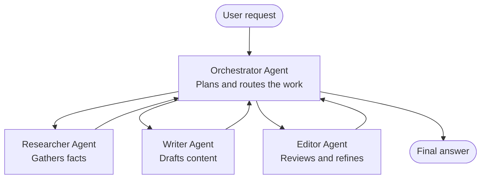

# יסודות מרובי-סוכנים - פרוס את מערכת ה-AI המתואמת הראשונה שלך

**ניווט בפרק:**
- **📚 דף הבית של הקורס**: [AZD למתחילים](../../README.md)
- **📖 הפרק הנוכחי**: פרק 5 - פתרונות AI מרובי-סוכנים
- **⬅️ קודם**: [פרק 4: תשתית](../chapter-04-infrastructure/README.md)
- **➡️ הבא**: [תבניות תיאום](../chapter-06-pre-deployment/coordination-patterns.md)

> ההנחיה לפקודה נבדקה מול התיעוד שפורסם של `azd 1.37.2`. פריסות ענן לא בוצעו.

## מבוא

בפרקים הקודמים פרסת אפליקציה אחת - ובפרק 2 פרסת סוכן AI יחיד. שיעור זה לוקח את הצעד הבא: פריסה של **מערכת מרובי-סוכנים**, שבה מספר סוכנים מומחים עובדים יחד לפתרון בעיה שסוכן יחיד לא יכול היה להתמודד איתה היטב בעצמו.

החדשות הטובות למתחילים: **אתה לא צריך פקודות חדשות.** פתרון מרובי-סוכנים הוא עדיין פרויקט azd. תבצע `azd init`, `azd up`, בדיקות ו-`azd down`—בדיוק את זרימת העבודה שאתה כבר מכיר. מה שמשתנה זה ה*צורה* של האפליקציה בפנים.

## מטרות הלמידה

עד סוף שיעור זה, תלמד:
- להבין מה המשמעות של "מרובי-סוכנים" ומתי שווה את המורכבות הנוספת
- לזהות את התפקידים הנפוצים במערכת מרובי-סוכנים (מנחה + מומחים)
- לפרוס תבנית מרובי-סוכנים אמיתית ועובדת עם `azd up`
- להבין את המשאבים של Azure שתומכים באפליקציית מרובי-סוכנים
- לדעת כיצד לאמת, להתאים אישית ולהסיר את הפתרון בבטחה

## תוצאות הלמידה

לאחר השלמת שיעור זה, תוכל:
- להסביר את ההבדל בין סוכן יחיד למערכת מרובי-סוכנים
- לבחור בין סוכן יחיד עם כלים לבין עיצוב מרובי-סוכנים אמיתי
- לפרוס ולבדוק תבנית מרובי-סוכנים מקצה לקצה עם azd
- לזהות היכן כל סוכן רץ ואיך הם מתקשרים
- לנקות את כל המשאבים כדי למנוע חיובים מתמשכים

---

## מהי מערכת מרובי-סוכנים?

סוכן AI יחיד הוא מודל אחד עם סט הוראות וכמה כלים (אופציונלי). זה מתאים למשימות ממוקדות. אך ככל שהמשימה מתרחבת—מחקר, כתיבה, עריכה, בדיקות עובדות—לדחוס הכל בתבנית אחת הופך את הסוכן לאיטי יותר, פחות אמין וקשה יותר לניפוי שגיאות.

**מערכת מרובי-סוכנים** מפרקת את העבודה למומחים שכל אחד מבצע משימה אחת היטב, ומנוהלת על ידי מנחה:



### שני התפקידים שתמיד תראה

| תפקיד | משימה | דוגמה |
|------|-----|---------|
| **מנחה** | מחליט *מה יקרה אחר כך* ומפנה עבודה בין הסוכנים | "קודם מחקר, אחר כך כתיבה, אחר כך עריכה" |
| **מומחה** | מבצע משימה ממוקדת אחת ומחזיר תוצאה | "חוקר" שאוסף רק עובדות |

### האם באמת צריך סוכנים מרובים?

התחל פשוט. השתמש במערכת מרובי-סוכנים **רק** כאשר אחת מהאפשרויות הבאות נכונה:

- ✅ למשימה יש **שלבים מובחנים** שמרוויחים מהוראות שונות (מחקר מול כתיבה מול סקירה)
- ✅ אתה רוצה שמומחים ירוצו **במקביל** כדי לחסוך זמן
- ✅ שלבים שונים צריכים **כלים או מקורות מידע שונים**
- ✅ אתה צריך שכל שלב יהיה **ניתן לבדיקה וניפוי שגיאות בנפרד**

אם המשימה היא שאלה ותשובה פשוטה או קריאה לכלי פשוט, סוכן יחיד עם כלים (פרק 2) הוא פשטני, זול וקל לתפעול.

> **טיפ למתחילים:** "יותר סוכנים" זה לא "טוב יותר". כל סוכן מוסיף השהייה, עלות ודבר חדש לניטור. הוסף סוכנים רק כאשר הבעיה מתחלקת בבירור לחלקים.

---

## שתי דרכים לבניית מערכת מרובי-סוכנים ב-Azure

| גישה | מה זה | הטובה ל- |
|----------|-----------|----------|
| **סוכן יחיד + כלים** | סוכן Foundry אחד שקורא לפונקציות/כלים | זרימות עבודה פשוטות, התחלה |
| **מספר סוכנים מתואמים** | מספר סוכנים עם מנחה | שלבים מובחנים, עבודה במקביל, מומחיות |

שיעור זה מתמקד בגישה השנייה באמצעות **תבנית מוכנה**, כך שתוכל לראות מערכת מרובי-סוכנים אמיתית פועלת לפני שתבנה אחת משלך.

---

## התנסות מעשית: פרוס אפליקציית מרובי-סוכנים עובדת

נפרוס את **Contoso Creative Writer**, דוגמה רשמית של Azure שמאחדת סוכני מחקר, מוצר, כתיבה ועריכה כדי להפיק מאמר. לפני ההתקדמות, בדוק את [התנאים והעלויות של הדוגמה](https://github.com/Azure-Samples/contoso-creative-writer#azure-account-requirements): היא זקוקה למכסת מודל, Azure AI Search, גישת Bing Grounding, Python, Docker וויית'ים תואמי Bash. זמינות מודלים ואזור תלויה במנוי שלך; הפריסה אינה מובטחת בבחירת אזור מסוים.

### שלב 1: אתחל את התבנית

```bash
# Create a working folder
mkdir creative-writer && cd creative-writer

# Initialize from the official multi-agent template
azd init --template Azure-Samples/contoso-creative-writer .
```

> ניתן לדפדף בעוד תבניות מרובי-סוכנים בכל עת ב-[גלריית Awesome AZD AI](https://azure.github.io/awesome-azd/?tags=ai). אפשרויות נוספות ידידותיות למתחילים כוללות את `get-started-with-ai-agents` ו-`azure-ai-travel-agents`.

### שלב 2: אמת את הזהות

```bash
# Required for azd workflows
azd auth login

# Also required by this sample's Azure CLI hooks
az login
```

### שלב 3: בדוק את הסביבה

```bash
# init normally creates/selects an environment; confirm it before proceeding
azd env list
# Only if you need an additional environment:
# azd env new dev
```

### שלב 4: תצוגה מקדימה, ואז פריסה

```bash
# See what will be created before spending anything (recommended)
azd provision --preview

# Provision infrastructure and deploy all agents in one step
azd up
```

`azd up` ידרוש הגדרות חסרות של מנוי ואזור, ואז יספק משאבים ויפרס את האפליקציה. התצוגה המקדימה אינה שומרת מכסה או מבטיחה הצלחה; וויית'ים בתבנית עשויים עדיין לרוץ במהלך תצוגה מקדימה של הפריסה, לכן בדוק אותם תחילה. כדי להאריך את זמן ההמתנה של azd לכל **פריסת שירות** (ולא פריסת מודל):

```bash
azd deploy --timeout 1800
```

טיימאאוט מונע מ-azd להמתין; הוא לא מבטל את הפריסה ב-Azure. בדוק את מצב המשאב לפני ניסיון חוזר.

> **הערה על עלות וקיבולת:** אפליקציות מרובי-סוכנים מפרסות מודלי AI שצורכים מכסה וגורמים לעלויות. אם `azd up` נכשל במכסת מודל, ראה [פתרון בעיות AI](../chapter-07-troubleshooting/ai-troubleshooting.md) עבור תיקוני אזור ומכסה, ופרק 6 [תכנון קיבולת](../chapter-06-pre-deployment/capacity-planning.md).

---

## הבנת מה שפרסת

אפליקציית מרובי-סוכנים טיפוסית כמו זו מספקת סט של משאבי Azure שממופים ישירות לאחריות שבדיאגרמה למעלה:

| משאב | למה הוא שם |
|----------|----------------|
| **Microsoft Foundry / מודלים** | מאחסן את מודלי השפה שכל סוכן משתמש בהם |
| **Azure AI Search** | נותן לסוכן החוקר נתונים מבוססי מציאות לחיפוש |
| **Container Apps** (או App Service) | מאחסן את המנחה ואת קוד הסוכן |
| **Cosmos DB** (בחלק מהדוגמאות) | מאחסן מצב/זיכרון משותף שעובר בין סוכנים |
| **Application Insights** | עוקב אחרי בקשות *באמצעות* הסוכנים כדי שתוכל לנפות שגיאות בזרימה |

### איך הסוכנים מתקשרים זה עם זה

ברוב דוגמאות azd מרובי-סוכנים, ה**מנחה רץ בקוד האפליקציה שלך** (לדוגמה, באמצעות מסגרת כמו Semantic Kernel או Microsoft Agent Framework). המנחה קורא לכל סוכן מומחה בתורו, מעביר את התוצאות ומרכיב את התשובה הסופית. הסוכנים משתפים הקשר דרך:

- **קריאות פונקציות/כלים** — המנחה מזמין מומחה ומקבל תוצאה בחזרה
- **זיכרון משותף** — בסיס נתונים (לעתים Cosmos DB) מחזיק במצב ששני הסוכנים יכולים לקרוא
- **הודעות/מאורעות** — לתקשורת רופפת יותר, הסוכנים מתקשרים דרך תור או Service Bus

> **למה זה חשוב לניפוי שגיאות:** מכיוון שכל שלב הוא נפרד, Application Insights מראה לך *איזה* סוכן היה איטי או נכשל. זו סיבה עיקרית לחלוקת העבודה בין סוכנים מלכתחילה.

---

## אמת את הפריסה

ודא שהמערכת עובדת לפני שמתקדמים:

```bash
# Show the deployed endpoints
azd show

# Open the app's monitoring dashboard
azd monitor

# Open Application Insights Logs (not a terminal log stream)
azd monitor --logs
```

פתח את כתובת ה-URL של האפליקציה מ-`azd show` ובקש מאמר קצר. השתמש בתצוגת ניפוי השגיאות של הדוגמה כדי לבדוק את זרימת העבודה של הסוכן. חיפוש עסקאות ב-Application Insights יכול להראות את השלבים האישיים רק אם הדוגמה ממשיכה וקורלטת אותם; azd לא מוסיף אוטומטית טווחי סוכן.

**קריטריוני הצלחה:**
- ✅ `azd show` מפרט נקודת קצה נגישה
- ✅ בקשה מייצרת תוצאה שעברה בבירור שלבים מרובים
- ✅ תצוגת הניפוי מראה מספר שלבים של סוכן; אם המעקב מופעל, אמת את הטלמטריה המתאימה לאחר העיבוד

---

## התאמה אישית: הוסף או שנה סוכן

מכיוון שכל סוכן הוא רק הוראות плюс כלים, ההתאמה האישית נגישה:

1. **מצא את ההגדרות של הסוכן** בתבנית (לעיתים קבוצת קבצים של `prompts/`, `agents/` או `*.prompty`).
2. **כוונן את ההוראות של הסוכן** — לדוגמה, אמור לסוכן העריכה לאכוף טון מסוים או מספר מילים מדויק.
3. **פרוס מחדש רק את הקוד** (התשתית לא משתנה):

   ```bash
   azd deploy
   ```

להמשיך עם פרויקט סוכן Foundry *שלך*, השתמש בחבילת GA עם AZD גרסה 1.37.0+ בתיקיה ריקה נפרדת:

```bash
azd ext install microsoft.foundry
azd ai agent init
azd up
azd ai agent invoke      # test, with response timing
```

ראה את [המדריך לניסוי מקומי עם סוכן מאוחסן ב-GA](../chapter-02-ai-development/microsoft-foundry-integration.md#hosted-agent-walkthrough-ga) לבדיקה מקומית של Agent Inspector, פריסת קוד מרחוק ואחריות לניקוי. גם [תיעוד ה-AZD AI CLI](../chapter-08-production/production-ai-practices.md#azd-ai-cli-commands-and-extensions) מכסה את תוסף הערכות נפרדות, אופטימיזציה ומחיקת סוכן.

---

## ניקוי

אפליקציות מרובי-סוכנים מריצות שירותים רבויי-חיוב. השמד הכל כשהסיימת:

```bash
# Review the resources and confirm deletion interactively
azd down
```

המחיקה היא הרסנית. למעבדה חד-פעמית, `azd down --force --purge` מדלג על מחיקה ואישורי מחיקה רכה נתמכים; ניקוי הוא בלתי-הפיך במקום נתמך ועשוי להיחסם על ידי הגנת ניקוי. מחיקה רכה היא סוגיית שיקום/שימוש חוזר בשמות, לא הוכחה לעומס חיוב מתמשך. בדוק משאבים שמורים וחשבונות לאחר הניקוי.

אם גם אתחלת סוכן מאוחסן על פרויקט Foundry קיים, `azd down` משאיר את סוכן הפרויקט ואת שאר המשאבים במקומם. הסר רק משאבים לא רצויים שבבעלותך בנפרד. לפרויקט Foundry חדש שנוצר על ידי סביבת AZD שלו, `azd down` מוחק את קבוצת המשאבים ואת הכל שבתוכה.

---

## הערה על מערכות מרובי-סוכנים בייצור

ה-[פתרון סוכני קמעונאות מרובה](../../examples/retail-scenario.md) במאגר זה הוא **שרטוט ארכיטקטוני**, לא תבנית בפקודה אחת—הוא מתעד כיצד *ייתכן* שייבנה מערכת קמעונאית ייצורית (ומובהר שמימוש מלא הוא מאמץ משמעותי). השתמש בו כהפניה לעיצוב *לאחר* שפרסת דוגמה עובדת כאן. לנושאי ייצור (עמידות, עלות, ניטור, ממשל), המשך ל-[פרק 8: נוהלי בינה מלאכותית בייצור](../chapter-08-production/production-ai-practices.md).

---

## סיכום

- מערכת רב-סוכנים מחלקת עבודה בין מומחים המתואמים על ידי מנחה.
- השתמש בה רק כאשר למשימה יש שלבים מובחנים, מקבילות או כלים שונים בכל שלב—אחרת עדיף סוכן יחיד.
- זרימת העבודה של azd לא השתנתה: `azd init` → `azd up` → בדיקה → `azd down`.
- תבנית אמיתית כמו `contoso-creative-writer` מאפשרת לך לראות ולהתאים אישית אפליקציית רב-סוכנים עובדת כבר היום.
- מעקב Application Insights בין הסוכנים הוא אחד היתרונות המעשיים הגדולים בעיצוב רב-סוכנים.

---

## 🔗 ניווט

| כיוון | שיעור |
|-----------|--------|
| **קודם** | [פרק 4: תשתית](../chapter-04-infrastructure/README.md) |
| **הבא** | [תבניות תיאום](../chapter-06-pre-deployment/coordination-patterns.md) |

## 📖 משאבים קשורים

- [מדריך סוכני בינה מלאכותית](../chapter-02-ai-development/agents.md)
- [תבניות תיאום](../chapter-06-pre-deployment/coordination-patterns.md)
- [שיטות עבודה בבינה מלאכותית בתעשייה](../chapter-08-production/production-ai-practices.md)
- [פתרון בעיות בינה מלאכותית](../chapter-07-troubleshooting/ai-troubleshooting.md)

---

<!-- CO-OP TRANSLATOR DISCLAIMER START -->
**כתב ויתור**:
מסמך זה תורגם באמצעות שירות תרגום אוטומטי [Co-op Translator](https://github.com/Azure/co-op-translator). למרות שאנו שואפים לדיוק, יש לקחת בחשבון שתרגומים אוטומטיים עלולים להכיל שגיאות או אי-דיוקים. יש להחשיב את המסמך המקורי בשפתו הטבעית כמקור הסמכות. למידע קריטי מומלץ להשתמש בתרגום מקצועי על ידי מתרגם אדם. אנו לא אחראים לכל אי-הבנה או פירוש שגוי הנובע מהשימוש בתרגום זה.
<!-- CO-OP TRANSLATOR DISCLAIMER END -->