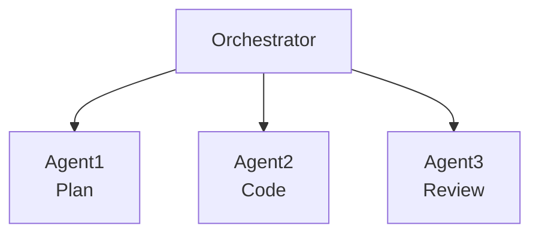
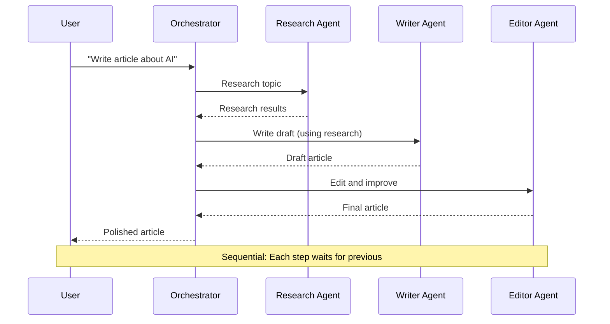
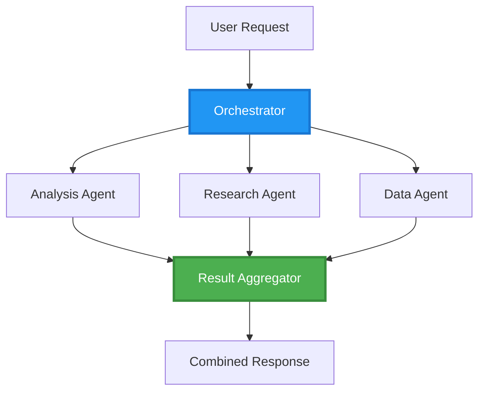
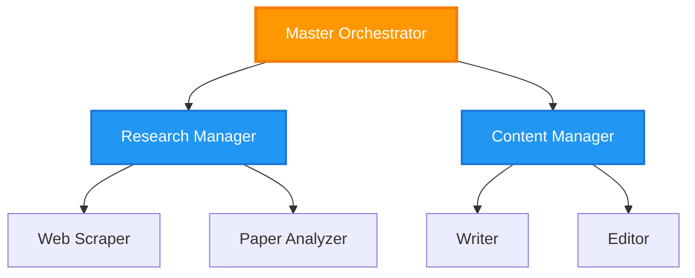
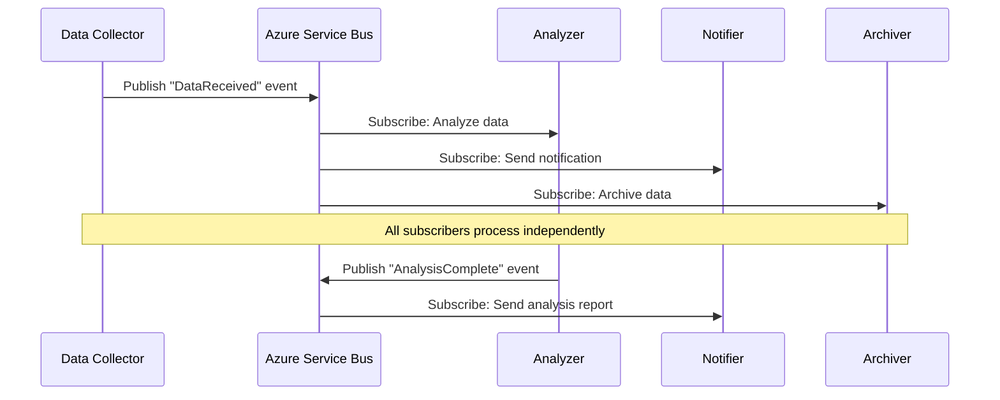
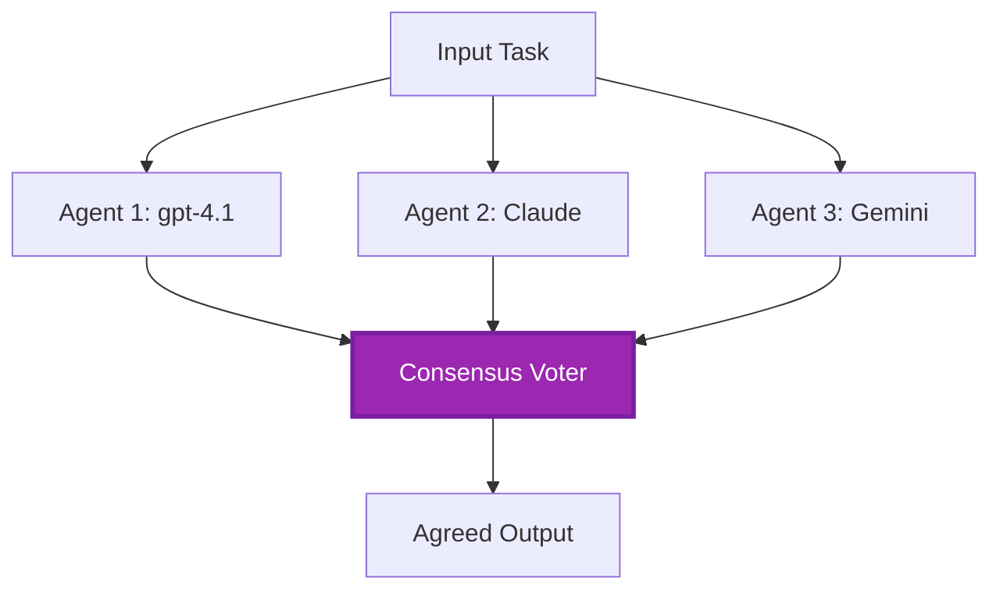
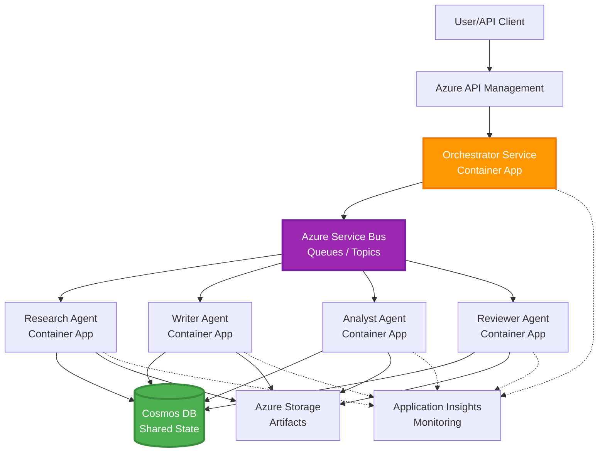

# תבניות תיאום של סוכנים מרובים

⏱️ **זמן משוער**: 60-75 דקות קריאה; מספר שעות לביצוע | 💰 **עלות משוערת**: תלויה בעומס העבודה | ⭐ **מורכבות**: מתקדם

**📚 מסלול לימוד:**
- ← קודם: [תכנון קיבולת](capacity-planning.md) - אסטרטגיות גודל ומשאבים
- 🎯 **אתה כאן**: תבניות תיאום סוכנים מרובים (תזמור, תקשורת, ניהול מצב)
- → הבא: [בחירת SKU](sku-selection.md) - בחירת שירותי Azure נכונים
- 🏠 [דף הקורס](../../README.md)

---

## מה תלמד

בסיום השיעור הזה, תוכל:
- להבין תבניות **ארכיטקטורת סוכנים מרובים** ומתי להשתמש בהן
- ליישם **תבניות תזמור** (מרוכז, מבוזר, היררכי)
- לתכנן אסטרטגיות **תקשורת סוכנים** (סינכרונית, אסינכרונית, מונעת אירועים)
- לנהל **מצב משותף** בין סוכנים מבוזרים
- לפרוס **מערכות סוכנים מרובים** ב-Azure באמצעות AZD
- ליישם **תבניות תיאום** בתרחישי AI מהעולם האמיתי
- לנטר ולתקן מערכות סוכנים מבוזרות

## מדוע תיאום סוכנים מרובים חשוב

### ההתפתחות: מסוכן יחיד לסוכנים מרובים

**סוכן יחיד (פשוט):**
```
User → Agent → Response
```
- ✅ קל להבנה וליישום
- ✅ מהיר למשימות פשוטות
- ❌ מוגבל ביכולות של מודל יחיד
- ❌ לא יכול לבצע משימות מורכבות במקביל
- ❌ ללא התמחות

**מערכת סוכנים מרובים (מתקדם):**

- ✅ סוכנים מתמחים למשימות ספציפיות
- ✅ ביצוע במקביל למהירות
- ✅ מודולרי וניתן לתחזוקה
- ✅ טוב יותר בתהליכים מורכבים
- ⚠️ דורש לוגיקת תיאום

**אנלוגיה**: סוכן יחיד הוא כמו אדם אחד שעושה את כל המשימות. סוכנים מרובים הם כמו צוות שכל חבר בו בעל מיומנות מיוחדת (חוקר, מקודד, ביקור, כותב) שעובדים יחד.

---

## תבניות תיאום מרכזיות

### תבנית 1: תיאום סדרתי (רצף אחריות)

**מתי להשתמש**: משימות חייבות להתבצע בסדר ספציפי, כל סוכן בונה על פלט קודם.



**יתרונות:**
- ✅ זרימת מידע ברורה
- ✅ קל לאיתור שגיאות
- ✅ סדר ביצוע צפוי

**מגבלות:**
- ❌ איטי יותר (אין מקביליות)
- ❌ כשל אחד עוצר את כל הרצף
- ❌ לא מתמודד עם משימות תלוי-אחרות

**דוגמאות שימוש:**
- צינור יצירת תוכן (מחקר → כתיבה → עריכה → פרסום)
- יצירת קוד (תכנון → יישום → בדיקה → פריסה)
- יצירת דוחות (איסוף נתונים → ניתוח → ויזואליזציה → סיכום)

---

### תבנית 2: תיאום מקבילי (פאן-אאוט/פאן-אין)

**מתי להשתמש**: משימות עצמאיות יכולות לפעול במקביל, התוצאות משולבות בסוף.



**יתרונות:**
- ✅ מהיר (ביצוע במקביל)
- ✅ עמיד לכשלים (תוצאות חלקיות מתקבלות)
- ✅ מתרחב אופקית

**מגבלות:**
- ⚠️ תוצאות עשויות להגיע לא לפי הסדר
- ⚠️ יש צורך בלוגיקת אגירה
- ⚠️ ניהול מצב מורכב

**דוגמאות שימוש:**
- איסוף נתונים ממקורות מרובים (API, מסדי נתונים, סקרייפינג)
- ניתוח תחרותי (דגמים מרובים מייצרים פתרונות, הבחירה הטובה ביותר)
- שירותי תרגום (תרגום למספר שפות במקביל)

---

### תבנית 3: תיאום היררכי (מנהל-עובד)

**מתי להשתמש**: תהליכים מורכבים עם תת-משימות, יש צורך בהאצלת סמכויות.



**יתרונות:**
- ✅ מתאים לתהליכים מורכבים
- ✅ מודולרי וניתן לתחזוקה
- ✅ גבולות אחריות ברורים

**מגבלות:**
- ⚠️ ארכיטקטורה מורכבת יותר
- ⚠️ השהיה גבוהה יותר (שכבות תיאום מרובות)
- ⚠️ דורש תזמור מתוחכם

**דוגמאות שימוש:**
- עיבוד מסמכים ארגוניים (סיווג → ניתוב → עיבוד → ארכיון)
- צינורות נתונים מרובי שלבים (קלט → ניקוי → המרה → ניתוח → דיווח)
- תהליכים אוטומטיים מורכבים (תכנון → הקצאת משאבים → ביצוע → ניטור)

---

### תבנית 4: תיאום מונחה אירועים (פרסם-והרשם)

**מתי להשתמש**: סוכנים צריכים להגיב לאירועים, רצוי ניתוק רפה.



**יתרונות:**
- ✅ ניתוק רפה בין סוכנים
- ✅ קל להוסיף סוכנים חדשים (פשוט להירשם)
- ✅ עיבוד אסינכרוני
- ✅ עמיד (שמירת הודעות)

**מגבלות:**
- ⚠️ עקביות בהדרגה
- ⚠️ איתור שגיאות מורכב
- ⚠️ אתגרי סדר הודעות

**דוגמאות שימוש:**
- מערכות ניטור בזמן אמת (התראות, לוחות בקרה, יומנים)
- התראות רב-ערוציות (אימייל, SMS, פוש, Slack)
- צינורות עיבוד נתונים (צרכנים מרובים על אותו מידע)

---

### תבנית 5: תיאום מבוסס הסכמה (הצבעה/קוואורום)

**מתי להשתמש**: יש צורך בהסכמה של כמה סוכנים לפני ההתקדמות.



**יתרונות:**
- ✅ דיוק גבוה יותר (דעות מרובות)
- ✅ עמיד לכשלים (כישלונות מיעוט מתקבלים)
- ✅ איכות מובטחת מובנית

**מגבלות:**
- ❌ יקר (קולות ממודלים מרובים)
- ❌ איטי יותר (ממתין לכל הסוכנים)
- ⚠️ יש צורך בפתרון קונפליקטים

**דוגמאות שימוש:**
- הפחתת תוכן (מספר דגמים בודקים תוכן)
- סקירת קוד (מספר מנתחים/לינטורים)
- אבחון רפואי (מספר דגמים עם בדיקה מקצועית)

---

## סקירת ארכיטקטורה

### מערכת סוכנים מרובים שלמה ב-Azure



**רכיבים מרכזיים:**

| רכיב | מטרה | שירות Azure |
|-----------|---------|---------------|
| **שער API** | נקודת כניסה, הגבלת קצב, אימות | API Management |
| **מתזמן** | מתאם תזרימי עבודה של סוכנים | Container Apps |
| **תור הודעות** | תקשורת אסינכרונית | Service Bus / Event Hubs |
| **סוכנים** | עובדי AI מתמחים | Container Apps / Functions |
| **מאגר מצבים** | מצב משותף, מעקב משימות | Cosmos DB |
| **אחסון ארטיפקטים** | מסמכים, תוצאות, לוגים | Blob Storage |
| **ניטור** | מעקב מבוזר, יומנים | Application Insights |

תורי Service Bus/נושאים ו-Event Hubs הם שירותים שונים עם מודלים שונים למשלוח/צריכה; Event Hubs אינו תחליף ישיר לקוד עובד Service Bus כאן. מקביליות, הודעות מתמשכות והצבעות מודל לא מבטיחים עמידות לכשלים או דיוק גבוה יותר בעצמם.

---

## דרישות מוקדמות

### כלים נדרשים

```bash
# Verify Azure Developer CLI
azd version
# Command reference baseline: azd 1.37.2

# Verify Azure CLI
az --version
# ✅ Expected: azure-cli 2.50.0 or higher

# Verify Docker (for local testing)
docker --version
# ✅ Expected: Docker version 20.10 or higher
```

### דרישות Azure

- מנוי Azure פעיל
- הרשאות ליצירת:
  - Container Apps
  - מרחבי שמות Service Bus
  - חשבונות Cosmos DB
  - חשבונות אחסון
  - Application Insights

### דרישות ידע מוקדמות

עליך להשלים:
- [ניהול קונפיגורציה](../chapter-03-configuration/configuration.md)
- [אימות ואבטחה](../chapter-03-configuration/authsecurity.md)
- [דוגמת מיקרו-שירותים](../../../../examples/microservices)

---

## מדריך ביצוע

> **קטעי עיצוב, לא מעבדה להפעלה:** עץ הפרויקט ותוויות `File:` מטה מתארים קבצים ליצירה בפרויקט שלך; מאגר זה אינו מכיל יישום `multi-agent-system` מלא. חוסרים כלולים בתבניות מפתח/פרמטר, סביבה/רישום Container Apps, Dockerfiles ונעילות תלות, הקמת מאגר/מכולה Cosmos, פריסות מודלים, הגדרות זהות/תפקידים, חוקים לסקיילינג, ועובדים/תורים מקבילים. אל תצפה ש-`azd init` יפיק את הקבצים האלה או ש-`azd up` יפרוס את הקטעים ללא שינוי. לנקודת התחלה ניתנת לביצוע, סיים את [יסודות סוכנים מרובים](../chapter-05-multi-agent/multi-agent-basics.md).

**הנחות ריצה:** Python 3.10+, `azure-servicebus`, `azure-cosmos`, `openai`, Flask, ו-(לצורך ניטור) `azure-monitor-opentelemetry`; הנח את `shared` בנתיב הייבוא של Python בכל תמונת שירות. מכולת Cosmos `agent-state/tasks` חייבת כבר להתקיים עם מפתח חלוקה `/id`. חיבורים מבוססי-מפתחות מפשטים קטעים אלו, לא הנחייה לפרודקשן: העדף זהויות מנוהלות עם תפקידי נתונים מוגדרים ל-Service Bus/Cosmos/OpenAI. אל תחשוף מפתחות ביציאות או ביומנים.

משלוח Service Bus הוא **לפחות פעם אחת**. שמור על איסטומפוטנטיות לכל משימה **ולכל שלב**, השתמש בתחרות אופטימית (ETags) לקריאה/שינוי/כתיבה של מצב, וחידש נעילות הודעות בעיבוד ארוך. מנהל מצב פשוט למטה הוא רק סדרתי ואינו מיישם הבטחות אלו מהפרודקשן.

### מבנה הפרויקט

```
multi-agent-system/
├── azure.yaml                    # AZD configuration
├── infra/
│   ├── main.bicep               # Main infrastructure
│   ├── core/
│   │   ├── servicebus.bicep     # Message queue
│   │   ├── cosmos.bicep         # State store
│   │   ├── storage.bicep        # Artifact storage
│   │   └── monitoring.bicep     # Application Insights
│   └── app/
│       ├── orchestrator.bicep   # Orchestrator service
│       └── agent.bicep          # Agent template
└── src/
    ├── orchestrator/            # Orchestration logic
    │   ├── app.py
    │   ├── workflows.py
    │   └── Dockerfile
    ├── agents/
    │   ├── research/            # Research agent
    │   ├── writer/              # Writer agent
    │   ├── analyst/             # Analyst agent
    │   └── reviewer/            # Reviewer agent
    └── shared/
        ├── state_manager.py     # Shared state logic
        └── message_handler.py   # Message handling
```

---

## שיעור 1: תבנית תיאום סדרתי

### יישום: צינור יצירת תוכן

נבנה צינור סדרתי: מחקר → כתיבה → עריכה. פרסום מחוץ לדוגמה זו.

### 1. הגדרת AZD

**קובץ: `azure.yaml`**

```yaml
name: content-pipeline
metadata:
  template: multi-agent-sequential@1.0.0

services:
  orchestrator:
    project: ./src/orchestrator
    language: python
    host: containerapp
  
  research-agent:
    project: ./src/agents/research
    language: python
    host: containerapp
  
  writer-agent:
    project: ./src/agents/writer
    language: python
    host: containerapp
  
  editor-agent:
    project: ./src/agents/editor
    language: python
    host: containerapp
```

### 2. תשתית: Service Bus לתיאום

**קובץ: `infra/core/servicebus.bicep`**

```bicep
param name string
param location string
param tags object = {}

resource serviceBusNamespace 'Microsoft.ServiceBus/namespaces@2022-10-01-preview' = {
  name: name
  location: location
  tags: tags
  sku: {
    name: 'Standard'
    tier: 'Standard'
  }
  properties: {
    minimumTlsVersion: '1.2'
  }
}

// Queue for orchestrator → research agent
resource researchQueue 'Microsoft.ServiceBus/namespaces/queues@2022-10-01-preview' = {
  parent: serviceBusNamespace
  name: 'research-tasks'
  properties: {
    maxDeliveryCount: 3
    lockDuration: 'PT5M'
    deadLetteringOnMessageExpiration: true
  }
}

// Queue for research agent → writer agent
resource writerQueue 'Microsoft.ServiceBus/namespaces/queues@2022-10-01-preview' = {
  parent: serviceBusNamespace
  name: 'writer-tasks'
  properties: {
    maxDeliveryCount: 3
    lockDuration: 'PT5M'
  }
}

// Queue for writer agent → editor agent
resource editorQueue 'Microsoft.ServiceBus/namespaces/queues@2022-10-01-preview' = {
  parent: serviceBusNamespace
  name: 'editor-tasks'
  properties: {
    maxDeliveryCount: 3
    lockDuration: 'PT5M'
  }
}

output namespace string = serviceBusNamespace.name
// Do not output RootManageSharedAccessKey. Resolve scoped credentials
// securely or use managed identity in the application and scale rules.
```

### 3. מנהל מצב משותף

**קובץ: `src/shared/state_manager.py`**

```python
from azure.cosmos import CosmosClient, PartitionKey
from datetime import datetime, timezone
import os

class StateManager:
    """Manages shared state across agents using Cosmos DB"""
    
    def __init__(self):
        endpoint = os.environ['COSMOS_ENDPOINT']
        key = os.environ['COSMOS_KEY']
        
        self.client = CosmosClient(endpoint, key)
        self.database = self.client.get_database_client('agent-state')
        self.container = self.database.get_container_client('tasks')
    
    def create_task(self, task_id: str, task_type: str, input_data: dict):
        """Create a new task"""
        task = {
            'id': task_id,
            'type': task_type,
            'status': 'pending',
            'input': input_data,
            'created_at': datetime.now(timezone.utc).isoformat(),
            'steps': []
        }
        self.container.create_item(task)
        return task
    
    def update_task_step(self, task_id: str, step_name: str, result: dict):
        """Update task with completed step"""
        task = self.container.read_item(task_id, partition_key=task_id)
        
        task['steps'].append({
            'name': step_name,
            'completed_at': datetime.now(timezone.utc).isoformat(),
            'result': result
        })
        
        self.container.replace_item(task_id, task)
        return task
    
    def complete_task(self, task_id: str, final_result: dict):
        """Mark task as complete"""
        task = self.container.read_item(task_id, partition_key=task_id)
        task['status'] = 'completed'
        task['result'] = final_result
        task['completed_at'] = datetime.now(timezone.utc).isoformat()
        self.container.replace_item(task_id, task)
        return task
    
    def get_task(self, task_id: str):
        """Retrieve task state"""
        return self.container.read_item(task_id, partition_key=task_id)
```

### 4. שירות מתזמן

**קובץ: `src/orchestrator/app.py`**

```python
from flask import Flask, request, jsonify
from azure.servicebus import ServiceBusClient, ServiceBusMessage
import json
import uuid
import os
from shared.state_manager import StateManager

app = Flask(__name__)
state_manager = StateManager()

# Service Bus connection
servicebus_connection_str = os.environ['SERVICEBUS_CONNECTION_STRING']
servicebus_client = ServiceBusClient.from_connection_string(servicebus_connection_str)

@app.route('/health', methods=['GET'])
def health():
    return jsonify({'status': 'healthy', 'service': 'orchestrator'})

@app.route('/create-content', methods=['POST'])
def create_content():
    """
    Sequential workflow: Research → Write → Edit (returns a draft; no publishing)
    """
    data = request.get_json(silent=True) or {}
    topic = data.get('topic')
    
    if not topic:
        return jsonify({'error': 'Topic required'}), 400
    
    # Create task in state store
    task_id = str(uuid.uuid4())
    task = state_manager.create_task(
        task_id=task_id,
        task_type='content_creation',
        input_data={'topic': topic}
    )
    
    # Send message to research agent (first step)
    sender = servicebus_client.get_queue_sender('research-tasks')
    message = ServiceBusMessage(
        body=json.dumps({
            'task_id': task_id,
            'topic': topic,
            'next_queue': 'writer-tasks'  # Where to send results
        }),
        content_type='application/json'
    )
    
    with sender:
        sender.send_messages(message)
    
    return jsonify({
        'task_id': task_id,
        'status': 'started',
        'workflow': 'sequential',
        'steps': ['research', 'write', 'edit'],
        'message': 'Content creation pipeline initiated'
    }), 202

@app.route('/task/<task_id>', methods=['GET'])
def get_task_status(task_id):
    """Check task status"""
    try:
        task = state_manager.get_task(task_id)
        return jsonify(task)
    except Exception as e:
        return jsonify({'error': str(e)}), 404

if __name__ == '__main__':
    app.run(host='0.0.0.0', port=8080)
```

### 5. סוכן מחקר

**קובץ: `src/agents/research/app.py`**

```python
from azure.servicebus import ServiceBusClient, ServiceBusMessage
from openai import AzureOpenAI
import json
import os
import time
from shared.state_manager import StateManager

# Initialize clients
state_manager = StateManager()
servicebus_client = ServiceBusClient.from_connection_string(
    os.environ['SERVICEBUS_CONNECTION_STRING']
)

openai_client = AzureOpenAI(
    api_key=os.environ['AZURE_OPENAI_API_KEY'],
    api_version="2024-10-21",
    azure_endpoint=os.environ['AZURE_OPENAI_ENDPOINT']
)

def process_research_task(message_data):
    """Process research request and pass to writer"""
    task_id = message_data['task_id']
    topic = message_data['topic']
    next_queue = message_data['next_queue']
    
    print(f"🔬 Researching: {topic}")
    
    # Call Microsoft Foundry Models for research
    response = openai_client.chat.completions.create(
        model=os.environ['AZURE_OPENAI_DEPLOYMENT'],
        messages=[
            {"role": "system", "content": "You are a research assistant. Provide comprehensive research on the given topic."},
            {"role": "user", "content": f"Research this topic thoroughly: {topic}"}
        ],
        max_tokens=1500
    )
    
    research_results = response.choices[0].message.content
    
    # Update state
    state_manager.update_task_step(
        task_id=task_id,
        step_name='research',
        result={'research': research_results}
    )
    
    # Send to next agent (writer)
    sender = servicebus_client.get_queue_sender(next_queue)
    message = ServiceBusMessage(
        body=json.dumps({
            'task_id': task_id,
            'topic': topic,
            'research': research_results,
            'next_queue': 'editor-tasks'
        }),
        content_type='application/json'
    )
    
    with sender:
        sender.send_messages(message)
    
    print(f"✅ Research complete for task {task_id}")

def main():
    """Listen to research queue"""
    receiver = servicebus_client.get_queue_receiver('research-tasks')
    
    print("🔬 Research Agent started, listening for tasks...")
    
    with receiver:
        while True:
            messages = receiver.receive_messages(max_wait_time=5)
            for message in messages:
                try:
                    message_data = json.loads(str(message))
                    process_research_task(message_data)
                    receiver.complete_message(message)
                except Exception as e:
                    print(f"❌ Error processing message: {e}")
                    receiver.abandon_message(message)

if __name__ == '__main__':
    main()
```

### 6. סוכן כותב

**קובץ: `src/agents/writer/app.py`**

```python
from azure.servicebus import ServiceBusClient, ServiceBusMessage
from openai import AzureOpenAI
import json
import os
from shared.state_manager import StateManager

state_manager = StateManager()
servicebus_client = ServiceBusClient.from_connection_string(
    os.environ['SERVICEBUS_CONNECTION_STRING']
)

openai_client = AzureOpenAI(
    api_key=os.environ['AZURE_OPENAI_API_KEY'],
    api_version="2024-10-21",
    azure_endpoint=os.environ['AZURE_OPENAI_ENDPOINT']
)

def process_writing_task(message_data):
    """Write article based on research"""
    task_id = message_data['task_id']
    topic = message_data['topic']
    research = message_data['research']
    next_queue = message_data['next_queue']
    
    print(f"✍️ Writing article: {topic}")
    
    # Call Microsoft Foundry Models to write article
    response = openai_client.chat.completions.create(
        model=os.environ['AZURE_OPENAI_DEPLOYMENT'],
        messages=[
            {"role": "system", "content": "You are a professional writer. Write engaging, well-structured articles."},
            {"role": "user", "content": f"Based on this research:\n\n{research}\n\nWrite a comprehensive article about: {topic}"}
        ],
        max_tokens=2000
    )
    
    article_draft = response.choices[0].message.content
    
    # Update state
    state_manager.update_task_step(
        task_id=task_id,
        step_name='writing',
        result={'draft': article_draft}
    )
    
    # Send to editor
    sender = servicebus_client.get_queue_sender(next_queue)
    message = ServiceBusMessage(
        body=json.dumps({
            'task_id': task_id,
            'topic': topic,
            'draft': article_draft
        }),
        content_type='application/json'
    )
    
    with sender:
        sender.send_messages(message)
    
    print(f"✅ Article draft complete for task {task_id}")

def main():
    """Listen to writer queue"""
    receiver = servicebus_client.get_queue_receiver('writer-tasks')
    
    print("✍️ Writer Agent started, listening for tasks...")
    
    with receiver:
        while True:
            messages = receiver.receive_messages(max_wait_time=5)
            for message in messages:
                try:
                    message_data = json.loads(str(message))
                    process_writing_task(message_data)
                    receiver.complete_message(message)
                except Exception as e:
                    print(f"❌ Error: {e}")
                    receiver.abandon_message(message)

if __name__ == '__main__':
    main()
```

### 7. סוכן עורך

**קובץ: `src/agents/editor/app.py`**

```python
from azure.servicebus import ServiceBusClient
from openai import AzureOpenAI
import json
import os
from shared.state_manager import StateManager

state_manager = StateManager()
servicebus_client = ServiceBusClient.from_connection_string(
    os.environ['SERVICEBUS_CONNECTION_STRING']
)

openai_client = AzureOpenAI(
    api_key=os.environ['AZURE_OPENAI_API_KEY'],
    api_version="2024-10-21",
    azure_endpoint=os.environ['AZURE_OPENAI_ENDPOINT']
)

def process_editing_task(message_data):
    """Edit and finalize article"""
    task_id = message_data['task_id']
    topic = message_data['topic']
    draft = message_data['draft']
    
    print(f"📝 Editing article: {topic}")
    
    # Call Microsoft Foundry Models to edit
    response = openai_client.chat.completions.create(
        model=os.environ['AZURE_OPENAI_DEPLOYMENT'],
        messages=[
            {"role": "system", "content": "You are an expert editor. Improve grammar, clarity, and structure."},
            {"role": "user", "content": f"Edit and improve this article:\n\n{draft}"}
        ],
        max_tokens=2000
    )
    
    final_article = response.choices[0].message.content
    
    # Mark task as complete
    state_manager.complete_task(
        task_id=task_id,
        final_result={
            'topic': topic,
            'final_article': final_article,
            'word_count': len(final_article.split())
        }
    )
    
    print(f"✅ Article finalized for task {task_id}")

def main():
    """Listen to editor queue"""
    receiver = servicebus_client.get_queue_receiver('editor-tasks')
    
    print("📝 Editor Agent started, listening for tasks...")
    
    with receiver:
        while True:
            messages = receiver.receive_messages(max_wait_time=5)
            for message in messages:
                try:
                    message_data = json.loads(str(message))
                    process_editing_task(message_data)
                    receiver.complete_message(message)
                except Exception as e:
                    print(f"❌ Error: {e}")
                    receiver.abandon_message(message)

if __name__ == '__main__':
    main()
```

### 8. פריסה ובדיקות

פקודות אלה חלות **רק לאחר יישום קובצי הפרויקט החסרים**. אתחול סוכן Foundry אינטראקטיבי הוא זרימת עבודה נפרדת; הוא אינו מייצר את עיצוב Service Bus זה.

```bash
# In your completed custom project
azd up

# Alternative in a SEPARATE empty folder (agents beta.23 requires azd >= 1.37)
azd extension install azure.ai.agents
azd ai agent init
azd up
```

> ראה [פקודות AZD AI CLI](../chapter-08-production/production-ai-practices.md#azd-ai-cli-commands-and-extensions) לכל הדגלים והאפשרויות של `azd ai`.

```bash
# Get orchestrator URL
ORCHESTRATOR_URL=$(azd env get-values | grep ORCHESTRATOR_URL | cut -d '=' -f2 | tr -d '"')

# Create content
curl -X POST $ORCHESTRATOR_URL/create-content \
  -H "Content-Type: application/json" \
  -d '{"topic": "The Future of AI in Healthcare"}'
```

**✅ פלט צפוי:**
```json
{
  "task_id": "a1b2c3d4-e5f6-7890-abcd-ef1234567890",
  "status": "started",
  "workflow": "sequential",
  "steps": ["research", "write", "edit"],
  "message": "Content creation pipeline initiated"
}
```

**בדוק התקדמות משימה:**
```bash
TASK_ID="a1b2c3d4-e5f6-7890-abcd-ef1234567890"
curl $ORCHESTRATOR_URL/task/$TASK_ID
```

**✅ פלט צפוי (הושלם):**
```json
{
  "id": "a1b2c3d4-e5f6-7890-abcd-ef1234567890",
  "type": "content_creation",
  "status": "completed",
  "steps": [
    {
      "name": "research",
      "completed_at": "2025-11-19T10:30:00Z",
      "result": {"research": "..."}
    },
    {
      "name": "writing",
      "completed_at": "2025-11-19T10:32:00Z",
      "result": {"draft": "..."}
    }
  ],
  "result": {
    "topic": "The Future of AI in Healthcare",
    "final_article": "...",
    "word_count": 1500
  }
}
```

---

## שיעור 2: תבנית תיאום מקבילי

### יישום: אגגרגטור מחקר מרובה מקורות

נבנה מערכת מקבילה שאוספת מידע ממספר מקורות בו-זמנית.

### מתזמן מקבילי

**קובץ: `src/orchestrator/parallel_workflow.py`**

```python
from flask import Flask, request, jsonify
from azure.servicebus import ServiceBusClient, ServiceBusMessage
import json
import uuid
import os
from shared.state_manager import StateManager

app = Flask(__name__)
state_manager = StateManager()

servicebus_client = ServiceBusClient.from_connection_string(
    os.environ['SERVICEBUS_CONNECTION_STRING']
)

@app.route('/research-parallel', methods=['POST'])
def research_parallel():
    """
    Parallel workflow: Multiple agents work simultaneously
    """
    data = request.json
    query = data.get('query')
    
    task_id = str(uuid.uuid4())
    task = state_manager.create_task(
        task_id=task_id,
        task_type='parallel_research',
        input_data={
            'query': query,
            'agents': ['web', 'academic', 'news', 'social']
        }
    )
    
    # Fan-out: publish sequentially; workers may process concurrently.
    agents = [
        ('web-research-queue', 'web'),
        ('academic-research-queue', 'academic'),
        ('news-research-queue', 'news'),
        ('social-research-queue', 'social')
    ]
    
    for queue_name, agent_type in agents:
        sender = servicebus_client.get_queue_sender(queue_name)
        message = ServiceBusMessage(
            body=json.dumps({
                'task_id': task_id,
                'query': query,
                'agent_type': agent_type,
                'result_queue': 'aggregation-queue'
            }),
            content_type='application/json'
        )
        
        with sender:
            sender.send_messages(message)
    
    return jsonify({
        'task_id': task_id,
        'status': 'started',
        'workflow': 'parallel',
        'agents_dispatched': 4,
        'message': 'Parallel research initiated'
    }), 202

if __name__ == '__main__':
    app.run(host='0.0.0.0', port=8080)
```

### לוגיקת אגירה

**קובץ: `src/agents/aggregator/app.py`**

```python
from azure.servicebus import ServiceBusClient
import json
import os
from collections import defaultdict
from shared.state_manager import StateManager

state_manager = StateManager()
servicebus_client = ServiceBusClient.from_connection_string(
    os.environ['SERVICEBUS_CONNECTION_STRING']
)

# Single-process demo only: not durable or shared across replicas.
# Production: use durable unique (task_id, agent_type) result records.
task_results = defaultdict(dict)
expected_agents = 4  # web, academic, news, social

def process_result(message_data):
    """Aggregate results from parallel agents"""
    task_id = message_data['task_id']
    agent_type = message_data['agent_type']
    result = message_data['result']
    
    # Store result
    task_results[task_id][agent_type] = {
        'agent': agent_type,
        'data': result
    }
    
    print(f"📊 Received result from {agent_type} agent ({len(task_results[task_id])}/{expected_agents})")
    
    # Check if all agents completed (fan-in)
    if len(task_results[task_id]) == expected_agents:
        print(f"✅ All agents completed for task {task_id}. Aggregating...")
        
        # Combine results
        aggregated = {
            'query': message_data['query'],
            'sources': list(task_results[task_id].values()),
            'summary': generate_summary(list(task_results[task_id].values()))
        }
        
        # Mark complete
        state_manager.complete_task(task_id, aggregated)
        
        # Clean up
        del task_results[task_id]
        
        print(f"✅ Aggregation complete for task {task_id}")

def generate_summary(results):
    """Generate summary from all sources"""
    summaries = [r['data'].get('summary', '') for r in results]
    return '\n\n'.join(summaries)

def main():
    """Listen to aggregation queue"""
    receiver = servicebus_client.get_queue_receiver('aggregation-queue')
    
    print("📊 Aggregator started, listening for results...")
    
    with receiver:
        while True:
            messages = receiver.receive_messages(max_wait_time=5)
            for message in messages:
                try:
                    message_data = json.loads(str(message))
                    process_result(message_data)
                    receiver.complete_message(message)
                except Exception as e:
                    print(f"❌ Error: {e}")
                    receiver.abandon_message(message)

if __name__ == '__main__':
    main()
```

**יתרונות תבנית מקבילית:**
- ⚡ **פוטנציאלית השהיה נמוכה יותר** (מוגבלת לעובד האיטי ביותר בתוספת עלות תיאום)
- 🔄 **מתמיכה בתוצאות חלקיות** עם מועדים ונהלי כשל מפורשים (לא מיושם באגגרגטור בסיסי)
- 📈 **מתרחבת** (הוסף בקלות סוכנים נוספים)

---

## תרגילים מעשיים

### תרגיל 1: הוסף טיפול בזמן קצוב ⭐⭐ (בינוני)

**מטרה**: ליישם לוגיקת זמן קצוב כדי שאגגרגטור לא יחכה לנצח לסוכנים איטיים.

**נקודת התחלה:** הרץ סימולציית מועד סיום מקומית זו לפני שילוב עם עובד תור. בדיקת זמן קצוב שמופעלת רק כשהודעה חדשה מגיעה לעולם לא תופעל אם העובד החסר לא שולח דבר.

**שלבים**:

1. **הוסף מעקב זמן קצוב לאגגרגטור:**

```python
import asyncio

async def simulated_agent(name, delay):
    await asyncio.sleep(delay)
    return {'agent': name, 'result': 'done'}

async def main():
    tasks = [asyncio.create_task(simulated_agent(name, delay))
             for name, delay in [('web', 0.1), ('academic', 0.2),
                                 ('news', 0.3), ('social', 3)]]
    done, pending = await asyncio.wait(tasks, timeout=1)
    results = [task.result() for task in done]
    for task in pending:
        task.cancel()
    await asyncio.gather(*pending, return_exceptions=True)
    print({'completed_agents': len(results), 'timed_out': bool(pending)})
    assert len(results) == 3 and pending

asyncio.run(main())
```

2. **פלט צפוי:**

```text
{'completed_agents': 3, 'timed_out': True}
```

3. **שילוב במערכת התורים (משימת עיצוב):** שמור את מועד התפוצה והסוכנים הצפויים ביצירת המשימה, הפעל סריקת מועדים תקופתית שאינה תלויה בתוצאות נכנסות, סיים אטומטית תוצאות חלקיות, ותתעלם מהודעות מאוחרות/כפולות למשימות סגורות. זמן קצוב מקומי לא מבטל עובדים מרוחקים.

רק עבור הפרויקט הממומש שלך:

```bash
azd deploy aggregator

# Submit task
curl -X POST $ORCHESTRATOR_URL/research-parallel \
  -H "Content-Type: application/json" \
  -d '{"query": "AI safety research"}'

# Check results after 30 seconds
curl $ORCHESTRATOR_URL/task/$TASK_ID
```

**✅ קריטריוני הצלחה:**
- ✅ המבחן המקומי מחזיר תוצאה לאחר זמן הקצוב שלו גם אם סוכן לא הושלם
- ✅ התגובה מציינת תוצאות חלקיות (`"timed_out": true`)
- ✅ התוצאות הזמינות מוחזרות (3 מתוך 4 סוכנים)

**זמן**: 20-25 דקות

---

### תרגיל 2: יישום לוגיקת ניסיון חוזר ⭐⭐⭐ (מתקדם)

**מטרה**: לנסות מחדש אוטומטית משימות סוכנים שנכשלו לפני וויתור.

**שלבים**:

1. **השתמש בספירת משלוחים של Service Bus במקום ספירות ניסיון חוזר מותאמות אישית:**

```python
import json
import time
# Integration fragment: use a live peek-lock ServiceBusReceiver.
# Set queue maxDeliveryCount to 4 for one attempt + up to three retries.
```

2. **הוסף מטפל ניסיונות חוזרים לסוכנים:**

```python
def process_with_retry(message, receiver, process_func):
    """Process message with automatic retry on failure"""
    try:
        message_data = json.loads(str(message))
        
        # Process the message
        process_func(message_data)
        
        # Success - complete
        receiver.complete_message(message)
        
    except Exception as e:
        if message.delivery_count < 4:
            # Bounded exponential delay: 5s, 10s, 20s.
            # Renew the lock if processing + waiting can exceed its duration.
            time.sleep(5 * 2 ** (message.delivery_count - 1))
            receiver.abandon_message(message)
        else:
            # Max retries exceeded - move to dead letter queue
            print(f"❌ Max attempts exceeded for message {message.message_id}")
            receiver.dead_letter_message(
                message,
                reason="MaxRetriesExceeded",
                error_description=str(e)
            )
```

3. **נטר את תור המכתבים המתים:**

```python
def monitor_dead_letters():
    """Check dead letter queue for failed messages"""
    receiver = servicebus_client.get_queue_receiver(
        'research-tasks',
        sub_queue='deadletter'
    )
    
    with receiver:
        messages = receiver.receive_messages(max_wait_time=5)
        for message in messages:
            print(f"☠️ Dead letter: {message.message_id}")
            print(f"Reason: {message.dead_letter_reason}")
            print(f"Description: {message.dead_letter_error_description}")
```

**✅ קריטריוני הצלחה:**
- ✅ משימות שנכשלו מנסות שוב אוטומטית (עד 3 פעמים)
- ✅ השהייה מעריכית בין הנסיונות (5 שניות, 10 שניות, 20 שניות), עם חידוש נעילת הודעה במידת הצורך
- ✅ לאחר כישלונות מרביים, הודעות מגיעות לתור מכתבים מתים
- ✅ הודעות בתור מכתבים מתים ניתנות לבדיקה; נדרשת זרימת עבודה נפרדת ומזהמת לשחזור

**זמן**: 30-40 דקות

---

### תרגיל 3: יישום מפסק מעגל ⭐⭐⭐ (מתקדם)

**מטרה**: למנוע כשלים כרוניים על ידי עצירת בקשות לסוכנים שנכשלים.

**שלבים**:

1. **צור מחלקת מפסק מעגל:**

```python
from enum import Enum
from datetime import datetime, timedelta, timezone

class CircuitState(Enum):
    CLOSED = "closed"      # Normal operation
    OPEN = "open"          # Failing, reject requests
    HALF_OPEN = "half_open"  # Testing if recovered

class CircuitBreaker:
    def __init__(self, failure_threshold=5, timeout_seconds=60):
        self.failure_threshold = failure_threshold
        self.timeout_seconds = timeout_seconds
        self.failure_count = 0
        self.last_failure_time = None
        self.state = CircuitState.CLOSED
    
    def call(self, func):
        """Execute function with circuit breaker protection"""
        if self.state == CircuitState.OPEN:
            # Check if timeout expired
            if datetime.now(timezone.utc) - self.last_failure_time > timedelta(seconds=self.timeout_seconds):
                self.state = CircuitState.HALF_OPEN
                print("🔄 Circuit breaker: HALF_OPEN (testing)")
            else:
                raise Exception(f"Circuit breaker OPEN for agent. Try again in {self.timeout_seconds}s")
        
        try:
            result = func()
            
            # Success
            self.failure_count = 0 # Count consecutive failures only
            if self.state == CircuitState.HALF_OPEN:
                self.state = CircuitState.CLOSED
                self.failure_count = 0
                print("✅ Circuit breaker: CLOSED (recovered)")
            
            return result
            
        except Exception as e:
            self.failure_count += 1
            self.last_failure_time = datetime.now(timezone.utc)
            
            if self.failure_count >= self.failure_threshold:
                self.state = CircuitState.OPEN
                print(f"🔴 Circuit breaker: OPEN (too many failures)")
            
            raise
```

2. **החל על קריאות לסוכנים:**

```python
# In orchestrator
agent_circuits = {
    'web': CircuitBreaker(failure_threshold=5, timeout_seconds=60),
    'academic': CircuitBreaker(failure_threshold=5, timeout_seconds=60),
    'news': CircuitBreaker(failure_threshold=5, timeout_seconds=60),
    'social': CircuitBreaker(failure_threshold=5, timeout_seconds=60)
}

def send_to_agent(agent_type, message_data):
    """Send with circuit breaker protection"""
    circuit = agent_circuits[agent_type]
    
    try:
        circuit.call(lambda: send_message(agent_type, message_data))
    except Exception as e:
        print(f"⚠️ Skipping {agent_type} agent: {e}")
        # Continue with other agents
```

מעגל זה מגן על **פעולת השליחה**, לא על השלמתה על ידי העובד מרחוק: הכנסת הודעה לתור בהצלחה אינה אומרת דבר לגבי האם הסוכן פעיל. `send_message` היא פונקציית השולח של היישום שלך. עבור מעגלי ביצוע, הזן תקלות/איחורים שנצפו במשימה אל מתאם עמיד. מחלקה בזיכרון זו היא הדגמה חד-תהליכית, לא מתג מעגלים מבוזר.

3. **בדוק את מתג המעגל מקומית:**

```python
# Run after the class definition; no Azure changes required.
circuit = CircuitBreaker(failure_threshold=5, timeout_seconds=0)
def fail():
    raise RuntimeError("simulated failure")
for _ in range(5):
    try:
        circuit.call(fail)
    except RuntimeError:
        pass
assert circuit.state == CircuitState.OPEN
assert circuit.call(lambda: "recovered") == "recovered"
assert circuit.state == CircuitState.CLOSED
print("Circuit breaker recovery verified")
```

**✅ קריטריוני הצלחה:**
- ✅ לאחר 5 כשלונות, המעגל נפתח (דוחה בקשות)
- ✅ לאחר 60 שניות, המעגל חצי פתוח (בודק התאוששות)
- ✅ סוכנים אחרים ממשיכים לעבוד כרגיל
- ✅ המעגל נסגר אוטומטית כשסוכן מתאושש

**זמן**: 40-50 דקות

---

## ניטור ודיוג

### עקיבה מבוזרת עם Application Insights

**קובץ: `src/shared/tracing.py`**

```python
from azure.monitor.opentelemetry import configure_azure_monitor
from opentelemetry import trace
from opentelemetry.trace import SpanKind
import logging
import os

connection_string = os.environ.get('APPLICATIONINSIGHTS_CONNECTION_STRING')

# Configure once per process. Message send/receive trace-context propagation
# and agent attributes on exceptions need explicit instrumentation.
if connection_string:
    configure_azure_monitor(connection_string=connection_string, logger_name=__name__)
tracer = trace.get_tracer(__name__)

# Configure logging
logger = logging.getLogger(__name__)
logger.setLevel(logging.INFO)

def trace_agent_call(agent_name, task_id, operation_name, operation):
    """Trace agent operations"""
    with tracer.start_as_current_span(f'agent.{agent_name}.{operation_name}', kind=SpanKind.CLIENT) as span:
        span.set_attribute('agent', agent_name)
        span.set_attribute('task_id', task_id)
        span.set_attribute('operation', operation_name)
        
        try:
            result = operation()
            span.set_attribute('status', 'success')
            logger.info('Agent operation completed', extra={
                'agent': agent_name, 'task_id': task_id, 'operation': operation_name
            })
            return result
        except Exception as e:
            span.set_attribute('status', 'error')
            logger.exception('Agent operation failed', extra={
                'agent': agent_name, 'task_id': task_id, 'operation': operation_name
            })
            raise
```

### שאילתות ב-Application Insights

**עקוב אחרי זרימות עבודה מרובות סוכנים:**

```kusto
// Trace complete workflow for a task
traces
| where customDimensions.task_id == "a1b2c3d4-..."
| project timestamp, message, customDimensions.agent, customDimensions.operation
| order by timestamp asc
```

**השוואת ביצועי סוכנים:**

```kusto
// Compare agent execution times
dependencies
| where name contains "agent"
| summarize 
    avg_duration = avg(duration),
    p95_duration = percentile(duration, 95),
    count = count()
  by agent = tostring(customDimensions.agent)
| order by avg_duration desc
```

**ניתוח כשלונות:**

```kusto
// Find which agents fail most
exceptions
| where customDimensions.agent != ""
| summarize 
    failure_count = count(),
    unique_errors = dcount(outerMessage)
  by agent = tostring(customDimensions.agent)
| order by failure_count desc
```

---

## ניתוח עלויות

### עלויות מערכת מרובת סוכנים (הערכות חודשיות)

נתוני תכנון מדגימים בלבד, לא הצעות מחיר: הסכום למטה הוא **240-565$ לחודש**. אמת שיעורים אזוריים נוכחיים, שעות רפליקות פעילות/בטל, תמהיל אסימונים לקלט/פלט, אחסון וטלמטריה. Serverless אין לו מינימום תפוקה מושכר אך עדיין מחויב לבקשות ואחסון.

| רכיב | תצורה | עלות |
|-----------|--------------|------|
| **מתאם מרכזי** | 1 אפליקציית מכולה (1 vCPU, 2GB) | 30-50$ |
| **4 סוכנים** | 4 אפליקציות מכולה (0.5 vCPU, 1GB כל אחת) | 60-120$ |
| **Service Bus** | רמת סטנדרט, 10M הודעות | 10-20$ |
| **Cosmos DB** | Serverless, 5GB אחסון, 1M RUs | 25-50$ |
| **Blob Storage** | 10GB אחסון, 100K פעולות | 5-10$ |
| **Application Insights** | 5GB קליטה | 10-15$ |
| **דגמים של Microsoft Foundry** | gpt-4.1, 10M אסימונים | 100-300$ |
| **סה"כ** | | **240-565$ לחודש** |

### אסטרטגיות אופטימיזציה בעלויות

1. **השתמש ב-serverless כאשר אפשרי:**
   ```bicep
   // Cosmos DB serverless (no minimum cost)
   properties: {
     databaseAccountOfferType: 'Standard'
     capabilities: [{ name: 'EnableServerless' }]
   }
   ```

2. **הקטן סוכנים לאפס כאשר לא פעילים:**
   ```bicep
   scale: {
     minReplicas: 0  // Requires a Service Bus/KEDA scale rule to wake workers
     maxReplicas: 10
   }
   ```

3. **השתמש באצווה ל-Service Bus:**
   ```python
   # Send messages in batches (cheaper)
   sender.send_messages([message1, message2, message3])
   ```

4. **מטמון תוצאות בשימוש תכוף:**
   ```python
   # Use Azure Cache for Redis
   if cache.exists(query_hash):
       return cache.get(query_hash)
   ```

---

## שיטות עבודה מומלצות

### ✅ יש לעשות:

1. **השתמש בפעולות אידמפוטנטיות**
   ```python
   # Pseudocode: implement a durable, atomic per-step deduplication claim.
   def process_task(task_id):
       raise NotImplementedError("Claim (task_id, step) atomically, execute, persist outcome")
   ```

2. **ממש רישום מקיף**
   ```python
   logger.info(f"Agent: {agent_name}, Task: {task_id}, Action: {action}")
   ```

3. **השתמש במזהי קורלציה**
   ```python
   # Pass task_id through entire workflow
   message_data = {
       'task_id': task_id,  # Correlation ID
       'timestamp': datetime.utcnow().isoformat()
   }
   ```

4. **קבע TTL (זמן חיים) להודעה**
   ```bicep
   properties: {
     defaultMessageTimeToLive: 'PT1H'  // 1 hour max
   }
   ```

5. **עקוב אחרי תורי הודעות מתות**
   ```python
   # Regular monitoring of failed messages
   monitor_dead_letters()
   ```

### ❌ אין לעשות:

1. **אל תיצור תלות מעגלית**
   ```python
   # ❌ BAD: Agent A → Agent B → Agent A (infinite loop)
   # ✅ GOOD: Define clear directed acyclic graph (DAG)
   ```

2. **אל תחסום תהליכי סוכן**
   ```python
   # ❌ BAD: Synchronous wait
   while not task_complete:
       time.sleep(1)
   
   # ✅ GOOD: Use message queue callbacks
   ```

3. **אל תתעלם מכשלונות חלקיים**
   ```python
   # ❌ BAD: Fail entire workflow if one agent fails
   # ✅ GOOD: Return partial results with error indicators
   ```

4. **אל תשתמש בניסיונות חוזרים אינסופיים**
   ```python
   # ❌ BAD: retry forever
   # ✅ GOOD: max_retries = 3, then dead letter
   ```

---

## מדריך פתרון בעיות

### בעיה: הודעות תקועות בתור

**תסמינים:**
- הודעות מצטברות בתור
- סוכנים לא מעבדים
- סטטוס משימה תקוע ב"בהמתנה"

**אבחנה:**
```bash
# Check queue depth
az servicebus queue show \
  --resource-group "$RG_NAME" \
  --namespace-name mybus \
  --name research-tasks \
  --query "countDetails"

# Check agent logs using Azure CLI
az containerapp logs show --name research-agent --resource-group $RG_NAME --tail 50
```

**פתרונות:**

1. **הגדל את מספר רפליקות הסוכן:**
   ```bash
   az containerapp update \
     --resource-group "$RG_NAME" \
     --name research-agent \
     --min-replicas 3 \
     --max-replicas 10
   ```

2. **בדוק את תור הודעות המתות:**
   ```bash
   az servicebus queue show \
     --resource-group "$RG_NAME" \
     --namespace-name mybus \
     --name research-tasks \
     --query "countDetails.deadLetterMessageCount"
   ```

---

### בעיה: משימה נתקעת/אינה מסתיימת

**תסמינים:**
- סטטוס משימה נשאר "בתהליך"
- חלק מהסוכנים משלימים, אחרים לא
- אין הודעות שגיאה

**אבחנה:**
```bash
# Check task state
curl $ORCHESTRATOR_URL/task/$TASK_ID

# Check Application Insights
# Run query: traces | where customDimensions.task_id == "..."
```

**פתרונות:**

1. **ממש טיימאוט במאגגרגטור (תרגיל 1)**

2. **בדוק תקלות סוכן באמצעות Azure Monitor:**
   ```bash
   # View logs via azd monitor
   azd monitor --logs
   
   # Or use Azure CLI to check specific container app logs
   az containerapp logs show --name <agent-name> --resource-group $RG_NAME --follow | grep "ERROR\|FAIL"
   ```

3. **וודא שכל הסוכנים פועלים:**
   ```bash
   az containerapp list \
     --resource-group rg-agents \
     --query "[].{name:name, status:properties.runningStatus}"
   ```

---

## למידע נוסף

### תיעוד רשמי
- [Azure Service Bus](https://learn.microsoft.com/azure/service-bus-messaging/service-bus-messaging-overview)
- [Cosmos DB](https://learn.microsoft.com/azure/cosmos-db/introduction)
- [Container Apps DAPR](https://learn.microsoft.com/azure/container-apps/dapr-overview)
- [AI Agent Orchestration Patterns](https://learn.microsoft.com/azure/architecture/ai-ml/guide/ai-agent-design-patterns)

### השלבים הבאים בקורס זה
- ← הקודם: [תכנון קיבולת](capacity-planning.md)
- → הבא: [בחירת SKU](sku-selection.md)
- 🏠 [דף הבית של הקורס](../../README.md)

### דוגמאות קשורות
- [דוגמת מיקרו-שירותים](../../../../examples/microservices) - דפוסי תקשורת שירותים
- [דוגמת דגמי Microsoft Foundry](../../../../examples/azure-openai-chat) - אינטגרציית בינה מלאכותית

---

## סיכום

**למדת:**
- ✅ חמישה דפוסי תיאום (רציף, מקביל, היררכי, מונחה אירועים, קונצנזוס)
- ✅ ארכיטקטורת מרובי סוכנים ב-Azure (Service Bus, Cosmos DB, Container Apps)
- ✅ ניהול מצב בין סוכנים מבוזרים
- ✅ טיפול בטיימאוטים, ניסיונות חוזרים, ומתאמי מעגל
- ✅ ניטור ודיוג מערכות מבוזרות
- ✅ אסטרטגיות אופטימיזציה בעלויות

**עיקרי הדברים:**
1. **בחר את הדפוס המתאים** - רציף לזרימות עבודה ממוסדרות, מקביל למהירות, מונחה אירועים לגמישות
2. **נהל מצב בזהירות** - השתמש ב-Cosmos DB או דומה למצב משותף
3. **טפל בכשלונות בחן** - טיימאוטים, ניסיונות חוזרים, מתאמי מעגל, תורים של הודעות מתות
4. **נטר הכל** - עקיבה מבוזרת חיונית לדיוג
5. **אופטימיזציה של עלויות** - קנה למספר אפס, השתמש ב-serverless, מימש מטמון

**השלבים הבאים:**
1. סיים את התרגילים המעשיים
2. בנה מערכת מרובת סוכנים למקרה השימוש שלך
3. למד את [בחירת SKU](sku-selection.md) כדי למקסם ביצועים ועלות

---

<!-- CO-OP TRANSLATOR DISCLAIMER START -->
**כתב ויתור**:
מסמך זה תורגם באמצעות שירות תרגום אוטומטי [Co-op Translator](https://github.com/Azure/co-op-translator). למרות שאנו שואפים לדיוק, יש לקחת בחשבון שתרגומים אוטומטיים עלולים להכיל שגיאות או אי-דיוקים. יש להחשיב את המסמך המקורי בשפתו הטבעית כמקור הסמכות. למידע קריטי מומלץ להשתמש בתרגום מקצועי על ידי מתרגם אדם. אנו לא אחראים לכל אי-הבנה או פירוש שגוי הנובע מהשימוש בתרגום זה.
<!-- CO-OP TRANSLATOR DISCLAIMER END -->