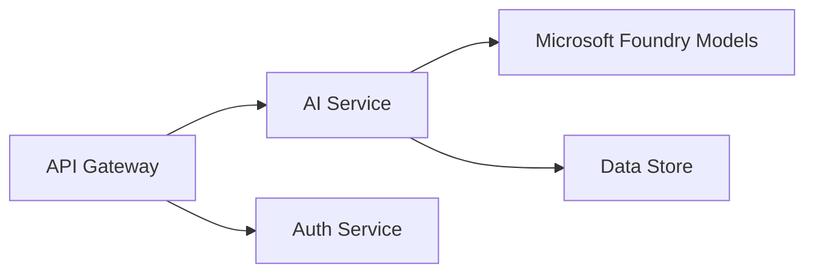
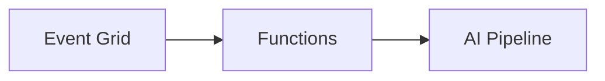

# פרק 8: דפוסי ייצור וארגוניים

**📚 קורס**: [AZD למתחילים](../../README.md) | **⏱️ משך**: 2-3 שעות | **⭐ רמת קושי**: מתקדם

---

## סקירה כללית

פרק זה מכסה דפוסי פריסה מוכנים לארגונים, חיזוק אבטחה, ניטור ואופטימיזציה של עלויות לעומסי עבודה של AI בסביבת ייצור.

זהו רפרנס ארכיטקטוני, לא תבנית מלאה לפריסה בייצור. דוגמאות מוותרות על פרטי אינטגרציה שיש לספק ולבדוק באפליקציה שלך; קריאת רשימת הבדיקה אינה מאמתת מוכנות לייצור.

> **עדכון Foundry GA (2026-11-09):** השתמש ב-`azd >= 1.37.0` ובחבילת `microsoft.foundry` 1.0 הזמינה באופן כללי עבור תהליך Foundry; הערכות מותקנות בנפרד. ראה [טווח שחרור והגירה](production-ai-practices.md#recent-release-changes-and-fixes) ו-[דוגמת צינור מאובטח](production-ai-practices.md#cicd-pipeline-configuration). זהו סקירת תיעוד, לא אימות פריסה חיה או סטטוס GA כולל לתכונות תצוגה מוקדמת אופציונליות.

## מטרות הלמידה

בסיום פרק זה, תוכל:
- לפרוס אפליקציות עמידות מרובות-אזוריות
- ליישם דפוסי אבטחה ארגוניים
- להגדיר ניטור מקיף
- לאופטם עלויות בהיקף גדול
- להקים צינורות CI/CD עם AZD

---

## 📚 שיעורים

| # | שיעור | תיאור | זמן |
|---|--------|-------------|------|
| 1 | [פרקטיקות AI בייצור](production-ai-practices.md) | דפוסי פריסה ארגוניים | 90 דק' |

---

## 🚀 רשימת בדיקה לייצור

- [ ] פריסה מרובת אזורים לעמידות
- [ ] זהות מנוהלת לאימות (ללא מפתחות)
- [ ] Application Insights לניטור
- [ ] תקציבי עלות והתראות מוגדרים
- [ ] סריקת אבטחה מופעלת
- [ ] אינטגרציה עם צינור CI/CD
- [ ] תכנית גיבוי והתאוששות מאסון

---

## 🏗️ דפוסי ארכיטקטורה

### דפוס 1: מיקרו-שירותי AI



### דפוס 2: AI מונע אירועים



---

## 🔐 מילות מפתח לאבטחה

```bicep
// Illustrative properties from different resources, NOT a standalone Bicep file.
// Attach identity to the application host:
identity: {
  type: 'SystemAssigned'
}

// AI account properties (also require private endpoints, DNS and app connectivity):
properties: {
  publicNetworkAccess: 'Disabled'
  networkAcls: {
    defaultAction: 'Deny'
  }
}
```

---

## 💰 אופטימיזציה של עלויות

| אסטרטגיה | מגבלה עיקרית |
|----------|---------|
| סקיילינג לאפס (Container Apps) | דרוש טריגר מתאים; שירותים אחרים עדיין גורמים לעלויות |
| שימוש בשכבות צריכה לפיתוח | השווה מחירי שירות נבחר ועומס עבודה |
| סקיילינג מתוזמן | סקיילינג דרך תשתית/אוטומציה נתמכת |
| הזמנות/קיבולת מוקצית | רק כשהנתמך; התחייבויות יכולות להעלות עלויות בזמן שקט |

השתמש ב-[דפוס משאבי תקציב מלא](production-ai-practices.md#2-cost-monitoring-and-budgets) עם תאריך התחלה תקף, טווח חיוב, נמענים והרשאות. תקציב שולח התראות; הוא אינו מגביל הוצאות. החיסכון תלוי במדידת השימוש ואינו אחוזי מובטח.

---

## 📊 הגדרת ניטור

```bash
# Open the Application Insights logs view (requires configured monitoring)
azd monitor --logs

# Check Application Insights
azd monitor --overview

# View metrics
az monitor metrics list --resource <resource-id>
```

---

## 🔗 ניווט

| כיוון | פרק |
|-----------|---------|
| **קודם** | [פרק 7: פתרון בעיות](../chapter-07-troubleshooting/README.md) |
| **סיום קורס** | [דף הבית של הקורס](../../README.md) |

---

## 📖 משאבים קשורים

- [מדריך סוכני AI](../chapter-02-ai-development/agents.md)
- [Application Insights](../chapter-06-pre-deployment/application-insights.md)
- [פתרונות מרובי סוכנים](../chapter-05-multi-agent/README.md)
- [דוגמת מיקרו-שירותים](../../examples/microservices/README.md)

---

<!-- CO-OP TRANSLATOR DISCLAIMER START -->
**כתב ויתור**:
מסמך זה תורגם באמצעות שירות תרגום אוטומטי [Co-op Translator](https://github.com/Azure/co-op-translator). למרות שאנו שואפים לדיוק, יש לקחת בחשבון שתרגומים אוטומטיים עלולים להכיל שגיאות או אי-דיוקים. יש להחשיב את המסמך המקורי בשפתו הטבעית כמקור הסמכות. למידע קריטי מומלץ להשתמש בתרגום מקצועי על ידי מתרגם אדם. אנו לא אחראים לכל אי-הבנה או פירוש שגוי הנובע מהשימוש בתרגום זה.
<!-- CO-OP TRANSLATOR DISCLAIMER END -->