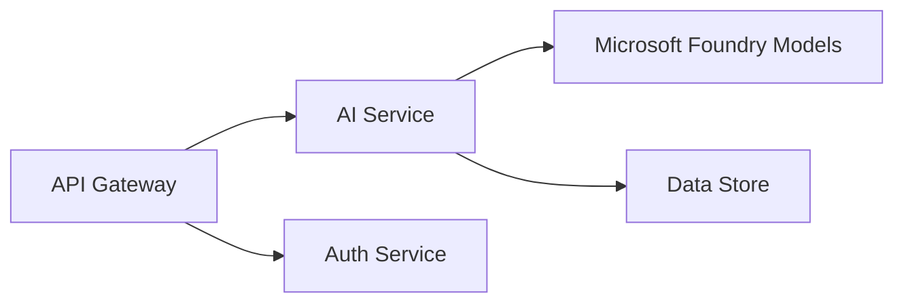
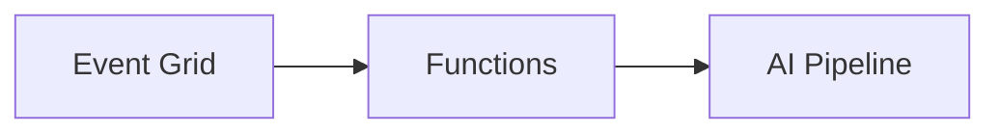

# פרק 8: דפוסי ייצור וארגוניים

**📚 קורס**: [AZD למתחילים](../../README.md) | **⏱️ משך**: 2-3 שעות | **⭐ רמת מורכבות**: מתקדם

---

## סקירה כללית

פרק זה עוסק בדפוסי פריסה המתאימים לארגונים, הקשחת אבטחה, ניטור ואופטימיזציית עלויות לעומסי עבודה של AI בפרודקשן.

זוהי התייחסות אדריכלית, לא תבנית פריסה מלאה למערכת ייצור. דוגמאות עושות שימוש בפירוט אינטגרציה שיש לספק ולבדוק באפליקציה שלך; קריאת רשימת הביקורת אינה מאשרת מוכנות לפרודקשן.

> **סקירת שחרור (2026-11-04):** ההנחיה ל-AI CLI נבדקה אל מול `azd 1.37.2`, סוכנים `1.0.0-beta.23`, ותיעוד/מקור הערכות `1.0.0-beta.2`. ראה [שינויים ותיקונים בשחרור](production-ai-practices.md#recent-release-changes-and-fixes) לדרישות תאימות ופרטי הגירה; אין זו אימות פריסה חיה.

## מטרות הלמידה

בסיום פרק זה תוכל:
- לפרוס יישומים רב-אזוריים חסיני תקלות
- ליישם דפוסי אבטחה ארגוניים
- להגדיר ניטור מקיף
- לאופטם עלויות בהיקף
- להקים צינורות CI/CD עם AZD

---

## 📚 שיעורים

| # | שיעור | תיאור | זמן |
|---|--------|-------------|------|
| 1 | [שיטות AI בפרודקשן](production-ai-practices.md) | דפוסי פריסה ארגוניים | 90 דקות |

---

## 🚀 רשימת ביקורת לפרודקשן

- [ ] פריסה רב-אזורית לעמידות
- [ ] זהות מנוהלת לאימות (ללא מפתחות)
- [ ] Application Insights לניטור
- [ ] תקציבי עלויות והגדרות התראות
- [ ] סריקות אבטחה מופעלות
- [ ] אינטגרציה עם צנרת CI/CD
- [ ] תוכנית שחזור מאסון

---

## 🏗️ דפוסי אדריכלות

### דגם 1: מיקרו-שירותי AI



### דגם 2: AI מונחה אירועים



---

## 🔐 שיטות אבטחה מומלצות

```bicep
// Illustrative properties from different resources, NOT a standalone Bicep file.
// Attach identity to the application host:
identity: {
  type: 'SystemAssigned'
}

// AI account properties (also require private endpoints, DNS and app connectivity):
properties: {
  publicNetworkAccess: 'Disabled'
  networkAcls: {
    defaultAction: 'Deny'
  }
}
```

---

## 💰 אופטימיזציית עלויות

| אסטרטגיה | מגבלה עיקרית |
|----------|---------|
| Scale to zero (Container Apps) | דורש טריגר מתאים; שירותים אחרים עדיין יוצרים עלויות |
| שימוש בשכבות צריכה לפיתוח | השוואת מחירי שירות ושל עומס עבודה נבחר |
| תזמון סקיילינג | סקיילינג דרך תשתית/אוטומציה נתמכת |
| הזמנות/קיבולת מוקצית | רק כאשר נתמך; התחייבויות יכולות להעלות עלויות רדומות |

השתמש ב[דגם משאבי תקציב מלא](production-ai-practices.md#2-cost-monitoring-and-budgets) עם תאריך התחלה תקף, היקף חיוב, נמענים והרשאות. תקציב שולח התראות; אין זה מגביל הוצאה. החיסכון תלוי במדידת ניצול ואינו אחוז מובטח.

---

## 📊 הגדרת ניטור

```bash
# Open the Application Insights logs view (requires configured monitoring)
azd monitor --logs

# Check Application Insights
azd monitor --overview

# View metrics
az monitor metrics list --resource <resource-id>
```

---

## 🔗 ניווט

| כיוון | פרק |
|-----------|---------|
| **קודם** | [פרק 7: פתרון בעיות](../chapter-07-troubleshooting/README.md) |
| **סיום קורס** | [דף הבית של הקורס](../../README.md) |

---

## 📖 משאבים קשורים

- [מדריך סוכני AI](../chapter-02-ai-development/agents.md)
- [Application Insights](../chapter-06-pre-deployment/application-insights.md)
- [פתרונות רב-סוכניים](../chapter-05-multi-agent/README.md)
- [דוגמת מיקרו-שירותים](../../examples/microservices/README.md)

---

<!-- CO-OP TRANSLATOR DISCLAIMER START -->
**כתב ויתור**:
מסמך זה תורגם באמצעות שירות תרגום אוטומטי [Co-op Translator](https://github.com/Azure/co-op-translator). למרות שאנו שואפים לדיוק, יש לקחת בחשבון שתרגומים אוטומטיים עלולים להכיל שגיאות או אי-דיוקים. יש להחשיב את המסמך המקורי בשפתו הטבעית כמקור הסמכות. למידע קריטי מומלץ להשתמש בתרגום מקצועי על ידי מתרגם אדם. אנו לא אחראים לכל אי-הבנה או פירוש שגוי הנובע מהשימוש בתרגום זה.
<!-- CO-OP TRANSLATOR DISCLAIMER END -->