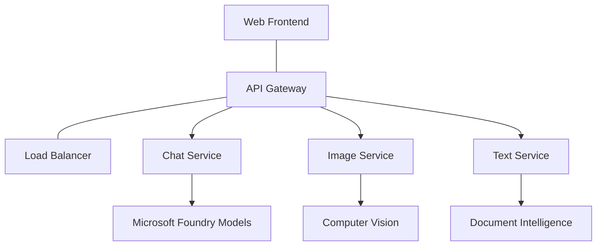

# שיטות עבודה מומלצות לעומסי עבודה בינה מלאכותית בפרודקשן עם AZD

**ניווט בפרק:**
- **📚 דף הקורס הראשי**: [AZD למתחילים](../../README.md)
- **📖 הפרק הנוכחי**: פרק 8 - תבניות פרודקשן וארגוניות
- **⬅️ הפרק הקודם**: [פרק 7: פתרון תקלות](../chapter-07-troubleshooting/debugging.md)
- **⬅️ גם קשור**: [מעבדה של סדנת AI](../chapter-02-ai-development/ai-workshop-lab.md)
- **🎯 הקורס הושלם**: [AZD למתחילים](../../README.md)

## סקירה כללית

מדריך זה מסביר תבניות עיצוב של בינה מלאכותית בפרודקשן באמצעות Azure Developer CLI (AZD). הוא מהווה רפרנס עיצובי, לא יישום שניתן לפרוס או הסמכה לפרודקשן.

**גבולות לדוגמה:** אלא אם מתואר במפורש כמלא, קטעי Bicep מניחים פרמטרים ומשאבים שמוכנסים מתוך תבנית המכילה. הם מתעלמים מתמונות/תוכניות מארחות, זהויות, הקצאות תפקידים, DNS, פלטים ואינטגרציה נדרשת אחרת. מסלולי שירות YAML וסקריפטים של hooks/tests הם קבצים להמחשה ליצירה ב**היישום שלך**; הם לא מסופקים בקורס הזה. השתמש בדוגמת AZD עובדת כבסיס, הקמפל את התשתית המלאה, ונסה אותה בסביבה מבודדת לפני פרודקשן.

## אתגרים מרכזיים שנטופלו

חששות נפוצים בפרודקשן כוללים פריסות מרובות שירותים, ניהול זהויות וסודות, סקיילינג, בקרת עלויות, ומעקב. כאן לא נטען על שכיחות מדודה.

## תבניות ארכיטקטורה לבינה מלאכותית בפרודקשן

### תבנית 1: ארכיטקטורת מיקרוסרוויסים בינה מלאכותית

**מתי להשתמש**: יישומי בינה מלאכותית מורכבים עם יכולות מרובות



**מימוש ב-AZD**:

```yaml
# azure.yaml
name: enterprise-ai-platform
services:
  web:
    project: ./web
    host: staticwebapp
  api-gateway:
    project: ./api-gateway
    host: containerapp
  chat-service:
    project: ./services/chat
    host: containerapp
  vision-service:
    project: ./services/vision
    host: containerapp
  text-service:
    project: ./services/text
    host: containerapp
```

### תבנית 2: עיבוד מונע-אירועים לבינה מלאכותית

**מתי להשתמש**: עיבוד אצווה, ניתוח מסמכים, זרימות עבודה אסינכרוניות

```bicep
// Event Hub for AI processing pipeline
resource eventHub 'Microsoft.EventHub/namespaces@2024-01-01' = {
  name: eventHubNamespaceName
  location: location
  sku: {
    name: 'Standard'
    tier: 'Standard'
    capacity: 1
  }
}

// Service Bus for reliable message processing
resource serviceBus 'Microsoft.ServiceBus/namespaces@2024-01-01' = {
  name: serviceBusNamespaceName
  location: location
  sku: {
    name: 'Premium'
    tier: 'Premium'
    capacity: 1
  }
}

// Function App for processing
resource functionApp 'Microsoft.Web/sites@2023-01-01' = {
  name: functionAppName
  location: location
  kind: 'functionapp,linux'
  properties: {
    siteConfig: {
      appSettings: [
        {
          name: 'FUNCTIONS_EXTENSION_VERSION'
          value: '~4'
        }
        {
          name: 'AZURE_OPENAI_ENDPOINT'
          value: '@Microsoft.KeyVault(VaultName=${keyVault.name};SecretName=openai-endpoint)'
        }
      ]
    }
  }
}
```

זה יוצר קטעי מרחב שמות, לא מרכזיות, תורים, מנויים או טריגרים של פונקציות. פונקציה שניתן להריץ זקוקה גם לתוכנית אירוח, קונפיגורציית ריצה/אחסון, זהות מחוברת, RBAC וגישה לרשת. הפנייה ל-Key Vault דורשת הרשאה לקרוא את הסוד; כתובת URL של נקודת קצה כשלעצמה איננה אישור.

## מחשבה על בריאות סוכן הבינה המלאכותית

כאשר אפליקציית ווב רגילה קורסת, התסמינים מוכרים: דף לא נטען, API מחזיר שגיאה, או פריסה נכשלת. יישומים מבוססי AI יכולים לקרוס באותן דרכים—אבל יכולים גם להתנהג בצורה עדינה יותר שלא מייצרת הודעות שגיאה ברורות.

חלק זה עוזר לך לבנות מודל מנטלי למעקב אחר עומסי עבודה AI כדי שתדע איפה לחפש כשדברים לא נראים בסדר.

### כיצד בריאות הסוכן שונה מבריאות אפליקציה רגילה

אפליקציות רגילות יכולות גם להיכשל בעדינות ב"נכונות". סוכן AI מוסיף איכות תגובה לא דטרמיניסטית לדאגות הרגילות של זמינות ונכונות. חשוב על בריאות סוכן בשתי שכבות:

| שכבה | מה לצפות | איפה לחפש |
|-------|--------------|---------------|
| **בריאות התשתית** | האם השירות רץ? האם המשאבים מסופקים? האם נקודות הקצה נגישות? | `azd monitor`, בריאות משאבי פורטל Azure, לוגים של מכולות/אפליקציות |
| **בריאות ההתנהגות** | האם הסוכן מגיב במדויק? האם התגובות בזמן? האם המודל נקרא כראוי? | Distributed Traces ב-Application Insights, מדדי זמני השהיית קריאת המודל, לוגי איכות תגובה |

בריאות התשתית היא מוכרת — זהה לכל אפליקציית azd. בריאות ההתנהגות היא השכבה החדשה שעומסי עבודה בינה מלאכותית מציגים.

### איפה לחפש כשאפליקציות AI לא מתנהגות כמצופה

אם יישום ה-AI שלך לא מפיק את התוצאות שציפית להן, הנה רשימת בדיקה מושגית:

1. **תתחיל מהבסיסים.** האם האפליקציה פועלת? האם היא יכולה להגיע לתלותיה? בדוק `azd monitor` ובריאות המשאבים בדיוק כמו בכל אפליקציה אחרת.
2. **בדוק את חיבור המודל.** האם האפליקציה שלך מצליחה לקרוא למודל ה-AI? שיחות נכשלות או שהתשובות מתעכבות הן הסיבה השכיחה ביותר לבעיות באפליקציות AI ויופיעו בלוגי האפליקציה.
3. **בדוק את הקלט והעיגון בבטחה.** תשובות שגויות יכולות לנבוע מהבאת מידע, הוראות, מגבלות מודל או הרצת כלי עזר. השתמש בנתוני אבחון מבוקרי גישה ומוצפנים; אל תאפשר רישום גס של השאלות/תשובות בפרודקשן.
4. **בחן את השהיית התגובה.** קריאות למודל AI איטיות יותר מקריאות API טיפוסיות. אם האפליקציה נראית איטית, בדוק אם זמני התגובה למודל עלו - זה יכול להעיד על צימצום תעבורה, גבולות קיבולת או עומס אזורי.
5. **עקוב אחרי איתותי עלות.** קפיצות בלתי צפויות בשימוש בטוקנים או קריאות API עשויות להצביע על לולאה, בקשת שגויה או ניסיונות חוזרים מופרזים.

אין צורך לשלוט מיד בכלי ניטור מתקדמים. המסר המרכזי הוא שליישומי AI יש שכבת התנהגות נוספת למעקב, וניטור מובנה של azd (`azd monitor`) נותן נקודת התחלה לחקירת שתי השכבות.

---

## שיטות עבודה מומלצות לאבטחה

### 1. מודל אבטחה אפס אמון

**אסטרטגיית מימוש**:
- אין תקשורת שירות-לשירות ללא אימות
- כל קריאות ה-API משתמשות בזהויות מנוהלות
- בידוד רשת עם נקודות קצה פרטיות
- בקרות גישה עם הרשאת המינימום הנדרשת

```bicep
// Managed Identity for each service
resource chatServiceIdentity 'Microsoft.ManagedIdentity/userAssignedIdentities@2023-01-31' = {
  name: 'chat-service-identity'
  location: location
}

// Role assignments with minimal permissions
resource openAIUserRole 'Microsoft.Authorization/roleAssignments@2022-04-01' = {
  scope: openAIAccount
  name: guid(openAIAccount.id, chatServiceIdentity.id, '5e0bd9bd-7b93-4f28-af87-19fc36ad61bd')
  properties: {
    roleDefinitionId: subscriptionResourceId('Microsoft.Authorization/roleDefinitions', '5e0bd9bd-7b93-4f28-af87-19fc36ad61bd')
    principalId: chatServiceIdentity.properties.principalId
    principalType: 'ServicePrincipal'
  }
}
```

### 2. ניהול סודות מאובטח

**תבנית אינטגרציה ל-Key Vault**:

```bicep
// Key Vault with proper access policies
resource keyVault 'Microsoft.KeyVault/vaults@2023-02-01' = {
  name: keyVaultName
  location: location
  properties: {
    tenantId: tenant().tenantId
    sku: {
      family: 'A'
      name: 'standard' // Premium is needed for HSM-backed keys, not ordinary secrets
    }
    enableRbacAuthorization: true  // Use RBAC instead of access policies
    enablePurgeProtection: true    // Prevent accidental deletion
    enableSoftDelete: true
    softDeleteRetentionInDays: 90
  }
}

// Optional legacy key-auth alternative; omit when using Entra ID.
resource openAIKeySecret 'Microsoft.KeyVault/vaults/secrets@2023-02-01' = {
  parent: keyVault
  name: 'openai-api-key'
  properties: {
    value: openAIAccount.listKeys().key1
    attributes: {
      enabled: true
    }
  }
}
```

הקצה את זהות זמן הריצה `Key Vault Secrets User` בטווח המתאים וחבר אותה למארח; `enableRbacAuthorization` לבדה אינה מעניקה גישה. העדף אימות זהות מנוהלת OpenAI עם `disableLocalAuth: true`. מפתח הסוד האופציונלי הגיוני רק עבור חשבון שנועד במכוון להיות מופעל עם מפתח, וגורם הפרוביזיה גם זקוק להרשאה לכתוב סודות.

### 3. אבטחת רשת

**קונפיגורציית נקודת קצה פרטית**:

```bicep
// Virtual Network for AI services
resource virtualNetwork 'Microsoft.Network/virtualNetworks@2023-04-01' = {
  name: vnetName
  location: location
  properties: {
    addressSpace: {
      addressPrefixes: ['10.0.0.0/16']
    }
    subnets: [
      {
        name: 'ai-services-subnet'
        properties: {
          addressPrefix: '10.0.1.0/24'
          privateEndpointNetworkPolicies: 'Disabled'
        }
      }
      {
        name: 'app-services-subnet'
        properties: {
          addressPrefix: '10.0.2.0/24'
          delegations: [
            {
              name: 'Microsoft.Web/serverFarms'
              properties: {
                serviceName: 'Microsoft.Web/serverFarms'
              }
            }
          ]
        }
      }
    ]
  }
}

// Private endpoints for all AI services
resource openAIPrivateEndpoint 'Microsoft.Network/privateEndpoints@2023-04-01' = {
  name: '${openAIAccountName}-pe'
  location: location
  properties: {
    subnet: {
      id: virtualNetwork.properties.subnets[0].id
    }
    privateLinkServiceConnections: [
      {
        name: 'openai-connection'
        properties: {
          privateLinkServiceId: openAIAccount.id
          groupIds: ['account']
        }
      }
    ]
  }
}
```

נקודות קצה פרטיות דורשות גם קבוצות אזורי DNS פרטיים/קישורים לרשת וירטואלית ואינטגרציית אפליקציה לרשת הווירטואלית (VNet). הן לא חוסמות אוטומטית גישה ציבורית: השבת במפורש את הגישה הציבורית של חשבון ה-AI לאחר שאושרה הקישוריות הפרטית והגישה לפריסה.

## ביצועים וסקיילינג

### 1. אסטרטגיות סקיילינג אוטומטי

**סקיילינג אוטומטי לאפליקציות מכולה**:

```bicep
resource containerApp 'Microsoft.App/containerApps@2023-05-01' = {
  name: containerAppName
  location: location
  properties: {
    configuration: {
      ingress: {
        external: true
        targetPort: 8000
        transport: 'http'
      }
    }
    template: {
      scale: {
        minReplicas: 2  // Always have 2 instances minimum
        maxReplicas: 50 // Scale up to 50 for high load
        rules: [
          {
            name: 'http-scaling'
            http: {
              metadata: {
                concurrentRequests: '20'  // Scale when >20 concurrent requests
              }
            }
          }
          {
            name: 'cpu-scaling'
            custom: {
              type: 'cpu'
              metadata: {
                type: 'Utilization'
                value: '70'  // Scale when CPU >70%
              }
            }
          }
        ]
      }
    }
  }
}
```

### 2. אסטרטגיות מטמון

**מטמון Redis לתגובות AI**:

```bicep
// Legacy Azure Cache for Redis example (not recommended for new deployments)
resource redisCache 'Microsoft.Cache/redis@2023-04-01' = {
  name: redisCacheName
  location: location
  properties: {
    sku: {
      name: 'Premium'
      family: 'P'
      capacity: 1
    }
    enableNonSslPort: false
    minimumTlsVersion: '1.2'
    redisConfiguration: {
      'maxmemory-policy': 'allkeys-lru'
    }
    // Sharding distributes data; replication/failover provides availability.
    shardCount: 2
  }
}

// Cache configuration in application
var cacheConnectionString = '${redisCache.properties.hostName}:6380,password=${redisCache.listKeys().primaryKey},ssl=True,abortConnect=False'
```

Azure Cache for Redis Basic/Standard/Premium נמצא ב[מסלול פרישה](https://learn.microsoft.com/azure/azure-cache-for-redis/retirement-faq). השתמש ב-Azure Managed Redis לעיצובים חדשים וב-SKU, זהות וקונפיגורציית TLS המתועדים שלו, במקום להעתיק משאב ישן זה למערכת פרודקשן חדשה. שורת מחרוזת החיבור היא תחליף לא פעיל, לא אישור. חלק את מפתחות המטמון לפי הרשאה, מודל/הוראות, וגרסת שליפה, עם תאריך תפוגה; מטמון משותף לקריאה בלבד עלול לחשוף נתוני משתמשים אחרים.

### 3. איזון עומסים וניהול תעבורה

**שער אפליקציה עם WAF**:

```bicep
// Application Gateway with Web Application Firewall
resource applicationGateway 'Microsoft.Network/applicationGateways@2023-04-01' = {
  name: appGatewayName
  location: location
  properties: {
    sku: {
      name: 'WAF_v2'
      tier: 'WAF_v2'
      capacity: 2
    }
    webApplicationFirewallConfiguration: {
      enabled: true
      firewallMode: 'Prevention'
      ruleSetType: 'OWASP'
      ruleSetVersion: '3.2'
    }
    // Backend pools for AI services
    backendAddressPools: [
      {
        name: 'ai-services-pool'
        properties: {
          backendAddresses: [
            {
              fqdn: '${containerApp.properties.configuration.ingress.fqdn}'
            }
          ]
        }
      }
    ]
  }
}
```

זהו משאב שער חלקי: פריסה אמיתית דורשת גם תת-רשת שער/הגדרת IP, IPs ופורטים קדמיים, מאזיני TLS/תעודות, הגדרות HTTP/בדיקות אחוריות, כללי ניתוב וקדימויות, ומדיניות WAF שנבדקה. שם אירוח TLS/SNI ואימות חייבים להתאים לאחור Container App.

## 💰 אופטימיזציה של עלויות

### 1. גודל משאבים מותאם

**קונפיגורציות מותאמות לסביבה**:

שמות אלו הם **קלטים של תבנית מותאמת להמחשה**, לא הגדרות אוטומטיות של AZD. מיפוי כל אחד לתוך `infra/main.parameters.json`/Bicep וקונפיגורציית מארח תחילה. לדוגמה, דוגמת ה-RAG משתמשת ב-`AZURE_SEARCH_SERVICE_SKU` ו-`AZURE_OPENAI_CHATGPT_DEPLOYMENT_CAPACITY`, לא בשמות הכלליים מטה. תן למבחני הזיכרון של Container Apps יחידה נתמכת כמו `1Gi` במשאב עצמו. החל שינויים בתשתית באמצעות `azd up` או `azd provision`; `azd deploy` לבדה לא מחילה שינויים ב-Bicep.

```bash
# Development environment
azd env new development
azd env set AZURE_OPENAI_SKU "S0"
azd env set AZURE_OPENAI_CAPACITY 10
azd env set AZURE_SEARCH_SKU "basic"
azd env set CONTAINER_CPU 0.5
azd env set CONTAINER_MEMORY 1.0

# Production environment  
azd env new production
azd env set AZURE_OPENAI_SKU "S0"
azd env set AZURE_OPENAI_CAPACITY 100
azd env set AZURE_SEARCH_SKU "standard"
azd env set CONTAINER_CPU 2.0
azd env set CONTAINER_MEMORY 4.0
```

### 2. ניטור עלויות ותקציבים

```bicep
// Supply the first day of the current UTC month, e.g. 2026-11-01T00:00:00Z.
param budgetStartDate string

// Cost management and budgets
resource budget 'Microsoft.Consumption/budgets@2024-08-01' = {
  name: 'ai-workload-budget'
  properties: {
    timePeriod: {
      startDate: budgetStartDate
    }
    timeGrain: 'Monthly'
    amount: 2000  // In the billing currency, not necessarily USD
    category: 'Cost'
    notifications: {
      warning: {
        enabled: true
        operator: 'GreaterThan'
        threshold: 80
        contactEmails: [
          'finance@company.com'
          'engineering@company.com'
        ]
        contactRoles: [
          'Owner'
          'Contributor'
        ]
      }
      critical: {
        enabled: true
        operator: 'GreaterThan'
        threshold: 95
        contactEmails: [
          'cto@company.com'
        ]
      }
    }
  }
}
```

החלף את מקבלי הדוגמה ובדוק טווח/הרשאות. אזעקות תקציב משתמשות בנתוני חיוב מעוכבים ואינן אוכפות תקרת הוצאה.

### 3. אופטימיזציה של שימוש בטוקנים

**ניהול עלויות OpenAI**:

זהו רק חישוב גס מבוסס תווים לתצוגה מקדימה ב-UI, **לא** מתקן תקפות מגבלת טוקנים למודל. קוד פרודקשן חייב להשתמש במטען טוקנים המתאים למודל הפרוס ולחשב הוראות מערכת, סכמות כלים, היסטוריה ותקציב פלט. דחה הודעת משתמש גדולה מדי במקום לקצץ בשקט.

```typescript
// Application-level token optimization
class TokenOptimizer {
  private readonly maxTokens = 4000;
  private readonly reserveTokens = 500;
  
  optimizePrompt(userInput: string, context: string): string {
    const availableTokens = this.maxTokens - this.reserveTokens;
    if (this.estimateTokens(userInput) + 8 >= availableTokens) {
      throw new Error("User input exceeds the illustrative prompt budget");
    }
    const estimatedTokens = this.estimateTokens(userInput + context) + 8;
    
    if (estimatedTokens > availableTokens) {
      // Truncate context, not user input
      context = this.truncateContext(context, Math.max(0, availableTokens - this.estimateTokens(userInput) - 8));
    }
    
    return `${context}\n\nUser: ${userInput}`;
  }
  
  private estimateTokens(text: string): number {
    // Rough estimation: 1 token ≈ 4 characters
    return Math.ceil(text.length / 4);
  }

  private truncateContext(text: string, estimatedBudget: number): string {
    return text.slice(0, Math.max(0, estimatedBudget) * 4);
  }
}
```

## ניטור והתבוננות

### 1. Application Insights מקיף

```bicep
// Application Insights with advanced features
resource applicationInsights 'Microsoft.Insights/components@2020-02-02' = {
  name: applicationInsightsName
  location: location
  kind: 'web'
  properties: {
    Application_Type: 'web'
    WorkspaceResourceId: logAnalyticsWorkspace.id
    SamplingPercentage: 100  // Ingestion setting; review cost and SDK sampling separately
    DisableIpMasking: false  // Retain IP masking
  }
}

// Custom metrics for AI operations
resource aiMetricAlerts 'Microsoft.Insights/metricAlerts@2018-03-01' = {
  name: 'ai-high-error-rate'
  location: 'global'
  properties: {
    description: 'Alert when failed request count exceeds 10 in five minutes'
    severity: 2
    enabled: true
    scopes: [
      applicationInsights.id
    ]
    evaluationFrequency: 'PT1M'
    windowSize: 'PT5M'
    criteria: {
      'odata.type': 'Microsoft.Azure.Monitor.SingleResourceMultipleMetricCriteria'
      allOf: [
        {
          name: 'high-error-rate'
          metricName: 'requests/failed'
          operator: 'GreaterThan'
          threshold: 10
          timeAggregation: 'Count'
        }
      ]
    }
  }
}
```

### 2. ניטור ייחודי ל-AI

**לוחות מחוונים מותאמים למדדים ב-AI**:

```json
{
  "dashboard": {
    "name": "AI Application Monitoring",
    "tiles": [
      {
        "name": "OpenAI Request Volume",
        "query": "dependencies | where target contains 'openai' | summarize count() by bin(timestamp, 5m)"
      },
      {
        "name": "AI Response Latency",
        "query": "dependencies | where target contains 'openai' | summarize avg(duration) by bin(timestamp, 5m)"
      },
      {
        "name": "Token Usage",
        "query": "customMetrics | where name == 'openai_tokens_used' | summarize sum(value) by bin(timestamp, 1h)"
      },
      {
        "name": "Cost per Hour",
        "query": "customMetrics | where name == 'openai_cost' | summarize sum(value) by bin(timestamp, 1h)"
      }
    ]
  }
}
```

JSON זה הוא סקיצה שהוגדרה באפליקציה, לא סכמת לוח מחוונים בפורטל Azure שניתן לייבוא. שאלות הטוקן/עלות דורשות שהאפליקציה תפיק בדיוק את המדדים המותאמים הללו; לא נוצרו על ידי AZD. התאם מסנני תלות לשמות נקודת הקצה/ספאנים שלך בפועל.

### 3. בדיקות בריאות וניטור זמינות

```bicep
// Application Insights availability tests
resource availabilityTest 'Microsoft.Insights/webtests@2022-06-15' = {
  name: 'ai-app-availability-test'
  location: location
  tags: {
    'hidden-link:${applicationInsights.id}': 'Resource'
  }
  properties: {
    SyntheticMonitorId: 'ai-app-availability-test'
    Name: 'AI Application Availability Test'
    Description: 'Tests AI application endpoints'
    Enabled: true
    Frequency: 300  // 5 minutes
    Timeout: 120    // 2 minutes
    Kind: 'standard'
    Locations: [
      {
        Id: 'us-east-2-azr'
      }
      {
        Id: 'us-west-2-azr'
      }
    ]
    Request: {
      RequestUrl: 'https://${webApp.properties.defaultHostName}/health'
      HttpVerb: 'GET'
      FollowRedirects: true
      ParseDependentRequests: false
    }
    ValidationRules: {
      ExpectedHttpStatusCode: 200
      SSLCheck: true
      SSLCertRemainingLifetimeCheck: 7
    }
  }
}
```

## התאוששות מאסון וזמינות גבוהה

הבדיקה המוקדמת מניחה App Service קיים `webApp` ומשאב Application Insights. בדיקות זמינות סטנדרטיות הן בתשלום ודורשות נקודת קצה נגישה; אפליקציות פרטיות דורשות עיצוב ניטור פרטי מתאים. בדיקות URL ping מיושנות; השתמש ב[בדיקות זמינות סטנדרטיות](https://learn.microsoft.com/azure/azure-monitor/app/availability).

### 1. פריסת רב-אזורית

```yaml
# azure.yaml - Multi-region configuration
name: ai-app-multiregion
services:
  api-primary:
    project: ./api
    host: containerapp
    env:
      AZURE_REGION: eastus
  api-secondary:
    project: ./api
    host: containerapp
    env:
      AZURE_REGION: westus2
```

```bicep
// Separate App Service topology, not the Container Apps declarations above
resource trafficManager 'Microsoft.Network/trafficManagerProfiles@2022-04-01' = {
  name: trafficManagerProfileName
  location: 'global'
  properties: {
    profileStatus: 'Enabled'
    trafficRoutingMethod: 'Priority'
    dnsConfig: {
      relativeName: trafficManagerProfileName
      ttl: 30
    }
    monitorConfig: {
      protocol: 'HTTPS'
      port: 443
      path: '/health'
      intervalInSeconds: 30
      toleratedNumberOfFailures: 3
      timeoutInSeconds: 10
    }
    endpoints: [
      {
        name: 'primary-endpoint'
        type: 'Microsoft.Network/trafficManagerProfiles/azureEndpoints'
        properties: {
          targetResourceId: primaryAppService.id
          endpointStatus: 'Enabled'
          priority: 1
        }
      }
      {
        name: 'secondary-endpoint'
        type: 'Microsoft.Network/trafficManagerProfiles/azureEndpoints'
        properties: {
          targetResourceId: secondaryAppService.id
          endpointStatus: 'Enabled'
          priority: 2
        }
      }
    ]
  }
}
```

משתני סביבה אינם בוחרים מיקומי משאבים. IaC חייב לספק מארחים אזוריים נפרדים ולקשר כל שירות עם תגיות `resourceName` או `azd-service-name`. דוגמת Traffic Manager היא **טופולוגיית App Service נפרדת** (`primaryAppService`/`secondaryAppService`), לא ניתוב להצהרות Container Apps. Container Apps דורש נקודת קצה/כניסה חיצונית מתאימה, ניתוב TLS/דומיין מותאם ובדיקות בריאות.

### 2. גיבוי ושרידות נתונים

```bicep
// Backup configuration for critical data
resource backupVault 'Microsoft.DataProtection/backupVaults@2023-05-01' = {
  name: backupVaultName
  location: location
  identity: {
    type: 'SystemAssigned'
  }
  properties: {
    storageSettings: [
      {
        datastoreType: 'VaultStore'
        type: 'LocallyRedundant'
      }
    ]
  }
}

```

המאגר לבדו אינו מגבה דבר. קבע **מדיניות תואמת ספציפית לעומס עבודה ומופע גיבוי**, הרשאות מקור, שמירה ובדיקות שחזור באמצעות [מטריצות תמיכה של Azure Backup](https://learn.microsoft.com/azure/backup/backup-support-matrix). אין מדיניות Azure Backup כללית לפריסות דגמי Azure OpenAI מתארחות. שמור הגדרות תשתית/מודל בקוד מקור; הגן על מסמכים שהועלו, נתוני יישום וארטיפקטים לכיוונון מדויק באמצעות תכונות הגיבוי/ייצוא הנתמכות של כל שירות. הגדר ובדוק במפורש RPO/RTO.

## אינטגרציית DevOps ו-CI/CD

### 1. זרימת עבודה ב-GitHub Actions

```yaml
# .github/workflows/deploy-ai-app.yml
name: Deploy AI Application

on:
  push:
    branches: [main]
  pull_request:
    branches: [main]

jobs:
  test:
    runs-on: ubuntu-latest
    steps:
      - uses: actions/checkout@v4
      
      - name: Setup Python
        uses: actions/setup-python@v4
        with:
          python-version: '3.11'
          
      - name: Install dependencies
        run: |
          pip install -r requirements.txt
          pip install pytest
          
      - name: Run tests
        run: pytest tests/
        
      - name: AI Safety Tests
        run: |
          python scripts/test_ai_safety.py
          python scripts/validate_prompts.py

```

זהו **החלק של מבחן בלבד** של זרימת העבודה ומניח שיצרת `requirements.txt`, `tests/`, ושני סקריפטי בטיחות. הוסף את משימות הפרוביזיה/פריסה המאומתות של OIDC מ[הגדרת צינור CI/CD](#cicd-pipeline-configuration), עם `needs: test`, טריגר push/manual מהימן, וסביבות GitHub מוגנות. אל תפרוס קוד בקשות משיכה לא מהימן עם אישורי ענן. מריץ טרי אינו כולל סביבה מקומית נבחרת של AZD; ספק את קלטי הסביבה/מנוי/מיקום והשתמש ב-`azd auth login`, לא רק ב-`azure/login`.

### 2. אימות תשתית

```bash
# scripts/validate_infrastructure.sh
#!/bin/bash
set -euo pipefail

echo "Validating AI infrastructure deployment..."

# Requires Azure CLI login and the resource group selected explicitly.
: "${AZURE_RESOURCE_GROUP:?Set AZURE_RESOURCE_GROUP}"
: "${AZURE_OPENAI_NAME:?Set AZURE_OPENAI_NAME}"
: "${AZURE_OPENAI_CHAT_DEPLOYMENT:?Set the actual deployment name}"

# A successful empty list is not proof that resources exist.
types=("Microsoft.CognitiveServices/accounts" "Microsoft.Search/searchServices"
       "Microsoft.Storage/storageAccounts" "Microsoft.KeyVault/vaults")
for resource_type in "${types[@]}"; do
    count=$(az resource list --resource-group "$AZURE_RESOURCE_GROUP" \
        --resource-type "$resource_type" --query "length(@)" -o tsv)
    if [[ "$count" -lt 1 ]]; then
        echo "ERROR: No $resource_type found in $AZURE_RESOURCE_GROUP"
        exit 1
    fi
done

# Validate OpenAI model deployments
echo "Validating OpenAI model deployments..."
state=$(az cognitiveservices account deployment show \
  --name "$AZURE_OPENAI_NAME" --resource-group "$AZURE_RESOURCE_GROUP" \
  --deployment-name "$AZURE_OPENAI_CHAT_DEPLOYMENT" \
  --query "properties.provisioningState" -o tsv)
if [[ "$state" != "Succeeded" ]]; then
    echo "ERROR: Required model deployment is not provisioned successfully"
    exit 1
fi

echo "Infrastructure validation completed successfully!"
```

צפוי: יציאה אפס והודעת השלמה רק כאשר כל הסוגים הצפויים קיימים והפריסה של המודל המנופה קיימת. זה בודק את מצב המלאי/הפריסה, **לא** את בריאות המשאבים, טופולוגיה מדויקת, RBAC, נגישות רשת או התנהגות מודל. התאם את הסוגים הצפויים לארכיטקטורה שלך ואז בצע בדיקת מוכנות אפליקציה מאומתת נפרדת.

## רשימת בדיקה למוכנות לפרודקשן

### אבטחה ✅
- [ ] כל השירותים משתמשים בזהויות מנוהלות
- [ ] סודות מאוחסנים ב-Key Vault
- [ ] נקודות קצה פרטיות מוגדרות
- [ ] קבוצות אבטחת רשת מיושמות
- [ ] RBAC עם הרשאת מינימום
- [ ] WAF מופעל בנקודות הגישה הציבוריות

### ביצועים ✅
- [ ] סקיילינג אוטומטי מוגדר
- [ ] מטמון מיושם
- [ ] איזון עומסים מוגדר
- [ ] CDN לתוכן סטטי
- [ ] חיבורי מאגר נתונים בריכתיים
- [ ] אופטימיזציה לשימוש בטוקנים

### ניטור ✅
- [ ] Application Insights מוגדר
- [ ] מדדים מותאמים מוגדרים
- [ ] חוקים של התראות מוגדרים
- [ ] לוח מחוונים נוצר
- [ ] בדיקות בריאות מיושמות
- [ ] מדיניות שמירת לוגים

### אמינות ✅
- [ ] פריסה רב-אזורית
- [ ] תוכנית גיבוי והתאוששות
- [ ] מפסקים מעגליים מיושמים
- [ ] מדיניות ניסיונות חוזרים מוגדרת
- [ ] הדרדרות מתונה
- [ ] נקודות בדיקת בריאות

### ניהול עלויות ✅
- [ ] התראות תקציב מוגדרות
- [ ] גודל משאבים מותאם
- [ ] הנחות פיתוח/בדיקות מיושמות
- [ ] רכישת מופעים שמורים
- [ ] לוח ניטור עלויות
- [ ] סקירות עלויות סדירות

### התאמה רגולטורית ✅
- [ ] דרישות שהייה של נתונים מלאות
- [ ] רישום ביקורת מופעל
- [ ] מדיניות התאמה מיושמות
- [ ] בסיסי אבטחה מיושמים
- [ ] הערכות אבטחה סדירות
- [ ] תוכנית תגובה לאירועים

## מדדי ביצועים

### יעדי פרודקשן להמחשה

אלה הם דוגמאות SLO למשא ומתן ובדיקת עומס, לא אבני דרך מדודות או הבטחות. השהיית תגובה תלויה באורך המודל/הפלט; ההוצאה החודשית בטוקנים תלויה בתנועה ובמחירים, לא רק במניין הטוקנים.

| מדד | יעד | ניטור |
|--------|--------|------------|
| **זמן תגובה** | < 2 שניות | Application Insights |
| **זמינות** | 99.9% | ניטור זמינות |
| **שיעור שגיאות** | < 0.1% | לוגי אפליקציה |
| **הוצאה על מודל** | < $500/חודש (תקציב לדוגמה) | ניהול עלויות |
| **משתמשים בו זמנית** | 1000+ | בדיקת עומס |
| **זמן התאוששות** | < שעה | בדיקות התאוששות מאסון |

### בדיקות עומס

להלן סקיצה לממשק של סקריפט בדיקת עומס **שעליך לממש**; מאגר זה אינו מספק `scripts/load_test.py`. הגדר טענות בקשות, אימות, עומסים מייצגים, טענות אחוזונים על שיהוי/שגיאות, ותקרת הוצאה בכלי בדיקת העומס שבחרת לפני ההרצה:

```bash
# Load testing script for AI applications
python scripts/load_test.py \
  --endpoint https://your-ai-app.azurewebsites.net \
  --concurrent-users 100 \
  --duration 300 \
  --ramp-up 60
```

## 🤝 שיטות עבודה מומלצות מהקהילה

מבוסס על משוב מקהילת Discord של Microsoft Foundry:

### ההמלצות המובילות מהקהילה:

1. **התחל קטן, מדרג בהדרגה**: התחל עם SKU בסיסיים והגדל לפי השימוש הממשי
2. **נטר הכל**: הגדר ניטור מקיף מהיום הראשון
3. **אוטומציה של אבטחה**: השתמש בתשתית כקוד לאבטחה עקבית
4. **בדוק לעומק**: כלול בדיקות ספציפיות ל-AI בצינור שלך
5. **תכנן לעלויות**: נטר שימוש בטוקנים וקבע התראות תקציב מוקדם

### נפילות נפוצות שיש להימנע מהן:

- ❌ הכנסת מפתחות API קשיחים בקוד
- ❌ אי הגדרת ניטור תקין
- ❌ התעלמות מאופטימיזציה של עלויות
- ❌ אי בדיקת תרחישי כישלון
- ❌ פריסה ללא בדיקות בריאות

## פקודות והרחבות AZD AI CLI

AZD מכיל מערך מתרחב של פקודות והרחבות ספציפיות ל-AI שמייעלות את זרימות העבודה של AI בפרודקשן. כלים אלו יוצרים גשר בין פיתוח מקומי לפריסה פרודקשנית של עומסי AI.

> **עדכון GA Foundry (2026-11-09):** חבילה `microsoft.foundry` הגיעה ל**1.0 / זמינות כללית** ב-[5 בנובמבר 2026](https://devblogs.microsoft.com/azure-sdk/microsoft-foundry-azure-developer-cli-ga/). השתמש ב**`azd >= 1.37.0`** לצורך זרימת העבודה הזו. סקירת `azd 1.37.2`, agents beta.23, ו-evaluations beta.2 לשעבר שמורה למטה כהיסטוריית מעבר, לא גרסת החבילה הנוכחית. זו סקירת תיעוד / מקור, לא אימות פריסה חיה או טענה שכל הרחבה אופציונלית, API או תכונת תצוגה מוקדמת היא GA.

### הרחבות AZD עבור AI

AZD משתמש במערכת הרחבות כדי להוסיף יכולות ספציפיות ל-AI. התקן ונהל הרחבות עם:

```bash
# List all available extensions (including AI)
azd extension list

# Inspect installed versions
azd version
azd ext list --installed

# Install the GA Foundry bundle
azd ext install microsoft.foundry

# Install the separate Foundry evaluations extension
azd extension install azure.ai.evaluations

# Install the fine-tuning extension
azd extension install azure.ai.finetune

# Install the custom models extension
azd extension install azure.ai.models

# Upgrade the Foundry bundle
azd ext upgrade microsoft.foundry
```

**הרחבות AI זמינות:**

| הרחבה | מטרה | מצב |
|-----------|---------|--------|
| `microsoft.foundry` | חבילה מטא שמתקינה את שבע ההרחבות המרכזיות שלמטה; ללא קבוצת פקודות משלה | חבילת GA 1.0 |
| `azure.ai.agents` | `azd ai agent`: הגדרת סוכן, ביצוע מקומי, ופעולות | כלול; עם גרסה עצמאית |
| `azure.ai.connections` | `azd ai connection`: חיבורים לפרויקט | כלול; עם גרסה עצמאית |
| `azure.ai.inspector` | `azd ai inspector`: ממשק Agent Inspector מקומי | כלול; עם גרסה עצמאית |
| `azure.ai.projects` | `azd ai project`: משאבי פרויקט ופריסות מודלים | כלול; עם גרסה עצמאית |
| `azure.ai.routines` | `azd ai routine`: לוחות זמנים וטריגרים | כלול; עם גרסה עצמאית |
| `azure.ai.skills` | `azd ai skill`: קווי התנהגות לשימוש חוזר | כלול; עם גרסה עצמאית |
| `azure.ai.toolboxes` | `azd ai toolbox`: אוספי כלים עם גרסאות | כלול; עם גרסה עצמאית |
| `azure.ai.evaluations` | מערכי נתוני הערכה, מעריכים, קבוצות הערכה, והרצות | התקנה/שחרור נפרד |
| `azure.ai.dataset` | רישום מערכי נתונים וגרסה | התקנה/שחרור נפרד |
| `azure.ai.finetune` | כוונון מדגם Foundry | התקנה/שחרור נפרד |
| `azure.ai.models` | מודלים מותאמים Foundry | התקנה/שחרור נפרד |

התקנת `azure.ai.agents` באופן נפרד נתמכת ומתקינה את התלויות; החבילה היא ברירת המחדל של הקורס עבור זרימת עבודה GA. GA של החבילה אינה ערבות סטטוס שחרור גורפת לתכונות אופציונליות של הרכיבים. עיין ב[אריזת הרחבות ואימות](https://learn.microsoft.com/azure/foundry/agents/how-to/install-cli-foundry-extensions) ובדוק את עזרת הפקודה המותקנת לפני השימוש.

> עדכן קודם את ה-CLI המרכזי עם `azd update` או שיטת [התקנה/עדכון](https://learn.microsoft.com/azure/developer/azure-developer-cli/install-azd) המתאימה, ואז הרץ `azd ext upgrade microsoft.foundry`. עדכן הערכות שהותקנו בנפרד לפי הצורך עם `azd ext upgrade azure.ai.evaluations`. אין פקודת `azd upgrade` מרכזית. תעד וסקור הרחבות עם גרסאות עצמאיות באוטומציה בפרודקשן; שדרוג אינו בהכרח מיגרציה אוטומטית של תצורה ישנה.

### שינויים ותיקונים מהשחרורים האחרונים

| שחרור | מה השתנה בקורס זה |
|---------|------------------------------|
| `microsoft.foundry` 1.0 GA (2026-11-05) | ברירת מחדל לחבילת שבע ההרחבות, שמירת הגדרות סוכן/פריסה ב-`azure.yaml`, בדיקה מקומית עם Agent Inspector, והעלאת קוד לבניית Foundry מרוחק. התקנת הערכות בנפרד והתקנת ההרחבות הנדרשות מחדש ב-CI runners. |
| `azd 1.37.0` | מוסיף APIs יציבים לתצוגת פריסה ותיקוני עריכת הרחבות ששינו הגדרות `azure.yaml` לא קשורות. |
| `azd 1.37.1` | מתקן הפצת Ctrl+C בין הרחבות ומבדיל בין ביטול / תזמון-פוגה לכישלונות כלליים. |
| `azd 1.37.2` | משפר את אימות הפריסה: אזהרות קריטיות כברירת מחדל הן **לא**, נכשל ללא אישור בהרצות ללא השגחה, וביטול מדלג על ווים לאחר הפריסה. מתקן גם ערכי סביבה לא פתורים ברשימות מניעה של Deployment Stacks כשהתכונה האלפא מופעלת. |
| סוכנים `beta.22` | מעביר הערכה ל-`azd ai eval`, משנה אופטימיזציה ל-API v1 GA, דורש ריבוי `toolboxes`, ומפריד בין managed-harness, קול ואישור תצוגה ארוכת טווח. מתקן בחירת מודלים ספציפית לסביבה ואימות תיבת כלים. |
| סוכנים `beta.23` | חושף `init --harness`; מתקן פלט תשובה A2A 0.3, מסלולי פרומפט-סוכן לא תקינים ומודולים בשכבות תשתית, אבחון תזמון פוקסוק הפעלה, ואזהרות RBAC של מפתח שנשמרו. |
| הערכות `beta.2` | דורש תצורת הערכה ב-camelCase, מוסיף יצירת שיחה סטטית/מדומה ומקורות מפורשים מקומיים, ומתיקן טיפול זהות / גרסאות מערכי נתונים, ספירות שער איכות ואבחון הרצות שנכשלו. |

תזמון פוקסוק הפעלת סוכן **אינו** מהווה הוכחה לכישלון פריסה: בדוק את הגרסה שניסו להפעלה ואת מצבה לפני ניסיון חוזר. אזהרות RBAC של מפתח יכולות להישאר אפילו כשהפריסה מצליחה; פתר את חוסר הגישה לפני קריאה כסוכן זה.

השורות של הבטא מגדירות תיקונים וגבולות מעבר מוקדמים, לא דרישה לקיבוע פרויקטים חדשים לגרסאות אלו.

מקורות: [הודעת GA של Foundry](https://devblogs.microsoft.com/azure-sdk/microsoft-foundry-azure-developer-cli-ga/), [שחרורי AZD](https://github.com/Azure/azure-dev/releases), [שחרור agents beta.23](https://github.com/Azure/azure-dev/releases/tag/azd-ext-azure-ai-agents_1.0.0-beta.23), [מעבר agents beta.22](https://github.com/Azure/azure-dev/releases/tag/azd-ext-azure-ai-agents_1.0.0-beta.22), ו-[שחרור evaluations beta.2](https://github.com/Azure/azure-dev/releases/tag/azd-ext-azure-ai-evaluations_1.0.0-beta.2).

**מהן הרחבות החבילה `skills` ו-`connections`?**

אלו מותקנות עם החבילה המרכזית אך משרתות מטרות שונות:

- **`azure.ai.skills`** — **כישור** שמארז קווי התנהגות לשימוש חוזר עבור סוכנים. שתף הנחיות שנבדקו בין סוכנים במקום להעתיקן. כישור אינו מממש כלי בעצמו ואינו מעניק גישה לנתונים; השתמש בתיבות כלים ובקוד יישום להפעלת כלי. 
- **`azure.ai.connections`** — **חיבור** הוא קישור מנוהל מפרויקט Foundry שלך למשאב חיצוני שהסוכנים שלך זקוקים לו—מקור נתונים (כמו Azure AI Search), נקודת קצה של כלי, או שירות אחר. חיבורים מרכזים *איפה* ו*איך* סוכנים ניגשים לנתונים, כך שפרטי ההתחברות ונקודות הקצה מתגוררים במקום אחד מנוהל במקום להתפזר בקוד.

אינך צריך להגדיר כל יכולת משולבת כדי לפרוס את הסוכן הראשון שלך. השתמש בכישורים כאשר סוכנים חולקים קווים מנחים התנהגותיים ובחיבורים כאשר הם משתפים משאבים חיצוניים.

### אתחול פרויקטי סוכן עם `azd ai agent init`

הפקודה `azd ai agent init` יוצרת תבנית פרויקט סוכן Microsoft Foundry. לדוגמה של פריסת קוד ניתנת להרצה עם Python 3.13+ ו-uv הנוכחי, עקוב אחר [המדריך לאירוח סוכן GA](../chapter-02-ai-development/microsoft-foundry-integration.md#hosted-agent-walkthrough-ga). הפקודות למטה מדגימות במקום זאת אימוץ **שלך** תבנית פרויקט `azure.yaml` נוכחית; התבנית המקומית המצוינת אינה כלולה בקורס זה:

```bash
# Initialize a new agent project from a local project template
azd ai agent init --template ./templates/support-agent/azure.yaml

# Initialize and target a specific Foundry project
azd ai agent init --template ./templates/support-agent/azure.yaml --project-id <foundry-project-id>

# Adopt the template into a different directory
azd ai agent init --template ./templates/support-agent/azure.yaml --src ./agents/my-agent
```

**דגלים מרכזיים:**

| דגל | תיאור |
|------|-------------|
| `-t, --template` | נתיב או URI נתמך מ-GitHub למסמך פרויקט `azure.yaml` |
| `-p, --project-id` | מזהה פרויקט Microsoft Foundry קיים לסביבת azd שלך |
| `-s, --src` | תיקיית מקור לסוכנים שנוצרו, או תיקיית יעד בעת אימוץ פרויקט |
| `--deploy-mode code` | העלאת מקור לבניית Foundry מרחוק במקום לבנות מכולה מקומית |
| `--model-deployment` | שימוש חוזר בפריסת מודל קיימת בשם במהלך אתחול |
| `--kind` | אתחול סוכן `hosted`, `prompt`, או תצוגה מקדימה של `prompt-voice` |
| `--harness` | מסגרת הפעלה אופציונלית ל-`--kind prompt`; דורש בחירת תצוגה מקדימה |
| `-e, --environment` | סביבת azd לשימוש |

`--manifest`/`-m` הוא כינוי מיושן ל-`--template`/`-t`; שינוי שם הדגל אינו ממיר מניתוח ישן למסמך פרויקט עדכני. `--host containerapp` אינו דגל אתחול סוכן עדכני. עבור יישום Container Apps רגיל, השתמש ב-`azd init --template` עם תבנית המכריזה על `host: containerapp`.

עבור פרויקט קיים עם בדיוק שירות `azure.ai.project` אחד, `azd ai agent add support-agent --file ./agents/support-agent.yaml` מוסיף או מעדכן הגדרת סוכן ישירה ללא פריסה או פרסום. פקודות ריצה דוחות הגדרות `agent.yaml`/AgentManifest מרומזות מיושנות והגדרות שירות מקוננות `config:`; העבר אותן לשירות `azure.ai.agent` עדכני. כאשר init מדפיס שלב `cd` הבא, הפעל אותו לפני `azd up`: init אינו משנה את ספריית ה-shell שלך.

**טיפ לייצור**: השתמש ב-`--project-id` כדי להתחבר ישירות לפרויקט Foundry קיים, כך שקוד הסוכן ומשאבי הענן שלך יהיו מחוברים מההתחלה.

#### תכונות תצוגה מקדימה אופציונליות

מסגרת מנוהלת, קול והפעלה ארוכת טווח מנוטרלות בנפרד כברירת מחדל. הגדר רק את המתג עבור התכונה שאתה צריך בסביבת **תהליך shell/CI**, לא עם `azd env set`:

| תכונה | משתנה סביבה של תהליך |
|---------|------------------------------|
| מסגרת מנוהלת (`init --kind prompt --harness ...`) | `AZD_ALPHA_ENABLE_AGENTS_MANAGED_HARNESS=true` |
| קול (`init --kind prompt-voice`) | `AZD_ALPHA_ENABLE_AGENTS_VOICE=true` |
| הפעלה ארוכת טווח | `AZD_ALPHA_ENABLE_AGENTS_LONG_RUNNING=true` |

לדוגמה, השתמש ב-`export AZD_ALPHA_ENABLE_AGENTS_MANAGED_HARNESS=true` בבאש או ב-`$env:AZD_ALPHA_ENABLE_AGENTS_MANAGED_HARNESS = "true"` בפאוורשל לפני הרצת הפקודה הרלוונטית. מתג אחד אינו מפעיל את האחרים. ראו את [קובץ ה-README של הסוכנים ששוחררו](https://github.com/Azure/azure-dev/blob/azd-ext-azure-ai-agents_1.0.0-beta.23/cli/azd/extensions/azure.ai.agents/README.md) עבור כל המתגים וההגבלות של התצוגה המקדימה.

### ניהול מחזור חיי הסוכן

סיומת `azure.ai.agents` בחבילה תומכת בבדיקות מקומיות ובפעולות סוכן מתפרס. התקן את `azure.ai.evaluations` בנפרד למדידת איכות:

```bash
# Start the local agent and Agent Inspector (leave running)
azd ai agent run

# From a second terminal in the project directory
azd ai agent invoke --local "Explain how this agent is deployed."

# Invoke a deployed agent and view server response timing
# (total latency and time to first byte)
azd ai agent invoke

# Show the live endpoint configuration before changing it
azd ai agent endpoint show

# Download the deployed source of a code-based hosted agent
# (with SHA-256 verification)
azd ai agent code download

# Delete a hosted agent and all of its versions
# (--force terminates active sessions)
azd ai agent delete --force
```

**מחזור חיים במבט חפוז:**

| שלב | פקודה | שימוש בייצור |
|-------|---------|----------------|
| בדיקה מקומית | `azd ai agent run`, ואז `azd ai agent invoke --local "Test prompt"` | בדוק בקשות ותשובות לפני הפריסה; שיחות לדגם Azure עדיין מחייבות |
| פריסה | `azd deploy` | במצב קוד, בנה את המקור שהועלה מרחוק ב-Foundry |
| בדיקה | `azd ai agent invoke` | אמת תשובות ומדוד השהייה לפני השחרור |
| אבחון | `azd ai agent doctor`, `azd ai agent monitor --follow` | בדוק הגדרות/הרשאות וזרום ליומני הסוכן |
| בדיקה | `azd ai agent endpoint show` | בדוק את האימות/הקונפיגורציה ב-endpoint; גלה שינויים שבורים מוקדם |
| מדידה | `azd ai eval init`, `generate`, `run start` | הגדר, פרוס ובצע הערכות ניתנות לחזרה |
| שיפור | `azd ai agent optimize --eval <evaluation-name> --optimize-model <optimizer-deployment>` | השתמש מחדש בהערכת תאימות כדי לייעל את הסוכן |
| שחזור | `azd ai agent code download` | השג את המקור המדויק שהופץ לביקורת/חזרה לאחור |
| פרישה | `azd ai agent delete --force` | הסר סוכן ואת הגרסאות שלו בצורה נקייה |

> הפעל את `azd ai agent --help` כדי לבדוק פקודות בגרסה המותקנת שלך. החבילה ב-GA; תכונות תצוגה מקדימה Gate-עצמאיות עדיין דורשות בחירה. לפני ניקוי, הבדל בין מחיקת סוכן למחיקת פרויקט: `azd down` מוחק קבוצת משאבים של פרויקט שיצרת זה עתה, אבל משאיר משאבים של פרויקטים שנעשה בהם שימוש חוזר. עקוב אחרי [ההנחיות לניקוי](../chapter-02-ai-development/microsoft-foundry-integration.md#7-clean-up-deliberately).

`endpoint show` תומך בסוכנים מאוחסנים, מבוססי הפעלה וקול החל מהשרת; עדכוני endpoint מיועדים רק לאירוח; סוכני Workflow אינם נתמכים. הורדת קוד ודוגמת פרישת סוכן מאוחסן שלמעלה אינם פעולות כלליות לכל סוגי הסוכנים.

#### העברת הערכות ובדיקות איכות

החל מגרסת סוכנים **1.0.0-beta.22 (2026-10-23)**, פקודות `azd ai agent eval` ישנות מספקות הנחיות להעברה במקום תהליך ההערכה הקודם. אל תעתיק דוגמאות ישנות של `eval generate --dataset ...`: ההערכה מתבצעת כעת תחת **`azd ai eval`**.

בפרויקט סוכן מאותחל, התחבר עם `azd auth login`, אשרר את סביבה/פרויקט Foundry שנבחר, והתקן את `azure.ai.evaluations`. פריסת מודל שופט דרושה לניקוד מבוסס-מודל; יצירת שיחות וסימולציה שיח ייתכן וידרשו בחירות מודל משלהם ועלולים לגרום לעלויות נוספות.

```bash
# Generate a draft rubric and dataset from the deployed agent
azd ai eval generate

# After reviewing the assets, configure a named evaluation
azd ai eval init --name quality

# Review generated files, then register datasets, evaluators, and eval groups
azd up

# Start an evaluation and wait for its results
azd ai eval run start --eval quality --wait

# Inspect runs and available test-case output
azd ai eval run list
azd ai eval run show <run-id>
azd ai eval run output list <run-id>
```

לדוגמת ההכרזה של GA, בחר **Dataset and evaluator** ו-**Turn** במהלך ההפקה, לאחר מכן בחר את הנכסים שנסקרו ומודל שופט במהלך האתחול. עקוב אחרי השלבים המודפסים במקום להניח שהנכסים שנוצרו כבר רשומים. ניתן גם לאתחל כנגד מערך נתונים/סולם מדידה קיים שנסקר ללא יצירת נתונים חדשים. תצורת ההערכה בדרך כלל נמצאת ב-`evals/azure.eval.yaml`, המוזכרת ע"י שירות `azure.ai.eval` ב-`azure.yaml`. המפתחות הם **camelCase** (`evaluationLevel`, `maxSamples`, `initializationParameters`, `dataMapping`); מפתחות תצורה ב-old snake_case נדחים. נתיבים בתוך קובץ תצורה שמוזכר נפתחים יחסית לקובץ זה, לא לשורש המאגר.

להערכות שיחה, בחר **static** כדי לדרג תמלילים שהושלמו ללא קריאה לסוכן, או **simulation** כדי ליצור שיחות מזרעי תרחיש. סימולציה זקוקה ליעד סוכן, מודל סימולטור, ובחירה נפרדת של מודל שופט. לפקודות ללא השגחה, ספק את הקלטים הרשומים ע"י `azd ai eval init --help` ו-`azd ai eval generate --help`; אל תניח שמודל ההפקה הוא גם השופט או הסימולטור.

ל-CI, קבע מדיניות איכות מפורשת באמצעות `azd ai eval run start --help` (`--fail-on`) וטפל ביציאת מארח לא אפסית ככישלון. הרצה שהושלמה אינה בהכרח מעבר איכות. סקור שורות שנכשלו/היתקלות בשגיאות ואבחונים; חוסר או אי-התאמות במניין התוצאות אינן ראיה להצלחה. מערכי נתונים רשומים שומרים על זהות/גרסת השירות שלהם; `--max-samples` אינו יכול לסנן מערך נתונים רשום. פרסם מערך נתונים קטן במכוון או השתמש במקור קובץ מקומי נתמך.

```bash
# Example CI policy: at least 90% of all test cases must pass
azd ai eval run start --eval quality --wait --no-prompt --fail-on "pass-rate=0.9"
```

שער שיעור העבירה משתמש במבחנים שעברו חלקי סך כל מבחני הבדיקה; שורות שנכשלו, עם שגיאות, דלגו או שלא עברו נספרות נגדו. אל תשייך שער ל-`--no-wait`, שמוחזר לפני שקביעה זמינה.

#### הגירת תצורת אופטימיזציה

האופטימיזציה משתמשת כעת ב-API הגרסה v1 של GA. כדי להשתמש שוב בהערכה תואמת **בשלב הפנייה, מבוססת מערך נתונים** מהזרם החדש:

```bash
# Replace placeholders with the evaluation name and optimizer model deployment
azd ai agent optimize --eval-config ./evals/azure.eval.yaml --eval <evaluation-name> --optimize-model <optimizer-deployment>
```

`--eval` בוחר הערכה; `--eval-config` בוחר את קובץ התצורה שלה (כולל הגדרות מגובלות בקובץ). `--config` במקום זאת מקבל **בקשת API אופטימיזציה עצמאית** ב-YAML או JSON. אל תעביר `eval.yaml` ישן לסוכן או `azure.eval.yaml` החדש ל-`--config`, ואל תשייך `--config` עם `--eval`/`--eval-config`. הערכות שיחה, מבוססות עקבות, או סימולציה אינן ניתנות להחלפה עם קיצור האופטימיזציה מבוסס מערך הנתונים; השתמש בפורמט הבקשה הנתמך עבור אותם תרחישים. סקור מועמדים לפני החלתם או פריסתם.

ראה את [מדריך ההערכות לגרסה הנבדקת](https://github.com/Azure/azure-dev/blob/azd-ext-azure-ai-evaluations_1.0.0-beta.2/cli/azd/extensions/azure.ai.evaluations/README.md) ואת [מקור פקודת האופטימיזציה לגרסה הנבדקת](https://github.com/Azure/azure-dev/blob/azd-ext-azure-ai-agents_1.0.0-beta.23/cli/azd/extensions/azure.ai.agents/internal/cmd/optimize.go) לאפשרויות מדויקות.

#### תצוגה מקדימה לפריסת סוכן מתארחת לקריאה בלבד

לסביבה קיימת המחוברת ל-Foundry עם שירות מאוחד `azure.ai.agent` של `kind: hosted`, השווה תצורה נתמכת לפני פריסה:

```bash
azd deploy <service-name> --preview --no-prompt
```

תצוגה מקדימה זו אינה מרחיבה את הסוכן. זו אינה השוואה שלמה לתשתית/אבטחה: סוכני פקודות/קול/זרם עבודה, סידורי תצורה ישנים, וחלק מהגדרות מתארחות מחוץ להיקף שלה. תוצאת `unknown` אינה אישור לפריסה. אין פקודת `azd ai agent deploy` עצמאית או פקודת `--dry-run` לסוכן; השתמש בזרם העבודה המרכזי לפריסה.

### פרוטוקול הקשר מודל (MCP) עם `azd mcp`

AZD כוללת תמיכה בשרת MCP מובנה (אלפא), המאפשר סוכני AI וכלים לאינטראקציה עם המשאבים שלך ב-Azure דרך פרוטוקול סטנדרטי:

```bash
# Start the MCP server for your project
azd mcp start

# Review current Copilot consent rules for tool execution
azd copilot consent list
```

שרת MCP חושף את ההקשר של פרויקט azd שלך—סביבות, שירותים, ומשאבי Azure—לכלי פיתוח מבוססי AI. זה מאפשר:

- **פריסה בליווי AI**: אפשר לסוכני קוד לשאול את מצב הפרויקט שלך ולהפעיל פריסות
- **גילוי משאבים**: כלים עם AI יכולים לגלות אילו משאבי Azure הפרויקט שלך משתמש
- **ניהול סביבה**: סוכנים יכולים לעבור בין סביבות פיתוח/בדיקה/ייצור

### יצירת תשתית עם `azd infra generate`

לעומסי עבודה ב-AI לייצור, ניתן ליצור ולהתאים אישית תשתית כקוד במקום להסתמך על אספקה אוטומטית:

```bash
# Generate supported infrastructure for this project type
azd infra generate
```

התמיכה תלויה בפרויקט/מארח ובספקים מותקנים; זו אינה פקודת הפוך כללית למשאבי Azure שרירותיים או הבטחה ליצור גם Bicep וגם Terraform. הרץ `azd infra generate --help` ובדוק את הפורמט שיצר. במידת התמיכה, כתיבת IaC לדיסק מאפשרת לך:
- לסקור ולבדוק תשתית לפני פריסה
- להוסיף מדיניות אבטחה מותאמת אישית (חוקי רשת, נקודות קצה פרטיות)
- להשתלב עם תהליכי ביקורת IaC קיימים
- לשלוט בגרסאות שינויים בתשתית בנפרד מקוד האפליקציה

### קשרי מחזור חיי ייצור

AZD מאפשר להזריק לוגיקה מותאמת אישית בכל שלב במחזור חיי הפריסה—קריטי לעומסי עבודה של AI לייצור:

```yaml
# azure.yaml - Production hooks example
name: ai-production-app
hooks:
  preprovision:
    shell: sh
    run: scripts/validate-quotas.sh    # Check AI model quota before provisioning
  postprovision:
    shell: sh
    run: scripts/verify-networking.sh  # Verify IaC-provisioned private connectivity
  predeploy:
    shell: sh
    run: scripts/run-ai-safety-tests.sh  # Run prompt safety checks
  postdeploy:
    shell: sh
    run: scripts/smoke-test.sh           # Verify agent responses post-deploy
services:
  agent-api:
    project: ./src/agent
    host: containerapp
    hooks:
      predeploy:
        shell: sh
        run: scripts/validate-model-access.sh  # Per-service hook
```

```bash
# Run a specific hook manually during development
azd hooks run predeploy
```

**קשרים מומלצים לייצור לעומסי עבודה של AI:**

| קשר | מקרה שימוש |
|------|----------|
| `preprovision` | אימות מכסות מנויים לקיבולת מודל AI |
| `postprovision` | אימות חיבוריות פרטית ותוצרים דרושים של משאבים |
| `predeploy` | הרצת בדיקות בטיחות AI, אימות תבניות קריאה |
| `postdeploy` | בדיקת עשן לתגובות סוכן, אימות חיבור מודל |

### תצורת צינור CI/CD

תחילה אשרר את הפרויקט מקומית והשלם `azd up` מוצלח. לאחר מכן השתמש ב-`azd pipeline config` כדי לחבר אותו ל-GitHub Actions או Azure Pipelines עם אימות מאובטח של Azure:

```bash
# Configure CI/CD pipeline (interactive)
azd pipeline config

# Configure with a specific provider
azd pipeline config --provider github
```

הפקודה הזו:
- יוצרת או מגדירה זהות צינור; סקור את תחום/הרשאות התפקיד שנוצרו במקום להניח הרשאות מינימום
- מגדירה קרדנציאל פדרטיבי (ללא סודות מאוחסנים)
- יוצרת או מעדכנת את קובץ ההגדרה של הצינור שלך
- מגדירה משתני סביבה דרושים במערכת ה-CI/CD שלך

#### שלב אחרי שלב: צינור GitHub Actions ראשון שלך

הנה ההליכה המלאה מפרויקט azd פעיל לפריסות אוטומטיות בכל דחיפה.

**1. ודא שהפרויקט שלך ב-GitHub**

```bash
git init
git add .
git commit -m "Initial azd project"
gh repo create my-ai-app --private --source=. --push
```

**2. הפעל קונפיגורציית צינור**

```bash
azd pipeline config --provider github
```

azd יבצע, באופן אינטראקטיבי:
- ישאל איזה מנוי וסביבה ליעד
- יצור Entra **רישום אפליקציה + service principal** לצינור
- יקבע **קרדנציאל פדרטיבי (OIDC)**—כך ש-GitHub מאמת ל-Azure עם טוקנים קצרים ו**ללא סודות שמורים**
- ידחוף את **המשתנים** הנדרשים לרפוזיטורי GitHub שלך (`AZURE_CLIENT_ID`, `AZURE_TENANT_ID`, `AZURE_SUBSCRIPTION_ID`, `AZURE_ENV_NAME`, `AZURE_LOCATION`)

**3. הבן את זרם העבודה שנוצר**

לתבנית נתמכת, קבע/סקור את `.github/workflows/azure-dev.yml`. דוגמת Foundry הבאה שומרת על בדיקת קוד, כניסה ב-OIDC, והגדרות סביבה יעד ומתקינה את חבילת GA וגם הערכות במריץ. הוסף את toolchain של האפליקציה ודרישות ספקי תשתית; עבור Terraform, שמור את ההגדרה שנוצרה, remote-state, ושלבי האימות. בחר והצמד גרסת AZD שנבדקה בשווה או מעל 1.37.0; קטע זה משתמש במינימום של ההכרזה.

```yaml
# .github/workflows/azure-dev.yml
on:
  push:
    branches: [ main ]
  workflow_dispatch:        # lets you run it manually too

permissions:
  id-token: write           # required for OIDC federated login
  contents: read

concurrency:
  group: foundry-production-deployment
  cancel-in-progress: false

jobs:
  build:
    runs-on: ubuntu-latest
    env:
      AZURE_CLIENT_ID: ${{ vars.AZURE_CLIENT_ID }}
      AZURE_TENANT_ID: ${{ vars.AZURE_TENANT_ID }}
      AZURE_SUBSCRIPTION_ID: ${{ vars.AZURE_SUBSCRIPTION_ID }}
      AZURE_ENV_NAME: ${{ vars.AZURE_ENV_NAME }}
      AZURE_LOCATION: ${{ vars.AZURE_LOCATION }}
    steps:
      - uses: actions/checkout@v4
      - name: Install azd
        uses: Azure/setup-azd@v2
        with:
          version: 1.37.0
      - name: Install Foundry extensions
        run: azd ext install microsoft.foundry azure.ai.evaluations
      - name: Log in with OIDC
        run: azd auth login --client-id "$AZURE_CLIENT_ID" --federated-credential-provider "github" --tenant-id "$AZURE_TENANT_ID"
      - name: Provision infrastructure
        run: azd provision --no-prompt
      - name: Deploy application
        run: azd deploy --no-prompt
      - name: Evaluate deployed agent
        run: azd ai eval run start --eval quality --wait --no-prompt --fail-on "pass-rate=0.9"
```

שלב ההערכה דורש מחויבות `evals/azure.eval.yaml`, הפניה לשירות שלה ב-`azure.yaml`, נכסי בדיקה לא סודיים שנבדקו, וגישה של הצינור למערכי נתונים, מעריכים, ופריסות מודל מוזכרות. קבע את הערכת `quality` לפני הפעלת השלב; השמט גם את השלב וגם התקנת ההערכות אם הפרויקט שלך אינו משתמש בו. הרצה שהושלמה לבדה אינה שער איכות: הדוגמה דורשת לפחות 90% מכל המקרים שיעברו.

השתמש בסביבת AZD נפרדת ואישורים מתאימים לכל שלב. קבוצת התחרותיות מסדרת זרם עבודה זה בלבד, לא כלים או מאגרי קוד אחרים שמעדכנים את אותו סוכן. הענק הרשאות משאבים ו-Foundry הנדרשות לזהות הצינור ואחסן קרדנציאלי זמן ריצה נדרשים בסודות, לא בתצורה מחויבת. ראה את [המדריך המלא ל-CI/CD של Foundry](https://learn.microsoft.com/azure/foundry/agents/how-to/set-up-ci-cd-cli) לדרישות ספציפיות לספק.

**4. אשר שזה פועל**

```bash
# Push a change to trigger the pipeline
git commit -am "Trigger pipeline" --allow-empty
git push
```

פתח את לשונית **Actions** ברפוזיטורי GitHub וצפה בהרצת זרם העבודה של `azd provision` ו-`azd deploy` אוטומטית.

> **למה קרדנציאל פדרטיבי חשוב:** צינורות ישנים שמרו סוד לקוח ב-GitHub. קרדנציאל OIDC מפדרט מוסר את הסוד כולו—GitHub מבקש טוקן קצר זמן בזמן הריצה, שזה גם בטוח יותר וגם אין צורך לסובב או לדלוף. זו ההגדרה ברירת המחדל של `azd pipeline config`.

> **סודות לעומת משתנים:** מזהים לא רגישים (`AZURE_CLIENT_ID` וכו') נמצאים ב-**משתני** הרפו. אם האפליקציה שלך באמת צריכה סוד בזמן בנייה, הוסף אותו כ-**סוד** בגיטהאב והפנה אליו עם `${{ secrets.NAME }}`—אך העדף Key Vault + זהות מנוהלת בזמן ריצה (ראה [פרק 3](../chapter-03-configuration/authsecurity.md)).

**זרימת עבודה לפרודקשן עם קונפיגורציית פייפליין:**

```bash
# 1. Set up production environment
azd env new production
azd env set AZURE_OPENAI_CAPACITY 100

# 2. Configure the pipeline
azd pipeline config --provider github

# 3. Review the generated trigger, provisioning/deployment steps, and approvals
```

#### שלב-אחר-שלב: Azure DevOps Pipelines

מעדיף Azure DevOps על GitHub Actions? azd תומך בו באופן טבעי עם ספק `azdo`. הזרימה כמעט זהה—azd מייצר את קובץ הפייפליין, יוצר חיבור שירות, ומגדיר אימות.

**1. ודא שיש לך פרויקט ב-Azure DevOps**

אתה צריך ארגון ופרויקט ב-`https://dev.azure.com/<your-org>`. צור Personal Access Token (PAT) עם תחומי **Build (קריאה והרצה)**, **Code (קריאה וכתיבה)**, ו-**Service Connections (קריאה, שאילתה וניהול)**—azd יבקש את זה ממך.

**2. הגדר את הפייפליין**

```bash
azd pipeline config --provider azdo
```

azd יבצע:
- יבקש את הארגון והפרויקט שלך ב-Azure DevOps
- ייצור (או שימוש חוזר) ב**חיבור שירות** לאזור Azure באמצעות שירות פרינציפל
- יגדיר **פדרציית זהות לעומס עבודה (OIDC)** כך שלא יאוחסן סוד לקוח
- יגדיר הגדרת פייפליין (בדרך כלל `.azdo/pipelines/azure-dev.yml`) מתוך תבנית הפייפליין של הפרויקט

**3. סקור את הפייפליין שנוצר**

השתמש בפייפליין שנוצר לפרויקט, כולל **חיבור השירות של Azure ושלבי האימות של AZD**. מדריך ההתקנה הרשמי של [Azure Pipelines](https://learn.microsoft.com/azure/developer/azure-developer-cli/pipeline-azure-pipelines) מציג קטע התקנה למטה; זה **רק להתקנה**, לא זרימת עבודה רצה עם אימות:

```yaml
# .azdo/pipelines/azure-dev.yml (installer fragment only)
trigger:
  - main

pool:
  vmImage: ubuntu-latest

steps:
  - task: setup-azd@0
    displayName: Install azd
```

התקן את הרחבת AZD ל-Azure DevOps אם המשימה הזאת אינה זמינה בארגון שלך. עבור עבודות Foundry, אמת שיש לך AZD 1.37.0+ והתקן `microsoft.foundry` בראנר, וכן `azure.ai.evaluations` כשנדרשות הערכות. אל תעתיק שלבי Shell ישירים של `azd provision`/`azd deploy` ללא אימות: הגדרת חיבור שירות לא תכנס אוטומטית כל תהליך ל-AZD. עקוב אחרי התחברות OIDC והקשר משימת מורשה שבתבנית שנוצרה, וספק את הסביבה/המנוי/המיקום שנבחר.

**4. מאיפה משתנים מגיעים**

azd מאחסן את ערכי הסביבה (`AZURE_ENV_NAME`, `AZURE_LOCATION`, `AZURE_SUBSCRIPTION_ID`) כ**קבוצת משתנים** ב-Azure DevOps כך שהפייפליין יוכל לקרוא אותם. אתה יכול לראות ולערוך אותם תחת **Pipelines → Library**.

> **אותו היתרון OIDC כמו ב-GitHub:** ספק `azdo` גם מגדיר פדרציית זהות לעומס עבודה כברירת מחדל, כך שלא מאוחסן סוד לקוח בחיבור השירות—Azure DevOps מחליף טוקן קצר-זמן בזמן ריצה. העבר `--auth-type client-credentials` רק אם הארגון שלך עדיין לא משתמש ב-OIDC.

**5. הפעל את זה**

```bash
git commit -am "Add Azure DevOps pipeline" --allow-empty
git push
```

פתח **Pipelines** ב-Azure DevOps כדי לצפות ב`azd provision` ו-`azd deploy` רצות.

### הוספת רכיבים עם `azd add`

הוסף בהדרגה שירותי Azure לפרויקט קיים:

```bash
# Add a new service component interactively
azd add
```

זה שימושי במיוחד להרחבת אפליקציות AI בפרודקשן—למשל, הוספת שירות חיפוש וקטורי, נקודת סיום סוכן חדשה, או רכיב ניטור לפריסה קיימת.

## משאבים נוספים

- **מסגרת עבודה Azure Well-Architected**: [הנחיות לעומס עבודה של AI](https://learn.microsoft.com/azure/well-architected/ai/)
- **תיעוד Microsoft Foundry**: [המסמכים הרשמיים](https://learn.microsoft.com/azure/ai-studio/)
- **תבניות קהילה**: [דוגמאות Azure](https://github.com/Azure-Samples)
- **קהילת דיסקורד**: [ערוץ #Azure](https://discord.gg/microsoft-azure)
- **כישורי סוכן ל-Azure**: [microsoft/github-copilot-for-azure ב-skills.sh](https://skills.sh/microsoft/github-copilot-for-azure) - כישורי סוכן לשימוש חוזר ל-AI של Azure, Foundry, פריסה, מיטוב עלויות ואבחון. התקן בעורך שלך:
  ```bash
  npx skills add microsoft/github-copilot-for-azure
  ```

---

**ניווט בפרק:**
- **📚 דף קורס**: [AZD למתחילים](../../README.md)
- **📖 פרק נוכחי**: פרק 8 - דפוסי פרודקשן וארגוניים
- **⬅️ פרק קודם**: [פרק 7: פתרון תקלות](../chapter-07-troubleshooting/debugging.md)
- **⬅️ גם קשור**: [מעבדת סדנת AI](../chapter-02-ai-development/ai-workshop-lab.md)
- **🎯 סיום הקורס**: [AZD למתחילים](../../README.md)

**זכור**: עומסי עבודה ב-AI בייצור דורשים תכנון זהיר, ניטור, ואופטימיזציה מתמשכת. התחל עם דפוסים אלו והתאם אותם לדרישות הספציפיות שלך.

---

<!-- CO-OP TRANSLATOR DISCLAIMER START -->
**כתב ויתור**:
מסמך זה תורגם באמצעות שירות תרגום אוטומטי [Co-op Translator](https://github.com/Azure/co-op-translator). למרות שאנו שואפים לדיוק, יש לקחת בחשבון שתרגומים אוטומטיים עלולים להכיל שגיאות או אי-דיוקים. יש להחשיב את המסמך המקורי בשפתו הטבעית כמקור הסמכות. למידע קריטי מומלץ להשתמש בתרגום מקצועי על ידי מתרגם אדם. אנו לא אחראים לכל אי-הבנה או פירוש שגוי הנובע מהשימוש בתרגום זה.
<!-- CO-OP TRANSLATOR DISCLAIMER END -->