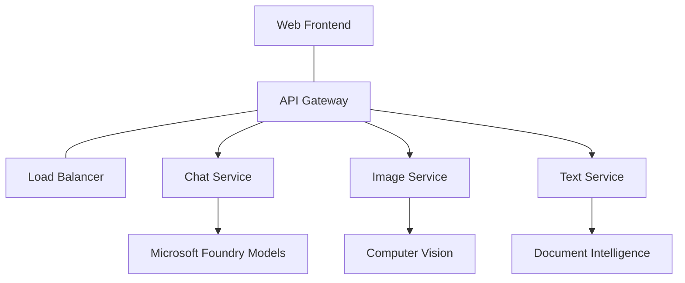

# שיטות עבודה מומלצות לעומסי עבודה של AI בייצור עם AZD

**ניווט בפרק:**
- **📚 דף הבית של הקורס**: [AZD למתחילים](../../README.md)
- **📖 פרק נוכחי**: פרק 8 - דפוסי ייצור וארגוניים
- **⬅️ פרק קודם**: [פרק 7: פתרון בעיות](../chapter-07-troubleshooting/debugging.md)
- **⬅️ גם קשור**: [סדנת AI במעבדה](../chapter-02-ai-development/ai-workshop-lab.md)
- **🎯 סיום הקורס**: [AZD למתחילים](../../README.md)

## סקירה כללית

מדריך זה מסביר דפוסי עיצוב AI לייצור באמצעות Azure Developer CLI (AZD). זוהי הפניה לעיצוב, לא יישום ניתן לפריסה או הסמכה לייצור.

**גבולות דוגמה:** אלא אם כן נכתב במפורש כמלא, קטעי Bicep מניחים פרמטרים ומשאבים מוזכרים מתבנית כוללת. הם מדלגים על תמונות/תכניות מארחים, זהויות, הקצאות תפקידים, DNS, פלטים ואינטגרציה נדרשת נוספת. נתיבי שירות YAML וסקריפטים של hooks/tests הם קבצים לדוגמה ליצירה ב**היישום שלך עצמו**; הם אינם מסופקים בקורס זה. השתמש בדוגמת AZD עובדת כבסיס, קומפל את התשתית המלאה, ובדוק בסביבה מבודדת לפני הייצור.

## אתגרים מרכזיים המטופלים

דאגות נפוצות בייצור כוללות פריסות מרובות שירותים, ניהול זהויות וסודות, סקיילינג, בקרות עלויות ומוניטורינג. לא נטען כאן שיעור שכיחות מדוד.

## דפוסי ארכיטקטורה ל-AI בייצור

### דפוס 1: ארכיטקטורת מיקרו-שירותים ל-AI

**מתי להשתמש**: יישומים מורכבים של AI עם יכולות מרובות



**יישום ב-AZD**:

```yaml
# azure.yaml
name: enterprise-ai-platform
services:
  web:
    project: ./web
    host: staticwebapp
  api-gateway:
    project: ./api-gateway
    host: containerapp
  chat-service:
    project: ./services/chat
    host: containerapp
  vision-service:
    project: ./services/vision
    host: containerapp
  text-service:
    project: ./services/text
    host: containerapp
```

### דפוס 2: עיבוד AI מונחה אירועים

**מתי להשתמש**: עיבוד אצווה, ניתוח מסמכים, זרימות עבודה אסינכרוניות

```bicep
// Event Hub for AI processing pipeline
resource eventHub 'Microsoft.EventHub/namespaces@2024-01-01' = {
  name: eventHubNamespaceName
  location: location
  sku: {
    name: 'Standard'
    tier: 'Standard'
    capacity: 1
  }
}

// Service Bus for reliable message processing
resource serviceBus 'Microsoft.ServiceBus/namespaces@2024-01-01' = {
  name: serviceBusNamespaceName
  location: location
  sku: {
    name: 'Premium'
    tier: 'Premium'
    capacity: 1
  }
}

// Function App for processing
resource functionApp 'Microsoft.Web/sites@2023-01-01' = {
  name: functionAppName
  location: location
  kind: 'functionapp,linux'
  properties: {
    siteConfig: {
      appSettings: [
        {
          name: 'FUNCTIONS_EXTENSION_VERSION'
          value: '~4'
        }
        {
          name: 'AZURE_OPENAI_ENDPOINT'
          value: '@Microsoft.KeyVault(VaultName=${keyVault.name};SecretName=openai-endpoint)'
        }
      ]
    }
  }
}
```

הדבר יוצר קטעי מרחב שמות, לא hubs, תורים, מנויים או טריגרים של פונקציות. פונקציה שניתנת להרצה גם צריכה תכנית אירוח, קונפיגורציית ריצה/אחסון, זהות מצורפת, RBAC וגישה לרשת. הפניה ל-Key Vault דורשת הרשאה לקריאת הסוד; כתובת URL של נקודת קצה בפני עצמה אינה אישור.

## חשיבה על בריאות סוכן ה-AI

כאשר אפליקציית ווב מסורתית נשברת, הסימפטומים מוכרים: העמוד לא נטען, API מחזיר שגיאה, או פריסה נכשלת. יישומים מבוססי AI עלולים להיכשל בכל אותן דרכים — אבל גם להראות התנהגויות מתוחכמות יותר שאינן מייצרות הודעות שגיאה ברורות.

סעיף זה עוזר לך לבנות מודל מנטלי למעקב אחרי עומסי העבודה של AI כדי שתדע היכן להסתכל כשדברים לא נראים כשורה.

### איך בריאות הסוכן שונה מבריאות אפליקציה מסורתית

גם לאפליקציות מסורתיות יכולים להיות כשלים עדינים בייציבות. סוכן AI מוסיף איכות תגובה לא ודאית לדאגות הרגילות של זמינות ותקינות. חשוב את בריאות הסוכן בשתי שכבות:

| שכבה | מה לצפות | איפה להסתכל |
|-------|--------------|---------------|
| **בריאות התשתית** | האם השירות פועל? האם משאבים מוכנים? האם נקודות הקצה נגישות? | `azd monitor`, בריאות משאב בפורטל Azure, יומני מכולות/אפליקציות |
| **בריאות התנהגותית** | האם הסוכן מגיב בדיוק? האם התגובות בזמן? האם הקריאה למודל נכונה? | עקבות ב-Application Insights, מדדי השהיית קריאות למודל, יומני איכות תגובה |

בריאות תשתית מוכרת — זהה לכל אפליקציית azd. בריאות התנהגותית היא השכבה החדשה שעמסי AI מציגים.

### איפה להסתכל כשיישומי AI לא מתנהגים כמצופה

אם היישום AI שלך אינו מייצר את התוצאות המצופות, הנה רשימת בדיקה רעיונית:

1. **התחל מהבסיסים.** האם האפליקציה פועלת? האם היא מגיעה לתלויות שלה? בדוק את `azd monitor` ובריאות המשאבים כפי שהיית עושה בכל אפליקציה.
2. **בדוק את חיבור המודל.** האם היישום שלך מצליח לקרוא למודל ה-AI? קריאות למודל שנכשלו או תמו בזמן הן גורם שכיח ביותר לבעיות יישום AI ויופיעו ביומני האפליקציה.
3. **בדוק קלט וקרקע בצורה בטוחה.** תשובות שגויות יכולות לנבוע משליפה, הוראות, הגבלות מודל, או ביצוע כלים. השתמש בנתוני אבחון עם בקרת גישה ומחוקים; אל תאפשר רישום בלתי מבוקר של הפקודות/תגובות בייצור.
4. **סקור השהיית תגובה.** קריאות למודל AI איטיות יותר מקריאות API טיפוסיות. אם האפליקציה שלך נראית איטית, בדוק אם זמני תגובת המודל עלו — זה יכול להצביע על חריגה, מגבלות קיבולת, או עומס ברמת האזור.
5. **עקוב אחרי אותות עלויות.** קפיצות בלתי צפויות בשימוש בטוקנים או בקריאות API יכולות להעיד על לולאה, פרומפט שגוי או ניסיונות חוזרים מופרזים.

אין צורך לשלוט בכלי התצפית מיד. המסקנה המרכזית היא שליישומי AI יש שכבה נוספת של התנהגות לניטור, ומוניטורינג המובנה של azd (`azd monitor`) נותן נקודת התחלה לבדיקה של שתי השכבות.

---

## שיטות עבודה מומלצות לאבטחה

### 1. מודל אבטחת Zero-Trust

**אסטרטגיית יישום**:
- אין תקשורת שירות לשירות ללא אימות
- כל קריאות ה-API משתמשות בזהויות מנוהלות
- בידוד רשת עם נקודות קצה פרטיות
- בקרות גישה לפי הרשאות מינימליות

```bicep
// Managed Identity for each service
resource chatServiceIdentity 'Microsoft.ManagedIdentity/userAssignedIdentities@2023-01-31' = {
  name: 'chat-service-identity'
  location: location
}

// Role assignments with minimal permissions
resource openAIUserRole 'Microsoft.Authorization/roleAssignments@2022-04-01' = {
  scope: openAIAccount
  name: guid(openAIAccount.id, chatServiceIdentity.id, '5e0bd9bd-7b93-4f28-af87-19fc36ad61bd')
  properties: {
    roleDefinitionId: subscriptionResourceId('Microsoft.Authorization/roleDefinitions', '5e0bd9bd-7b93-4f28-af87-19fc36ad61bd')
    principalId: chatServiceIdentity.properties.principalId
    principalType: 'ServicePrincipal'
  }
}
```

### 2. ניהול סודות מאובטח

**דפוס אינטגרציה עם Key Vault**:

```bicep
// Key Vault with proper access policies
resource keyVault 'Microsoft.KeyVault/vaults@2023-02-01' = {
  name: keyVaultName
  location: location
  properties: {
    tenantId: tenant().tenantId
    sku: {
      family: 'A'
      name: 'standard' // Premium is needed for HSM-backed keys, not ordinary secrets
    }
    enableRbacAuthorization: true  // Use RBAC instead of access policies
    enablePurgeProtection: true    // Prevent accidental deletion
    enableSoftDelete: true
    softDeleteRetentionInDays: 90
  }
}

// Optional legacy key-auth alternative; omit when using Entra ID.
resource openAIKeySecret 'Microsoft.KeyVault/vaults/secrets@2023-02-01' = {
  parent: keyVault
  name: 'openai-api-key'
  properties: {
    value: openAIAccount.listKeys().key1
    attributes: {
      enabled: true
    }
  }
}
```

הקצה זהות ריצה `Key Vault Secrets User` בהיקף המתאים וצורף אותה למארח; `enableRbacAuthorization` לבדו אינו מקנה גישה. העדף אימות באמצעות זהות מנוהלת של OpenAI עם `disableLocalAuth: true`. הסוד האופציונלי למפתח הגיוני רק עבור חשבון עם מפתח מופעל בכוונה, והעיקרון להקצאה זקוק גם להרשאה לכתיבת סודות.

### 3. אבטחת רשת

**קונפיגורציית נקודת קצה פרטית**:

```bicep
// Virtual Network for AI services
resource virtualNetwork 'Microsoft.Network/virtualNetworks@2023-04-01' = {
  name: vnetName
  location: location
  properties: {
    addressSpace: {
      addressPrefixes: ['10.0.0.0/16']
    }
    subnets: [
      {
        name: 'ai-services-subnet'
        properties: {
          addressPrefix: '10.0.1.0/24'
          privateEndpointNetworkPolicies: 'Disabled'
        }
      }
      {
        name: 'app-services-subnet'
        properties: {
          addressPrefix: '10.0.2.0/24'
          delegations: [
            {
              name: 'Microsoft.Web/serverFarms'
              properties: {
                serviceName: 'Microsoft.Web/serverFarms'
              }
            }
          ]
        }
      }
    ]
  }
}

// Private endpoints for all AI services
resource openAIPrivateEndpoint 'Microsoft.Network/privateEndpoints@2023-04-01' = {
  name: '${openAIAccountName}-pe'
  location: location
  properties: {
    subnet: {
      id: virtualNetwork.properties.subnets[0].id
    }
    privateLinkServiceConnections: [
      {
        name: 'openai-connection'
        properties: {
          privateLinkServiceId: openAIAccount.id
          groupIds: ['account']
        }
      }
    ]
  }
}
```

נקודות קצה פרטיות דורשות גם קבוצות אזורי DNS פרטיים/קישורי VNet ואינטגרציה עם VNet באפליקציה. הן אינן חוסמות גישה ציבורית אוטומטית: יש לבטל במפורש את גישת הרשת הציבורית של חשבון ה-AI לאחר אימות קישוריות פרטית וגישת פריסה.

## ביצועים וסקיילינג

### 1. אסטרטגיות סקלינג אוטומטי

**סקלינג אוטומטי של Container Apps**:

```bicep
resource containerApp 'Microsoft.App/containerApps@2023-05-01' = {
  name: containerAppName
  location: location
  properties: {
    configuration: {
      ingress: {
        external: true
        targetPort: 8000
        transport: 'http'
      }
    }
    template: {
      scale: {
        minReplicas: 2  // Always have 2 instances minimum
        maxReplicas: 50 // Scale up to 50 for high load
        rules: [
          {
            name: 'http-scaling'
            http: {
              metadata: {
                concurrentRequests: '20'  // Scale when >20 concurrent requests
              }
            }
          }
          {
            name: 'cpu-scaling'
            custom: {
              type: 'cpu'
              metadata: {
                type: 'Utilization'
                value: '70'  // Scale when CPU >70%
              }
            }
          }
        ]
      }
    }
  }
}
```

### 2. אסטרטגיות מטמון

**מטמון Redis לתגובות AI**:

```bicep
// Legacy Azure Cache for Redis example (not recommended for new deployments)
resource redisCache 'Microsoft.Cache/redis@2023-04-01' = {
  name: redisCacheName
  location: location
  properties: {
    sku: {
      name: 'Premium'
      family: 'P'
      capacity: 1
    }
    enableNonSslPort: false
    minimumTlsVersion: '1.2'
    redisConfiguration: {
      'maxmemory-policy': 'allkeys-lru'
    }
    // Sharding distributes data; replication/failover provides availability.
    shardCount: 2
  }
}

// Cache configuration in application
var cacheConnectionString = '${redisCache.properties.hostName}:6380,password=${redisCache.listKeys().primaryKey},ssl=True,abortConnect=False'
```

Azure Cache for Redis Basic/Standard/Premium נמצא על [דרך הפרישה](https://learn.microsoft.com/azure/azure-cache-for-redis/retirement-faq). השתמש ב-Azure Managed Redis לעיצובים חדשים וב-SKU המתועד שלו, זהות, וקונפיגורציית TLS, במקום להעתיק משאב ישן זה למערכת ייצור חדשה. שורת מחרוזת החיבור היא מציין מקום ללא פונקציונליות, לא אישור. חלק מפתחות המטמון לפי הרשאות, מודל/הוראות, וגירסת שליפה, עם תוקף; מטמון משותף לקריאה בלבד יכול לגלות מידע של משתמש אחר.

### 3. איזון עומסים וניהול תעבורה

**שער אפליקציות עם WAF**:

```bicep
// Application Gateway with Web Application Firewall
resource applicationGateway 'Microsoft.Network/applicationGateways@2023-04-01' = {
  name: appGatewayName
  location: location
  properties: {
    sku: {
      name: 'WAF_v2'
      tier: 'WAF_v2'
      capacity: 2
    }
    webApplicationFirewallConfiguration: {
      enabled: true
      firewallMode: 'Prevention'
      ruleSetType: 'OWASP'
      ruleSetVersion: '3.2'
    }
    // Backend pools for AI services
    backendAddressPools: [
      {
        name: 'ai-services-pool'
        properties: {
          backendAddresses: [
            {
              fqdn: '${containerApp.properties.configuration.ingress.fqdn}'
            }
          ]
        }
      }
    ]
  }
}
```

זהו משאב שער חלקי: פריסה אמיתית דורשת גם תת-רשת של השער/קונפיגורציית IP, IP ופורט מקדמי, מאזיני/תעודות TLS, הגדרות HTTP אחוריות/בדיקות, כללי ניתוב ועדיפויות, ומדיניות WAF שבדוקה. שם המארח/TLS ו-SNI ואימות חייבים להתאים ל-backend של Container App.

## 💰 אופטימיזציה של עלויות

### 1. מימוני משאבים מותאמים

**קונפיגורציות סביבתיות ספציפיות**:

שמות אלה הם **קלטים לדוגמת תבנית מותאמת**, לא הגדרות AZD אוטומטיות. מיפוי כל אחד ל-`infra/main.parameters.json`/Bicep וקונפיגורציית המארח תחילה. לדוגמה, דוגמת RAG משתמשת ב-`AZURE_SEARCH_SERVICE_SKU` ו-`AZURE_OPENAI_CHATGPT_DEPLOYMENT_CAPACITY`, לא השמות הכלליים למטה. ספק זיכרון Container Apps ביחידה נתמכת כדוגמת `1Gi` במשאב בפועל. החל שינויים בתשתית עם `azd up` או `azd provision`; `azd deploy` לבדו אינו מחיל שינויים בבייספ.

```bash
# Development environment
azd env new development
azd env set AZURE_OPENAI_SKU "S0"
azd env set AZURE_OPENAI_CAPACITY 10
azd env set AZURE_SEARCH_SKU "basic"
azd env set CONTAINER_CPU 0.5
azd env set CONTAINER_MEMORY 1.0

# Production environment  
azd env new production
azd env set AZURE_OPENAI_SKU "S0"
azd env set AZURE_OPENAI_CAPACITY 100
azd env set AZURE_SEARCH_SKU "standard"
azd env set CONTAINER_CPU 2.0
azd env set CONTAINER_MEMORY 4.0
```

### 2. ניטור עלויות ותקציבים

```bicep
// Supply the first day of the current UTC month, e.g. 2026-11-01T00:00:00Z.
param budgetStartDate string

// Cost management and budgets
resource budget 'Microsoft.Consumption/budgets@2024-08-01' = {
  name: 'ai-workload-budget'
  properties: {
    timePeriod: {
      startDate: budgetStartDate
    }
    timeGrain: 'Monthly'
    amount: 2000  // In the billing currency, not necessarily USD
    category: 'Cost'
    notifications: {
      warning: {
        enabled: true
        operator: 'GreaterThan'
        threshold: 80
        contactEmails: [
          'finance@company.com'
          'engineering@company.com'
        ]
        contactRoles: [
          'Owner'
          'Contributor'
        ]
      }
      critical: {
        enabled: true
        operator: 'GreaterThan'
        threshold: 95
        contactEmails: [
          'cto@company.com'
        ]
      }
    }
  }
}
```

החלף את הנמענים בדוגמה ובדוק היקף/הרשאות. התראות התקציב משתמשות בנתוני חיוב עם עיכוב ואינן אוכפות תקרת הוצאה.

### 3. אופטימיזציה של שימוש בטוקנים

**ניהול עלויות OpenAI**:

זוהי רק הערכה מבוססת תווים לתצוגה מקדימה בממשק, **לא** מאמת מגבלת טוקנים של מודל. קוד פרודקשן חייב להשתמש במפענח תואם למודל המפורסם ולחשב הוראות מערכת, סכמות כלים, היסטוריה, ותקציב פלט. דחה הודעת משתמש גדולה מדי במקום לקצוץ בשקט.

```typescript
// Application-level token optimization
class TokenOptimizer {
  private readonly maxTokens = 4000;
  private readonly reserveTokens = 500;
  
  optimizePrompt(userInput: string, context: string): string {
    const availableTokens = this.maxTokens - this.reserveTokens;
    if (this.estimateTokens(userInput) + 8 >= availableTokens) {
      throw new Error("User input exceeds the illustrative prompt budget");
    }
    const estimatedTokens = this.estimateTokens(userInput + context) + 8;
    
    if (estimatedTokens > availableTokens) {
      // Truncate context, not user input
      context = this.truncateContext(context, Math.max(0, availableTokens - this.estimateTokens(userInput) - 8));
    }
    
    return `${context}\n\nUser: ${userInput}`;
  }
  
  private estimateTokens(text: string): number {
    // Rough estimation: 1 token ≈ 4 characters
    return Math.ceil(text.length / 4);
  }

  private truncateContext(text: string, estimatedBudget: number): string {
    return text.slice(0, Math.max(0, estimatedBudget) * 4);
  }
}
```

## ניטור ותצפית

### 1. Application Insights מקיף

```bicep
// Application Insights with advanced features
resource applicationInsights 'Microsoft.Insights/components@2020-02-02' = {
  name: applicationInsightsName
  location: location
  kind: 'web'
  properties: {
    Application_Type: 'web'
    WorkspaceResourceId: logAnalyticsWorkspace.id
    SamplingPercentage: 100  // Ingestion setting; review cost and SDK sampling separately
    DisableIpMasking: false  // Retain IP masking
  }
}

// Custom metrics for AI operations
resource aiMetricAlerts 'Microsoft.Insights/metricAlerts@2018-03-01' = {
  name: 'ai-high-error-rate'
  location: 'global'
  properties: {
    description: 'Alert when failed request count exceeds 10 in five minutes'
    severity: 2
    enabled: true
    scopes: [
      applicationInsights.id
    ]
    evaluationFrequency: 'PT1M'
    windowSize: 'PT5M'
    criteria: {
      'odata.type': 'Microsoft.Azure.Monitor.SingleResourceMultipleMetricCriteria'
      allOf: [
        {
          name: 'high-error-rate'
          metricName: 'requests/failed'
          operator: 'GreaterThan'
          threshold: 10
          timeAggregation: 'Count'
        }
      ]
    }
  }
}
```

### 2. ניטור ייחודי ל-AI

**לוחות מחוונים מותאמים למדדים של AI**:

```json
{
  "dashboard": {
    "name": "AI Application Monitoring",
    "tiles": [
      {
        "name": "OpenAI Request Volume",
        "query": "dependencies | where target contains 'openai' | summarize count() by bin(timestamp, 5m)"
      },
      {
        "name": "AI Response Latency",
        "query": "dependencies | where target contains 'openai' | summarize avg(duration) by bin(timestamp, 5m)"
      },
      {
        "name": "Token Usage",
        "query": "customMetrics | where name == 'openai_tokens_used' | summarize sum(value) by bin(timestamp, 1h)"
      },
      {
        "name": "Cost per Hour",
        "query": "customMetrics | where name == 'openai_cost' | summarize sum(value) by bin(timestamp, 1h)"
      }
    ]
  }
}
```

JSON זה הוא שרטוט מוגדר על ידי היישום, לא סכמת לוח מחוונים ליבוא בפורטל Azure. שאילתות טוקנים/עלויות דורשות שהאפליקציה שלך תפיק בדיוק מדדים מותאמים אלו; הם אינם נוצרים על ידי AZD. התאם מסנני תלות לשמות נקודת הקצה/הטווחים של המודל בפועל.

### 3. בדיקות בריאות וניטור זמינות

```bicep
// Application Insights availability tests
resource availabilityTest 'Microsoft.Insights/webtests@2022-06-15' = {
  name: 'ai-app-availability-test'
  location: location
  tags: {
    'hidden-link:${applicationInsights.id}': 'Resource'
  }
  properties: {
    SyntheticMonitorId: 'ai-app-availability-test'
    Name: 'AI Application Availability Test'
    Description: 'Tests AI application endpoints'
    Enabled: true
    Frequency: 300  // 5 minutes
    Timeout: 120    // 2 minutes
    Kind: 'standard'
    Locations: [
      {
        Id: 'us-east-2-azr'
      }
      {
        Id: 'us-west-2-azr'
      }
    ]
    Request: {
      RequestUrl: 'https://${webApp.properties.defaultHostName}/health'
      HttpVerb: 'GET'
      FollowRedirects: true
      ParseDependentRequests: false
    }
    ValidationRules: {
      ExpectedHttpStatusCode: 200
      SSLCheck: true
      SSLCertRemainingLifetimeCheck: 7
    }
  }
}
```

## שיקום מאסון וזמינות גבוהה

הבדיקה הקודמת מניחה שירות אפליקציה קיים `webApp` ומשאב Application Insights. בדיקות זמינות סטנדרטיות הן חשבוניות ודורשות נקודת קצה נגישה; אפליקציות פרטיות בלבד זקוקות לעיצוב ניטור פרטי מתאים. בדיקות URL ping מיושנות; השתמש ב[בדיקות זמינות סטנדרטיות](https://learn.microsoft.com/azure/azure-monitor/app/availability).

### 1. פריסה מרובת אזורים

```yaml
# azure.yaml - Multi-region configuration
name: ai-app-multiregion
services:
  api-primary:
    project: ./api
    host: containerapp
    env:
      AZURE_REGION: eastus
  api-secondary:
    project: ./api
    host: containerapp
    env:
      AZURE_REGION: westus2
```

```bicep
// Separate App Service topology, not the Container Apps declarations above
resource trafficManager 'Microsoft.Network/trafficManagerProfiles@2022-04-01' = {
  name: trafficManagerProfileName
  location: 'global'
  properties: {
    profileStatus: 'Enabled'
    trafficRoutingMethod: 'Priority'
    dnsConfig: {
      relativeName: trafficManagerProfileName
      ttl: 30
    }
    monitorConfig: {
      protocol: 'HTTPS'
      port: 443
      path: '/health'
      intervalInSeconds: 30
      toleratedNumberOfFailures: 3
      timeoutInSeconds: 10
    }
    endpoints: [
      {
        name: 'primary-endpoint'
        type: 'Microsoft.Network/trafficManagerProfiles/azureEndpoints'
        properties: {
          targetResourceId: primaryAppService.id
          endpointStatus: 'Enabled'
          priority: 1
        }
      }
      {
        name: 'secondary-endpoint'
        type: 'Microsoft.Network/trafficManagerProfiles/azureEndpoints'
        properties: {
          targetResourceId: secondaryAppService.id
          endpointStatus: 'Enabled'
          priority: 2
        }
      }
    ]
  }
}
```

משתני סביבה לא בוחרים מיקומי משאבים. IaC חייב להקצות מארחים אזוריים נפרדים ולחבר כל שירות עם תגים `resourceName` או `azd-service-name`. דוגמת Traffic Manager היא **טופולוגיית שירות אפליקציה נפרדת** (`primaryAppService`/`secondaryAppService`), לא ניתוב להצהרות Container Apps. Container Apps דורש נקודת קצה/כניסה חיצונית מותאמת, ניתוב TLS/שם תחום מותאם, ובדיקות בריאות.

### 2. גיבוי ושליפת נתונים

```bicep
// Backup configuration for critical data
resource backupVault 'Microsoft.DataProtection/backupVaults@2023-05-01' = {
  name: backupVaultName
  location: location
  identity: {
    type: 'SystemAssigned'
  }
  properties: {
    storageSettings: [
      {
        datastoreType: 'VaultStore'
        type: 'LocallyRedundant'
      }
    ]
  }
}

```

הכספת לבדה אינה מגבה כלום. קונפיגורציה של **מדיניות מגובה נתמכת ספציפית לעומס העבודה ודגם גיבוי**, הרשאות מקור, שמירה, ובדיקות שחזור באמצעות [מטריצות תמיכה של Azure Backup](https://learn.microsoft.com/azure/backup/backup-support-matrix). אין מדיניות גיבוי Azure כללית לפריסות מודל Azure OpenAI מנוהלות. שמור הגדרות תשתית/מודל בשליטת מקור; הגן על מסמכים שהועלו, נתוני יישום, ופריטי מידול מחדש באמצעות תכונות הגיבוי/ייצוא הנתמכות של כל שירות גיבוי. הגדר ובדוק RPO/RTO במפורש.

## אינטגרציה עם DevOps ו-CI/CD

### 1. זרימת עבודה ב-GitHub Actions

```yaml
# .github/workflows/deploy-ai-app.yml
name: Deploy AI Application

on:
  push:
    branches: [main]
  pull_request:
    branches: [main]

jobs:
  test:
    runs-on: ubuntu-latest
    steps:
      - uses: actions/checkout@v4
      
      - name: Setup Python
        uses: actions/setup-python@v4
        with:
          python-version: '3.11'
          
      - name: Install dependencies
        run: |
          pip install -r requirements.txt
          pip install pytest
          
      - name: Run tests
        run: pytest tests/
        
      - name: AI Safety Tests
        run: |
          python scripts/test_ai_safety.py
          python scripts/validate_prompts.py

```

זהו **החלק לבדיקה בלבד** בזרימת עבודה ומניח שיצרת `requirements.txt`, `tests/`, ושני הסקריפטים לבטיחות. הוסף את משרות הפריסה/הקצאה המאומתות OIDC מ[הגדרת צינור CI/CD](#cicd-pipeline-configuration), עם `needs: test`, טריגר משיכה/ידני אמין, וסביבות GitHub מוגנות. אל תפרוס קוד בקשות משיכה לא מהימן עם אישורי ענן. מנח רץ חדש ללא סביבת AZD מקומית נבחרת; ספק את קלטי הסביבה/מנוי/מיקום והשתמש ב-`azd auth login`, לא רק ב-`azure/login`.

### 2. אימות תשתית

```bash
# scripts/validate_infrastructure.sh
#!/bin/bash
set -euo pipefail

echo "Validating AI infrastructure deployment..."

# Requires Azure CLI login and the resource group selected explicitly.
: "${AZURE_RESOURCE_GROUP:?Set AZURE_RESOURCE_GROUP}"
: "${AZURE_OPENAI_NAME:?Set AZURE_OPENAI_NAME}"
: "${AZURE_OPENAI_CHAT_DEPLOYMENT:?Set the actual deployment name}"

# A successful empty list is not proof that resources exist.
types=("Microsoft.CognitiveServices/accounts" "Microsoft.Search/searchServices"
       "Microsoft.Storage/storageAccounts" "Microsoft.KeyVault/vaults")
for resource_type in "${types[@]}"; do
    count=$(az resource list --resource-group "$AZURE_RESOURCE_GROUP" \
        --resource-type "$resource_type" --query "length(@)" -o tsv)
    if [[ "$count" -lt 1 ]]; then
        echo "ERROR: No $resource_type found in $AZURE_RESOURCE_GROUP"
        exit 1
    fi
done

# Validate OpenAI model deployments
echo "Validating OpenAI model deployments..."
state=$(az cognitiveservices account deployment show \
  --name "$AZURE_OPENAI_NAME" --resource-group "$AZURE_RESOURCE_GROUP" \
  --deployment-name "$AZURE_OPENAI_CHAT_DEPLOYMENT" \
  --query "properties.provisioningState" -o tsv)
if [[ "$state" != "Succeeded" ]]; then
    echo "ERROR: Required model deployment is not provisioned successfully"
    exit 1
fi

echo "Infrastructure validation completed successfully!"
```

צפוי: יציאה אפסית והודעת השלמה רק כאשר כל סוגי הנתונים הצפויים קיימים ופריסת המודל המוגדרת מוקצה. זוהי בדיקת מלאי/הקצאה, **לא** בריאות משאב, טופולוגיה מדויקת, RBAC, נגישות רשת, או התנהגות מודל. התאם את סוגי הנתונים לציפיות הארכיטקטורה שלך, ואז בצע מבחן מוכנות אפליקציה מאומת.

## רשימת בדיקה למוכנות ייצור

### אבטחה ✅
- [ ] כל השירותים משתמשים בזהויות מנוהלות
- [ ] סודות מאוחסנים ב-Key Vault
- [ ] נקודות קצה פרטיות מוגדרות
- [ ] קבוצות אבטחת רשת מיושמות
- [ ] RBAC עם הרשאת מינימום
- [ ] WAF מופעל בנקודות קצה ציבוריות

### ביצועים ✅
- [ ] סקלינג אוטומטי מוגדר
- [ ] מטמון מושלם
- [ ] הגדרת איזון עומסים
- [ ] CDN לתוכן סטטי
- [ ] חיבור מאגר נתונים משותף
- [ ] אופטימיזציית שימוש בטוקנים

### ניטור ✅
- [ ] Application Insights מוגדר
- [ ] מדדים מותאמים מוגדרים
- [ ] כללי התראה מוגדרים
- [ ] לוח מחוונים נבנה
- [ ] בדיקות בריאות מיושמות
- [ ] מדיניות שמירת יומנים

### אמינות ✅
- [ ] פריסה מרובת אזורים
- [ ] תכנית גיבוי ושחזור
- [ ] שבירות מעגל מיושמות
- [ ] מדיניות ניסיונות חוזרים מוגדרת
- [ ] הידרדרות הדרגתית
- [ ] נקודות בדיקת בריאות

### ניהול עלויות ✅
- [ ] התראות תקציב מוגדרות
- [ ] מימוני משאבים מותאמים
- [ ] הנחות לפיתוח/בדיקה מיושמות
- [ ] רכישת מופעים שמורים
- [ ] לוח מחוונים לניטור עלויות
- [ ] סקירות עלויות סדירות

### תאימות ✅
- [ ] דרישות מיקום נתונים מתקיימות
- [ ] רישום ביקורת מופעל
- [ ] מדיניות תאימות מיושמת
- [ ] קווי בסיס אבטחתיים מיושמים
- [ ] הערכות אבטחה סדירות
- [ ] תכנית תגובה לאירועים

## קריטריוני ביצועים

### יעדי ייצור מדגימים

אלה הם דוגמאות ל-SLO לנהל ולבדוק בעומס, לא מדדי ביצועים מדודים או הבטחות. השהיית תגובה תלויה באורך מודל/פלט; הוצאה חודשית על טוקנים תלויה בתנועה ובמחירים, לא במניין הטוקנים בלבד.

| מדד | יעד | ניטור |
|--------|--------|------------|
| **זמן תגובה** | < 2 שניות | Application Insights |
| **זמינות** | 99.9% | ניטור זמינות |
| **שיעור שגיאות** | < 0.1% | יומני אפליקציה |
| **הוצאה על מודל** | < 500$ לחודש (תקציב לדוגמה) | ניהול עלויות |
| **משתמשים בו-זמנית** | 1000+ | בדיקות עומס |
| **זמן התאוששות** | < שעה אחת | בדיקות התאוששות מאסון |

### בדיקות עומס

להלן סקיצה של ממשק לסקריפט בדיקות עומס **שעליך ליישם**; מאגר זה אינו מספק `scripts/load_test.py`. הגדר את תוכן הבקשות, אימות, עומסי עבודה מייצגים, הטענות אחוזונים לעיכוב/שגיאה, ותקרת הוצאות בכלי בדיקות העומס שבחרת לפני ההפעלה:

```bash
# Load testing script for AI applications
python scripts/load_test.py \
  --endpoint https://your-ai-app.azurewebsites.net \
  --concurrent-users 100 \
  --duration 300 \
  --ramp-up 60
```

## 🤝 שיטות עבודה מומלצות בקהילה

מבוסס על משוב מקהילת Microsoft Foundry Discord:

### המלצות מובילות מהקהילה:

1. **התחל קטן, הרחב בהדרגה**: התחל עם SKUs בסיסיים והרחב בהתאם לשימוש בפועל
2. **נטר הכל**: הקם ניטור מקיף מהיום הראשון
3. **אוטומציה של אבטחה**: השתמש בתשתית כקוד לאבטחה עקבית
4. **בדוק ביסודיות**: כלול בדיקות ספציפיות ל-AI בצנרת שלך
5. **תכנן לעלויות**: נטר את השימוש בטוקנים והגדר התראות תקציב מוקדם

### מלכודות נפוצות להימנע מהן:

- ❌ שכפול מפתחות API בקוד
- ❌ אי הקמת ניטור תקין
- ❌ התעלמות מאופטימיזציית עלויות
- ❌ אי בדיקת תרחישי כשל
- ❌ פריסה ללא בדיקות בריאות

## פקודות והרחבות AZD AI CLI

AZD מכיל סט גדל של פקודות והרחבות ספציפיות ל-AI שמפשטות זרימות עבודה ייצוריות של AI. כלים אלה מגשרים על הפער בין פיתוח מקומי לפריסת ייצור לעומסי עבודה של AI.

> **סקירת שחרור (2026-11-04):** ההנחיות של CLI למטה נבדקו מול הגרסאות שפורסמו של `azd` **1.37.2**, `azure.ai.agents` **1.0.0-beta.23**, ו-`azure.ai.evaluations` **1.0.0-beta.2**. סוכני beta.23 דורשים `azd >= 1.37.0`; הערכות beta.2 דורשות `azd >= 1.33.0`. השתמש לפחות ב-1.37.0 עבור זרימת עבודה משולבת. זו סקירת תיעוד/מקור, לא אימות פריסת Azure בשידור חי.

### הרחבות AZD ל-AI

AZD משתמש במערכת הרחבות להוספת יכולות ספציפיות ל-AI. התקן ונהל הרחבות עם:

```bash
# List all available extensions (including AI)
azd extension list

# Inspect installed extension details
azd version
azd extension show azure.ai.agents

# Install the Foundry agents extension
azd extension install azure.ai.agents

# Install the separate Foundry evaluations extension
azd extension install azure.ai.evaluations

# Install the fine-tuning extension
azd extension install azure.ai.finetune

# Install the custom models extension
azd extension install azure.ai.models

# Upgrade all installed extensions
azd extension upgrade --all
```

**הרחבות AI זמינות:**

| הרחבה | מטרה | מצב |
|-----------|---------|--------|
| `azure.ai.agents` | ניהול שירות סוכני Foundry | תצוגה מקדימה |
| `azure.ai.evaluations` | מערכי נתונים להערכה, מעריכים, קבוצות eval, והפעלות | תצוגה מקדימה |
| `azure.ai.skills` | כישורי סוכן שניתנים לשימוש חוזר | תצוגה מקדימה |
| `azure.ai.connections` | חיבורים ל-Foundry (מקורות נתונים, כלים) | תצוגה מקדימה |
| `azure.ai.finetune` | כיוונון מדויק של דגמים ב-Foundry | תצוגה מקדימה |
| `azure.ai.models` | דגמים מותאמים אישית ב-Foundry | תצוגה מקדימה |
| `azure.coding-agent` | קונפיגורציית סוכן קוד | זמין |

> הרץ `azd extension list --installed` ו-`azd extension show azure.ai.evaluations` כדי לבדוק את הגרסאות המותקנות. שדרג את ה-CLI המרכזי תחילה באמצעות [הוראות התקנה/עדכון](https://learn.microsoft.com/azure/developer/azure-developer-cli/install-azd) (להתקנת Windows winget: `winget upgrade Microsoft.Azd`), ואז הרץ `azd extension upgrade --all`. אין פקודת ליבה `azd upgrade`. סקור שינויים שבורים לפני שדרוג אוטומציה ייצורית; אל תניח ששדרוג הרחבה ישמור על פורמטים ישנים של פקודות או קונפיגורציה.

### שינויים ותיקונים בשחרור האחרון

| שחרור | מה משתנה בקורס זה |
|---------|------------------------------|
| `azd 1.37.0` | מוסיף APIs יציבים לתצוגת פריסה ומתקן עריכות הרחבה שמשנות הגדרות `azure.yaml` שאינן קשורות. |
| `azd 1.37.1` | מתקנים הפצת Ctrl+C בין ההרחבות ומבדילים בין ביטול/זמני סיום לכשלים כלליים. |
| `azd 1.37.2` | משפר אימות מתן משאבים: אזהרות קריטיות כברירת מחדל ל**לא**, כשל ללא אישור בהרצות ללא השגחה, וביטול מדלג על קריאות לאחר מתן משאבים. גם מתקנים ערכי סביבה שלא נפתרו ברשימות מניעת Deployment Stacks כשהתכונה האלפא הזאת מופעלת. |
| סוכנים `beta.22` | מעביר הערכות ל-`azd ai eval`, משנה אופטימיזציה ל-GA v1 API, דורש `toolboxes` ברבים, ומפריד בין managed-harness, voice, ואופציית תצוגה מקדימה ארוכת-טווח. מתקנים בחירת מודל תלויה סביבה ואימות כלי עבודה. |
| סוכנים `beta.23` | חושף `init --harness`; מתקנים פלט תשובות A2A 0.3, דרכי/מודולי סוכן בקשתית לא תקינים בין שכבות תשתית, אבחון זמני הפעלה, ואזהרות RBAC מפתחים שעוד נותרו. |
| הערכות `beta.2` | דורש קונפיגורציית הערכה ב-camelCase, מוסיף כתיבת שיחה סטטית/מדומה ומקורות קבצים מקומיים מפורשים, ומתקן טיפול בזהות/גרסה של מערכי נתונים, ספירות שער איכות, ואבחון הרצות שנכשלו. |

זמני הפעלה של סוכן אינם מהווים הוכחה לכשל בפריסה: בדוק את הגירסה שניסתה ומצבה לפני ניסיון חוזר. אזהרות RBAC מפתחים יכולות להישאר גם כשהמתן משאבים מצליח; פתר את הגישה החסרה לפני הפעלתו כמפתח זה.

מקורות: [שחרורי AZD](https://github.com/Azure/azure-dev/releases), [שחרור סוכנים beta.23](https://github.com/Azure/azure-dev/releases/tag/azd-ext-azure-ai-agents_1.0.0-beta.23), [הגירת סוכנים beta.22](https://github.com/Azure/azure-dev/releases/tag/azd-ext-azure-ai-agents_1.0.0-beta.22), ו-[שחרור הערכות beta.2](https://github.com/Azure/azure-dev/releases/tag/azd-ext-azure-ai-evaluations_1.0.0-beta.2).

**מהן ההרחבות החדשות `skills` ו-`connections`?**

שתי הרחבות תצוגה מקדימה הופיעו לצד כלים לסוכנים ושווה להבין אותן גם כמתחיל:

- **`azure.ai.skills`** — **כישור** הוא יכולת שניתנת לשימוש חוזר (כלי או התנהגות ארוזים) שאתה יכול לצרף לסוכן אחד או יותר במקום לבצע אותה מחדש בכל פעם. חשב על זה כיחידת בנייה משותפת: הגדר כישור "חפש בתיעוד" או "חפש בהזמנה" פעם אחת, ואז השתמש בו על פני סוכנים. זה שומר על עקביות מערכות ריבוי סוכנים (פרק 5) ומונע העתק-הדבק.
- **`azure.ai.connections`** — **חיבור** הוא קישור מנוהל מפרויקט Foundry שלך למשאב חיצוני שהסוכנים שלך צריכים — מקור נתונים (כמו Azure AI Search), נקודת קצה של כלי, או שירות אחר. החיבורים מרכזים *איפה* ו-*איך* הסוכנים ניגשים לנתונים, כך שקרדנציאלים ונקודות קצה נמצאים במקום אחד מָפוק במקום להתפזר בקוד.

אינך זקוק להם כדי לפרוס את הסוכנים הראשונים שלך — הישאר עם `azure.ai.agents` בזמן הלמידה. פנה ל-`skills` כשאתה מוצא עצמך משכפל את אותו כלי בין סוכנים, ול-`connections` כשכמה סוכנים משתפים את אותו מקור נתונים.

### אתחול פרויקטי סוכן עם `azd ai agent init`

הפקודה `azd ai agent init` יוצרת תשתית לפרויקט סוכן Microsoft Foundry. השתמש בתבנית פרויקט עדכנית של `azure.yaml`, לא במניפסט סוכן ישן במפורש:

```bash
# Initialize a new agent project from a local project template
azd ai agent init --template ./templates/support-agent/azure.yaml

# Initialize and target a specific Foundry project
azd ai agent init --template ./templates/support-agent/azure.yaml --project-id <foundry-project-id>

# Adopt the template into a different directory
azd ai agent init --template ./templates/support-agent/azure.yaml --src ./agents/my-agent
```

**דגלים מרכזיים:**

| דגל | תיאור |
|------|-------------|
| `-t, --template` | נתיב או URI נתמך ב-GitHub למסמך פרויקט `azure.yaml` |
| `-p, --project-id` | מזהה פרויקט Microsoft Foundry קיים לסביבת azd שלך |
| `-s, --src` | ספריית מקור לסוכנים שנוצרו, או ספריית יעד לאימוץ פרויקט |
| `--kind` | אתחל סוכן מסוג `hosted`, `prompt`, או תצוגה מקדימה של `prompt-voice` |
| `--harness` | מתקן ביצוע אופציונלי ל-`--kind prompt`; דורש את האופציה שלו לתצוגה מקדימה |
| `-e, --environment` | סביבת azd לשימוש |

`--manifest`/`-m` הוא כינוי מיושן ל-`--template`/`-t`; שינוי שם הדגל אינו ממיר מניפסט ישן למסמך פרויקט עדכני. `--host containerapp` אינו דגל אתחול סוכן עדכני. עבור אפליקציית Container Apps רגילה, השתמש ב-`azd init --template` עם תבנית שמצהירה `host: containerapp`.

עבור פרויקט קיים עם בדיוק שירות `azure.ai.project` אחד, `azd ai agent add support-agent --file ./agents/support-agent.yaml` מוסיף או מעדכן הגדרת סוכן ישירה ללא מתן משאבים או פריסה. פקודות זמן הריצה דוחות מניפסט `agent.yaml`/AgentManifest ישן ומגדירות שירות יונקות `config:`; המרה לשירות `azure.ai.agent` עדכני. כאשר init מדפיס `cd` כשלב הבא, הרץ אותו לפני `azd up`: init אינו משנה את ספריית העבודה שלך במעטפת.

**טיפ לייצור**: השתמש ב-`--project-id` כדי להתחבר ישירות לפרויקט Foundry קיים, לשמור על קוד הסוכן ומשאבי הענן שלך מקושרים מההתחלה.

#### תכונות תצוגה מקדימה אופציונליות

managed harness, voice, ו-invocation ארוך טווח מנוטרלות בנפרד כברירת מחדל. הגדר רק את המתג עבור התכונה שאתה צריך ב-**סביבת תהליך shell/CI**, לא עם `azd env set`:

| תכונה | משתנה סביבת תהליך |
|---------|------------------------------|
| managed harness (`init --kind prompt --harness ...`) | `AZD_ALPHA_ENABLE_AGENTS_MANAGED_HARNESS=true` |
| voice (`init --kind prompt-voice`) | `AZD_ALPHA_ENABLE_AGENTS_VOICE=true` |
| invocation ארוך טווח | `AZD_ALPHA_ENABLE_AGENTS_LONG_RUNNING=true` |

לדוגמה, השתמש ב-`export AZD_ALPHA_ENABLE_AGENTS_MANAGED_HARNESS=true` ב-Bash או `$env:AZD_ALPHA_ENABLE_AGENTS_MANAGED_HARNESS = "true"` ב-PowerShell לפני הרצת הפקודה הרלוונטית. מתג אחד לא מפעיל את האחרים. עיין ב-[README של סוכנים שוחררו](https://github.com/Azure/azure-dev/blob/azd-ext-azure-ai-agents_1.0.0-beta.23/cli/azd/extensions/azure.ai.agents/README.md) לכל המתגים והגבלות התצוגה המקדימה.

### ניהול מחזור חיים של סוכן

השתמש ב-`azure.ai.agents` לבדיקה, בדיקה, אופטימיזציה, ושלילת סוכנים, ובהרחבה הנפרדת `azure.ai.evaluations` למדידת איכות:

```bash
# Invoke a deployed agent and view server response timing
# (total latency and time to first byte)
azd ai agent invoke

# Show the live endpoint configuration before changing it
azd ai agent endpoint show

# Download the deployed source of a code-based hosted agent
# (with SHA-256 verification)
azd ai agent code download

# Delete a hosted agent and all of its versions
# (--force terminates active sessions)
azd ai agent delete --force
```

**מחזור חיים במבט חטוף:**

| שלב | פקודה | שימוש ייצור |
|-------|---------|----------------|
| בדיקה | `azd ai agent invoke` | אמת תגובות ומדוד עיכוב לפני שחרור |
| בדיקה | `azd ai agent endpoint show` | סקור אימות/קונפיגורציית נקודת קצה; גלה שינויים שבורים מוקדם |
| מדידה | `azd ai eval init`, `generate`, `run start` | הגדר, פרוס, ובצע הערכות חוזרות |
| שיפור | `azd ai agent optimize --eval <evaluation-name> --optimize-model <optimizer-deployment>` | השתמש מחדש בהערכה תואמת כדי לאופטם את הסוכן |
| התאזנות | `azd ai agent code download` | שלוף את המקור המדויק שהופץ לביקורת/החזקה |
| השבתה | `azd ai agent delete --force` | השבת סוכן ואת הגירסאות שלו בצורה נקייה |

> אלה פקודות בתצוגה מקדימה ויכולות להשתנות בין שחרורי הרחבה. הרץ `azd ai agent --help` כדי לראות את תת-הפקודות המדויקות בגרסה המותקנת שלך.

`endpoint show` תומך בסוכני hosted, prompt, ו-voice, אך עדכוני נקודות קצה הם רק hosted; סוכני workflow לא נתמכים. הורדת קוד ודוגמת השבתת סוכן hosted למעלה אינם פעולות כלליות לכל סוג סוכן.

#### הגירת הערכה ובדיקות איכות

החל ממס' סוכנים **1.0.0-beta.22 (2026-10-23)**, פקודות legacy `azd ai agent eval` מספקות הדרכה להגרה במקום תהליך הערכה הקודם. אל תעתיק דוגמאות ישנות `eval generate --dataset ...`: הערכה כעת נמצאת תחת **`azd ai eval`**.

בפרויקט סוכן מאותחל, אמת באמצעות `azd auth login`, אשר את הסביבה/פרויקט Foundry הנבחר, והתקן `azure.ai.evaluations`. יש צורך בפריסת מודל שופט לציון מבוסס מודל; יצירה וסימולציית שיחות יכולות לדרוש בחירות מודל נפרדות ולגרור חיובים נוספים.

```bash
# Scaffold evals/ and wire an azure.ai.eval service into azure.yaml
azd ai eval init

# Optionally synthesize a rubric and dataset from the agent
azd ai eval generate

# Review generated files, then register datasets, evaluators, and eval groups
azd up

# Start an evaluation and wait for its results
azd ai eval run start --wait

# Inspect runs and available test-case output
azd ai eval run list
azd ai eval run show <run-id>
azd ai eval run output list <run-id>
```

עקוב אחרי הבחירות האינטראקטיביות והשלבים הבאים שהודפסו במקום להניח שנכסי הנפקה רשומים מראש. קונפיגורציית הערכה נמצאת בדרך כלל ב-`evals/azure.eval.yaml`, מצוינת על ידי שירות `azure.ai.eval` ב-`azure.yaml`. המפתחות הם **camelCase** (`evaluationLevel`, `maxSamples`, `initializationParameters`, `dataMapping`); מפתחות קונפיגורציית snake_case ישנים נדחים. נתיבי קובץ בקונפיגורציה שמצוינת מתייחסים יחסי לקובץ ההפניה, לא לשורש המאגר.

עבור הערכות שיחה, בחר **סטטי** לציון תמלולים שהושלמו ללא קריאה לסוכן, או **סימולציה** ליצירת שיחות ממטבעות תרחיש. סימולציה זקוקה לסוכן יעד, מודל סימולטור, ובחירת מודל שופט נפרדת. עבור פקודות ללא השגחה, ספק את הקלטים שצוינו ב-`azd ai eval init --help` ו-`azd ai eval generate --help`; אל תנח שהמודל ליצירה הוא גם השופט או הסימולטור.

עבור CI, הגדר מדיניות איכות מפורשת באמצעות `azd ai eval run start --help` (`--fail-on`) וטפל ביציאה לא אפסית כמחדל. הרצה שהושלמה אינה בהכרח מעבר איכות אוטומטי. סקור שורות שנכשלו/שבו שגיאה ואבחון; ספירות תוצאות חסרות או לא עקביות אינן הוכחה להצלחה. מערכי נתונים רשומים שומרים על זהות/גרסת שירותם; `--max-samples` לא יכול ליצור תת-קבוצה ממערך נתונים רשום. פרסם מערך נתונים קטן במכוון, או השתמש במקור קובץ מקומי נתמך.

```bash
# Example CI policy: at least 90% of all test cases must pass
azd ai eval run start --wait --fail-on "pass-rate=0.9"
```

שער שיעור מעבר משתמש במקרי מבחן שעברו חלקי סכום מקרי המבחן הכוללים; שורות שנכשלו, שגו, הושמטו, או שלא עברו נספרים נגדה. אל תשלב שער עם `--no-wait`, שמחזיר לפני שהחלטה זמינה.

#### הגירת קונפיגורציית אופטימיזציה

אופטימיזציה משתמשת כעת ב-GA v1 API. לשימוש חוזר בהערכה תואמת **ברמת סיבוב, מבוססת מערך נתונים** מזרימת העבודה החדשה:

```bash
# Replace placeholders with the evaluation name and optimizer model deployment
azd ai agent optimize --eval-config ./evals/azure.eval.yaml --eval <evaluation-name> --optimize-model <optimizer-deployment>
```

`--eval` בוחר הערכה; `--eval-config` בוחר את קובץ התצורה שלה (כולל הגדרות מגובה בקובץ). `--config` במקום זאת מקבל **בקשת API לאופטימיזציה עצמאית** ב-YAML או JSON. אל תעביר סוכן ישן `eval.yaml` או את החדש `azure.eval.yaml` ל-`--config`, ואל תשילב `--config` עם `--eval`/`--eval-config`. הערכות שיחה, מגובות מעקב, או סימולציה אינן ניתנות להחלפה עם קיצור הדרך לאופטימיזציה מגובה במאגר הנתונים; השתמש בפורמט בקשת האופטימיזציה הנתמך עבור תרחישים אלה. עיין במועמדים לפני יישום או פריסה שלהם.

ראה את [הפניה להערכות עבור הגרסה הבוקרת](https://github.com/Azure/azure-dev/blob/azd-ext-azure-ai-evaluations_1.0.0-beta.2/cli/azd/extensions/azure.ai.evaluations/README.md) ואת [מקור הפקודה לאופטימיזציה עבור הגרסה הבוקרת](https://github.com/Azure/azure-dev/blob/azd-ext-azure-ai-agents_1.0.0-beta.23/cli/azd/extensions/azure.ai.agents/internal/cmd/optimize.go) לקבלת אפשרויות מדויקות.

#### תצוגה מקדימה לפריסת סוכן אירוח לקריאה בלבד

עבור סביבת Foundry קיימת עם שירות `azure.ai.agent` מאוחד של `kind: hosted`, השווה את התצורה הנתמכת לפני פריסה:

```bash
azd deploy <service-name> --preview --no-prompt
```

תצוגה מקדימה זו אינה מבצעת פריסה של הסוכן. זוהי לא השוואת תשתית/אבטחה מלאה: סוכני הנחייה/קול/זרימת עבודה, סידורי תצורה מיושנים, וחלק מהגדרות האירוח אינם בתחום שלו. תוצאה של `unknown` איננה אישור לפרוס. אין פקודת `azd ai agent deploy` עצמאית או פקודת סוכן `--dry-run`; השתמש בזרימת העבודה הראשית לפריסה.

### פרוטוקול הקשר מודל (MCP) עם `azd mcp`

AZD כולל תמיכה מובנית בשרת MCP (אלפא), המאפשר סוכני בינה מלאכותית וכלים באינטראקציה עם משאבי Azure שלך באמצעות פרוטוקול סטנדרטי:

```bash
# Start the MCP server for your project
azd mcp start

# Review current Copilot consent rules for tool execution
azd copilot consent list
```

שרת ה-MCP חושף את הקשר הפרויקט של azd שלך—סביבות, שירותים, ומשאבי Azure—לכלי פיתוח מונעי בינה מלאכותית. זה מאפשר:

- **פריסת סיוע בינה מלאכותית**: אפשר לסוכנים לקוד לשאול את מצב הפרויקט שלך וליזום פריסות
- **גילוי משאבים**: כלים של AI יכולים לגלות אילו משאבי Azure הפרויקט משתמש
- **ניהול סביבות**: סוכנים יכולים לעבור בין סביבות פיתוח/הטמעה/ייצור

### יצירת תשתית עם `azd infra generate`

לעומסי עבודה של בינה מלאכותית בייצור, ניתן לייצר ולשנות תשתית כקוד במקום להסתמך על פרוביזיה אוטומטית:

```bash
# Generate supported infrastructure for this project type
azd infra generate
```

התמיכה תלויה בפרויקט/מארח ובספקים המותקנים; זוהי לא פקודה כללית של הנדסה הפוכה למשאבי Azure שרירותיים או הבטחה לייצר גם Bicep וגם Terraform. הפעל את `azd infra generate --help` ובדוק את הפורמט שנוצר. במקומות הנתמכים, כתיבת IaC לדיסק מאפשרת לך:
- לסקור ולבדוק את התשתית לפני פריסה
- להוסיף מדיניות אבטחה מותאמת (כללי רשת, נקודות קצה פרטיות)
- לשלב בתהליכי ביקורת IaC קיימים
- לנהל גרסאות של שינויים בתשתית בנפרד מקוד היישום

### חיבורי מחזור חיים בייצור

חיבורי AZD מאפשרים להזריק לוגיקה מותאמת בכל שלב במחזור חיי הפריסה—חשוב לעומסי עבודה של בינה מלאכותית בייצור:

```yaml
# azure.yaml - Production hooks example
name: ai-production-app
hooks:
  preprovision:
    shell: sh
    run: scripts/validate-quotas.sh    # Check AI model quota before provisioning
  postprovision:
    shell: sh
    run: scripts/verify-networking.sh  # Verify IaC-provisioned private connectivity
  predeploy:
    shell: sh
    run: scripts/run-ai-safety-tests.sh  # Run prompt safety checks
  postdeploy:
    shell: sh
    run: scripts/smoke-test.sh           # Verify agent responses post-deploy
services:
  agent-api:
    project: ./src/agent
    host: containerapp
    hooks:
      predeploy:
        shell: sh
        run: scripts/validate-model-access.sh  # Per-service hook
```

```bash
# Run a specific hook manually during development
azd hooks run predeploy
```

**חיבורים מומלצים לעומסי עבודה בינה מלאכותית בייצור:**

| חיבור | מקרה שימוש |
|------|----------|
| `preprovision` | אימות מכסי מינויים לקיבולת מודל בינה מלאכותית |
| `postprovision` | אימות חיבוריות פרטית ותוצאות משאב דרושות |
| `predeploy` | ביצוע בדיקות בטיחות בינה מלאכותית, אימות תבניות הנחיה |
| `postdeploy` | בדיקה ראשונית של תגובות סוכן, אימות חיבור למודל |

### תצורת צינור CI/CD

השתמש ב-`azd pipeline config` כדי לחבר את הפרויקט שלך ל-GitHub Actions או Azure Pipelines עם אימות Azure מאובטח:

```bash
# Configure CI/CD pipeline (interactive)
azd pipeline config

# Configure with a specific provider
azd pipeline config --provider github
```

פקודה זו:
- יוצרת או מגדירה זהות לצינור; סקור את מרחב התפקידים/הרשאות שנוצר במקום להניח הרשאות מינימליות
- מגדירה אישורי סחר פדרטיבי (ללא סודות מאוחסנים)
- יוצרת או מעדכנת את קובץ הגדרת הצינור שלך
- מגדירה משתני סביבה דרושים במערכת CI/CD שלך

#### שלב אחרי שלב: הצינור הראשון שלך ב-GitHub Actions

הנה התהליך המלא מפרויקט azd עובד לפריסות אוטומטיות בכל לחיצה.

**1. ודא שהפרויקט שלך ב-GitHub**

```bash
git init
git add .
git commit -m "Initial azd project"
gh repo create my-ai-app --private --source=. --push
```

**2. הפעל תצורת צינור**

```bash
azd pipeline config --provider github
```

azd יבצע, באופן אינטראקטיבי:
- ישאל לאיזו מנוי Azure וסביבה לכוון
- ייצור **רישום אפליקציה + שירות פרינסיפל** ל-Entra עבור הצינור
- יגדיר **אישורי סחר פדרטיביים (OIDC)**—כך ש-GitHub יאמת ל-Azure עם אסימון קצר טווח ו**לא יישמרו סודות**
- ידחוף את ה**משתנים** הנדרשים לרפו GitHub שלך (`AZURE_CLIENT_ID`, `AZURE_TENANT_ID`, `AZURE_SUBSCRIPTION_ID`, `AZURE_ENV_NAME`, `AZURE_LOCATION`)

**3. הבן את זרימת העבודה שנוצרה**

עבור תבנית נתמכת, הגדר/סקור את `.github/workflows/azure-dev.yml`. החלקים המרכזיים נראים כך (התבנית חייבת לספק את כלי האפליקציה ופרמטרי הסביבה):

```yaml
# .github/workflows/azure-dev.yml
on:
  push:
    branches: [ main ]
  workflow_dispatch:        # lets you run it manually too

permissions:
  id-token: write           # required for OIDC federated login
  contents: read

jobs:
  build:
    runs-on: ubuntu-latest
    env:
      AZURE_CLIENT_ID: ${{ vars.AZURE_CLIENT_ID }}
      AZURE_TENANT_ID: ${{ vars.AZURE_TENANT_ID }}
      AZURE_SUBSCRIPTION_ID: ${{ vars.AZURE_SUBSCRIPTION_ID }}
      AZURE_ENV_NAME: ${{ vars.AZURE_ENV_NAME }}
      AZURE_LOCATION: ${{ vars.AZURE_LOCATION }}
    steps:
      - uses: actions/checkout@v4
      - name: Install azd
        uses: Azure/setup-azd@v2
      - name: Log in with OIDC
        run: azd auth login --client-id "$AZURE_CLIENT_ID" --federated-credential-provider "github" --tenant-id "$AZURE_TENANT_ID"
      - name: Provision infrastructure
        run: azd provision --no-prompt
      - name: Deploy application
        run: azd deploy --no-prompt
```

**4. אמת שהוא עובד**

```bash
# Push a change to trigger the pipeline
git commit -am "Trigger pipeline" --allow-empty
git push
```

פתח את לשונית **Actions** ברפו GitHub וצפה בזרימת העבודה רצה אוטומטית ב-`azd provision` וב-`azd deploy`.

> **למה אישורי סחר פדרטיביים חשובים:** צינורות ישנים שמרו סוד לקוח ב-GitHub. אישורי סחר פדרטיביים OIDC מבטלים לחלוטין את הסוד הזה—GitHub מבקש אסימון קצר טווח בזמן ריצה, שהוא גם יותר מאובטח וגם לא מצריך סיבוב או דליפה. זה ברירת המחדל ש-`azd pipeline config` מגדיר.

> **סודות לעומת משתנים:** מזהים לא רגישים (`AZURE_CLIENT_ID` וכו׳) נמצאים ב**משתני** הריפוזיטורי. אם האפליקציה שלך באמת זקוקה לסוד בזמן הבנייה, הוסף אותו כ-**סוד** ב-GitHub והפנה אליו עם `${{ secrets.NAME }}`—אבל העדף שימוש ב-Key Vault + זהות מנוהלת בזמן ריצה (ראה [פרק 3](../chapter-03-configuration/authsecurity.md)).

**זרימת עבודה בפיתוח עם קונפיגורציית Pipeline:**

```bash
# 1. Set up production environment
azd env new production
azd env set AZURE_OPENAI_CAPACITY 100

# 2. Configure the pipeline
azd pipeline config --provider github

# 3. Review the generated trigger, provisioning/deployment steps, and approvals
```

#### שלב אחר שלב: Azure DevOps Pipelines

מעדיף Azure DevOps על פני GitHub Actions? azd תומך בו באופן מובנה עם ספק `azdo`. הזרימה כמעט זהה—azd מייצר את קובץ ה-pipeline, יוצר חיבור שירות, ומגדיר אימות.

**1. ודא שיש לך פרויקט ב-Azure DevOps**

אתה צריך ארגון ופרויקט ב-`https://dev.azure.com/<your-org>`. צור Personal Access Token (PAT) עם הרשאות **Build (קריאה והרצה)**, **Code (קריאה וכתיבה)** ו-**Service Connections (קריאה, שאילתה וניהול)**—azd יבקש זאת ממך.

**2. הגדר את ה-pipeline**

```bash
azd pipeline config --provider azdo
```

azd יבצע:
- יבקש את ארגון Azure DevOps והפרויקט שלך
- ייצור (או ישתמש מחדש) ב**חיבור שירות** ל-Azure באמצעות Service Principal
- יגדיר **פדרציית זהות עומס עבודה (OIDC)** כך שלא יאוחסן סוד לקוח
- יגדיר הגדרת pipeline (בדרך כלל `.azdo/pipelines/azure-dev.yml`) מתוך תבנית ה-pipeline של הפרויקט

**3. בדוק את ה-pipeline שנוצר**

השתמש ב-pipeline שנוצר לפרויקט, כולל **חיבור השירות לאזור והשלבים לאימות AZD**. מדריך ההתקנה הרשמי של [Azure Pipelines](https://learn.microsoft.com/azure/developer/azure-developer-cli/pipeline-azure-pipelines) מציג את קטע ההתקנה הבא; זה **התקנה בלבד**, לא זרימת פריסה מורצת עם אימות:

```yaml
# .azdo/pipelines/azure-dev.yml (installer fragment only)
trigger:
  - main

pool:
  vmImage: ubuntu-latest

steps:
  - task: setup-azd@0
    displayName: Install azd
```

התקן את התוסף AZD ל-Azure DevOps אם המשימה הזו אינה זמינה בארגון שלך. אל תעתיק שלבי Shell פשוטים של `azd provision`/`azd deploy` ללא אימות: הגדרת חיבור שירות אינה מתריעה אוטומטית כל תהליך ב-AZD. עקוב אחר התחברות OIDC ותוכן המשימה המורשה שבתבנית שנוצרה, וספק את הסביבה/המנוי/המיקום שנבחרו.

**4. מאיפה מגיעים המשתנים**

azd שומר את ערכי הסביבה (`AZURE_ENV_NAME`, `AZURE_LOCATION`, `AZURE_SUBSCRIPTION_ID`) כ**קבוצת משתנים** ב-Azure DevOps כדי שה-pipeline יוכל לקרוא אותם. ניתן לצפות בהם ולערוך אותם תחת **Pipelines → Library**.

> **אותו יתרון של OIDC כמו ב-GitHub:** ספק `azdo` גם מגדיר פדרציית זהות עומס עבודה כברירת מחדל, כך שלא מאוחסן סוד לקוח בחיבור השירות—Azure DevOps מחליף טוקן קצר מועד בזמן ריצה. העבר `--auth-type client-credentials` רק אם הארגון שלך עדיין לא יכול להשתמש ב-OIDC.

**5. הרץ את זה**

```bash
git commit -am "Add Azure DevOps pipeline" --allow-empty
git push
```

פתח את **Pipelines** ב-Azure DevOps כדי לצפות ב`azd provision` ו-`azd deploy` רצות.

### הוספת רכיבים עם `azd add`

הוסף בהדרגה שירותי Azure לפרויקט קיים:

```bash
# Add a new service component interactively
azd add
```

זה שימושי במיוחד להרחבת יישומי AI פרודקשן—למשל, הוספת שירות חיפוש וקטורי, נקודת סיום של סוכן חדש, או רכיב ניטור לפריסת קיימת.

## משאבים נוספים

- **מסגרת עבודה לאדריכלות נכונה של Azure**: [הנחיות לעומסי עבודה של AI](https://learn.microsoft.com/azure/well-architected/ai/)
- **תיעוד Microsoft Foundry**: [מסמכים רשמיים](https://learn.microsoft.com/azure/ai-studio/)
- **תבניות קהילה**: [דוגמאות Azure](https://github.com/Azure-Samples)
- **קהילת דיסקורד**: [ערוץ #Azure](https://discord.gg/microsoft-azure)
- **כישורי סוכן ל-Azure**: [microsoft/github-copilot-for-azure ב-skills.sh](https://skills.sh/microsoft/github-copilot-for-azure) - כישורי סוכן שימושיים חוזרים ל-Azure AI, Foundry, פריסה, אופטימיזציה לעלויות ואבחון. התקן בעורך שלך:
  ```bash
  npx skills add microsoft/github-copilot-for-azure
  ```

---

**ניווט פרקים:**
- **🏠 דף הבית של הקורס**: [AZD למתחילים](../../README.md)
- **📖 הפרק הנוכחי**: פרק 8 - תבניות ייצור וארגוניות
- **⬅️ הפרק הקודם**: [פרק 7: פתרון בעיות](../chapter-07-troubleshooting/debugging.md)
- **⬅️ גם קשור**: [מעבדת סדנת AI](../chapter-02-ai-development/ai-workshop-lab.md)
- **🎯 הקורס הושלם**: [AZD למתחילים](../../README.md)

**זכור**: עומסי עבודה של AI בייצור דורשים תכנון קפדני, ניטור, ואופטימיזציה מתמשכת. התחיל עם התבניות הללו והתאם אותן לצרכים הספציפיים שלך.

---

<!-- CO-OP TRANSLATOR DISCLAIMER START -->
**כתב ויתור**:
מסמך זה תורגם באמצעות שירות תרגום אוטומטי [Co-op Translator](https://github.com/Azure/co-op-translator). למרות שאנו שואפים לדיוק, יש לקחת בחשבון שתרגומים אוטומטיים עלולים להכיל שגיאות או אי-דיוקים. יש להחשיב את המסמך המקורי בשפתו הטבעית כמקור הסמכות. למידע קריטי מומלץ להשתמש בתרגום מקצועי על ידי מתרגם אדם. אנו לא אחראים לכל אי-הבנה או פירוש שגוי הנובע מהשימוש בתרגום זה.
<!-- CO-OP TRANSLATOR DISCLAIMER END -->